# ① テストを読む

[全体像](README.md) ｜ ① テストを読む ｜ [② 実行して計る](02-measure.md) →

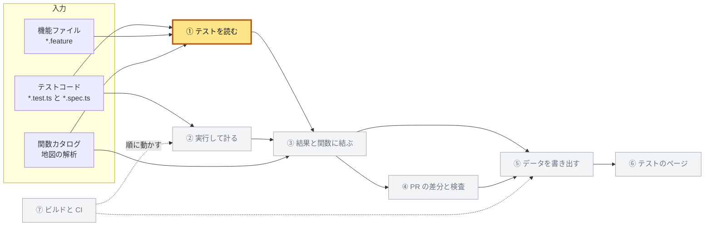

| 項目 | 内容 |
|---|---|
| 入力 | テストコード（`*.test.ts`、`*.spec.ts` など）、機能ファイル（`tests/features/**/*.feature`）、ステップ定義（`tests/steps/**/*.ts`）、訳の表（`tests/steps/ja.yaml`）、観点の表（`tests/catalog/aspects.yaml`）、地図の解析（`Repository` と `MapData`） |
| 出力 | テストケースごとのカード（`TestCase[]`）、読めなかったことの警告、訳の無い言い回し（あわせて `CatalogResult`） |
| 実装 | `packages/test-catalog/src/` の `discover.ts`、`catalog.ts`、`read-code.ts`、`words.ts`、`read-feature.ts`、`vocabulary.ts`、`aspects.ts`、`id.ts`、`lint.ts`。<br>`tests/features/`（機能ファイル）、`tests/steps/`（ステップ定義と `ja.yaml`）、`tests/catalog/aspects.yaml`<br>作る順：[再現の手順](README.md#再現の手順)の [2](README.md#2-機能ファイルとプロセス内の実行先)、[3](README.md#3-カードの読み取り) |

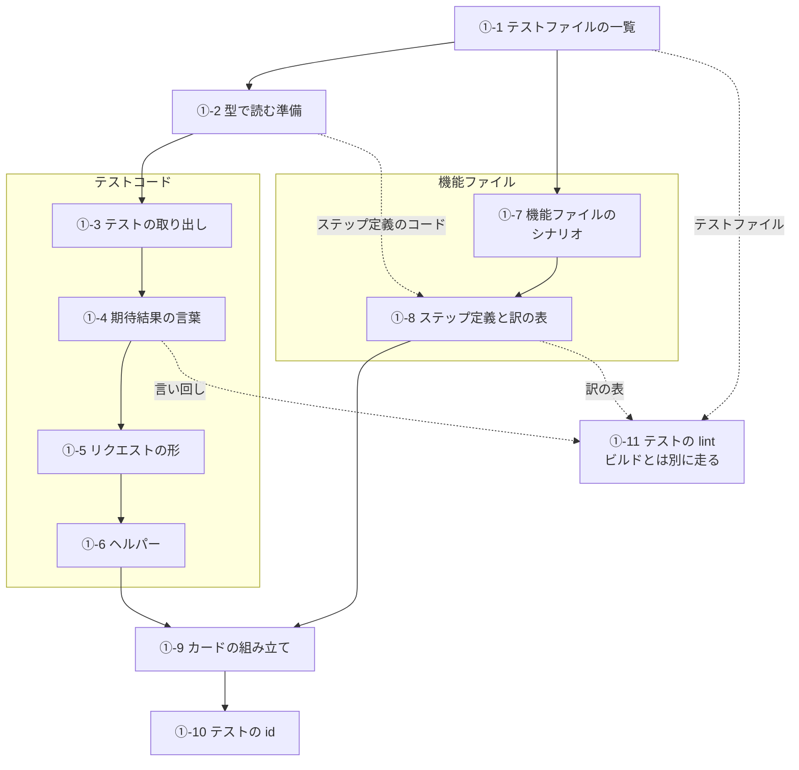

## ①-1 テストファイルの一覧

読むテストファイルと、ヘルパーを探すテスト支援のファイルを、git が知るファイルから決める。

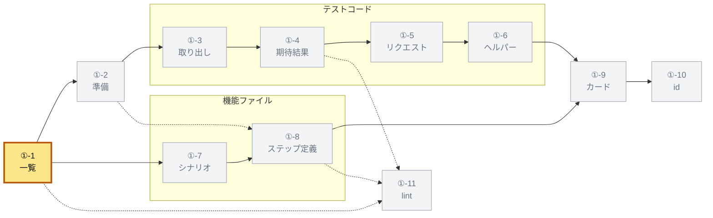

### ①-1-a git が知るファイル

ファイルの一覧は git から取る。

| 読む版 | コマンド | 後の処理 |
|---|---|---|
| 作業ツリー | `git ls-files --cached --others --exclude-standard -z` | 重複を除いて並べ、ディスクに無いパスを除く |
| コミット（④ が使う） | `git ls-tree -r --name-only -z <commit>` | 重複を除いて並べる |

作業ツリーでは、追跡していない新しいファイルも入る。
`git rm` せずに消したファイルは index に残るので、ディスクで確かめて除く。

### ①-1-b テストファイルの分け方

テストのパスは、地図の `isTestPath` が決める。
`/\.(test|spec)\.(c|m)?[jt]sx?$/` に合うか、`.feature` で終わるパスである。

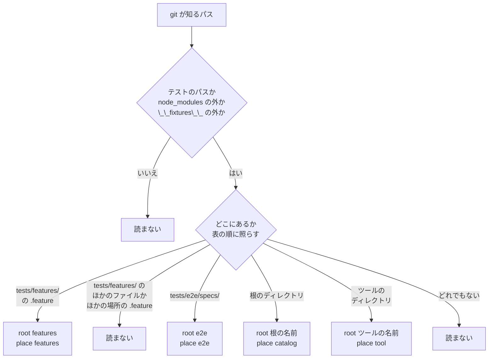

テストファイルは、上の順で最初に当たった規則で決まる。
決まるのは、`root`（テストが属する単位）、形（`form`）、**置き場所**（`place`）である。

| 順 | 条件 | root | form | place |
|---|---|---|---|---|
| 1 | テストのパスでない、または `/node_modules/` か `/__fixtures__/` を含む | 読まない | | |
| 2 | `tests/features/` の下の `.feature` | `features` | `feature` | `features` |
| 3 | `tests/features/` の下のほかのファイル、またはほかの場所の `.feature` | 読まない | | |
| 4 | `tests/e2e/specs/` の下 | `e2e` | `code` | `e2e` |
| 5 | 根のディレクトリの下 | 根の名前 | `code` | `catalog` |
| 6 | ツールのディレクトリの下 | ツールの名前 | `code` | `tool` |
| 7 | どれでもない | 読まない | | |

**根**は、関数カタログを作る解析の単位で、`packages/cli/extract.json` を地図の `readRoots` で読んだものである。
順は、ライブラリ（`libraries`）が先、アプリ（`sources`）が後である。

| 根 | ディレクトリ |
|---|---|
| `core` | `packages/core/src` |
| `experimental` | `packages/experimental/src` |
| `google-login` | `packages/google-login/src` |
| `hono` | `apps/hono/src` |
| `nextjs` | `apps/nextjs/src` |

根のディレクトリの下なら、CLI が抽出しないディレクトリでもその根のテストとする。
`apps/hono/src/app.test.ts` は `hono` のテストである。
置き場所が `catalog` のテストには、根のディレクトリからのパスを `module` として持たせる。

ツールのディレクトリは `TOOL_ROOTS` で、前から順に照らす。

| ディレクトリ | root |
|---|---|
| `packages/cli/` | `cli` |
| `packages/map-analysis/` | `map-analysis` |
| `packages/test-catalog/` | `test-catalog` |
| `packages/test-reach/` | `test-reach` |
| `apps/map/` | `map` |
| `apps/tests/` | `tests-viewer` |
| `.github/scripts/` | `scripts` |
| `scripts/` | `scripts` |

決まり方の例である（`repository.test.ts` の期待値）。

| パス | root | place | module |
|---|---|---|---|
| `packages/core/src/client-auth.test.ts` | `core` | `catalog` | `client-auth.test.ts` |
| `apps/hono/src/oidc-provider/endpoints/token/pipeline.test.ts` | `hono` | `catalog` | `oidc-provider/endpoints/token/pipeline.test.ts` |
| `tests/e2e/specs/auth-code-flow.spec.ts` | `e2e` | `e2e` | なし |
| `tests/features/token/client-authentication.feature` | `features` | `features` | なし |
| `packages/cli/src/__tests__/cli.test.ts` | `cli` | `tool` | なし |
| `.github/scripts/verify-ci-gate.test.mjs` | `scripts` | `tool` | なし |
| `tests/conformance/run.test.mjs` | 読まない | | |
| `packages/core/src/client-auth.ts` | 読まない（テストでない） | | |

OpenID Conformance Suite（`tests/conformance`）は Docker で走る別の検査なので、カタログに入れない。
`tests/e2e/reach/lcov.test.mjs` も、どの規則にも当たらないので読まない。
例：このリポジトリでは 466 ファイルが当たる。

```ts
interface TestFile {
  path: string; // リポジトリのルートからのパス
  root: string;
  module?: string; // place が catalog のときだけ
  form: 'code' | 'feature';
  place: 'catalog' | 'e2e' | 'features' | 'tool';
}
```

### ①-1-c テスト支援のファイル

**テスト支援のファイル**は、テストが呼ぶ補助の関数を置くファイルである。
[①-6](#-6-ヘルパー) は、この中に宣言された関数だけを、ほかのファイルのヘルパーとして認める。
[①-3-d](#-3-d-describe-が名指す関数とコード)（製品のコードの判定）と [①-5-g](#-5-g-iteach-の表)（表の定数）も、この判定を使う。

`isTestSupportPath(path)` は次の順で決める。

| 順 | 条件 | 結果 |
|---|---|---|
| 1 | `node_modules/` を含む、または `/\.d\.[cm]?ts$/` に合う | 偽 |
| 2 | `tests/` で始まる | 真 |
| 3 | `test-support/`、`__tests__/`、`__fixtures__/`、`__mocks__/` のディレクトリの下 | 真 |
| 4 | ファイル名が `test-helpers`、`test-utils`、`fixture`、`fixtures` に拡張子 `.[cm]?[jt]sx?` | 真 |
| 5 | テストのパス | 真 |
| 6 | それ以外 | 偽 |

ツールが自分で検査するモジュールや、カタログの外のアプリのコードは偽である。
それらのテストが呼ぶのは検査する関数であって、ヘルパーではないからである。

`supportFiles(paths)` は、次の四つをすべて満たすパスを選ぶ。
[①-2](#-2-型で読む準備) の別のプロジェクトが、このファイルを読む。

- 拡張子が `/\.[cm]?[jt]sx?$/` に合う
- テストのパスでない
- `tests/conformance/` の下でない
- `isTestSupportPath` が真

`repository.test.ts` の期待値から例を挙げる。

| パス | `isTestSupportPath` | 当たる規則 |
|---|---|---|
| `tests/e2e/fixtures.ts` | 真 | 2 |
| `apps/hono/src/test-support/context.ts` | 真 | 3 |
| `packages/map-analysis/src/__tests__/helpers.ts` | 真 | 3 |
| `packages/experimental/src/ciba/test-helpers.ts` | 真 | 4 |
| `apps/tests/src/lib/fixture.ts` | 真 | 4 |
| `packages/core/src/client-auth.test.ts` | 真 | 5 |
| `packages/core/src/client-auth.ts` | 偽 | 6 |
| `tests/e2e/types.d.ts` | 偽 | 1 |

実装：

- `packages/test-catalog/src/discover.ts`：`listFiles`、`testFileOf`、`testFiles`、`TOOL_ROOTS`、`isTestSupportPath`、`supportFiles`
- `packages/map-analysis/src/roots.ts`：`isTestPath`、`readRoots`

## ①-2 型で読む準備

テストコードを地図と同じコンパイラで開き、名前から関数カタログの id とヘルパーの宣言を引けるようにする。

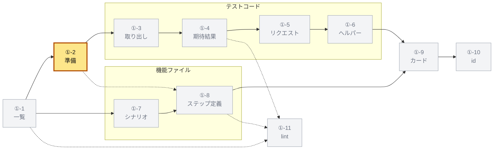

### ①-2-a 入力と地図から使うもの

この章の読み取りは、`readCatalog(input)` 一つである。
呼ぶのは ⑤ の `buildTests`、④ の `readBaseCatalog` と `draftTests` である。

```ts
interface CatalogInput {
  repository: Repository; // 地図の解析（下の表）
  data: MapData;
  files: TestFile[]; // ①-1
  read: (path: string) => string; // 機能ファイルの本文を読む
  overlay?: Overlay; // ④ の分岐点の版
  aspects: AspectTable; // ①-9-d
  vocabulary: Vocabulary; // ①-8-a
  translations: Translations; // ①-8-d
  supportFiles?: string[]; // ①-1-c
}
```

`buildTests` は、作業ツリーの `listFiles` から `testFiles` と `supportFiles`（[①-1](#-1-テストファイルの一覧)）で `files` と `supportFiles` を作る。
`aspects`、`vocabulary`、`translations` は `readTables` が読む（`readAspects`、`Vocabulary.read`、`Translations.read`）。

地図の解析は入力であり、この章はその一部だけを使う。

| 使うもの | 中身 | 使う節 |
|---|---|---|
| `Repository.repository` | リポジトリの絶対パス | 全体 |
| `Repository.roots` | 根の一覧（`AnalysisRoot`：`name`、`directory`、`include`、`exclude`、`project`、`library`） | [①-1](#-1-テストファイルの一覧)、[①-2](#-2-型で読む準備) |
| `Repository.cli.catalog` | 関数カタログ（id → `{ id, name, package, module, ... }`） | [①-2](#-2-型で読む準備)、[①-9](#-9-カードの組み立て) |
| `Repository.cli.specReferencesOf` | 文から仕様の節を取る関数 | [①-3](#-3-テストの取り出し) |
| `MapData.flows[framework].endpoints[]` | エンドポイントの `id`、`path`、`methods`、`module` | [①-2-d](#-2-d-エンドポイントの索引) |
| `catalogModules`、`overlayConfigs`、`overlayOf` | 根ごとに重ねる tsconfig | [①-2-b](#-2-b-二種類のプロジェクト) |
| `Compiler` | TypeScript 7 の API（`typescript/unstable/sync`）の窓口 | [①-2-b](#-2-b-二種類のプロジェクト) |
| `Resolver.reference(name)` | 名前が指す関数カタログの関数 | [①-3](#-3-テストの取り出し) から [①-6](#-6-ヘルパー) |

id の形は、全体像の「[地図から使うもの](README.md#地図から使うもの)」の表のとおりである。

`Resolver` は、根のプロジェクト（[①-2-b](#-2-b-二種類のプロジェクト)）ごとに一つ作る。

```ts
new Resolver(project, {
  repository: repo.repository,
  roots: repo.roots,
  isFunction: (id) => repo.cli.catalog[id] !== undefined,
  paragraph: (text) => text, // JSDoc の要約。この章は使わない
});
```

`Resolver.reference(name)` は、名前の節点を次の順で引く。

1. 名前の記号を取り、import と再エクスポートの別名をたどる
2. 記号の `function` の宣言が根のモジュールにあれば、id を作る（`default` は宣言の名前）
3. その id がカタログにあれば `{ kind: 'function', id }`
4. 根のモジュールの interface、型、クラスのメンバーなら `{ kind: 'member', id }`（`importTarget` は使わない）
5. `const a = b` か `const a = x.b` の変数なら、右の名前を同じ手順で引く（同じ記号は二度引かない）
6. どれでもなければ `undefined`

根のモジュールは、根のディレクトリの下の `.ts` か `.tsx`（`.d.ts` でない）である。
さらに、`include` に入り、`exclude` に合わないものに限る（地図の `moduleOf`）。
だから `test-helpers.ts`（`exclude` が除く）の関数と、アロー関数を入れた `const` は、関数カタログの関数にならない。

### ①-2-b 二種類のプロジェクト

テストファイルは、置き場所でどちらのプロジェクトで開くかが決まる。

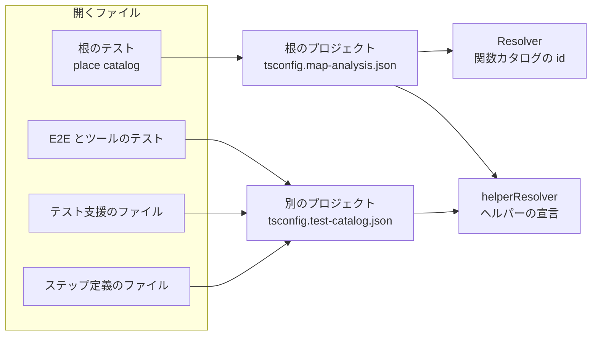

| プロジェクト | 設定のファイル（仮想） | `files` | Resolver |
|---|---|---|---|
| 根のプロジェクト | 根の `project` のディレクトリの `tsconfig.map-analysis.json` | 関数カタログのモジュールと、その根のテストファイル | あり |
| 別のプロジェクト | リポジトリ直下の `tsconfig.test-catalog.json` | E2E とツールのテスト、テスト支援のファイル、ステップ定義のファイル | なし |

根のプロジェクトの設定は、地図の `overlayConfigs` が作る。

- `extends: './tsconfig.json'` で、そのディレクトリの設定を受け継ぐ
- `compilerOptions.paths` が、ライブラリのパッケージ名（とサブパス）をソースに向ける
- `files` に、`catalogModules` が返すモジュールと、[①-1](#-1-テストファイルの一覧) の `module` を並べる

多くの tsconfig はテストを除くので、テストを `files` に足して読めるようにする。
根のプロジェクトでは、テスト支援のファイルは import から届く。

別のプロジェクトの設定は、次の JSON である。

```json
{
  "compilerOptions": {
    "allowJs": true, "checkJs": false, "noEmit": true, "noResolve": true, "skipLibCheck": true,
    "target": "es2022", "module": "esnext", "moduleResolution": "bundler", "types": []
  },
  "files": ["./tests/e2e/specs/acr-values.spec.ts", "./tests/e2e/fixtures.ts", "./tests/steps/common/response.steps.ts"]
}
```

`files` は例であり、実際は E2E とツールのテスト、`supportFiles`、語彙（[①-8](#-8-ステップ定義と訳の表)）のステップ定義のファイルを、重複なしで並べる。
`noResolve: true` なので、`files` の外への import は解決しない。

どちらの設定も `Compiler` に仮想のファイルとして渡し、ディスクには書かない。
④ が分岐点の版を読むときは、`overlay`（絶対パス → 本文、`null` は無いファイル）がその版の本文を渡す。
読み終えたら `compiler.close()` で閉じる。

### ①-2-c 読み取りに渡す関数

テストコードを読む関数（[①-3](#-3-テストの取り出し) から [①-6](#-6-ヘルパー)）は、次の関数を受け取る（`CodeReadOptions`）。

| 関数 | 根のプロジェクト | 別のプロジェクト |
|---|---|---|
| `importTarget(name)` | `Resolver.reference(name)` が関数なら、その id | いつも `undefined` |
| `constantsOf(nodes)` | `checker.getTypeAtLocation(nodes)` が文字列か数のリテラル型なら、その値 | 空 |
| `helperOf(name)` | `helperResolver`（[①-6-c](#-6-c-型で引くヘルパー)） | 同じ |
| `describedCode(name, file, imported)` | `describedCodeResolver`（[①-3-d](#-3-d-describe-が名指す関数とコード)） | 渡さない |
| `valueOf(name)` | `supportValueResolver`（[①-5-g](#-5-g-iteach-の表)） | 同じ |
| `endpointOfPath(path)` | `EndpointIndex`（[①-2-d](#-2-d-エンドポイントの索引)） | 同じ |
| `endpointOfFunction(id)` | `EndpointIndex` | 同じ |
| `specReferencesOf(text)` | 地図の CLI の関数（[①-2-e](#-2-e-仕様の節)） | 同じ |
| `translate(phrase, holes)` | 訳の表（[①-4-f](#-4-f-日本語)） | 同じ |

`helperOf` は、ヘルパー（[①-6](#-6-ヘルパー)）のほかに、URL を作るテスト支援のファイルの関数を引くのにも使う（[①-5-b](#-5-b-url-の読み方)）。
`describedCode` の答えは API テストだけが使い（[①-9-e](#-9-e-そのほかのフィールド)）、テストコードの API テストは根のテストにしか無い（[①-9-a](#-9-a-種類)）。
そのため、E2E とツールのテストには渡さない。

プロジェクトは設定のファイルごとに一つ作り、使い回す。
`Resolver` と三つの関数（`helperResolver`、`describedCodeResolver`、`supportValueResolver`）も、プロジェクトと一緒に持つ。
型の問い合わせが例外を投げたら、引けないものとして扱う。

### ①-2-d エンドポイントの索引

`EndpointIndex` は、`MapData.flows` の全フレームワークのエンドポイントから作る。
フレームワークは、`MapData.flows` のキーの順（`Object.entries`、地図が書いた順）に見る。
同じフレームワークの中は、エンドポイントの順に見る。
このリポジトリでは、hono、express、fastify、nextjs の順である。

| `Map` | キー → 値 | 決め方 |
|---|---|---|
| `paths` | パス → id | 最初に見たもの |
| `methods` | id → メソッドの一覧 | 最初に見たもの |
| `pathOf` | id → パス | 最初に見たもの |
| `routes` | `app/<module>` → id | nextjs のエンドポイントのうち、`module` が `/(^\|\/)route\.tsx?$/` に合うもの |

`endpointOfPath(path)` は次の順で引く。

1. `paths` にちょうどあれば、その id
2. 無ければ、`/` 以外の既知のパス `p` のうち、`path` が `p + '/'` で始まる最も長い `p` の id
3. どちらも無ければ `undefined`

`endpointOfFunction(id)` は、`/^nextjs:(.+)#[^#]+$/` の一つ目の組を `routes` で引く。
`nextjs:app/token/route.ts#POST` は `token` になる。

### ①-2-e 仕様の節

コメントの仕様の参照は、地図の CLI の `specReferencesOf` が取る。
次の正規表現に合う部分を、正規化して、重複なしで現れた順に返す。

```ts
/(?:OIDC (?:Core|Discovery|Session|Registration|Front-Channel Logout|Back-Channel Logout) 1\.0|OpenID Connect [A-Za-z -]+? 1\.0|RP-Initiated Logout 1\.0|CIBA Core 1\.0|OAuth 2\.[01](?: (?:Multiple Response Type Encoding Practices|Form Post Response Mode|Token Exchange|Device Authorization Grant|Security BCP))?|RFC ?\d{4}|JARM|ID-JAG draft|FAPI [\d.]+)(?:\s*(?:§|Section\s+|Sec\.\s*)\s*\d+(?:\.\d+)*(?:\s*\/\s*(?:§\s*|Section\s+)?\d+(?:\.\d+)*)*)?/g
```

正規化は四つの置き換えである。

- `Section ` と `Sec. ` を `§` にする
- `§` の後の空白を除く
- `/` の前後を空白一つにする
- 空白の連なりを一つにし、前後を除く

`RFC 6749 Section 5.2` は `RFC 6749 §5.2` になる。

### ①-2-f 警告

読めなかったことは、警告の一行にして返す。
警告があっても読み取りは止まらない。

| 場面 | 警告の文 |
|---|---|
| ファイルがプロジェクトのプログラムに無い | `<path>: not in the program of its project; its tests are not in the catalog` |
| 読み取りが例外を投げた | `<path>: could not be read (<message>)` |
| 機能ファイルが Gherkin として読めない | `<path>: does not parse (<message の一行目>)` |
| 同じ id のテストが複数のファイルにある | [①-10-c](#-10-c-重なったとき) |

このリポジトリでは警告は 0 件であり、`repository.test.ts` がそれを確かめる。

実装：

- `packages/test-catalog/src/catalog.ts`：`readCatalog`、`EndpointIndex`、`OTHER_CONFIG`
- `packages/map-analysis/src/roots.ts`：`overlayConfigs`、`overlayOf`
- `packages/map-analysis/src/ts.ts`：`Compiler`
- `packages/map-analysis/src/resolve.ts`：`Resolver.reference`
- `packages/cli/src/extract/functions.ts`：`specReferencesOf`

## ①-3 テストの取り出し

構文木の `describe` と `it` の呼び出しをたどり、テストコードのテストを一つずつ取り出す。

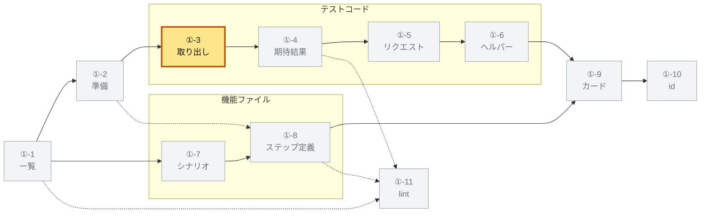

### ①-3-a 文のたどり方

ファイルの文を上から読み、ブロックの中へ入っていく。

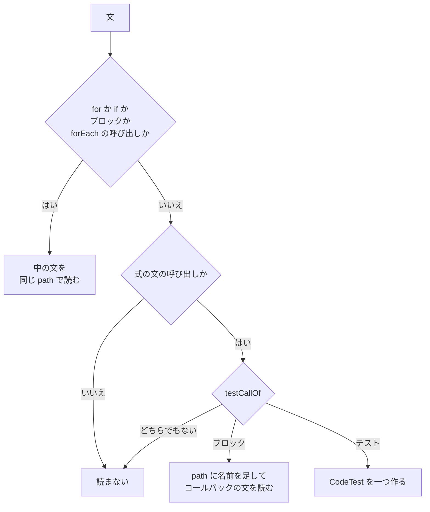

| 文 | 扱い |
|---|---|
| `for`、`for...of`、`for...in` | 本体の文を、同じ `path` の文として読む |
| `if` | then と else の両方を読む |
| ブロック `{ ... }` | 中の文を読む |
| `<x>.forEach(fn)` の式の文 | `fn` の本体の文を読む |
| ほかの式の文で、式が呼び出し | `testCallOf` で分ける |
| それ以外（宣言、`return`、`while`、`try` など） | 読まない |

ループや条件の中のテストも、一つのテストとして一度だけ読む。
`it.each` のテストも一つであり、名前はひな形のまま（`should accept %s`）である。
そのリクエストだけは、表の行ごとに読む（[①-5-g](#-5-g-iteach-の表)）。

### ①-3-b 呼び出しの分け方

`calleeChain` は、呼び出し先を先頭の識別子と、その後ろの名前に分ける。
`describe.skip.each(...)` は `describe` と `[skip, each]` になる。
呼び出し先がさらに呼び出し（`describe.each(table)(name, fn)`）なら、その呼び出し先へ進む。
括弧、`await`、`as`、`!`、`satisfies`、型の表明は外して読む（地図の `unwrap`）。

`testCallOf` は、次の順で分ける。

| 順 | 条件 | 結果 |
|---|---|---|
| 1 | 呼び出し先が識別子、プロパティ、呼び出しの連なりでなく、`calleeChain` が読めない（タグ付きテンプレート ``it.each`…` ``、`test['skip']`） | 対象外（警告もない） |
| 2 | 後ろの名前のどれかが `HOOKS` にある | 対象外 |
| 3 | 先頭が `describe` か `suite`、または先頭が `test` で最初の名前が `describe`（Playwright）。<br>残りの名前がすべて `MODIFIERS` か `SKIPS` | ブロック |
| 4 | 先頭が `it` か `test` で、名前がすべて `MODIFIERS` か `SKIPS` | テスト |
| 5 | それ以外（`it.foo(...)` など） | 対象外 |

| 集合 | 名前 |
|---|---|
| `HOOKS` | `beforeEach` `afterEach` `beforeAll` `afterAll` `use` `step` `info` `setTimeout` `configure` `extend` `expect` |
| `MODIFIERS` | `only` `concurrent` `sequential` `serial` `parallel` `shuffle` `fails` `fail` `slow` `each` `for` `skipIf` `runIf` `extend` `scoped` |
| `SKIPS` | `skip` `todo` `fixme` |

名前に `SKIPS` のどれかがあれば、スキップしたテスト（`skipped`）とする。
スキップしたブロックの中のテストも、すべてスキップである。
`extend` は `HOOKS` が先に効くので、`test.extend(...)` はテストにならない。
`await test.step(...)` も同じ理由でテストにならない。

### ①-3-c 名前と本体

名前は第一引数から取る。

| 第一引数 | 名前 |
|---|---|
| 文字列、または置換の無いテンプレート | その文字列 |
| 置換のあるテンプレート | バッククォートを除いたソース（`loop ${x}`） |
| `fn.name` | `fn` |
| 識別子 | その名前 |
| それ以外 | 式のソース（`'each ' + y`） |

本体は、引数を後ろから見て最初のアロー関数か関数式である。
ブロックの本体が `{ ... }` でなければ、その中にテストは無いものとする。

| フィールド | 値 |
|---|---|
| `lines` | 呼び出しの文の最初の行から最後の行まで（上のコメントは含めない） |
| `body` | 本体の関数のソース（[①-9-e](#-9-e-そのほかのフィールド) の `digest`） |
| `skipped` | [①-3-b](#-3-b-呼び出しの分け方) の規則 |

### ①-3-d describe が名指す関数とコード

`describe` の名前は、トップレベルに関数名を書く約束を前提に読む。
約束を書いた場所は [⑦-10](07-build-ci.md#-10-貢献者の規則) にある。
名前の前後の空白を除き、先頭の識別子 `/^[A-Za-z_$][\w$]*/` を取る。

| describe の名前 | 照らす名前 |
|---|---|
| `parseTokenRequest` | `parseTokenRequest` |
| `parseTokenRequest()` | `parseTokenRequest` |
| `ClientStore.get` | `ClientStore` |
| `validateX with a minimal resolver` | `validateX` |

照らす相手は、そのファイルが import した名前だけである。
`importsOf` は、import 指定子と既定の import の名前を集める（関数の中へは入らない）。
その名前の節点を `importTarget`（[①-2-c](#-2-c-読み取りに渡す関数)）で引き、関数カタログの関数ならその id を得る。
内側の `describe` も同じように引く。

結果は三つの列に残す。

- `described`：引けた関数の id（外側から順に、重複なし）
- `pathIds`：`path` の段ごとに、引けた id か `undefined`（[①-10](#-10-テストの-id) で使う）
- `pathCode`：`path` の段ごとに、名前が指すコードか `undefined`（下。[①-9-e](#-9-e-そのほかのフィールド) で使う）

例：`describe('authenticate')` の中の `describe('Client secret')` のテストは、次のようになる。
`described` は `['lib:auth.ts#authenticate']`、`pathIds` は `['lib:auth.ts#authenticate', undefined]` である。

**名指すコード**は、名前の宣言の範囲で、関数カタログの外のものも入る。
アプリを作る関数やクラス（`createOperatorApp`、`WebRouter`）は、カタログに無いことがあるからである。
`describedCode(name, file, imported)`（`describedCodeResolver`）が、段ごとに次の順で引く。

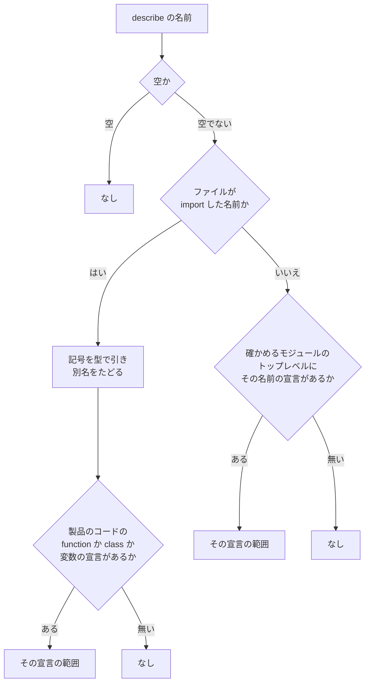

| 言葉 | 決め方 |
|---|---|
| 製品のコード（`isProductCode`） | パスが `/\.[cm]?[jt]sx?$/` に合い、`/\.d\.[cm]?ts$/` に合わず、テスト支援のファイル（[①-1-c](#-1-c-テスト支援のファイル)）でなく、`node_modules/` を含まない |
| 宣言の範囲 | 宣言のファイルのトップレベルに、宣言の名前の宣言（下の `topDeclaration`）があればその範囲。<br>無ければ宣言の文の範囲（変数なら変数の文） |
| 確かめるモジュール | テストのファイルのパスの `/\.(test\|spec)(\.[cm]?[jt]sx?)$/` を `$2` にしたもの（合わなければ探さない）。<br>そのパス、`.ts` を `.tsx` にしたもの、`.tsx` を `.ts` にしたものを順に試し、プロジェクトに無いものと製品のコードでないものを飛ばす |
| `topDeclaration(file, name)` | ファイルの文を上から見て、最初に当たった次のもの。<br>本体のある `function`（範囲は最初のオーバーロードから）、`class`、その名前を宣言する変数の文 |

- 範囲の行は `declarationLines`（[①-6-e](#-6-e-宣言の行)）で決める
- 宣言の名前は、別名で import していても、宣言そのものの名前である
- 答えは節点ごとと記号ごとに覚え、型が例外を投げたらなしとする

```ts
interface CodeRef {
  file: string; // リポジトリのルートからのパス
  lines: [number, number]; // 1 から数え、両端を含む
}
interface NamedCodeRef extends CodeRef {
  name: string; // 宣言の名前（createOperatorApp、WebRouter）
}
```

例（`read-code.test.ts`）：`server.test.ts` は `import { check, Router } from './server'` を持つ。

| describe | 名指すコード | 理由 |
|---|---|---|
| `Router` | `{ name: 'Router', file: 'src/server.ts', lines: [1, 10] }` | import したクラス。<br>行は JSDoc から |
| `Router` の中の `Routing` | `undefined` | import も、`server.ts` のその名前の宣言も無い |
| `createServer` | `server.ts` の関数 `createServer`（`[11, 16]`） | import していないので、確かめるモジュール `server.ts` で探す |

### ①-3-e テストの上のコメント

コメントは、前の文とテストの文の間にあるコメントのすべてである（`getLeadingCommentRanges`）。
空行を挟んだコメントも入る。
前の文と同じ行の末尾のコメントは入らない。

コメントの記号（`//`、`/*`、`*/`、行頭の `*`）を除き、行ごとに前後の空白を除いて読む。

| 行 | 読み方 |
|---|---|
| `ja: <名前>` | `ja`（後の行が勝つ） |
| `@test-id <id>` | `id`（値の最初のもの。後の行が勝つ） |
| `@aspect <観点> ...` | `aspects` に足す |
| `@subject <id> ...` | `subjects` に足す（`endpoint:<id>` か関数の id） |
| ほかの行 | `specReferencesOf(行)` の参照を `spec` に足す（重複なし） |

`ja:` の行は `/^ja:\s*(.+)$/`、`@` の三つは `/^@(test-id|aspect|subject)\s+(.+)$/` に合う行である。
`@` の三つの値は、空白かカンマ（`/[\s,]+/`）で区切る。
値のある `ja:` の行と、`@test-id`、`@aspect`、`@subject` の行からは仕様の参照を取らない。
ほかの `@` の行（`@see RFC 6749 §5.2`）と、値の無い `ja:` の行からは取る。

例（`readComments` のテスト）：

```ts
// @test-id token-invalid-client-secret
// @subject endpoint:token core:a.ts#f
// RFC 6749 §5.2 and RFC 7636 §4.6
it('...', () => {});
```

読んだ結果は次のとおりである。

```ts
{ spec: ['RFC 6749 §5.2', 'RFC 7636 §4.6'], id: 'token-invalid-client-secret', aspects: [], subjects: ['endpoint:token', 'core:a.ts#f'] }
```

### ①-3-f 取り出したテストの形

```ts
interface CodeTest {
  title: string;
  path: string[]; // 外側からの describe の名前
  lines: [number, number];
  comments: { spec: string[]; ja?: string; id?: string; aspects: string[]; subjects: string[] }; // ①-3-e
  assertions: Assertion[]; // ①-4
  expectations: Expectation[]; // ①-4 の読んだままの形
  requests: RequestShape[]; // ①-5
  described: string[]; // ①-3-d
  pathIds: Array<string | undefined>; // ①-3-d
  pathCode: Array<NamedCodeRef | undefined>; // ①-3-d
  called: string[]; // ①-4-h
  endpoints: string[]; // ①-5-f
  urls: string[]; // ①-4-i
  skipped: boolean;
  body: string;
  helpers: CodeHelper[]; // ①-6
}
```

実装：

- `packages/test-catalog/src/read-code.ts`：`readCodeTests`、`calleeChain`、`testCallOf`、`titleOf`、`callbackOf`、`describedName`、`importsOf`、`leadingComments`、`readComments`
- `packages/test-catalog/src/catalog.ts`：`describedCodeResolver`、`isProductCode`、`topDeclaration`

## ①-4 期待結果の言葉

`expect(...)` を構造のまま読み、英語の一行、訳の表の言い回し、日本語にする。

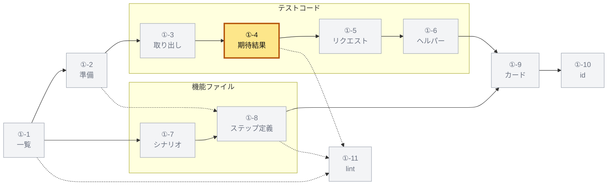

### ①-4-a expect の連なり

**期待結果**は、次の形の呼び出しである。

```ts
expect(actual).toBe(expected);
expect.soft(actual).not.toEqual(expected);
await expect(promise).rejects.toMatchObject({ error: 'invalid_client' });
await expect.poll(() => value()).resolves.toBe(1);
```

| 部分 | 規則 |
|---|---|
| マッチャー | 呼び出し先の最後の名前が `/^to[A-Z]/` に合う |
| 間の名前 | `.not`（一つごとに否定を反転）、`.resolves` と `.rejects`（`mode`）だけを許す |
| 先頭 | `expect` の呼び出し。<br>`expect` の後ろには `soft` と `poll` だけを許す |
| `actual` | `expect` の第一引数のソース。<br>無ければ期待結果でない |
| `args` | マッチャーの引数を `valueOf`（[①-4-b](#-4-b-値の読み方)）で読んだもの |

```ts
interface Expectation {
  actual: string; // 確かめる値のソース
  matcher: string;
  args: Value[];
  negated: boolean;
  mode?: 'resolves' | 'rejects';
}
```

### ①-4-b 値の読み方

`valueOf` は、マッチャーの引数を次の `Value` にする。

```ts
type Value =
  | { kind: 'string'; value: string } | { kind: 'number'; value: number } | { kind: 'boolean'; value: boolean }
  | { kind: 'null' } | { kind: 'undefined' } | { kind: 'regexp'; source: string }
  | { kind: 'object'; entries: Array<[string, Value]> } | { kind: 'array'; items: Value[] }
  | { kind: 'code'; code: string };
```

上から順に当てる。

| 書かれた値 | Value |
|---|---|
| 文字列、置換の無いテンプレート | `string` |
| 型が文字列か数のリテラルを与える `X.Y`（enum のメンバーなど） | 数字だけ（`/^-?\d+(\.\d+)?$/`）なら `number`、ほかは `string` |
| `expect.objectContaining(x)`、`expect.arrayContaining(x)` | `x` の Value |
| 数値、`-` の付いた数値 | `number` |
| `true`、`false` | `boolean` |
| `null` | `null` |
| `undefined` | `undefined` |
| 正規表現 | `regexp`（`source` は最初と最後の `/` の間） |
| ファイルの関数の引数の名前（[①-4-c](#-4-c-期待結果の集め方)） | 呼び出しが渡した値 |
| オブジェクト | `object`（省略記法 `{ a }` の値は `code`）。<br>計算したキー、スプレッド、メソッドがあれば全体を `code` |
| 配列 | `array` |
| それ以外 | `code`（式のソース） |

`X.Y` は、ファイルのマッチャーの引数の中から集め（左が識別子、右が大文字で始まる）、一度に型を問う（`constantsOf`）。
型が引けるのは根のプロジェクトだけなので、E2E とツールのテストでは `X.Y` は `code` のままである。
`TokenErrorCode.InvalidClient` は `invalid_client` になる。

### ①-4-c 期待結果の集め方

期待結果は、テストのコールバックの中のすべての呼び出しを、構文木の先行順（外の呼び出しが先）に見て集める。
入れ子の関数の中も見る。

[①-4-a](#-4-a-expect-の連なり) の形でない呼び出しは、呼び出し先が**ファイルの関数**の名前（識別子）なら、その関数の中も読む。
ファイルの関数は、下の `scopeOf` の `functions` を名前だけで引いたものである（スコープは見ない）。

- 読んだ期待結果は、その呼び出しの位置に差し込む
- テストから二段まで読む（テストが呼ぶ関数と、それが呼ぶ関数）
- 関数の引数の名前を、その呼び出しが位置で渡した値に置き換える
- 置き換えるのはマッチャーの引数だけで、`actual` は書かれたままである
- 呼ぶたびに読み直すので、二回呼べば期待結果は二つになる
- テストの中で定義した関数は、定義の場所で一度、呼ぶたびにもう一度読む
- import したテスト支援のファイルの関数（[①-6](#-6-ヘルパー) のヘルパー）の中の `expect` は読まない

`scopeOf` は、ファイル全体の宣言を名前で集める。

| 集合 | 入るもの | 同じ名前 |
|---|---|---|
| `functions` | 名前のある `function` と、アロー関数か関数式で初期化した変数（入れ子の中も） | 後のもの |
| `constants` | ほかの初期化子のある変数（入れ子の中も） | 最初のもの |

`let` と `var` も `const` と同じに扱う。
分割代入の名前（`const { a } = ...`）は、どちらにも入らない。

テストの中で定義した関数は、次のように読む（パッケージをビルドしたもので確かめた）。

```ts
const check = (v: number) => expect(v).toBe(1);
check(1);
check(2);
expect(3).toBe(3);
```

期待結果は `` `v` is 1 `` が三つ（定義の場所と二つの呼び出し）と、`` `3` is 3 `` である。

ファイルの関数の例（`read-code.test.ts`）：

```ts
function expectCode(run: () => unknown, code: string) {
  try { run(); } catch (error) { expect((error as { code: string }).code).toBe(code); }
}
it('should fail through a helper of the file', () => {
  expectCode(() => authenticate(''), 'invalid_client');
  expectCode(() => authenticate('x'), 'invalid_grant');
});
```

このテストの期待結果は二つで、`` the error code is `invalid_client` `` と `` the error code is `invalid_grant` `` である。
行の番号は、`expectCode` の中の `expect` の行である。

### ①-4-d 言葉にする規則

規則は上から順に当て、最初に当たったもので言う（`sayExpectation`）。

```ts
interface Said {
  text: string; // 英語の一行
  phrase: string; // 言い回し。規則の無いマッチャーは空
  holes: string[]; // 言い回しの穴に入る値（英語の順）
}
```

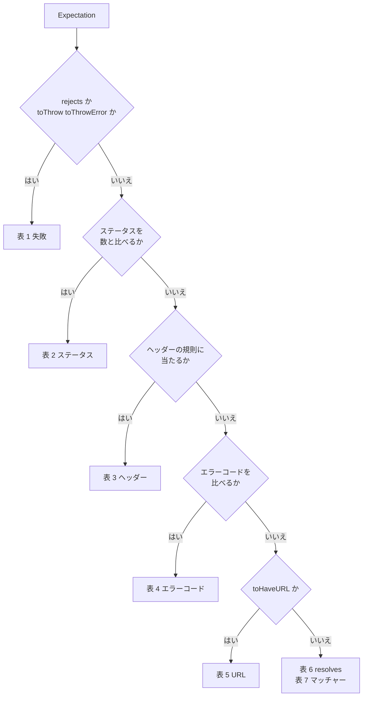

表の記法は次のとおりである。

- `<s>`：確かめる値の言葉（`actualWords(actual)`、[①-4-e](#-4-e-規則が使う関数)）
- `<v>`：第一引数の言葉（`valueWords`、[①-4-e](#-4-e-規則が使う関数)、引数が無ければ空）
- `<H>`：ヘッダー名のコードスパン
- `[ not]`：否定のときだけ ` not` が入る
- （否定は …）：否定のときは、英語の一行と言い回しの両方でその語に置き換える
- 「穴に入るもの」：言い回しの穴に、英語の順に入る値（`Said.holes`）
- `hole`：第一引数の `hole(value)`（文字列と数はその値、[①-4-e](#-4-e-規則が使う関数)）

#### 表 1 失敗

`.rejects` か、マッチャーが `toThrow` か `toThrowError` の期待結果に当てる。

| 条件（上から順） | 英語の一行 | 言い回し | 穴に入るもの |
|---|---|---|---|
| 否定で、`.rejects` でない | `does not fail` | `does not fail` | なし |
| `.rejects` の `toBeInstanceOf(X)` | `fails with <v>` | `fails with {string}` | `hole` |
| 引数がエラーを名指す（`errorNamed`）か正規表現 | `` fails with `<エラー>` `` | `fails with {string}` | エラー（`errorNamed` の値か、正規表現の `<v>`） |
| 引数がオブジェクト | `fails with <v>` | `fails with {value}` | `<v>` |
| それ以外 | `fails` | `fails` | なし |

正規表現の引数のエラーは `/<source>/` である。
一行の中では、エラーの前後のバッククォートを除いてからコードスパンにする。
`.rejects` の否定は言わない。

#### 表 2 ステータス

`isStatus(actual)` が真で、マッチャーが `toBe` か `toEqual`、引数が数の期待結果に当てる。

| 英語の一行 | 言い回し | 穴に入るもの |
|---|---|---|
| `the HTTP status is[ not] <数>` | `the HTTP status is[ not] {int}` | 数 |

#### 表 3 ヘッダー

`headerOf(actual)` がヘッダー名を返す期待結果に当てる。

| マッチャー | 英語の一行 | 言い回し | 穴に入るもの |
|---|---|---|---|
| `toBeNull`、`toBeUndefined` | `there is no <H> header`（否定は `there is a <H> header`） | `there is no {string} header`（否定は `there is a {string} header`） | ヘッダー名 |
| `toBe`、`toEqual`（引数あり） | `the <H> header is[ not] <v>` | `the {string} header is[ not] {string}` | ヘッダー名、`hole` |
| `toContain`（引数あり） | `the <H> header contains <v>`（否定は `does not contain`） | `the {string} header contains {string}` | ヘッダー名、`hole` |
| `toMatch`（引数あり） | `the <H> header matches <v>`（否定は `does not match`） | `the {string} header matches {string}` | ヘッダー名、`hole` |
| ほか | 表 4 へ進む | | |

穴のヘッダー名は、コードスパンにしない名前そのもの（`cache-control`）である。

#### 表 4 エラーコード

| 条件 | 英語の一行 | 言い回し | 穴に入るもの |
|---|---|---|---|
| `toMatchObject`、`toEqual`、`toStrictEqual` で、引数がオブジェクトでエラーを名指し、否定でない | `` the error code is `<コード>` `` | `the error code is {string}` | 名指すエラー（`errorNamed`、`invalid_grant`） |
| `isErrorCode(actual, 引数)` で、`toBe` か `toEqual` | `` the error code is[ not] `<コード>` ``（空なら `an empty string`） | `the error code is[ not] {string}` | 引数の文字列 |

#### 表 5 URL

マッチャーが `toHaveURL` で、引数のある期待結果に当てる。

| 引数 | 英語の一行 | 言い回し | 穴に入るもの |
|---|---|---|---|
| 正規表現で、末尾の固定の文字列が取れる | `` the URL ends with `<末尾>` ``（否定は `does not end with`） | `the URL ends with {string}` | 末尾（`/consent`） |
| ほかの正規表現 | `the URL matches /<source>/`（否定は `does not match`） | `the URL matches {value}` | `<v>` |
| 正規表現でない | `the URL is[ not] <v>` | `the URL is[ not] {value}` | `<v>` |

末尾は `/^(?:\^?\.\*)?((?:\\\/|[\w-])+)\$$/` の一つ目の組で、`\/` を `/` に戻したものである。
`/\/consent$/` は `` the URL ends with `/consent` `` になる。

#### 表 6 resolves

`.resolves` の期待結果に当てる。

| マッチャー | 英語の一行 | 言い回し | 穴に入るもの |
|---|---|---|---|
| `toBeUndefined`、`toBeNull`、`toBeDefined`、`toBeTruthy`、`toBeFalsy` | `<s> resolves to <w>`（否定は `does not resolve to`） | `{code} resolves to <w>` | `<s>` |
| `toBe`、`toEqual`、`toStrictEqual` | `<s> resolves to <v>`（否定は `does not resolve to`） | `{code} resolves to {value}` | `<s>`、`<v>` |
| `toMatchObject` | `<s> resolves to a value with <v>`（否定は `without`） | `{code} resolves to a value with {value}` | `<s>`、`<v>` |
| ほか | 表 7 へ進む | | |

`<w>` は順に `undefined`、`null`、`a value`、`a truthy value`、`a falsy value` である。

#### 表 7 マッチャー

ここまでのどれにも当たらない期待結果に当てる。

| マッチャー | 英語の一行 | 言い回し | 穴に入るもの |
|---|---|---|---|
| `toBe` | `<s> is[ not] <v>` | `{code} is[ not] {value}` | `<s>`、`<v>` |
| `toEqual`、`toStrictEqual` | `<s> equals <v>`（否定は `does not equal`） | `{code} equals {value}` | `<s>`、`<v>` |
| `toMatchObject` | `<s> has <v>`（否定は `does not have`） | `{code} has {value}` | `<s>`、`<v>` |
| `toBeUndefined` など五つ | `<s> is[ not] <w>` | `{code} is[ not] <w>` | `<s>` |
| `toBeInstanceOf` | `<s> is[ not] a <v>` | `{code} is[ not] a {value}` | `<s>`、`<v>` |
| `toHaveLength` | `the length of <s> is[ not] <v>` | `the length of {code} is[ not] {int}` | `<s>`、`hole` |
| `toContain`、`toContainEqual` | `<s> contains <v>`（否定は `does not contain`） | `{code} contains {value}` | `<s>`、`<v>` |
| `toMatch` | `<s> matches <v>`（否定は `does not match`） | `{code} matches {value}` | `<s>`、`<v>` |
| `toHaveProperty` | `<s> has the property <v>`（否定は `does not have the property`） | `{code} has the property {value}` | `<s>`、`<v>` |
| `toHaveBeenCalled` | `<s> was[ not] called` | `{code} was[ not] called` | `<s>` |
| `toHaveBeenCalledTimes` | `<s> was called <v> times`（否定を言わない） | `{code} was called {int} times` | `<s>`、`hole` |
| `toHaveBeenCalledWith` | `<s> was[ not] called with <全引数の言葉>`（`, ` でつなぐ） | `{code} was[ not] called with {value}` | `<s>`、全引数の言葉を `, ` でつないだもの（`` `a`, 2 ``） |
| `toBeGreaterThan` | `<s> is[ not] greater than <v>` | `{code} is[ not] greater than {value}` | `<s>`、`<v>` |
| `toBeGreaterThanOrEqual` | `<s> is[ not] at least <v>` | `{code} is[ not] at least {value}` | `<s>`、`<v>` |
| `toBeLessThan` | `<s> is[ not] less than <v>` | `{code} is[ not] less than {value}` | `<s>`、`<v>` |
| `toBeLessThanOrEqual` | `<s> is[ not] at most <v>` | `{code} is[ not] at most {value}` | `<s>`、`<v>` |
| `toHaveText`、`toContainText` | `<s> has the text <v>`（否定は `does not have the text`） | `{code} has the text {value}` | `<s>`、`<v>` |
| `toBeVisible` | `<s> is[ not] visible` | `{code} is[ not] visible` | `<s>` |
| `toHaveCount` | `<s> has <v> elements`（否定は `does not have`） | `{code} has {int} elements` | `<s>`、`hole` |
| `toHaveValue` | `<s> has the value <v>`（否定は `does not have the value`） | `{code} has the value {value}` | `<s>`、`<v>` |
| ほか | `<s>[ not] <matcher>[ <v>]` | なし（空の文字列） | なし |

表 7 の `<w>` は、順に `undefined`、`null`、`defined`、`truthy`、`falsy` である。
規則の無いマッチャーはコードのまま言い、訳さない（`` `ratio` toBeCloseTo 3 ``）。
規則は推論でなく表なので、新しいマッチャーは表に足す。

`words.test.ts` の期待値から、いくつか例を挙げる。

| expect | 英語の一行 |
|---|---|
| `expect(response.status).toBe(401)` | `the HTTP status is 401` |
| `expect(res.statusCode).not.toBe(200)` | `the HTTP status is not 200` |
| `expect(res.headers()['cache-control']).toBe('no-store')` | `` the `cache-control` header is `no-store` `` |
| `expect(authenticate()).rejects.toMatchObject({ error: 'invalid_client' })` | `` fails with `invalid_client` `` |
| `expect(() => parse()).toThrow(TokenError)` | `` fails with `TokenError` `` |
| `expect(await response.json()).toEqual({ error: 'invalid_grant' })` | `` the error code is `invalid_grant` `` |
| `expect(body).toMatchObject({ token_type: 'Bearer', expires_in: 3600 })` | `` the body has `token_type` `Bearer` and `expires_in` 3600 `` |
| `expect(parameters).toEqual({ code: 'code-1', state: 'state-1' })` | `` `parameters` equals `code` `code-1` and `state` `state-1` `` |
| `expect(page).toHaveURL(/code=/)` | `the URL matches /code=/` |
| `expect(lookup()).resolves.toMatchObject({ sub: 'u-1' })` | `` `lookup()` resolves to a value with `sub` `u-1` `` |
| `expect(tokens).toHaveLength(43)` | `` the length of `tokens` is 43 `` |

`code` のキーは認可コードにも使うので、`code-1` はエラーコードとしない（`ERROR_CODE` に合わない）。

### ①-4-e 規則が使う関数

値は、画面と PR のコメントがどちらも読む CommonMark のコードスパンで書く。

`codeSpan(code)` の規則は二つである。

- 中の最も長いバッククォートの連なりより一つ長いバッククォートで囲む
- 中がバッククォートで始まるか終わるとき、または空白で始まり空白で終わる（空白だけではない）とき、内側に空白を一つずつ入れる

`` `${issuer}/authorize` `` は ``` `` `${issuer}/authorize` `` ``` になる。

`shortCode(code)` は、空白の連なりを一つにして前後を除き、80 文字を超えれば 79 文字と `…` にする。

`valueWords(value)` は値の言葉である。

| Value | 言葉 | 例 |
|---|---|---|
| 空の `string` | `an empty string` | |
| `string` | コードスパン | `` `a` `` |
| `number`、`boolean` | そのまま | `1` |
| `null`、`undefined` | `null`、`undefined` | |
| `regexp` | `/<source>/` | `/x$/` |
| 空の `object` | `an empty object` | |
| `object` | `` `<キー>` <値の言葉> `` を ` and ` でつなぐ | `` `token_type` `Bearer` and `expires_in` 3600 `` |
| 空の `array` | `an empty list` | |
| `array` | `[<値の言葉>, ...]` | `` [`code`] `` |
| `code` | `shortCode` のコードスパン | |

`hole(value)` は、`{int}` と `{string}` の穴に入る値である。
引数が無ければ空、`string` は中身そのまま、`number` は数字、ほかは `valueWords` である。

`actualWords(code)` は、確かめる値の言葉である。

1. `shortCode` をかける
2. 全体が `(await X)` なら `X` にし、先頭の `await ` を除く
3. `body`、`json`、`payload` のどれか、`.json()` で終わる、または `<名前>.body` なら `the body`
4. ほかはコードスパン

`await response.json()`、`(await response.json())`、`body` は `the body` になり、`claims.sub` は `` `claims.sub` `` になる。

判定に使う関数と正規表現は次のとおりである。

```ts
// isStatus：actual の前後の空白を除き、?. を . にしてから照らす
const isStatus = (actual) => /(^|\.)status(Code)?(\(\))?$/.test(actual);
// headerOf：actual の前後の空白を除いて照らし、一つ目か二つ目の組がヘッダー名
// response.headers.get('X')、res.headers['x']、Playwright の response.headers()['x']
const HEADER = /\.headers(?:\(\))?(?:\.get\(\s*['"`]([^'"`]+)['"`]\s*\)|\[\s*['"`]([^'"`]+)['"`]\s*\])$/;
// OAuth のエラーコード：小文字の語を _ でつなぐ（invalid_client、slow_down）
const ERROR_CODE = /^[a-z]+(_[a-z0-9]+)+$/;
```

`isErrorCode(actual, value)` は、値が `string` で、次のどちらかのとき真である。
`actual` は、前後の空白を除き、`?.` を `.` にしてから照らす（`isStatus` と同じ）。

- `actual` が `/(^|\.)error$/` に合う
- `actual` が `/(^|\.)code$/` に合い、値が `ERROR_CODE` に合う

`errorNamed(value)` は、値が名指すエラーである。

| Value | エラー |
|---|---|
| `object` | `error` が `string` ならその値。<br>`error` が無いか `string` でなければ、`code` が `string` で `ERROR_CODE` に合えばその値 |
| `string` | その値 |
| `code` が `/^[A-Z][\w$]*(Error\|Exception)$/` に合う | その名前（`TokenError`） |
| `code` が `` /^new\s+[A-Z][\w$]*(?:Error\|Exception)\(\s*['"`]([\w.:-]+)['"`]/ `` に合う | 第一引数（`new CibaGrantError('unauthorized_client', ...)` は `unauthorized_client`） |
| ほか | なし |

### ①-4-f 日本語

言い回しのある期待結果は、訳の表（[①-8-d](#-8-d-訳の表)）で日本語にする。
表の穴は、英語の穴を次の `japaneseHole` で直してから入れる。

| 穴の種類 | 直し方 |
|---|---|
| `{string}` | 空なら `空文字列`、ほかはコードスパン |
| ほか | `an empty string` は `空文字列`、`an empty list` は `空の配列`、`an empty object` は `空のオブジェクト`、ほかはそのまま |

表に言い回しが無ければ `ja` を付けず、その言い回しを「訳の無い言い回し」（`untranslated`）に足す。
`{code}` の穴は訳さないので、`the body` は日本語の中でも `the body` のままである。

| 英語の一行 | 日本語 |
|---|---|
| `the HTTP status is 401` | `HTTP ステータスが 401 である` |
| `` the `WWW-Authenticate` header is `Basic` `` | `` `WWW-Authenticate` ヘッダーが `Basic` である `` |
| `` the error code is `invalid_client` `` | `` エラーコードが `invalid_client` である `` |
| `` the body has `token_type` `Bearer` `` | `` the body が `token_type` `Bearer` を持つ `` |
| `` `x` is an empty string `` | `` `x` が 空文字列 である `` |

`.rejects.toBeInstanceOf(TokenError)` の穴は `` `TokenError` `` なので、`{string}` の直しでもう一度囲まれる。
その日本語は ``` `` `TokenError` `` で失敗する ``` である。

### ①-4-g カードに残す形

期待結果は、一つずつ次の `Assertion` にしてカードに残す。

```ts
interface Assertion {
  actual: string; // actual のソースの空白を一つにしたもの
  matcher: string; // 機能ファイルの Then は 'step'（①-9-e）
  expected?: unknown; // 第一引数がそのままのデータにできるとき
  negated?: boolean; // 否定のときだけ true
  mode?: 'resolves' | 'rejects';
  line: number; // expect の呼び出しの始まる行
  text: string; // 英語の一行
  phrase?: string; // 言い回し（空なら付けない）
  ja?: string; // 訳の表にあるとき
}
```

`expected` は `plainValue` で作る。

| Value | `expected` |
|---|---|
| `string`、`number`、`boolean` | その値 |
| `null` | `null` |
| `regexp` | `"/<source>/"` |
| `object` | キーと値のオブジェクト。<br>直下にコードの値があれば付けない |
| `array` | 値の配列。<br>コードの要素があれば付けない |
| `undefined`、`code` | 付けない |

例：期待結果は 10,021 個で、言い回しの無いものは 2 個である。

### ①-4-h 確かめるところで呼ぶ関数

`called` は、テストが確かめるところで呼ぶ関数カタログの関数である。
テストは状態を用意するためにもカタログの関数（`registerClient`、`createEmptyDatabase`）を呼ぶ。
本体の呼び出しをすべて対象にすると、対象が用意の関数で埋まるので、確かめるところに限る。

1. 期待結果の `actual` の中の識別子を集める（プロパティの名前は除く）
2. 本体の変数宣言のうち、集めた名前を束縛するものの初期化子を足す
3. 1 の `actual` と 2 の初期化子の中で、呼び出し先が識別子の呼び出しを探す
4. その名前の `importTarget` が関数なら、その id を `called` に足す（重複なし）

たどるのは一段だけである。
`const a = h(); const b = g(a); expect(b)...` では、`g` は入り、`h` は入らない。

### ①-4-i 期待する URL

`toHaveURL` の第一引数から、期待する URL のパスを取る（`urls`）。

- 正規表現なら、`source` の `\/` を `/` に戻し、先頭の `^` と `.*` と末尾の `$` を除いてから `pathOfText`（[①-5-b](#-5-b-url-の読み方)）にかける
- 文字列なら、そのまま `pathOfText` にかける

`urls` の各パスは、[①-5-f](#-5-f-テストが届くエンドポイント) でエンドポイントに引く。

実装：

- `packages/test-catalog/src/read-code.ts`：`expectationOf`、`valueOf`、`memberAccessesOf`、`scopeOf`、`readCodeTests` の `collect`
- `packages/test-catalog/src/words.ts`：`sayExpectation`、`actualWords`、`valueWords`、`codeSpan`、`shortCode`、`plainValue`、`headerOf`、`isStatus`、`isErrorCode`、`errorNamed`、`japaneseHole`、`expectationPhrases`
- `packages/test-catalog/src/catalog.ts`：`japaneseHoles`

## ①-5 リクエストの形

テストの本体とファイルの関数が送るリクエストを読み、パスと行き先を決める。

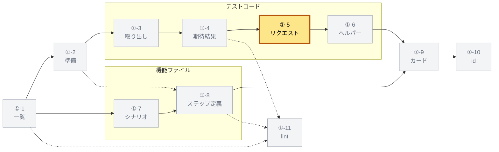

### ①-5-a 呼び出しの形

本体の呼び出しを順に見て、リクエストを送る形かを決める。

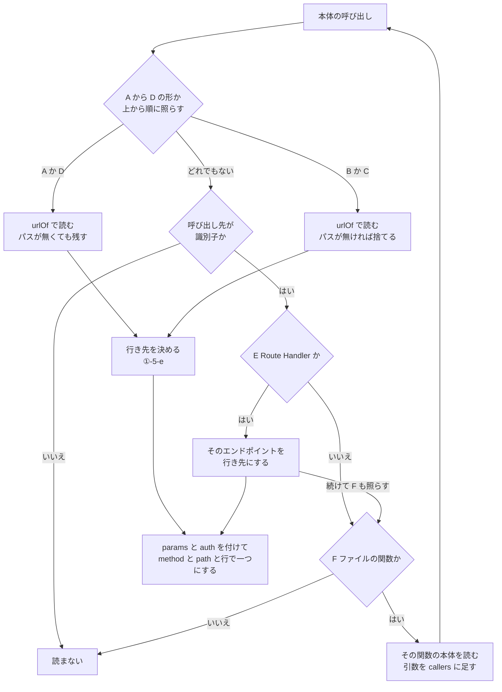

| 形 | 呼び出し | 条件 | URL | メソッド |
|---|---|---|---|---|
| A | `<x>.request(url, init)`、`<x>.fetch(req)`、`<x>.inject(opts)` | 引数があり、`<x>` のソースが `/^(request\|api\|context)$/i` に合わず、大域の `fetch` でない | `urlOf(第一引数)`（`inject` は `opts.url`） | `methodIn(第二引数)`、URL のメソッド（`inject` は `opts.method`）、`GET` の順 |
| B | `<x>.goto(url)` | 引数がある | `urlOf(url)` | `GET` |
| C | `<x>.get`、`post`、`put`、`patch`、`delete`、`head`、`fetch` | 引数があり、`<x>` のソースが `/request\|api\|context/i` を含み（Playwright）、大域の `fetch` でない | `urlOf(第一引数)` | 名前の動詞（`fetch` は `methodIn(第二引数)`、URL のメソッド、`GET` の順） |
| D | `fetch(url, init)` と大域の `fetch` | 引数があり、ファイルが大域の `fetch` を差し替えていない。<br>`fetch(url)` は、囲むスコープが `fetch` を宣言していないときだけ | `urlOf(url)` | `methodIn(init)`、URL のメソッド、`GET` の順 |
| E | `<名前>(...)` | 名前の `importTarget` が Next.js の Route Handler（`endpointOfFunction`） | 引数のうち最初にパスが取れるもの（無ければ空） | 名前が `GET` `POST` `PUT` `PATCH` `DELETE` `HEAD` ならそれ、ほかは URL のメソッド、`POST` の順 |
| F | `<名前>(...)` | 名前がファイルの関数（`scopeOf`） | その関数の本体を読む | |

A から D は上から順に照らし、最初に合った形だけで読む。
`<x>` のソースが A と C を分ける（`request.fetch(...)` は C、`page.request.fetch(...)` は A）。
**大域**は、ソースが `/^(globalThis|global|window|self)$/` に合う式で、`<大域>.fetch(...)` を大域の `fetch` と呼ぶ。
A から D に合わず、呼び出し先が識別子なら、E と F の両方を当てる。

A と D は、アプリかハンドラーかサーバーにリクエストを渡す形である。
URL に固定のパスが無くても送ったリクエストとして残し、そのパスを `''` にする。
B と C は、パスが取れたときだけ残す。
E のエンドポイントは `routes` にも足す（[①-5-f](#-5-f-テストが届くエンドポイント)）。

次のものは、送ったと数えない。

| 書き方 | 数えない理由 |
|---|---|
| `contextOf(requestTo('/token'))` のように `Request` を作るだけ | A から F のどの形にも当たらない |
| `const fetch = vi.fn(...)` の後の `fetch(url)`、引数の `fetch` | 囲むスコープが `fetch` を宣言している（`declaredAround`） |
| `vi.spyOn(globalThis, 'fetch')` のあるファイルの `fetch(url)` | ファイルが大域の `fetch` を差し替えている（`stubsGlobalFetch`） |

`declaredAround(name, at)` は、`at` の親から上へ、宣言を持つ節点（[①-6-b](#-6-b-名前の引き方) の `scopeNames`）がその名前を宣言しているかを見る。
`stubsGlobalFetch(file)` は、ファイルのどこかに次のどれかがあれば真である。

- 呼び出し先（空白を除いたソース）が `/(^|\.)spyOn$/` に合い、第一引数が大域、第二引数が文字列 `'fetch'` の呼び出し
- 呼び出し先が `/(^|\.)stubGlobal$/` に合い、第一引数が文字列 `'fetch'` の呼び出し
- 左辺が `<大域>.fetch` の代入

F の「ファイルの関数」は、[①-4-c](#-4-c-期待結果の集め方) と同じく `scopeOf` の `functions` を名前で引いたものである。
F の読み方には六つの決まりがある。

- 呼び出しの引数を `callers` に足して読む（テストが関数に渡したもの）
- 読む関数の中で定義しただけの関数は読まない（呼ばれたときに走るから）
- テストの本体の中で書いた関数（コールバックなど）の中は読む
- テストから 3 段まで読む
- 読んだ関数は、`callers` が空なら二度読まない
- import したテスト支援のファイルの関数（[①-6](#-6-ヘルパー) のヘルパー）の中のリクエストは読まない（URL を作る関数としては [①-5-b](#-5-b-url-の読み方) が読む）

`methodIn(init)` は、オブジェクトの `method` のプロパティが文字列なら、その大文字を返す。

同じリクエストを別の呼び出しから読み直すことがある。
`method`、`path`、`line`（送る呼び出しの始まる行）が同じなら一つにまとめる。
一つにするときは、`params` を合わせ、`auth` が無ければ足す。

### ①-5-b URL の読み方

`urlOf` は、書かれた URL から固定のパスと、分かればメソッドを取る。

| 書き方 | 読み方 |
|---|---|
| 文字列 | `pathOfText(文字列)` |
| テンプレート | 置換を目印にして `pathOfText` |
| `a + b` | 下の手順 |
| `new URL(x, base)` | `x` を読む |
| `new Request(x, init)`、`new NextRequest(x, init)` | `x` を読み、メソッドは `methodIn(init)`、`x` のメソッドの順 |
| ほかの `new` | なし |
| 識別子 | 読んでいるファイルの定数（`scopeOf` の `constants`）の初期化子を読む |
| `f(x, init)` | 下の手順 |
| それ以外 | なし |

`a + b` は次の順に読む。

1. `b` が `/` で始まる文字列なら、`b` のパス
2. ほかは `a` を読み、パスが取れたか `b` が文字列なら、`a` の結果
3. どちらでもなければ、`b` を読む（`origin + authorizePath(params)` の右）

`f(x, init)` の手順は次のとおりである。
`f` は識別子か、`a.f(...)` のプロパティ名である。

1. `f` が読んでいるファイルの関数なら、その関数が返す式（アローの本体か `return` の式）を順に読み、最初にパスの取れたものをそのまま返す
2. ファイルの関数でなく `f` が識別子なら、`helperOf`（[①-6-c](#-6-c-型で引くヘルパー)）でテスト支援のファイルの関数を引き、1 と同じに読む
3. 2 の関数は、その関数のファイルの定数と関数で読み、その中の呼び出しにも 2 を当てる
4. 取れなければ `x` を読み、パスが無ければ「なし」とする
5. 4 で取れたときのメソッドは、次の順に決める（名前は大小を区別しない）
   - `f` の名前が `post` を含めば `POST`
   - `preflight` か `options` を含めば `OPTIONS`
   - ほかは `methodIn(init)`、`x` のメソッドの順

識別子と関数は、読んでいるファイルと名前の組ごとに一度だけ読む。
定数や関数が互いを指していても、読み終わるためである。

`requestTo('/userinfo')` は `/userinfo`、`formPost('/introspect', fields)` は `POST /introspect` になる。
`helpers.tokenUrl()` は、ファイルの関数 `tokenUrl()` が `'/token'` を返せば `/token` になる。

テスト支援のファイルの関数が作るパスの例である（`read-code.test.ts`）。

```ts
// test-helpers.ts（テスト支援のファイル）
export function authorizePath(params: Record<string, string>): string {
  return '/authorize?' + new URLSearchParams(params).toString();
}
export function requestTo(path: string, init?: RequestInit): Request {
  return new Request(new URL(path, ISSUER), init);
}

// app.test.ts
app.request(requestTo(authorizePath({ client_id: 'c-1' })));
```

- `requestTo` の返す式からはパスが取れない（`path` は引数で、定数でない）
- そこで `x` の `authorizePath(...)` を読み、その返す式の `'/authorize?'` から `/authorize` を取る
- メソッドはどちらの名前からも決まらず、形 A の既定の `GET` になる

`pathOfText(text)` は次の手順で固定のパスを取る。
置換の位置は、置換の目印 `\u0000` で表す。

1. 先頭の `http://` か `https://` と、その後の origin（`/` か目印の前まで）を除く
2. 先頭の目印を除く（先頭の置換は origin とみなす：`${TEST_ISSUER}/token`）
3. `/` で始まらなければ、パスなし
4. 最初の `?`、`#`、目印の前までを取る
5. 空ならパスなし、2 文字以上なら末尾の `/` を一つ除く

| 文字列 | パス |
|---|---|
| `https://op.example.com/token?x=1` | `/token` |
| `${A}/authorize?${B}` | `/authorize` |
| `/register/${A}` | `/register` |
| `consent` | なし |
| `/` | `/` |

### ①-5-c ボディのキー

`params` は、リクエストのボディかクエリのキーである。
探すのは、送る呼び出しの引数と、その途中でテストがファイルの関数に渡した引数（`callers`）である。
その中のすべての節点を見る。

| 書き方 | 取るキー |
|---|---|
| `new URLSearchParams({ ... })` | オブジェクトのキー |
| `JSON.stringify({ ... })` | オブジェクトのキー |
| `form: { ... }`、`data: { ... }`、`params: { ... }`（Playwright） | オブジェクトのキー |
| ファイルの定数（`scopeOf` の `constants`）の名前か省略記法 `{ body }` で、値がボディを作る式 | その値の中から上の三つの形を探す（同じ名前は一度だけ） |
| テストが最初に呼んだファイルの関数の第一引数がオブジェクト（形 E では見ない） | そのキー |

定数の中で探すのは、上の三つの形だけである。
値がただのオブジェクトの定数（`form: FORM`、`JSON.stringify(BODY)`）からは、キーを取らない。

ボディを作る式は、オブジェクト、`new URLSearchParams(...)`、`JSON.stringify(...)`、そのどれかの `.toString()` である。
ほかのリクエストから計算した値は、このリクエストのボディとしない。

### ①-5-d 認証の方式

`auth` は、同じ範囲のソースの文字列と `params` から、上から順に決める。

| 順 | 条件 | `auth` |
|---|---|---|
| 1 | `` /basic(Auth\|Authorization\|Header)?\s*\(\|['"`]Basic\s/i `` に合う | `client_secret_basic` |
| 2 | `params` に `client_assertion` がある | `private_key_jwt` |
| 3 | `params` に `client_secret` がある | `client_secret_post` |
| 4 | `` /['"`]Bearer\s\|bearer\s*\(/i `` に合う | `bearer` |
| 5 | `/DPoP/i` に合う | `dpop` |
| 6 | どれでもない | なし |

### ①-5-e リクエストの行き先

**行き先**は、リクエストが届くエンドポイントか、届かない理由（`route`）である。
形 A から D のリクエストは、パスから次の順に決める。

| 順 | パス | `endpoint` | `route` |
|---|---|---|---|
| 1 | `''`（URL に固定の部分が無い） | なし | `unknown` |
| 2 | 自前のルート（下） | なし | `own` |
| 3 | `endpointOfPath(パス)`（[①-2-d](#-2-d-エンドポイントの索引)）が id を返す | その id | なし |
| 4 | それ以外 | なし | `app` |

| `route` | 意味 |
|---|---|
| `own` | テストが自分で登録したルートに届く。<br>エンドポイントのパスでもこれになる |
| `app` | 送り先のアプリの、エンドポイントでないルート（`/health`、運用者の API、何も答えないパス） |
| `unknown` | パスは、テストを動かすまで分からない |

形 E のリクエストは、いつもその Route Handler のエンドポイントを持ち、`route` を持たない。

**自前のルート**は、テストファイルが自分でハンドラーを登録したパスである（`ownRoutes`）。
ファイル全体（テストの本体の中も）から、次の呼び出しの第一引数を集める。

- 呼び出し先のプロパティ名が `get` `post` `put` `patch` `delete` `all` `on` `use` `mount` `route` のどれか
- 第一引数が文字列で、引数が二つ以上
- 最後の引数がアロー関数か関数式、またはプロパティ名が `mount` か `route`

第一引数は、`/` で始まればそのまま入れる。
`/^[\w.~-]/` に合えば、前に `/` を足して入れる（`router.get('status', ...)` は `/status`）。
ほかは入れない。
自前のルートは、ファイルごとに一度だけ求めて覚える（`ownRoutesOf`）。

例：次の三つを登録したファイルのリクエストは、表のようになる（`read-code.test.ts` の期待値）。

```ts
router.post('/token', () => 'own');
router.post('status', () => 'own');
router.mount('/login/google', {});
```

| リクエスト | `endpoint` | `route` |
|---|---|---|
| `router.request('/token')` | なし | `own` |
| `router.request('/login/google')` | なし | `own` |
| `router.request('/status')` | なし | `own` |
| `router.request('/userinfo')` | `userinfo` | なし |
| `router.request('/health')` | なし | `app` |

### ①-5-f テストが届くエンドポイント

テストが届くエンドポイント（`endpoints`）は二つの和である。

- 形 E で呼んだ Route Handler のエンドポイント（`routes`）
- `urls`（[①-4-i](#-4-i-期待する-url)）を `endpointOfPath` で引いたもの

カードに残すリクエストは、種類で決まる（[①-9-e](#-9-e-そのほかのフィールド)）。
API テストは送ったものをすべて残し、E2E とツールのテストはエンドポイントの付いたものだけを残す。
E2E のテストは RP（`/start` など）にも送り、それは地図に無いからである。

```ts
type RequestRoute = 'own' | 'app' | 'unknown'; // ①-5-e
interface RequestShape {
  endpoint?: string; // パスが当たったエンドポイントの id
  route?: RequestRoute; // endpoint が無いときの理由
  method: string;
  path: string; // `${TEST_ISSUER}/token` なら /token。固定の部分が無ければ ''
  params?: string[]; // ボディかクエリのキー
  auth?: string; // ①-5-d
  line: number; // 送る呼び出しの行
}
```

### ①-5-g it.each の表

`it.each(表)(名前, fn)` と `it.for(表)(名前, fn)` のテストは、表の行ごとに本体を読む（`tableRows`）。
一つのテストが、表のすべての行のパスへ送るからである。

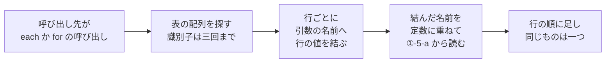

| 段 | 規則 |
|---|---|
| 対象のテスト | 呼び出し先が `<x>.each(...)` か `<x>.for(...)` の呼び出しであるテスト |
| 表 | その呼び出しの第一引数の配列。<br>識別子なら、ファイルの定数か `valueOf` の値をたどる（識別子を三回まで） |
| 結ぶ値 | 文字列で書いた値だけ |
| 行がオブジェクト | 一つ目の引数の分割代入（`({ path, status }) => ...`）の名前ごとに、同じキーの値 |
| 行が文字列 | 一つ目の引数の名前に、その行 |
| 行が配列で `each` | 引数を位置ごとに、配列の要素へ（`(method, path) => ...`） |
| 行が配列で `for` | 一つ目の引数の配列の分割代入を、位置ごとに（`([method, path]) => ...`） |
| 読み方 | 結んだ名前をファイルの定数に重ね、行ごとに本体を [①-5-a](#-5-a-呼び出しの形) から読む |
| まとめ方 | 行の順に足し、`method`、`path`、`line` が同じものは一つにする |
| 使わないとき | どの行も何も結ばなければ、行ごとに読まず一度だけ読む |

`valueOf` は `supportValueResolver(project, repository)` である。
名前の記号を型で引き、別名をたどる。
記号の宣言のうち、テスト支援のファイル（[①-1-c](#-1-c-テスト支援のファイル)）でテストのパスでないファイルにある、変数の宣言の初期化子を返す。
型が例外を投げたらなしとする。

例（`read-code.test.ts`）：ファイルは `app.post('/token', () => 'own')` を登録している。
`PREFLIGHTS` はテスト支援のファイルの定数で、`/token`、`/userinfo`、`/health` の三行を持つ。

```ts
it.each(['/token', '/userinfo'])('should answer OPTIONS %s', async (path) => {
  expect((await app.request(path, { method: 'OPTIONS' })).status).toBe(204);
});
it.each(PREFLIGHTS)('should answer OPTIONS $path with $status', async ({ path, status }) => {
  expect((await app.request(path, { method: 'OPTIONS' })).status).toBe(status);
});
```

| テスト | 読んだリクエスト |
|---|---|
| 一つ目 | `OPTIONS /token`（`own`）、`OPTIONS /userinfo`（`userinfo`） |
| 二つ目 | `OPTIONS /token`（`own`）、`OPTIONS /userinfo`（`userinfo`）、`OPTIONS /health`（`app`） |

例：`apps/hono/src/web/express/apply.test.ts` の `should hand OPTIONS $path to the provider` は、`it.each` の表を行ごとに読むテストである。
`it.each(PROVIDER_PATH_PREFLIGHTS)` の表は、テスト支援のファイル `apps/hono/src/test-support/web.ts` の定数である。
本体は `fetch(origin + path, { method: 'OPTIONS', ... })` を送る（形 D）。
`origin` からはパスが取れないので、[①-5-b](#-5-b-url-の読み方) の `a + b` の 3 で、行の `path` を読む。

例：リクエストは 22 個で、行き先は 17 のエンドポイントである。

### ①-5-h 読んだ例

`read-code.test.ts` の例では、テストはファイルの関数 `post` を呼ぶ。

```ts
async function post(fields: Record<string, string>) {
  return app.request(`${TEST_ISSUER}/token`, { method: 'POST', headers: { Authorization: basicAuthorization('c', 's') }, body: new URLSearchParams(fields) });
}
it('should answer the token endpoint with 401', async () => {
  const response = await post({ grant_type: 'authorization_code', code: 'c-1' });
  // ...
});
```

読んだ形は `{ endpoint: 'token', method: 'POST', path: '/token', params: ['grant_type', 'code'], auth: 'client_secret_basic', line: 7 }` である。
`line` は `post` の中の `app.request` の行である。

ほかの書き方も、パッケージをビルドしたもので次のように読めることを確かめた。

| 書き方 | 読んだ形 |
|---|---|
| `app.request(TOKEN_URL, { method: 'post', body: BODY, headers: { Authorization: 'Bearer x' } })`（`TOKEN_URL = 'https://op.example.com/token'`、`BODY = new URLSearchParams({ grant_type: '…', scope: '…' })`） | `POST /token`、`grant_type` と `scope`、`bearer` |
| `app.request(TOKEN_URL, { method: 'post', body: JSON.stringify(BODY_OBJECT) })`（`BODY_OBJECT = { grant_type: '…', scope: '…' }`） | `POST /token`（キーなし） |
| `app.fetch(requestTo('/userinfo'))` | `GET /userinfo` |
| `` request.post(`${ISSUER}/token`, { form: { grant_type: '...', client_secret: 's' } }) `` | `POST /token`、`grant_type` と `client_secret`、`client_secret_post` |
| `request.post(helpers.tokenUrl())`（ファイルの関数 `tokenUrl()` が `'/token'` を返す） | `POST /token` |
| `request.fetch(ISSUER + '/token', { method: 'PUT', data: { code: 'c' } })` | `PUT /token`、`code` |
| `page.goto('/authorize')` | `GET /authorize` |
| `fastify.inject({ method: 'POST', url: '/token' })` | `POST /token` |
| `fetch(new URL('/token', ISSUER), { method: 'POST', headers: { DPoP: 'p' } })` | `POST /token`、`dpop` |
| `` POST(new Request(`${ISSUER}/token`, { method: 'POST' })) ``（Route Handler） | `POST /token` |

行き先と送ったかどうかの例は、`read-code.test.ts` の期待値である。

| 書き方 | 読んだ形 |
|---|---|
| `app.request('/token', { method: 'POST' })`（ファイルが `app.post('/token', () => 'own')` を登録している） | `POST /token`、`route: 'own'` |
| `app.request(requestTo(authorizePath({ client_id: 'c-1' })))`（[①-5-b](#-5-b-url-の読み方)） | `GET /authorize`、`endpoint: 'authorize'` |
| `app.request(serverUrl())`（`serverUrl` は本体の無い関数） | `GET`、`path: ''`、`route: 'unknown'` |
| `fetch(server.url + '/', { redirect: 'manual' })`（テストが起動したサーバー） | `GET /`、`route: 'app'` |
| `const c = contextOf(requestTo('/userinfo'))` | リクエストにしない |
| `const fetch = vi.fn(...)` の後の `fetch('https://op.example.com/token')` | リクエストにしない |
| `vi.spyOn(globalThis, 'fetch')` のあるファイルの `fetch('https://op.example.com/.well-known/jwks.json')` | リクエストにしない |

実装：

- `packages/test-catalog/src/read-code.ts`：`requestsOf`、`urlOf`、`pathOfText`、`returnedBy`、`paramsIn`、`isBodyBuilder`、`authOf`、`methodIn`、`injectUrl`、`ownRoutes`、`ownRoutesOf`、`stubsGlobalFetch`、`declaredAround`、`withImports`、`tableRows`、`requestsOfRows`、`PLAYWRIGHT_METHODS`
- `packages/test-catalog/src/catalog.ts`：`EndpointIndex`、`supportValueResolver`

## ①-6 ヘルパー

テストが呼ぶ、同じファイルの関数とテスト支援のファイル（[①-1-c](#-1-c-テスト支援のファイル)）の関数を、**ヘルパー**として並べる。

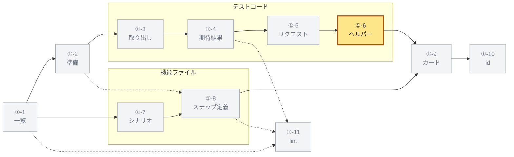

関数カタログの関数とテストの枠組みの関数は、ヘルパーにしない。
同じファイルの関数はスコープで引く（[①-6-b](#-6-b-名前の引き方)）。
[①-4-c](#-4-c-期待結果の集め方) と [①-5](#-5-リクエストの形) の「ファイルの関数」はスコープを見ずに名前で引くので、ヘルパーとは別の集まりである。
[①-5-b](#-5-b-url-の読み方) は URL を作るテスト支援のファイルの関数も読むが、ヘルパーの列はこの節の規則だけで決まる。

### ①-6-a 呼ぶ名前

本体の中で、次の識別子を本文の順に集める（`calleesIn`）。

- 呼び出し先そのものの識別子（`f(...)`）
- 呼び出しの引数の識別子（`items.map(f)` の `f`）

テストの枠組みの名前（`FRAMEWORK`）は集めない。
`describe` `suite` `it` `test` `bench` `expect` `beforeEach` `afterEach` `beforeAll` `afterAll` `vi` `vitest` `createBdd` `Given` `When` `Then` `Step` `Before` `After` `BeforeAll` `AfterAll` である。
`tests/e2e/fixtures.ts` の `test` と `expect` も、この名前なので集めない。

### ①-6-b 名前の引き方

テストのファイルの名前は、使われた場所のスコープで引く。

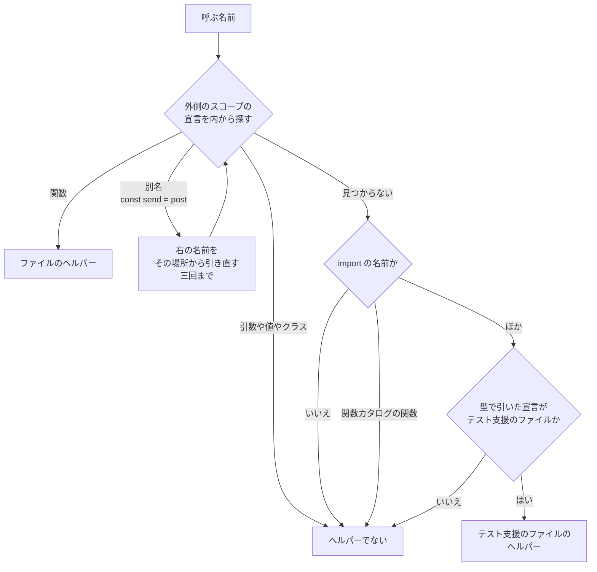

名前は、使われた節点から親を一つずつたどり、その名前を宣言する最初の節点で引く。
宣言を持つ節点は次の四つである（`scopeNames`）。

| 節点 | 宣言する名前 |
|---|---|
| 文の並び（`statements`）を持つ節点：ファイル、ブロック、`case` 節など | 並びの中の宣言（下の表） |
| `function`、関数式、アロー関数、メソッド、コンストラクタ、`get`、`set` | 引数の名前。<br>関数式は自分の名前も |
| `catch` 節 | その変数 |
| `for`、`for...of`、`for...in` | 初期化の変数 |

並びの中の宣言は、書いた位置によらず並び全体から見える。
同じ節点で名前が重なれば、関数と別名の宣言が勝つ（その中では後のもの）。
ほかの宣言は、先にある宣言を上書きしない。

宣言の意味は次のとおりである。

| 宣言 | 意味 |
|---|---|
| 本体のある `function` | 関数（オーバーロードは最初の宣言から） |
| 本体の無い `function`（オーバーロード、`declare function`） | ヘルパーでない（後の実装が上書きする） |
| `const f = () => ...`、`const f = function () {}` | 関数（変数の文全体） |
| `const send = post`（右が識別子） | 別名。<br>右の名前を、その宣言の場所から引き直す（三回まで） |
| 関数の引数、関数式自身の名前、`catch` の変数、`for` の変数 | ヘルパーでない |
| `class`、`enum`、`namespace`、ほかの変数、分割代入の名前 | ヘルパーでない |

関数の引数はヘルパーでないので、Playwright のフィクスチャ（`({ page }) => ...`）はヘルパーにならない。
関数式自身の名前の呼び出しは再帰であって、ヘルパーではない。

どのスコープにも無い名前は、ファイルの import の名前を見る。
その名前の `importTarget` が関数カタログの関数なら、ヘルパーではない（対象か、用意の関数である）。
ほかは `helperOf`（[①-6-c](#-6-c-型で引くヘルパー)）で型から宣言を引く。

ほかのファイルのヘルパーの中の呼び出しは、スコープでなく型だけで引く（`helperOf`）。

### ①-6-c 型で引くヘルパー

`helperResolver(project, repository)` は、名前の節点からヘルパーの宣言を返す。

1. `checker.getSymbolAtLocation(name)` で名前の記号を得る
2. 別名（import、再エクスポート）なら `getAliasedSymbol` でたどる（分からない記号ならなし）
3. 記号の宣言のうち、リポジトリの中で `isTestSupportPath`（[①-1-c](#-1-c-テスト支援のファイル)）が真のファイルのものだけを見る
4. 本体のある `function` があれば、それをヘルパーにする（行は、同じファイルの最初の宣言から実装の終わりまで）
5. 無ければ、アロー関数か関数式で初期化した変数を、その変数の文としてヘルパーにする
6. どれも無ければなし

答えは節点ごとと記号ごとに覚え、同じ問いを二度しない。
型が例外を投げたら、なしとする。

```ts
interface HelperDeclaration {
  file: string; // リポジトリのルートからのパス
  lines: [number, number]; // declarationLines
  fn: Node; // 中の呼び出しを読む関数
}
```

### ①-6-d 並べる順と深さ

ヘルパーは、テストが自分で呼ぶもの（深さ 1）を先に決め、それぞれの下に、それが呼ぶもの（深さ 2 以下）を深さ優先で並べる。

```ts
function helpersOf(body: Fn): CodeHelper[] {
  const found: CodeHelper[] = [];
  const listed = new Set<Fn>(); // 一度並べた関数
  const callsOf = (root: Fn, local: boolean) => {
    const helpers = [];
    for (const callee of calleesIn(root)) {
      const helper = helperAt(callee, local); // ①-6-b
      if (helper === undefined || listed.has(helper.fn)) continue;
      if (helper.fn === body || inside(helper.fn, body) || inside(helper.fn, root)) continue;
      listed.add(helper.fn); // 兄弟は先にすべて取る
      helpers.push(helper);
    }
    return helpers;
  };
  const add = (helper, depth: number) => {
    found.push({ ...helper.ref, depth });
    if (depth >= 4) return; // HELPER_DEPTH
    for (const next of callsOf(helper.fn, helper.local)) add(next, depth + 1);
  };
  for (const helper of callsOf(body, true)) add(helper, 1);
  return found;
}
```

- `helperAt(callee, local)`：`local` が真なら [①-6-b](#-6-b-名前の引き方) のスコープで、偽なら型で引く `helperOf`（[①-6-c](#-6-c-型で引くヘルパー)）だけで、名前を引く
- 返すヘルパーの `local` は、同じファイルの関数なら真、テスト支援のファイルの関数なら偽である
- `inside(a, b)`：`a` の親をたどると `b` に着く（`a` が `b` の中で書かれた）

この手順から、次のことが決まる。

- 一つの関数は一度だけ並ぶ（自分を呼ぶ関数も一度）
- テストが自分で呼ぶヘルパーは、別のヘルパーが先に呼んでも深さ 1 に並ぶ
- テストの本体の中で書いた関数は、テストのコードの一部であってヘルパーではない
- ヘルパーの中で書いた関数も、そのヘルパーのコードの一部である
- 深さは 4 まで

`read-code.test.ts` の一つ目のテストは、次のように並ぶ。

```ts
const inline = () => signIn('a'); // テストの中の関数
check(inline());
check(token('x'));
```

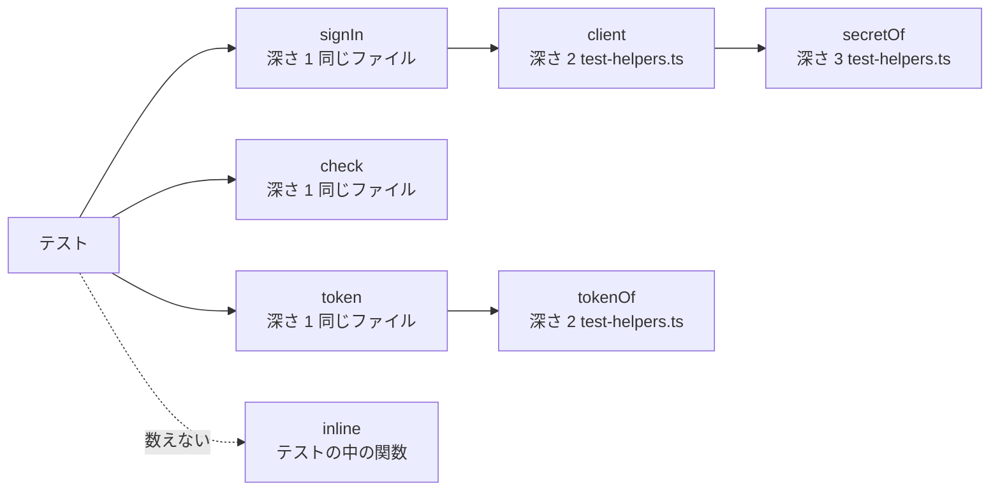

`signIn` は `inline` の中で呼ばれるが、`inline` はテストの一部なので、テストが呼ぶものとして深さ 1 に並ぶ。
`client` の中の `pick` は `client` の中で書いた関数なので並ばない。
`authenticate` は関数カタログの関数なので並ばない。

同じファイルの四つ目のテストは `check(signIn('b'))` と `check(client('b').id)` を呼ぶ。
`client` はテストが自分で呼ぶので、`check`、`signIn`、`client` が深さ 1、`secretOf` が深さ 2 になる。

`helperOf` が無いときは、ファイルの中のヘルパーだけを見つける（一つ目のテストなら `signIn`、`check`、`token`）。

### ①-6-e 宣言の行

`declarationLines(file, first, last)` は、ヘルパーのコードとして見せる行の範囲である。

- 始まりは `first` の JSDoc を含む始まり
- その上のコメントを下から順に見て、間の改行が一つ以下（空行が無い）なら含める
- 終わりは `last` の最後の行（オーバーロードなら実装の終わり）

| コード | 行 |
|---|---|
| 1 行目 `/** A client of the tests. */`、2 から 5 行目 `export function client(...) {...}` | `[1, 5]` |
| 6 行目 `// The secret of a client`、7 から 9 行目 `function secretOf(...)` | `[6, 9]` |
| 10 行目 `export const tokenOf = (value: string) => value.toUpperCase();` | `[10, 10]` |

```ts
interface CodeHelper {
  name: string; // 呼ばれた名前
  file?: string; // テスト支援のファイル。同じファイルなら無し
  lines: [number, number];
  depth: number; // 1 はテストが呼ぶもの
}

// カードに残す形。file は必ず持つ（同じファイルのヘルパーはテストのファイル）
interface HelperRef extends CodeRef {
  name: string;
  depth?: number; // 無ければ 1
}
```

例：6,062 枚のカードのうち 3,722 枚がヘルパーを持ち、深さの最大は 4 である。

実装：

- `packages/test-catalog/src/read-code.ts`：`helperReader`、`fileHelpers`、`calleesIn`、`scopeNames`、`boundNames`、`declarationLines`、`FRAMEWORK`、`HELPER_DEPTH`
- `packages/test-catalog/src/catalog.ts`：`helperResolver`

## ①-7 機能ファイルのシナリオ

機能ファイルを `@cucumber/gherkin` のパーサーで構造のまま読み、シナリオと例の行をテストケースにする。

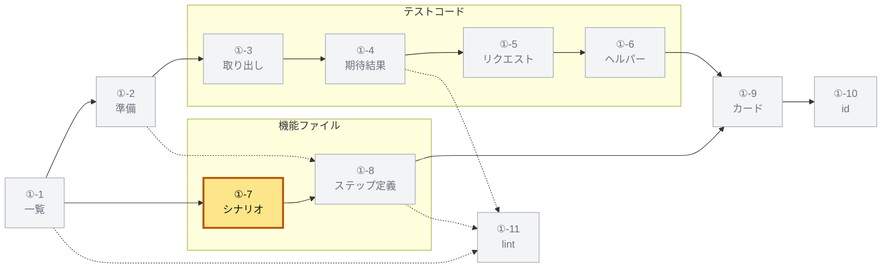

### ①-7-a 書き方の約束

機能ファイルは Gherkin で書くテストであり、英語を正とする。
カードが頼る約束は次のとおりである（検査は ⑦ の `lint-features.mjs`）。

- シナリオごとに、kebab-case の `@id:<id>` を一つ書く
- 対象のタグ（`@endpoint:`、`@function:`、`@scenario:`）を一つ以上書く
- **実行先**のタグ（`@hono`、`@nextjs`、`@http`）を一つ以上書く
- Feature と Rule のタグは、その中のシナリオのタグとして数える
- `ja:` の行（Gherkin の自由な説明）に日本語の名前を書いてよい

次は `tests/features/token/client-authentication.feature` の抜粋である。

```gherkin
@endpoint:token
Feature: Client authentication at the token endpoint
  ja: トークンエンドポイントのクライアント認証

  Background:
    Given a registered confidential client:
      | client_id | client_secret         | redirect_uri                    |
      | client-1  | client-1-secret-value | https://rp.example.com/callback |
    And the client "client-1" has the authorization code "code-1"

  @id:token-invalid-client-secret @spec:RFC6749-5.2 @spec:OAuth2.1-2.3 @spec:RFC6750-3 @auth @hono @nextjs
  Scenario: Reject invalid client credentials with invalid_client
    ja: 無効なクライアント認証情報を invalid_client で拒否する
    Given the client "client-1" presents invalid credentials
    When the client "client-1" requests the token endpoint with grant_type "authorization_code":
      | code   | redirect_uri                    |
      | code-1 | https://rp.example.com/callback |
    Then the HTTP status is 401
    And the error code is "invalid_client"
```

| 機能ファイル | カード |
|---|---|
| `Feature:` の名前 | `path[0]` |
| `Scenario:` の名前 | `title` |
| シナリオの `ja:` の行 | `ja.title` |
| `@id:` | `id`（[①-10](#-10-テストの-id)） |
| `@endpoint:`、`@function:` | `subjects`（[①-9-b](#-9-b-対象と根拠)） |
| `@spec:` | `spec` |
| `@hono`、`@nextjs`、`@http` | `targets` と `kind`（[①-9-a](#-9-a-種類)） |
| コロンの無いほかのタグ | `aspects` の宣言（[①-9-d](#-9-d-観点)） |
| `Given` | `steps`（`context`） |
| `When` | `steps`（`action`）と `requests`（[①-9-e](#-9-e-そのほかのフィールド)） |
| `Then` | `steps`（`outcome`）と `assertions`（[①-9-e](#-9-e-そのほかのフィールド)） |
| データテーブル | `steps[].table` と `requests[].params` |

### ①-7-b テストケースへの分け方

パーサーは `new Parser(new AstBuilder(IdGenerator.incrementing()), new GherkinClassicTokenMatcher())` である。
読めない文書は例外を投げ、[①-2-f](#-2-f-警告) の警告になる。

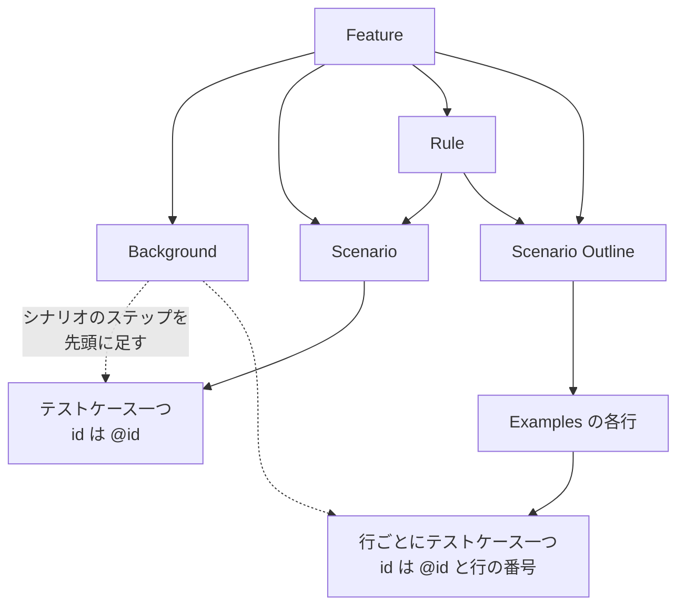

| 要素 | 扱い |
|---|---|
| `Scenario` | テストケース一つ |
| `Scenario Outline` | 全部の `Examples` の行ごとにテストケース一つ（行の番号は 1 から、`Examples` をまたいで続ける） |
| `Examples` の無い `Scenario Outline` | `Scenario` と同じくテストケース一つ（`<列>` は置き換えない） |
| `Rule` | 中のシナリオを、Feature と Rule のタグを受け継いで読む（Rule の名前は `path` に入れない） |
| `Background` | そのステップを、同じ階層と下の階層のシナリオの先頭に足す |
| `Feature:` の無い文書（空、コメントだけ） | テストケースなし |

### ①-7-c テストケースの値

テストケースごとに次の値を決める（`FeatureTest`、[①-7-d](#-7-d-タグの読み方) の下）。

| フィールド | シナリオ | 例の行 |
|---|---|---|
| `tags` | Feature、Rule、シナリオのタグの順 | 左に加えて `Examples` のタグ |
| `id` | タグのうち最初の `@id:` の値 | その値に `-<行の番号>` |
| `title` | シナリオの名前 | 名前の `<列>` を行の値にしたもの |
| `ja` | 説明の行のうち最初に `ja:` で始まるもの（空ならなし） | シナリオの `ja` の `<列>` を行の値にしたもの |
| `path` | `[Feature の名前]` | `[Feature の名前, アウトラインの名前（置き換えない）]` |
| `lines` | `Scenario:` の行から、同じ階層の次のシナリオの行の一つ前まで（次が無いときは下の終わり） | `[行の位置, 行の位置]` |
| `steps` | Background のステップとシナリオのステップ | 同じで、`<列>` を行の値にしたもの |
| `example` | なし | 列の名前 → 値（カードには入れない） |

同じ階層に次のシナリオが無いとき、終わりは `text.split('\n').length` である。
末尾が改行のファイルでは、最終行の次の行になる。
22 行の `client-authentication.feature` のシナリオは `[12, 23]` である。

`@id:` が無ければ `id` は無く、[①-10](#-10-テストの-id) がハッシュで決める。
Feature の `ja:` も読む（`featureJa`）が、カードには入れない。

シナリオのステップは、一つずつ次の形にする。

| フィールド | 値 |
|---|---|
| `keyword` | 書かれたキーワード（`Given `、`And `、末尾の空白も） |
| `type` | `keywordType` が Context なら `context`、Action なら `action`、Outcome なら `outcome`、Conjunction（`And`、`But`）なら前のステップの `type`、ほか（`*`）は `unknown` |
| `text` | ステップの文 |
| `table` | データテーブルのセルの値（見出しの行が先頭） |
| `line` | ステップの行 |

前のステップは、Background とシナリオをまたいで続けて数える。
`*` の後の `And` は `unknown` になる。

### ①-7-d タグの読み方

`readFeatureTags` は、先頭の `@` を除き、最初の `:` で名前と値に分ける。

| タグ | 読み方 |
|---|---|
| `@endpoint:<id>` | `endpoints` |
| `@function:<名前か id>` | `functions` |
| `@scenario:<id>` | `scenarios`（読むだけで、カードには使わない） |
| `@spec:<文書>-<節>` | `spec`（下の `specOfTag`） |
| `@id:<id>` | ここでは読み飛ばす |
| `@hono`、`@nextjs`、`@http` | `targets` |
| コロンの無いほかのタグ | `aspects`（大文字と小文字は区別する） |
| コロンのあるほかのタグ | 読まない |

タグは重複を除かない。
同じタグを Feature とシナリオの両方に書くと、`endpoints`、`targets`、`spec` に同じ値が二つ入る。
カードの `subjects`、`targets`、`spec` も重なる（[①-9-b](#-9-b-対象と根拠)、[①-9-e](#-9-e-そのほかのフィールド)）。

`specOfTag(value)` は、タグを仕様の節の書き方にする。

1. `/^(.*?)-(\d+(?:\.\d+)*)$/` で文書と節に分ける（合わなければ全体が文書）
2. 文書を置き換える：`/^RFC(\d{4})$/i` は `RFC $1`、`/^OAuth(\d\.\d)$/i` は `OAuth $1`、`/^OIDC-?Core(?:-?1\.0)?$/i` は `OIDC Core 1.0`、`/^OIDC-?Discovery(?:-?1\.0)?$/i` は `OIDC Discovery 1.0`
3. 残りの `-` を空白にする
4. 節があれば ` §<節>` を足す

| タグの値 | 節 |
|---|---|
| `RFC6749-5.2` | `RFC 6749 §5.2` |
| `OAuth2.1-2.3` | `OAuth 2.1 §2.3` |
| `OIDC-Core-11` | `OIDC Core 1.0 §11` |
| `OIDC-Discovery-4` | `OIDC Discovery 1.0 §4` |

```ts
interface FeatureTest {
  id?: string;
  outline?: { id?: string; row: number };
  title: string;
  ja?: string;
  path: string[];
  featureJa?: string;
  lines: [number, number];
  tags: string[];
  steps: FeatureStep[];
  example?: Record<string, string>;
}
```

### ①-7-e このリポジトリの機能ファイル

`tests/features/` の四つのファイルが、7 個の `@id` から 8 枚のカードを作る。
`token/` の三つは Feature に `@endpoint:token` を書き、どのシナリオも `@hono @nextjs` で走る（種類は `api`）。
`scenarios/` の一つは Feature に `@scenario:authorization-code-flow` を書き、`@http` で走る（種類は `e2e`）。

| ファイル | `@id` | 観点のタグ |
|---|---|---|
| `token/client-authentication.feature` | `token-invalid-client-secret` | `@auth` |
| `token/authorization-code-grant.feature` | `token-authorization-code-success` | なし |
| 同上 | `token-missing-required-parameter`（アウトライン、2 行で `-1` と `-2`） | なし |
| 同上 | `token-unknown-authorization-code` | なし |
| 同上 | `token-replayed-authorization-code` | `@security` |
| `token/grant-type.feature` | `token-unsupported-grant-type` | なし |
| `scenarios/authorization-code-flow.feature` | `auth-code-flow-online-refresh` | なし |

シナリオの文、表の値、`@spec:` のタグは、[付録 A](appendix.md#a-機能ファイル) の全文のとおりである。
どのシナリオのステップも、[①-8-e](#-8-e-ステップ定義の置き方) の 25 個の定義のどれかに合う。

実装：

- `packages/test-catalog/src/read-feature.ts`：`readFeatureTests`、`readFeatureTags`、`specOfTag`、`stepsOf`、`stepOf`、`japaneseOf`、`idOf`
- `tests/features/`

## ①-8 ステップ定義と訳の表

シナリオのステップを**語彙**（ステップ定義の集まり）に結び、言い回し、日本語、定義のコード、ヘルパーを付ける。

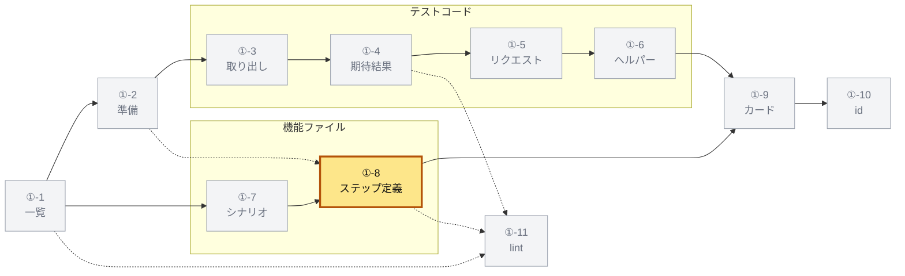

一つのシナリオのステップは、次の順に読む。

```mermaid
flowchart LR
  ST["シナリオのステップの文"] --> M["Vocabulary.matches<br/>最初に一致した定義"]
  M --> PH["phrase<br/>定義の式"]
  M --> HO["穴の値<br/>引用符ごと"]
  PH --> JA["ja.yaml のひな形"]
  HO --> JA
  JA --> J["ja"]
  M --> DC["definition<br/>定義のコードの範囲"]
  DC --> HP["定義が呼ぶヘルパー"]
  HP --> SH["scenarioHelpers<br/>シナリオのヘルパー"]
```

### ①-8-a 語彙の読み方

**ステップ定義**は、`tests/steps` の `Given`、`When`、`Then`、`Step` の呼び出しである。
第一引数が Cucumber Expression の式で、一行の単一引用符の文字列で書く（検査は ⑦ の `lint-steps.mjs`）。

`Vocabulary.read(repository)` は、`tests/steps` の下のソースを字句で読む。
ソースは、`node_modules` と `.` で始まる名前を除いて再帰で集めた、`/\.(m?[jt]s)$/` に合い `.d.ts` でないファイルである。
`.features-gen` は `.` で始まるので読まない。

```ts
// ステップ定義：キーワード、単一引用符の一行の文字列か、ほかの文字
const DEFINITION = /\b(Given|When|Then|Step)\(\s*(?:'((?:[^'\\\n]|\\.)*)'|(\S))/g;
// パラメータ型：defineParameterType の name と regexp
const PARAMETER_TYPE = /defineParameterType\(\s*(?:new\s+ParameterType\(\s*)?\{?[^)]*?name:\s*'([\w-]+)'[^)]*?regexp:\s*(\/(?:[^/\\\n]|\\.)+\/[a-z]*)/g;
```

| 合ったもの | 扱い |
|---|---|
| 文字列 | 定義。<br>式は `\'` を `'` に戻した文字列、行はキーワードの行 |
| ほかの文字（正規表現、テンプレート、変数） | `invalid` に集める（[作らなくてよいもの](README.md#作らなくてよいもの)） |
| `defineParameterType` | パラメータ型。<br>正規表現として読めなければ捨てる |

正規表現やテンプレートの式は、⑦ の `lint-steps.mjs` が自分の構文木の検査（`step-regexp`、`step-literal`）で落とす。

`new Vocabulary(definitions, invalid, parameterTypes)` は、`@cucumber/cucumber-expressions` で式を組む。

- `ParameterTypeRegistry` にパラメータ型を登録する（二度目の名前や既にある名前は捨てる）
- 各定義を `CucumberExpression` にする（組めない式は何にも一致せず、`bddgen` が報告する）

```ts
interface StepDefinition {
  keyword: 'Given' | 'When' | 'Then' | 'Step';
  expression: string; // 'the HTTP status is {int}'
  file: string; // tests/steps/common/response.steps.ts
  line: number;
}
```

語彙は 25 個で、`defineParameterType` は無い。

### ①-8-b シナリオのステップと定義

`vocabulary.matches(text)` は、シナリオのステップの文に一致する定義をすべて、定義の順に返す。
穴の値は、一致した文字列そのものである（`{string}` は引用符ごと）。
[①-9](#-9-カードの組み立て) は最初の一つだけを使う。
二つ以上に一致する文は、`bddgen` が ambiguous として落とす。

`the error code is "invalid_client"` は `the error code is {string}` に一致し、穴は `"invalid_client"` である。

一致したステップには三つを付ける。

| フィールド | 値 |
|---|---|
| `phrase` | 定義の式 |
| `ja` | 訳の表で式を引き、穴に一致した文字列をそのまま入れたもの |
| `definition` | 定義のコードの範囲（[①-8-c](#-8-c-定義のコードとヘルパー)） |

訳の表に式が無ければ、`ja` を付けず、式を「訳の無い言い回し」に足す。
どの定義にも一致しないステップは、そのままにする。

```ts
interface FeatureStep {
  keyword: string; // ①-7-c
  type: 'context' | 'action' | 'outcome' | 'unknown';
  text: string;
  table?: string[][];
  line: number;
  phrase?: string; // ①-8-b
  ja?: string;
  definition?: CodeRef; // { file, lines }
}
```

### ①-8-c 定義のコードとヘルパー

`stepDefinitionLines(file)` は、構文木で定義の呼び出しを探し、キーワードの行ごとに次を返す。

- `keyword`：呼び出し先の識別子（`Given`、`When`、`Then`、`Step`）
- `lines`：呼び出しの文と、その真上のコメント（`declarationLines`、[①-6-e](#-6-e-宣言の行)）
- `fn`：引数を後ろから見て最初のアロー関数か関数式

同じ行に二つあれば、最初のものを使う。

`stepDefinitionCode(project, repository, definitions, helperOf)` は、語彙の定義に、そのコードとヘルパーを結ぶ。

- `project` は [①-2-b](#-2-b-二種類のプロジェクト) の別のプロジェクトである
- 定義のファイルと行が構文木の行に無いか、キーワードが違えば、コードを付けない（④ が分岐点の版を重ねたときに起きる）
- ヘルパーは `fileHelpers` で、テストと同じ規則（[①-6](#-6-ヘルパー)）で読む（関数カタログの import は無いものとする）
- キーは `<file>:<line>` である

`read-code.test.ts` の例では、`src/steps.ts:6` の定義のコードは `[5, 8]` である。
5 行目のコメントが真上にあるからである。
`src/steps.ts:17` の定義は `errorOf`（深さ 1）と `trimmed`（深さ 2）を呼ぶ。

`scenarioHelpers(lists)` は、シナリオのステップの順に定義のヘルパーをまとめ、シナリオのヘルパーにする。

```ts
function scenarioHelpers(lists: HelperRef[][]): HelperRef[] {
  const helpers = [];
  const seen = new Set<string>(); // `${file}:${lines[0]}`
  for (const list of lists) {
    let skipping: number | undefined;
    for (const helper of list) {
      const depth = helper.depth ?? 1;
      if (skipping !== undefined && depth > skipping) continue; // 既出の下は飛ばす
      skipping = undefined;
      const key = `${helper.file}:${helper.lines[0]}`;
      if (seen.has(key)) { skipping = depth; continue; }
      seen.add(key);
      helpers.push(helper);
    }
  }
  return helpers;
}
```

既に並べたヘルパーは、その下のヘルパーごと飛ばす。
だから、どのヘルパーも、それを呼ぶヘルパーの下に残る。

| ステップ | 定義のヘルパー（名前と深さ） |
|---|---|
| 一つ目 | storeCode 1、scenarioClient 2、requiredCell 1 |
| 二つ目 | storeCode 1、scenarioClient 2、redeem 1、requestToken 2、scenarioClient 2、jsonBody 3 |
| 結果 | storeCode 1、scenarioClient 2、requiredCell 1、redeem 1、requestToken 2 |

二つ目の `scenarioClient` は既出なので、その下の `jsonBody` も飛ぶ。

### ①-8-d 訳の表

**訳の表** `tests/steps/ja.yaml` は、言い回しを日本語のひな形に対応づける YAML のマップである。
キーはステップ定義の式か、期待結果の言い回し（[①-4-d](#-4-d-言葉にする規則)）である。
ひな形の `{0}`、`{1}` は、言い回しの穴を英語の順に番号で指す。

```yaml
'the HTTP status is {int}': 'HTTP ステータスが {0} である'
'the {string} header is {string}': '{0} ヘッダーが {1} である'
'the client {string} redeems the authorization code {string} without {word}': 'クライアント {0} が {2} なしで認可コード {1} を引き換える'
'{code} is {value}': '{0} が {1} である'
```

| 操作 | 規則 |
|---|---|
| 読む（`Translations.read`） | ファイルが無ければ空の表。<br>値が文字列でない項目は捨てる |
| 訳す（`translate(phrase, holes)`） | ひな形の `/\{(\d+)\}/g` を `holes[番号]` にする（無い番号はそのまま、キーが無ければ `undefined`） |
| 穴を数える（`holesOf(phrase)`） | `\{`、`\}`、`\(`、`\)`、`\/` を除いてから `/\{([\w-]*)\}/g` の名前を並べる |

穴の種類は `{int}`、`{string}`、`{word}`、`{}`、パラメータ型の名前、期待結果の `{code}` と `{value}` である。
同じことを確かめる期待結果の言い回しとステップ定義の式は、同じ文にそろえてある。
`the HTTP status is {int}`、`the error code is {string}`、`the {string} header is {string}` の三つである。
そろえておけば、一つの訳で両方を訳せる。

表は 105 項目で、ステップ定義の式 25 個と期待結果の言い回し 83 個（重なり 3 個）をすべて訳す。
全文は [付録 B](appendix.md#b-訳の表) にある。

`checkTranslations(translations, phrases)` は、表の誤りを文にして返す（[①-11](#-11-テストの-lint) の lint が使う）。

| 誤り | 文 |
|---|---|
| キーがどの言い回しでもない | `tests/steps/ja.yaml: "<phrase>" is no step expression of tests/steps and no phrase of an expectation` |
| ひな形が穴の数の外の番号を使う | `tests/steps/ja.yaml: "<phrase>" has <n> holes, but its Japanese uses {<番号>}` |
| 穴を一度でなく使う | `tests/steps/ja.yaml: "<phrase>" uses its hole {<i>} <回数> times in its Japanese (once is right)` |

キーワードの日本語を引く `japaneseKeyword` は、出力に効かない（[作らなくてよいもの](README.md#作らなくてよいもの)）。

### ①-8-e ステップ定義の置き方

①-8-e から ①-8-g は、読み取りでなく、シナリオを走らせる側の決まりである。
読み取り（①-8-a から ①-8-d）が使うのは、ここに置く定義の式とコードの範囲だけである。
走らせるコマンドは [⑦-1-c](07-build-ci.md#-1-c-機能ファイルの-project)、報告は [②-5-d](02-measure.md#-5-d-機能ファイルのテスト) にある。

ステップ定義は、ワークスペースのパッケージ `@maronn-openid-connect/test-steps`（`tests/steps`）に置く。
一つの定義は、使える実行先を、`createBdd()` に渡す `test` とタグで宣言する。
シナリオのステップに、その実行先で使える定義が無ければ、`bddgen` の生成が落ちる。

```mermaid
flowchart TB
  BASE["playwright-bdd の test"]
  TG["support/target.ts<br/>extend で exchange"]
  IP["support/in-process.ts<br/>extend で target と op"]
  FX["tests/e2e/fixtures.ts<br/>到達を記録する test"]
  HT["support/http.ts<br/>mergeTests の後に<br/>extend で flow"]
  C["common/*.steps.ts<br/>タグなし"]
  I["in-process/*.steps.ts<br/>タグ not @http"]
  H["http/*.steps.ts<br/>タグ not @hono and not @nextjs"]
  BASE --> TG
  TG --> IP
  TG --> HT
  FX --> HT
  TG -.-> C
  IP -.-> I
  HT -.-> H
```

- 実線は `test.extend` と `mergeTests`、点線はステップ定義のファイルが `createBdd(test, { tags })` に渡す `test` である
- 定義は、タグの式に合うシナリオにだけ使える
- `bddgen` が書くテストは、シナリオが使う定義の `test` のうち最も広げたもの（例：`support/in-process.ts` の `test`）を import する

| project | 設定 | 走らせるシナリオ | 使える定義 |
|---|---|---|---|
| `in-process-hono` | `tests/steps/playwright.config.ts`（`use.target: 'hono'`） | `@hono` | `common`、`in-process` |
| `in-process-nextjs` | 同じ（`use.target: 'nextjs'`） | `@nextjs` | `common`、`in-process` |
| `http` | `tests/e2e/playwright.config.ts` | `@http` | `common`、`http` |

どの project も、四つの glob（`support/*.ts`、`common/*.steps.ts`、`in-process/*.steps.ts`、`http/*.steps.ts`）の定義を読む。
使える定義を分けるのは、定義のタグの式である。

| ファイル | 中身 |
|---|---|
| `support/target.ts` | 全部の実行先が広げる `test`。<br>シナリオごとの `exchange`（最後の応答）、`lastResponse`、`jsonBody`、`receivedFromFetch` |
| `support/in-process.ts` | プロセス内の `test`（`target` オプション（worker）と、シナリオごとの `op`）。<br>`IN_PROCESS_TARGETS = 'not @http'`、`requestToken`、`authorizationCodeFields`、`s256Challenge` |
| `support/http.ts` | HTTP の `test`（`target.ts` と `tests/e2e/fixtures.ts` を `mergeTests` し、`flow` を足す）。<br>`HTTP_TARGETS = 'not @hono and not @nextjs'`、`E2E_CLIENTS` |
| `support/drivers/driver.ts` | `InProcessDriver` の型 |
| `support/drivers/hono.ts` | hono のドライバー（[①-8-f](#-8-f-プロセス内のドライバー)） |
| `support/drivers/nextjs.ts` | Next.js のドライバー（[①-8-f](#-8-f-プロセス内のドライバー)） |
| `common/response.steps.ts` | 全部の実行先の `Then`（9 個） |
| `in-process/token.steps.ts` | トークンエンドポイントの `Given`、`When`、`Then`（11 個） |
| `http/authorization-code-flow.steps.ts` | ブラウザと HTTP の `Given`、`When`（5 個） |

25 個の定義は、次の三つの表のとおりである。
日本語は `ja.yaml` にある（[①-8-d](#-8-d-訳の表)）。

#### 全部の実行先の定義

`common/response.steps.ts` は `createBdd(test)`（`support/target.ts` の `test`、タグなし）なので、どの実行先でも使える。
九つとも `Then` で、`exchange.response`（最後の応答）を読む。
本文は `jsonBody` で JSON のオブジェクトとして読む（オブジェクトでなければ誤りで止まる）。

| 式 | 確かめること |
|---|---|
| `the HTTP status is {int}` | ステータスが値である |
| `the error code is {string}` | 本文の `error` が値である |
| `the error description is {string}` | 本文の `error_description` が値である |
| `the {string} header is {string}` | 名前を小文字にしたヘッダーが値である |
| `the {string} header starts with {string}` | そのヘッダーが値で始まる |
| `the body has {word} {string}` | 本文の `{word}` が文字列の値である |
| `the body has {word} {int}` | 本文の `{word}` が数の値である |
| `the body has a(n) {word}` | 本文の `{word}` が空でない文字列である |
| `the length of {word} is {int}` | 本文の `{word}` の長さが値である |

#### プロセス内の定義

`in-process/token.steps.ts` は `createBdd(test, { tags: IN_PROCESS_TARGETS })` で、`test` は `support/in-process.ts` のものである。
シナリオごとの `op` が、ドライバー、登録したクライアント（`clients`）、保存したコード（`codes`）を持つ。

| キーワード | 式 | すること |
|---|---|---|
| `Given` | `a registered confidential client:` | 表の行ごとにクライアントを登録する。<br>`client_id`、`client_secret`、`redirect_uri` の列は必須で空にできず（`requiredCell`）、`token_endpoint_auth_method` は無ければ `client_secret_basic`、ほかには `client_secret_post` だけを許す |
| `Given` | `the client {string} has the authorization code {string}` | クライアントの認可コードを、`scope` を `openid` として保存する |
| `Given` | `the client {string} has the authorization code {string}:` | 同じく保存する。<br>一行の表の `scope`（空白で区切る）と `code_verifier`（S256 の `code_challenge` にする）を使う |
| `Given` | `the client {string} presents invalid credentials` | 以後、そのクライアントが示す secret を `wrong-secret` にする |
| `Given` | `the client {string} has redeemed the authorization code {string}` | 下の `redeems` と同じリクエストを送り、ステータスが 200 であることを確かめる |
| `When` | `the client {string} requests the token endpoint with grant_type {string}` | `grant_type` だけのトークンリクエストを送る |
| `When` | `the client {string} requests the token endpoint with grant_type {string}:` | 一行の表の列を `grant_type` に足して送る |
| `When` | `the client {string} redeems the authorization code {string}` | `grant_type=authorization_code`、`code`、登録した `redirect_uri`、保存した `code_verifier`（あれば）を送る |
| `When` | `the client {string} redeems the authorization code {string} without {word}` | 上と同じ欄から `{word}` の欄を除いて送る（無い欄なら誤りで止まる） |
| `Then` | `the authorization code {string} is not consumed` | ドライバーが、コードは使用済みでない（`false`）と答える |
| `Then` | `the tokens issued from the authorization code {string} are revoked` | そのコードで得たアクセストークンとリフレッシュトークンを、ストアが持たない |

トークンリクエストは `requestToken` が作り、`driver.issuer` の `/token` へ `POST` で送る。
本文は `application/x-www-form-urlencoded` で、応答は `exchange.response` に入れる。
`client_secret_basic` は `Authorization: Basic`、`client_secret_post` は本文の `client_id` と `client_secret` で認証する。
Basic の値は、ID と secret をそれぞれ `encodeURIComponent` して `:` でつなぎ、base64 にしたものである。

`…:` で終わる二つの式は、表が一行でなければ誤りで止まる。
コードを引き換えて 200 なら、`access_token` と `refresh_token` を `codes` に覚え、`are revoked` が使う。

#### HTTP の定義

`http/authorization-code-flow.steps.ts` は `createBdd(test, { tags: HTTP_TARGETS })` で、`test` は `support/http.ts` のものである。
ブラウザ（`page`）、HTTP（`request`）、シナリオごとの `flow` を使う。

| キーワード | 式 | すること |
|---|---|---|
| `Given` | `the user {string} can log in with the password {string}` | ログインするユーザーを `flow` に覚える。<br>OP にいる開発用のユーザーで、`@http` のシナリオは `testuser` と `password` を使う |
| `When` | `the client {string} sends an authorization request with scope {string}` | `E2E_CLIENTS` のクライアント（今は `e2e-features-client` 一つ）で `/authorize` を開く。<br>`response_type=code`、PKCE（S256）、`state`、`nonce`、`prompt=consent` を付ける |
| `When` | `the user logs in on the login page` | URL が `/\/login$/` に合うことを確かめ、`Username:` と `Password:` を埋めて `Login` を押す |
| `When` | `the user approves on the consent page` | URL が `/\/consent$/` に合うことを確かめて `Approve` を押す。<br>`redirect_uri` に戻った URL の `state` を確かめ、`code` を取る |
| `When` | `the client redeems the authorization code for tokens` | `request.post` で `/token` へ、`client_secret_basic` と `grant_type`、`code`、`redirect_uri`、`code_verifier` を送る。<br>応答を `exchange.response` に入れる |

### ①-8-f プロセス内のドライバー

プロセス内の実行先は、アプリのコードをワーカーのプロセスで直に呼ぶ**ドライバー**で、シナリオごとに新しい OP を開く。
ステップ定義は `InProcessDriver` だけを見るので、一つの定義が両方のアプリに使える。

```ts
interface InProcessDriver {
  readonly issuer: string; // ステップ定義が送る URL の origin
  registerClient(client: ConfidentialClient): Promise<void>; // { clientId, clientSecret, redirectUri, authMethod }
  storeAuthorizationCode(code: IssuedAuthorizationCode): Promise<void>; // { code, clientId, redirectUri, scope, codeChallenge? }
  authorizationCodeUsed(code: string): Promise<boolean | undefined>; // ストアに無ければ undefined
  holdsAccessToken(accessToken: string): Promise<boolean>;
  holdsRefreshToken(refreshToken: string): Promise<boolean>;
  request(request: Request): Promise<Response>; // パスのエンドポイントに渡す
  close(): Promise<void>; // ストアを捨てる
}
```

```mermaid
sequenceDiagram
  participant S as ステップ定義
  participant OP as op の fixture
  participant IP as in-process.ts
  participant D as ドライバー
  participant A as アプリのコード
  S->>OP: シナリオを始める
  OP->>IP: openDriver(target)
  IP->>D: DRIVER_MODULES の URL を import
  D->>A: 準備してから import
  D-->>OP: InProcessDriver
  OP-->>S: driver と clients と codes
  S->>D: registerClient と storeAuthorizationCode
  S->>D: request(Request)
  D->>A: app.request か route.POST
  A-->>D: Response
  D-->>S: Response
  S->>OP: シナリオの終わり
  OP->>D: close()
```

- `target` は project の `use.target`（worker の option）である
- 無ければ `The project runs no in-process target: set use.target to hono or nextjs (tests/steps/playwright.config.ts)` を投げる
- `DRIVER_MODULES` は `{ hono: './drivers/hono.ts', nextjs: './drivers/nextjs.ts' }` で、`import(new URL(DRIVER_MODULES[target], import.meta.url).href)` で読む
- 指定子を文字列のリテラルにしないのは、二つのアプリのコードを一つの TypeScript のプログラムに入れないためである（JSX の設定が違う、[①-8-g](#-8-g-ステップ定義の-tsconfig)）
- 同じ理由で、`bddgen` と http の実行先は、アプリのコードを読み込まない
- `op` は `{ driver, clients: new Map(), codes: new Map() }` で、シナリオの後に `driver.close()` を呼ぶ
- だから、シナリオは前のシナリオのクライアント、コード、トークンを見ない

二つのドライバーは次のとおりである。
`TEST_ISSUER` は、どちらのアプリの `src/test-support/context.ts` でも `https://op.example.com` である。

| 項目 | hono（`drivers/hono.ts`） | Next.js（`drivers/nextjs.ts`） |
|---|---|---|
| `issuer` | `TEST_ISSUER` | `TEST_ISSUER` |
| OP | `createApp({ signingKeyProvider: staticKeyProvider(await rs256Key()), storage: stores, clientResolver: createClientResolver(db), clientKeyResolver: createClientKeyResolver(db), config: { issuer: TEST_ISSUER } })`。<br>`db` は `createEmptyDatabase()`、`stores` は `createProviderStores(db)` | `_oidc-provider/provider` の `stores` と、`_oidc-provider/db` の `createDatabase()` の `database`。<br>import の前に下の準備をする |
| ストア | ドライバーごとの新しいメモリの DB | ドライバーごとの新しい `createMapKvDatabase()`（`apps/nextjs/src/test-support/databases.ts`）を `current` にする |
| `registerClient` | `registerClient(db, confidentialClient({ clientId, clientSecret, redirectUris: [redirectUri], tokenEndpointAuthMethods: [authMethod] }))`。<br>`confidentialClient` は `grantTypes: ['authorization_code', 'refresh_token']` を足す | `registerClient(database, { clientId, clientSecret, redirectUris: [redirectUri], clientType: 'confidential', grantTypes: ['authorization_code', 'refresh_token'], tokenEndpointAuthMethods: [authMethod], responseTypes: ['code'] })` |
| `storeAuthorizationCode` | `stores.authCodeStore.set(code, storedAuthorizationCode({ … }))` | `stores.authCodeStore.set(code, { … })` |
| `authorizationCodeUsed` | `stores.authCodeStore.get(code)` の `used` | 同じ |
| `holdsAccessToken`、`holdsRefreshToken` | `accessTokenStore`、`refreshTokenStore` の `get` が `undefined` でないか | 同じ |
| `request` | `app.request(request)` | パスが `/token` で `POST` なら、`app/token/route` の `POST(request)`。<br>ほかのパスかメソッドは投げる |
| `close` | 何もしない | `current` がこのストアなら `undefined` にする |

Next.js の `request` が投げるのは、パスが無いときの `The Next.js in-process target serves no Route Handler at <パス>` と、`POST` でないときの `The Next.js in-process target serves only POST <パス>` である。

保存する認可コードは、どちらも次の値である。
同意の画面が保存するものと同じ形で、10 分前にログインしたユーザーのコードにする。

| 欄 | 値 |
|---|---|
| `code`、`clientId`、`redirectUri`、`scope` | ステップ定義が渡した値 |
| `grantId` | `grant-<code>` |
| `redirectUriExplicit` | `true` |
| `subject` | `user-1` |
| `used` | `false` |
| `expiresAt` | `now + 300`（`now` は `Math.floor(Date.now() / 1000)`） |
| `authTime` | `now - 600` |
| `nonce`、`sessionId` | `nonce-1`、`session-1` |
| `codeChallenge`、`codeChallengeMethod` | `codeChallenge` を渡したときだけ。<br>`codeChallengeMethod` は `S256` |

hono の `storedAuthorizationCode` は、`redirectUriExplicit`、`subject`、`used`、`nonce`、`sessionId` を上の値で埋める。

Next.js のドライバーは、provider を初めて import する前に、次の準備をする。
provider はストアをプロセスで一度だけ作るので、ストアそのものでなく、いまのシナリオのストアへ渡す KV を置く。

```mermaid
flowchart TB
  O["openDriver"] --> R["resolveNextSubpaths<br/>プロセスで一度"]
  R --> I{"globalThis に<br/>__oidcKvDatabase が<br/>あるか"}
  I -->|"無い"| P["環境変数を置き<br/>渡す KV を置き<br/>__oidcScenarioStoreInstalled<br/>を立てる"]
  I -->|"ある"| C{"__oidcScenarioStoreInstalled<br/>が立っているか"}
  C -->|"いいえ"| X["投げる"]
  C -->|"はい"| N["新しい Map の KV を<br/>current にする"]
  P --> N
  N --> M["provider と db を import"]
```

- 環境変数は `OIDC_ISSUER = TEST_ISSUER` と `OIDC_SQLITE_PATH = ':memory:'` である
- 渡す KV は、`get`、`set`、`setIfAbsent`、`delete` を、そのまま `current` に渡す
- `current` が無いときは `No scenario of the Next.js in-process target is running` を投げる
- 「投げる」のメッセージは `The Next.js provider opened its own store before the in-process target could put the scenario store there` である
- Playwright はワーカーの中でテストを一つずつ走らせるので、`current` はプロセスに一つでよい

`resolveNextSubpaths()` は、`node:module` の `registerHooks({ resolve })` を一度だけ登録する（`globalThis.__oidcNextSubpathsResolved`）。

- 解決が `ERR_MODULE_NOT_FOUND` で失敗し、指定子が `/^next\/[^.]+$/` に合えば、`<指定子>.js` で解き直す
- ほかの失敗は、そのまま投げる
- next のパッケージは `exports` を持たないので、Node の ESM の解決は `next/server` を `next/server.js` に解かないからである

### ①-8-g ステップ定義の tsconfig

`tests/steps` の `typecheck` は、三つの設定を順に `tsc --noEmit -p` で検査する。
ドライバーは、アプリと同じ JSX と厳しさで検査する。

三つの設定は、次の `compilerOptions` を共に持つ。

```json
{
  "target": "ES2022", "lib": ["ES2022", "DOM", "DOM.Iterable"], "types": ["node"],
  "module": "ESNext", "moduleResolution": "bundler", "noEmit": true, "isolatedModules": true,
  "esModuleInterop": true, "forceConsistentCasingInFileNames": true, "allowSyntheticDefaultImports": true,
  "strict": true, "noUnusedLocals": true, "noUnusedParameters": true, "noFallthroughCasesInSwitch": true,
  "skipLibCheck": true
}
```

| 設定 | 読むファイル | ほかの `compilerOptions` | 理由 |
|---|---|---|---|
| `tsconfig.json` | `include`：`playwright.config.ts`、`support/*.ts`、`support/drivers/driver.ts`、`common/**/*.ts`、`in-process/**/*.ts`、`http/**/*.ts`。<br>`exclude`：`node_modules`、`.features-gen`、`test-results` | `noUncheckedIndexedAccess: true`、`noImplicitReturns: true` | ステップ定義と fixture だけを、アプリのコード抜きで検査する |
| `tsconfig.hono.json` | `files`：`support/drivers/hono.ts` | `jsx: "react-jsx"`、`jsxImportSource: "hono/jsx"`、`noUncheckedIndexedAccess: false`、`noImplicitReturns: false` | `apps/hono/tsconfig.json` と同じ JSX と厳しさで、ドライバーが import する hono のコードを読む |
| `tsconfig.nextjs.json` | `include`：`support/drivers/nextjs.ts`、`../../apps/nextjs/src/app/_oidc-provider/features/*/config.ts` | `jsx: "react-jsx"`、`allowJs: true`、`resolveJsonModule: true`、`noUncheckedIndexedAccess: false`、`noImplicitReturns: false` | `apps/nextjs/tsconfig.json` と同じ設定にする。<br>機能の `config.ts` は `declare module` でアプリの `ClientRegistration` を広げるので、import されなくても入れる |

実装：

- `packages/test-catalog/src/vocabulary.ts`：`Vocabulary`、`readDefinitions`、`readParameterTypes`、`Translations`、`holesOf`、`checkTranslations`、`japaneseKeyword`
- `packages/test-catalog/src/catalog.ts`：`stepDefinitionLines`、`stepDefinitionCode`、`scenarioHelpers`
- `packages/test-catalog/src/read-code.ts`：`fileHelpers`
- `tests/steps/support/target.ts`：`test`、`exchange`
- `tests/steps/support/http.ts`：`HTTP_TARGETS`、`E2E_CLIENTS`
- `tests/steps/support/in-process.ts`：`DRIVER_MODULES`、`openDriver`、`IN_PROCESS_TARGETS`、`requestToken`
- `tests/steps/support/drivers/driver.ts`：`InProcessDriver`、`ConfidentialClient`、`IssuedAuthorizationCode`
- `tests/steps/support/drivers/hono.ts`：`openDriver`
- `tests/steps/support/drivers/nextjs.ts`：`openDriver`、`resolveNextSubpaths`、`installScenarioStore`、`scenarioStore`
- `tests/steps/tsconfig.json`
- `tests/steps/tsconfig.hono.json`
- `tests/steps/tsconfig.nextjs.json`
- `tests/steps/ja.yaml`

## ①-9 カードの組み立て

読んだテストの種類、対象、正常系か異常系か、観点を決め、**カード**（`TestCase`）にする。

```mermaid
flowchart LR
  S1["①-1<br/>一覧"] --> S2["①-2<br/>準備"]
  subgraph CODE["テストコード"]
    direction LR
    S3["①-3<br/>取り出し"] --> S4["①-4<br/>期待結果"] --> S5["①-5<br/>リクエスト"] --> S6["①-6<br/>ヘルパー"]
  end
  subgraph FEAT["機能ファイル"]
    direction LR
    S7["①-7<br/>シナリオ"] --> S8["①-8<br/>ステップ定義"]
  end
  S2 --> S3
  S1 --> S7
  S2 -.-> S8
  S6 --> S9["①-9<br/>カード"]
  S8 --> S9
  S9 --> S10["①-10<br/>id"]
  S1 -.-> S11["①-11<br/>lint"]
  S4 -.-> S11
  S8 -.-> S11
  classDef here fill:#fde68a,stroke:#b45309,stroke-width:3px,color:#111
  classDef dim fill:#f3f4f6,stroke:#9ca3af,color:#6b7280
  class S9 here
  class S1,S2,S3,S4,S5,S6,S7,S8,S10,S11 dim
```

カードの型は次のとおりで、各フィールドを決める節をコメントに書く。
`result` と `reach` は ③ が足す。

```ts
interface TestCase {
  id: string; // ①-10
  kind: 'unit' | 'api' | 'e2e' | 'tool'; // ①-9-a
  root: string; // ①-1。機能ファイルは 'features'
  source: { file: string; lines: [number, number]; form: 'code' | 'feature' }; // ①-3-c、①-7-c
  title: string;
  ja?: { title?: string }; // ①-3-e、①-7-c
  path: string[];
  subjects: Subject[]; // ①-9-b
  requests?: RequestShape[]; // ①-5、①-9-e
  routeCode?: NamedCodeRef; // ①-3-d、①-9-e
  outcome: 'success' | 'failure' | 'unknown'; // ①-9-c
  aspects: string[]; // ①-9-d
  spec: string[]; // ①-3-e、①-7-d
  assertions: Assertion[]; // ①-4-g、①-9-e
  errors?: string[]; // ①-9-c
  steps?: FeatureStep[]; // ①-7-c、①-8-b
  targets?: string[]; // ①-9-e
  evidence: Array<'declared' | 'static' | 'coverage'>; // ①-9-b
  skipped?: boolean; // スキップのときだけ true（①-3-b）
  digest: string; // ①-9-e
  result?: TestResult; // ③-3
  reach?: TestReach[]; // ③-4
  helpers?: HelperRef[]; // ①-6、①-8-c
}
```

### ①-9-a 種類

種類は、置き場所で決まるものを先に決め、決まらないものを振る舞いで分ける。

```mermaid
flowchart TB
  F{"form"} -->|"code"| P{"place"}
  P -->|"tool"| TL["tool"]
  P -->|"e2e"| E2["e2e"]
  P -->|"catalog"| Q{"リクエストを送るか<br/>endpoints があるか"}
  Q -->|"はい"| AP["api"]
  Q -->|"いいえ"| UN["unit"]
  F -->|"feature"| G{"実行先のタグ"}
  G -->|"@hono か @nextjs がある<br/>または @http が無い"| AP2["api"]
  G -->|"@http だけ"| E3["e2e"]
```

| 種類 | テストコード | 機能ファイル |
|---|---|---|
| `tool` | `place` が `tool` | なし |
| `e2e` | `place` が `e2e` | 実行先が `@http` だけ |
| `api` | 送ったリクエスト（[①-5](#-5-リクエストの形)）が一つでもあるか、`endpoints`（[①-5-f](#-5-f-テストが届くエンドポイント)）がある | `@hono` か `@nextjs` があるか、`@http` が無い |
| `unit` | 残り。<br>リクエストを一つも送らない | なし |

- 送ったリクエストは、行き先（[①-5-e](#-5-e-リクエストの行き先)）を問わない
- テストが自分で登録したルートや `/health` だけへ送るテストも、`api` である
- `root` も問わないので、ライブラリ（core など）のテストも、送れば `api` である
- ユニットテストは、確かめる関数を直接呼ぶテストである
- エンドポイントの対象が付くのは、行き先がエンドポイントのリクエストだけである（[①-9-b](#-9-b-対象と根拠)）

要件の「API テスト」と「統合テスト」は `api` 一つにまとめる。
どちらもプロセスの中で HTTP の形を取り、分ける根拠がコードに無いからである。

例：`api` は 217 枚で、hono 190、nextjs 20、機能ファイル 7 である。
core、experimental、google-login のテストに `api` は無い。
hono の 51 枚は、エンドポイントの対象を持たない（行き先が `own` か `app` だけ）。

### ①-9-b 対象と根拠

**対象**（`subjects`）は、テストが何を確かめるかである。

```ts
type Subject =
  | { kind: 'function'; id: string; how: 'describe' | 'call' | 'declared' | 'coverage' }
  | { kind: 'endpoint'; id: string; source: 'hono' | 'nextjs'; how: 'request' | 'declared' | 'coverage' }
  | { kind: 'member'; id: string; how: 'coverage' };
```

`how` は、その対象の**見つけ方**である。

テストコードのエンドポイントの対象は、`root` で決まるアプリ（`source`）ごとに一つずつ作る。

| `root` | `source` |
|---|---|
| `hono` | `hono` |
| `nextjs` | `nextjs` |
| `e2e` | `hono` と `nextjs`（E2E は両方のアプリで走る） |
| ほか | なし（エンドポイントの対象を作らない） |

テストコードの対象は、次の順に足す（`codeSubjects`）。
種類が `tool` なら対象を作らない。

| 順 | もと | 対象 | `how` |
|---|---|---|---|
| 1 | `// @subject endpoint:<id>` | アプリごとのエンドポイント | `declared` |
| 1 | `// @subject <関数の id>`（カタログにある id だけ） | 関数 | `declared` |
| 2 | `described`（[①-3-d](#-3-d-describe-が名指す関数とコード)） | 関数 | `describe` |
| 3 | `called`（[①-4-h](#-4-h-確かめるところで呼ぶ関数)） | 関数 | `call` |
| 4 | リクエストのエンドポイントと `endpoints`（[①-5-f](#-5-f-テストが届くエンドポイント)） | アプリごとのエンドポイント | `request` |

4 のリクエストは、`endpoint` の付いたものだけである。
行き先が `own`、`app`、`unknown` のリクエスト（[①-5-e](#-5-e-リクエストの行き先)）は、対象を作らない。
`kind`、`id`、`source` が同じ対象は、先に足したものだけを残す。

機能ファイルの対象は、タグから作る。

- アプリは、実行先に `@http` があれば `hono` と `nextjs`、無ければ `@hono` と `@nextjs` のもの
- `@endpoint:<id>` は、アプリごとのエンドポイント（`declared`）
- `@function:<x>` は、`x` がカタログの id ならその関数、ほかは `catalogNamed(x)` の関数（`declared`）

ここではテストコードと違い、重なりを除かない。
`@endpoint:` のタグとアプリの組ごとに一つ作るので、同じタグを二度書けば対象も二つになる（[①-7-d](#-7-d-タグの読み方)）。

`catalogNamed(x)` は、名前（`verifyClientSecret`）か、根の名前を付けた名前（`core:verifyClientSecret`）で関数を引く。
関数カタログの `name` が一致し、根の名前が付いていればその根の id に限り、ちょうど一つのときだけ、その id を返す。

**根拠**（`evidence`）は、対象を決めた手がかりである。

| 根拠 | テストコード | 機能ファイル |
|---|---|---|
| `declared` | `// @subject` が一つでもある | 対象が一つでもある |
| `static` | `declared` でない対象が一つでもある | なし |
| `coverage` | ③ が足す | ③ が足す |

### ①-9-c 正常系と異常系

**正常系**か**異常系**か（`outcome`）は、期待結果から決める。

```ts
function outcomeOf(expectsAnyFailure: boolean, expectsAnything: boolean) {
  if (expectsAnyFailure) return 'failure';
  return expectsAnything ? 'success' : 'unknown';
}
```

期待結果が一つも読めないテストは `unknown` である。

テストコードの期待結果は、`expectsFailure` が真なら失敗の期待である。

| 順 | 条件 | 結果 |
|---|---|---|
| 1 | `.rejects` | 真 |
| 2 | `toThrow` か `toThrowError` | 否定でなければ真、否定なら偽 |
| 3 | 否定 | 偽 |
| 4 | `isStatus(actual)` で引数が数 | 400 以上なら真 |
| 5 | `toMatchObject`、`toEqual`、`toStrictEqual` で引数がオブジェクト | `error` のキーが文字列なら真 |
| 6 | それ以外 | `isErrorCode(actual, 引数)` で、マッチャーが `/^to(Be\|Equal\|StrictEqual)$/` に合えば真 |

機能ファイルのシナリオは、`outcome` の型のシナリオのステップの文ごとに `stepOutcome` で決める。

| 順 | 文 | 結果 |
|---|---|---|
| 1 | `/\bHTTP status is (\d{3})\b/` に合う | 400 以上なら `failure`、ほかは `success` |
| 2 | `/\berror\b\|\bfails?\b\|\brejected\b\|\brefuse[sd]?\b/i` に合う | `failure` |
| 3 | それ以外 | `success` |

シナリオは、どれかが `failure` なら異常系である。
`the error description is ...` も `error` を含むので失敗の期待になる。

期待するエラー（`errors`）は、重複を除いてカードに残す。

| もと | 取り方 |
|---|---|
| テストコード | `expectsFailure` が真の期待結果ごとに `expectedErrors` |
| 機能ファイル | `outcome` のステップの文の `/error code is "([^"]+)"/g` |

`expectedErrors` は次の順に取る。

1. `isErrorCode(actual, 引数)` なら、その文字列
2. `errorNamed(引数)` があれば、その名前
3. 引数がコードで `/^[A-Z][\w$]*$/` に合えば、そのコード
4. ほかはなし

`toThrow('bad thing')` のような文字列も `errorNamed` が返すので、`errors` に入る。
エラーコードは、地図が求める外へ出る失敗と同じ語彙なので、③ の「不足」に使う。

### ①-9-d 観点

**観点**（`aspects`）は、境界値、認証、認可、セキュリティのような、正常系か異常系かとは別の軸である。
境界値のテストは、正常系のことも異常系のこともあるからである。

観点の表 `tests/catalog/aspects.yaml` は次の形である。

```yaml
aspects:
  boundary:
    label: 境界値
    tags: [boundary]
    words: [boundary, exactly, at the limit, at most, at least, maximum, minimum, one more, one less,
            too long, too short, longer than, shorter than, expired, expiry, empty, off by one]
  authentication:
    label: 認証
    tags: [auth, authentication]
    words: [authenticate, authentication, credential, credentials, client secret, client_secret,
            private_key_jwt, client_assertion]
    errors: [invalid_client, login_required]
    statuses: [401]
    headers: [WWW-Authenticate]
  authorization:
    label: 認可
    tags: [authorization, authz]
    words: [consent, permission, forbidden, not allowed, unauthorized_client]
    errors: [insufficient_scope, access_denied, unauthorized_client, consent_required, invalid_scope]
    statuses: [403]
  security:
    label: セキュリティ
    tags: [security]
    words: [replay, replayed, reuse, reused, forged, tampered, pkce, code_verifier, csrf, injection,
            open redirect, downgrade, timing]
required: [authentication, boundary]
```

上は、リポジトリのファイルの値を、読みやすく流れの形に書き直したものである。
`scope`、`state`、`nonce`、`signature` は、このリポジトリのテストの名前に多く現れて観点を分けないので、表に入れない。
`required` は、エンドポイントごとに求める観点で、③ が「不足」に使う。

`parseAspects(text)` は、各観点を次の形にする。

| フィールド | 値 |
|---|---|
| `id` | `aspects` のキー |
| `label` | 文字列ならそれ、ほかは `id` |
| `tags`、`words`、`errors`、`headers` | 配列なら各要素を文字列にしたもの、ほかは空 |
| `statuses` | 配列なら各要素を数にし、有限の数だけ残したもの |

ファイルが無ければ、空の表とする。

`aspectsOf(table, input)` は、次の順で決める。

1. 宣言を表の観点の `id` に直す（観点の `id` か `tags` に一致する値はその `id`、どれにも無い値はそのまま）
2. 表の観点を表の順に見て、次のどれかに当たれば足す
   - 宣言にある
   - `words` のどれかが名前に語として現れる（`hasWord`）
   - `errors` のどれかを期待する
   - `statuses` のどれかを期待する
   - `headers` のどれかを期待する（大小を区別しない）
3. 表に無い宣言を、宣言の順に後ろへ足す

`hasWord(text, word)` は、大小を区別せず、語の境目で照らす。

```ts
new RegExp(`(^|[^A-Za-z0-9_])${escape(word)}($|[^A-Za-z0-9_])`, 'i').test(text)
```

`should reject an expired code` は `expired` に当たり、`should reject unexpiredness` は当たらない。
`_` も語の一部なので、`client_secret_basic` は `client_secret` に当たらない。

観点の表に渡すものは、テストの形ごとに次のとおりである。
種類が `tool` なら観点を作らない。

| 入力 | テストコード | 機能ファイル |
|---|---|---|
| 宣言 | `// @aspect` の値 | コロンの無いほかのタグ |
| 名前 | `path` と `title` を改行でつないだもの | 同じ |
| エラー | `errors`（[①-9-c](#-9-c-正常系と異常系)） | `errors`（[①-9-c](#-9-c-正常系と異常系)） |
| ステータス | `isStatus(actual)` で引数が数の期待結果の値 | 文の `/HTTP status is (\d{3})/g` |
| ヘッダー | 各期待結果の `headerOf(actual)` | 文の `` /(?:the )?["`]?([A-Za-z-]+)["`]? header/g `` |

例：`tool` を除くと、観点の無いカードは 4,062 枚ある（全体では 5,262 枚）。
表に無い言い回しは拾えないので、画面が「観点なし」として出し、人が表を直すか宣言を足す。

### ①-9-e そのほかのフィールド

| フィールド | テストコード | 機能ファイル |
|---|---|---|
| `requests` | `api` は送ったものすべて、`e2e` と `tool` はエンドポイントの付いたものだけ（[①-5-f](#-5-f-テストが届くエンドポイント)）、`unit` は無し。<br>一つも無ければ付けない | 下の規則 |
| `routeCode` | `api` で、`endpoint` の無いリクエストがあるときだけ `routeCodeOf(test)`（下） | なし |
| `assertions` | [①-4-g](#-4-g-カードに残す形) | `outcome` の型のシナリオのステップごとに一つ |
| `targets` | `place` が `e2e` なら `['hono', 'nextjs']` | 実行先のタグ（重なりを除かない。無ければ付けない） |
| `skipped` | [①-3-b](#-3-b-呼び出しの分け方) | なし |
| `digest` | `body` の `digestOf` | ステップの `digestOf`（下） |
| `helpers` | [①-6](#-6-ヘルパー)。<br>同じファイルのヘルパーの `file` はテストのファイル | [①-8-c](#-8-c-定義のコードとヘルパー) の `scenarioHelpers` |
| `ja` | `{ title: comments.ja }` | `{ title: ja }` |

**ルートの実装**（`routeCode`）は、エンドポイントでない行き先へのリクエストに答えるコードである。
テストのページは、それを確かめるもののコードとして見せる（[⑥-10-d](06-viewer.md#-10-d-ほかのルート)）。
`routeCodeOf(test)` は、`path` の内側の段から外へ、次のように見る。

1. その段の `pathIds`（[①-3-d](#-3-d-describe-が名指す関数とコード)）に関数の id があれば、なしで終える
2. その段の `pathCode`（[①-3-d](#-3-d-describe-が名指す関数とコード)）があれば、それを返す
3. どの段にも無ければ、なし

1 で終えるのは、describe が名指すカタログの関数が対象になり、そのコードを対象として見せるからである。

| テスト（`apps/hono/src/`） | 行き先 | `routeCode` |
|---|---|---|
| `web/web-router.test.ts` の `WebRouter` の 27 件 | `own` が 24 件、`app` が 3 件 | `WebRouter`（`web/web-router.ts`） |
| `operator.test.ts` の 4 件 | `app` | `createOperatorApp`（`operator.ts`） |
| `app.test.ts` の `should answer the health check` | `app` | `createServerApp`（`app.ts`） |
| `oidc-provider/cors.test.ts` の 6 件 | `own` | なし（describe の `createCorsMiddleware` がカタログの関数） |

例：35 枚が `routeCode` を持つ。

`digestOf(text)` は、空白の連なりを一つにして前後を除いた文字列の SHA-256 の 16 進の先頭 16 文字である。
④ の差分は、これで本体だけ変わったテストを見分ける。

機能ファイルでは、ステップごとの `` `${keyword}${text}\n${table}` `` を改行でつないだものにかける。
`${table}` は、表の各行のセルを `|` でつなぎ、行を改行でつないだものである。
Background のステップも入る。

機能ファイルの `assertions` は次の形である。

```ts
{ actual: '', matcher: 'step', line: step.line, text: step.text, phrase?: step.phrase, ja?: step.ja }
```

機能ファイルの `requests` は、`action` の型のステップから作る。

1. Feature、Rule、シナリオ、`Examples` のタグのうち最初の `@endpoint:` のエンドポイントを `endpoint` とする
2. `endpoint` が無ければ、文の最初のパスらしい部分 `/\/[\w./-]+/` を `endpointOfPath` で引く（引けないステップはリクエストにしない）
3. `method` は、そのエンドポイントの `methods` の最初、無ければ `POST`
4. `path` は、そのエンドポイントの `path`、無ければ空
5. `params` は、データテーブルの見出しの行と、`phrase` の `/\b([a-z][a-z0-9]*_[a-z0-9_]+) \{(?:string|word|int)\}/g` の名前を、重複なしで並べたもの
6. `line` はステップの行

`When the client "client-1" requests the token endpoint with grant_type "authorization_code":` と見出し `code`、`redirect_uri` の表は、`params` が `code`、`redirect_uri`、`grant_type` になる。

実装：

- `packages/test-catalog/src/catalog.ts`：`codeCard`、`codeKind`、`routeCodeOf`、`featureCard`、`sourcesOf`、`outcomeOf`、`stepOutcome`、`digestOf`、`catalogNamed`
- `packages/test-catalog/src/read-code.ts`：`codeSubjects`
- `packages/test-catalog/src/words.ts`：`expectsFailure`、`expectedErrors`
- `packages/test-catalog/src/aspects.ts`：`parseAspects`、`readAspects`、`aspectsOf`、`hasWord`
- `tests/catalog/aspects.yaml`

## ①-10 テストの id

同じテストが二つのビルドで同じ id になり、ファイルを移しても変わらないように、カードごとに id を一つ決める。

```mermaid
flowchart LR
  S1["①-1<br/>一覧"] --> S2["①-2<br/>準備"]
  subgraph CODE["テストコード"]
    direction LR
    S3["①-3<br/>取り出し"] --> S4["①-4<br/>期待結果"] --> S5["①-5<br/>リクエスト"] --> S6["①-6<br/>ヘルパー"]
  end
  subgraph FEAT["機能ファイル"]
    direction LR
    S7["①-7<br/>シナリオ"] --> S8["①-8<br/>ステップ定義"]
  end
  S2 --> S3
  S1 --> S7
  S2 -.-> S8
  S6 --> S9["①-9<br/>カード"]
  S8 --> S9
  S9 --> S10["①-10<br/>id"]
  S1 -.-> S11["①-11<br/>lint"]
  S4 -.-> S11
  S8 -.-> S11
  classDef here fill:#fde68a,stroke:#b45309,stroke-width:3px,color:#111
  classDef dim fill:#f3f4f6,stroke:#9ca3af,color:#6b7280
  class S10 here
  class S1,S2,S3,S4,S5,S6,S7,S8,S9,S11 dim
```

```mermaid
flowchart TB
  C{"テストの形"} -->|"シナリオ"| A{"@id があるか"}
  A -->|"ある"| A1["@id の値<br/>行は 値-行の番号"]
  A -->|"無い"| H1["hashedTestId<br/>features と path と title"]
  C -->|"テストコード"| B{"@test-id があるか"}
  B -->|"ある"| B1["その値"]
  B -->|"無い"| H2["hashedTestId<br/>root と path と title"]
  A1 --> D{"同じ id が<br/>二つ以上あるか"}
  H1 --> D
  B1 --> D
  H2 --> D
  D -->|"はい"| FI["fileTestId<br/>同じファイルにも重なれば<br/>-番号を足す"]
  D -->|"いいえ"| K["そのまま"]
```

### ①-10-a 決め方

| 順 | テスト | id |
|---|---|---|
| 1 | シナリオで `@id:` がある | その値（例の行は `<id>-<行の番号>`、たとえば `token-missing-required-parameter-2`） |
| 2 | シナリオで `@id:` が無い | `hashedTestId('features', path, title)` |
| 3 | テストコードで `// @test-id <id>` がある | その値 |
| 4 | テストコードでほか | `hashedTestId(root, path の各段を pathIds の id か名前にしたもの, title)` |

```ts
function hashedTestId(root: string, path: readonly string[], title: string): string {
  return createHash('sha256').update([root, ...path, title].join('\u0000')).digest('hex').slice(0, 16);
}
```

区切りの `\u0000` は、`describe('a b')` の `c` と `describe('a')` の `b c` を別の id にするためである。
`root` は、ファイルを同じ根の中で動かしても変わらない。
トップレベルの `describe` は関数名なので、ファイルの分割や移動でも id は変わらない。
名前を変えれば id は変わり、④ の差分が名前の変更として対応づける。

### ①-10-b 名前の代わりに関数の id を使う理由

`describe` の名前が関数カタログの関数に引けた段は、名前の代わりにその関数の id を使う（`pathIds`）。
同じ名前の関数を持つ並んだモジュール（`db/kv` と `db/sql` の `registerClient` など）のテストが、名前だけでは同じ id になるからである。

例：次の二つは、このリポジトリのデータの id を計算し直して確かめたものである。

| テスト | ハッシュに入れる部分 | id |
|---|---|---|
| `apps/hono/.../token/pipeline.test.ts` の `tokenApp` ＞ `authorization_code grant` ＞ `should answer a wrong client_secret with 401 invalid_client and leave the code unused` | `hono`、`tokenApp`、`authorization_code grant`、名前（`tokenApp` は import でないので名前のまま） | `2dd34d2c23cf668f` |
| `apps/hono/.../steps/authenticate-client.test.ts` の `authenticateTokenClient` ＞ `Authenticated clients` ＞ `should authenticate a client_secret_basic client and return its registration and client_id` | `hono`、`hono:oidc-provider/endpoints/token/steps/authenticate-client.ts#authenticateTokenClient`、`Authenticated clients`、名前 | `67f16c34e0cd842b` |

### ①-10-c 重なったとき

全部のカードの id を決めた後で、同じ id のカードの組を探す。

1. 組のカードが複数のファイルにあれば、警告 `<n> tests have the id <id> (<ファイル, ...>): they are told apart by their files` を足す
2. 組の各カードの id を `fileTestId(root, file, path, title)` にする（`path` は名前の列で、`pathIds` を使わない）
3. 同じファイルに組の別のカードがあれば、その id に `-<組の中の位置>` を足す（位置は全ファイルの組の中で 1 から数える）

組の中の順は、読んだ順である。
テストコードのファイルを `files` の順（⑤ ではパスの順）に読み、次に機能ファイルを読む。
ファイルの中は書かれた順である。
付け直した id は、もう一度照らさない。

```ts
function fileTestId(root: string, file: string, path: readonly string[], title: string): string {
  return hashedTestId(root, [file, ...path], title);
}
```

固定した id（`@id:`、`// @test-id`）が重なったときも同じ規則が効く。
ただし固定した id の重なりは、[①-11](#-11-テストの-lint) の lint が先に落とす。
最後に、カードをファイルのパスの順、始まりの行の順に並べる（カタログの順）。

例：重なりは無い。
固定した id を持つのはシナリオの 8 枚だけで、ほかはすべてハッシュである。

実装：

- `packages/test-catalog/src/id.ts`：`hashedTestId`、`fileTestId`
- `packages/test-catalog/src/catalog.ts`：`readCatalog` の終わり
- `packages/test-catalog/src/read-feature.ts`：`readFeatureTests` が例の行の id を作る

## ①-11 テストの lint

読み取りが頼る二つの約束を、テストを実行せずに検査する。
規則は `lintTests(repository)` にあり、⑦ の `.github/scripts/lint-tests.mjs` がビルドしたパッケージから呼ぶ。
違反は一つずつ次の形で返す。

```mermaid
flowchart LR
  S1["①-1<br/>一覧"] --> S2["①-2<br/>準備"]
  subgraph CODE["テストコード"]
    direction LR
    S3["①-3<br/>取り出し"] --> S4["①-4<br/>期待結果"] --> S5["①-5<br/>リクエスト"] --> S6["①-6<br/>ヘルパー"]
  end
  subgraph FEAT["機能ファイル"]
    direction LR
    S7["①-7<br/>シナリオ"] --> S8["①-8<br/>ステップ定義"]
  end
  S2 --> S3
  S1 --> S7
  S2 -.-> S8
  S6 --> S9["①-9<br/>カード"]
  S8 --> S9
  S9 --> S10["①-10<br/>id"]
  S1 -.-> S11["①-11<br/>lint"]
  S4 -.-> S11
  S8 -.-> S11
  classDef here fill:#fde68a,stroke:#b45309,stroke-width:3px,color:#111
  classDef dim fill:#f3f4f6,stroke:#9ca3af,color:#6b7280
  class S11 here
  class S1,S2,S3,S4,S5,S6,S7,S8,S9,S10 dim
```

```ts
interface TestLintViolation {
  path: string;
  line: number;
  rule: 'ja-table' | 'test-id-duplicate';
  message: string;
}
```

| 規則 | 検査すること | 違反の文 |
|---|---|---|
| `ja-table` | 訳の表のキーがどれかの言い回しで、ひな形が各穴を一度ずつ使う | `checkTranslations` の文から `tests/steps/ja.yaml: ` を除いたもの（`path` は `tests/steps/ja.yaml`、`line` は 1） |
| `test-id-duplicate` | 固定した id が、リポジトリで一つのテストだけを名指す | `the id <id> also names the test at <最初のパス>:<最初の行>` |

`ja-table` の言い回しは、語彙の式と `expectationPhrases()` の和である。
`expectationPhrases()` は、[①-4-d](#-4-d-言葉にする規則) の規則を次の組み合わせすべてに当てて、空でない言い回しを集める（例：83 個）。

| 軸 | 値 |
|---|---|
| マッチャー | 表 7 の 27 個と `toThrow`、`toHaveURL`（`SAID_MATCHERS` の 29 個） |
| actual | `response.status`、`response.headers.get('Cache-Control')`、`body.error`、`value`、`page` |
| 引数 | なし、`401`、`'x'`、`{ error: 'invalid_client' }`、`{ a: 1 }`、`/\/consent$/`、`/code=/`、コード `TokenError` |
| 否定 | なし、あり |
| mode | なし、`resolves`、`rejects` |

`test-id-duplicate` は、[①-1](#-1-テストファイルの一覧) のテストファイルを読み、`fixedIds` で固定した id を取る。
ファイルは、`packages/cli/extract.json` を `readRoots` で読んだ根で、作業ツリーの `listFiles` から `testFiles` で選ぶ。
読めないファイルは飛ばす。

| 形 | 取り方 |
|---|---|
| テストコード | 行ごとに `/^\s*\/\/\s*@test-id\s+(\S+)/` |
| 機能ファイル | `#` で始まる行（コメント）を除き、行ごとに `/(?:^\|\s)@id:(\S+)/g` のすべて |

テストコードと機能ファイルの id は、一つの名前の空間で照らす。
最初に見たものを正とし、後に見た方を違反にする（`path` と `line` は後の方）。
ハッシュの id は検査しない（重なりは [①-10-c](#-10-c-重なったとき) が解く）。

`fixedIds` は `//` の行コメントだけを見る。
`readComments`（[①-3-e](#-3-e-テストの上のコメント)）はブロックコメントや JSDoc の `@test-id` も読むが、その重なりは lint が見ない。

訳の欠けは違反にしない。
画面が訳の無い言い回しの数を出し、英語で読めるからである。

同じ `pnpm run lint` で、⑦ の `lint-features.mjs`（機能ファイルの形）と `lint-steps.mjs`（ステップ定義の形）も走る。

実装：

- `packages/test-catalog/src/lint.ts`：`lintTests`、`fixedIds`
- `packages/test-catalog/src/vocabulary.ts`：`checkTranslations`
- `packages/test-catalog/src/words.ts`：`expectationPhrases`、`SAID_MATCHERS`

## この章の出力

`readCatalog(input)`（入力は [①-2-a](#-2-a-入力と地図から使うもの)）は、次の `CatalogResult` を返す。

```ts
interface CatalogResult {
  tests: TestCase[]; // カタログの順（①-10-c）
  warnings: string[]; // ①-2-f、①-10-c
  untranslated: string[]; // 訳の無い言い回し（並べたもの）
}
```

- ③ は `tests` を受け取り、`withRun` で実行の結果と到達を足してから、関数カタログに結ぶ
- ④ は、変えたテストファイルを分岐点の版の本文で読み直すために、`overlay` を付けて `readCatalog` をもう一度呼ぶ
- ④ の差分は、カードの `title`、`assertions`、`subjects`、`requests`、`digest` を比べ、差分のカードに対象の関数を写す（[④-4-e](04-pull-request.md#-4-e-差分のカード)）
- ⑤ は、カードをファイルごとに書き、`untranslated` と観点の表の `label` と `required` を索引に入れる
- ⑤ は、リクエストの `route` を索引の項目の `routes` にまとめ、`routeCode` のファイルの本文も書く（[⑤-8](05-data.md#-8-本文のファイル)、[⑤-10-a](05-data.md#-10-a-索引の項目)）
- `warnings` は、地図のビルドのログに `tests: <警告>` として出る

例：466 ファイルから 6,062 枚のカードを読む（`tool` 1,200、`unit` 4,523、`api` 217、`e2e` 122）。

[全体像](README.md) ｜ ① テストを読む ｜ [② 実行して計る](02-measure.md) →
