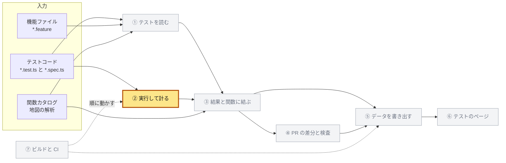
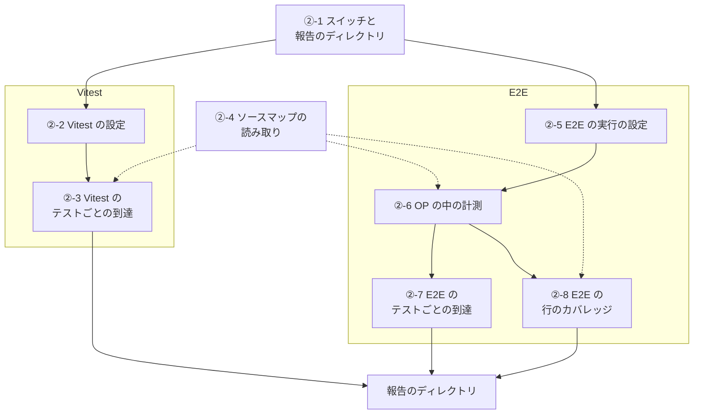
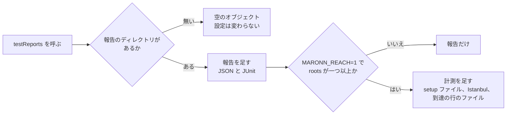
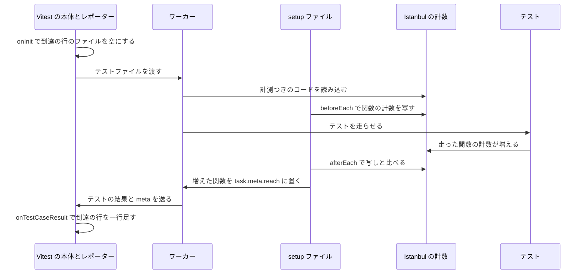
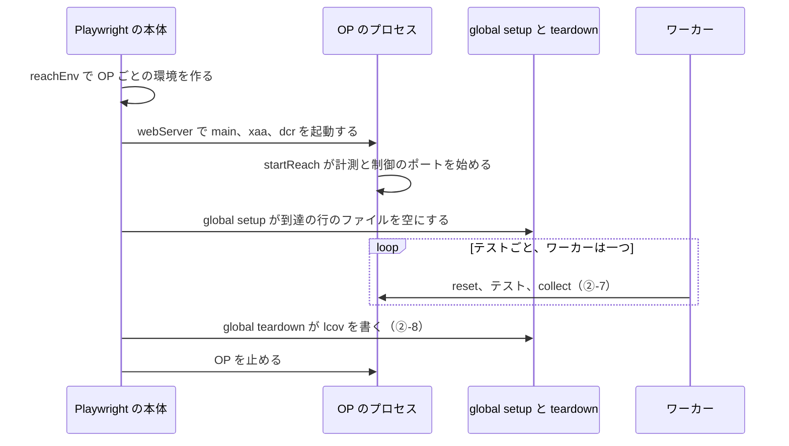
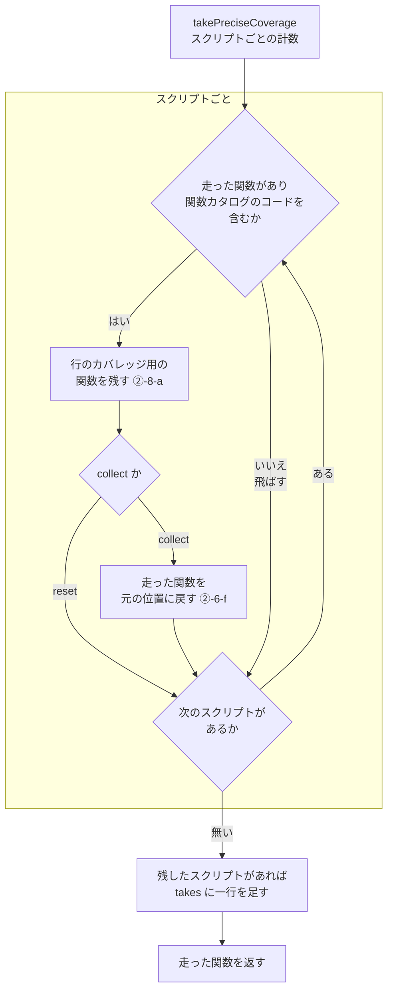
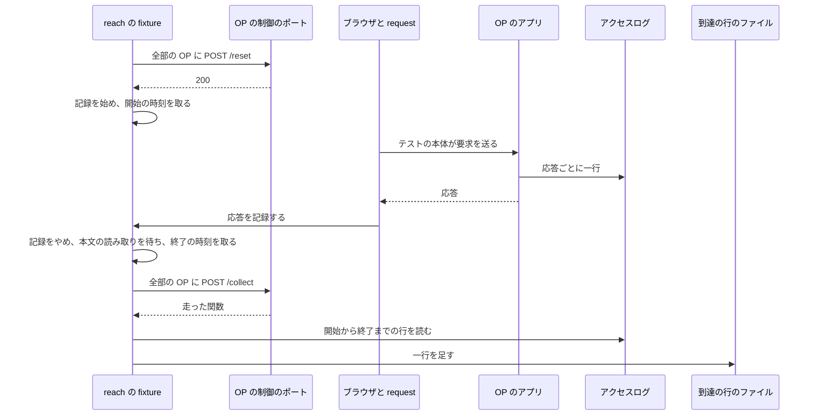
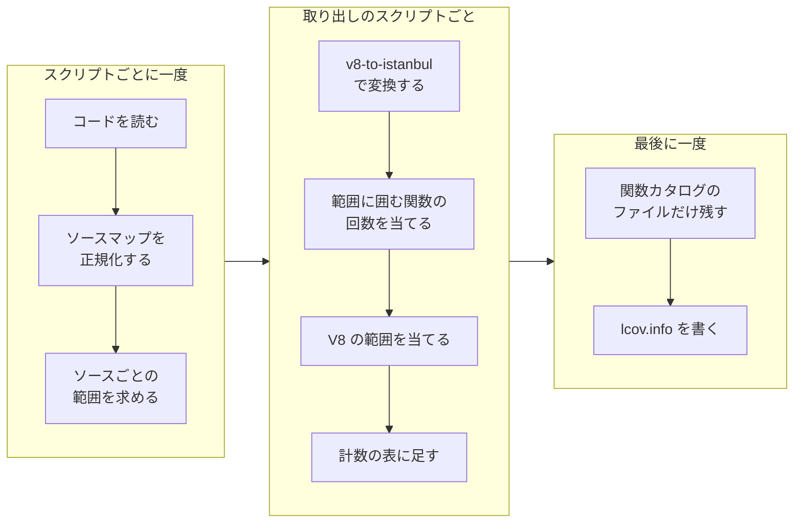

# ② 実行して計る

[全体像](README.md) ＞ [① テストを読む](01-read.md) ＞ ② 実行して計る ＞ [③ 結果と関数に結ぶ](03-join.md)



| 項目 | 内容 |
|---|---|
| 入力 | テストコード（Vitest のテスト、E2E の spec、機能ファイルから生成したテスト）、環境変数 `MARONN_REACH` と `MARONN_TEST_REPORTS` |
| 出力 | 報告のディレクトリ（テストの結果の JSON と JUnit、テストごとの到達 `reach/*.jsonl`、行のカバレッジ `lcov.info`） |
| 実装 | `packages/test-reach/src/`（`env.js`、`vitest.js`、`vitest-setup.js`、`vitest-reporter.js`、`source-map.js`、`op.js`）、`testReports` を呼ぶ各 `vitest.config.ts`、`tests/e2e/fixtures.ts`、`tests/e2e/reach/`（`config.ts`、`global-setup.ts`、`global-teardown.ts`、`lcov.mjs`）、`tests/e2e/playwright.config.ts`、`tests/steps/playwright.config.ts`、`tests/steps/support/http.ts`、`apps/hono/src/server.ts`、`apps/nextjs/src/instrumentation.ts`、`apps/nextjs/next.config.mjs` |

計り方は、テストが動く場所で二つに分かれる。
Vitest は Istanbul の計数を、E2E は OP のプロセスの V8 の計数を、テストの前後で比べる。



## ②-1 スイッチと報告のディレクトリ

計るかどうかと報告を書く先を、二つの環境変数で決める。

| 変数 | 値 | 意味 |
|---|---|---|
| `MARONN_REACH` | `1` のときだけ有効 | テストごとの到達を計り、報告も書く |
| `MARONN_TEST_REPORTS` | ディレクトリの絶対パス | 報告を書く先 |

どちらも無ければ、設定は何も足さない。
`pnpm test` と手で起動した OP は、今までと同じに動く。

報告のディレクトリ（`reportsDirectory`）は、次の順で決まる。

1. `MARONN_TEST_REPORTS` が空でなければ、その値（末尾の `/` を一つ除く）
2. 無くて `MARONN_REACH=1` なら、`<リポジトリ>/work/test-reports`
3. どちらも無ければ無し（報告を書かない）

`<リポジトリ>`（`repositoryRoot`）は、`packages/test-reach/src/` から三つ上のディレクトリである。
末尾に `/` を付けない絶対パスで持つ。

`test-reach` の出口と依存、計測した実行のコマンドは、⑦ にある。

- `test-reach` の出口（`./env`、`./source-map`、`./vitest`、`./op` など）：⑦-1-d
- `test-reach` を devDependency に持つパッケージ：⑦-1-e
- 計測した実行のコマンドと変数：⑦-5

### ②-1-a 報告のファイル

| パス | 中身 | 書く節 |
|---|---|---|
| `vitest/<名前>.json` | Vitest の JSON の報告 | ②-2 |
| `junit/vitest-<名前>.xml` | Vitest の JUnit | ②-2 |
| `coverage/vitest/<名前>/lcov.info` | Vitest の行のカバレッジ | ②-2 |
| `reach/vitest-<名前>.jsonl` | Vitest のテストごとの到達 | ②-3 |
| `playwright/<実行先>.json` | E2E の Playwright の JSON | ②-5 |
| `junit/e2e-<実行先>.junit.xml` | E2E の JUnit | ②-5 |
| `playwright/in-process.json` | プロセス内のシナリオの JSON | ②-5 |
| `junit/features-in-process.junit.xml` | プロセス内のシナリオの JUnit | ②-5 |
| `v8/<実行先>/<役>-<pid>-takes.jsonl` | OP の V8 の生の計数 | ②-6 |
| `v8/<実行先>/<役>-<pid>-sources.jsonl` | 計数のスクリプトとソースマップ | ②-6 |
| `access/<実行先>-<役>.log` | OP のアクセスログ | ②-6 |
| `reach/e2e-<実行先>.jsonl` | E2E のテストごとの到達 | ②-7 |
| `coverage/e2e/<実行先>/lcov.info` | E2E の行のカバレッジ | ②-8 |

- `<名前>` は、パッケージ名からスコープを除いたもの（`@maronn-openid-connect/app-hono` は `app-hono`）
- `<実行先>` は `hono` か `nextjs`
- `<役>` は OP のインスタンスで、`main`、`xaa`、`dcr` のどれか
- `<pid>` は OP のプロセスの番号

③ が読むのは、`vitest/`、`playwright/`、`reach/` である。
`v8/` と `access/` は lcov と到達の行を作る途中のもので、③ は読まない。
JUnit と lcov は、⑦ が Codecov へ上げる。

### ②-1-b 到達の行

**到達の行**は、テスト一つの到達を一行の JSON にしたものである。
Vitest も E2E も、同じ形 `RawReach` で JSONL に書く。

```ts
// packages/test-catalog/src/model.ts
interface RawReach {
  file: string; // テストのファイル。リポジトリからのパス
  path: string[]; // describe の名前。外から順
  title: string; // テストの名前
  target?: string; // 実行先。E2E だけ
  functions: Array<{ file: string; line: number; name?: string }>; // 走った関数の元の位置
  requests?: Array<{ method: string; url: string; status: number; error?: string }>; // E2E だけ
  retry?: number; // 再試行の番号。E2E は毎回（最初は 0）、Vitest は 1 以上のときだけ
  status?: 'passed' | 'failed' | 'skipped';
  tags?: string[]; // Playwright のタグ。E2E だけ
}
```

`functions` の `file` はリポジトリからのパス、`line` は 1 から数えた行である。
同じ `file` と `line` は一つにし、`file` の順（`localeCompare`）、次に `line` の順に並べる。
関数カタログの根の外の位置は入れない（②-1-c）。

例：`work/test-reports` の計測した実行では、Vitest の 5 パッケージで 4,880 行、E2E は実行先ごとに 122 行である。

### ②-1-c 関数カタログの根

到達に残すのは、関数カタログの根の中のソースの位置だけである。

根（`FUNCTION_ROOTS`）は次の六つで、`.github/scripts/lint-function-docs.mjs` と同じ並びである。

- `packages/core/src`
- `packages/experimental/src`
- `packages/google-login/src`
- `apps/hono/src/oidc-provider`
- `apps/hono/src/web`
- `apps/nextjs/src/app`

`isCatalogSource(path)` は、リポジトリからのパスが次をすべて満たすとき真である。

1. 根のどれかに `/` を足したもので始まる
2. `/node_modules/` を含まない
3. `/\.(test|spec)\.[cm]?[jt]sx?$/` に合わない
4. `/(^|\/)test-helpers\.ts$/` に合わない
5. `/(^|\/)test-support\//` に合わない

`repositoryPath(file, root)` は、`\` を `/` にし、`<root>/` で始まればその後ろを返す。
始まらなければ無し（リポジトリの外）である。

実装：`packages/test-reach/src/env.js`（`reachEnabled`、`reportsDirectory`、`repositoryRoot`、`repositoryPath`、`isCatalogSource`、`FUNCTION_ROOTS`）、`packages/test-catalog/src/model.ts`（`RawReach`）

## ②-2 Vitest の設定

各パッケージの `vitest.config.ts` は、`testReports()` の返す値を `test` に広げて、報告と計測を足す。

```ts
import { testReports } from '@maronn-openid-connect/test-reach/vitest';

export default defineConfig({
  test: {
    include: ['src/**/*.{test,spec}.{js,ts}'],
    ...testReports({ root: import.meta.url, roots: ['packages/core/src'] }),
  },
});
```

```ts
interface TestReportsOptions {
  root: string | URL; // vitest.config の import.meta.url か、パッケージのディレクトリ
  name?: string; // 報告の名前。既定はパッケージ名からスコープを除いたもの
  roots?: string[]; // テストが届く関数カタログの根。無ければ報告だけ
  env?: Record<string, string | undefined>; // 既定は process.env
}
```



### ②-2-a 返すもの

| キー | 値 | 足す条件 |
|---|---|---|
| `includeTaskLocation` | `true` | 報告を書く |
| `reporters` | 既定のレポーター（`configDefaults.reporters`）、`vitest-reporter.js`、`junit` の順 | 報告を書く |
| `setupFiles` | `vitest-setup.js` の絶対パス一つ | 計る |
| `coverage` | 下の表 | 計る |

`vitest-reporter.js` には、次のオプションを渡す。

| オプション | 値 |
|---|---|
| `outputFile` | `<報告>/vitest/<名前>.json` |
| `repositoryRoot` | パッケージから上へたどり、最初に `pnpm-workspace.yaml` があるディレクトリ（無ければ投げる） |
| `reachFile` | `<報告>/reach/vitest-<名前>.jsonl`（計るときだけ） |

`junit` には `{ outputFile: <報告>/junit/vitest-<名前>.xml }` を渡す。

パッケージのディレクトリは、`root` が URL か `file:` で始まればパスに直し、`/\.[cm]?[jt]s$/` に合えばその親とする。
合わなければ、末尾の `/` を除いたそれ自身である。
`<名前>` は、そのディレクトリの `package.json` の `name` から `/^@[^/]+\//` を除いたものである。

`includeTaskLocation` は、JSON の報告の各テストに行と列を付ける。
③ はいまこれを読まない。

| `coverage` のキー | 値 |
|---|---|
| `enabled` | `true` |
| `provider` | `'istanbul'` |
| `include` | 根ごとの `<パッケージからの相対パス>/**/*.{js,jsx,ts,tsx,mjs,mts}`（相対パスが空なら `.`） |
| `exclude` | `**/node_modules/**`、`**/dist/**`、`**/*.d.ts`、`**/*.test.*`、`**/*.spec.*`、`**/test-helpers.ts`、`**/test-support/**` |
| `allowExternal` | `true`（`../core/src` のような、パッケージの外の根も含める） |
| `reporter` | `[['lcovonly', { file: 'lcov.info', projectRoot: <リポジトリ> }]]`（lcov のパスをリポジトリからにする） |
| `reportsDirectory` | `<報告>/coverage/vitest/<名前>` |
| `reportOnFailure` | `true`（テストが落ちても lcov を書く） |

### ②-2-b パッケージごとの根

| パッケージ | `roots` |
|---|---|
| `packages/core` | `packages/core/src` |
| `packages/experimental` | `packages/experimental/src`、`packages/core/src` |
| `packages/google-login` | `packages/google-login/src`、`packages/core/src` |
| `apps/hono` | `apps/hono/src/oidc-provider`、`apps/hono/src/web`、`packages/core/src`、`packages/experimental/src`、`packages/google-login/src` |
| `apps/nextjs` | `apps/nextjs/src/app`、`packages/core/src`、`packages/experimental/src`、`packages/google-login/src` |
| `packages/cli`、`packages/map-analysis`、`packages/test-catalog`、`packages/test-reach`、`apps/map`、`apps/tests` | なし（報告だけを書く） |

アプリとパッケージのテストは、エイリアスでほかのパッケージの `src` を読むので、その根も計る。
計る 5 パッケージは、devDependency に `@vitest/coverage-istanbul`（5.0.5）を持つ。

`core`、`experimental`、`google-login` は、自前の `coverage`（`provider: 'v8'`）を先に書いている。
`testReports()` を `test` の最後に広げるので、計るときはその `coverage` を丸ごと置き換える。

実装：`packages/test-reach/src/vitest.js`（`testReports`、`packageDirectory`、`workspaceRoot`、`packageName`）、`packages/*/vitest.config.ts`、`apps/*/vitest.config.ts`、`packages/test-reach/vitest.config.js`

## ②-3 Vitest のテストごとの到達

Istanbul の関数の計数をテストの前後で比べ、増えた関数をそのテストの到達とする。



差分がそのテストのものになるのは、次の理由による。

- リポジトリのテストは `concurrent` を使わないので、ワーカーの中で一つずつ走る
- テストの間、計数は増えるだけである
- `isolate`（既定）ではテストファイルごとにグローバルが作り直されるが、無効でも差分は同じになる

テストファイルを読み込むときに走る関数は、最初のテストの写しより前に数えられる。
そのため、どのテストの到達にもならない。

### ②-3-a 前後の比べ方

Istanbul の計数は `globalThis.__VITEST_COVERAGE__` にある。
変換後のファイルのパスを鍵に、次の形を持つ。

```ts
interface FileCoverage {
  path: string; // 変換後のファイルの絶対パス
  fnMap: Record<string, { name?: string; decl?: { start: Position }; loc?: { start: Position } }>;
  f: Record<string, number>; // fnMap の鍵ごとの呼ばれた回数
  inputSourceMap?: { sources?: Array<string | null>; sourceRoot?: string; mappings?: string };
}
interface Position { line: number; column: number } // line は 1 から、column は 0 から
```

```ts
beforeEach(() => {
  before = snapshot(); // ファイルごとに { coverage, counts: { ...coverage.f } }
});

afterEach(({ task }) => {
  task.meta.reach = reachedSince(before);
});

function reachedSince(earlier) {
  const reached = new Map(); // `${file}:${line}` → { file, line, name? }
  for (const [path, coverage] of Object.entries(globalThis.__VITEST_COVERAGE__ ?? {})) {
    const previous = earlier.get(path);
    // テストの間に置き換わった計数は 0 から比べる
    const counts = previous?.coverage === coverage ? previous.counts : {};
    for (const [key, count] of Object.entries(coverage.f)) {
      if (!(count > (counts[key] ?? 0))) continue;
      const entry = coverage.fnMap[key];
      const start = entry && originalStart(coverage, entry); // ②-3-b
      if (!start || reached.has(`${start.file}:${start.line}`)) continue;
      const name = entry.name && !/^\(anonymous_\d+\)$/.test(entry.name) ? entry.name : undefined;
      reached.set(`${start.file}:${start.line}`, { ...start, ...(name ? { name } : {}) });
    }
  }
  return [...reached.values()];
}
```

`meta.reach` の `file` は絶対パスである。
リポジトリからのパスにするのはレポーターである（②-3-c）。

### ②-3-b 元の位置

関数の位置は Vite が変換した後のコードの座標なので、`inputSourceMap` で元のソースに戻す。

1. 候補は、あるものだけで、`decl.start`（関数の宣言の名前）、次に `loc.start`（関数の始まり）の順とする
2. `inputSourceMap.mappings` が無ければ、`{ file: coverage.path, line: 最初の候補の line }`
3. あれば、候補の順に `originalPositionFor(map, line, column)`（②-4-b）を引き、最初に引けたものを採る
4. どれも引けなければ、その関数を捨てる

元の `source` は、次の規則で絶対パスにする（`sourcePath`）。

| `source` の形 | 絶対パス |
|---|---|
| `file://` で始まる | `file://` を除き、`decodeURIComponent` する |
| `/` で始まる | そのまま |
| ほか | 変換後のファイルのディレクトリから解く（`..` で一つ上がり、`.` と空は飛ばす） |

ソースマップは、計数のオブジェクトごとに一度だけ読む（`WeakMap`）。

setup ファイルは `node:fs` も `node:path` も使わない。
`core` と `experimental` のワーカーは、`edge-runtime` の環境で動くからである。
ファイルを書くのは、本体のプロセスのレポーターである。

### ②-3-c レポーター

レポーター（`TestReportsReporter`）は Vitest の `JsonReporter` を継ぎ、本体のプロセスで動く。

| 時 | すること |
|---|---|
| 作るとき | `super({ outputFile, filterMeta: (key) => key !== 'reach' })` で、JSON の報告に `meta.reach` を入れない |
| `onInit` | `reachFile` があれば、親のディレクトリを作り、空のファイルにする |
| `onCoverage` | 何もせず、JSON の報告に計数の表を入れない（lcov が持つ） |
| `onTestCaseResult` | `reachFile` があり、`meta.reach` が配列なら、`rawReachOf` の一行を足す |

`rawReachOf(testCase, reached, root)` は、到達の行を次のように作る。

| フィールド | 値 |
|---|---|
| `file` | `testCase.module.moduleId` をリポジトリからのパスにしたもの（外なら絶対パスのまま） |
| `path` | `testCase.parent` から `type` が `suite` の間たどった名前（外から順） |
| `title` | `testCase.name`（`it.each` は値を入れた後の名前） |
| `functions` | `reached` のうち、リポジトリの中にあり `isCatalogSource` が真のもの（②-1-b の順） |
| `retry` | `testCase.diagnostic()?.retryCount`（1 以上のときだけ） |
| `status` | `testCase.result().state`（`passed`、`failed`、`skipped` のときだけ） |

`skip` のテストはフックが走らず `meta.reach` が無いので、行を書かない。

例（`work/test-reports/reach/vitest-core.jsonl` の一行）：

```json
{"file":"packages/core/src/signing-key.test.ts","path":["createCachedSigningKeyProvider"],"title":"should call the base provider on first call","functions":[{"file":"packages/core/src/signing-key.ts","line":216,"name":"createCachedSigningKeyProvider"},{"file":"packages/core/src/signing-key.ts","line":223}],"status":"passed"}
```

名前の無い二つ目は、返すオブジェクトのメソッド `getSigningKeys`（223 行）である。
Istanbul は、オブジェクトやクラスのメソッドを `(anonymous_5)` のような名前で数える。
setup ファイルは、この形の名前を落とす。
③ は、その行を含む最も内側のフレームに引く。

実装：`packages/test-reach/src/vitest-setup.js`（`snapshot`、`reachedSince`、`originalStart`、`sourcePath`、`sourceMapOf`）、`packages/test-reach/src/vitest-reporter.js`（`TestReportsReporter`、`rawReachOf`、`describePath`）

## ②-4 ソースマップの読み取り

生成後の位置から元のソースの位置を求める読み取りを、import の無い JavaScript で持つ。
Vitest の `edge-runtime` のワーカーでも、Node でも動かすためである。

| 関数 | 入力 | 出力 | 使う節 |
|---|---|---|---|
| `decodeMappings(mappings)` | `mappings` の文字列 | 行ごとのセグメントの配列 | ②-3、②-6、②-8 |
| `encodeMappings(lines)` | 行ごとのセグメントの配列 | `mappings` の文字列 | `flattenSourceMap` |
| `decodeSourceMap(map)` | `.map` の JSON か `inputSourceMap` | `{ sources, sourceRoot?, names, lines }` | ②-3、②-6、②-8 |
| `originalPositionFor(map, line, column)` | 1 からの行と 0 からの列 | 元の `{ source, line, column }` | ②-3 |
| `firstOriginalPositionIn(map, start, end)` | 生成後の範囲 | 範囲の中の最初の元の位置 | ②-6 |
| `flattenSourceMap(map)` | `sections` を持つソースマップ | 一枚のソースマップ | ②-6、②-8 |

**セグメント**は `[生成の列, ソースの番号, 元の行, 元の列, 名前の番号]` の数の配列で、どれも 0 から数える。
長さは 1、4、5 のどれかで、長さ 4 以上のものだけが元の位置を持つ。

### ②-4-a mappings の読み方

1. 文字を `A-Za-z0-9+/` の並びの番号（6 ビット）にし、ほかの文字なら投げる
2. 数の n 文字目（0 から）の下の 5 ビットを、`5n` ビット上げて足す
3. 32 のビットが立っていれば、次の文字へ続ける
4. 32 のビットの無い文字で一つの数が終わり、その最下位のビットが符号、残りが絶対値になる
5. `,` でセグメントを、`;` で行を区切る
6. 生成の列は同じ行の前のセグメントからの差で、行が変わると 0 から数え直す
7. ソースの番号、元の行、元の列、名前の番号は、マップ全体の前のセグメントからの差である
8. 各行のセグメントを、生成の列の順に並べる

例：`AAAA,EAAE;AACA,IAAI` は、`[[0,0,0,0],[2,0,0,2]]` と `[[0,0,1,2],[4,0,1,6]]` の二行になる。

`encodeMappings(lines)` は、その逆を行う。
`flattenSourceMap`（②-4-c）が使うので、読み戻して同じセグメントになる必要がある。

1. 各行のセグメントを、生成の列の順に並べる
2. 上の 6 と 7 と同じ差を取る（列は行ごとに 0 から）
3. 差 `v` を、負なら `(-v << 1) | 1`、ほかは `v << 1` にする
4. 下から 5 ビットずつ文字にし、後ろに続きがある文字には 32 のビットを立てる
5. セグメントを `,` で、行を `;` でつなぐ

### ②-4-b 位置の引き方

| 関数 | 採るセグメント | 採ったもののソースが `null` か無いとき |
|---|---|---|
| `originalPositionFor(map, line, column)` | `line` の行で、列が `column` 以下の最後のもの（無ければ `column` より後の最初のもの） | ほかを見ずに無しを返す |
| `firstOriginalPositionIn(map, start, end)` | `start` から `end` の前までの最初のもの（範囲の前には戻らない） | それを飛ばし、次のセグメントを見る |

どちらも、元の位置を持たないセグメント（長さ 1）は見ない。
返す `source` には、`sourceRoot` を `/` で終わる形にして前に付ける。
返す `line` は 1 から、`column` は 0 から数える。

`firstOriginalPositionIn` が前に戻らないのは、バンドルが関数の最初の文字ではなく、最初の字句に対応を書くからである。
前に戻ると、コメントやほかのモジュールの終わりに当たる。

### ②-4-c 索引つきのソースマップ

Turbopack は、`sections` を持つ索引つきのソースマップを書く。
`flattenSourceMap(map)` は、これを一枚のマップにする。

1. `sections` が無ければ、そのまま返す
2. 各 section の `map` を、先に平らにする
3. `sources` に、section の `sourceRoot`（`/` で終わる形）を前に付けたものを足していく
4. `sourcesContent` を同じ順に足していく（無ければ `null`）
5. `names` を足していく
6. 各セグメントの行に `offset.line` を足し、section の最初の行だけ列に `offset.column` も足す
7. ソースの番号と名前の番号に、それまでの `sources` と `names` の数を足す
8. `{ version: 3, sources, sourcesContent, names, mappings }` を返す

実装：`packages/test-reach/src/source-map.js`（`decodeMappings`、`encodeMappings`、`decodeSourceMap`、`originalPositionFor`、`firstOriginalPositionIn`、`flattenSourceMap`）

## ②-5 E2E の実行の設定

`tests/e2e/reach/config.ts` は、実行先と計るかどうかを決め、Playwright の設定に足すものを返す。

### ②-5-a 実行先

| `E2E_OP_PACKAGE` | 実行先（`target`） | 計るか |
|---|---|---|
| 無し、または `@maronn-openid-connect/app-hono` | `hono` | 計る |
| `@maronn-openid-connect/app-nextjs` | `nextjs` | 計る |
| `@maronn-openid-connect/sample-hono-cloudflare` など | スコープと `sample-` を除いた名前（`hono-cloudflare`） | 計らない |

計る（`reachOn`）のは、`MARONN_REACH=1` で、OP が二つのアプリのどちらかのときである。
`test-reach` を起動するのは二つのアプリだけで、サンプルは CLI が生成したコードだからである。

到達の行のファイル（`reachFile`）は `<報告>/reach/e2e-<実行先>.jsonl` である。
報告のディレクトリが無ければ、空の文字列になる。

### ②-5-b 設定に足すもの

| 関数 | 返すもの | 条件（満たさなければ空） |
|---|---|---|
| `reportReporters()` | `['json', { outputFile: <報告>/playwright/<実行先>.json }]` と `['junit', { outputFile: <報告>/junit/e2e-<実行先>.junit.xml }]` | 報告のディレクトリがある |
| `reachRun()` | `{ workers: 1, globalSetup, globalTeardown }` | `reachOn` |
| `reachEnv(role, issuer)` | OP のインスタンスに渡す環境変数（②-5-c） | `reachOn` で、報告のディレクトリがある |

`playwright.config.ts` は、`reporter` の `list` と `html` の後に `reportReporters()` を足し、`reachRun()` を設定に広げる。
ワーカーを一つにするのは、OP の計数とアクセスログを、テストごとに切り分けるためである。
`retries` は、CI で 2、手元で 0 である。

`globalSetup`（`reach/global-setup.ts`）は、到達の行のファイルを空にする。
ワーカーでなく本体で空にするのは、Playwright が失敗の後に新しいワーカーを立てるからである。
`globalTeardown` は ②-8 で扱う。

### ②-5-c OP のインスタンス

`reachEnv(role, issuer)` は、OP のインスタンス一つの環境変数を作り、そのインスタンスを記録する。

1. 制御のポートは、`issuer` のポート（無ければ `https:` で 443、ほかで 80）に 1 を足した数
2. アクセスログは `<報告>/access/<実行先>-<role>.log`
3. `{ role, issuer: issuer の origin, control, accessLog }` を `process.env.MARONN_REACH_OPS` の JSON の配列に入れ、同じ `role` のものは置き換える
4. 次の環境変数を返す

| 変数 | 値 |
|---|---|
| `MARONN_REACH` | `1` |
| `MARONN_TEST_REPORTS` | 報告のディレクトリ |
| `MARONN_REACH_PORT` | 制御のポート |
| `MARONN_REACH_TARGET` | 実行先 |
| `MARONN_REACH_ROLE` | `role` |
| `MARONN_REACH_ACCESS_LOG` | アクセスログのパス |

ワーカーは `MARONN_REACH_OPS` を受け継ぎ、`reachOps()` で読む。

`playwright.config.ts` の `webServer` は、インスタンスごとに `pnpm --filter <OP> start` を走らせ、その `env` の最後に `reachEnv` を広げる。

| 役 | 起動する OP | issuer |
|---|---|---|
| `main` | いつも | `E2E_ISSUER`（無ければ `http://<ホスト>:<E2E_OP_PORT、既定 3010>`） |
| `xaa` | 二つのアプリと `sample-hono-cloudflare` | `E2E_XAA_ISSUER`（無ければ `http://<ホスト>:<E2E_XAA_OP_PORT、既定 3040>`） |
| `dcr` | 二つのアプリ、`sample-hono-cloudflare`、`sample-express-flyio` | `E2E_DCR_ISSUER`（無ければ `http://<ホスト>:<E2E_DCR_OP_PORT、既定 3050>`） |

`<ホスト>` は `E2E_HOST`、無ければ `127.0.0.1` である。
制御のポートは issuer の URL から決まり、`*_PORT` の変数からではない。
`test:e2e:app-hono` は 3410、`test:e2e:app-nextjs` は 3510 を、`E2E_OP_PORT` と `E2E_ISSUER` の両方に設定する。
そのため、制御のポートは `main` が 3411 か 3511、`xaa` が 3041、`dcr` が 3051 になる。

`reuseExistingServer` は CI の外で真なので、手元では起動中の OP が使い回される。
計測の無い OP が使い回されたときは、②-7 の fixture がテストを落とす。

`tests/e2e` の `test:e2e:app-hono` と `test:e2e:app-nextjs` は、OP をビルドし、`bddgen` の後に `playwright test` を走らせる。
`MARONN_REACH=1` のまま走らせると、Next.js のビルドも計るためのビルドになる（②-6-a）。

### ②-5-d 機能ファイルのテスト

機能ファイルのシナリオは、タグで二つの設定に分かれ、報告の置き場もそれで決まる。

| シナリオのタグ | 設定 | 到達 | 報告 |
|---|---|---|---|
| `@http` | `tests/e2e/playwright.config.ts` の project `http` | 計る | E2E と同じ `playwright/<実行先>.json`、`junit/e2e-<実行先>.junit.xml`、`reach/e2e-<実行先>.jsonl` |
| `@hono`、`@nextjs` | `tests/steps/playwright.config.ts` の project `in-process-hono` と `in-process-nextjs` | 計らない | `playwright/in-process.json` と `junit/features-in-process.junit.xml` |

`@http` の報告の `<実行先>` は、その E2E の実行の実行先（`hono` か `nextjs`）である。
③ は、`@http` のシナリオの結果と到達を、その実行先のものにする。

`@http` のテストは、`tests/steps/support/http.ts` が `mergeTests(target, reach)` で作る。
`reach` は `tests/e2e/fixtures.ts` の `test` なので、E2E の spec と同じに到達を記録する。
その到達の行の `file` は、`bddgen` が生成した `tests/e2e/.features-gen/http/…/*.feature.spec.js` である。
③ は、シナリオを `file` でなく `@id:` のタグで引く（③-2-a）。

プロセス内の設定は、報告のディレクトリを自分で決める。

```ts
// tests/steps/playwright.config.ts
const reports = process.env['MARONN_TEST_REPORTS']
  ?? (process.env['MARONN_REACH'] === '1' ? new URL('../../work/test-reports', import.meta.url).pathname : undefined);
```

この規則は、`reportsDirectory`（②-1）と三つの点で違う。

| 場合 | プロセス内の設定 | `reportsDirectory` |
|---|---|---|
| `MARONN_TEST_REPORTS` が空の文字列 | そのまま使う | 無いとみなす |
| `MARONN_TEST_REPORTS` の末尾の `/` | 残す | 一つ除く |
| 無くて `MARONN_REACH=1` | 設定のファイルから `../../work/test-reports` の URL の `pathname`（デコードしない） | `<リポジトリ>/work/test-reports`（`fileURLToPath` でデコードしたパス） |

二つの project の結果は一つのファイルに入り、③ は project の名前から実行先を読む。

E2E の spec は、`test` を `tests/e2e/fixtures.ts` から取る。
`@playwright/test` の `test` では到達が記録されないので、⑦ の lint が見張る。

実装：`tests/e2e/reach/config.ts`（`target`、`reachOn`、`reachFile`、`reportReporters`、`reachRun`、`reachEnv`、`reachOps`）、`tests/e2e/reach/global-setup.ts`、`tests/e2e/playwright.config.ts`、`tests/steps/playwright.config.ts`、`tests/steps/support/http.ts`、`tests/e2e/package.json`（`test:e2e:app-hono`、`test:e2e:app-nextjs`）

## ②-6 OP の中の計測

OP のプロセスは V8 の precise coverage を取り、テストごとに計数を消して読む口を、別のポートに開く。

OP に Istanbul を使わないのは、計測の変換を差し込む先が、OP の起動の仕方で違うからである。
hono のアプリは `tsx` で動き、ライブラリは tsc が書いた `packages/*/dist` から読む（②-6-a）。
Next.js は、`next build`（Turbopack）がサーバーのコードをバンドルする。
V8 の計数はランタイムが持つので、同じ口で両方の OP を計れる。



Playwright は、`webServer` を起動してから `globalSetup` を、`globalTeardown` の後に `webServer` を止める。

### ②-6-a 計測を始める場所

計測は、OP がアプリのモジュールを読む前に、`startReach`（②-6-b）で始める。
V8 がアプリのモジュールを最初の行から数えるためである。
設計書の「確かめたこと」では、遅れて始めると走らなかった関数が結果から抜け、lcov がそれを走ったと数えた。

| OP | 始める場所 | 呼び方 |
|---|---|---|
| hono | `apps/hono/src/server.ts`（`start` は `tsx src/server.ts`） | `startReach({ target: 'hono' })` |
| Next.js | `apps/nextjs/src/instrumentation.ts` の `register()`（`next start` が呼ぶ） | `startReach({ target: 'nextjs', accessLog: true })` |

`apps/hono/src/server.ts` は、次の順に動く。

1. `MARONN_REACH=1` なら、`@maronn-openid-connect/test-reach/op` を動的に import し、`startReach` を待つ
2. `./app.js` と `./settings.js` を動的に import して、アプリを作る
3. 計るときは、アプリを `withAccessLog`（②-6-g）で包んでから `serve` する

hono の OP の中で、ライブラリは `packages/*/dist` の JavaScript として動く。
`core`、`experimental`、`google-login` の `exports` が `./dist/` を指すからである（`core` は `./dist/index.js`）。
tsc は `sourceMap: true` で隣に `.js.map` を書き、②-6-e と ②-6-f はそれで `packages/*/src` に戻す。
`test:e2e:app-hono` は、先にアプリの `build`（ライブラリの tsc）を走らせて、これらを作る。

ソースマップの無い `dist` では、そのスクリプトは関数カタログのコードを含まないとみなされる（②-6-e）。
そのため、hono の OP の到達に `packages/*/src` が出なくなる。

`register()` は、次の順に動く。

1. `NEXT_RUNTIME` が `nodejs` でなければ戻る
2. `MARONN_REACH=1` なら、`import(/* webpackIgnore: true */ /* turbopackIgnore: true */ '@maronn-openid-connect/test-reach/op')` で読み、`startReach` を待つ
3. `registerDevelopmentData()` を呼ぶ

Next.js の import の注釈は、`test-reach` をバンドルせず、実行時に解くためである。

`apps/nextjs/next.config.mjs` は、`MARONN_REACH=1` でビルドするときだけ、次を足す。

```js
experimental: { serverSourceMaps: true, serverMinification: false }
```

サーバーのコードのソースマップで、計数を `app/` と `packages/*/src` の行に戻す。
縮めないので、位置は関数の位置になり、V8 は関数をソースと同じ名前で呼ぶ。

### ②-6-b startReach の手順

`startReach` は、計測のセッションと制御のポートを、決まった順に用意する。

```ts
startReach(options?: {
  port?: number; // 既定は MARONN_REACH_PORT
  target?: string; // 既定は MARONN_REACH_TARGET、無ければ 'op'
  role?: string; // 既定は MARONN_REACH_ROLE、無ければ 'main'
  accessLog?: boolean | string; // 文字列ならそのパス、true なら MARONN_REACH_ACCESS_LOG
  env?: Record<string, string | undefined>; // 既定は process.env
}): Promise<{ port: number; close(): Promise<void> } | undefined>;
```

1. `MARONN_REACH` が `1` でなければ、何もせず `undefined` を返す
2. `port` が正の整数でなければ投げる（`MARONN_REACH=1 needs MARONN_REACH_PORT, ...`）
3. 生の計数のディレクトリ `<報告>/v8/<target>/` を作る（報告のディレクトリが無ければ `<報告>` は `<リポジトリ>/work/test-reports`）
4. その中の `<role>-` で始まるファイルを消し、`<role>-<pid>-takes.jsonl` と `<role>-<pid>-sources.jsonl` を空で作る
5. `process.setSourceMapsEnabled(true)` で、`findSourceMap` がソースマップを返すようにする
6. `node:inspector/promises` の `Session` をつなぎ、`Profiler.enable`、`Debugger.enable`、`Debugger.setSkipAllPauses({ skip: true })`、`Profiler.startPreciseCoverage({ callCount: true, detailed: true })` を順に送る
7. `accessLog` があれば、アクセスログを始める（②-6-g）
8. 制御のポートを `127.0.0.1` で開く

古い `<role>-` のファイルを消すのは、②-8 がディレクトリのファイルを全部読むからである。
`Debugger` を有効にするのは、`tsx` がメモリに置く生成後のコードを `Debugger.getScriptSource` で得るためである。
このスレッドが止まると再開する者がいないので、`setSkipAllPauses` で止まらないようにする。

`close()` は、ポートを閉じ、`Profiler.stopPreciseCoverage` を送って、セッションを切る。

### ②-6-c 制御のポート

`Profiler.takePreciseCoverage` は、前の呼び出しからの計数を返し、計数を 0 に戻す。
この一回を**取り出し**と呼ぶ。
テストの前に取り出して捨て、後にもう一度取り出せば、そのテストの計数だけが残る。

| 要求 | すること | 応答 |
|---|---|---|
| `POST /reset` | 取り出して捨てる | `200 { target, role }` |
| `POST /collect` | 取り出し、走った関数を返す | `200 { target, role, functions }` |
| ほかの要求 | 何もしない | `404 {"error":"not_found"}` |
| 取り出しに失敗したとき | | `500 { error: スタック }` |

応答はどれも `Content-Type: application/json` である。
受けるのは、メソッドが POST で、URL がちょうど `/reset` か `/collect` の要求だけである。
クエリの付いた URL（`/collect?x=1`）は 404 になる。
ポートを開けなければ、`startReach` は listen のエラーで投げる。

取り出しは Promise の列で一つずつ行い、`reset` と `collect` が交わらないようにする。
`functions` は `[{ file, line, name? }]` で、②-1-b と同じ規則で並べる。

### ②-6-d 一回の取り出し

一回の取り出しは、スクリプトを一つずつ見て、全部を見た後に takes の行を書く。



「走った関数がある」は、`ranges[0].count` が 1 以上の関数が一つでもあることである。
最初の分岐を通ったスクリプトは、残す関数が空でも takes の行に入る。
takes の一行は次の形である。

```ts
// <役>-<pid>-takes.jsonl の一行。取り出しごとに一つ
interface Take {
  kind: 'reset' | 'collect';
  at: number; // Date.now()
  scripts: Array<{ scriptId: string; url: string; functions: FunctionCoverage[] }>;
}
// V8 の形
interface FunctionCoverage {
  functionName: string;
  isBlockCoverage: boolean;
  ranges: Array<{ startOffset: number; endOffset: number; count: number }>; // [0] が関数の全体
}
```

行のカバレッジ用には、`functionsForLines`（②-8-a）が残す関数を、さらに絞る。
残すのは、`startOffset` が 0 か、関数カタログの範囲（`spans`）に重なるものである。
バンドルには React や Next.js も入っているからである。

ファイルは取り出しのたびに、その場で足して書く（`appendFileSync`）。
Playwright は実行の終わりに、OP が受け取れるシグナル無しで OP を止めるからである。

### ②-6-e スクリプトの読み方

スクリプトは、`scriptId` ごとに一度だけ読み、覚えておく（`scriptOf`）。

1. `url` が `file://` でないか、リポジトリの外か、`/node_modules/` を含めば、知らないスクリプトとする
2. `Debugger.getScriptSource` で生成後のコードを得る
3. `findSourceMap(url)`、無ければ `findSourceMap(path)` でソースマップを得る
4. 関数カタログのコードを含むか（`catalog`）を、下の表で決める
5. `catalog` なら、関数カタログのソースに戻る範囲（`spans`）を求める
6. `catalog` なら、sources のファイルに一行を足す

| ソースマップ | `catalog` が真になる条件 | `spans` |
|---|---|---|
| 無い | スクリプトのファイルが `isCatalogSource` | ファイルの全体 `[0, コードの長さ)` |
| ある | `sources`（`sections` の中も）のどれかが、`sourcePathOf` で関数カタログのソースに戻る | 平らにしたマップ（②-4-c）からの `spansOf` |

```ts
interface Script {
  url: string;
  path: string; // スクリプトの絶対パス
  source: string; // 生成後のコード
  lineStarts: number[]; // 各行の始まりのオフセット
  map?: DecodedSourceMap; // catalog のときだけ
  catalog: boolean;
  spans: Array<[number, number]>; // 関数カタログのソースに戻る範囲。終わりを含まない
}
```

ソースマップの `source` は、次の規則で絶対パスにする（`sourcePathOf`）。

| `source` の形 | 絶対パス |
|---|---|
| `file://` で始まる | `fileURLToPath` |
| `/^[a-z-]+:\/\/\/?\[project\]\/(.*)$/` に合う（Turbopack） | `<リポジトリ>/` に、残りを `decodeURIComponent` して付ける |
| ほかの `/^[a-z-]+:/`（`webpack://next/...` など） | 無し |
| ほか | 生成後のファイルのディレクトリから、`decodeURIComponent` して解く |

`spansOf(map, lineStarts, keeps)` は、範囲を次のように作る。

1. マップの行を順に見て、生成後のコードの行を越えたら止める
2. 元の位置を持ち、ソースが `keeps` に合うセグメントごとに、範囲を作る
3. 範囲の始まりは、そのセグメントの位置である
4. 終わりは、同じ行の次のセグメントの位置である（元の位置やソースは問わない）
5. 次のセグメントが無ければ次の行の始まり、それも無ければ始まり + 1 を終わりとする
6. 前の範囲の終わりが今の始まり以上なら、前の範囲の終わりを大きいほうに延ばす
7. そうでなければ、長さを 1 以上にして足す

`meets(spans, range)` は、`range` と重なる範囲があるかを二分探索で答える。
範囲はどれも終わりを含まない。
`range.startOffset` より後で終わる最初の範囲が、`range.endOffset` より前で始まれば重なる。

| `spans` が `[[0, 10], [20, 40]]` のときの `range` | 重なるか |
|---|---|
| 5 から 8 | 重なる |
| 10 から 20 | 重ならない（`[0, 10)` は 10 を含まない） |
| 15 から 25 | 重なる |

sources のファイルの一行は次の形である。

```ts
// <役>-<pid>-sources.jsonl の一行。関数カタログのコードを含むスクリプトごとに一度
interface ScriptSource {
  scriptId: string;
  url: string;
  sourceFile?: string; // ディスクのファイルが生成後のコードと同じとき（Turbopack のチャンク、packages/*/dist）
  source?: string; // そうでないとき（tsx がメモリに置くコード）
  sourceMapFile?: string; // 末尾の sourceMappingURL がファイルを名指し、それがあるとき
  sourceMap?: object | null; // そうでないとき（findSourceMap の payload）
}
```

`sourceMapFile` は、ソースマップがあるときだけ、コードの末尾 1,024 文字の `/\/\/[#@] sourceMappingURL=([^\s'"]+)\s*$/` から取る。
`data:` の URL は名指しとみなさない。
`file://` の URL はパスに直し、ほかはスクリプトのディレクトリから `decodeURIComponent` して解く。
ディスクにあるものは、写さずにファイルを名指す（Turbopack のチャンクは数 MB ある）。

例：`work/test-reports` の hono の `main` では、313 のスクリプトのうち 81 が `packages/*/dist` のファイルを名指す。
残る 232 は `apps/hono/src` のもので、`source` と `sourceMap` を行に持つ。

### ②-6-f 走った関数

`collect` の取り出しは、スクリプトの関数のうち、次のどれにも当たらないものを走った関数とする。

| 除く関数 | 理由 |
|---|---|
| `ranges[0]` が無いか、その `count` が 0 | 走っていない |
| `startOffset` が 0 | モジュールの最上位 |
| `functionName` が `<` で始まる | クラスのフィールドの初期化（`<instance_members_initializer>`、`<static_initializer>`） |
| `spans` に重ならない | 関数カタログの外のコード |
| その位置のコードが `(__turbopack_context__` で始まる | Turbopack がモジュールを包む関数 |
| 元の位置が無いか、関数カタログの外 | 元のソースに戻せないか、戻した先が関数カタログでない |

元の位置（`originalOf`）は次のように求める。

1. `startOffset` と `endOffset` を、0 から数えた行と列にする（`lineStarts` の二分探索）
2. ソースマップがあれば、行に 1 を足した `firstOriginalPositionIn(map, 始まり, 終わり)`（②-4-b）で元の位置を引き、`sourcePathOf` で絶対パスにする
3. ソースマップが無ければ、スクリプトのパスと、始まりの行に 1 を足した行
4. リポジトリからのパスにし、`isCatalogSource` が真なら `{ file, line }` とする

`name` は、`functionName` が空でなければその値である。
同じ `file` と `line` は、最初のものだけを残す。

### ②-6-g アクセスログ

アクセスログは、OP の HTTP の応答ごとに一行を書く。
ブラウザに見えない要求、E2E の RP（`tests/e2e/apps/client.mjs`）が裏で送る `/token` などを知るためである。

| OP | 書くところ | 方法 |
|---|---|---|
| hono | `apps/hono/src/server.ts` の `withAccessLog` | アプリの前に置いた `hono/logger` の `-->` で始まる行から色（`/\x1b\[[0-9;]*m/g`）を除き、`Date.now()` と空白を前に付けて足す |
| Next.js | `op.js`（`startReach({ accessLog: true })`） | `node:diagnostics_channel` の `http.server.response.finish` を購読し、制御のポート以外の応答ごとに一行を足す |

どちらも、始めにファイルを空にする。
行の形は次のとおりで、hono は後ろに所要時間（`18ms`）が付く。

```text
<epoch ミリ秒> --> <メソッド> <パスとクエリ> <ステータス>
1794041669571 --> GET /authorize?response_type=code&client_id=e2e-client&... 302 5ms
```

### ②-6-h 生成物からの切り離し

計測の口は、CLI が生成するコードに入らない。

- `server.ts` と `instrumentation.ts` は、CLI が写す根の外にある
- どちらも `MARONN_REACH=1` のときだけ、`test-reach` を動的に import する
- `test-reach` は devDependency である
- `packages/cli/src/__tests__/test-reach-isolation.test.ts` が、テンプレートに `test-reach` の名と `server.ts`、`instrumentation.ts` が無いことを確かめる
- 同じテストが、どのフレームワーク、DB（`sql`、`kv`）、機能の組み（既定と全部）の生成物にも `test-reach` の名が無いことを確かめる

実装：`apps/hono/src/server.ts`（`withAccessLog`）、`apps/hono/package.json`（`start`、`build`）、`apps/nextjs/src/instrumentation.ts`（`register`）、`apps/nextjs/next.config.mjs`、`packages/test-reach/src/op.js`（`startReach`、`take`、`scriptOf`、`originalOf`、`sourcePathOf`、`spansOf`、`meets`、`functionsForLines`、`sourceMapFileOf`）、`packages/cli/src/__tests__/test-reach-isolation.test.ts`

## ②-7 E2E のテストごとの到達

`tests/e2e/fixtures.ts` の `test` は、各テストの前後に全部の OP の計数を消して読み、リクエストの列と合わせて到達の行を書く。



### ②-7-a fixture の差し替え

`reachOn` が偽なら、どの fixture も Playwright のものをそのまま渡す。

| fixture | `reachOn` のとき | 理由 |
|---|---|---|
| `browser`（worker） | `newContext` と `newPage` を包み、作った context を見張る | テストが自分で開く context も記録する |
| `context` | 見張る | 既定の context を記録する |
| `request` | `Proxy` で包み、送るメソッドの応答を記録する | API の呼び出しを記録する |
| `reach`（`auto`、`timeout` 60 秒） | ②-7-c の手順 | |

context を見張るのは一度だけである（`WeakSet`）。
見張りは、記録の最中の `response` のうち、`resourceType()` が `document`、`fetch`、`xhr` のものを記録する。
画像やスクリプトは、エンドポイントの呼び出しではないからである。

`request` の送るメソッドは `get`、`post`、`put`、`patch`、`delete`、`head`、`fetch` である。
`fetch` のメソッドは、`options.method`、無ければ URL の文字列なら `GET`、Request なら `request.method()` を大文字にしたものである。

### ②-7-b リクエストの記録

記録する一件は `{ at: Date.now(), method, url, status, error? }` である。
`url` の origin が、どれかの OP の `issuer` と同じものだけを残す。

`error` は、OAuth のエラーコードを次の順に探す。

| 順 | もと | 規則 |
|---|---|---|
| 1 | `Location` ヘッダ | 応答の URL を基にした URL の、クエリか、無ければフラグメントの `error` |
| 2 | `WWW-Authenticate` ヘッダ | `/\berror="([^"]+)"/` |
| 3 | 本文 | ステータスが 400 以上で、`content-type` に `json` を含むとき、JSON の文字列の `error` |

ブラウザの応答の本文は、読み取りの Promise を積んでおく。
fixture は、終了の時刻を取る前にその読み取りを待つ。
`request` の応答の本文は、呼び出しの中で読み終えてから応答を返す。

### ②-7-c 一行の組み立て

`reach` の fixture は、テストごとに次の手順で到達の行を一行書く。

1. `reachOps()` の全部の OP に、並べて `POST /reset` を送る
2. 答えない OP か、`ok` でない応答があれば、テストを落とす
3. 記録を始め、開始の時刻を取る
4. テストの本体を走らせ（`use()`）、成否によらず記録をやめる
5. 本文の読み取りを待ち、終了の時刻を取る
6. 全部の OP に `POST /collect` を送り、走った関数を `file:line` で一つにする（後の OP の値が残る）
7. 各 OP のアクセスログから、開始から終了までの行を読む
8. 下のフィールドで一行を作り、到達の行のファイルに足す

答えない OP のメッセージは、計測の無い OP を止めて走らせ直すよう言う。
手元では `reuseExistingServer` が、計測の無い OP を使い回しうるからである。

| フィールド | 値 |
|---|---|
| `file` | `testInfo.file` のリポジトリからのパス（`\` は `/` にする） |
| `path` | `testInfo.titlePath.slice(1, -1)`（ファイルとテストの名前を除いた describe） |
| `title` | `testInfo.title` |
| `target` | 実行先 |
| `tags` | `testInfo.tags`（シナリオは `@id:` を持つ） |
| `retry` | `testInfo.retry`（最初の試行は 0） |
| `status` | `passed` と `skipped` はそのまま、ほかは `failed` |
| `functions` | 6 の関数（②-1-b の順） |
| `requests` | 7 の行と、記録したリクエストを合わせたもの（下の規則） |

アクセスログの行は `/^(\d+) --> (\S+) (\S+) (\d{3})/` で読む。
時刻が開始以上で終了以下のものを残し、パスが `/_next/` で始まるもの（Next.js の静的ファイル）は除く。
`url` は、その OP の `issuer` にパスを付けたものである。

`requestsOf(logged, seen)` は、二つの記録を合わせる。

1. アクセスログの行を全部、当て先の列に入れる
2. 記録したリクエストごとに、列のまだ当てていないものから、`method`、`status`、`url` が同じ最初のものを探す
3. 見つかれば当てたものとし、記録に `error` があればそれに写す
4. 見つからなければ、記録を列の後ろに足す
5. 列を `at` の順に並べ、`at` を除く

足した記録も、後の記録の当て先になる。
そのため、ログに無い同じ要求が二度あれば一件にまとまり、後の記録の `error` が写る。

例（`reach/e2e-hono.jsonl` の一行の `requests` の始まり）：

```json
[{"method":"GET","url":"http://127.0.0.1:3410/authorize?response_type=code&...","status":302},{"method":"GET","url":"http://127.0.0.1:3410/login","status":200},{"method":"POST","url":"http://127.0.0.1:3410/login","status":302},{"method":"GET","url":"http://127.0.0.1:3410/consent","status":200},{"method":"POST","url":"http://127.0.0.1:3410/consent","status":302},{"method":"POST","url":"http://127.0.0.1:3410/token","status":200}]
```

前のテストが残した処理は、次のテストの要求と計数に入りうる（設計書の「残っていること」）。
例は、落ちたテストが途中で止めた RP のポーリング（デバイスと CIBA）である。

実装：`tests/e2e/fixtures.ts`（`test`、`watch`、`watchBrowser`、`recordedRequest`、`recordApi`、`redirectErrorOf`、`challengeErrorOf`、`jsonErrorOf`、`control`、`loggedHops`、`requestsOf`、`statusOf`）

## ②-8 E2E の行のカバレッジ

OP が取り出しごとに書いた生の計数を、実行の終わりに一つの lcov にまとめる。

lcov は、`tests/e2e` の devDependency の四つのライブラリで書く（版は ⑦-1-e）。

| ライブラリ | 使い道 |
|---|---|
| `v8-to-istanbul` | V8 の計数を、ソースマップを通して Istanbul の形にする |
| `istanbul-lib-coverage` | 取り出しごとの計数を、一つの表に足す |
| `istanbul-lib-report` | 書き出す先のディレクトリと表から、報告の文脈を作る |
| `istanbul-reports` | `lcovonly` で `lcov.info` を書く |

この節の検査（`reach/lcov.test.mjs`）は、`tests/e2e` の `test:unit`（`node --test reach/*.test.mjs`）で走る。

### ②-8-a 取り出しに残す関数

`functionsForLines(functions)` は、取り出しの関数のうち、行のカバレッジに要るものを残す。

1. 関数を、始まりの小さい順、同じなら終わりの大きい順に並べる（外が先）
2. 囲む関数の積み上げを持ち、今の関数の始まり以下で終わるものを降ろす
3. 次のどれかに当たる関数を残す
   - 最上位である（`startOffset` が 0）
   - 走った（`count` が 1 以上）
   - 囲む関数が無い
   - すぐ外の関数が最上位である
   - すぐ外の関数が走った
4. 今の関数を積み上げに載せる

落とすのは、走らなかった関数のうち、すぐ外の関数が最上位でなく、走ってもいないものである。
その行は、すでに 0 だからである。

最上位とその直下を残すのには、二つの理由がある。

- v8-to-istanbul は、どの範囲にも入らない行を走ったと数える
- tsx のモジュールの最上位は、元のソースに戻らない

そのため、最上位の直下の関数は、走らなかったことを自分の範囲で示す必要がある。

例（`op.test.js`）：外から順に次の関数があり、走ったのは `ran` だけとする。

| 関数 | すぐ外の関数 | 残すか |
|---|---|---|
| `''`（最上位） | 無し | 残す |
| `wrapper` | 最上位 | 残す |
| `ran` | `wrapper` | 残す（走った） |
| `callbackOfRan` | `ran` | 残す（外が走った） |
| `idle` | `wrapper` | 落とす |
| `insideIdle` | `idle` | 落とす |
| `topIdle` | 最上位 | 残す |

### ②-8-b lcov の組み立て

`coverageOf` は、生の計数をスクリプトごとに Istanbul の形にし、一つの表に足す。



`coverageOf(directory, root)` は、`<prefix>-sources.jsonl` ごとに、同じ `<prefix>` の `-takes.jsonl` を読む（名前の順）。
takes が無ければ、その組を飛ばす。
ディレクトリが無ければ、空の表を返す。
JSONL の空の行は飛ばす。

スクリプトの準備は、`scriptId` ごとに一度だけ行う。

1. コードは、行の `source`、無ければ `sourceFile`、無ければ `url` のファイルを読む
2. ソースマップは、`sourceMapFile` を読むか、行の `sourceMap` を使う
3. ソースマップを正規化する（下の表）
4. ソースごとの範囲（`sourceSpans`）を求める

ソースマップが無いスクリプトは、ソースマップ無しで変換し、範囲を当てない。

| 正規化 | 規則 |
|---|---|
| 平らにする | `flattenSourceMap`（②-4-c） |
| `sources` | 絶対パスにし（下の表）、file URL にする |
| `sourcesContent` | 関数カタログのソースはマップの中身かディスクのファイル、ほかは空の文字列 |
| `sourceRoot` | 除く |

| `source` の形 | 絶対パス（`absoluteSource`） |
|---|---|
| `file://` で始まる | `fileURLToPath` |
| Turbopack の `[project]`（②-6-e と同じ正規表現） | `<リポジトリ>/` に、残りを `decodeURIComponent` して付ける |
| ほか | `webpack://<名前>/` を除いて `decodeURIComponent` し、絶対パスでなければ生成後のファイルのディレクトリから解く |

tsx はソースの中身を持たないので、ディスクから読む。
バンドルのほかのソース（React、Next.js）を空にするので、その行は報告に出ない。

`sourceSpans` は、関数カタログのソースごとに、生成後の範囲を一つ決める。

1. ソースの番号ごとに、生成の位置で最初と最後のセグメント、元の位置（行、列）で最も前と最も後のセグメントを求める
2. 最も前の位置が最も後の位置より前（`earliest.offset < latest.offset + 1`）なら、範囲は `[earliest.offset, latest.offset + 1)`
3. そうでなければ、`[first.offset, last.offset + 1)`

生成の最後の対応までにしないのは、tsx が関数の後に置く `__name(fn, "fn")` が、関数の名前の位置に戻るからである。
そこまでにすると、最後の関数の本体の行が 1 のまま残る。

取り出しのスクリプトごとに、次を行う。
sources のファイルに無い `scriptId` は飛ばす。

1. `v8ToIstanbul(path, 0, { source, sourceMap: { sourcemap } }, (file) => !関数カタログのソース(file))` を作り、`load()` する
2. `applyCoverage` に、ソースごとの範囲を関数として先に、取り出しの関数を後に渡す
3. 範囲の関数の回数は、その範囲を囲む最も小さい関数の回数（無ければ 0）とする（`enclosingCount`）
4. `toIstanbul()` の結果を、計数の表（`istanbul-lib-coverage`）に足す

範囲を先に当てるのは、v8-to-istanbul がどの行も 1 から始め、V8 の範囲で下げるからである。
tsx のモジュールの最上位と Turbopack の包みは元に戻らないので、走らなかった関数の行が 1 のまま残る。
範囲の回数は、リセットの後は 0、モジュールを読み込んだ取り出しでは 1 になる。

最後に、計数の表を関数カタログのソースだけに絞る。
v8-to-istanbul は、除いたソースもファイルとして残すからである。

`writeLcov({ target, reports?, root? })` は、次を行う。

1. 報告のディレクトリが無ければ投げる
2. `coverageOf(<報告>/v8/<target>)` を求める
3. `istanbul-lib-report` の出力先を `<報告>/coverage/e2e/<target>` にする
4. `istanbul-reports` の `lcovonly`（`{ file: 'lcov.info', projectRoot: <リポジトリ> }`）を書く
5. ファイルの数を返す

`globalTeardown`（`reach/global-teardown.ts`）は `writeLcov({ target, reports })` を呼び、`[reach] coverage/e2e/<実行先>/lcov.info: <数> files` を出す。

手では、`MARONN_TEST_REPORTS`（か `MARONN_REACH=1`）を付けて `node tests/e2e/reach/lcov.mjs <実行先>...` で書く。
実行先が無ければ、使い方を出して終了コードを 2 にする。
あれば実行先ごとに、`coverage/e2e/<実行先>/lcov.info: <数> files` を出す（`[reach] ` は付かない）。

例：`work/test-reports` では、`coverage/e2e/hono/lcov.info` が 313 ファイル、`nextjs` が 194 ファイルを持つ。

実装：`packages/test-reach/src/op.js`（`functionsForLines`）、`tests/e2e/reach/lcov.mjs`（`coverageOf`、`writeLcov`、`normalizedSourceMap`、`absoluteSource`、`sourceSpans`、`enclosingCount`）、`tests/e2e/reach/global-teardown.ts`、`tests/e2e/reach/lcov.test.mjs`

## この章の出力

- 報告のディレクトリ（書く側は `MARONN_TEST_REPORTS`、③ は `MAP_TEST_REPORTS` で同じディレクトリを名指す）
- ③ が読むもの：`vitest/*.json`、`playwright/*.json`、`reach/*.jsonl`（到達の行、`RawReach`）
- ⑦ が Codecov へ上げるもの：`coverage/vitest/<名前>/lcov.info`、`coverage/e2e/<実行先>/lcov.info`、`junit/*.xml`
- CI では、`v8/` と `access/` を除いて artifact `test-reports` に入れ、③ の動く `map` ジョブへ渡す（⑦）

[全体像](README.md) ＞ [① テストを読む](01-read.md) ＞ ② 実行して計る ＞ [③ 結果と関数に結ぶ](03-join.md)
