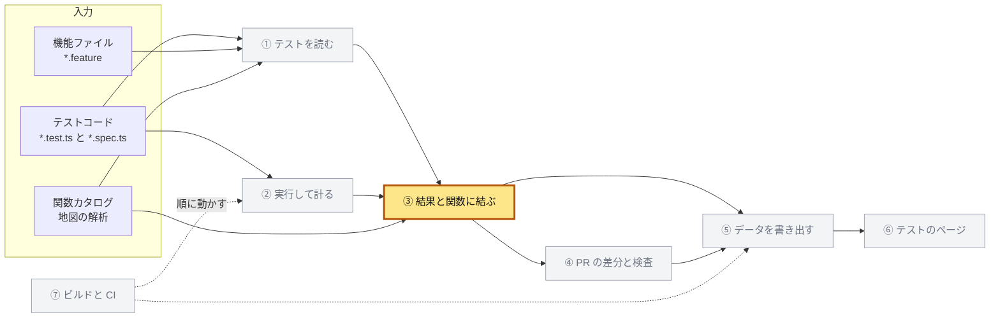
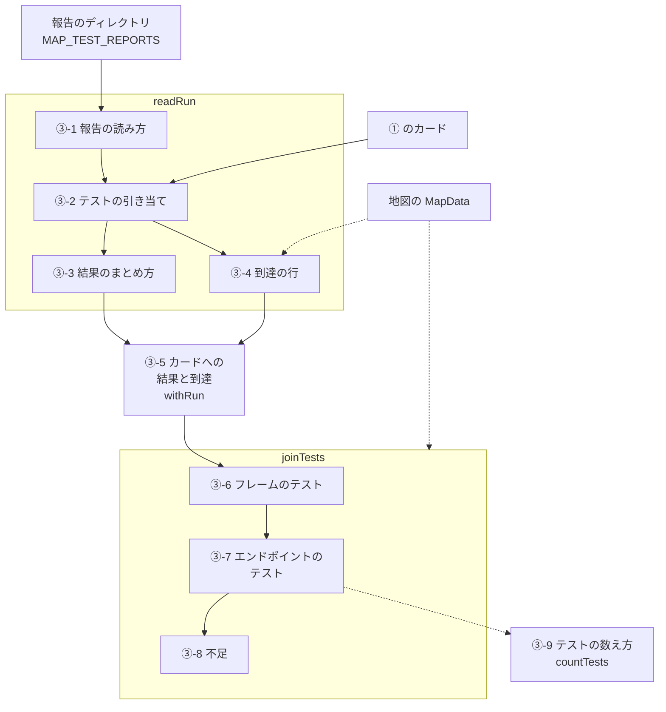
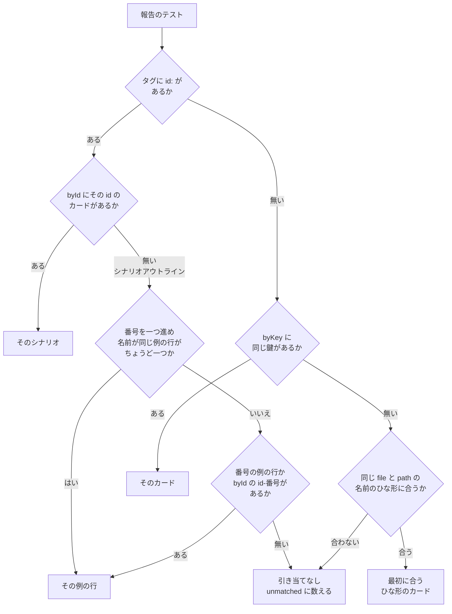
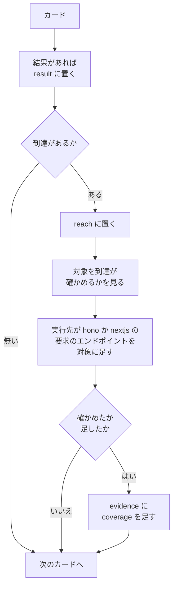
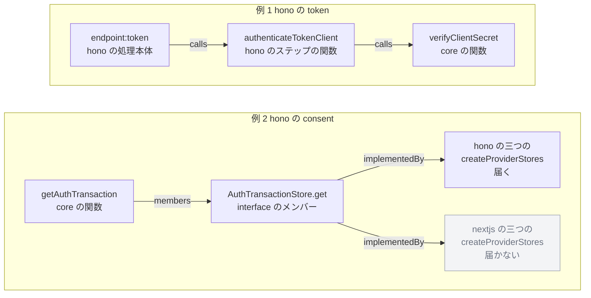
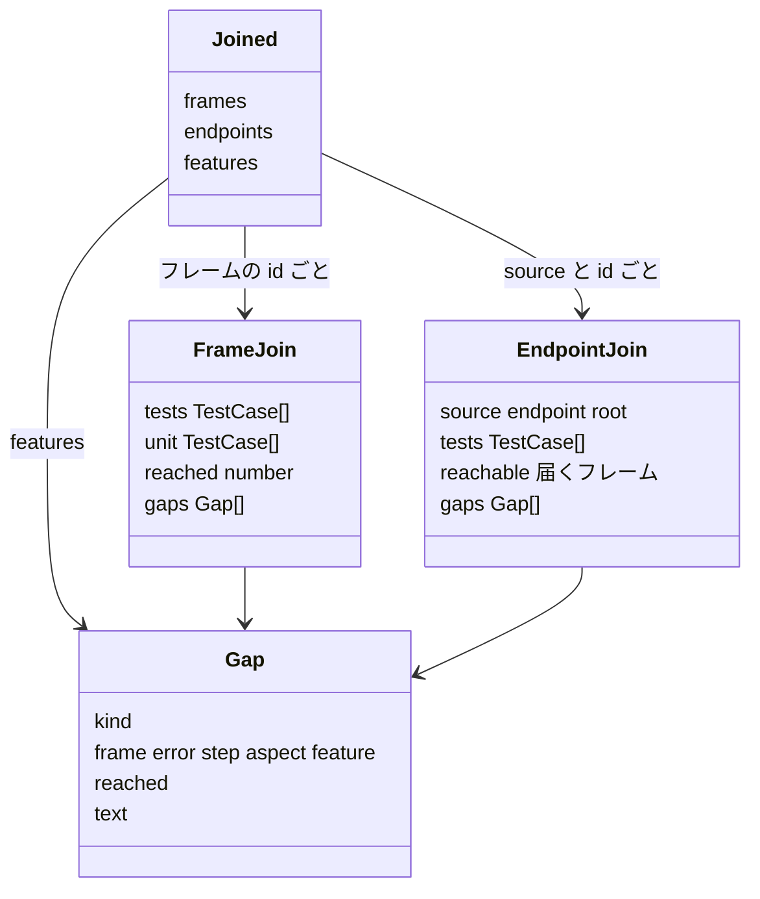
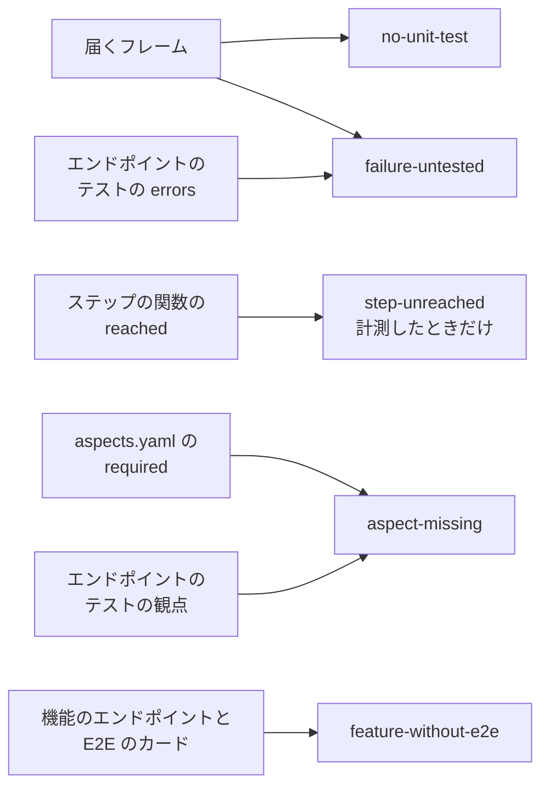

# ③ 結果と関数に結ぶ

[全体像](README.md) ＞ [② 実行して計る](02-measure.md) ＞ ③ 結果と関数に結ぶ ＞ [④ PR の差分と検査](04-pull-request.md)



| 項目 | 内容 |
|---|---|
| 入力 | ① のカード（`TestCase[]`）、② の報告のディレクトリ（`MAP_TEST_REPORTS`）、地図の `MapData`（`functions`、`bodies`、`members`、`flows`、`features`、`sources`）、観点の表（`required` と `label`） |
| 出力 | 結果と到達を足したカード、計測したかどうか（`measured`）、`Joined`（フレームごととエンドポイントごとのテストと不足、機能の不足） |
| 実装 | `packages/test-catalog/src/run.ts`（`readRun`、`CaseFinder`、`FrameLocator`、`repositoryPath`）、`build.ts`（`withRun`、`buildTests`）、`join.ts`（`joinTests`、`reachableFrames`、`sourceOfFrame`、`endpointsOf`、`countTests`、`errorCodeOf`）、`catalog.ts`（`EndpointIndex`） |

③ は、⑤ の `buildTests` の中で、① がカードを読んだ後に動く。
報告のディレクトリが無ければ ③-1 から ③-5 を飛ばし、計測していない実行として ③-6 から先を行う。



## ③-1 報告の読み方

`readRun(directory, repository, tests, data, endpointOf)` は、報告のディレクトリから三種類のファイルを決まった順に読む。

`buildTests` が `readRun` を呼ぶのは、`reports` が与えられ、そのディレクトリがあるときだけである。
`reports` は、`build-data.mjs` が `MAP_TEST_REPORTS` の前後の空白を除き、空でなければ `resolve` で絶対パスにして渡す。
`repository` は、`BuildContext.repository.repository`（リポジトリの絶対パス）である。
`endpointOf` は、`EndpointIndex.endpointOfPath`（③-4-c）である。

| 順 | ファイル | 形 | 使い道 |
|---|---|---|---|
| 1 | `vitest/*.json`（名前の順） | Vitest の JSON の報告 | 結果（`meta.reach` があれば到達も） |
| 2 | `playwright/*.json`（名前の順） | Playwright の JSON の報告 | 結果（ファイルの名前が実行先） |
| 3 | `reach/*.jsonl`（名前の順） | 到達の行（`RawReach`、②-1-b） | 到達 |

ディレクトリが無い種類は、ファイルが無いものとして飛ばす。

### ③-1-a 読む形

報告のうち、読むのは次のフィールドだけである。

```ts
// vitest/*.json
interface VitestReport {
  startTime?: number; // epoch ミリ秒
  testResults?: Array<{
    name: string; // テストファイルの絶対パス
    assertionResults?: Array<{
      ancestorTitles: string[]; // describe の名前。外から順
      title: string;
      status: string;
      duration?: number | null;
      meta?: { reach?: Array<{ file: string; line: number; name?: string }> };
    }>;
  }>;
}

// playwright/*.json
interface PlaywrightReport {
  config?: { rootDir?: string }; // testDir の絶対パス
  stats?: { startTime?: string }; // ISO 8601
  suites?: PlaywrightSuite[]; // 一番上はテストファイル
}
interface PlaywrightSuite {
  title: string;
  file?: string; // rootDir からのパス
  specs?: Array<{
    title: string;
    file?: string;
    tags?: string[]; // `@` の無いタグ。シナリオは `id:<id>` を持つ
    tests?: Array<{ // project ごとに一つ
      projectName?: string;
      status?: string; // expected、unexpected、flaky、skipped
      results?: Array<{ status?: string; duration?: number; retry?: number }>; // 試行ごと
    }>;
  }>;
  suites?: PlaywrightSuite[];
}
```

報告の状態は、次の表でカードの状態にする（`statusOf`）。

| 報告の `status` | カードの状態 |
|---|---|
| `passed`、`expected`、`flaky` | `passed` |
| `skipped`、`pending`、`todo`、`disabled` | `skipped` |
| ほか（`failed`、`timedOut`、`interrupted` など） | `failed` |

実行の時刻（`run.at`）は、最初に見つけた開始の時刻である。
Vitest の `startTime` を ISO 8601 にしたものが先で、無ければ Playwright の `stats.startTime` である。
`TestRun.run` の `ref` と `commit` は、いまどこでも埋めない。

Vitest の `meta.reach` は、② のレポーターが JSON から外すので、このリポジトリでは到達は `reach/` から来る。
`readRun` は、それでも `meta.reach` があれば、`skipped` でない結果の到達として読む。
この経路は、位置がリポジトリからのパスのときだけフレームに引ける（② の setup ファイルが置くのは絶対パスである）。

### ③-1-b 返す形

```ts
interface JoinedRun {
  run: TestRun; // { run: { at? }, results: テストの id ごとの TestResult }
  reach: Map<string, TestReach[]>; // テストの id ごとの到達
  unmatched: { results: number; reach: number }; // カードに引き当てられなかった数
  measured: boolean; // 到達を一つでも読んだか
}
```

実装：`packages/test-catalog/src/run.ts`（`readRun`、`jsonFiles`、`statusOf`）、`packages/test-catalog/src/build.ts`（`buildTests`）、`apps/map/scripts/build-data.mjs`

## ③-2 テストの引き当て

報告のテストを、ファイルと describe と名前で、またはシナリオの `@id:` のタグで、カードに引き当てる。

### ③-2-a 引き当ての索引

`CaseFinder` は、カードから四つの索引を作る。

**名前のひな形**は、`it.each` のプレースホルダーを持つテストの名前である（`should accept %s`）。
プレースホルダーは `/%[sdifjoO#]|\$[A-Za-z_][\w.]*/` である。

| 索引 | 入るカード | 鍵 |
|---|---|---|
| `byId` | 全部 | カードの id |
| `outlines` | 機能ファイルのカードで、id が `/^(.*)-(\d+)$/` に合い、`path` が二つ以上のもの | id の前の部分（シナリオアウトラインの id）。値は、例の行のカードをカタログの順に並べた列 |
| `byKey` | テストコードのカード | `source.file`、`path` の各要素、`title` を `\u0000` でつないだもの |
| `templates` | テストコードのカードで、名前が名前のひな形のもの | `source.file` と `path` を `\u0000` でつないだもの |

`byKey` で同じ鍵のカードが二枚あれば、カタログの順で後のカードが残る。
その名前の結果と到達は、後の一枚に入る。

名前のひな形は、次の手順で正規表現にする（`templatePattern`）。

1. プレースホルダーで切る
2. プレースホルダーを `[\s\S]*` に、ほかを正規表現の文字を逃がした文字列にする
3. つないで、`^` と `$` で挟む

`should accept %s` は、`should accept a` にも `should accept b` にも合う。



| 関数 | 規則 |
|---|---|
| `code(file, path, title)` | `byKey` の同じ鍵、無ければ同じ `file` と `path` の `templates` で最初に合うもの |
| `scenario(id)` | `byId` の `id` |
| `scenario(id, row, title)` | `outlines` の `id` の例の行のうち、名前が `title` のものがちょうど一つならそれ。でなければ `row` 番目の例の行、それも無ければ `byId` の `${id}-${row}` |

シナリオアウトラインかどうかは、`scenario(id)` が無いことで決める。
例の行の id は `<id>-<番号>` で、`<id>` そのもののカードは無いからである（①-10）。

例の行の番号は、同じシナリオアウトラインの報告のテストを見た順に、1 から数える。

| 報告 | 番号を数える単位 |
|---|---|
| Playwright の JSON | 報告のファイルごとに、spec のファイルと id |
| 到達の行 | 実行先と id |

playwright-bdd は、例の行のテストを、その行の値を入れた名前で呼ぶ。
① のカードの名前も同じ規則で作るので、ふつうは名前で決まる。
名前で決まらないときだけ、番号が効く。

### ③-2-b ファイルのパス

報告のファイルは、`repositoryPath(repository, file)` でリポジトリからのパスにする。

1. `repository` からの相対パスを `/` でつなぐ
2. それが `..`、`.claude/`、`/` のどれでも始まらなければ、それを返す
3. 始まれば、絶対パスの中で `/packages/`、`/apps/`、`/tests/`、`/.github/`、`/scripts/` が最後に現れる位置から後を返す
4. どれも現れなければ、1 の相対パスを返す

別の作業ツリー（`.claude/worktrees/`）や CI の作業場所で書いた報告も読むためである。

| 報告のパス（`repository` は `/repo`） | 結果 |
|---|---|
| `/repo/tests/e2e/specs/flow.spec.ts` | `tests/e2e/specs/flow.spec.ts` |
| `/repo/.claude/worktrees/agent-1/tests/e2e/specs/flow.spec.ts` | `tests/e2e/specs/flow.spec.ts` |
| `/home/runner/work/x/x/packages/core/src/a.test.ts` | `packages/core/src/a.test.ts` |

これを通すのは、Vitest の `testResults[].name` と、Playwright の `rootDir` に spec のファイルをつないだものである。
`rootDir` が無ければ `<repository>/tests/e2e` を使う。
到達の行の `file` は、② がリポジトリからのパスで書くので、そのまま使う。

### ③-2-c Playwright の describe

Playwright の報告の describe の並びは、suite の木をたどって作る。

1. 一番上の suite はテストファイルなので、並びを空にして始める
2. 子の suite の `file` があり、`title` が `file` と同じなら、ファイルの suite として並びを変えない
3. ほかの子の suite は、`title` を並びに足す
4. spec のファイルは、`spec.file`、無ければ近い suite の `file` である

### ③-2-d 実行先

| 報告 | 実行先 |
|---|---|
| Vitest の JSON | `''`（空の文字列） |
| Playwright の JSON の、project が `in-process-<名前>` のテスト | `<名前>`（`hono`、`nextjs`） |
| Playwright の JSON の、ほかの project（`chromium`、`http`）のテスト | ファイルの名前から `.json` を除いたもの（`hono.json` は `hono`） |
| 到達の行 | `target`（Vitest の行には無い） |

実装：`packages/test-catalog/src/run.ts`（`CaseFinder`、`templatePattern`、`repositoryPath`、`readRun` の `visit`）

## ③-3 結果のまとめ方

引き当てた結果を、カードの id ごと、実行先ごとに一つの `TestResult` にまとめる。

```ts
interface TestResult {
  status: 'passed' | 'failed' | 'skipped'; // 実行先のうち最も悪いもの
  targets: Record<string, { status: TestStatus; duration: number; attempts: number }>; // 実行先ごと
}
```

報告のテスト一つは、次の値になる。

| 値 | Vitest | Playwright（project ごと） |
|---|---|---|
| 状態 | `statusOf(status)` | `expected` と `flaky` は `passed`、`skipped` は `skipped`、ほかは最後の試行の `status`（無ければテストの `status`）の `statusOf` |
| 時間 | `duration`（無ければ 0） | 全部の試行の `duration` の和 |
| 試行の数 | 1 | `results` の数（無ければ 1） |

同じカードと実行先に二つ目の値が来たら、次のように合わせる。
`it.each` の各行は、名前のひな形の一枚のカードに集まるからである。

| 値 | 合わせ方 |
|---|---|
| 状態 | 悪いほう（悪い順に `failed`、`passed`、`skipped`） |
| 時間 | 和 |
| 試行の数 | 大きいほう |

カードの `status` は、全部の実行先の状態のうち最も悪いものである。
Playwright の再試行（CI で 2 回）は、全部の試行が `results` に残り、状態は最後の試行で決まる。

引き当てられなかったものは、`unmatched.results` に一つずつ数える。
Vitest は `assertionResults` の一件ごと、Playwright は `spec.tests` の一件（project ごと）ごとである。

例（`join.test.ts`）：

| 報告 | 結果 |
|---|---|
| 名前が `should accept %s` のカードに、`should accept a`（passed、2 ms）と `should accept b`（failed、3 ms） | `{ status: 'failed', targets: { '': { status: 'failed', duration: 5, attempts: 1 } } }` |
| `expected` のテストで、試行が failed（5 ms）と passed（4 ms） | `{ status: 'passed', targets: { hono: { status: 'passed', duration: 9, attempts: 2 } } }` |

例：`work/test-reports` の報告では、6,008 枚のうち 5,707 枚に結果が付く。
実行先ごとには、`''` が 5,578 枚、`hono` と `nextjs` が 129 枚ずつである。
数は実行で変わる。

結果の無い 301 枚は、どれも `.github/scripts/*.test.mjs` の `tool` のテストである。
これらは `node --test` で走って報告を書かないので、結果が付かない（⑦-5）。

実装：`packages/test-catalog/src/run.ts`（`readRun` の `record`、`worse`、`statusOf`）

## ③-4 到達の行

到達の行を、テストと実行先ごとに一行に絞り、位置をフレームの id に、URL をエンドポイントに直す。

### ③-4-a 残す到達の行

どの到達の行を残し、どのカードに引き当てるかを、次の手順で決める。

1. 空の行（空白だけの行も）は飛ばし、JSON でない行は `unmatched.reach` に数える
2. 一行でも読めば、`measured` を真にする
3. 鍵 `target`、`file`、`path` の各要素、`title` を `\u0000` でつなぐ（`target` が無ければ空）
4. 同じ鍵では、`retry`（無ければ 0）が大きいほう、同じなら後の行を残す
5. 残った行を、鍵を初めて見た順に、③-2 の規則でカードに引き当てる
6. `status` が `skipped` の行は捨てる（シナリオアウトラインのものは、例の行の番号を数えてから捨てる）
7. 引き当てられなければ、`unmatched.reach` に数える

例の行は名前が違うので、その到達の行の鍵もふつうは違う。
二つの例の行が名前まで同じなら、到達の行の鍵が重なり、一行だけが残る。
捨てた到達の行も番号を取るので、後の例の行の番号はずれない。

### ③-4-b 位置を含むフレーム

`FrameLocator` は、関数とエンドポイントの処理本体の範囲を、ファイルごとに持つ。

1. `MapData.functions` と `MapData.bodies` の全部の項目を見る
2. `source`（`{ file, start, end }`）があり、`MapData.sources[source.file].path` があるものを、そのパスの範囲として持つ
3. `frameAt(path, line)` は、`start <= line <= end` の範囲のうち `end - start` が最も小さいもの（同じなら先に見たもの）の id を返す
4. どの範囲にも入らなければ、その位置を捨てる

名前でなく位置で引くのは、バンドラーが関数の名前を変えることがあるからである。
関数の中の無名の関数は、それを含む最も内側のフレームになる。

到達の `functions` は、引けたフレームの id を一つずつ、文字の順に並べたものである。

### ③-4-c 要求のエンドポイント

到達の行の要求ごとに、パスと、そのパスのエンドポイントを決める。

要求の `url` は、`new URL(url, 'http://op.invalid').pathname` でパスにする。
クエリは落ちる。
URL として読めなければ、`url` をそのまま使う。

パスからエンドポイントの id へは、`EndpointIndex.endpointOfPath(path)` で引く。

1. `MapData.flows` の全部のフレームワークの、全部のエンドポイントを見る
2. 要求のパスと同じ `path` のエンドポイントがあれば、それ（同じ `path` では最初に見たもの）
3. 無ければ、エンドポイントの `path`（`/` は除く）に `/` を足したもので要求のパスが始まるもののうち、`path` が最も長いもの
4. どれも無ければ無し

`/login/google` は 2 で `login-google` に、`/register/abc` は 3 で `register` になる。

```ts
interface TestReach {
  target?: string; // 到達の行の target。Vitest は無し
  functions: string[]; // フレームの id。文字の順
  requests?: Array<{ endpoint?: string; method: string; path: string; status: number; error?: string }>; // 空なら付けない
}
```

### ③-4-d 同じテストの到達のまとめ方

到達は、テストの id ごとの列に入れる（`addReach`）。

1. 列に同じ `target` の項目が無ければ、足す
2. あれば、`functions` を和にして並べ直し、`requests` を後ろにつなぐ

`it.each` の各行の到達は、名前のひな形の一枚のカードの、一つの項目に集まる。

例（`join.test.ts`）：位置 `apps/hono/src/oidc-provider/endpoints/token/steps/authenticate-client.ts:3` と、要求 `POST http://127.0.0.1:3410/token 200` を持つ行は、次になる。

```json
{ "target": "hono", "functions": ["hono:oidc-provider/endpoints/token/steps/authenticate-client.ts#authenticateTokenClient"], "requests": [{ "endpoint": "token", "method": "POST", "path": "/token", "status": 200 }] }
```

例：`work/test-reports` の報告では、4,855 枚に到達が付き、`unmatched` は結果も到達も 0 である。
項目は、実行先の無いものが 4,733、`hono` と `nextjs` が 122 ずつで、一項目に平均 18.4 のフレームがある。
要求は 1,540 件で、1,529 件がエンドポイントに引ける。
引けないのは `/operator/clients/...` や `/oidc-error` のような、地図のエンドポイントでないパスである。

実装：`packages/test-catalog/src/run.ts`（`readRun`、`FrameLocator`、`reachOf`、`addReach`）、`packages/test-catalog/src/catalog.ts`（`EndpointIndex.endpointOfPath`）

## ③-5 カードへの結果と到達

`withRun(tests, run)` は、結果と到達をカードに置き、到達が示すエンドポイントを対象に足す。



対象を到達が確かめるのは、次のどちらかのときである。

- 関数の対象の id が、到達の `functions`（実行先をまたいだ和）にある
- エンドポイントの対象について、実行先が無いか対象の `source` と同じ到達の項目に、そのエンドポイントの要求がある

足す対象は、実行先が `hono` か `nextjs` の項目の、エンドポイントの引けた要求ごとに作る。

```ts
{ kind: 'endpoint', id: request.endpoint, source: entry.target, how: 'coverage' }
```

同じ `id` と `source` のエンドポイントの対象が既にあれば、足さない。
コードに見えないエンドポイント（ブラウザのリダイレクトの先、RP の裏の通信）を、対象にするためである。

`evidence` の `coverage` は、確かめたか足したときに、まだ無ければ一つ足す。
到達した関数は、対象には足さない。
到達のまま ③-6 が使う。

`model.ts` の型は、`how: 'coverage'` の関数の対象、`member` の対象、`TestReach.members` を持つ。
コードは、そのどれも作らない。

例：このリポジトリでは、76 枚のカードに `coverage` のエンドポイントの対象が付き、4,414 枚の `evidence` に `coverage` が入る。

実装：`packages/test-catalog/src/build.ts`（`withRun`）

## ③-6 フレームのテスト

カードをフレームごとに集め、**フレームのテスト**、**フレームのユニットテスト**、到達したテストの数を決める。

種類が `tool` のカードは、どのフレームにも入れない。
対象と到達の id のうち、`MapData.functions` にも `MapData.bodies` にも無いものは数えない。

| 集まり | 入る条件 |
|---|---|
| `tests`（フレームのテスト） | 関数の対象（`kind: 'function'`、`how` は問わない）の id がそのフレームか、到達の `functions` にそのフレームがある |
| `unit`（フレームのユニットテスト） | 種類が `unit` で、そのフレームの関数の対象の `how` が `describe` か `declared` |
| `reached` | 到達の `functions`（実行先をまたいだ和）にそのフレームがあるカードの数 |

一枚のカードは、一つのフレームに一度だけ入る。
`how: 'call'` の対象（確かめるところで呼ぶ関数）は、`tests` に入るが `unit` には入らない。
`tests` と `unit` は、カタログの順に並ぶ。

```ts
interface FrameJoin {
  tests: TestCase[]; // フレームのテスト
  unit: TestCase[]; // フレームのユニットテスト
  reached: number; // 到達したカードの数
  gaps: Gap[]; // ③-8-c
}
```

例：このリポジトリでは、テストのあるフレームが 1,052、ユニットテストのあるフレームが 664 である。

実装：`packages/test-catalog/src/join.ts`（`joinTests` の前半）

## ③-7 エンドポイントのテスト

エンドポイントごとに、届くフレームを呼び出しからたどり、そのエンドポイントのテストを決める。

### ③-7-a エンドポイントの並び

エンドポイントは、`MapData.flows.hono.endpoints`、次に `MapData.flows.nextjs.endpoints` を、地図の順に並べる（`endpointsOf`）。
鍵は `<source>:<id>`（`hono:token`）である。
テストが無くても、どのエンドポイントも項目を持つ。

### ③-7-b 届くフレーム

**届くフレーム**は、エンドポイントの `root` から、呼び出しとメンバーの実装をたどって行けるフレームである。
計測した到達とは別に、地図の呼び出しの表だけで決まる。

フレームの `source` は、id の形で決まる（`sourceOfFrame`）。

| id の形 | `source` |
|---|---|
| `hono:` で始まるか、`endpoint:` で始まり `endpoint:nextjs:` で始まらない | `hono` |
| `nextjs:` か `endpoint:nextjs:` で始まる | `nextjs` |
| ほか（`core:`、`experimental:`、`google-login:`） | 無し（どちらのエンドポイントにも届く） |

```ts
function reachableFrames(data: MapData, source: 'hono' | 'nextjs', root: string): Set<string> {
  const seen = new Set<string>();
  const stack = [root]; // root は source を問わず入れる
  const serves = (id: string) => sourceOfFrame(id) === undefined || sourceOfFrame(id) === source;
  while (stack.length > 0) {
    const id = stack.pop()!;
    if (seen.has(id)) continue;
    seen.add(id);
    const entry = data.functions[id] ?? data.bodies[id];
    if (entry === undefined) continue;
    for (const callee of entry.calls) if (serves(callee) && !seen.has(callee)) stack.push(callee);
    for (const member of entry.members ?? []) {
      for (const impl of data.members[member]?.implementedBy ?? []) if (serves(impl) && !seen.has(impl)) stack.push(impl);
    }
  }
  return seen;
}
```

`apps/hono` の実装は hono のエンドポイントにだけ、`apps/nextjs` の実装は Next.js のエンドポイントにだけ届く。
メンバー（`AuthTransactionStore.get` など）そのものはフレームでないので、届くフレームに入らない。

図の二つの例は、このリポジトリの `map.json` にある関係である。
例 1 は `calls` を、例 2 は `members` と `implementedBy` をたどる。



### ③-7-c エンドポイントのテストの条件

エンドポイントのテストは、種類が `tool` でないカードのうち、次のどれか一つに当たるものである（条件に順は無い）。

| 条件 | 内容 |
|---|---|
| 対象 | 対象に、id がこのエンドポイントで `source` が同じエンドポイントがある（`how` は問わず、③-5 で足したものも入る） |
| 到達 | 到達の項目のうち、実行先が無いか `source` と同じもののどれかが、`functions` に `root` を持つか、このエンドポイントの要求を持つ |
| 届くフレーム | 届くフレームのどれかの、フレームのユニットテストである |

並びは、カタログの順である。

```ts
interface EndpointJoin {
  source: 'hono' | 'nextjs';
  endpoint: string; // エンドポイントの id
  root: string; // トレースが始まるフレーム
  tests: TestCase[]; // エンドポイントのテスト
  reachable: Set<string>; // 届くフレーム
  gaps: Gap[]; // ③-8-a
}

interface Joined {
  frames: Map<string, FrameJoin>; // フレームの id ごと
  endpoints: Map<string, EndpointJoin>; // `<source>:<id>` ごと
  features: Gap[]; // 機能の不足（③-8-b）
}
```



`frames` は、テストのあるフレームと、どれかのエンドポイントから届くフレームの全部を持つ。
③-8-c がフレームの不足を求めるときに、届くフレームの項目も作るからである。

例：このリポジトリでは、エンドポイントは 34 ある。
`hono:token` は 243 のフレームに届き、テストは 1,326 件である。
`nextjs:token` は 254 のフレームに届き、テストは 1,232 件である。

実装：`packages/test-catalog/src/join.ts`（`endpointsOf`、`sourceOfFrame`、`reachableFrames`、`joinTests`）

## ③-8 不足

テストが確かめていないことを、五つの規則で**不足**として求める。



```ts
interface Gap {
  kind: 'no-unit-test' | 'failure-untested' | 'step-unreached' | 'aspect-missing' | 'feature-without-e2e';
  frame?: string; // 不足のあるフレーム
  error?: string; // failure-untested の失敗（`TokenError(invalid_target)`）
  step?: string; // step-unreached のステップの id
  aspect?: string; // aspect-missing の観点
  feature?: string; // feature-without-e2e の機能の id
  reached?: number; // no-unit-test で、計測したときの到達したカードの数
  text: string; // ページに出す文
}
```

種類ごとに持つ欄は決まっている。
⑤ は、これらの欄をそのまま写し、エンドポイントを示す欄を足して索引に入れる（⑤-10-c）。

| 種類 | `kind` のほかに持つ欄 |
|---|---|
| `no-unit-test` | `frame`、`reached`（計測したときだけ）、`text` |
| `failure-untested` | `frame`（失敗が出るフレーム。エンドポイントの不足では ③-8-a の最初のもの）、`error`、`text` |
| `step-unreached` | `frame`（ステップの `functionId`）、`step`、`text` |
| `aspect-missing` | `aspect`、`text` |
| `feature-without-e2e` | `feature`、`text` |

### ③-8-a エンドポイントの不足

エンドポイントごとに、四つの規則を次の順に当てる。

| 種類 | 条件 | 並び |
|---|---|---|
| `no-unit-test` | 届くフレームのうち `MapData.functions` にあるもの（処理本体は除く）で、フレームのユニットテストが無い | フレームの id の順 |
| `failure-untested` | 届くフレームから外へ出る失敗のうち、エラーコードを持ち、エンドポイントのテストのどの `errors` にもそのコードが無い | 失敗の文字の順 |
| `step-unreached` | 計測した実行で、`functionId` を持つステップのうち、その関数の `reached` が 0 | ステップの順 |
| `aspect-missing` | `aspects.yaml` の `required` の観点のうち、エンドポイントのテストのどれも持たない | `required` の順 |

`no-unit-test` は、計測しなくても出す。
計測したときは、`reached` に到達したカードの数を添える。

失敗の文字は、届くフレームの項目（`MapData.functions` か `MapData.bodies`）の `failures[].error` である。
例は `TokenError(invalid_client)` である。
エラーコードは、`/\(([a-z][a-z0-9_]*)\)$/` で末尾の括弧の中から取る（`errorCodeOf`）。
OAuth のエラーコードのほか、`AuthTransactionError(invalid_csrf_token)` のような内部のコードもこの形なら数える。

コードの無い失敗（`Error`、`RangeError`）は数えない。
どのテストがそれを期待しているかを言い当てる規則が無いからである。

同じ失敗の文字が二つのフレームから出るときは、届くフレームをたどった順で最初のフレームを `frame` にする。
カードの `errors` は ① が読む、テストが期待するエラーコードとエラーのクラスの名前である。

`step-unreached` の `reached` は、実行先を問わず数えた値である。

### ③-8-b 機能の不足

`feature-without-e2e` は、`MapData.features` の機能ごとに求める。

1. `endpoints` が空の機能は飛ばす
2. 種類が `e2e` のカードのどれも次のどちらにも当たらなければ、不足とする

- エンドポイントの対象の id が、機能の `endpoints` にある（`how` と `source` は問わない）
- 到達の要求のエンドポイントが、機能の `endpoints` にある

### ③-8-c フレームの不足

`joinTests` は、フレームごとの不足（`FrameJoin.gaps`）も求める。
対象は、テストのあるフレームと、どれかのエンドポイントから届くフレームである。

- `no-unit-test`：関数で、フレームのユニットテストが無い
- `failure-untested`：次の規則による
  - 確かめるテスト：フレームのテストと、そのフレームに届く全部のエンドポイントのテスト
  - 不足：フレームのコードつきの失敗のうち、確かめるテストのどの `errors` にもコードが無いもの
  - 同じ失敗の文字は一度だけ

フレームの不足は、いまどのファイルにも書かない。

### ③-8-d 不足の文

| 種類 | `text` |
|---|---|
| `no-unit-test` | `<名前>() にユニットテストが無い`（計測したときは後に `（到達するテスト <reached>）` を付ける） |
| `failure-untested` | `外へ出る失敗 <error> を検証するテストが無い` |
| `step-unreached` | `どのテストも通らないステップ: <ステップの id>（<ステップの label>）` |
| `aspect-missing` | `<観点の label>のテストが無い`（label が無ければ観点の id） |
| `feature-without-e2e` | `機能 <機能の id> のエンドポイント（<endpoints を「、」でつないだもの>）を通る E2E のテストが無い` |

`<名前>` は関数の `name` である。

索引の `gaps` への並べ方は ⑤-10-c にある。

例：このリポジトリのエンドポイントの不足は、`no-unit-test` が 1,279（321 フレーム）、`failure-untested` が 25 である。
`aspect-missing` は 2、`step-unreached` は 0、機能の不足は 2 である。
`required` は `authentication` と `boundary` である。

実装：`packages/test-catalog/src/join.ts`（`joinTests` の後半、`errorCodeOf`、`frameName`）、`packages/test-catalog/src/build.ts`（`buildTests` の `gaps`）、`tests/catalog/aspects.yaml`

## ③-9 テストの数え方

`countTests(tests)` は、カードの集まりを、種類、正常系と異常系、観点、根拠、結果で数える。

```ts
interface TestCounts {
  total: number;
  kinds: Partial<Record<'unit' | 'api' | 'e2e' | 'tool', number>>; // 一枚に一つ
  outcomes: Partial<Record<'success' | 'failure' | 'unknown', number>>; // 一枚に一つ
  aspects: Record<string, number>; // カードの観点ごとに一つ
  evidence: Partial<Record<'declared' | 'static' | 'coverage', number>>; // カードの根拠ごとに一つ
  results: Partial<Record<'passed' | 'failed' | 'skipped' | 'none', number>>; // 結果の無いカードは none
}
```

0 の鍵は持たない。
⑤ は、カタログの全部（`TestsIndex.counts`）と、エンドポイントのテスト（`EndpointTestsRef.counts`）を、これで数える。

例：このリポジトリのカタログの全部は次のとおりである。

| 軸 | 数 |
|---|---|
| `total` | 6,008 |
| `kinds` | `unit` 4,586、`tool` 1,146、`api` 154、`e2e` 122 |
| `outcomes` | `success` 4,366、`failure` 1,319、`unknown` 323 |
| `evidence` | `static` 4,505、`coverage` 4,414、`declared` 7 |
| `results` | `passed` 5,707、`none` 301 |

実装：`packages/test-catalog/src/join.ts`（`countTests`）

## この章の出力

- 結果と到達を足したカード（`result`、`reach`、`coverage` のエンドポイントの対象、`evidence` の `coverage`）は、④ と ⑤ が受け取る
- `measured`（到達を読んだか）は、④ が関連するテストを決めるときと、⑤ の `TestsIndex.measured` に使う
- `Joined` は、⑤ が `indexRefs` で索引の `frames` と `endpoints` にし、不足を索引の `gaps` に置き、`outlineOf` で名指す関数を決めるのに使う
- `JoinedRun` の `run.run`（`at`）は ⑤ が索引の `run` にし、`unmatched` の数は地図のビルドのログに出る

[全体像](README.md) ＞ [② 実行して計る](02-measure.md) ＞ ③ 結果と関数に結ぶ ＞ [④ PR の差分と検査](04-pull-request.md)
