# ④ PR の差分と検査

[全体像](README.md) ＞ [③ 結果と関数に結ぶ](03-join.md) ＞ ④ PR の差分と検査 ＞ [⑤ データを書き出す](05-data.md)

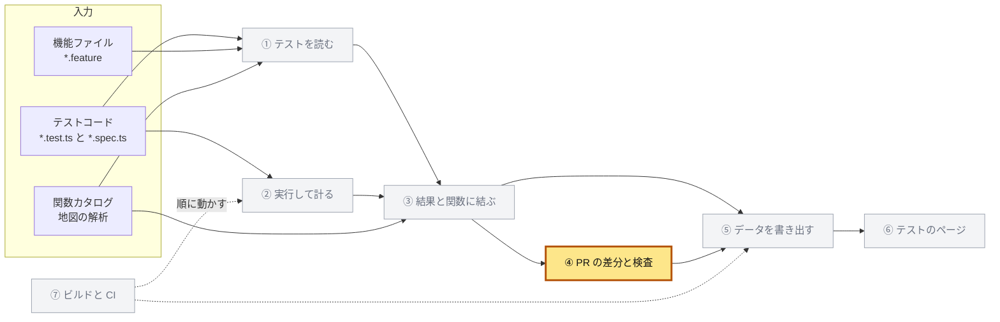

| 項目 | 内容 |
|---|---|
| 入力 | 地図が集めた PR の変更（`BuildContext.changes`：`MapChanges`、分岐点、変わったファイル）、③ のカード（結果と到達つき）と `measured`、変更メモ（`apps/map/changes/*.md`）、分岐点の版のファイル（git） |
| 出力 | テストの差分（`TestDiff`）、検査に落ちるフレームの列（`MapChanges.untested`）、`changes.md` の `### テスト` の節、地図の検査の失敗、変更メモの雛形 |
| 実装 | `packages/test-catalog/src/`（`build.ts` の `readBaseCatalog` と `buildTests` の PR の部分、`diff.ts`、`markdown.ts`、`draft.ts`）、`packages/map-analysis/src/`（`changes.ts`、`notes.ts`、`check.ts`、`draft.ts`、`build.ts`）、`apps/map/scripts/`（`build-data.mjs`、`check-map.mjs`、`draft-notes.mjs`） |

この章は PR の地図のビルドでだけ動く。
PR の地図は、`MAP_BASE`（git のリビジョン）を渡したビルドである。
`MAP_BASE` が無いビルドでは、④-9 の手元のコマンドを除き、この章の処理は走らない。

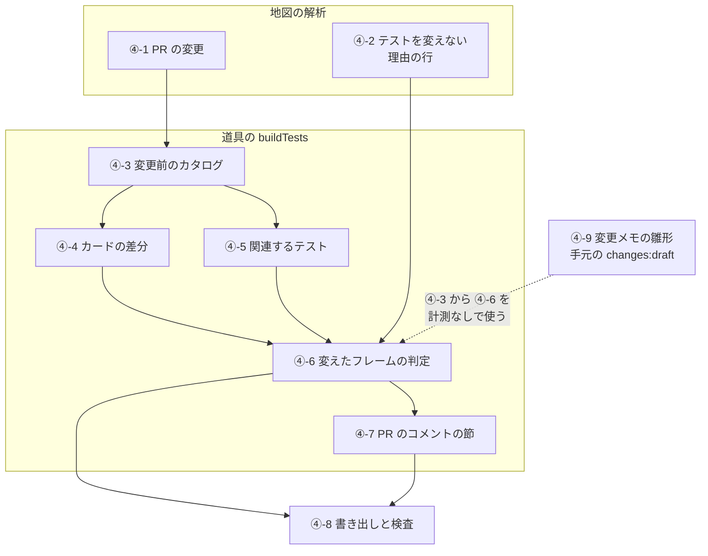

## ④-1 PR の変更

道具が地図から受け取る PR の変更と、その中で道具が頼る規則を示す。

変更を集めるのは地図の `collectChanges` である。
地図はその結果（`ChangeResult`）を、拡張の `BuildContext.changes` として道具に渡す。
`BuildContext` の形は [全体像の「地図から使うもの」](README.md#地図から使うもの) にある。

### ④-1-a 分岐点と変わったファイル

**分岐点**は、PR が base から分かれたコミットである。
地図は分岐点と作業ツリーを比べる。

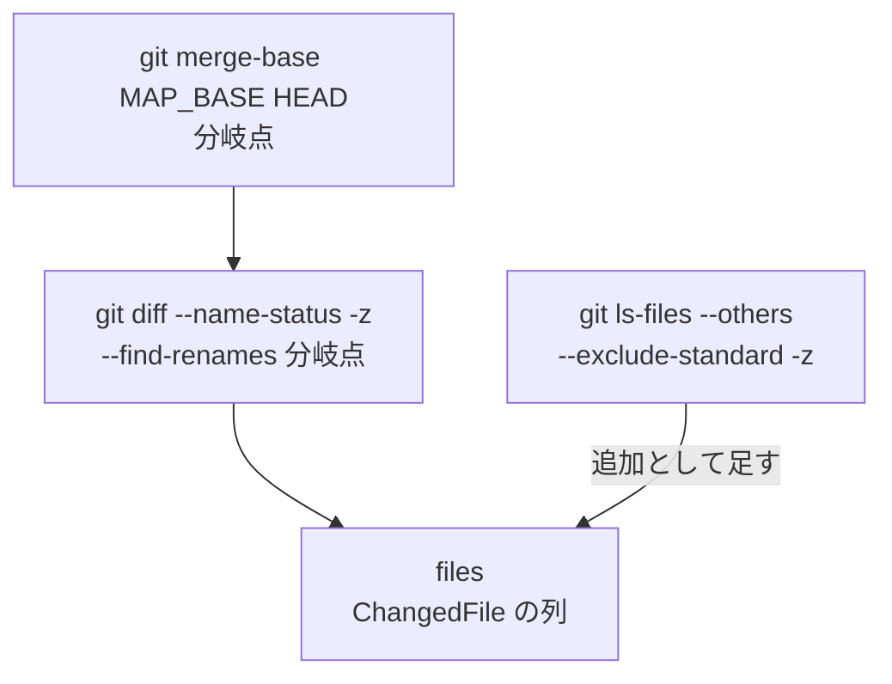

- 分岐点は `git merge-base <MAP_BASE> HEAD` の出力の前後の空白を除いたものである
- 比べる相手は作業ツリーなので、コミットしていない変更も入る
- 追跡していないファイル（無視するものを除く）も、追加として足す
- CI では作業ツリーが PR のマージコミットなので、base が分岐の後にした変更は入らない
- `git diff` には `--no-color --no-ext-diff` も付ける

`git diff` の出力は NUL で区切られている。
状態の文字ごとに、続く欄を次のように読む。

| 状態の文字 | 続く欄 | 作る `ChangedFile` |
|---|---|---|
| `R`（名前の変更） | 前のパス、後のパス | `{ status: 'R', before, after }` |
| `C`（複写） | 元のパス、複写先 | `{ status: 'A', after: 複写先 }`（追加とみなす） |
| `A` | パス | `{ status: 'A', after }` |
| `D` | パス | `{ status: 'D', before }` |
| ほか（`M`、`T` など） | パス | `{ status, before: パス, after: パス }` |

空の欄は飛ばす。
追跡していないファイルは `{ status: 'A', after }` として末尾に足す。

```ts
interface ChangedFile {
  status: string;
  before?: string; // 追加したファイルには無い
  after?: string; // 消したファイルには無い
}

interface ChangeResult {
  changes: MapChanges; // data.changes と同じオブジェクト
  frames: Map<string, FrameChange>; // 地図のページが使う
  base: Revision; // 分岐点の木
  forkPoint: string; // 分岐点のコミット
  files: ChangedFile[]; // 作業ツリーが分岐点から変えたすべてのファイル
}
```

道具は `forkPoint` と `files` を ④-3 で使う。

### ④-1-b 変わったファイルの数え方

地図は変わったファイルを次の順に分ける。
道具のために足したのは、テストファイルの数 `testFiles` である。

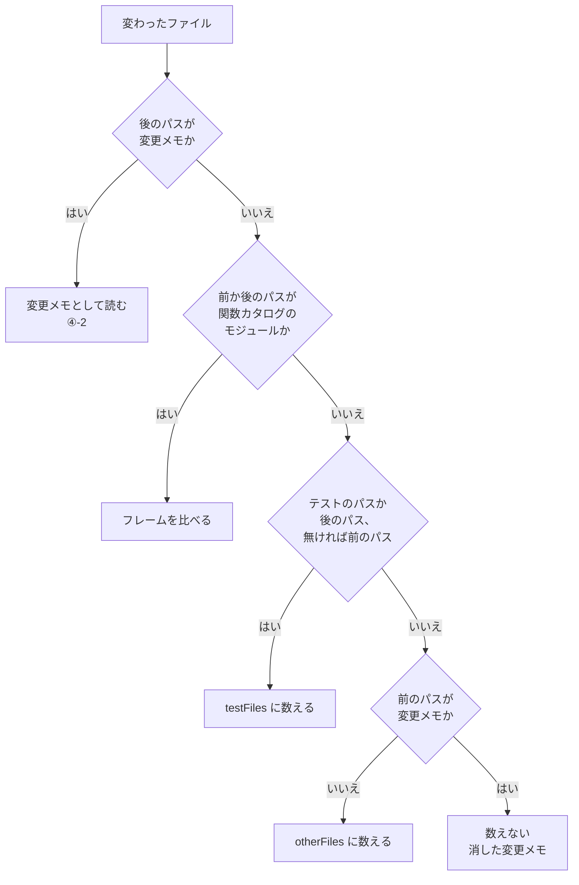

- 変更メモは `apps/map/changes/` の下の `.md` で、`README.md`（大文字と小文字を問わない）を除く
- 関数カタログのモジュールは、根のディレクトリの下の `.ts` か `.tsx`（`.d.ts` を除く）で、根の `include` と `exclude` に従う
- テストのファイルは根の `exclude`（`\.test\.tsx?$`）に当たるので、根の下にあってもモジュールにならない
- テストのパスは ①-1-b と同じ `isTestPath` で決める

このブランチを `MAP_BASE=origin/main` で作ると、`60 test files, 148 other files` になる（値は例）。

### ④-1-c 道具が読む変更の欄

道具は `MapChanges.frames` の各要素（`FrameChangeEntry`）の次の欄を読む。

| 欄 | 意味 | 使う節 |
|---|---|---|
| `id` | フレームの id。消したものは分岐点の id | ④-5、④-6 |
| `kind` | `added`、`modified`、`moved`、`docs`、`removed`、`noted` | ④-6（`added` と `modified` だけを判定する） |
| `name`、`package`、`module`、`body` | 名前、根、モジュール、処理本体か | ④-7 の言葉 |
| `summary` | 差分を言葉にした句の列 | ④-7 は先頭の一つ、④-9 は先頭の六つ |
| `reach` | エンドポイントからの道の列。道の `source` と `endpoint` から鍵 `<source>:<endpoint>` を作る | ④-5、④-7、④-9 |
| `required` | 変更メモが要る変更 | ④-6 |
| `failuresAdded` | 変更の後に外へ出て、前には出なかった失敗 | ④-6 |
| `testReason` | テストを変えない理由（④-2） | ④-6 |
| `notes` | そのフレームを名指す節 | ④-9 |

`required` は、地図が次の式で決める。

```ts
required =
  (kind === 'added' || kind === 'modified') &&
  !cosmetic && // コメントや書き方だけの変更（木が同じ）でない
  (body === true || reach.length > 0); // 処理本体か、エンドポイントに届く
```

`failuresAdded` は、地図が `modified` の変更にだけ計算する。
足したフレームには無い。

道具のために地図に足した欄は次の四つである。

| 型 | 欄 | 書く側 |
|---|---|---|
| `MapChanges` | `testFiles` | 地図（④-1-b） |
| `MapChanges` | `untested` | 道具（④-6） |
| `FrameChangeEntry` | `testReason` | 地図（④-2） |
| `ChangeNoteText` | `reason`、`reasonLine` | 地図（④-2） |

実装：`packages/map-analysis/src/changes.ts`（`collectChanges`、`parseNameStatus`、`git`）、`packages/map-analysis/src/notes.ts`（`isNote`）、`packages/map-analysis/src/roots.ts`（`moduleOf`、`isTestPath`）、`packages/map-analysis/src/model.ts`（`MapChanges`、`FrameChangeEntry`）

## ④-2 テストを変えない理由の行

変更メモの節から、テストを変えない理由を読み出す規則を決める。

変更メモの読み方そのものは地図のものである。
`##` の見出しが節を始め、見出しの名前か HTML コメントの id がフレームを名指す。
道具のために足したのは、節の中の理由の行の読み方である。

理由の行は、次の正規表現に合う行である。

```ts
const REASON_LINE = /^\s*テストを変えない理由\s*[:：]\s*(.*?)\s*$/;
```

- コロンは半角でも全角でもよい
- 行の前後と、コロンのまわりの空白は除く

### ④-2-a 節の行の読み方

節の行を上から一行ずつ読み、本文か理由に振り分ける。

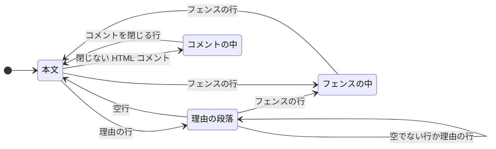

| 今の状態 | 理由の行が来たとき | ほかの行が来たとき |
|---|---|---|
| 本文 | 新しい理由の段落を始める | 本文に残す |
| 理由の段落 | 新しい理由の段落を始める | 空行とフェンスの行は段落を閉じて本文に残し、ほかは段落に足す |
| フェンスの中 | 本文に残す（書いた例として扱う） | 本文に残す |
| コメントの中 | 本文に残す（コメントにした下書きとして扱う） | 本文に残す |

- フェンスの行は、行頭の空白の後に三つのバッククォートか三つのチルダが来る行である
- フェンスの行が来るたびに、フェンスの中と外が入れ替わる
- 本文に残した行で、フェンスの外にいるときだけコメントを見る
- その行の最後の `<!--` が最後の `-->` より後ろにあれば、コメントの中に入る
- コメントの中で `-->` を含む行が来れば、コメントの外に出る

### ④-2-b 理由と本文

- 理由の段落は、理由の行のコロンの後と、段落に足した行を、それぞれ前後の空白を除いて改行でつないだものである
- 空の部分を除き、HTML コメントを消し、前後の空行を除いて言葉にする
- 節の理由（`reason`）は、言葉が空でない最初の段落である
- 理由の行が一つでもあれば `reasonLine` を立てる
- コロンの後が空の理由の行でも立てる（雛形が空けた場所である）
- 本文（`text`）は、理由の段落を除いた行から HTML コメントを消し、前後の空行を除いたものである

理由の段落は本文に入らない。
そのため、理由の行だけの節は説明の無い節と数える。
理由は、なぜコードを変えたかの説明ではないからである。

| 節の行 | `text` | `reason` | `reasonLine` |
|---|---|---|---|
| `テストを変えない理由: 形は同じ。` | 空 | `形は同じ。` | 立つ |
| `テストを変えない理由：`（全角、後が空） | 空 | 無し | 立つ |
| `テストを変えない理由:` の次の行に `次の行に書いた理由。` | 空 | `次の行に書いた理由。` | 立つ |
| `テストを変えない理由: <!-- あとで -->` | 空 | 無し | 立つ |
| 空の理由の行、空行、`テストを変えない理由: 二つ目の行。` | 空 | `二つ目の行。` | 立つ |
| フェンスの中の `テストを変えない理由: 例の行。` | フェンスごと本文 | 無し | 立たない |
| HTML コメントの中の `テストを変えない理由: あとで書く` | 空 | 無し | 立たない |

### ④-2-c フレームへの付け方

地図の `attachNotes` が、節を名指したフレームに節の中身（`ChangeNoteText`）を付ける。

```ts
interface ChangeNoteText {
  file: string; // 変更メモのパス
  heading: string;
  text: string; // 理由の段落と HTML コメントを除いた本文
  reason?: string;
  reasonLine?: boolean;
}

// FrameChangeEntry の欄
testReason?: { text: string; note: string }; // 理由と、その変更メモのパス
```

- 読む変更メモは、PR が足したか変えたものだけである（④-1-b）
- 変更メモはパスの順、節は書いた順に読む
- 見出しが複数のフレームを名指せば、同じ中身がそのすべてに付く
- `testReason` は、付いた節のうち `reason` のある最初のものから作る
- `documented`（説明がある）は、`text` が空でない節が一つでもあるときに立つ

この規則は `packages/map-analysis/src/__tests__/notes.test.ts` の `the reason not to change the tests` が確かめる。

実装：`packages/map-analysis/src/notes.ts`（`REASON_LINE`、`splitReason`、`parseNote`、`withoutComments`、`attachNotes`）

## ④-3 変更前のカタログ

分岐点の版のテストを、作業ツリーと同じ規則でカードにする。
これを**変更前のカタログ**と呼ぶ。

変えていないテストファイルは、作業ツリーのカードをそのまま使う。
変えたテストファイルだけを、分岐点の版で読み直す。

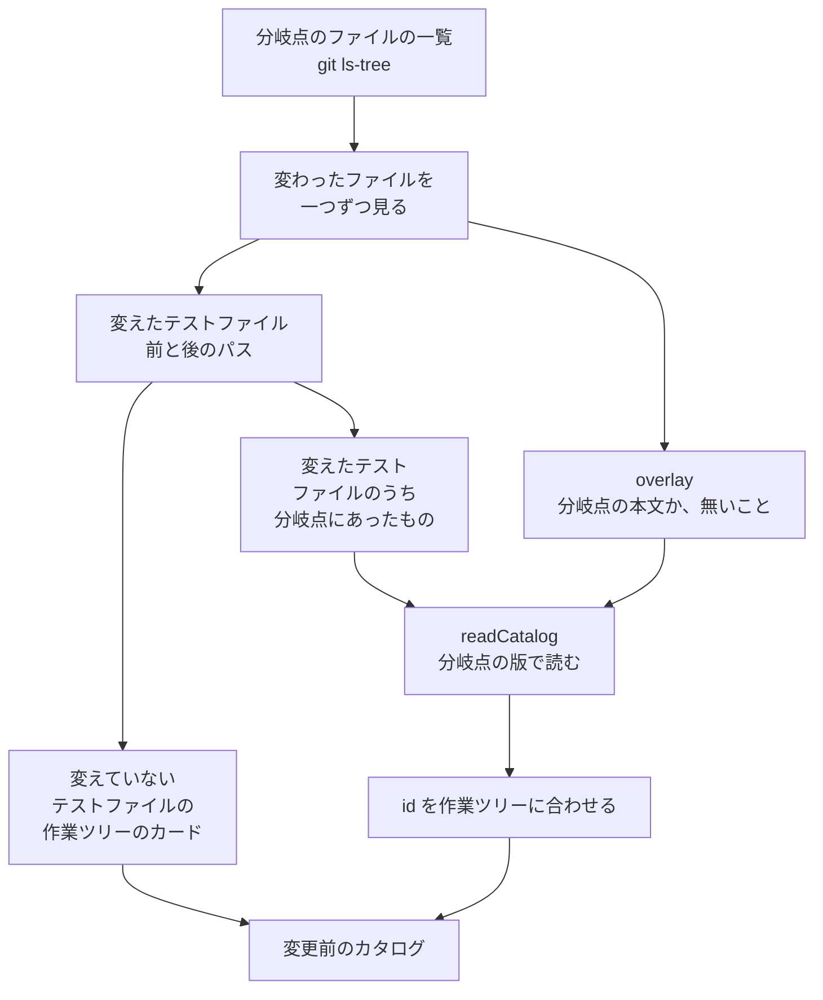

`readBaseCatalog(context, head, tables)` は次の順に動く。

1. `context.changes` が無ければ、作業ツリーのカード（`head`）の写しを返す
2. 分岐点のファイルの一覧 `baseFiles` を、`listFiles(root, 分岐点)`（`git ls-tree -r --name-only -z <分岐点>`）で得る
3. `files` の各ファイルについて、次の三つをする
   - 前と後のパスのうち、①-1-b の規則でテストファイルになるものを `changedTests` に入れる
   - 前のパスが `baseFiles` にあれば、overlay に `<root>/<前のパス>` から `git show <分岐点>:<前のパス>` の本文への対応を入れる
   - 後のパスが前と違い、`baseFiles` に無ければ、overlay に `<root>/<後のパス>` から `null`（その版に無いファイル）への対応を入れる
4. `head` のうち、ファイルが `changedTests` に無いカードを `unchanged` とする
5. `changedTests` のうち `baseFiles` にあるパスを、テストファイル（`TestFile`）にする
6. 一つも無ければ、`unchanged` を返す
7. ① の `readCatalog` を下の表の入力で呼ぶ
8. 読んだカードの id を合わせる（④-3-a）
9. `[...unchanged, ...読んだカード]` を返す

| `readCatalog` の入力 | 値 |
|---|---|
| `files` | 手順 5 のテストファイル |
| `read` | `git show <分岐点>:<path>`（機能ファイルの本文を読む） |
| `overlay` | 手順 3 の対応 |
| `aspects`、`vocabulary`、`translations` | 作業ツリーの表（`readTables`） |
| `repository`、`data` | 作業ツリーのもの |
| `supportFiles` | 渡さない |

- overlay は、テストファイルに限らず変わったすべてのファイルに作る
- `describe` が名指す関数を、分岐点のコードの型で引くためである
- `supportFiles` は、E2E の spec とツールのテストを読むプロジェクトに足す、テスト支援のファイルである（①-1-c）
- 渡さないので、それらの読み直したカードには、支援のファイルのヘルパーが付かないことがある
- 差分はヘルパーを比べないので、これで差分は変わらない（④-4）
- 読み直したカードには、結果も到達も無い（③ の `withRun` を当てない）
- `unchanged` のカードは、作業ツリーの実行の結果と到達を持ったまま比べられる

### ④-3-a id を合わせる

読み直したカードに、作業ツリーの同じテストの id を付け直す。

- 鍵は `<ファイル>\u0000<describe の列を \u0000 でつないだもの>\u0000<名前>` である
- 作業ツリーに同じ鍵のカードがあれば、その id にする
- ただし、その id を `unchanged` のカードか、先に付け直したカードが使っていれば付け直さない

作業ツリーは全部のテストファイルを読むので、id の重なりを見つけて `fileTestId` に変えることがある（①-10-c）。
変更前のカタログは変えたファイルしか読まないので、その重なりが見えず、別の id になる。
付け直さないと、変えていないテストが、消したテストと足したテストの組に見える。

実装：`packages/test-catalog/src/build.ts`（`readBaseCatalog`、`readTables`）、`packages/test-catalog/src/discover.ts`（`listFiles`、`testFileOf`、`testFiles`）、`packages/map-analysis/src/changes.ts`（`git`）

## ④-4 カードの差分

変更前と作業ツリーのカードを比べ、足した、消した、名前を変えた、変えたテストを決める。

```ts
function diffCatalogs(before: TestCase[], after: TestCase[], data: MapData, changes: MapChanges, measured: boolean): TestDiff;
```

`before` は ④-3 の変更前のカタログ、`after` は ③ のカードである。
`TestDiff` の全体の形は ⑤-9 にある。

### ④-4-a 足したテストと消したテスト

- 足したテストは、作業ツリーにだけある id のカードである
- 消したテストは、変更前にだけある id のカードである
- どちらも、それぞれのカタログの順に並べる

### ④-4-b 名前の変更

ハッシュの id は名前から作るので、名前を変えたテストは消したテストと足したテストの組として現れる（①-10）。
そのうち、次の条件を満たす組を**名前の変更**として対応づける。

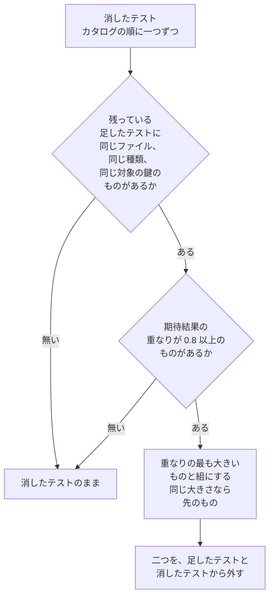

- 一度組にした足したテストは、後の消したテストの候補にならない
- **対象の鍵**は、根拠が `coverage` でない対象を文字列にし、重複を除いて並べた列である
- 文字列は `function:<id>`、`endpoint:<source>:<id>`、`member:<id>` である
- 計測した実行が足した対象（`coverage`）を除くのは、計測した側のカタログにしか無いからである

重なり（`expectationOverlap`）は、期待結果を言葉（`text`）で比べた割合である。

```ts
function expectationOverlap(a: Assertion[], b: Assertion[]): number {
  if (a.length === 0 && b.length === 0) return 1;
  const right = b.map((x) => x.text);
  let same = 0;
  for (const text of a.map((x) => x.text)) {
    const i = right.indexOf(text);
    if (i === -1) continue;
    same += 1;
    right.splice(i, 1); // 同じ言葉は一つずつ消し込む
  }
  return same / Math.max(a.length, b.length);
}
```

- `[a, b]` と `[a, c]` は 0.5、`[]` と `[]` は 1、`[a]` と `[]` は 0 である
- 期待結果が五つのテストは、四つが同じなら名前の変更になる
- 閾値の 0.8 は、設計では実際の PR で測って決め直すことになっている

### ④-4-c 変えたテスト

両方にある id のカードを、`changesOf(前, 後)` で比べる。
変わったことは `what` に次の順で入る。

| `what` | 条件 |
|---|---|
| `title` | 名前が違う |
| `assertions` | 期待結果を言葉の多重集合として比べ、足したものか消したものがある |
| `subjects` | 対象の鍵の列（④-4-b）が違う |
| `requests` | リクエストを `<method> <path> <params を , でつないだもの> <auth、無ければ空>` の文字列にして並べた列が違う |
| `body` | 上のどれも無く、`digest`（本体の空白を除いたハッシュ、①-9-e）が違う |

- `what` が空なら、変えたテストに入れない
- `assertions` が入るときは、足した期待結果と消した期待結果を `{ added, removed }` に持たせる
- ハッシュの id は名前を含むので、同じ id で `title` が変わるのは id を固定したテスト（`@id:`、`// @test-id`）だけである

名前の変更の組も `changesOf` で比べる。
`title` を除いて `what` が残るときだけ、`title` を除いたものを変えたテストに足す。
その id は後の id である。

```ts
// TestDiff['modified'] の要素
{ id: string; what: Array<'title' | 'assertions' | 'subjects' | 'requests' | 'body'>; assertions?: { added: Assertion[]; removed: Assertion[] } }
```

### ④-4-d 数

| 欄 | 中身 |
|---|---|
| `counts.before`、`counts.after` | 二つのカタログのカードの数 |
| `counts.byKind[種類]` | `[前の数, 後の数]` |
| `counts.byEndpoint[<source>:<endpoint>]` | そのエンドポイントを対象に持つ（`coverage` を除く）カードの `[前の数, 後の数]` |

鍵の並びは、変更前のカタログ、作業ツリーのカタログの順に初めて出た順である。

### ④-4-e 差分のカード

差分が名指すテストの抜き出しを `cards` に id で持つ。
テストのページとコメントは、これで名前と種類を出す。

| 入れるテスト | 取る版 | `examples` |
|---|---|---|
| 足したテスト、変えたテスト、名前の変更の後 | 作業ツリー | アウトラインの行なら、その行の数 |
| 消したテスト、名前の変更の前 | 変更前 | 入れない |

- アウトラインの行は、`form` が `feature` で `path` が二つ以上のカードである
- 行の数は、作業ツリーで同じファイル、同じ `path` のカードの数である
- `examples` は 2 以上のときだけ入れる
- `ja` はカードの `ja.title` があるときだけ入れる
- `endpoints` は、対象のエンドポイントの鍵（`coverage` を除く）があるときだけ入れる

```ts
// TestDiff['cards'] の値
type DiffCard = Pick<TestCase, 'id' | 'kind' | 'title' | 'outcome' | 'aspects' | 'source' | 'path'> & {
  ja?: string;
  examples?: number;
  endpoints?: string[];
};
```

この規則は `packages/test-catalog/src/__tests__/join.test.ts` の `diffCatalogs` と `expectationOverlap` のテストが確かめる。

実装：`packages/test-catalog/src/diff.ts`（`diffCatalogs`、`expectationOverlap`、`changesOf`、`moreIn`、`subjectKeys`、`endpointKeys`、`cardOf`）

## ④-5 関連するテスト

変えたフレームごとに、その変更を確かめうるテスト（関連するテスト）を決める。

`relatedTests(entry, tests, data, measured)` は、テストごとに近さの順位を付ける。
順位の小さい順に並べ、同じ順位ではカタログの順を保つ。

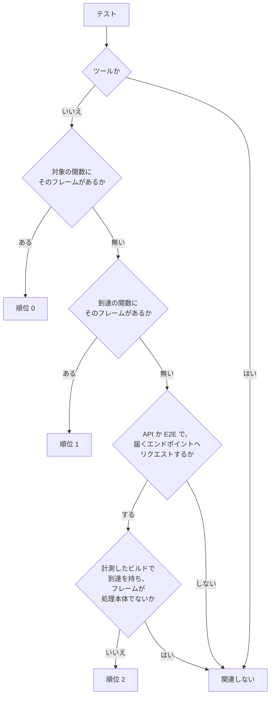

- 対象の関数は、根拠を問わない（`describe`、`call`、`declared`）
- 到達の関数は、どの実行先の到達でもよい
- 計測したビルドは、`measured` が真のビルドである（③）
- テストがリクエストするエンドポイントは、根拠が `coverage` でない、対象のエンドポイントの鍵である

**届くエンドポイント**は、次の鍵の集合である。

- 変更の `reach` の各道の `<source>:<endpoint>`
- フレームが処理本体（`body` が真）なら、そのエンドポイントの鍵

処理本体の鍵の `source` は、id が `endpoint:nextjs:` で始まれば `nextjs`、ほかの `endpoint:` なら `hono` である。
エンドポイントは、地図の `bodies[id].endpoint` である。

計測したビルドでは、到達がテストの通った関数を示す。
到達を持つテストは、フレームに届いていなければ関連しない。
例外は処理本体の変更で、そのエンドポイントへリクエストするテストを関連に入れる。
合成の処理本体（行の範囲を持たない本体）は、到達の関数に決して現れない。

計測の無いビルドでは、どのテストも到達を持たない。
このとき順位 2 は、届くエンドポイントへリクエストする API と E2E のテストすべてである。
計測したビルドでも、到達を持たないテストには同じ規則を当てる。
読み直した変更前のカード（④-3）が、これに当たる。

同じ規則を、作業ツリーのカタログと変更前のカタログの両方に当てる（④-6 の `before` と `after`）。

この規則は `join.test.ts` の `diffCatalogs` の次のテストが確かめる。

- `should count the API tests of an endpoint the change reaches as related when the run was not measured`
- `should count the endpoints a measured run added on neither side, and relate the tests of both sides by the same rule`

実装：`packages/test-catalog/src/diff.ts`（`relatedTests`、`bodyEndpoint`、`endpointKeys`）、`packages/test-catalog/src/join.ts`（`sourceOfFrame`）

## ④-6 変えたフレームの判定

変えたフレームごとに、テストを触ったか、検査に落ちるかを決める。

判定するのは、`MapChanges.frames` のうち `kind` が `added` か `modified` の変更である。
移動、JSDoc だけ、削除、メモだけの変更は判定しない。
並びは `MapChanges.frames` の順（id の順）である。

### ④-6-a 判定の欄

| 欄 | 決め方 |
|---|---|
| `frame` | フレームの id |
| `related` | 作業ツリーのカタログでの関連するテスト（④-5）の id |
| `touched` | `related` のうち、触ったテストの id |
| `untouched` | `required` が真で、`touched` が空 |
| `reason` | 変更の `testReason`（④-2）。あるときだけ |
| `failuresWithoutTest` | `failuresAdded` のうち、OAuth のエラーコードを持ち、そのコードを関連するテストのどれも期待しないもの |
| `before`、`after` | 変更前と作業ツリーの、関連するテストの保証の範囲 |

**触ったテスト**は、この PR が足したテスト、変えたテスト、名前の変更の後のテストである。

- エラーコードは `/\(([a-z][a-z0-9_]*)\)$/` で取る（`TokenError(invalid_target)` は `invalid_target`）
- コードの無い失敗（`RangeError` など）は数えない
- 期待するエラーは、関連するテストの `errors`（OAuth のエラーコードとエラークラス）を合わせたものである

**保証の範囲**は、関連するテストの次の三つの集合である。
どれも重複を除いて並べる。

| 集合 | 中身 |
|---|---|
| `outcomes` | 期待結果（`unknown` を除く） |
| `aspects` | 観点 |
| `errors` | 期待するエラー |

### ④-6-b 検査に落ちる変更

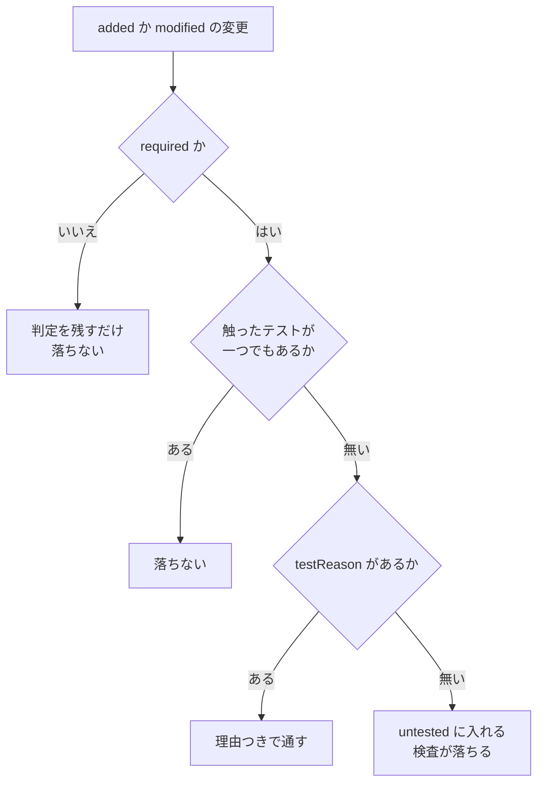

- `MapChanges.untested` は、`untouched` が真で `reason` の無い判定の `frame` の列である
- 関連するテストが一つも無いフレームも、`required` なら `untouched` になる
- 期待するテストの無い新しい失敗は、コメントに出すだけで落とさない

`join.test.ts` の、変更前と同じテストを渡す例は次の判定になる。
`verifyClientSecret` を変え、それを `describe` が名指すテスト `kept` を変えなかった場合である。

```json
{
  "frame": "core:client-auth.ts#verifyClientSecret",
  "related": ["kept"],
  "touched": [],
  "untouched": true,
  "failuresWithoutTest": [],
  "before": { "outcomes": ["success"], "aspects": [], "errors": [] },
  "after": { "outcomes": ["success"], "aspects": [], "errors": [] }
}
```

この規則は `join.test.ts` の `diffCatalogs` の次のテストが確かめる。

- `should mark a change none of whose related tests changed as untouched, and keep the reason its note gives`
- `should count a change whose related test the pull request changed as touched, and the new failures no test expects`

実装：`packages/test-catalog/src/diff.ts`（`diffCatalogs`、`guaranteeOf`）、`packages/test-catalog/src/join.ts`（`errorCodeOf`）、`packages/test-catalog/src/build.ts`（`buildTests` の PR の部分）

## ④-7 PR のコメントの節

テストの差分を、PR のコメントに入る Markdown の節にする。

`testsMarkdown(diff, data, aspects)` は、`### テスト` で始まり改行で終わる文字列を返す。
見出しを `###` にするのは、コメントの `## OIDC Provider Map` の下に入るからである。
枠の言葉は日本語で、テストの名前と期待結果は英語のままである。

### ④-7-a ブロックの並び

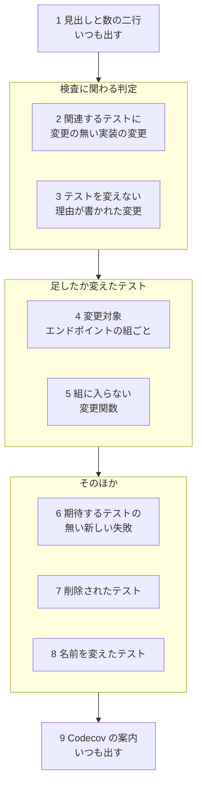

各ブロックの前には空行を一つ置く。
太字の見出しの後にも空行を一つ置く。

| 順 | 見出しか行 | 出す条件 | 一覧の一行 |
|---|---|---|---|
| 1 | `テストケース: <前> → <後>（<差>）  <種類> <差>、…` と `追加 <n> · 変更 <n> · 名前の変更 <n> · 削除 <n>` | いつも | |
| 2 | `**関連するテストに変更の無い実装の変更（<n>、CI を落とす）**` | `untouched` で理由の無い判定がある | `- <フレーム>（<要約の先頭>）: 関連するテスト <n> 件、変更なし` |
| 3 | `**テストを変えない理由が書かれた変更（<n>）**` | `untouched` で理由のある判定がある | `- <フレーム>: 関連するテスト <n> 件。「<理由>」` |
| 4 | `**変更対象: <エンドポイントの名前>（<source>, …）**` | エンドポイントを持つ、足したか変えたテストがある | ④-7-c |
| 5 | `**テストを足すか変えた変更関数**` | 触ったテストがあり、どの組の鍵にも届かないフレームがある | `- <フレーム>: <触ったテストの言葉>` |
| 6 | `**新しく外へ出る失敗を期待するテストが無いもの**` | `failuresWithoutTest` がある | `- <失敗>（<フレーム> から）` |
| 7 | `**削除されたテスト（<n>）**` | 消したテストがある | `- <テスト>` |
| 8 | `**名前を変えたテスト（<n>）**` | 名前の変更がある | `- <前の名前> → <後の名前>` |
| 9 | `テストの結果とカバレッジの変化は Codecov のコメントにあります。` | いつも | |

- 1 行目の種類の差は、差が 0 でない種類だけを `、` でつなぎ、前に空白を二つ置く
- 種類の並びは `byKind` の鍵の順（④-4-d）である
- 2 の一覧の後に、空行と次の一文を置く

```text
テストを足すか変えるか、変えないのが妥当なら、変更メモのその関数の節に `テストを変えない理由: …` の行を書いてください（`pnpm --filter @maronn-openid-connect/map changes:draft` が書く場所を空けます）。
```

- 2 と 3 の `<n> 件` は `related` の数で、要約の先頭は `summary` の一つ目（無ければ括弧ごと出さない）である
- 5 は、触ったテストがあり、`reach` のどの道もどの組の鍵にも届かない判定である
- 6 の並びは判定の順、その中では `failuresWithoutTest` の順である

### ④-7-b 言葉

| 部品 | 形 |
|---|---|
| 種類 | `unit` は `ユニット`、`api` は `API`、`e2e` は `E2E`、`tool` は `ツール` |
| 期待結果 | `success` は `正常系`、`failure` は `異常系`、`unknown` は出さない |
| 差 | 正は `+3`、負は `-1`、0 は `±0` |
| 一行目のケースの数 | `toLocaleString('en-US')`（`5,731`）。ほかの数はそのまま |
| 関数のフレーム | `` `<name>()`（<package> <module>） `` |
| 処理本体のフレーム | `` `<name>`（エンドポイントの処理） `` |
| 変更の記録に無いフレーム | `` `<id>` `` |
| テスト | `<title>（<種類>, <期待結果>, <観点の名前>…, <n> 行）`。無い部品は除き、`, ` でつなぐ |
| カードの無いテスト | `` `<id>` `` |

- 観点の名前は観点の表の `label` で、表に無ければ id のままである
- アウトラインの行は、一つの一覧の中で同じファイルと同じ `path` のものを一行にまとめる
- まとめた行の名前はアウトラインの名前（`path` の最後）で、`<n> 行` はまとめた数である
- 要約の先頭、理由、期待結果の言葉は、空白の連なりを一つの空白にし、`|` の前に `\` を足し、前後の空白を除く
- 一つの一覧は 20 行（`LIMIT`）までで、残りは次の一行にする

```text
- ほか <n> 件は、テストの画面（地図の `/tests/` の「この PR のテスト」）で見てください。
```

### ④-7-c エンドポイントの組

足したテストと変えたテストを、届くエンドポイントの名前で組にする。

- 足したテスト、名前の変更の後、変えたテストの順に、差分のカードの `endpoints` の鍵を見る
- エンドポイントの名前は、地図の `methods` を ` | ` でつなぎ、空白と `path` を続けたもの（`POST /token`）である
- 地図に無いエンドポイントは id を名前にする
- 名前が同じ鍵は一つの組になる（`hono:token` と `nextjs:token` は `POST /token`）
- 名前の変更の後と変えたテストは「変更されたテスト」に、ほかは「追加されたテスト」に入れる
- 組は名前の文字列の順に並べ、見出しの括弧には組の `source` を重複なく並べる

```text
**変更対象: POST /token（hono, nextjs）**

追加されたテスト:
- <テスト>

変更されたテスト:
- <テスト>（名前の変更: <前の名前> から）（期待 ~~<消した期待結果>~~ → <足した期待結果>）

関連する変更関数:
- <フレーム>: ユニット 追加 2、API 変更 1
```

- 「変更されたテスト」の期待は、消した期待結果に取り消し線を付けて先に、足した期待結果を後に置き、先頭の四つを ` → ` でつなぐ
- 期待結果が変わっていない行には期待の括弧を付けず、名前の変更でない行には名前の括弧を付けない
- 「関連する変更関数」に出すのは、`reach` がこの組の鍵に届く判定である
- ただし、触ったテストのうち、この組の鍵を持つものか、エンドポイントを持たないもの（ユニットテストなど）があるときだけ出す
- 一行の言葉には、その触ったテストだけを数える
- 触ったテストの言葉は、種類ごとに `<種類> 追加 <n>` と `<種類> 変更 <n>` を作り、`、` でつなぐ
- 「変更」は、変えたテストと名前の変更の後のテストである

### ④-7-d 例

このブランチを `MAP_BASE=origin/main` で作ったときの節である（値は例）。

```md
### テスト

テストケース: 5,731 → 6,008（+277）  ツール +269、API +7、E2E +1
追加 277 · 変更 0 · 名前の変更 0 · 削除 0

**変更対象: POST /token（hono, nextjs）**

追加されたテスト:
- Exchange the code for an access token, an ID Token and a refresh token（API, 正常系）
- Reject a request without <parameter> with <error>（API, 異常系, 2 行）
- Reject an authorization code the provider did not issue with invalid_grant（API, 異常系）
- Reject a replayed code with invalid_grant and revoke the tokens issued from it（API, 異常系, セキュリティ）
- Reject invalid client credentials with invalid_client（API, 異常系, 認証）
- Reject a grant_type the provider does not offer with unsupported_grant_type（API, 異常系）

テストの結果とカバレッジの変化は Codecov のコメントにあります。
```

検査に落ちる変更があると、数の二行の後に次のブロックが入る。
`verifyClientSecret` を変え、関連する二つのテストを変えなかった場合である。

```md
**関連するテストに変更の無い実装の変更（1、CI を落とす）**

- `verifyClientSecret()`（core client-auth.ts）（条件 `secret.length < 8` を足した）: 関連するテスト 2 件、変更なし

テストを足すか変えるか、変えないのが妥当なら、変更メモのその関数の節に `テストを変えない理由: …` の行を書いてください（`pnpm --filter @maronn-openid-connect/map changes:draft` が書く場所を空けます）。
```

この形は、④-6 の二つのテストと、`join.test.ts` の次のテストが確かめる。

- `should list a renamed test of an endpoint as changed in the comment, not as added`

実装：`packages/test-catalog/src/markdown.ts`（`testsMarkdown`、`testLines`、`testWords`、`frameWords`、`listed`、`cell`、`signed`、`KIND_WORDS`、`OUTCOME_WORDS`、`LIMIT`）

## ④-8 書き出しと検査

差分を地図のデータとログに渡し、地図の検査で CI を落とすまでを決める。

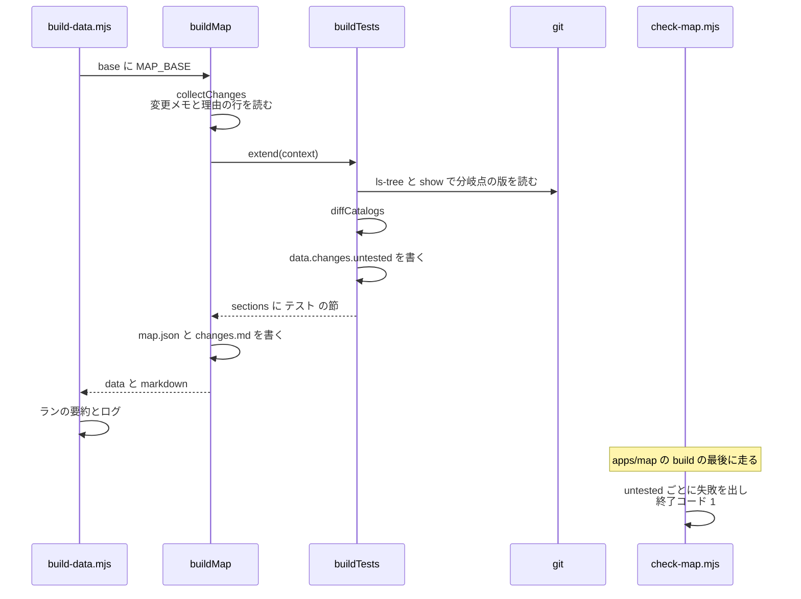

### ④-8-a 道具がすること

1. `context.changes` と `data.changes` の両方があるときだけ、④-3 から ④-7 を走らせる
2. 書き出し先（`out`）があれば `tests/diff.json` を書き、索引に `diff: true` を立てる（⑤-9）
3. `data.changes.untested` に ④-6-b の列を入れる（`data` は、地図がこの後で `map.json` に書くオブジェクト）
4. `testsMarkdown` の結果を `sections` に入れて返す
5. ログに次の一行を足す

```text
tests: <前の数> → <後の数> cases, <n> added, <n> removed, <n> renamed, <n> changed; <n> changes need a test or a reason
```

PR の地図でないビルドでは、前のビルドの `diff.json` を消し、`sections` を空で返す。

### ④-8-b 地図がすること

- `changes.md` を `changesMarkdown(changes, { sections })` で書く
- 地図の節（説明の無い変更、変わった関数の表など）の後に、空行を挟み、各節の末尾の空白を除いて足す
- PR の地図でなければ、`changes.md` を消す

`build-data.mjs` は、PR の地図のとき次をする。

- `GITHUB_STEP_SUMMARY` があれば、そのファイルに `## OIDC Provider Map`、空行、`changes.md` の中身を足す（`appendFileSync`）
- `Changes since <MAP_BASE> (<分岐点の先頭 7 文字>[, with the uncommitted work]): …` の行を出す
- その行は `<n> test files` と `<n> need a test or a reason` を含む
- 変わったフレームごとの行を出し、`untested` に入るものには `(no test changed: write a test or a reason)` を付ける

ログ全体の形は ⑦-2 にある。

### ④-8-c 地図の検査

`check-map.mjs` は `map.json` を読み、`checkMap` で検査する。
`untested` の id ごとに、次の失敗を一つ足す。

```text
<name>() (<package> <module>) changed and reaches an endpoint, but this pull request adds or changes none of its related tests: change a test that names or reaches it, or write why the tests stay as they are on a line `テストを変えない理由: …` in its section of apps/map/changes/*.md
```

- 処理本体なら、先頭は `the endpoint body <name>` になる
- 失敗が一つでもあれば、各失敗を `✗ <失敗>` として標準エラーに出し、終了コード 1 で終わる
- 数の行の末尾は `<n> changes whose tests did not change without a reason` である
- 検査は `apps/map` の `build` の最後にあり、データ、地図、テストのページを作った後に走る（⑦-3）
- CI は、検査が落ちた PR でもプレビューとコメントを作る（⑦-7-a）
- コメントには `changes.md` が入る

この失敗の形は `packages/map-analysis/src/__tests__/check.test.ts` の次のテストが確かめる。

- `should fail on a change whose related tests the pull request did not touch, naming the reason line that lets it pass`

実装：`packages/test-catalog/src/build.ts`（`buildTests`）、`packages/map-analysis/src/build.ts`（`buildMap`、`BuildContext`、`BuildExtension`）、`packages/map-analysis/src/changes.ts`（`changesMarkdown`）、`packages/map-analysis/src/check.ts`（`checkMap`）、`apps/map/scripts/build-data.mjs`、`apps/map/scripts/check-map.mjs`

## ④-9 変更メモの雛形

手元で `changes:draft` を走らせ、変更メモに節と理由の場所を書き足す。

```bash
MAP_BASE=origin/main pnpm --filter @maronn-openid-connect/map changes:draft [変更メモのパス]
```

- `MAP_BASE` は前後の空白を除き、空なら `origin/main` とする
- 引数は、書き込む変更メモのリポジトリのルートからのパスである（pnpm が渡す `--` は読み飛ばす）

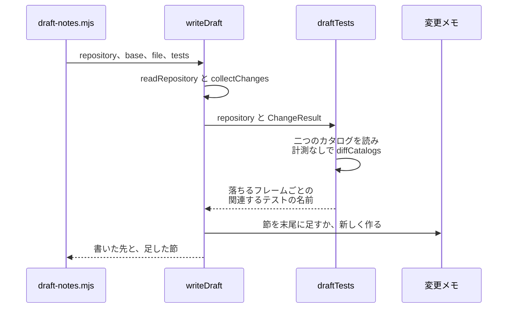

### ④-9-a 落ちる変更と関連するテスト

`draftTests` は地図のデータを持たないので、`MapData` の代わりを組む（`mapDataOf`）。

| 欄 | 中身 |
|---|---|
| `flows` | `repository.cli.flows` |
| `features` | `repository.cli.features` |
| `bodies` | 作業ツリーのフレームのうち、`kind` が `body` で `endpoint` のあるもの。`summary` は空、`calls` と `sites` は空の列 |
| `functions`、`members`、`sources` | 空 |

1. 作業ツリーのカタログを `readCatalog` で読む（`supportFiles` は渡さない）
2. 変更前のカタログを `readBaseCatalog` で読む（④-3）
3. `diffCatalogs(変更前, 作業ツリー, data, changes, false)` で比べる
4. `untouched` で理由の無い判定ごとに、関連するテストの名前（`title`、無ければ id）の列を返す

報告は読まないので、関連するテストは計測の無い規則（④-5）で選ぶ。
そのため雛形の関連するテストは、CI の計測したビルドのものと違うことがある。

### ④-9-b 書く節

`writeDraft` は二種類の節を書く。

| 節 | 対象のフレーム | 中身 |
|---|---|---|
| 新しい節 | `added` か `modified` で、名指す節が一つも無い。`required` のものを先に、ほかは id の順 | 見出し、自動要約、届く先、書く場所の案内。`draftTests` が返したフレームには、関連するテストと空の理由の行も |
| 理由の場所の節 | `draftTests` が返し、名指す節があり、`testReason` が無く、`reasonLine` の立った節も無い | 同じ見出し、関連するテスト、空の理由の行 |

`reasonLine` の立った節があるフレームを除くのは、前の雛形が空けた場所に二つ目を足さないためである。

書く先は、次のうち最初に決まるものである。

1. 引数のパス
2. PR が足したか変えた変更メモのうち、パスの順で最初のもの
3. `apps/map/changes/<noteName(ブランチ名)>`

`noteName` は、`git rev-parse --abbrev-ref HEAD` を `/` で分けた最後の空でない部分を使う。
`[^A-Za-z0-9._-]+` に合う部分を `-` にし、前後の `-` を除き、`.md` を付ける（空なら `changes.md`）。
`claude/apps-map` は `apps-map.md`、`feature/x y` は `x-y.md` になる。

- ファイルがあれば、末尾の空白を除き、空行を一つ挟んで節を足す
- 無ければ、`# （この PR のタイトル）`、空行、`<!-- この PR で何をするか、なぜするかを書く -->`、空行の後に節を書く
- 新しい節を先に、理由の場所の節を後に、改行でつなぐ
- どちらの節も無ければ、何も書かない

新しい節は次の形である（`draftSections` と `draftTestLines`）。

```md
## verifyClientSecret <!-- core:client-auth.ts#verifyClientSecret -->

<!-- 自動要約: 条件 `secret.length < 8` を足した -->
<!-- 届く先: hono:token, nextjs:token -->
<!-- なぜ変えたか、何に気をつけるかを書く（何を変えたかとどこに効くかは地図が出す） -->

<!-- 関連するテスト（2）: should reject a short secret / should accept a long secret。どれかを変えるか、変えない理由を次の行に書く -->
テストを変えない理由:
```

- 見出しは `## <name> <!-- <id> -->` である
- 自動要約は `summary` の先頭六つを ` / ` でつなぐ（無ければ `変更あり`）
- 届く先は `reach` の `<source>:<endpoint>` を重複なく `, ` でつなぐ（無ければ `なし`）
- 関連するテストと空の理由の行は、`draftTests` が返したフレームにだけ、空行の後に付ける
- 関連するテストは先頭の十件を ` / ` でつなぎ、残りを ` ほか <n>` とする
- 関連するテストが無ければ `<!-- 関連するテスト: なし。テストを足すか、テストを足さない理由を次の行に書く -->` とする
- コメントの中の `-->` は `- ->` にする（コメントが途中で閉じないため）
- 理由の場所の節は、見出し、空行、関連するテストの行、空の理由の行、空行である

雛形を読み返すと、HTML コメントは本文から消え、空の理由の行は理由にならない（④-2）。
そのため雛形のままでは、説明の検査も理由の検査も通らない。

スクリプトは次の形で出す。

```text
Wrote <n> sections, and the place of a reason for the tests of <n> changes, to <file>:
  要説明  テスト  <name>  <id>
Say why each changed under its heading; the map shows what changed and where it takes effect.
For a change marked テスト, change one of the tests the comment lists, or write why not after テストを変えない理由:.
```

- `要説明` は、新しい節で `required` のものに付く
- `テスト` は、理由の場所を空けたものに付く
- 付かない欄は、全角の空白三つで埋める
- 最後の行は、理由の場所を一つでも空けたときだけ出す
- 書くものが無ければ、`Every change since <base> has a section in a change note already.` だけを出す

この形は `notes.test.ts` の次のテストが確かめる。

- `should draft the related tests in a comment and an empty reason line, in a new section or in one of its own`
- `should name a new note after the branch`

実装：`apps/map/scripts/draft-notes.mjs`、`packages/map-analysis/src/draft.ts`（`writeDraft`、`noteName`）、`packages/map-analysis/src/notes.ts`（`draftSections`、`draftTestSections`、`draftTestLines`、`draftHeading`）、`packages/test-catalog/src/draft.ts`（`draftTests`、`mapDataOf`）

## この章の出力

- ⑤ へ：`TestDiff`。⑤ が `tests/diff.json` に書き、索引に `diff: true` を立てる（⑤-9）
- 地図へ：`MapChanges.untested`（`map.json` に入り、地図の検査が読む）と、`changes.md` の末尾の `### テスト` の節
- ⑦ へ：落ちた検査の終了コードと、PR のコメントとランの要約に入る `changes.md`

[全体像](README.md) ＞ [③ 結果と関数に結ぶ](03-join.md) ＞ ④ PR の差分と検査 ＞ [⑤ データを書き出す](05-data.md)
