# ⑤ データを書き出す

[全体像](README.md) ｜ ← [④ PR の差分と検査](04-pull-request.md) ｜ ⑤ データを書き出す ｜ [⑥ テストのページ](06-viewer.md) →

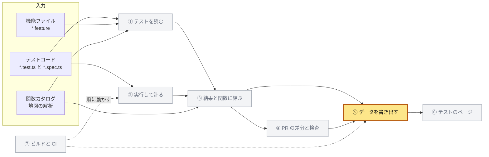

| 項目 | 内容 |
|---|---|
| 入力 | ③ のカード（`TestCase[]`、結果と到達つき）と `Joined`、`measured` と実行の時刻、① の訳の無い言い回し（`untranslated`）、④ のテストの差分（`TestDiff`）、地図の `MapData`（`flows`、`functions`、`bodies`、`sources`）、作業ツリーの木（`repository.head.trees`）とファイルの本文、観点の表 |
| 出力 | `apps/tests/public/data` の `tests.json`、`outline.json`、`tests/by-file/<hash>.json`、`tests/sources/<hash>.json`、`tests/diff.json` |
| 実装 | `packages/test-catalog/src/build.ts`（`buildTests`、`writeFileCards`、`indexRefs`、`codeOfFrame`、`stepBlocks`、`outlineOf`、`shownFiles`）、`packages/test-catalog/src/model.ts`、`packages/test-catalog/src/join.ts`（`entryOf`、`countTests`）、`packages/map-analysis/src/build.ts`（`writeHashed`、`removeStale`）<br>作る順：[再現の手順](README.md#再現の手順)の [4](README.md#4-データの段への接続-2)、[8](README.md#8-データの仕上げ) |

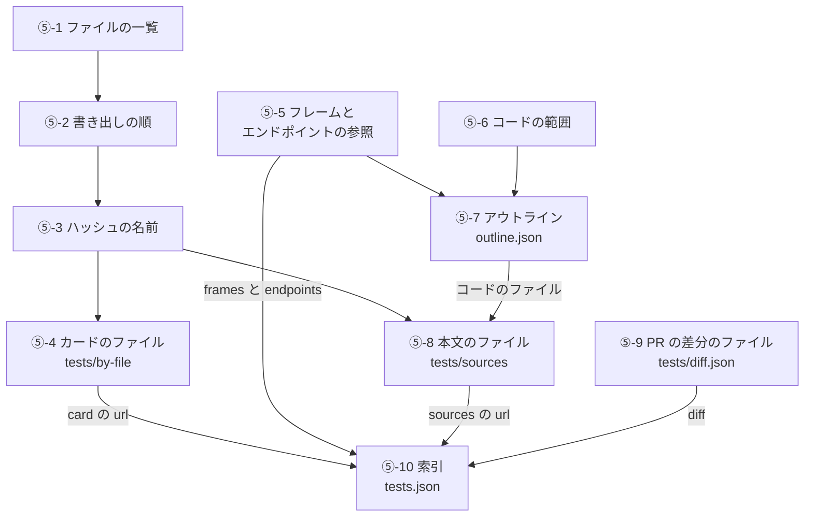

## ⑤-1 ファイルの一覧

テストのページが読むファイルと、その間の参照を示す。

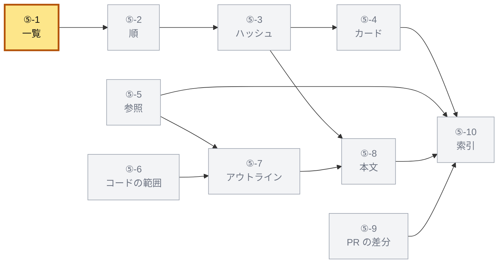

```text
apps/tests/public/data/          gitignore する
├── tests.json                   索引（TestsIndex）
├── outline.json                 アウトライン（TestsOutline）
└── tests/
    ├── by-file/<hash>.json      テストファイルごとのカード（FileTests）
    ├── sources/<hash>.json      ページが見せるファイルの本文（TestSource）
    └── diff.json                PR のビルドだけ（TestDiff）
```

- 型は `packages/test-catalog/src/model.ts` に一つだけ置く
- `model.ts` はコードを持たず、何も import しない
- テストのページが、`@maronn-openid-connect/test-catalog/model` として型だけを読むからである
- JSON は `JSON.stringify` の出力そのままで、字下げしない
- url は、テストのページの根からの相対（`./data/...`）である

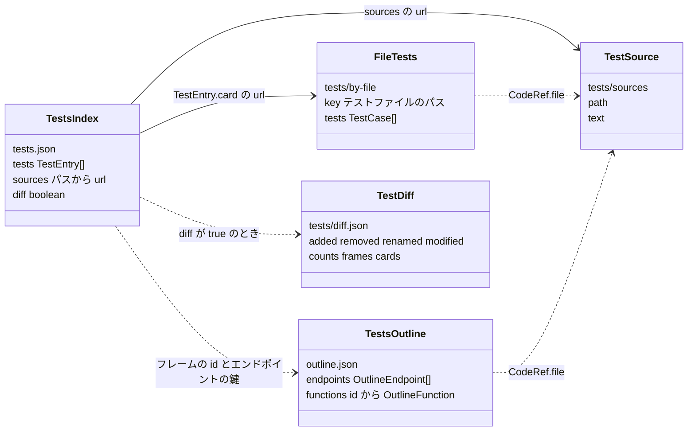

- 実線は url で指す参照である
- 点線は、id、鍵、パスで名指す参照である
- `CodeRef.file` は、`TestsIndex.sources` の鍵と同じパスである

`model.ts` の型のうち、`RawReach` と `TestRun` はこのデータに書かない。
`RawReach` は、② が報告のディレクトリに書く到達の一行である。
`TestRun` は、③ が報告から組む実行で、その `run` だけを索引に写す（[⑤-10](#-10-索引)）。

例：このブランチのデータを `MAP_BASE=origin/main` で作ると、大きさは次のとおりである。

| ファイル | 数 | 合計のバイト数 | 中央値 | 最大 |
|---|---|---|---|---|
| `tests.json` | 1 | 4,234,667 | | |
| `outline.json` | 1 | 532,823 | | |
| `tests/by-file/` | 466 | 14,229,632 | 16,005 | 326,601 |
| `tests/sources/` | 847 | 6,426,858 | 4,541 | 109,290 |
| `tests/diff.json` | 1 | 110,573 | | |

合計は 25,534,553 バイトである。
最も大きいカードのファイルは、`tests/e2e/specs/dynamic-client-registration.spec.ts`（20 件）のものである。
E2E のカードは実行先ごとに到達を持ち、その関数の列が長い。

ページがどのファイルをいつ読むかは [⑥-2-a](06-viewer.md#-2-a-読むファイルと時) にある。

実装：

- `packages/test-catalog/src/model.ts`
- `packages/test-catalog/package.json`：`exports` の `./model`
- `.gitignore`：`apps/tests/public/data/`

## ⑤-2 書き出しの順

`buildTests(context, options)` が、ファイルを決まった順に書く。

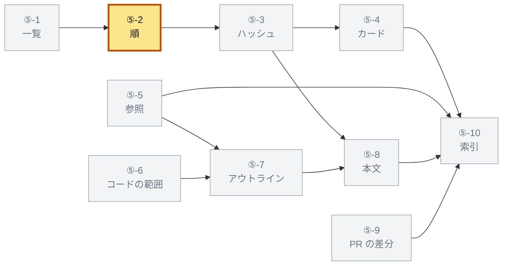

```ts
interface TestBuildOptions {
  reports?: string; // 報告のディレクトリ（MAP_TEST_REPORTS）。無いか、ディレクトリが無ければ実行なし
  out?: string; // apps/tests/public/data。無ければファイルを一つも書かない
}
```

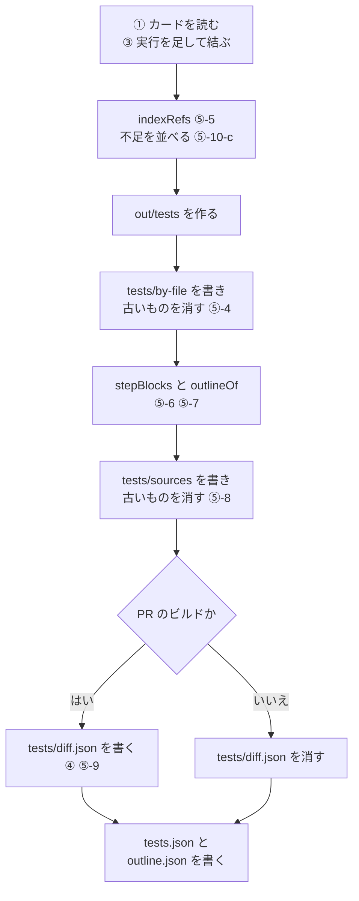

- 索引とアウトラインは最後に書く
- 索引が指すカードと本文のファイルは、その時にはもう書き終わっている
- 名前の決まった三つ（`tests.json`、`outline.json`、`tests/diff.json`）は、毎回上書きするか消す
- `out` が無いときも、索引とアウトラインは組み立てる
- そのときはファイルを書かないので、項目の `card` は無く、`sources` は空になる
- 最後にログに一行足す（形は [⑦-2](07-build-ci.md#-2-データの段)）
- 地図に返すのは `{ sections }` で、PR のビルドでなければ空の列である（[④-8](04-pull-request.md#-8-書き出しと検査)）

実装：`packages/test-catalog/src/build.ts`（`buildTests`、`TestBuildOptions`）

## ⑤-3 ハッシュの名前

カードと本文のファイルは、中身のハッシュを名前にして書く。
中身が変われば名前も変わるので、キャッシュが古いファイルを返すことは無い。

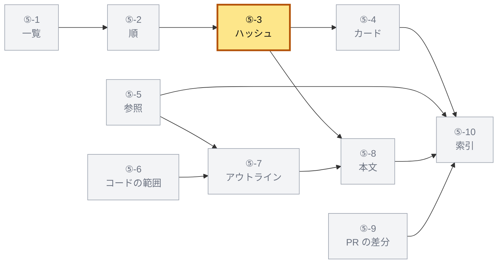

```ts
function hashed(id: string, content: string): string {
  return `${createHash('sha256').update(id).update('\0').update(content).digest('hex')}.json`;
}
```

| ディレクトリ | `id` | `content` |
|---|---|---|
| `tests/by-file/` | テストファイルのパス | `JSON.stringify({ version: 1, key: パス, tests: カードの列 })` |
| `tests/sources/` | 見せるファイルのパス | `JSON.stringify({ path, text })` |

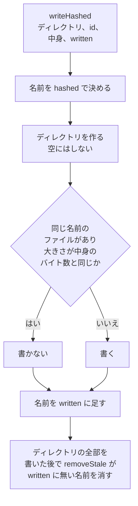

- ディレクトリは先に空にしない
- 配っている開発サーバー（vite）は、一度消えたディレクトリに書き直したファイルを見なくなるからである
- 名前が同じなら中身も同じなので、大きさが合えばファイルが丸ごとあるとみなす
- 書かなかったファイルは、更新の時刻も変わらない
- url は `./data/tests/by-file/<名前>` と `./data/tests/sources/<名前>` である

例：`apps/hono/src/app.test.ts` のカードの url は `./data/tests/by-file/e28e2b39338deff3bd064f7e5e214ed92901474d8839f65f6e3ac2ad780a5c63.json` である。
このブランチのデータのファイルの名前は、上の式の値と一致する。

実装：`packages/map-analysis/src/build.ts`（`hashed`、`writeHashed`、`removeStale`）

## ⑤-4 カードのファイル

テストファイルごとに、そのファイルのカードの全文を一つのファイルに書く。

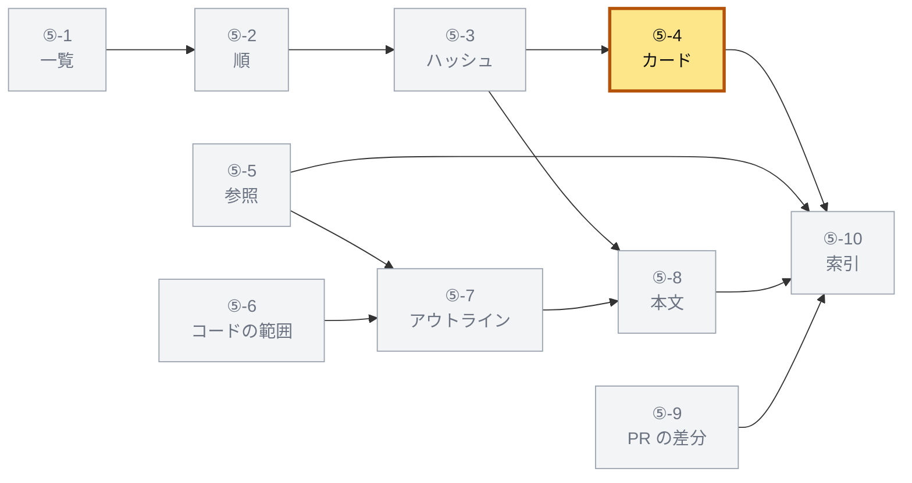

- カードは、カタログの順（ファイルのパス、始まりの行）に並ぶ
- ファイルは、パスを（コード単位の順に）並べ替えた順に書く
- 索引の各項目は、そのファイルの url を `card` に持つ（[⑤-10-a](#-10-a-索引の項目)）
- ページはテストを開くと、そのファイルを読み、`id` でカードを探す

```ts
interface FileTests {
  version: 1;
  key: string; // テストファイルのパス
  tests: TestCase[];
}
```

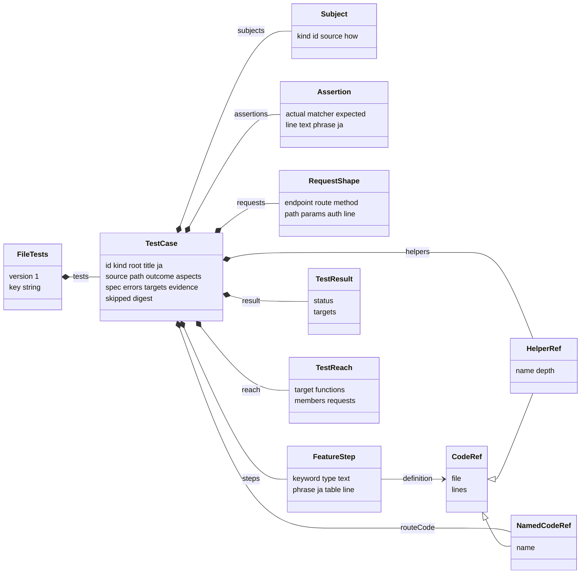

### ⑤-4-a カードの型

カードはファイルに `TestCase` の形のまま書き、型はそれを決める節にある。

| 型 | 節 |
|---|---|
| `TestCase` | [①-9](01-read.md#-9-カードの組み立て) |
| `Subject` | [①-9-b](01-read.md#-9-b-対象と根拠) |
| `Assertion` | [①-4-g](01-read.md#-4-g-カードに残す形) |
| `RequestShape`、`RequestRoute` | [①-5-f](01-read.md#-5-f-テストが届くエンドポイント) |
| `CodeRef`、`NamedCodeRef` | [①-3-d](01-read.md#-3-d-describe-が名指す関数とコード) |
| `HelperRef` | [①-6-e](01-read.md#-6-e-宣言の行) |
| `FeatureStep` | [①-8-b](01-read.md#-8-b-シナリオのステップと定義) |
| `TestResult` | [③-3](03-join.md#-3-結果のまとめ方) |
| `TestReach` | [③-4-c](03-join.md#-4-c-要求のエンドポイント) |

型の中の `TestKind` などの名前は、次の別名である。

```ts
type TestKind = 'unit' | 'api' | 'e2e' | 'tool';
type TestOutcome = 'success' | 'failure' | 'unknown';
type Evidence = 'declared' | 'static' | 'coverage';
type TestStatus = 'passed' | 'failed' | 'skipped';
```

- `Subject` の `member` と `TestReach.members` は書かない（[作らなくてよいもの](README.md#作らなくてよいもの)）
- 見つけ方が `coverage` の対象は、③ が到達から足すエンドポイントだけである
- `routeCode` のファイルの本文も `tests/sources` に書く（[⑤-8](#-8-本文のファイル)）

例：`apps/hono/src/operator.test.ts` の `should answer 401 to a request without the operator token` は次の二つを持つ。

```json
{
  "requests": [{ "route": "app", "method": "DELETE", "path": "/clients/rp-1/keys", "line": 71 }],
  "routeCode": { "name": "createOperatorApp", "file": "apps/hono/src/operator.ts", "lines": [56, 78] }
}
```

### ⑤-4-b 例

例：このブランチの `packages/core/src/access-token-issuer.test.ts` の最初のカードである。
`reach.functions` は、十一個のうち先頭の三つだけを示す。

```json
{
  "id": "0b4e5b687cf195c4",
  "kind": "unit",
  "root": "core",
  "source": { "file": "packages/core/src/access-token-issuer.test.ts", "lines": [40, 47], "form": "code" },
  "title": "should issue a JWT with three dot-separated segments",
  "path": ["createJwtAccessTokenIssuer"],
  "subjects": [{ "kind": "function", "id": "core:access-token-issuer.ts#createJwtAccessTokenIssuer", "how": "describe" }],
  "outcome": "success",
  "aspects": [],
  "spec": [],
  "assertions": [
    {
      "actual": "token.split('.').length",
      "matcher": "toBe",
      "expected": 3,
      "line": 46,
      "text": "`token.split('.').length` is 3",
      "phrase": "{code} is {value}",
      "ja": "`token.split('.').length` が 3 である"
    }
  ],
  "evidence": ["static", "coverage"],
  "digest": "1c323bed1bd35ace",
  "helpers": [{ "name": "buildPayload", "file": "packages/core/src/access-token-issuer.test.ts", "lines": [21, 31], "depth": 1 }],
  "result": { "status": "passed", "targets": { "": { "status": "passed", "duration": 7.246454999999969, "attempts": 1 } } },
  "reach": [{ "functions": ["core:access-token-issuer.ts#createJwtAccessTokenIssuer", "core:access-token.ts#generateAccessToken", "core:access-token.ts#validateAccessTokenExpiration"] }]
}
```

実装：

- `packages/test-catalog/src/build.ts`：`writeFileCards`
- `packages/test-catalog/src/model.ts`：`FileTests`、`TestCase` と、その中の型

## ⑤-5 フレームとエンドポイントの参照

索引に、フレームごとの数と、エンドポイントごとのテストの id を書く。

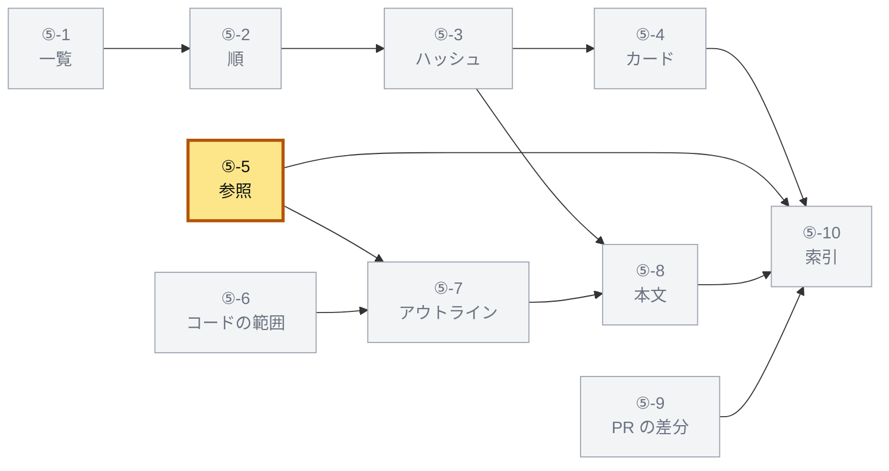

索引はカードを一度ずつ持ち、フレームとエンドポイントは id で名指す。
多くのエンドポイントが届く関数には、計測した実行で千を超えるテストが到達する。
エンドポイントごとにカードを写すと、同じ千のカードがエンドポイントの数だけ並ぶからである。

### ⑤-5-a フレームの数

`frames` には、フレームのテスト（[③-6](03-join.md#-6-フレームのテスト)）が一つ以上あるフレームを、id の順に入れる。

```ts
interface FrameTestsRef {
  unit: number; // フレームのユニットテストの数（③-6 の unit）
  success: number; // そのうち正常系
  failure: number; // そのうち異常系
  boundary: number; // そのうち観点に boundary を持つもの
  reached: number; // フレームに到達したカードの数（③-6 の reached）
  related: number; // フレームのテストの数（③-6 の tests）
}
```

例：`core:access-token-issuer.ts#createJwtAccessTokenIssuer` は `{ "unit": 12, "success": 10, "failure": 2, "boundary": 1, "reached": 160, "related": 160 }` である。

### ⑤-5-b エンドポイントのテスト

`endpoints` には、`Joined.endpoints` の全部のエンドポイントを、鍵 `<source>:<endpoint>` の順に入れる。

```ts
interface EndpointTestsRef {
  counts: TestCounts; // エンドポイントのテスト（③-7-c）を countTests（③-9）で数えたもの
  gaps: number; // そのエンドポイントの不足の数
  tests: string[]; // units に入らないテストの id
  units: Record<string, string[]>; // 届くフレームごとのユニットテストの id
}
```

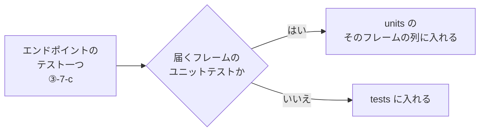

- フレームのユニットテスト（[③-6](03-join.md#-6-フレームのテスト) の `unit`）であるかで分ける
- そのような届くフレームが複数あれば、そのすべての列に入れる
- `units` の鍵はフレームの id の順で、テストの列が空のフレームは入れない
- 列の中と `tests` の並びは、カタログの順である
- `units` と `tests` を合わせると、`counts` が数えるテストのすべてになる
- 計測した実行で処理本体を通っただけのユニットテスト（届くフレームのユニットテストでない）は、`tests` に入る

例：`hono:token` は、`counts.total` が 1,328（ユニット 1,244、API 25、E2E 59）、不足 69、`tests` 84 件、`units` 173 フレームである。
テストのページは、このうち `tests` と、エンドポイント自身のフレームの `units` だけを出す（ページのエンドポイントのテスト、[⑥-3-d](06-viewer.md#-3-d-ページが出すエンドポイントのテスト)）。

この規則は `packages/test-catalog/src/__tests__/build.test.ts` の `indexRefs` が確かめる。

実装：

- `packages/test-catalog/src/build.ts`：`indexRefs`
- `packages/test-catalog/src/join.ts`：`countTests`

## ⑤-6 コードの範囲

ページが見せるコードを、ファイルのパスと行の範囲（**コードの範囲**、`CodeRef`）で表す。

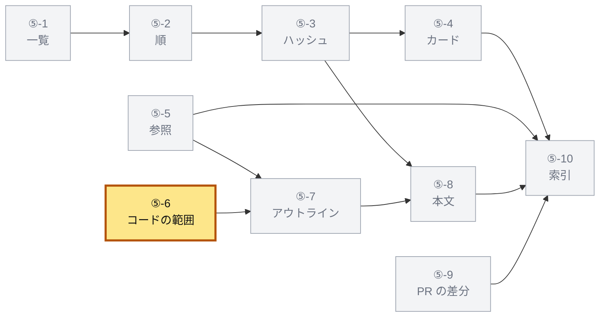

### ⑤-6-a フレームのコード

`codeOfFrame(data, id)` は、関数か処理本体のコードの範囲を返す。

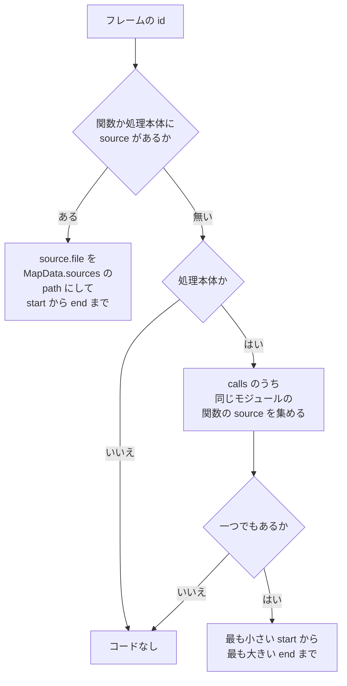

- 関数の `source` は、JSDoc とオーバーロードを含む
- 合成の処理本体（複数の handler を持つ本体）は、地図で行の範囲を持たない
- 同じモジュールは、`<本体の package>:<本体の module>` と同じ `source.file` である
- `source.file` が `MapData.sources` に無ければ、`source` が無いのと同じに扱う

例：このブランチの hono の `endpoint:login` は合成の本体である。
同じモジュールの `prepareLogin`（12 行から 42 行）と `submitLogin`（44 行から 97 行）から、`[12, 97]` になる。

### ⑤-6-b ステップのブロック

関数を持たないステップは、ステップの目印コメント `// [step-id]` が始めるブロックをコードにする。
Next.js のステップはすべてこれで、hono のステップにもある。

`stepBlocks(data, trees, read)` は次の順に動く。

1. 作業ツリーの木（`head.trees` の各値の `tree`）を、`tree.file`（`MapData.sources` の鍵）ごとに分ける
2. hono、nextjs の順に、`MapData.flows[source].endpoints` を見る
3. `endpoint.source`（`MapData.sources` の鍵）が無いか、`MapData.sources[endpoint.source].path` が無ければ飛ばす
4. そのファイルの木を、`tree.id === endpoint.root` の木を先に、ほかは `tree.lines[0]` の小さい順に並べ替える
5. 関数を持たない各ステップについて、木を順に、ノードを前順（ノード、`pre`、`branches` の中）にたどる
6. 最初に見つかった、`kind` が `block` で `step.id` がそのステップの id のノードの行を取る
7. 本文が読めれば、範囲の始まりの空行を飛ばす（地図はブロックに上の空行を含める）
8. `<source>:<endpoint>:<step>` の鍵で返す

- 目印コメントの無いステップは、コードなしである
- 同じステップのブロックが Route Handler とその下の関数の両方にあれば、Route Handler のものを取る
- 空行を飛ばすのは、始まりが終わりより前にある間だけである

この規則は `build.test.ts` の `the code of the outline` と `stepBlocks` のテストが確かめる。

実装：

- `packages/test-catalog/src/build.ts`：`codeOfFrame`、`stepBlocks`
- `packages/map-analysis/src/tree.ts`：`nodesOf`

## ⑤-7 アウトライン

ページが `map.json` を読まずにテストの対象を名指せるよう、関数カタログの抜き出しを `outline.json` に書く。

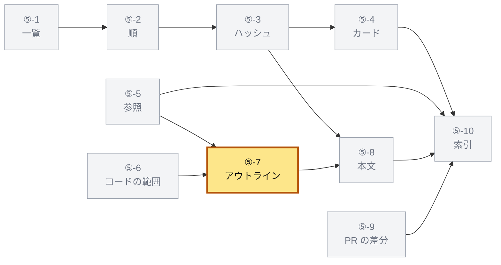

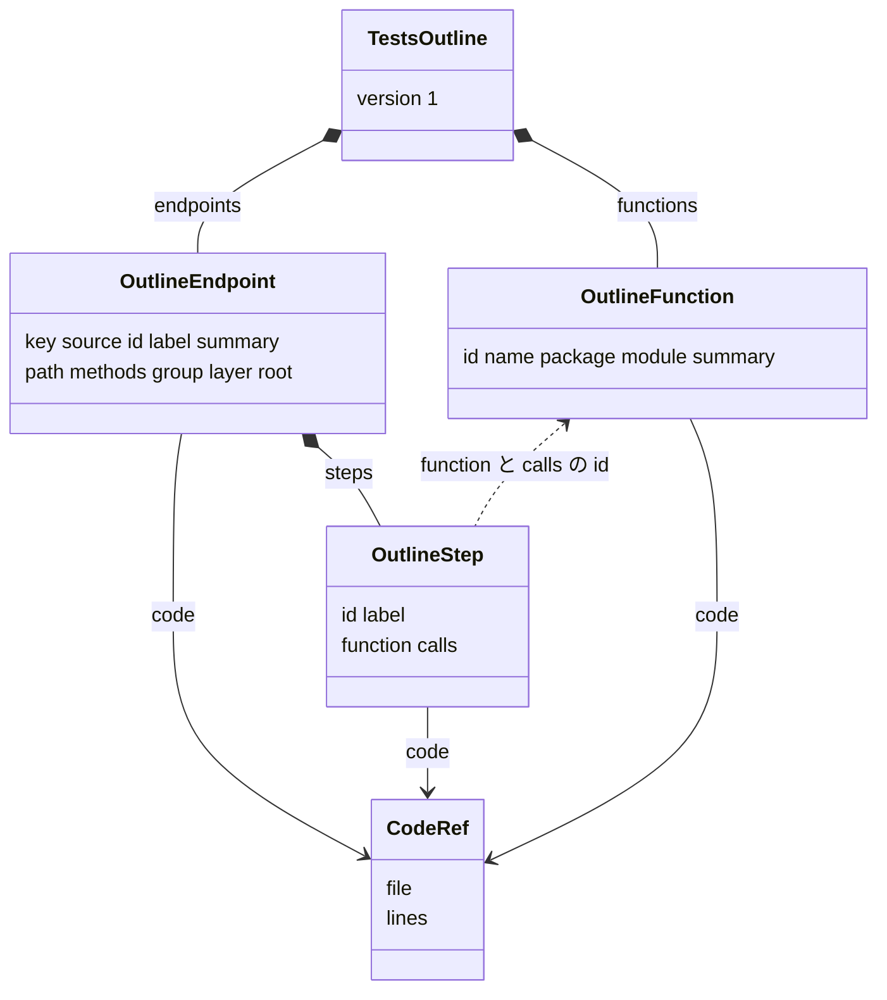

```ts
interface TestsOutline {
  version: 1;
  endpoints: OutlineEndpoint[];
  functions: Record<string, OutlineFunction>; // フレームの id から
}

interface OutlineEndpoint {
  key: string; // '<source>:<endpoint>'。TestsIndex.endpoints の鍵
  source: 'hono' | 'nextjs';
  id: string;
  label: string; // 日本語の名前
  summary?: string;
  path: string;
  methods: string[];
  group: { id: string; label: string };
  layer: 'api' | 'browser' | 'metadata';
  root: string; // トレースが始まるフレーム
  steps: OutlineStep[];
  code?: CodeRef; // root のコード（⑤-6-a）
}

interface OutlineStep {
  id: string;
  label: string; // 日本語の名前
  function?: string; // ステップの関数のフレームの id
  calls?: string[]; // 関数の無いステップだけ（下の規則）
  code?: CodeRef; // 関数のコードか、ブロック（⑤-6-b）
}

interface OutlineFunction {
  id: string;
  name: string;
  package: string;
  module: string;
  summary?: string; // 空でないときだけ
  code?: CodeRef; // ⑤-6-a
}
```

### ⑤-7-a エンドポイントとステップ

- エンドポイントは hono、nextjs の順で、それぞれ地図の順（`flows[source].endpoints`）に入れる
- `Joined.endpoints` に無いエンドポイントは入れない
- `root` は `Joined` のものを使い、無ければ地図のものを使う
- `summary` は、地図のエンドポイントにあるときだけ入れる
- 関数のあるステップ（`functionId`）は、`function` とその関数のコードを持つ
- 関数の無いステップは、あれば `calls` とブロックのコードを持つ

関数の無いステップの `calls` は、そのステップの下にもユニットテストを出すためにある。

1. 地図のステップの `calls` の重複を除く
2. そのエンドポイントの `EndpointTestsRef.units`（[⑤-5-b](#-5-b-エンドポイントのテスト)）に鍵のあるフレームだけを残す
3. 残りが無ければ、`calls` を入れない

### ⑤-7-b 名指す関数

`functions` には、次のフレームを id の順に入れる。

- 索引の `frames` の鍵（フレームのテストのあるフレーム）
- 各エンドポイントの `root`
- ステップの `function`
- 関数の無いステップの `calls`

地図の `functions` か `bodies` にあるものだけを入れ、どちらにも無い id は入れない。
`name`、`package`、`module`、`summary` は地図のものである。

### ⑤-7-c 例

例：`hono:token` は次のとおりである。
`summary` は短く切り、`steps` は先頭の一つだけを示す。

```json
{
  "key": "hono:token",
  "source": "hono",
  "id": "token",
  "label": "トークンエンドポイント",
  "summary": "クライアントを認証し、提示されたグラントを検証して、トークンレスポンスで応答する。",
  "path": "/token",
  "methods": ["POST"],
  "group": { "id": "authorization-code", "label": "認可コードフロー" },
  "layer": "api",
  "root": "endpoint:token",
  "steps": [
    {
      "id": "parse-request",
      "label": "トークンリクエストを解析する",
      "function": "hono:oidc-provider/endpoints/token/steps/parse-request.ts#parseTokenRequest",
      "code": { "file": "apps/hono/src/oidc-provider/endpoints/token/steps/parse-request.ts", "lines": [46, 106] }
    }
  ],
  "code": { "file": "apps/hono/src/oidc-provider/endpoints/token/pipeline.ts", "lines": [40, 126] }
}
```

`nextjs:token` の二つ目のステップは、関数を持たずに `calls` とブロックを持つ。

```json
{
  "id": "authenticate-client",
  "label": "クライアントを認証する",
  "calls": [
    "core:client-auth.ts#extractClientCredentials",
    "core:token-request.ts#resolveAuthenticatedTokenClient",
    "core:client-auth.ts#validateClientAuthMethod",
    "core:client-auth.ts#verifyClientSecret"
  ],
  "code": { "file": "apps/nextjs/src/app/token/route.ts", "lines": [138, 162] }
}
```

例：エンドポイントは 34（hono と nextjs に 17 ずつ）、ステップは 250、関数は 1,060 である。
ステップのうちコードの範囲を持つものは 185、`calls` を持つものは 43 である。

この規則は `build.test.ts` の `outlineOf` が確かめる。

実装：`packages/test-catalog/src/build.ts`（`outlineOf`）

## ⑤-8 本文のファイル

ページがコードを見せるファイルの本文を、ファイルごとに一つ書く。

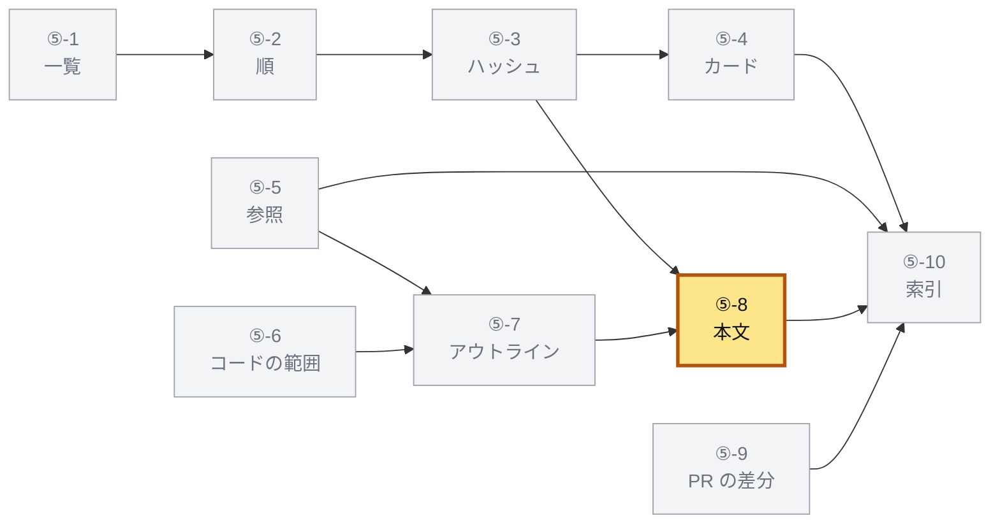

```ts
interface TestSource {
  path: string; // リポジトリのルートからのパス
  text: string; // 作業ツリーの本文そのまま
}
```

見せるファイル（`shownFiles`）は次のものの和で、重複を除いてパスを（コード単位の順に）並べ替える。

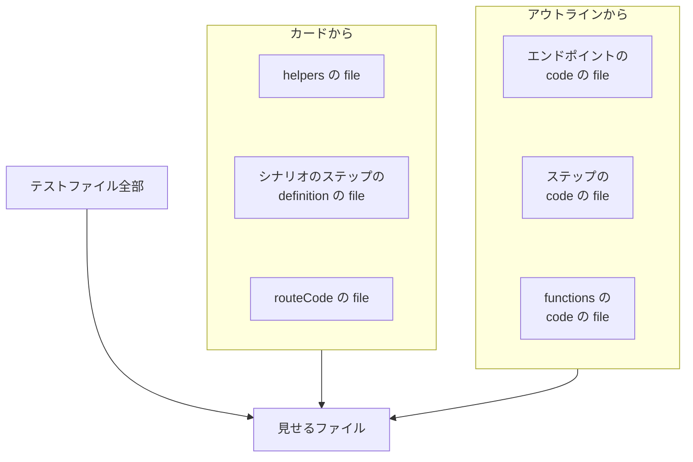

- 本文は作業ツリーから読み、読めないファイルは飛ばす
- 書いたファイルの url を、索引の `sources[パス]` に入れる
- 本文に色は付けない（設計では、色を付けると 20 MB を超えるためとしている）
- ページが自分で字句に分けて色を付ける（[⑥-12-c](06-viewer.md#-12-c-typescript-の色づけ)）

例：このブランチでは 847 ファイルである。
テストファイルが 466、ほか（ヘルパー、ステップ定義、ルートの実装、関数、処理本体のファイル）が 381 である。

例：`packages/core/src/access-token-issuer.test.ts` の本文の url は `./data/tests/sources/d2081499fcdc6e2b3a7fc0448030eddc9912fb04296dde7f2d9de5f00b3daee4.json` である。
中身は次の形で、`text` は 5,482 文字ある（先頭だけを示す）。

```json
{ "path": "packages/core/src/access-token-issuer.test.ts", "text": "import { describe, it, expect, beforeAll } from 'vitest';\nimport {\n…" }
```

この規則は `build.test.ts` の次のテストが確かめる。

- `should show the code of every file a card or the outline points at: the tests, the helpers, the step definitions, the functions and the bodies`

実装：`packages/test-catalog/src/build.ts`（`shownFiles`、`buildTests` の本文の部分）

## ⑤-9 PR の差分のファイル

PR のビルドでだけ、④ の `TestDiff` を `tests/diff.json` に書く。

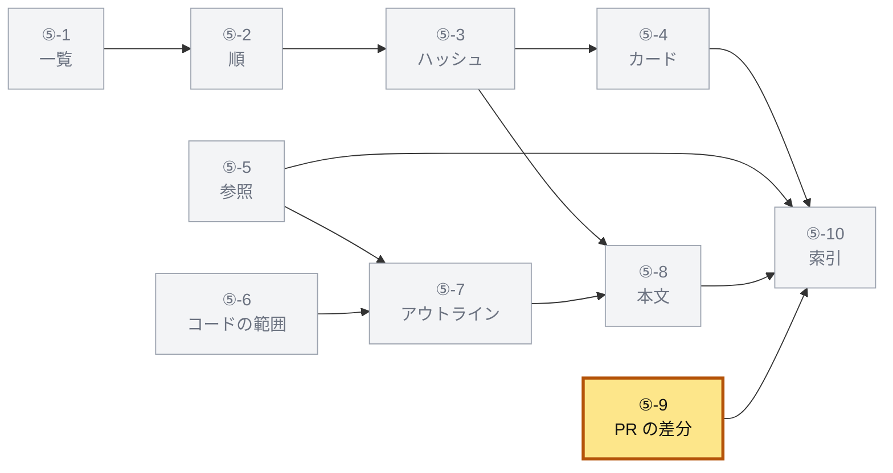

- 名前は決まっていて、ハッシュにしない
- 書いたときは、索引の `diff` を `true` にする
- PR のビルドでなければ、前のビルドが残したものを消す

形は [④-4](04-pull-request.md#-4-カードの差分) の `TestDiff` で、そのまま JSON にして書く。

例：このブランチを `MAP_BASE=origin/main` で作ると、足したテスト 331、ほかは 0、判定 0、カード 331 である。
`counts` は `before` 5,731、`after` 6,062、`byEndpoint` の鍵は 32 個（`hono:token` は `[50, 57]`）である。

例：`cards` の値の一つ（シナリオアウトラインの行）は次のとおりである。

```json
{
  "id": "token-missing-required-parameter-1",
  "kind": "api",
  "title": "Reject a request without code with invalid_request",
  "outcome": "failure",
  "aspects": [],
  "source": { "file": "tests/features/token/authorization-code-grant.feature", "lines": [38, 38], "form": "feature" },
  "path": ["The authorization_code grant at the token endpoint", "Reject a request without <parameter> with <error>"],
  "ja": "code のないリクエストを invalid_request で拒否する",
  "examples": 2,
  "endpoints": ["hono:token", "nextjs:token"]
}
```

このカードは関数の対象を持たないので、`functions` と `calls` は無い。

実装：

- `packages/test-catalog/src/build.ts`：`buildTests` の PR の部分
- `packages/test-catalog/src/diff.ts`：`diffCatalogs`、`cardOf`

## ⑤-10 索引

ページが最初に読む索引を `tests.json` に書く。
索引は全部のカードを一度ずつ、期待結果とステップを除いて持つ。

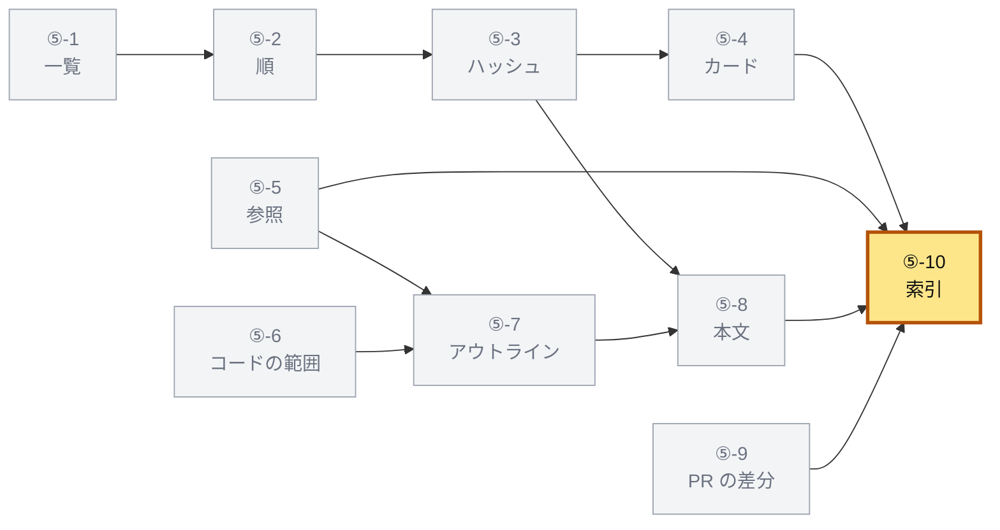

```mermaid
classDiagram
  direction LR
  class TestsIndex {
    version 1
    run measured
    counts unknown untranslated
    requiredAspects sources
    aspectLabels diff
  }
  class TestEntry {
    id kind root title ja
    file lines form path
    outcome aspects subjects routes
    evidence targets skipped
    result reached card
  }
  class FrameTestsRef {
    unit success failure boundary
    reached related
  }
  class EndpointTestsRef {
    gaps
    tests
    units
  }
  class TestCounts {
    total kinds outcomes
    aspects evidence results
  }
  class Gap {
    kind frame error step
    aspect feature reached text
  }
  TestsIndex *-- TestEntry : tests
  TestsIndex *-- FrameTestsRef : frames
  TestsIndex *-- EndpointTestsRef : endpoints
  TestsIndex *-- TestCounts : counts
  TestsIndex *-- Gap : gaps
  EndpointTestsRef *-- TestCounts : counts
  EndpointTestsRef ..> TestEntry : tests と units の id
```

```ts
interface TestsIndex {
  version: 1;
  run?: { ref?: string; commit?: string; at?: string };
  measured: boolean;
  tests: TestEntry[];
  frames: Record<string, FrameTestsRef>; // ⑤-5-a
  endpoints: Record<string, EndpointTestsRef>; // ⑤-5-b
  counts: TestCounts;
  unknown: { subject: number; outcome: number; aspect: number };
  untranslated: string[];
  gaps: Array<Gap & { source?: string; endpoint?: string; endpoints?: string[] }>;
  requiredAspects: string[];
  sources: Record<string, string>; // パスから本文の url
  aspectLabels: Record<string, string>;
  diff?: boolean;
}
```

| 欄 | 中身 |
|---|---|
| `run` | 報告のディレクトリがあれば入れる。<br>`at` は [③-1-a](03-join.md#-1-a-読む形) の開始の時刻で、無ければ `{}` |
| `measured` | 到達を一つでも読んだか（[③-1-a](03-join.md#-1-a-読む形)、[③-4-a](03-join.md#-4-a-残す到達の行)） |
| `tests` | カードごとの項目（[⑤-10-a](#-10-a-索引の項目)）。<br>カタログの順 |
| `counts` | 全部のカードを `countTests` で数えたもの（[③-9](03-join.md#-9-テストの数え方)） |
| `unknown` | 規則で読めなかったカードの数（[⑤-10-b](#-10-b-読めなかった数)） |
| `untranslated` | 訳の表に日本語の無い言い回しを、（コード単位の順に）並べ替えたもの（[①-4-f](01-read.md#-4-f-日本語)、[①-8-b](01-read.md#-8-b-シナリオのステップと定義)） |
| `gaps` | [⑤-10-c](#-10-c-不足の並べ方) |
| `requiredAspects` | 観点の表の `required` |
| `sources` | [⑤-8](#-8-本文のファイル) |
| `aspectLabels` | 観点の表の id から `label`（`boundary` から `境界値`）。<br>表の順 |
| `diff` | `tests/diff.json` を書いたときだけ `true` |

`run` の `ref` と `commit` は書かない（[作らなくてよいもの](README.md#作らなくてよいもの)）。

例：`run` は `{ "at": "2026-11-07T19:47:44.818Z" }`、`measured` は `true` である。
項目は 6,062、`frames` は 1,052、`endpoints` は 34、`sources` は 847、`gaps` は 350 である。

### ⑤-10-a 索引の項目

カードから期待結果、ステップ、リクエストなどを除き、数とカードの url を足した形である。

```ts
interface TestEntry {
  id: string;
  kind: TestKind;
  root: string;
  title: string;
  ja?: string; // TestCase.ja.title
  file: string; // TestCase.source.file
  lines: [number, number]; // TestCase.source.lines
  form: 'code' | 'feature'; // TestCase.source.form
  path: string[];
  outcome: TestOutcome;
  aspects: string[];
  subjects: Subject[];
  routes?: RequestRoute[]; // endpoint の無いリクエストの route を、出た順に重複なく
  evidence: Evidence[];
  targets?: string[];
  skipped?: boolean; // true のときだけ
  result?: TestStatus; // TestCase.result.status
  reached?: number; // 到達の関数の数。実行先をまたいで重複を除く
  card?: string; // カードのファイルの url（⑤-4）
}
```

- 項目に入れないのは、`spec`、`assertions`、`errors`、`requests`、`routeCode`、`steps`、`digest`、`helpers`、実行先ごとの結果、到達の中身である
- これらは、テストを開いたときにカードのファイルから読む
- `routes` は、一覧がカードを読まずに、自前やアプリのルートへのテストと、走らせるまでパスが分からないテストを見分けるためにある

例：`apps/hono/src/app.test.ts` の項目は次のとおりである。

```json
{
  "id": "363af334cabbef71",
  "kind": "api",
  "root": "hono",
  "title": "should publish the discovery document of the ISSUER",
  "file": "apps/hono/src/app.test.ts",
  "lines": [17, 28],
  "form": "code",
  "path": ["createServerApp"],
  "outcome": "success",
  "aspects": [],
  "subjects": [{ "kind": "endpoint", "id": "discovery", "source": "hono", "how": "request" }],
  "evidence": ["static"],
  "result": "passed",
  "reached": 52,
  "card": "./data/tests/by-file/e28e2b39338deff3bd064f7e5e214ed92901474d8839f65f6e3ac2ad780a5c63.json"
}
```

同じファイルの `should answer the health check` は、`"subjects": []` と `"routes": ["app"]` を持つ。
`routes` を持つ項目は 51 で、`own` が 34、`app` が 17 である。

### ⑤-10-b 読めなかった数

| 欄 | 数えるカード |
|---|---|
| `subject` | ユニットか API で、対象が一つも無い |
| `outcome` | ツールでなく、期待結果が `unknown` |
| `aspect` | ツールでなく、観点が一つも無い |

例：`subject` 325、`outcome` 22、`aspect` 4,062 である。

### ⑤-10-c 不足の並べ方

③ はエンドポイントごとに不足を出し（形と規則は [③-8](03-join.md#-8-不足)）、索引は同じ関数の `no-unit-test` を一つにまとめる。

```mermaid
flowchart TB
  A["エンドポイントごとの不足<br/>エンドポイントの順 ③-7-a"] --> B{"no-unit-test で<br/>frame があるか"}
  B -->|"いいえ"| D["source と endpoint を<br/>付けて入れる"]
  B -->|"はい"| C["フレームごとに<br/>一つにまとめ<br/>endpoints に鍵を足す"]
  D -->|"一番目"| E["gaps"]
  C -->|"二番目<br/>初めて出た順"| E
  F["機能の不足<br/>feature-without-e2e"] -->|"三番目"| E
```

- まとめた不足は、最初に出たものの欄（`text`、`reached`）を持つ
- `endpoints` は、そのフレームに届くエンドポイントの鍵を、エンドポイントの順（[③-7-a](03-join.md#-7-a-エンドポイントの並び)）に持つ
- ほかの不足の `source` と `endpoint` は、そのエンドポイントの `hono` か `nextjs` と id である
- 並びは、ほかの不足、まとめた不足、機能の不足の順である
- フレームごとの不足（[③-8-c](03-join.md#-8-c-フレームの不足) の `FrameJoin.gaps`）は書かない

例：不足は 350 件で、`no-unit-test` 321、`failure-untested` 25、`aspect-missing` 2、`feature-without-e2e` 2 である。

```json
[
  { "kind": "aspect-missing", "aspect": "authentication", "text": "認証のテストが無い", "source": "hono", "endpoint": "jwks" },
  { "kind": "no-unit-test", "frame": "core:crypto-utils.ts#getJwaAlgorithm", "reached": 1083, "text": "getJwaAlgorithm() にユニットテストが無い（到達するテスト 1083）", "endpoints": ["hono:discovery", "hono:jwks", "hono:authorize", "hono:consent"] },
  { "kind": "feature-without-e2e", "feature": "revocation", "text": "機能 revocation のエンドポイント（revocation）を通る E2E のテストが無い" }
]
```

二つ目の `endpoints` は、18 個のうち先頭の四つだけを示す。

実装：

- `packages/test-catalog/src/build.ts`：`buildTests` の索引と不足の部分
- `packages/test-catalog/src/join.ts`：`entryOf`、`countTests`
- `packages/test-catalog/src/run.ts`：`readRun`

## この章の出力

- ⑥ は、`apps/tests/public/data` の五種類のファイルを読む
- ⑥ は、型を `@maronn-openid-connect/test-catalog/model` から読む
- ⑦ のビルドで、テストのページの `vite build` が `public/data` を `dist/data` に写し、`copy-tests-viewer.mjs` が地図の `dist/tests/` に写す

[全体像](README.md) ｜ ← [④ PR の差分と検査](04-pull-request.md) ｜ ⑤ データを書き出す ｜ [⑥ テストのページ](06-viewer.md) →
