# ⑥ テストのページ

[全体像](README.md) ｜ ← [⑤ データを書き出す](05-data.md) ｜ ⑥ テストのページ ｜ [⑦ ビルドと CI](07-build-ci.md) →

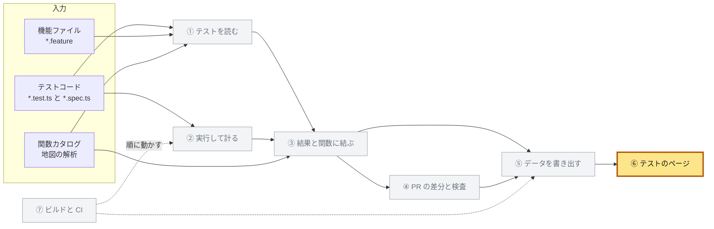

| 項目 | 内容 |
|---|---|
| 入力 | ⑤ が `apps/tests/public/data` に書く五種類のファイル（`tests.json`、`outline.json`、`tests/by-file/<hash>.json`、`tests/sources/<hash>.json`、`tests/diff.json`）。<br>型は `@maronn-openid-connect/test-catalog/model` から読む |
| 出力 | ブラウザに出す画面。<br>`vite build` が書く `apps/tests/dist`（`index.html`、`assets/`、`data/`） |
| 実装 | `apps/tests` の `package.json`、`vite.config.ts`、`tsconfig.json`、`vitest.config.ts`、`index.html`、`src/main.tsx`、`src/App.tsx`、`src/styles.css`、`src/components/`（`Header`、`Home`、`KindPage`、`EndpointPage`、`FilesPage`、`PrPage`、`SearchPage`、`Panel`、`TestDetail`、`TestList`、`TestCode`、`CodeRefs`、`CodeView`、`Target`、`PrMarks`、`ErrorBoundary`、`ui`、`app-context`）、`src/lib/`（`route`、`load`、`data`、`filter`、`kinds`、`targets`、`pr`、`helpers`、`lines`、`tokenize`、`format` と、そのテスト、`fixture`）<br>作る順：[再現の手順](README.md#再現の手順)の [9](README.md#9-テストのページ) |

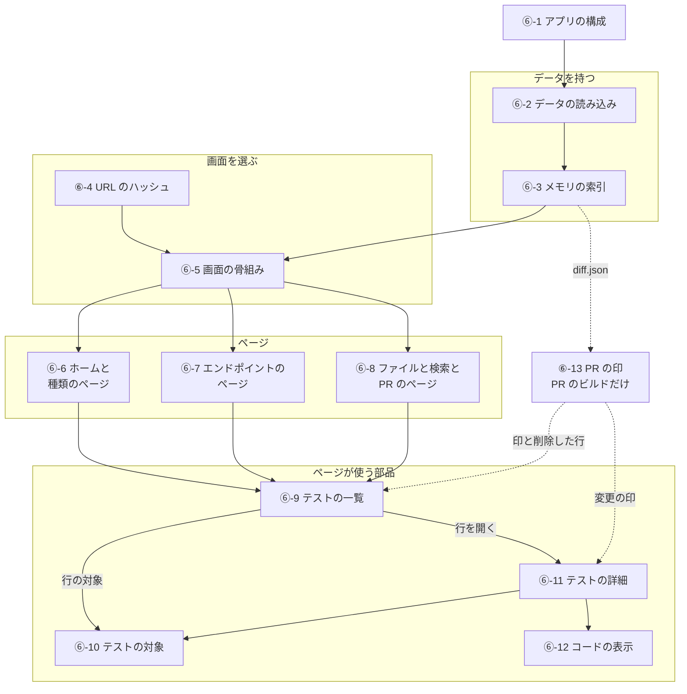

## ⑥-1 アプリの構成

テストのページのパッケージとビルド、ファイルの分け方、見た目の約束、小さな部品を決める。

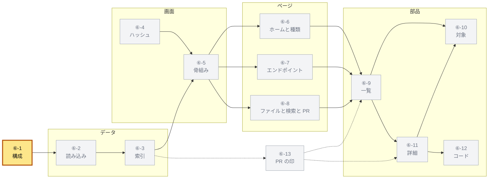

### ⑥-1-a パッケージとビルド

テストのページは、Vite と React で作る単独のアプリ `@maronn-openid-connect/tests`（`apps/tests`）である。
地図とは別にビルドし、⑦ が地図の `dist/tests/` に写して配る（[⑦-3](07-build-ci.md#-3-地図のビルドと検査)、[⑦-4](07-build-ci.md#-4-tests-での配信)）。
このアプリのビルドはデータを作らない。
データは地図のデータの段が書く（[⑦-2](07-build-ci.md#-2-データの段)）。

| `package.json` | 値 |
|---|---|
| `dependencies` | `react`、`react-dom`（どちらも `^19.3.1`） |
| `devDependencies` | `@maronn-openid-connect/test-catalog` と `@maronn-openid-connect/test-reach`（`workspace:*`）、`@types/react` と `@types/react-dom`（`^19.3.0`）、`typescript ^7.0.2`、`vite ^8.3.3`、`vitest ^5.0.5` |
| `dev` | `vite --host ${HOST:-127.0.0.1} --port ${PORT:-3620}` |
| `build` | `vite build` |
| `preview` | `vite preview --host ${HOST:-127.0.0.1} --port ${PORT:-3620}` |
| `typecheck` | `tsc --noEmit` |
| `test` | `vitest run` |

`vite.config.ts` は次だけを決める。

```ts
export default defineConfig({
  base: './', // 資産を相対のパスで読む。地図の dist/tests/ に置いても動く
  build: { outDir: 'dist', emptyOutDir: true, sourcemap: false },
});
```

- `public/` は Vite の既定のままで、`public/data` が `dist/data` に写る
- JSX は `tsconfig.json` の `jsx: "react-jsx"` で変換する

| `tsconfig.json` | 値 |
|---|---|
| `target`、`lib` | `ES2022`。<br>`ES2022`、`DOM`、`DOM.Iterable` |
| `module`、`moduleResolution` | `ESNext`、`bundler` |
| `jsx` | `react-jsx` |
| `types` | `["vite/client"]`。<br>TypeScript 7 は `node_modules/@types` を自分では読まないため |
| 検査 | `strict`、`noUnusedLocals`、`noUnusedParameters`、`noFallthroughCasesInSwitch`、`noImplicitReturns`、`isolatedModules`、`verbatimModuleSyntax`、`skipLibCheck`、`noEmit` |
| `include` | `["src"]` |

```ts
// vitest.config.ts
export default defineConfig({
  test: {
    ...testReports({ root: import.meta.url }), // ② の報告。MARONN_TEST_REPORTS か MARONN_REACH=1 のとき
    include: ['src/**/*.test.ts'], // src/lib の純粋な処理だけ。画面はページを開いて確かめる
    environment: 'node',
  },
});
```

`index.html` は次だけを持つ。

- `<html lang="ja">`
- `<meta charset="utf-8">`
- `<meta name="viewport" content="width=device-width, initial-scale=1, viewport-fit=cover">`
- `<meta name="color-scheme" content="light dark">`
- `<title>テスト · OIDC Provider</title>`
- `<div id="root"></div>` と `<script type="module" src="/src/main.tsx"></script>`

`src/main.tsx` は `./styles.css` を読み、`#root` に `<StrictMode><App /></StrictMode>` を描く。

### ⑥-1-b ファイルの分け方

処理は `src/lib`、画面は `src/components` に置く。
`src/lib` は React を使わず、テストはここにだけ置く。
型は `@maronn-openid-connect/test-catalog/model` から `import type` で読み、実行時のコードは読まない。

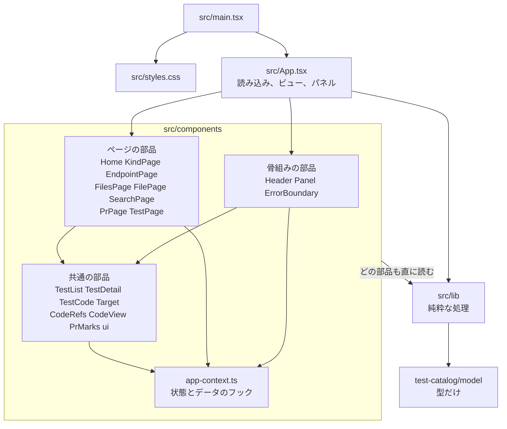

- `FilePage` は `FilesPage.tsx` に、`TestPage` は `Panel.tsx` にある
- `fetch` を呼ぶのは `load.ts` だけで、`load.ts` を読むのは `App.tsx` と `app-context.ts` だけである

| `src/lib` | すること | 節 |
|---|---|---|
| `route.ts` | ハッシュとビューの読み書き | [⑥-4](#-4-url-のハッシュ) |
| `load.ts` | JSON の取得、再試行、キャッシュ | [⑥-2](#-2-データの読み込み) |
| `data.ts` | `Db`、種類の順と数、エンドポイントとファイルの集計 | [⑥-3](#-3-メモリの索引)、[⑥-8](#-8-ファイルと検索と-pr-のページ) |
| `filter.ts` | 絞り込み、検索、言語の選び方、コードの区切り | [⑥-9](#-9-テストの一覧)、[⑥-8](#-8-ファイルと検索と-pr-のページ)、[⑥-1-d](#-1-d-小さな部品と数の書き方) |
| `kinds.ts` | 種類のページの分け方 | [⑥-6](#-6-ホームと種類のページ) |
| `targets.ts` | 対象、経路、ほかのルート、テスト対象のコード、コードのパネル | [⑥-10](#-10-テストの対象)、[⑥-11](#-11-テストの詳細)、[⑥-12](#-12-コードの表示) |
| `pr.ts` | PR の印、削除したテスト、PR の数 | [⑥-13](#-13-pr-の印) |
| `helpers.ts` | ヘルパーの木 | [⑥-11](#-11-テストの詳細) |
| `lines.ts` | 見せるコードの行 | [⑥-12](#-12-コードの表示) |
| `tokenize.ts` | 色づけ | [⑥-12](#-12-コードの表示) |
| `format.ts` | 数、時間、日付、実行先の名前、棒の幅 | [⑥-1-d](#-1-d-小さな部品と数の書き方) |
| `fixture.ts` | テストが使う小さな索引、アウトライン、カード、差分 | |

| `src/components` | すること | 節 |
|---|---|---|
| `app-context.ts` | `AppState`、`useApp`、`useNarrow`、`useTitle`、データのフック | [⑥-2](#-2-データの読み込み)、[⑥-5](#-5-画面の骨組み) |
| `Header.tsx` | ヘッダー | [⑥-5](#-5-画面の骨組み) |
| `Panel.tsx` | パネルとテストのページ | [⑥-5](#-5-画面の骨組み) |
| `ErrorBoundary.tsx` | 描けない画面の表示 | [⑥-5](#-5-画面の骨組み) |
| `Home.tsx`、`KindPage.tsx` | ホームと種類のページ | [⑥-6](#-6-ホームと種類のページ) |
| `EndpointPage.tsx` | エンドポイントのページ | [⑥-7](#-7-エンドポイントのページ) |
| `FilesPage.tsx`、`SearchPage.tsx`、`PrPage.tsx` | ファイル、検索、PR のページ | [⑥-8](#-8-ファイルと検索と-pr-のページ) |
| `TestList.tsx`、`Target.tsx` | 一覧と一覧の行、対象の一行 | [⑥-9](#-9-テストの一覧)、[⑥-10](#-10-テストの対象) |
| `TestDetail.tsx`、`TestCode.tsx` | テストの詳細とコードのタブ | [⑥-11](#-11-テストの詳細) |
| `CodeRefs.tsx`、`CodeView.tsx` | コードの項目と、コードの表示 | [⑥-12](#-12-コードの表示) |
| `PrMarks.tsx` | PR の札、数、点、凡例、切り替え、変更の欄、削除したテストの詳細 | [⑥-13](#-13-pr-の印) |
| `ui.tsx` | 小さな部品 | [⑥-1-d](#-1-d-小さな部品と数の書き方) |

### ⑥-1-c 見た目の約束

見た目の決めごとは、この節と各節に書いた値（色、幅の境、寸法）だけで、書いていない余白や大きさは作り手が決めてよい。

スタイルは `src/styles.css` の一枚で、CSS の枠組みを使わない。
色は `:root` の変数に置く。
ダークモードは、`@media (prefers-color-scheme: dark)` の中で同じ変数を上書きする。
色だけで意味を伝えず、記号か言葉を添える（✓、✗、–、PR の札の言葉と凡例）。

| 決めごと | 値 |
|---|---|
| ヘッダー | 高さ `--header: 56px`。<br>`position: sticky` で上に留める |
| 本文の幅 | `max-width: 1280px`、余白 `32px 24px 64px` |
| 文字 | 本文 `15px`、行の高さ `1.6`。<br>`--font` は `system-ui` から日本語のフォントへの列、`--mono` は `ui-monospace` からの列 |
| 角と線 | `--radius: 12px`、`--radius-sm: 8px`、線は 1px |
| 間隔 | 8px の格子 |
| 数字 | `.num` は `font-variant-numeric: tabular-nums` |
| フォーカス | `:focus-visible` に 2px の `--accent` の枠 |

配置は、画面の幅で二段に変える。

| 幅 | 変わること |
|---|---|
| 1081px 以上 | 基本の配置 |
| 1080px 以下 | ホームの概要のタイルが 2 列。<br>エンドポイントのページの左の列が狭まる。<br>ファイルのページのコードが一覧の下に回る |
| 768px 以下 | スマートフォンの配置。<br>本文の文字 `14px`、本文の余白 `24px 16px 48px`、`h1` `22px`（広い画面は `26px`）、ページの段の間 `24px`（同 `32px`）。<br>ヘッダーが一行、パネルが全幅、一覧の行が二段 |

- 幅 768px 以下を**スマートフォン**、769px 以上を「広い画面」と呼ぶ
- JavaScript も、768px の境を `NARROW_QUERY = '(max-width: 768px)'` で使う
- `useNarrow()` は `matchMedia` の変化を追い、`matchMedia` が投げれば `false` とする

| 役割 | 変数 | ライト | ダーク |
|---|---|---|---|
| 背景と面 | `--bg`、`--surface`、`--surface-2`、`--surface-3` | `#ffffff`、`#ffffff`、`#f6f7f9`、`#eef0f3` | `#131417`、`#1a1c20`、`#202227`、`#2a2d33` |
| 線 | `--border`、`--border-strong` | `#e5e7eb`、`#d4d7dd` | `#2c2f35`、`#3a3e45` |
| 文字 | `--text`、`--text-2`、`--muted` | `#15171c`、`#464b57`、`#6b7280` | `#eceef1`、`#c2c6cd`、`#8d939c` |
| アクセント | `--accent`、`--accent-text`、`--accent-soft` | `#2a6fd6`、`#1f5fbf`、`#ebf2fd` | `#5b9bf0`、`#8ab8f5`、`#1d2a3d` |
| 結果 | `--passed`、`--failed`、`--none`、`--failed-soft` | `#15803d`、`#d03b3b`、`#848a93`、`#fdecec` | `#3fbf6a`、`#ef6464`、`#7d838c`、`#3a1f21` |
| 正常系 | `--success`、`--success-text`、`--success-soft` | `#12927a`、`#0b6b59`、`#e2f4ef` | `#2bb89b`、`#6fd6c0`、`#16302b` |
| 異常系 | `--failure`、`--failure-text`、`--failure-soft` | `#e3672f`、`#a5461a`、`#fcede5` | `#ee8452`、`#f3a57d`、`#38241a` |
| テストなしの札 | `--amber-text`、`--amber-soft` | `#8a5d00`、`#fbf1dc` | `#e6bf6a`、`#352b17` |
| 種類 | `--part-api`、`--part-e2e`、`--part-unit`、`--part-tool` | `#2a6fd6`、`#7c4ddb`、`#a9c5ef`、`#9aa1ab` | `#5b9bf0`、`#b08cf5`、`#38598a`、`#6a707a` |
| 判定なし | `--part-unknown` | `#c4c9d0` | `#4a4f57` |
| コード | `--code-bg`、`--code-on`、`--code-on-edge` | `#fafbfc`、`#edf3fc`、`#7ea7e3` | `#16181b`、`#1d2a3d`、`#4f80c4` |
| PR の線と点 | `--pr-added`、`--pr-modified`、`--pr-removed` | `#2da44e`、`#b5850f`、`#b8327f` | `#3fb950`、`#d29922`、`#de6aaa` |
| PR の一覧の行の地 | `--pr-added-tint`、`--pr-modified-tint`、`--pr-removed-tint` | `#f3faf5`、`#fdf9ee`、`#fdf7fa` | `#15221a`、`#252014`、`#26171f` |
| PR の札の地 | `--pr-added-soft`、`--pr-modified-soft`、`--pr-removed-soft` | `#dcf2e2`、`#f8ecc9`、`#f7dfec` | `#1d3a27`、`#3d3218`、`#45203a` |
| PR の文字 | `--pr-added-text`、`--pr-modified-text`、`--pr-removed-text` | `#11632a`、`#77500a`、`#8f1d5c` | `#84dfa1`、`#e7c36f`、`#f4a6d0` |
| PR の混ざった点 | `--pr-mixed` | `#8a9099` | `#858b94` |
| 色づけ | `--tok-keyword`、`--tok-string`、`--tok-comment`、`--tok-number`、`--tok-tag`、`--tok-punct` | `#8040c8`、`#1a7f4b`、`#666e78`、`#b35a00`、`#2a6fd6`、`#666e78` | `#c79bff`、`#7fd19b`、`#8b929c`、`#f0a860`、`#86b6ef`、`#8b929c` |
| 重ね | `--scrim`、`--shadow`、`--veil` | `rgba(17, 20, 26, 0.28)`、`0 8px 32px rgba(17, 20, 26, 0.12)`、`rgba(17, 20, 26, 0.035)` | `rgba(0, 0, 0, 0.5)`、`0 8px 32px rgba(0, 0, 0, 0.4)`、`rgba(255, 255, 255, 0.04)` |

- `--part-success` と `--part-failure` は、`--success` と `--failure` を指す
- `:root` の `color-scheme` は、ライトで `light`、ダークで `dark` にする
- スタイルの冒頭の注記は、文字の色を、置く面に対して 4.5:1 以上とする
- PR の印は、追加を緑、変更（名前の変更も）を黄、削除をローズにする
- 削除のローズは、失敗の赤（`--failed`）と分けた色である
- 選んだテストのコードの行（`--code-on`）は青で、変更の黄と分ける

### ⑥-1-d 小さな部品と数の書き方

どの画面も、`ui.tsx` の部品と `format.ts` の書き方で数と状態を出す。

| 部品 | 描くもの | 規則 |
|---|---|---|
| `StatusIcon` | 一つの結果の記号 | `passed` は ✓（`--passed`）、`failed` は ✗（`--failed`）、`skipped` と結果なしは –（`--none`）。<br>`title` と `aria-label` は 成功、失敗、スキップ、結果なし |
| `HealthMark` | 集めた結果の丸 | 色の丸に白の記号。<br>名前は 失敗あり、すべて成功、結果なし |
| `OutcomeBadge` | 正常系か異常系の札 | `success` は 正常系（`--success-soft` の地に `--success-text`）、`failure` は 異常系（`--failure-*`）。<br>`unknown` は何も出さない |
| `Badge` | 灰色の札 | 種類、観点、スキップ、例の数に使う |
| `Segmented` | 一つを選ぶボタンの列 | `role="group"` と `aria-label`。<br>選んだボタンが `aria-pressed="true"`。<br>`count` があれば小さく添える |
| `Chips` | 折り返すボタンの列 | `aria-pressed`。<br>`quiet` は破線の枠と薄い文字 |
| `Tabs` | タブ | ARIA の tabs の型。<br>→ と ← で隣へ（端で反対の端へ回る）、Home と End で端へ。<br>選んだタブだけを `tabIndex=0` にする |
| `PartsBar` | 内訳の細い棒 | 高さ 6px、部分の間に 2px、部分の幅は最小 3px。<br>0 の部分は描かない |
| `Legend` | 棒の色の名前 | 色の四角と名前。<br>`counts` があれば数も |
| `Words` | 文の中のコード | `codeParts` で区切り、コードの部分を `<code>` にする |
| `SourceSwitch` | ソースの切り替え | `Hono` と `Next.js` の `Segmented`。<br>`place` が `header` なら `.top-source`、`body` なら `.body-source` に置く |
| `CodeIcon` | `</>` の絵 | 16px の SVG |

`PartsBar` の `aria-label` と `title` は、`<名前> <数>` を「、」でつないだものである。
合計が 0 なら「テストなし」とする。

| 関数 | 規則 | 例 |
|---|---|---|
| `formatCount(n)` | `Intl.NumberFormat('ja-JP')` | `6062` → `6,062` |
| `formatDuration(ms)` | 有限でないか負なら空。<br>1000 未満は `<四捨五入> ms`。<br>60000 未満は秒で、10000 未満なら小数一桁。<br>ほかは秒に四捨五入して `<分> 分 <秒> 秒` | `202.7` → `203 ms`、`1234` → `1.2 s`、`42000` → `42 s`、`125000` → `2 分 5 秒` |
| `formatDate(iso)` | 読み手の時間帯の `YYYY/MM/DD HH:mm`。<br>読めなければ空 | |
| `targetLabel(t)` | `''` → `Vitest`、`hono` → `Hono`、`nextjs` → `Next.js`、`http` → `HTTP`、ほかはそのまま | |
| `share(part, whole)` | どちらかが 0 以下なら 0。<br>ほかは `max(part / whole * 100, 0.5)`（棒の幅の %） | `1, 10000` → `0.5` |

`codeParts(text)` は、文を CommonMark のコードスパンと同じ規則で区切る。
① の `words.ts`（`codeSpan`）が、この形で期待結果の文を書くからである。

- N 個続くバッククォートが開き、次にちょうど N 個続くバッククォートが閉じる
- 閉じるものが無ければ、その連なりを文字のまま残す
- 中身が 2 文字以上で、空白で始まって空白で終わり、空白だけでなければ、両端の空白を一つずつ除く

```text
入力  `page.url()` is `` `${issuer}/authorize` ``
出力  コード「page.url()」、文字「 is 」、コード「`${issuer}/authorize`」
```

実装：

- `apps/tests/package.json`
- `apps/tests/vite.config.ts`
- `apps/tests/tsconfig.json`
- `apps/tests/vitest.config.ts`
- `apps/tests/index.html`
- `apps/tests/src/main.tsx`
- `apps/tests/src/styles.css`：`:root`、`@media (prefers-color-scheme: dark)`、`@media (max-width: 1080px)`、`@media (max-width: 768px)`
- `apps/tests/src/components/app-context.ts`：`NARROW_QUERY`、`useNarrow`
- `apps/tests/src/components/ui.tsx`
- `apps/tests/src/lib/format.ts`
- `apps/tests/src/lib/filter.ts`：`codeParts`

## ⑥-2 データの読み込み

ページがどのファイルをいつ読み、失敗をどう扱い、何を覚えておくかを決める。

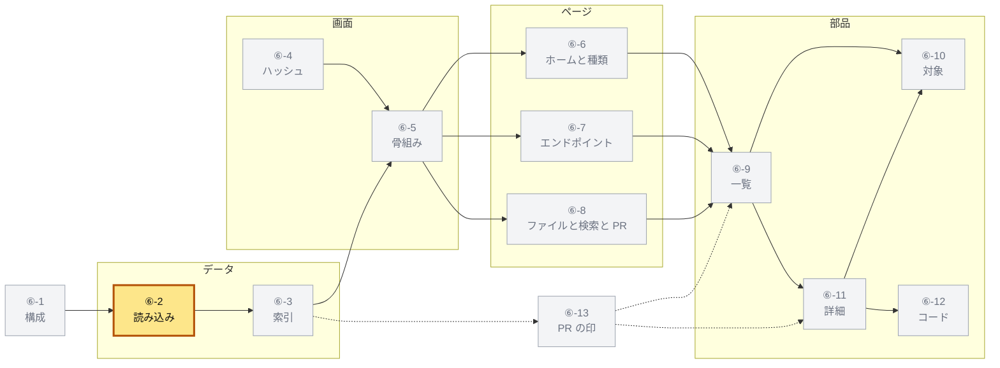

### ⑥-2-a 読むファイルと時

ページは ⑤ の五種類のファイルを、ページからの相対の url で読む。

| ファイル | url | 読む時 | 読む部品 |
|---|---|---|---|
| 索引 | `./data/tests.json`（`TESTS_URL`） | 開いたときに一度 | `App` |
| アウトライン | `./data/outline.json`（`OUTLINE_URL`） | 開いたときに一度、索引と同時に | `App` |
| PR の差分 | `./data/tests/diff.json`（`DIFF_URL`） | 索引の `diff` が `true` なら、索引の後に一度。<br>最初の画面の前 | `App` |
| カードのファイル | 索引の項目の `card`（`./data/tests/by-file/<hash>.json`） | テストを開いたとき。<br>カードの要る一覧の行が見えたとき（[⑥-10-e](#-10-e-一行で言う対象) の `needsCard`） | `useCard`、`useCards` |
| 本文のファイル | `index.sources[パス]`（`./data/tests/sources/<hash>.json`） | コードを見せるとき | `useSource` |

```ts
// App の最初の useEffect。toError(e) は e instanceof Error ? e : new Error(String(e))
const index = loadJson<TestsIndex>(TESTS_URL);
const diff = index.then((value) => (value.diff === true ? loadJson<TestDiff>(DIFF_URL).catch(toError) : undefined));
Promise.all([index, loadJson<TestsOutline>(OUTLINE_URL).catch(() => undefined), diff])
  .then(([value, outline, changes]) => buildDb(value, outline, changes))
  .then((db) => setLoaded({ db }), (error) => setLoaded({ error: toError(error) }));
```

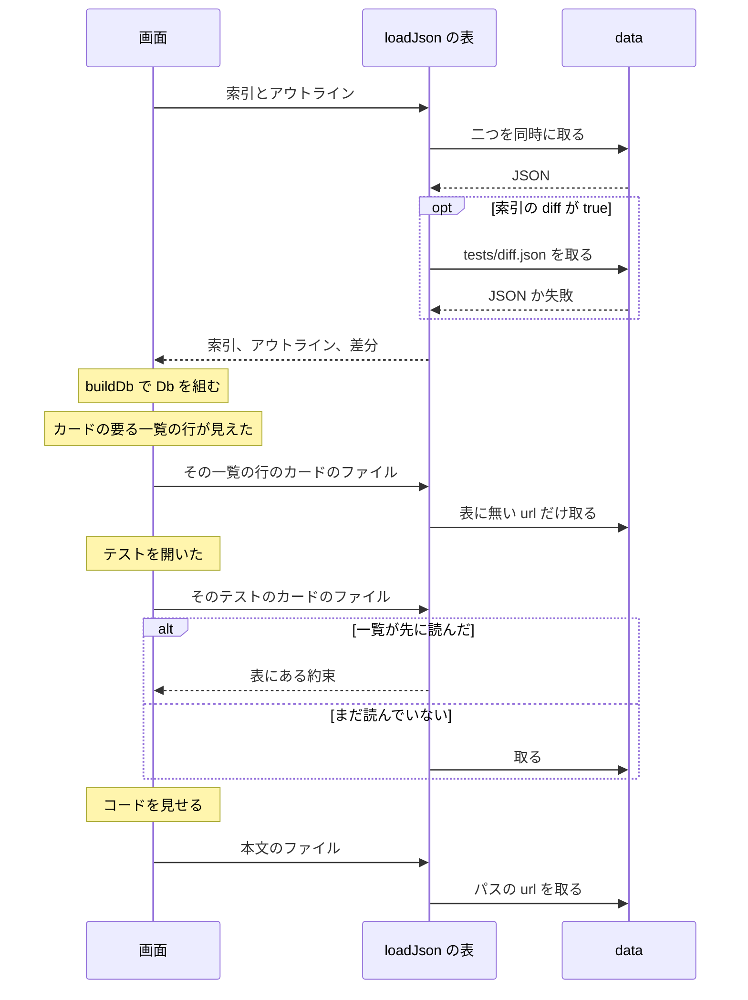

- アウトラインを読めなくても、索引だけで続ける
- 差分を読めなければ、その `Error` を `buildDb` に渡す
- そのときは PR の印を付けず、PR のページが理由を言う（[⑥-8-d](#-8-d-この-pr-のテスト)）
- 差分を最初の画面の前に読むのは、どの一覧も初めから印を出すためである（差分は小さい）
- 索引を読めないと、どの画面も出さない（[⑥-5-e](#-5-e-空と失敗の表示)）
- `buildDb` は約束の `then` の中で呼ぶので、`buildDb` が投げても同じ失敗の表示になる

### ⑥-2-b 取得と再試行

`fetchJson` は、一つの url を取って JSON として読み、失敗すれば一度だけ取り直す。

```ts
type Fetch = (url: string) => Promise<{ ok: boolean; status: number; text(): Promise<string> }>;
function fetchJson<T>(url: string, fetcher: Fetch = (input) => fetch(input), retries = 1): Promise<T>;

/** データが無い。地図のデータの段を走らせずにページをビルドした */
class MissingData extends Error {
  constructor(readonly url: string) {
    super(`${url} がありません`);
    this.name = 'MissingData';
  }
}
```

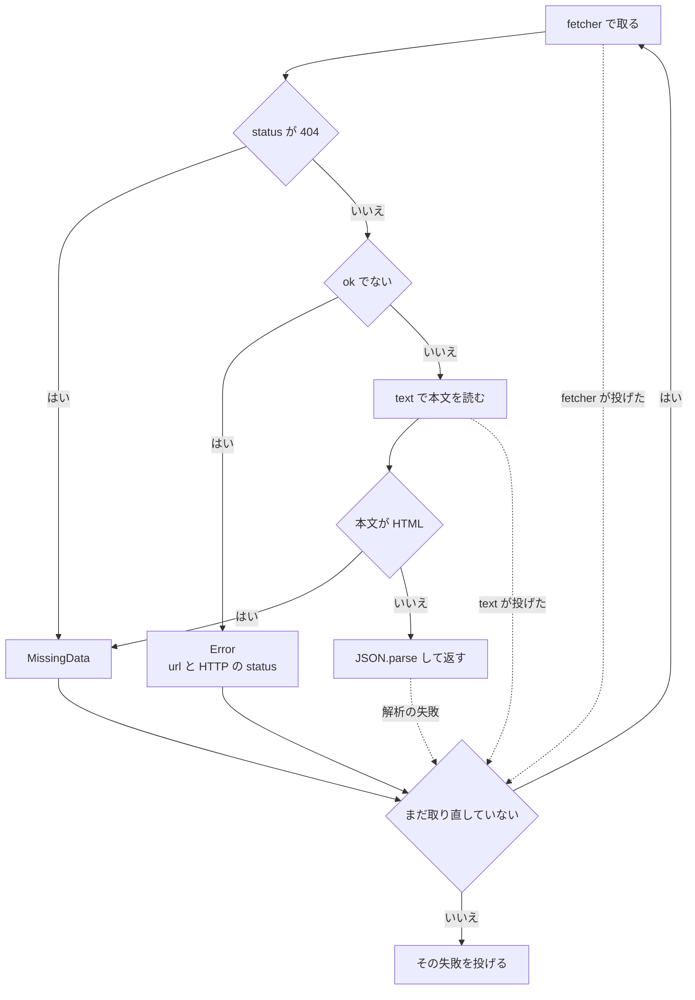

- 本文が HTML とは、本文が `/^\s*</` に合うことである
- 開発サーバーは、無いファイルに `index.html` を返すので、それを「無い」とみなす
- どの失敗も一度だけ取り直す（取るのは最大 2 回）
- 取得そのものの失敗（ネットワーク）も、同じく取り直し、二度目の失敗を投げる
- その失敗の文が、画面の「失敗の文」になる（[⑥-5-e](#-5-e-空と失敗の表示)）
- 取り直すのは、地図のデータの段がファイルを書き直している最中に、ページが読むことがあるからである
- HTTP の失敗の文は `${url}: HTTP ${status}` である
- テストでは、`fetcher` に偽物を渡す（`load.test.ts`）

### ⑥-2-c 一度だけ読む仕組み

`loadJson(url)` は、url ごとに取得の約束（`Promise`）を一つだけ持つ。

```ts
const cache = new Map<string, Promise<unknown>>();

function loadJson<T>(url: string): Promise<T> {
  let promise = cache.get(url) as Promise<T> | undefined;
  if (promise === undefined) {
    promise = fetchJson<T>(url);
    cache.set(url, promise);
    promise.catch(() => cache.delete(url)); // 失敗は忘れ、次に開くと取り直す
  }
  return promise;
}
```

部品は、`app-context.ts` のフックでデータを読む。

| フック | 返すもの | 規則 |
|---|---|---|
| `useJson<T>(url)` | 読み込み中は `undefined`、成功は値、失敗は `Error` | `url` が `undefined` なら何もしない。<br>いまの `url` の結果だけを返し、古い url の結果は捨てる |
| `useCard(entry)` | カード（`TestCase`）、`Error`、`undefined` | `entry.card` が無ければ `Error('このテストのカードがありません')`。<br>ファイルの `tests` に `id` が無ければ `Error('カードの中にこのテストがありません')` |
| `useCards(urls)` | 届いたカードのファイルの `Map`（url から `FileTests`） | url の重なりを除き、並べて改行でつないだ鍵が変わったときだけ読む。<br>読めないファイルは入れない |
| `useSource(path)` | 本文（`TestSource`）、`Error`、`undefined` | url は `index.sources[path]`。<br>無ければ `Error('このファイルのコードがデータにありません')` |

ほかに、ページは次の `Map` を覚える。

| `Map` | 鍵 | 中身 | 場所 |
|---|---|---|---|
| `cache` | url | 取得の約束 | `load.ts` |
| `highlighted` | ファイルのパス | 色づけしたコードの行（[⑥-12-b](#-12-b-見せる範囲)） | `CodeView.tsx` |
| `qualifiers` | `Db`（`WeakMap`） | 同じ名前の関数の添え書き（[⑥-10-g](#-10-g-同じ名前の関数)） | `targets.ts` |
| `cardIndex` | `FileTests`（`WeakMap`） | id からカード（`cardIn`） | `targets.ts` |

- どの `Map` も、ページを閉じるまで残る
- 新しいデータを見るには、ページを読み直す

実装：

- `apps/tests/src/App.tsx`：`TESTS_URL`、`OUTLINE_URL`、最初の `useEffect`
- `apps/tests/src/lib/load.ts`：`DIFF_URL`、`MissingData`、`fetchJson`、`loadJson`
- `apps/tests/src/components/app-context.ts`：`useJson`、`useCard`、`useCards`、`useSource`
- `apps/tests/src/lib/targets.ts`：`cardIn`

## ⑥-3 メモリの索引

索引とアウトラインと差分から一度だけ `Db` を組み、どの画面も使う並べ方と数え方を決める。

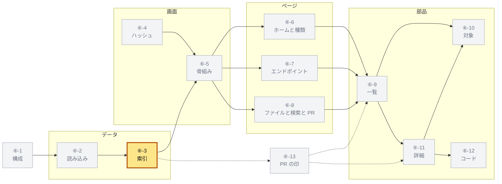

### ⑥-3-a Db の形

`buildDb(index, outline?, diff?)` は、索引の項目を一度だけたどって `Map` を作る。
画面は索引の項目の列をたどり直さず、この `Map` を引く（例：索引は 6,062 件）。

```ts
interface Db {
  index: TestsIndex; // 欠けた欄を埋めたもの
  endpoints: OutlineEndpoint[]; // アウトラインの順
  functions: Record<string, OutlineFunction>; // フレームの id から
  byId: Map<string, TestEntry>;
  byFile: Map<string, TestEntry[]>; // ファイルごと、コードの行の順
  byEndpoint: Map<string, OutlineEndpoint>; // 鍵は `<source>:<id>`（`hono:token`）
  haystack: Map<string, string>; // 検索が読む文字列
  hasCode: boolean; // アウトラインがコードの範囲を持つか
  pr?: PrMarks; // PR の印（⑥-13-a）
  diffError?: Error; // 読めなかった差分
}
```

| 欄 | 作り方 |
|---|---|
| `byId` | 索引の項目の `id` から項目 |
| `byFile` | 索引の項目の `file` ごとの列。<br>`lines[0]` の小さい順、同じなら `title` の `localeCompare` の順 |
| `haystack` | `[title, ja ?? '', file, ...path].join('\n').toLowerCase()` |
| `byEndpoint` | アウトラインのエンドポイントの `key` から |
| `hasCode` | エンドポイントか関数のどれか一つが `code` を持てば `true` |
| `pr` | 索引の `diff` が `true` で、`diff` が読めたとき `prMarks(diff, byId)` |
| `diffError` | 索引の `diff` が `true` で、`diff` が `Error` のとき、その `Error` |

データの段はページより古いことも新しいこともあるので、欠けた欄を埋める。

| 欄 | 無いとき |
|---|---|
| `index.tests` | `[]` |
| `index.counts` | `countsOf(tests)` |
| `index.endpoints`、`index.sources`、`index.aspectLabels` | `{}` |
| アウトライン | `endpoints` は `[]`、`functions` は `{}` |
| エンドポイントの `methods` | `[]` |
| エンドポイントの `group` | `{ id: 'other', label: 'そのほか' }` |
| エンドポイントの `steps` | `[]`。<br>`null` とオブジェクトでない要素は捨てる |

索引が知らないエンドポイント、ステップ、関数は、テストの無いものとして出し、失敗にしない。

### ⑥-3-b ページが読む欄

ページは ⑤ の型の一部だけを読む。
次の表の「読まない欄」は、画面を変えない。

| ファイル | 読む欄 | 読まない欄 |
|---|---|---|
| `tests.json` | `tests`、`endpoints`（`tests` と `units`）、`counts`、`sources`、`aspectLabels`、`run.at`、`diff` | `version`、`measured`、`frames`、`unknown`、`untranslated`、`gaps`、`requiredAspects`、エンドポイントの `counts` と `gaps` |
| 索引の項目（`TestEntry`） | `id`、`kind`、`root`、`title`、`ja`、`file`、`lines`、`form`、`path`、`outcome`、`aspects`、`subjects`、`routes`、`skipped`、`result`、`card` | `evidence`、`targets`、`reached` |
| `outline.json` | エンドポイントの `key`、`source`、`id`、`label`、`summary`、`path`、`methods`、`group`、`root`、`code`、`steps`（`id`、`label`、`function`、`calls`、`code`）。<br>関数の `id`、`name`、`package`、`module`、`summary`、`code` | `version`、エンドポイントの `layer` |
| カード（`TestCase`） | `id`、`source.lines`、`spec`、`assertions`（`text`、`ja`、`line`）、`steps`（`type`、`keyword`、`text`、`ja`、`line`、`definition`）、`requests`（`endpoint`、`route`、`method`、`path`、`params`、`auth`）、`result`、`reach`（`target`、`requests`）、`helpers`、`routeCode` | ほかの欄。<br>対象、種類、題は索引の項目のものを使う |
| `tests/sources/*.json` | `text` | `path` |
| `tests/diff.json` | `counts.before`、`counts.after`、`added`、`modified`（`id`、`what`、`assertions`）、`renamed`、`removed`、`cards`、`frames`（`frame`、`untouched`、`related`、`reason.text`） | `counts.byKind`、`counts.byEndpoint`、`frames` のほかの欄 |

- 差分の `cards` からは、`kind`、`title`、`ja`、`outcome`、`source`（`file`、`lines`、`form`）、`path`、`aspects`、`endpoints`、`functions`、`calls`、`examples` を読む（[⑥-13-a](#-13-a-差分から印へ)）
- 不足（`gaps`）と読めなかった数（`unknown`）は、データにだけ残る（[⑤-10](05-data.md#-10-索引)）
- 画面が示す不足は、ユニットテストの無いステップの「テストなし」だけである（[⑥-7-b](#-7-b-処理の流れ)）

### ⑥-3-c 種類の順と数え方

種類は、どの一覧と棒でも E2E、API、ユニット、ツールの順（`KINDS`）に並べる。
広いテストから狭いテストへ並べ、道具を最後に置く。
ページを持つ種類は `MAIN_KINDS = ['e2e', 'api', 'unit']`（`route.ts`）で、`KINDS` からツールを除いたものである。

| 種類 | `KIND_LABELS` | `KIND_NAMES` | `KIND_NOTES` |
|---|---|---|---|
| `e2e` | E2E | E2E テスト | ブラウザと OP を動かし、いくつものエンドポイントを通る流れを確かめる |
| `api` | API | API テスト | アプリやエンドポイントに HTTP リクエストを送り、応答を確かめる |
| `unit` | ユニット | ユニットテスト | 関数を直接呼び、その結果を確かめる |
| `tool` | ツール | ツールのテスト | CLI、地図、テストの一覧などの道具を確かめる |

| 関数 | 規則 |
|---|---|
| `sortForList(entries)` | 種類の順、`file` の `localeCompare`、`lines[0]`、`title` の `localeCompare` の順 |
| `countsOf(entries)` | `total`、`kinds`、`outcomes` と `results`（`result` が無い索引の項目は `none`）を数える。<br>`aspects` と `evidence` は空 |
| `kindCounts(entries)` | 四つの種類の数。<br>無い種類は 0 |
| `healthOf(results)` | `failed` が 1 以上なら `failed`、`passed` が 1 以上なら `passed`、ほかは `none` |
| `entriesOf(db, ids)` | 渡した `ids` の順に、索引の項目を引く。<br>索引に無い id は飛ばす |

### ⑥-3-d ページが出すエンドポイントのテスト

ページが出すエンドポイントのテスト（`endpointTests`）は、[③-7-c](03-join.md#-7-c-エンドポイントのテストの条件) のエンドポイントのテストより狭い。
索引の `tests`（主に API と E2E のテスト）と、エンドポイント自身のフレーム（`root` とステップのフレーム）の `units` だけを入れる。
ステップより下で届く関数（cookie、ストアなど）のユニットテストは、どのエンドポイントにも付くからである。
それらは「ほかの関数」に分ける。

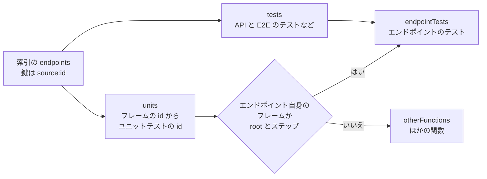

| 関数 | 規則 |
|---|---|
| `stepFrames(step)` | ステップの `function` と `calls` を、重なりを除いて並べる。<br>hono のステップはほとんどが自分の関数一つ、Next.js のステップはブロックが呼ぶ関数になる。<br>どちらも無いステップは空 |
| `endpointFrames(endpoint)` | `[endpoint.root, ...各ステップの stepFrames]` の重なりを除いたもの。<br>エンドポイント自身のフレーム |
| `endpointTests(db, endpoint)` | `ref.tests` と、`endpointFrames` の `ref.units` を合わせ、重なりを除いて `sortForList`。<br>`ref` が無ければ `[]` |
| `stepTests(db, key, step)` | ステップのフレームの `units` を合わせ、重なりを除いて、索引にあるものを `sortForList` |
| `stepCount(db, key, step)` | ステップのフレームの `units` の id を、重なりを除いて数えた数（索引に無い id も数える） |
| `unitTestsOf(db, key, frame)` | 一つのフレームの `units` を `sortForList` |
| `otherFunctions(db, endpoint)` | `units` のうち `endpointFrames` にないものを `{ id, name, module, count }` にする。<br>`count` の多い順、同じなら `name` の `localeCompare` の順 |
| `nameOfFrame(id)` | 最後の `#` の後ろ。<br>`#` が無ければ id のまま（`core:jwt.ts#sign` → `sign`） |
| `endpointGroups(db, source)` | ソースのエンドポイントをアウトラインの順のまま、`group` の初めて出た順にまとめる |

- `ref` は `index.endpoints['<source>:<id>']`（`endpointRef`）である
- `ref.tests` は [⑤-5-b](05-data.md#-5-b-エンドポイントのテスト) のとおりで、到達で処理本体に届いたユニットテストも入りうる
- `otherFunctions` の `name` はアウトラインの `name`、無ければ `nameOfFrame(id)` である
- `module` はアウトラインの `<package>:<module>`、無ければ空の文字列である

例：hono の `token` のテストは 216 件、ほかの関数は 151 個である。
Next.js の `token` は、テスト 296 件、ほかの関数 140 個である。
hono の `authorize` の `ref.tests` は、API 17 件と E2E 82 件である。

実装：

- `apps/tests/src/lib/route.ts`：`MAIN_KINDS`
- `apps/tests/src/lib/data.ts`：`Db`、`buildDb`、`KINDS`、`KIND_LABELS`、`KIND_NAMES`、`KIND_NOTES`、`sortForList`、`countsOf`、`kindCounts`、`healthOf`、`entriesOf`、`endpointRef`、`stepFrames`、`endpointFrames`、`endpointTests`、`stepTests`、`stepCount`、`unitTestsOf`、`otherFunctions`、`nameOfFrame`、`endpointGroups`

## ⑥-4 URL のハッシュ

URL のハッシュと画面の対応、ページのつながり、履歴とスクロールの扱いを決める。

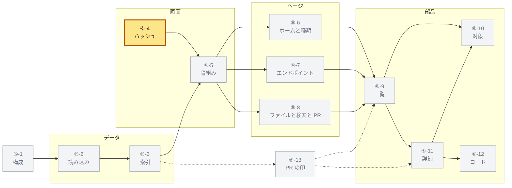

**ビュー**（`View`）はハッシュだけから決まるので、どの画面もハッシュだけで開ける。
サーバーにパスを足さずに済み、`/tests/` の下でもそのまま動く（[⑦-4](07-build-ci.md#-4-tests-での配信)）。

```ts
type Source = 'hono' | 'nextjs';
type MainKind = 'e2e' | 'api' | 'unit'; // ページを持つ種類
type KindFilter = 'all' | 'api' | 'e2e' | 'unit' | 'tool';
type OutcomeFilter = 'both' | 'success' | 'failure';
type Page = 'home' | 'kind' | 'endpoint' | 'files' | 'file' | 'pr' | 'search' | 'test';

interface View {
  page: Page;
  testKind?: MainKind; // 種類のページの種類
  pkg?: string; // ユニットテストのパッケージ（core）
  source?: Source; // エンドポイントのページ
  endpoint?: string;
  file?: string; // ファイルのページのパス
  test?: string; // テストのページのテスト。一覧ではパネルのテスト
  code?: string; // 一覧のパネルのコード（⑥-4-d の形の文字列）
  q?: string; // 検索の語
  step?: string; // エンドポイントのページで絞るステップ
  fn?: string; // 同じく、絞る関数（フレームの id）
  kind?: KindFilter;
  outcome?: OutcomeFilter;
  changed?: boolean; // 一覧に、PR が触れたテストだけを残す（⑥-13-e）
}
```

### ⑥-4-a ページのパス

| ハッシュ | ページ | 部品 | 例 |
|---|---|---|---|
| `#/` | ホーム | `Home` | |
| `#/kind/<e2e\|api\|unit>` | 種類のページ | `KindPage` | `#/kind/unit?pkg=hono` |
| `#/endpoint/<source>/<id>` | エンドポイントのページ | `EndpointPage` | `#/endpoint/hono/token?step=parse-request` |
| `#/files` | ファイルの一覧 | `FilesPage` | |
| `#/file/<パス>` | ファイルのページ | `FilePage` | `#/file/packages/core/src/jwt-steps.test.ts` |
| `#/pr` | この PR のテスト | `PrPage` | |
| `#/search?q=<語>` | 検索の結果 | `SearchPage` | `#/search?q=token+client` |
| `#/test/<id>` | テストのページ | `TestPage` | `#/test/auth-code-flow-online-refresh` |

ページは、次のようにつながる。

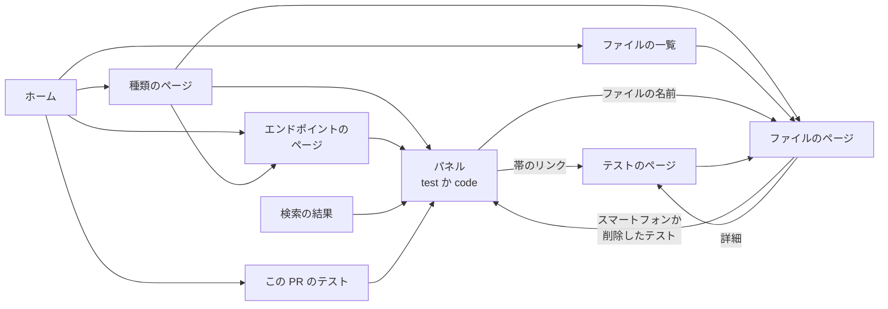

- 検索の結果へは、どのページからもヘッダーの検索で移る
- ファイルのページのテストは、広い画面ではそのページのコードに、スマートフォンではパネルに出る（[⑥-8-b](#-8-b-ファイルのページ)）
- パンくずで戻る先は、種類、エンドポイント、テストのページがホーム、ファイルのページがファイルの一覧である

### ⑥-4-b クエリ

一覧は、絞り込みとパネルをクエリに持つ。
戻るボタンでパネルが閉じ、リンクを開けばパネルも開いた一覧が出る。

| キー | 読むページ | 値 | 読まない値 |
|---|---|---|---|
| `test` | `test` 以外 | パネルで開くテストの id | 空 |
| `code` | `test` 以外 | パネルで開くコード（[⑥-4-d](#-4-d-パネルのコードの値)）。<br>`test` があれば読まない | 読めない値 |
| `kind` | `kind` と `test` 以外 | 一覧の種類の絞り込み（`api`、`e2e`、`unit`、`tool`） | `all` と知らない値 |
| `outcome` | `test` 以外 | `success` か `failure` | `both` と知らない値 |
| `changed` | `endpoint`、`kind`、`file`、`search` | `1` なら、PR が触れたテストだけを残す（[⑥-13-e](#-13-e-この-pr-の変更だけ)） | `1` でない値 |
| `step` | `endpoint` | 絞るステップの id | 空 |
| `fn` | `endpoint` | 絞る関数のフレームの id。<br>`step` があれば読まない | 空 |
| `pkg` | `kind` の `unit` | ユニットテストのパッケージ | 空 |
| `q` | `search` | 検索の語 | なし（無ければ空の語） |

- `changed` を持つ四つのページは、`hasChangedFilter(page)` が決める
- `kind` を使うのは [⑥-9](#-9-テストの一覧) の一覧、`outcome` を使うのは [⑥-9](#-9-テストの一覧) の一覧と種類のページである
- ほかのページでは、読んでも画面を変えない

### ⑥-4-c 読み方と書き方

`parseHash(hash)` は、読めないハッシュをすべてホームにする。

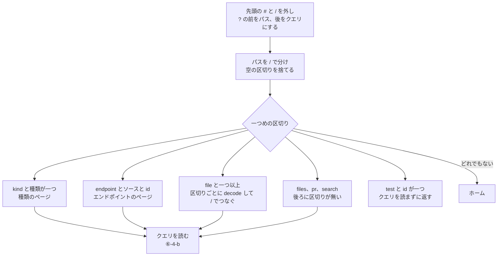

- `decode` は `decodeURIComponent` で、投げたら元の文字列を使う
- ソースは `hono` か `nextjs`、種類は `e2e`、`api`、`unit` だけを読む（`#/kind/tool` と `#/endpoint/express/token` はホーム）
- `pkg` は種類が `unit` のときだけ読む
- `test` と `code` が両方あれば、`test` だけを残す

`formatHash(view)` は、同じビューに読み戻せるハッシュを書く。

| ページ | 書くもの |
|---|---|
| `kind` | `/kind/<testKind ?? 'e2e'>` |
| `endpoint` | `/endpoint/<source ?? 'hono'>/<encodeURIComponent(endpoint)>` |
| `file` | `/file/<パス>`。<br>`/` で分けた区切りごとに `encodeURIComponent` し、`/` は残す |
| `files`、`pr`、`search` | `/files`、`/pr`、`/search` |
| `test` | `#/test/<encodeURIComponent(test)>` だけを返し、クエリを書かない |
| `home` | `#/` だけを返す |

クエリは `URLSearchParams` で、次の順と条件で書く。

| 順 | キー | 書く条件 |
|---|---|---|
| 1 | `q` | 検索の結果のページ。<br>値が無ければ空（`q=`） |
| 2 | `pkg` | 種類のページの `unit` |
| 3 | `step` か `fn` | エンドポイントのページ。<br>`step` があれば `fn` は書かない |
| 4 | `kind` | 種類のページでなく、`all` でない |
| 5 | `outcome` | `both` でない |
| 6 | `changed` | `true` で、`hasChangedFilter` のページ。<br>値は `1` |
| 7 | `test` か `code` | `test` があれば `code` は書かない |

- 書くときは、定義された値をそのまま書く（空の文字列も書く）
- 読めない値を捨てるのは、読む側（[⑥-4-b](#-4-b-クエリ)）だけである
- クエリが空なら `?` も書かない
- ファイルのパスの `/` を残すのは、アドレス欄でファイルのパスがそのまま読めるようにするためである

例：次のビューは、下のハッシュになる。

```text
{ page: 'endpoint', source: 'nextjs', endpoint: 'token', step: 'parse-request',
  kind: 'unit', outcome: 'success', changed: true, test: 'abc' }
#/endpoint/nextjs/token?step=parse-request&kind=unit&outcome=success&changed=1&test=abc
```

### ⑥-4-d パネルのコードの値

`code` の値は、コードの種類と鍵をコロンでつないだ文字列である。

```ts
type CodeTarget =
  | { kind: 'fn'; id: string } // fn:<フレームの id>
  | { kind: 'endpoint'; key: string } // endpoint:<source>:<id>
  | { kind: 'step'; key: string; step: string }; // step:<source>:<id>:<ステップの id>
```

`parseCode(value)` は、次の順に読む。

1. 最初の `:` の前を種類、後ろを残りとし、`:` が無ければ読まない
2. `fn` は、残りが空でなければ、残りの全体を id とする（id の中の `:` と `#` はそのまま）
3. ほかは残りを `:` で分け、一つめがソースで二つめが空でない id でなければ読まない
4. `endpoint` は区切りがちょうど二つ、`step` はちょうど三つで三つめが空でないときだけ読む
5. ほかの種類（`class:x` など）は読まない

- エンドポイントの id とステップの id はコロンを含まないので、この分け方で足りる
- 例：`fn:hono:oidc-provider/endpoints/token/steps/parse-request.ts#parseTokenRequest`、`endpoint:nextjs:token`、`step:hono:token:authenticate-client`
- `formatCode(target)` は、この逆を書く

### ⑥-4-e 履歴とスクロール

ビューは、`go(view, { replace? })`、リンク、ブラウザの戻ると進むで変わる。

| 関数 | 規則 |
|---|---|
| `samePage(a, b)` | `page`、`testKind`、`source`、`endpoint`、`file` が同じ。<br>テストのページなら `test` も同じ |
| `panelOf(view)` | テストのページなら `undefined`、ほかは `test ?? code` |
| `withoutPanel(view)` | テストのページならホーム、ほかは `test` と `code` を除いたビュー |

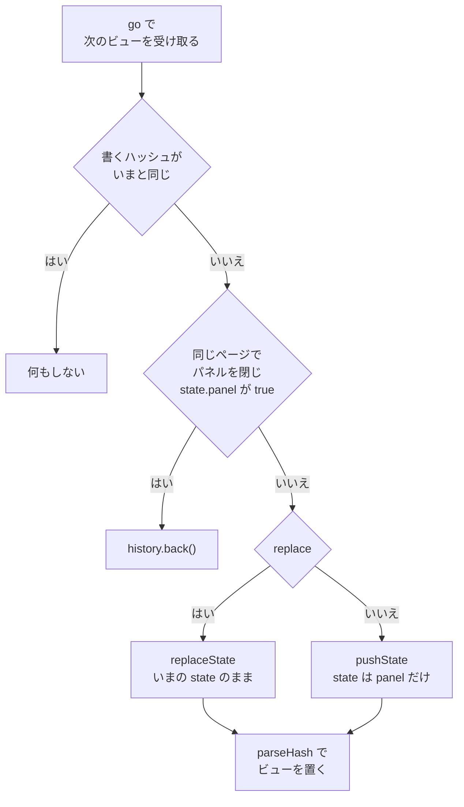

- `pushState` の state は `{ panel }` で、パネルを開くときだけ `panel` が `true` である
- 開くときとは、次のビューにパネルがあり、いまのビューに無く、`samePage` のときである
- 同じページで、そうして開いたパネルを閉じるときは、`history.back()` で一つ戻る
- 戻るボタンで、閉じたパネルがまた開かないようにするためである
- リンクから開いたパネルは `state.panel` を持たないので、閉じると戻らずにパネルの無いビューを `pushState` で足す
- 絞り込みの変化は `replace` で書き、履歴を増やさない
- `App` は `popstate` と `hashchange` でハッシュを読み直すので、`<a href="#/...">` のリンクでも画面が変わる

スクロールとタブの題は、次のように決める。

- `samePage` でない画面に移ると、`window.scrollTo({ top: 0 })` する（`useLayoutEffect`）
- 絞り込みとパネルの変化では、位置を保つ
- タブの題（`useTitle`）は `<画面の名前> · テスト`、名前が無いか空なら `テスト · OIDC Provider` にする

| 画面 | 名前 |
|---|---|
| ホーム | 無し |
| 種類のページ | `KIND_NAMES` |
| エンドポイントのページ | `<label>（Hono）` か `<label>（Next.js）` |
| ファイルの一覧 | ファイル |
| ファイルのページ | ファイルの名前 |
| 検索の結果 | `「<語>」の検索結果` |
| この PR のテスト | この PR のテスト |
| テストのページ | テストの題（[⑥-9-b](#-9-b-一覧の行) の `titleOf`）。<br>削除したテストなら、その題 |

実装：

- `apps/tests/src/lib/route.ts`：`View`、`CodeTarget`、`hasChangedFilter`、`parseHash`、`formatHash`、`parseCode`、`formatCode`、`samePage`、`panelOf`、`withoutPanel`
- `apps/tests/src/App.tsx`：`go`、`popstate` と `hashchange`、スクロールの `useLayoutEffect`
- `apps/tests/src/components/app-context.ts`：`useTitle`

## ⑥-5 画面の骨組み

`App` が描く枠（ヘッダー、本文、パネル）と、その状態の移り方、空と失敗の表示を決める。

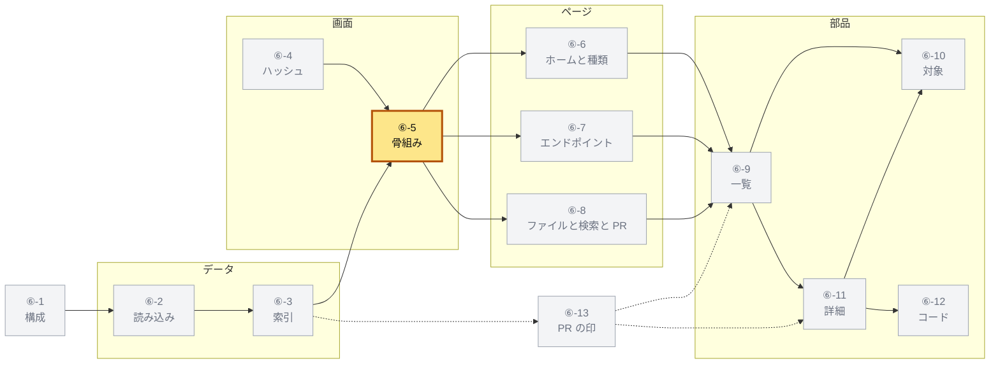

### ⑥-5-a 起動から画面まで

`App` は、索引を読むまで本文に「テストを読み込んでいます…」を出す。

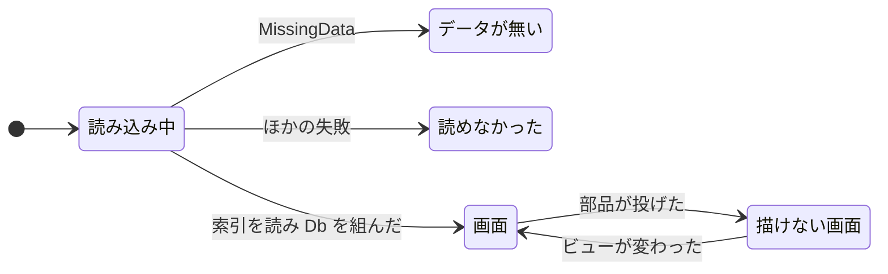

- `Db` ができると、`AppContext` に `AppState` を置き、ビューの `page` で本文の部品を選ぶ（`Screen`）
- 本文の部品は `ErrorBoundary` で包み、`reset` にビューのハッシュを渡す
- ハッシュが変わると、描けなかった画面をもう一度描く

```ts
interface AppState {
  db: Db;
  view: View;
  lang: Lang; // 'ja' | 'en'
  source: Source;
  go: (view: View, options?: { replace?: boolean }) => void;
  chooseSource: (source: Source) => void;
}
```

| `page` | 部品 |
|---|---|
| `kind` | `KindPage` |
| `endpoint` | `EndpointPage` |
| `files`、`file` | `FilesPage`、`FilePage` |
| `pr` | `PrPage` |
| `search` | `SearchPage` |
| `test` | `TestPage` |
| ほか | `Home` |

```text
div.shell          パネルが開いている間は inert
├── Header         ⑥-5-c
└── main.main
    └── ErrorBoundary → ページの部品
Panel              ⑥-5-d。パネルを出すときだけ、.shell の外に置く
```

### ⑥-5-b 読み手の好み

ページは、題の言語とソースを読み手のブラウザに覚える。

| 好み | `localStorage` の鍵 | 値 | 既定 |
|---|---|---|---|
| 題の言語 | `tests.lang` | `ja`、`en` | `ja` |
| ソース | `tests.source` | `hono`、`nextjs` | `hono` |

- 読みも書きも `try` で包み、使えない窓（プライベートの窓など）ではページを閉じるまでの値にする
- 知らない値は既定にする
- エンドポイントのページでは、ハッシュのソースに切り替えを合わせるが、それは覚えない
- 切り替えで選ぶと覚え、エンドポイントのページなら、同じ id の別のソースのページへ `replace` で移る
- 移る先のビューは `page`、`source`、`endpoint` だけで、ステップ、関数、絞り込み、パネルは消える
- ヘッダーにソースの切り替えを出すのは、ホーム、エンドポイントのページ、API の種類のページだけである

ソースは、次を決める。

- ホームに並べるエンドポイント（[⑥-6-a](#-6-a-ホーム)）
- API の種類のページの組（[⑥-6-d](#-6-d-api-テストの並べ方)）
- 一覧の行と詳細の対象（[⑥-10](#-10-テストの対象)）、削除したテストの対象（[⑥-13-b](#-13-b-削除したテストの置き場所)）
- テスト対象の経路と、コードの項目の初めの版（[⑥-11-d](#-11-d-テスト対象のタブ)、[⑥-12-a](#-12-a-コードの項目)）

### ⑥-5-c ヘッダー

ヘッダーは一行で、左から次を並べる。

1. 題のリンク（「テスト」と小さな「OIDC Provider」、`#/`）
2. ソースの切り替え（出すページだけ）
3. 検索の箱（幅 280px、プレースホルダー「テストを検索」）
4. 検索を開くボタン（スマートフォンだけ）
5. 言語の切り替え（`EN` と `日本語`、小さな `Segmented`）
6. 地図へのリンク（「地図」、`../`）

- 2 と 3 のあいだに伸びる空き（`.top-spacer`、`flex: 1`）を置き、3 から 6 を右端に寄せる
- 並びの幅は本文と同じ `max-width: 1280px` で、間は 16px、左右の余白は 24px である

検索は、打つたびに検索の結果へ移る。

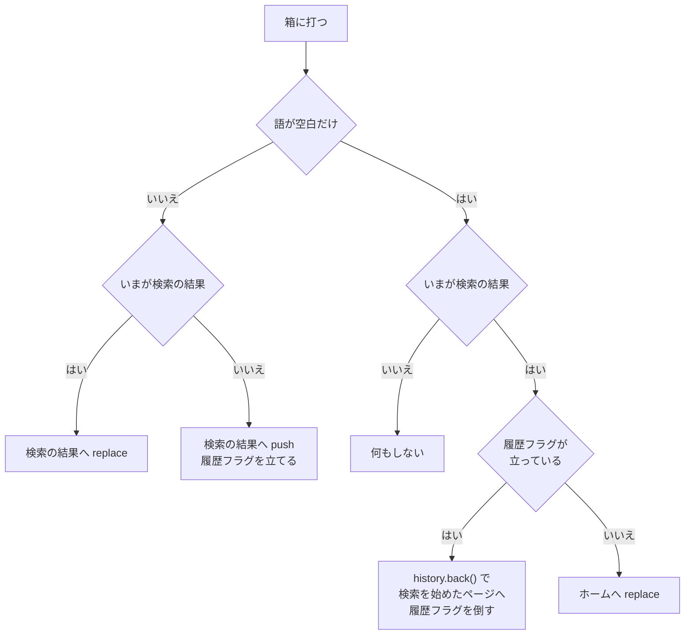

- 履歴フラグ（`pushed`）は、この検索が検索の結果の履歴を足したかを表す
- 語はそのまま `q` に書く（前後の空白も残す）
- 箱の語は、検索の結果ではハッシュの `q`、ほかのページでは空に合わせる
- 検索の結果を離れると、履歴フラグを倒す
- 送信（Enter）は、語が空でなければ検索の結果へ移る（検索の結果の上では `replace`）
- 送信では、語が空でも箱のフォーカスを外す
- × は箱を空にし、スマートフォンでは検索を畳む
- 広い画面では、箱が空のあいだ × を隠す
- Escape は検索を畳む

スマートフォン（768px 以下）では、ヘッダーを次のように変える。

- 題の「OIDC Provider」を隠し、ヘッダーの余白を `0 16px`、間を 12px にする
- 検索の箱を隠し、検索のボタンで箱をヘッダーの上に重ねて開き、箱にフォーカスする
- ヘッダーのソースの切り替え（`.top-source`）を隠し、ページの中の切り替え（`.body-source`）を全幅で出す

### ⑥-5-d パネル

パネルに出すものはビューから決め、開閉は履歴に合わせる（履歴の規則は [⑥-4-e](#-4-e-履歴とスクロール)）。

```ts
const narrow = useNarrow(); // 768px 以下
const removed = view.test !== undefined && db.pr?.removedById.has(view.test) === true; // 削除したテスト
const panelTest = view.page === 'test' || (view.page === 'file' && !narrow && !removed) ? undefined : view.test;
const panelCode = view.page === 'test' || panelTest !== undefined ? undefined : view.code;
```

- テストのページはパネルを出さない
- 広い画面のファイルのページは、テストをパネルでなく、そのファイルのコードの強調で示す（[⑥-8-b](#-8-b-ファイルのページ)）
- ただし削除したテストはコードが無いので、ファイルのページでもパネルに出す

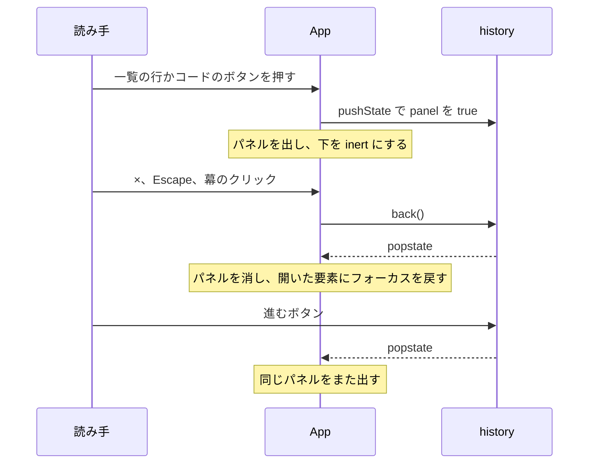

| 振る舞い | 規則 |
|---|---|
| 配置 | 右に固定し、幅 `min(1040px, 72vw)`、高さいっぱい、中だけをスクロールする。<br>削除したテストは幅 `min(560px, 100vw)`（`.panel-small`）。<br>スマートフォンではどちらも `100vw` |
| 下のページ | `.shell` を `inert` にし、`body` に `panel-open`（`overflow: hidden`）を付ける |
| 帯 | 上に固定した高さ 56px の帯。<br>テストなら「このテストのページ」（`#/test/<id>`）のリンク、削除したテストなら「この PR で削除されたテスト」、コードなら「コード」の文字。<br>右に閉じる × |
| 閉じる | ×、Escape、横の幕（`.scrim`）のクリックで `go(withoutPanel(view))` |
| フォーカス | 開いたときと中身が変わったときに、パネルにフォーカスし、先頭までスクロールを戻す |
| 閉じた後 | 開く前にフォーカスがあった要素へ、まだ文書にあれば `focus({ preventScroll: true })` で戻す |
| 読み上げ | `role="dialog"`、`aria-modal="true"`、`aria-labelledby="panel-title"`（中の題の id） |
| 失敗 | 中身を `ErrorBoundary` で包み、`reset` にテストかコードの値を渡す |

パネルとテストのページの中身は、次の順に選ぶ。

| `test` の id | パネル | テストのページ（`#/test/<id>`） |
|---|---|---|
| 索引にある | `TestDetail`（[⑥-11](#-11-テストの詳細)） | パンくず（ホーム › ファイルのパス）と `TestDetail` |
| 削除したテスト | `RemovedDetail`（[⑥-13-f](#-13-f-テストの詳細の印)） | パンくず（ホーム）と `RemovedDetail` |
| どちらでもない | テスト <id> はありません。 | 同じ |

- コードは `codePanel`（[⑥-12-a](#-12-a-コードの項目)）の題、場所の一行、要約と、コードの項目で出す

### ⑥-5-e 空と失敗の表示

ページは、無いデータと読めないデータを、画面ごとの文で示し、白い画面で止めない。

表示の「」の中は、画面の文そのままである。

| 場所 | 条件 | 表示 |
|---|---|---|
| 全体 | 索引を読み込み中 | 「テストを読み込んでいます…」 |
| 全体 | 索引が `MissingData` | 題「テストのデータがありません」と、作り方（`pnpm run build:map`、地図のパッケージだけなら `pnpm --filter @maronn-openid-connect/map run data`、書き出す先 `apps/tests/public/data`） |
| 全体 | 索引のほかの失敗 | 題「データを読み込めませんでした」、失敗の文、「もう一度読み込む」（`location.reload()`） |
| 本文、パネル | 部品が投げた | 題「この画面を表示できませんでした」、失敗の文、「ホームへ」 |
| ホーム | ソースのエンドポイントが無い | 「エンドポイントの一覧（outline.json）がありません。」 |
| エンドポイント | 鍵がアウトラインに無い | 「エンドポイント <鍵> はありません。」と「ホームへ」 |
| エンドポイント | ステップにユニットテストが無い | 札「テストなし」 |
| 一覧の節 | その種類のテストが無い | 「<KIND_NAMES>はありません」 |
| 一覧、種類のページ | 絞り込みで空 | 「該当するテストはありません」 |
| 一覧、種類のページ | 「この PR の変更だけ」で空 | 「この PR で変わったテストはありません」 |
| API の種類のページ | 何も残らない | 「<Hono か Next.js> の該当するテストはありません」 |
| ユニットの種類のページ | パッケージが無い | 「ユニットテストはありません」 |
| ファイルのページ | テストも削除したテストも無い | 「このファイルのテストはありません。」 |
| ファイルのページ | テストがすべて削除され、本文も無い | 「この PR でこのファイルのテストはすべて削除されました。コードはありません。」 |
| 検索の結果 | 一致しない | 「一致するテストはありません。英語と日本語のタイトル、ファイルのパス、describe の名前から探します。」 |
| PR | PR のビルドでない | 「このデータはプルリクエストのビルドではありません。」 |
| PR | 差分を読めなかった | 「この PR のテストの差分を読み込めませんでした（<失敗の文>）。」 |
| PR | テストの変更が無い | 「この PR はテストを変えていません。」 |
| PR | 理由の無い変更 | 札「理由の記載なし」 |
| パネル、テストのページ | 索引にも削除したテストにも無い id | 「テスト <id> はありません。」 |
| パネル、テストのページ | 削除したテスト | 「このテストはこの PR で削除されたので、コードと結果はありません。」 |
| パネル | 読めないコードの値、データに無いコード | 「このコードはデータにありません。」 |
| 詳細 | カードを読み込み中と失敗 | 「読み込んでいます…」と、`useCard` の失敗の文（[⑥-2-c](#-2-c-一度だけ読む仕組み)） |
| ヘルパーのタブ | 何も呼ばない | `hasCode` なら「このテストが呼ぶヘルパーはありません。」、ほかは「このデータにはヘルパーの情報がありません。データを作り直すと表示されます。」 |
| ヘルパーのタブ | ステップ定義が無い | 「定義が見つかりません」 |
| テスト対象のタブ | コードの項目が無い | 「このテストが何を確かめているか（関数やエンドポイント）は分かりませんでした。」 |
| テスト対象のタブ | コードの項目が無く、ほかのルートへのリクエストがある | 「このテストのリクエストに答えるコードは分かりませんでした。」 |
| テスト対象のタブ | `hasCode` が `false` | 「このデータには関数とエンドポイントのコードの範囲がありません。データを作り直すと表示されます。」 |
| コードの項目 | 関数かルートの実装の範囲が無い | 「<name> のコードはデータにありません。」 |
| コードの項目 | ブロックの範囲が無い | 「「<name>」のコードはデータにありません。」 |
| コードの項目 | エンドポイントの版の範囲が無い | 「<label>（<Hono か Next.js>）のコードはデータにありません。」 |
| コード | 本文のファイルが無い | 「このファイルのコードがデータにありません」 |
| コード | 読み込み中 | 「コードを読み込んでいます…」 |
| コード | 範囲がファイルの外 | 「<a>–<b> 行はファイルの外です（データを作った後にファイルが変わりました）。ファイル全体を表示します。」 |

失敗の文は、`MissingData` なら `<url> がありません`、HTTP なら `<url>: HTTP <status>` である。
ネットワークの失敗なら、ブラウザの `fetch` が投げた文（`Failed to fetch` など）である。

実装：

- `apps/tests/src/App.tsx`：`App`、`Screen`、`NoData`、`remembered`、`remember`、`chooseLang`、`chooseSource`、`showsSource`、`removed`、`panelTest`、`panelCode`
- `apps/tests/src/components/app-context.ts`：`AppState`、`AppContext`、`useApp`
- `apps/tests/src/components/Header.tsx`：`Header`、`search`、`submit`、`close`
- `apps/tests/src/components/Panel.tsx`：`Panel`、`CodeDetail`、`TestPage`
- `apps/tests/src/components/ErrorBoundary.tsx`

## ⑥-6 ホームと種類のページ

ホーム（`#/`）と三つの種類のページ（`#/kind/<種類>`）が、テストをどう数えてどう並べるかを決める。

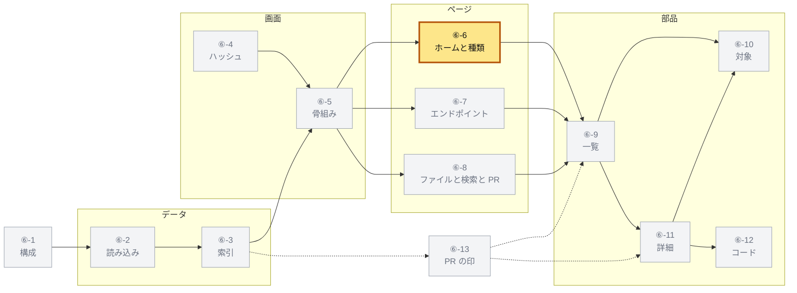

⑥-6 から ⑥-8 のページは、後の節の部品を使う。
部品の言葉は、次の意味である。

| 言葉 | 意味 | 節 |
|---|---|---|
| 一覧の行 | 一覧の中で、テスト一つを示す一行。<br>`hideFile` を渡すと、ファイルの名前を出さない | [⑥-9-b](#-9-b-一覧の行) |
| 対象の文脈 | 一覧がすでに言っているもの（`TargetContext`）。<br>`current` はエンドポイントの id、`known` は関数の id の列、`named` は組の見出しの名前で、一覧の行はそれを繰り返さない | [⑥-10-e](#-10-e-一行で言う対象) |
| `qualifier` | 同じ名前の関数を見分ける添え書き | [⑥-10-g](#-10-g-同じ名前の関数) |
| PR の数 | 一覧のテストのうち、PR が足した、変えた、名前を変えた、消したテストの数（`prCounts`） | [⑥-13-c](#-13-c-数の数え方と書き方) |
| 削除したテスト | PR が消したテスト。<br>`removedOfKind` や `endpointRemoved` で、元にあった一覧に混ぜて出す | [⑥-13-b](#-13-b-削除したテストの置き場所) |
| この PR の変更だけ | 一覧を、PR が触れたテストだけに絞る切り替え | [⑥-13-e](#-13-e-この-pr-の変更だけ) |

### ⑥-6-a ホーム

ホームは、上から次の五つを出す。

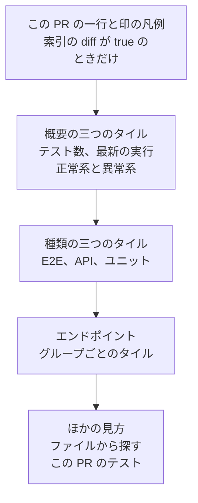

| 部分 | 規則 |
|---|---|
| この PR の一行 | `#/pr` へのリンク。<br>「この PR」、「テスト <before> → <after>」、三つの数を言葉で（[⑥-13-c](#-13-c-数の数え方と書き方)）、「→」。<br>差分を読めなかったときは「この PR」「のテスト」「→」だけ |
| 印の凡例 | この PR の一行の横に、PR の札と数の読み方を出す（[⑥-13-c](#-13-c-数の数え方と書き方)）。<br>差分を読めたときだけ |
| テスト数 | `counts.total`（無ければ索引の項目の数）、四つの種類の棒、数つきの凡例 |
| 最新の実行 | 実行した数は `passed + failed + skipped`。<br>0 なら「結果なし」、`failed` が 1 以上なら「✗ <n> 件失敗」、ほかは「✓ すべて成功」 |
| 最新の実行の下 | 成功の数、失敗の数（1 以上のとき）、スキップの数（1 以上のとき）、結果なしの数。<br>`run.at` があれば「<formatDate> の実行」 |
| 正常系 : 異常系 | `success` と `failure` の数を「:」で並べ、正常系、異常系、判定なしの棒と数つきの凡例 |
| 種類のタイル | `MAIN_KINDS` の順に、色の四角、`KIND_NAMES`、数、PR の数（[⑥-13-c](#-13-c-数の数え方と書き方)）、`KIND_NOTES`、「<見方>に見る →」。<br>種類のページへのリンク |
| 見方 | E2E は `spec・シナリオのファイルごと`、API は `エンドポイントごと`、ユニットは `関数ごと`（`KIND_GROUPING`） |
| エンドポイント | 見出しと、ツールを除く種類の凡例。<br>その下に、スマートフォンだけのソースの切り替え。<br>ソースの `endpointGroups` のグループごとに、グループの `label` とタイル |
| エンドポイントのタイル | 結果の丸（`healthOf(countsOf(endpointTests(...)).results)`）、`label`、テストの数、`methods` を ` · ` でつないだものと `path`、PR の数、ツールを除く種類の棒。<br>エンドポイントのページへのリンク |
| ほかの見方 | 「ファイルから探す →」（`#/files`）、PR のビルドなら「この PR のテスト →」 |

- 種類の棒（`kindParts(counts, withTools)`）は、エンドポイントにツールのテストが無いので、既定でツールを除く
- 概要の「テスト数」だけは `withTools` でツールも出す
- エンドポイントのタイルの PR の数は、`endpointTests` の id と、`endpointRemoved` の削除したテストで数える（[⑥-13-b](#-13-b-削除したテストの置き場所)）

| 配置 | 1081px 以上 | 769px から 1080px | 768px 以下 |
|---|---|---|---|
| 概要のタイル | 3 列 | 2 列 | 1 列 |
| 種類のタイル | 3 列 | 3 列 | 1 列 |
| エンドポイントのタイル | `repeat(auto-fill, minmax(320px, 1fr))` | 同じ | 1 列 |

例：テスト数は 6,062 である。
内訳は E2E 122、API 217、ユニット 4,523、ツール 1,200 である。
最新の実行は成功 5,761、結果なし 301 である。
正常系と異常系は 4,420 : 1,319（判定なし 323）である。

### ⑥-6-b 種類のページの頭

種類のページは、一つの種類のテストを、確かめるもので分けて並べる。
ツールのテストはページを持たず、ファイルのページと検索にだけ出る。

- パンくずは「ホーム」
- 題は `KIND_NAMES`、その下に「<数> 件 · <KIND_NOTES>」（数は `testsOfKind(db, kind).length`）
- 三つの種類へのリンク（色の四角、`KIND_LABELS`、`counts.kinds` の数、PR の点）を並べ、いまの種類に `aria-current="page"` を付ける
- どの種類も、正常系と異常系の絞り込み（[⑥-9-a](#-9-a-絞り込みと種類の節)）と「この PR の変更だけ」（[⑥-13-e](#-13-e-この-pr-の変更だけ)）を持つ
- 種類の絞り込みは持たない
- 一覧の行は、絞り込みに合う削除したテストも、元の場所に混ぜて出す（[⑥-13-b](#-13-b-削除したテストの置き場所)）

| 種類 | 分け方 | 一覧の行に渡す対象の文脈（[⑥-10-e](#-10-e-一行で言う対象)） |
|---|---|---|
| E2E | ファイルごと（[⑥-6-c](#-6-c-e2e-テストの並べ方)） | `{}` |
| API | 選んだソースのエンドポイントごと、次にほかのルートの組（[⑥-6-d](#-6-d-api-テストの並べ方)） | エンドポイントの組は `{ current: エンドポイントの id }`、ほかのルートの組は `{ known: [関数の id], named: 組の名前 }` |
| ユニット | パッケージ、モジュール、関数（[⑥-6-e](#-6-e-ユニットテストの並べ方)） | `{ known: [関数の id] }`。<br>関数の分からないテストは `{}` |

`testsOfKind(db, kind)` は、その種類の索引の項目を `sortForList` で並べる。

### ⑥-6-c E2E テストの並べ方

`e2eFiles(db)` は、E2E のテストをファイルごとにまとめる。

- ファイルの題は、そのファイルの最初のテストの `path[0]`（describe か Feature）である
- テストが無ければ最初の削除したテストの `path[0]`、それも無ければファイルの名前である
- ファイルは、題の大文字と小文字を区別しない順（`localeCompare(b, 'en', { sensitivity: 'base' })`）、同じならパスの `localeCompare` の順
- Playwright の spec と機能ファイルを同じ並びに混ぜる
- 見出しは、題、数、PR の数、ファイルの名前（`#/file/<パス>` へのリンク、`title` にパス）
- 一覧の行はファイルの名前を出さない（`hideFile`）
- 正常系と異常系で絞り、テストも削除したテストも残らないファイルは出さない
- 何も残らなければ [⑥-5-e](#-5-e-空と失敗の表示) の文を出す

例：23 ファイルである。
最初の三つは `acr_values`、`Auth transaction cookie`、`Authorization Code Flow` である。

### ⑥-6-d API テストの並べ方

`apiEndpoints(db, source)` は、API テストを、選んだソースのエンドポイントごとにまとめる。
どのエンドポイントにも届かないテストは、ほかのルートの組に分ける。

```ts
interface ApiGroups {
  endpoints: Array<{ endpoint: OutlineEndpoint; tests: TestEntry[]; removed: RemovedTest[] }>; // アウトラインの順
  untested: OutlineEndpoint[]; // ソースの、API テストの無いエンドポイント
  outside: OutsideGroup[]; // テストやアプリのルートへのリクエスト
  runtime: OutsideGroup[]; // パスが実行時に決まるリクエスト
}

interface OutsideGroup {
  key: string; // fn:<フレームの id>、describe:<ファイル>\u0000<describe>、file:<パス>
  name: string; // 関数の名前（アウトラインの name か nameOfFrame）、無ければ describe、無ければファイルの名前
  fn?: string; // 組の関数（フレームの id）
  qualifier?: string; // 同じ名前の関数との見分け（⑥-10-g）
  file?: string; // 関数の無い組の、テストのファイル
  tests: TestEntry[];
  removed: RemovedTest[];
}
```

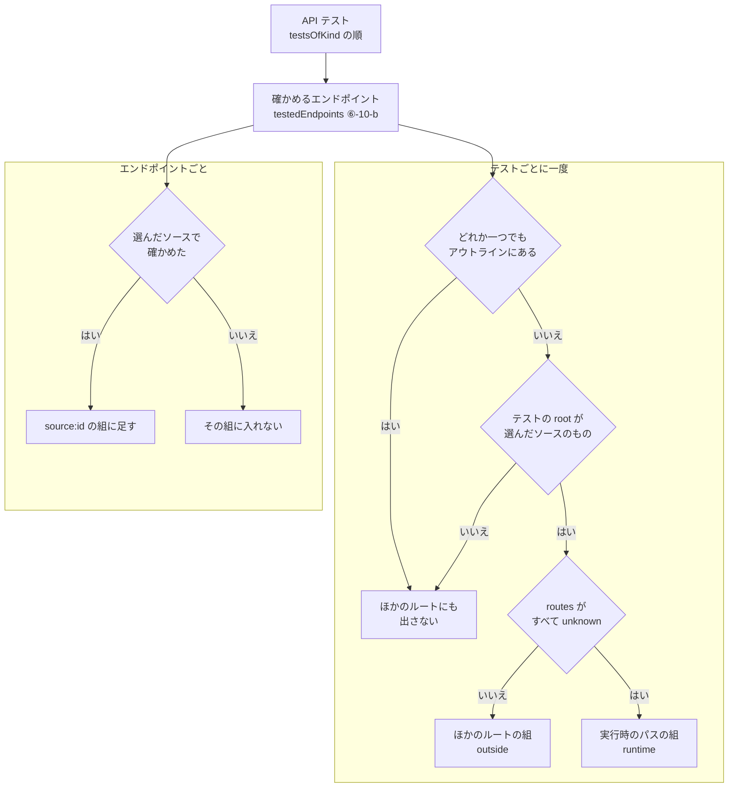

- 左の判定はエンドポイントごとに、右の判定はテストごとに一度行い、両方を行う
- 二つのエンドポイントを確かめるテストは、両方の組に入る
- アウトラインにあるエンドポイントを確かめても、どれも選んだソースのものでなければ、テストはこのソースのどこにも出ない
- 「アウトラインにある」は、そのエンドポイントの、どれかのソースの鍵が `byEndpoint` にあることである
- 「選んだソースのもの」は、`root` が `hono` か `nextjs` なら、選んだソースと同じことである
- ほかの `root`（シナリオなど）のテストは、どちらのソースのものでもある
- `routes` は索引の項目の欄で、ほかのルートの行き先を重ならずに持つ（[⑥-10-d](#-10-d-ほかのルート)）
- 「すべて unknown」（`onlyAtRunTime`）は、`routes` が空でなく、すべてが `unknown` であることである

エンドポイントの組と、ほかのルートの組は、次の順に並べる。

| 並び | 規則 |
|---|---|
| エンドポイント | ソースのエンドポイントをアウトラインの順に見る。<br>組があれば節にする。<br>組が無いか、組のテストが 0 件（削除したテストだけ）なら `untested` に入れる |
| ほかのルートの組 | `name` を `localeCompare(b, 'en', { sensitivity: 'base' })`、同じなら `qualifier`（無ければ空）、次に `key` の `localeCompare` の順 |

ほかのルートの組の鍵は、テストの対象（`subjects`）から次の順に決める。

1. `how: 'describe'` の関数の対象があれば、その関数（`fn:<id>`）
2. 無ければ、describe の名前の関数を、テストのファイルが確かめるモジュールで探す（下）
3. 無ければ、`how: 'declared'` の関数の対象
4. 無ければ、`path[0]`（describe）があれば、そのファイルとその describe（`describe:…`）
5. 無ければ、`how: 'call'` の最初の関数
6. 無ければ、テストのファイル（`file:<パス>`）

- 2 のモジュールは、ファイルの名前から `/\.(?:test|spec)(\.[cm]?[jt]sx?)$/` の `.test` か `.spec` を除いたパスである（`app.test.ts` → `app.ts`）
- そのパスに `code.file` があり、`name` が describe と同じアウトラインの関数を探す
- 関数のある組は `qualifier`（[⑥-10-g](#-10-g-同じ名前の関数)）を、関数の無い組は `file` を持つ

画面は、次のように出す。

- エンドポイントの節の見出しは、題（エンドポイントのページへのリンク）、数、PR の数、`methods` と `path`
- `code` があれば、見出しの終わりに「コード」のボタンを置く（[⑥-12-a](#-12-a-コードの項目)）
- エンドポイントの節の後に、ほかのルートの節と、実行時のパスの節を置く（題は下の表）
- その二つは、組が一つも無ければ出さない
- 節の見出しの数は、その節の組のテストの id を重ならずに数えた数である
- 節の題の下に、次の説明を置く

| 節 | 説明の文 |
|---|---|
| テストやアプリのルートへのリクエスト | 「テストが自分で登録したルートや、アプリの /health・運用者の API など、OP のエンドポイントではないルートにリクエストを送る API テストです。テストが describe に書いた関数やクラスごとに並べます。」 |
| パスが実行時に決まるリクエスト | 「URL がコードに書かれておらず、テストを動かすまでどこへ送るか分からないリクエストの API テストです。テストが describe に書いた関数ごとに並べます。」 |

- 組の見出しは、`name`（等幅）と `（<qualifier>）`、数、PR の数である
- 続けて、関数に `code` があれば「コード」のボタン、関数が無ければファイルの名前のリンクを置く
- 組の無いエンドポイントは、最後の一行に、リンクを「、」でつないで出す
- その一行の頭は「API テストのないエンドポイント（<ソース>）」である
- 絞って何も残らなければ [⑥-5-e](#-5-e-空と失敗の表示) の文を出す

絞り込みの列は、ソースの切り替え（`.body-source`）、正常系と異常系、「この PR の変更だけ」の順である（`.filters-api`）。

- 広い画面では、`.body-source` を隠し、ソースの切り替えはヘッダーにある
- スマートフォンでは、ソースの切り替えと正常系と異常系が一行に収まるように詰める
- 詰め方は、`.filters-api` の間を 8px、ボタンの左右の余白を 10px にし、`.body-source` を `flex: 1 1 auto` で伸ばすことである
- 「この PR の変更だけ」は、行に収まらなければ次の行に回る（`.filters` は `flex-wrap: wrap`）

例：hono は 17 個のエンドポイントのすべてに API テストがある。
Next.js は 2 個のエンドポイントに API テストがあり、15 個は無い。

hono のほかのルートの組は 9 個（51 件）で、実行時のパスの組は無い。
組は `applyOidc` が三つ（`oidc-provider`、`web/express`、`web/fastify`）、ほかに `createApp`、`createCorsMiddleware`、`createOperatorApp`、`createServerApp`、`WebRouter`、`writeWebResponse` である。
`WebRouter` は関数でなく describe の組（`apps/hono/src/web/web-router.test.ts`、27 件）である。

### ⑥-6-e ユニットテストの並べ方

`unitPackages(db)` は、ユニットテストを、パッケージ、モジュール、関数の三段にまとめる。

```mermaid
flowchart LR
  T["ユニットテスト<br/>testsOfKind の順"]
  F{"確かめる関数<br/>testedFunctions"}
  P["パッケージ"]
  M["モジュール"]
  G["関数の組"]
  U["root のパッケージの<br/>関数の分からないテスト"]
  T --> F
  F -->|"一つ以上"| P --> M --> G
  F -->|"無い"| U
```

| 規則 | 値 |
|---|---|
| 関数 | `testedFunctions(entry)`（[⑥-10-a](#-10-a-確かめる関数)）。<br>到達だけの関数は入れない。<br>テストは、確かめる関数ごとにその組に入る |
| 場所 | アウトラインの関数の `package` と `module`。<br>アウトラインに無ければ id から読む（`core:jwt.ts#sign` → `core` と `jwt.ts`）。<br>パッケージが空なら、テストの `root` |
| パッケージの順 | `core`、`experimental`、`google-login`、`hono`、`nextjs`（`PACKAGE_ORDER`）、ほかは名前の `localeCompare` の順 |
| パッケージの数 | 入ったテストの id の数（重なりを除き、削除したテストは数えない） |
| モジュールの順 | パスの `localeCompare` |
| 関数の順 | アウトラインの関数のコードの始まりの行、無ければ最後。<br>同じなら `name` の `localeCompare` の順 |
| 組の中の順 | `testsOfKind` の順 |

画面は、次のように畳んで出す。

- パッケージのチップ（名前、PR の点、数）で一つを選ぶ
- 既定は最初のパッケージで、それを選ぶとハッシュから `pkg` を消す（`replace`）
- `pkg` が知らない名前なら、最初のパッケージを出す
- 絞り込みの列の下に、次の説明を置く

```text
モジュールを開くと関数が、関数を開くとそのテストが出ます。関数のテストは、その関数を describe に書いたテストと、期待値で結果を確かめているテストです。
```

- モジュールは `<details>` に畳み、パッケージのモジュールが 8 個以下（`OPEN_MODULES`）なら開いて始める
- 畳んだモジュールの見出しは、パス、テストの数、PR の数、「関数 <n>」である
- パスは `/` の後ろで折り返せる（`<wbr>`）
- 開いたモジュールは、関数ごとに、開くボタン（▸ か ▾、名前、数、PR の数）を出す
- その横に、`code` があれば「コード」のボタン、その下に要約（`Words`）を出す
- 関数を開くと、その関数のテストの一覧の行を出す
- モジュールに関数が一つだけなら、その関数を開いて始める
- 関数の分からないテストは、最後に「関数の分からないテスト」として畳む
- 正常系と異常系で絞ると、テストの残らない関数とモジュールを出さない
- 「この PR の変更だけ」を入れると、モジュール、関数、関数の分からないテストを開いて始める
- 何も残らなければ [⑥-5-e](#-5-e-空と失敗の表示) の文を出す
- パッケージか絞り込みを変えると、モジュールの開閉を初めに戻す

例：core は 1,487 件で、29 モジュールである。
hono は 1,460 件で、179 モジュールである。
experimental は 764 件、google-login は 119 件である。
nextjs は 695 件である。

実装：

- `apps/tests/src/components/Home.tsx`：`Home`、`PrLine`、`Tiles`、`Kinds`、`Endpoints`、`kindParts`、`KIND_GROUPING`
- `apps/tests/src/components/KindPage.tsx`：`KindPage`、`KindLinks`、`useKeep`、`changesOf`、`GroupChanges`、`E2eTests`、`ApiTests`、`OutsideSection`、`OutsideGroupItem`、`UnitTests`、`UnitModuleItem`、`UnitFunctionItem`、`UnknownItem`、`PathText`、`OPEN_MODULES`
- `apps/tests/src/lib/kinds.ts`：`testsOfKind`、`e2eFiles`、`apiEndpoints`、`onlyAtRunTime`、`ofSource`、`describedFunction`、`outsideKey`、`placeOfEntry`、`unitPackages`、`PACKAGE_ORDER`、`placeOfFrame`

## ⑥-7 エンドポイントのページ

エンドポイントのページ（`#/endpoint/<source>/<id>`）が出す処理の流れと、テストの絞り込みを決める。

```mermaid
flowchart LR
  S1["⑥-1<br/>構成"]
  subgraph DATA["データ"]
    direction TB
    S2["⑥-2<br/>読み込み"] --> S3["⑥-3<br/>索引"]
  end
  subgraph FRAME["画面"]
    direction TB
    S4["⑥-4<br/>ハッシュ"] --> S5["⑥-5<br/>骨組み"]
  end
  subgraph PAGES["ページ"]
    direction TB
    S6["⑥-6<br/>ホームと種類"]
    S7["⑥-7<br/>エンドポイント"]
    S8["⑥-8<br/>ファイルと検索と PR"]
  end
  subgraph PARTS["部品"]
    direction TB
    S9["⑥-9<br/>一覧"]
    S10["⑥-10<br/>対象"]
    S11["⑥-11<br/>詳細"]
    S12["⑥-12<br/>コード"]
  end
  S13["⑥-13<br/>PR の印"]
  S1 --> S2
  S3 --> S5
  S5 --> S6
  S5 --> S7
  S5 --> S8
  S6 --> S9
  S7 --> S9
  S8 --> S9
  S9 --> S10
  S9 --> S11
  S11 --> S10
  S11 --> S12
  S3 -.-> S13
  S13 -.-> S9
  S13 -.-> S11
  classDef here fill:#fde68a,stroke:#b45309,stroke-width:3px,color:#111
  classDef dim fill:#f3f4f6,stroke:#9ca3af,color:#6b7280
  class S7 here
  class S1,S2,S3,S4,S5,S6,S8,S9,S10,S11,S12,S13 dim
```

```mermaid
flowchart TB
  H["頭 ⑥-7-a<br/>題、METHOD と path<br/>コードのボタン<br/>テストの数と結果<br/>PR の数"]
  subgraph FLOW["左の列 処理の流れ ⑥-7-b"]
    S["ステップの列<br/>番号、名前、ユニットの数"]
    O["ほかの関数<br/>畳んである"]
  end
  L["右の列 テスト ⑥-7-c<br/>E2E、API、ユニットの節"]
  H ~~~ S
  H ~~~ O
  S -->|"選ぶと step"| L
  O -->|"選ぶと fn"| L
```

### ⑥-7-a 頭

- 鍵は `<source>:<endpoint>` で、アウトラインに無ければ「エンドポイント <鍵> はありません。」とホームへのリンクだけを出す
- パンくずは「ホーム › <グループの label>」
- 題は `label`、その下に `methods`（` · ` でつなぐ）と `path` を出す
- `code` があれば、`path` の横に「コード」のボタン（`endpoint:<鍵>` を開く）を置く
- `summary` があれば `Words` で出す
- 数の並びは、「テスト <total>」、ツールを除く種類の棒（幅 200px）、数つきの凡例、結果である
- 結果は「✗ <n> 件失敗」「✓ すべて成功」「– 結果なし」のどれかである
- 数は `countsOf(endpointTests(db, endpoint))` で、絞り込んでも変えない
- 数の並びの後に、スマートフォンだけのソースの切り替え（`.body-source`）を置く
- PR がこのエンドポイントのテストに触れていれば、その下の別の行に PR の数のボタンを置く（[⑥-13-e](#-13-e-この-pr-の変更だけ)）
- スマートフォンでは、種類の棒（`.bar-inline`）が全幅の一行になり、凡例はその下に回る

### ⑥-7-b 処理の流れ

左の列「処理の流れ」に、ステップを番号の丸と縦の線で並べる。

| 部分 | 規則 |
|---|---|
| ステップ | 番号（1 から）、`label`、札。<br>`stepCount` が 1 以上なら「ユニット <n>」、0 なら「テストなし」（`--amber-*` の札） |
| PR の点 | PR のビルドでは、名前と札のあいだに、ステップのユニットテストの PR の点を置く列を作る（[⑥-13-c](#-13-c-数の数え方と書き方)） |
| 選ぶ | ユニットテストか、PR が削除したユニットテストのあるステップだけがボタン（`aria-pressed`）。<br>選んだステップをもう一度選ぶと外す |
| コード | `stepHasCode(db, step)`（[⑥-12-a](#-12-a-コードの項目)）なら `</>` のボタン（`step:<鍵>:<ステップの id>` を開く、`title` は「「<label>」のコードを見る」） |
| 列を揃える | どれかのステップにコードがあれば、コードの無いステップにも空の列を置き、札の位置を揃える |
| ほかの関数 | `otherFunctions` が一つ以上なら「▸ ほかの関数 <n>」に畳む。<br>ビューに `fn` があれば開いて始める |
| ほかの関数の中 | 説明の文と、関数ごとのボタン（名前と数、`title` は `module`、無ければ id）。<br>選んだ関数には `module` を添える。<br>選んだ関数をもう一度選ぶと外す |
| 十個まで | 最初の 10 個（`FIRST_OTHERS`）を出し、「すべて表示（<n>）」で全部、「テストの多い 10 件だけ表示」で戻す。<br>選んだ関数が 11 個目以降なら全部を出して始める |

ほかの関数の説明の文は、次のとおりである。

```text
ステップより下で届く関数です。選ぶとその関数のユニットテストを表示します。
```

選んだステップは、地を `--accent-soft`、番号の丸を `--accent` で塗り、名前を太くする。

### ⑥-7-c 絞り込みと一覧

ステップか関数を選ぶと、一覧をそのユニットテストに絞る。

```mermaid
flowchart TB
  V{"ビュー"}
  ALL["endpointTests"]
  ST["stepTests"]
  FN["unitTestsOf"]
  LIST["TestList ⑥-9"]
  V -->|"step も fn も無い"| ALL
  V -->|"step がある"| ST
  V -->|"fn がある"| FN
  ALL -->|"種類の節あり<br/>文脈 current"| LIST
  ST -->|"種類の節なし<br/>文脈 current と known"| LIST
  FN -->|"種類の節なし<br/>文脈 current と known"| LIST
```

| 選び方 | 一覧のテスト | 一覧に混ぜる削除したテスト | 一覧の題 | 対象の文脈 |
|---|---|---|---|---|
| 無し | `endpointTests` | `endpointRemoved`（[⑥-13-b](#-13-b-削除したテストの置き場所)） | テスト | `{ current: id }` |
| `step` | `stepTests`。<br>そのステップが無ければ「無し」と同じ | `framesRemoved(stepFrames(step))` | 「<label>」のユニットテスト と ×（「絞り込みを外す」） | `{ current: id, known: stepFrames(step) }` |
| `fn` | `unitTestsOf(db, 鍵, fn)` | `framesRemoved([fn])` | 「<関数の name か fn>」のユニットテスト と × | `{ current: id, known: [fn] }` |

- 絞ると、種類の節を作らず、種類の絞り込みも出さない（`fixedKind`）
- 絞らないときは、E2E、API、ユニットの節を、テストが無くても出す（`sections={MAIN_KINDS}`）
- 選ぶと、ビューから `step`、`fn`、`test`、`code`、`kind` を消し、`outcome` と `changed` を残して `replace` で書く
- スマートフォンでは一覧がステップの下にあるので、選んだ後に一覧（`.endpoint-list`）の先頭までスクロールする

| 配置 | 処理の流れと一覧 |
|---|---|
| 1081px 以上 | `minmax(300px, 380px)` と残り、間 32px |
| 769px から 1080px | `minmax(260px, 320px)` と残り、間 24px |
| 768px 以下 | 1 列。<br>処理の流れが上 |

例：hono の `token` は 22 ステップで、どのステップにもユニットテストがある。
Next.js の `token` では、`parse-request` など 7 個のステップが「テストなし」である。

実装：

- `apps/tests/src/components/EndpointPage.tsx`：`EndpointPage`、`Flow`、`Step`、`selection`、`pick`、`narrow`、`FIRST_OTHERS`
- `apps/tests/src/lib/data.ts`：[⑥-3-d](#-3-d-ページが出すエンドポイントのテスト) の関数、`endpointRemoved`、`framesRemoved`
- `apps/tests/src/lib/targets.ts`：`stepHasCode`

## ⑥-8 ファイルと検索と PR のページ

ファイルの一覧、ファイルのページ、検索の結果、この PR のテストの四つのページを決める。
ハッシュは順に `#/files`、`#/file/<パス>`、`#/search`、`#/pr` である。

```mermaid
flowchart LR
  S1["⑥-1<br/>構成"]
  subgraph DATA["データ"]
    direction TB
    S2["⑥-2<br/>読み込み"] --> S3["⑥-3<br/>索引"]
  end
  subgraph FRAME["画面"]
    direction TB
    S4["⑥-4<br/>ハッシュ"] --> S5["⑥-5<br/>骨組み"]
  end
  subgraph PAGES["ページ"]
    direction TB
    S6["⑥-6<br/>ホームと種類"]
    S7["⑥-7<br/>エンドポイント"]
    S8["⑥-8<br/>ファイルと検索と PR"]
  end
  subgraph PARTS["部品"]
    direction TB
    S9["⑥-9<br/>一覧"]
    S10["⑥-10<br/>対象"]
    S11["⑥-11<br/>詳細"]
    S12["⑥-12<br/>コード"]
  end
  S13["⑥-13<br/>PR の印"]
  S1 --> S2
  S3 --> S5
  S5 --> S6
  S5 --> S7
  S5 --> S8
  S6 --> S9
  S7 --> S9
  S8 --> S9
  S9 --> S10
  S9 --> S11
  S11 --> S10
  S11 --> S12
  S3 -.-> S13
  S13 -.-> S9
  S13 -.-> S11
  classDef here fill:#fde68a,stroke:#b45309,stroke-width:3px,color:#111
  classDef dim fill:#f3f4f6,stroke:#9ca3af,color:#6b7280
  class S8 here
  class S1,S2,S3,S4,S5,S6,S7,S9,S10,S11,S12,S13 dim
```

### ⑥-8-a ファイルの一覧

ファイルの一覧は、テストのファイルを root ごとに畳んで並べる。

| `fileGroups(db)` の規則 | 値 |
|---|---|
| 組 | ファイルの最初のテスト（コードの行の順）の `root` |
| ツールの組 | 組を初めて作ったファイルの、最初のテストの種類が `tool` の組 |
| 削除だけのファイル | PR がテストをすべて削除したファイルも、数 0 で並べる。<br>組は `rootOfFile`（[⑥-13-b](#-13-b-削除したテストの置き場所)）、ツールかは削除したテストの種類で決める |
| 組の順 | ツールでない組が先。<br>次に `core`、`experimental`、`google-login`、`hono`、`nextjs`、`e2e`、`features` の順（`ROOT_ORDER`）、ほかはその後ろ。<br>同じなら `root` の `localeCompare` の順 |
| ファイルの順 | パスの `localeCompare` |
| 数 | 組とファイルのテストの数。<br>削除したテストは数えない |
| 共通のディレクトリ | `commonDirectory(組のパスの列)` |

```ts
// commonDirectory：最初のパスのディレクトリ（最後の / まで）から始め、合わないパスがあれば一段ずつ縮める
let prefix = first.slice(0, first.lastIndexOf('/') + 1);
for (const path of rest) {
  while (prefix !== '' && !path.startsWith(prefix)) prefix = prefix.slice(0, prefix.slice(0, -1).lastIndexOf('/') + 1);
}
```

- 名前の途中では切らない（`packages/core-a/x.test.ts` と `packages/core-b/y.test.ts` は `packages/`）
- 共有するディレクトリが無ければ空の文字列である

画面は、次を出す。

- 題「ファイル」、その下に「<ファイルの数> ファイル · <テストの数> テスト」（`byFile.size` と索引の項目の数）
- 組ごとの `<details>` の見出しは、root、数、PR の数（「PR」の語つき）、共通のディレクトリである
- 最初のツールの組の前に「ツールのテスト」と書く
- ファイルは、共通のディレクトリを除いたディレクトリ（薄く）と名前、PR の数、数で、`#/file/<パス>` へのリンク
- 開いたときに 768px 以下なら、組を畳んで始める
- ただし、PR が触れたテストのある組は開いて始める
- ファイルの列は `repeat(auto-fill, minmax(340px, 1fr))`、スマートフォンでは 1 列

例：466 ファイルで、組は 14 個である。
最初の組は `core`（1,487 件、`packages/core/src/`）である。
ツールの組は `cli` から `tests-viewer` までの 7 組である。

### ⑥-8-b ファイルのページ

ファイルのページは、一つのファイルのテストと、そのファイルのコードを並べる。

- パンくずは「ファイル › <最初のテストの root>」（テストが無ければ「ファイル」だけ）
- 題はファイルの名前（等幅）、その下にディレクトリ、「テスト <n>」と結果（テストがあるとき）
- 結果は、そのファイルのテストの `result` の `failed` と `passed` の数を `healthOf` で読む
- PR のビルドでは、一覧の上に「この PR の変更だけ」を置く（[⑥-13-e](#-13-e-この-pr-の変更だけ)）
- 左は、一覧の行を `describeGroups` の組ごとに出し、組の上に describe の道筋（` › ` でつなぐ）を書く
- 左の一覧の行は、削除したテストを元の場所に混ぜたもので、ファイルの名前も対象も出さない
- 右は、ファイル全体のコード（[⑥-12-b](#-12-b-見せる範囲)）で、選んだテストのコードの行を強調してそこまでスクロールする
- テストを選ぶと、コードの上に、結果の記号、題、「詳細」（`#/test/<id>`）、選択を外す ×（`replace`）を出す
- テストがすべて削除され、本文のファイルも無ければ、コードの代わりに [⑥-5-e](#-5-e-空と失敗の表示) の文を出す

`describeGroups(rows)` は、続いて並ぶ同じ `path` の一覧の行を一つの組にする。
同じ道筋でも、間に別の道筋が挟まれば別の組になる。

```mermaid
flowchart LR
  R["一覧の行を選ぶ<br/>クエリの test"]
  W{"768px 以下か<br/>削除したテスト"}
  D["右のコードを強調"]
  P["パネルで詳細"]
  R --> W
  W -->|"いいえ"| D
  W -->|"はい"| P
```

- すでにテストを選んでいれば、次の選択は `replace` で書く
- 広い画面では一覧が隠れないので、選び直すたびに履歴を増やさないためである

| 配置 | テストとコード |
|---|---|
| 1081px 以上 | `5fr` と `7fr`、間 32px。<br>コードは `position: sticky` でヘッダーの下 16px に留まる |
| 1080px 以下 | 1 列。<br>コードは留まらない |

コードの箱の高さは、画面に合わせる（`max-height: calc(100vh - var(--header) - 96px)`）。

### ⑥-8-c 検索の結果

検索の結果は、検索の語のすべてを含むテストを一覧にする。

```ts
function searchTests(db: Db, query: string): TestEntry[] {
  const words = query.toLowerCase().split(/\s+/).filter((word) => word !== '');
  if (words.length === 0) return []; // 空の語は何にも合わない
  return db.index.tests.filter((entry) => words.every((word) => (db.haystack.get(entry.id) ?? '').includes(word)));
}
```

- 読むのは `haystack`（英語と日本語の題、ファイルのパス、describe の道筋を小文字にしたもの）である
- 結果は `sortForList` で並べ、`TestList`（対象の文脈 `{}`）で出す
- PR のビルドでは、同じ規則で削除したテストも探し（`searchRemoved`）、一覧に混ぜる
- 題は「「<語>」の検索結果」、その下に件数（削除したテストは数えない）

### ⑥-8-d この PR のテスト

この PR のテストは、PR のビルドの差分（`Db.pr`、[⑥-13-a](#-13-a-差分から印へ)）を出す。
PR のコメントの「この PR のテスト:」の行が、`<プレビューの URL>/tests/#/pr` を指す（[⑦-7-a](07-build-ci.md#-7-a-pr-のコメント)）。

- 索引の `diff` が `true` でなければ、[⑥-5-e](#-5-e-空と失敗の表示) の文だけを出す
- 差分を読めなかったとき（`Db.pr` が無い）も、`diffError` の文を添えた [⑥-5-e](#-5-e-空と失敗の表示) の文だけを出す
- 題「この PR のテスト」の下に、「テスト <before> → <after>」を出す
- 続けて、三つの数を言葉で書き（[⑥-13-c](#-13-c-数の数え方と書き方) の `full`）、「（差 +<n>）」を添える
- 減ったときは、`+` の代わりに `−`（U+2212）と差の絶対値を書く
- 四つの変更がどれも 0 なら「この PR はテストを変えていません。」と出す

その下に、四つの数のタイルを、削除、変更、名前の変更、追加の順に並べる。

- タイルの数は、その節の一覧の行の数である
- 1 以上のタイルはボタンで、押すとその節へ `scrollIntoView({ block: 'start' })` で移る
- 1 以上のタイルは、左に印の色の 3px の線を持つ（名前の変更は変更の色）
- 0 のタイルは押せず、線を持たず、文字を薄くする

節は、次の順に置き、空の節は出さない。

1. 削除したテスト
2. 変更したテスト
3. 名前を変えたテスト
4. 追加したテスト
5. テストが変わっていない実装の変更

少ないことの多い変更を先に置き、数の多い追加を後に回す。

| 節 | 一覧の行の作り方 |
|---|---|
| 削除したテスト | `diff.removed` の id ごとに、削除したテスト（[⑥-13-a](#-13-a-差分から印へ)）の一覧の行（開ける）。<br>削除したテストに無い id は、開けない一覧の行 |
| 変更したテスト | `diff.modified` のうち、名前を変えたテストの後の id でないもの |
| 名前を変えたテスト | `diff.renamed` の後の id の一覧の行。<br>`before` は、言語が `ja` で `cards[前].ja` があればそれ、無ければ `cards[前].title`、無ければ前の id |
| 追加したテスト | `diff.added` |

- 削除したテストのほかは `rowFor` で作る
- `rowFor` は、索引にある id なら索引の項目の一覧の行（開ける）を作る
- 索引に無い id なら、`diff.cards[id]` の `kind`、`title`、`ja`、`outcome`、`source.file` で開けない一覧の行を作る
- 名前の変更と中身の変更が両方ある id は、名前を変えたテストの節にだけ出す
- 節の一覧の行は、種類の順（`KINDS`、種類の無い一覧の行は最後）、同じならファイルの順に並べる
- 節の種類が二つ以上あり、どの一覧の行も種類を持てば、種類の変わり目に見出しの行（`KIND_LABELS` と数）を入れる
- 一覧の行は対象を出す（対象の文脈 `{}`）
- 節の見出しが状態を言うので、一覧の行は札と地を省き、左の線だけを残す（[⑥-13-d](#-13-d-一覧の行の印) の `quiet`）

「テストが変わっていない実装の変更」は、`frames` のうち `untouched` が `true` のものを並べる。

- 関数の名前（アウトラインの `name`、無ければ `nameOfFrame`）、`<package>:<module>`、「関連するテスト <n>」
- `reason` があればその `text`、無ければ札「理由の記載なし」

数のタイルは 4 列（幅 720px まで）、スマートフォンでは 2 列である。

例：追加が 331 件で、変更、名前の変更、削除は 0 件である。
テストは 5,731 → 6,062（差 +331）で、テストが変わっていない実装の変更は無い。

実装：

- `apps/tests/src/components/FilesPage.tsx`：`FilesPage`、`FilePage`
- `apps/tests/src/components/SearchPage.tsx`：`SearchPage`
- `apps/tests/src/components/PrPage.tsx`：`PrPage`、`rowFor`、`byKind`、`Section`、`SECTIONS`、`sectionId`、`Untested`
- `apps/tests/src/lib/data.ts`：`fileGroups`、`ROOT_ORDER`、`commonDirectory`、`rootOfFile`、`describeGroups`、`splitPath`
- `apps/tests/src/lib/filter.ts`：`searchTests`、`searchRemoved`

## ⑥-9 テストの一覧

テストを並べる一覧（`TestList` と `Rows`）の絞り込み、節、一覧の行、出し方を決める。
`TestList` はエンドポイントのページと検索の結果が使い、`Rows` は種類、ファイル、PR のページも直に使う。

```mermaid
flowchart LR
  S1["⑥-1<br/>構成"]
  subgraph DATA["データ"]
    direction TB
    S2["⑥-2<br/>読み込み"] --> S3["⑥-3<br/>索引"]
  end
  subgraph FRAME["画面"]
    direction TB
    S4["⑥-4<br/>ハッシュ"] --> S5["⑥-5<br/>骨組み"]
  end
  subgraph PAGES["ページ"]
    direction TB
    S6["⑥-6<br/>ホームと種類"]
    S7["⑥-7<br/>エンドポイント"]
    S8["⑥-8<br/>ファイルと検索と PR"]
  end
  subgraph PARTS["部品"]
    direction TB
    S9["⑥-9<br/>一覧"]
    S10["⑥-10<br/>対象"]
    S11["⑥-11<br/>詳細"]
    S12["⑥-12<br/>コード"]
  end
  S13["⑥-13<br/>PR の印"]
  S1 --> S2
  S3 --> S5
  S5 --> S6
  S5 --> S7
  S5 --> S8
  S6 --> S9
  S7 --> S9
  S8 --> S9
  S9 --> S10
  S9 --> S11
  S11 --> S10
  S11 --> S12
  S3 -.-> S13
  S13 -.-> S9
  S13 -.-> S11
  classDef here fill:#fde68a,stroke:#b45309,stroke-width:3px,color:#111
  classDef dim fill:#f3f4f6,stroke:#9ca3af,color:#6b7280
  class S9 here
  class S1,S2,S3,S4,S5,S6,S7,S8,S10,S11,S12,S13 dim
```

### ⑥-9-a 絞り込みと種類の節

`TestList` は、テストの列を種類の節に分け、上に絞り込みを置く。

```ts
function TestList(props: {
  tests: readonly TestEntry[];
  removed?: readonly RemovedTest[]; // 一覧に混ぜる削除したテスト（⑥-13-b）
  title?: ReactNode;
  fixedKind?: boolean; // 種類の絞り込みと節を作らない（ステップのユニットテスト）
  empty?: string;
  target?: TargetContext; // 一覧の行に渡す対象の文脈（⑥-10-e）
  sections?: readonly TestKind[]; // テストが無くても出す種類の節
}): ReactNode;
```

| 規則 | 値 |
|---|---|
| 出す種類 | テストか削除したテストが 1 件以上の種類と、`sections` の種類を、`KINDS` の順に |
| 種類の絞り込み | 出す種類が二つ以上で、`fixedKind` でないときに出す。<br>「すべて」（全体の数）と、種類ごとの `KIND_LABELS`（数） |
| ビューの `kind` | 出す種類に無いか `fixedKind` なら「すべて」とみなす |
| 正常系と異常系 | 「正常系」「異常系」「両方」の順。<br>いつも出す |
| この PR の変更だけ | PR のビルドで出す（[⑥-13-e](#-13-e-この-pr-の変更だけ)） |
| 絞り方 | `filterTests`。<br>種類が `all` でなければ同じ種類、`outcome` が `both` でなければ同じ `outcome` を残す。<br>`unknown` は「両方」のときだけ残る。<br>削除したテストも同じ条件で絞る（`filterRemoved`） |
| 節 | 「すべて」なら出す種類ごと、ほかは選んだ種類だけ。<br>見出しは色の四角、`KIND_NAMES`、絞った後の数、PR の数、`KIND_NOTES` |
| 見出しの数 | 絞った後のテストの数。<br>削除したテストは数えない |
| 空の節 | `sections` の種類は空でも出す。<br>「この PR の変更だけ」が入っているときは、空の節を出さない。<br>文は [⑥-5-e](#-5-e-空と失敗の表示) |
| 書き方 | `go({ ...view, kind })` と `go({ ...view, outcome })` を `replace` で書く。<br>既定の値は `undefined` にして書かない |

- `Rows` の鍵を `<kind>:<outcome>:<changed>:<テストの数>:<最初の id>` にする
- 絞り込みかテストの列が変わると、[⑥-9-c](#-9-c-百件ずつ出す仕組み) の百件の区切りを初めに戻す

### ⑥-9-b 一覧の行

**一覧の行**（`Row`）は、次の形を持つ。

```ts
interface Row {
  id: string;
  kind?: TestKind;
  title: string;
  ja?: string;
  outcome?: TestOutcome;
  result?: TestStatus;
  file: string;
  line?: number; // 最初のコードの行。削除したテストを場所の順に混ぜる鍵（⑥-13-b）
  path?: string[]; // describe の道筋。ファイルのページが組にする
  before?: string; // 名前を変えたテストの前の題（PR のページ）
  open?: boolean; // 押してパネルで開けるか
  entry?: TestEntry; // 対象を求める元
  removed?: boolean; // 削除したテスト
  gone?: RemovedTest; // 削除したテストの、差分に残るもの
}
```

- `rowOf(entry)` は、索引の項目から `open: true` の一覧の行を作る（`line` は `lines[0]`）
- `removedRow(test)` は、削除したテストから `open: true`、`removed: true` の一覧の行を作る
- 一覧の行は、結果の記号、題、前の題、対象の一行（[⑥-10-f](#-10-f-対象の書き方)）を並べる
- その右に、正常系か異常系の札と、ファイルの名前（`hideFile` なら出さない）を置く
- PR のビルドでは、題の前に PR の札を置き、一覧の行に地と線を付ける（[⑥-13-d](#-13-d-一覧の行の印)）
- 題は `titleOf(row, lang)` である
- `titleOf` は、言語が `ja` で `ja` が空でなければ `ja`、ほかは英語の `title` である
- 名前を変えたテストは、題の下に「旧名」の小さな語と前の題を薄く出す（[⑥-13-d](#-13-d-一覧の行の印)）
- 開ける一覧の行はボタンで、押すと `go({ ...withoutPanel(view), test: id })` でパネルを開く
- ファイルのページで、すでにテストを選んでいれば、この `go` を `replace` で書く
- ビューの `test` と同じ一覧の行は `aria-current` を持ち、地の色を変える
- 開けない一覧の行は、同じ並びをボタンにせず文字だけで出す

| 配置 | 列 |
|---|---|
| 769px 以上 | `18px`（記号）、残り（題）、`56px`（札）、`200px`（ファイルの名前）。<br>ファイルの名前を出さなければ `18px`、残り、`56px` |
| 768px 以下 | 二段。<br>一段目は記号と題、二段目は札とファイルの名前（`grid-template-areas: 'status title title' '. outcome file'`） |

### ⑥-9-c 百件ずつ出す仕組み

`Rows` は、一覧の行を百件（`CHUNK = 100`）ずつ出し、千件の一覧もすぐに開く。

```mermaid
flowchart TB
  A["一覧の行の列と<br/>削除したテスト"]
  M["mergeByPlace で<br/>場所の順に混ぜる"]
  B["先頭から limit 件<br/>初めは 100"]
  C{"対象の文脈がある"}
  D["見えている行のうち<br/>needsCard の行の<br/>カードのファイルを読む"]
  E["行ごとに targetOf<br/>削除したテストは removedTarget"]
  F["withoutImplied で<br/>一覧が言うことを除く"]
  G["一覧の行を描く"]
  H["さらに表示<br/>limit に 100 を足す"]
  A --> M --> B --> C
  C -->|"はい"| D --> E --> F --> G
  C -->|"いいえ"| G
  G --> H
```

- 混ぜ方は [⑥-13-b](#-13-b-削除したテストの置き場所) の `mergeByPlace` である
- 対象の文脈が無い一覧（ファイルのページ）は、一覧の行に対象を出さない
- カードを読むのは、`needsCard` の一覧の行だけである（[⑥-10-e](#-10-e-一行で言う対象)）
- カードが届くまで、E2E の一覧の行は、対象のエンドポイントをアウトラインの順に並べて経路を言う
- 削除したテストの対象は、差分に残るものから求める（[⑥-13-b](#-13-b-削除したテストの置き場所) の `removedTarget`）
- 残りがあれば「さらに表示（残り <n> 件）」を出す
- `groups` があれば、種類の変わり目に見出しの行（`KIND_LABELS` と数）を入れる
- 見出しの行の数は、見えている百件でなく、混ぜた後の一覧の行の全体で数える
- 一覧の行が無ければ `empty`、それも無ければ「該当するテストはありません」
- `quiet` は、PR の札と地を省く（[⑥-13-d](#-13-d-一覧の行の印)）

実装：

- `apps/tests/src/components/TestList.tsx`：`TestList`、`Rows`、`RowItem`、`Row`、`rowOf`、`removedRow`、`withRemoved`、`rowTarget`、`OutcomeFilterControl`、`useChangedOnly`、`filterRemoved`、`KindHeading`、`CHUNK`
- `apps/tests/src/lib/filter.ts`：`filterTests`、`titleOf`
- `apps/tests/src/lib/targets.ts`：`needsCard`、`cardIn`
- `apps/tests/src/components/app-context.ts`：`useCards`

## ⑥-10 テストの対象

一覧の行と詳細が「対象」として何を言うかを決める。
言うものは、関数、エンドポイント、E2E テストの経路、API テストのほかのルートである。
関数とエンドポイントは、索引の項目の `subjects`（`kind`、`id`、`source`、`how`、[①-9-b](01-read.md#-9-b-対象と根拠)）から求める。
経路の順、ほかのルート、ルートの実装は、カードから求める。

```mermaid
flowchart LR
  S1["⑥-1<br/>構成"]
  subgraph DATA["データ"]
    direction TB
    S2["⑥-2<br/>読み込み"] --> S3["⑥-3<br/>索引"]
  end
  subgraph FRAME["画面"]
    direction TB
    S4["⑥-4<br/>ハッシュ"] --> S5["⑥-5<br/>骨組み"]
  end
  subgraph PAGES["ページ"]
    direction TB
    S6["⑥-6<br/>ホームと種類"]
    S7["⑥-7<br/>エンドポイント"]
    S8["⑥-8<br/>ファイルと検索と PR"]
  end
  subgraph PARTS["部品"]
    direction TB
    S9["⑥-9<br/>一覧"]
    S10["⑥-10<br/>対象"]
    S11["⑥-11<br/>詳細"]
    S12["⑥-12<br/>コード"]
  end
  S13["⑥-13<br/>PR の印"]
  S1 --> S2
  S3 --> S5
  S5 --> S6
  S5 --> S7
  S5 --> S8
  S6 --> S9
  S7 --> S9
  S8 --> S9
  S9 --> S10
  S9 --> S11
  S11 --> S10
  S11 --> S12
  S3 -.-> S13
  S13 -.-> S9
  S13 -.-> S11
  classDef here fill:#fde68a,stroke:#b45309,stroke-width:3px,color:#111
  classDef dim fill:#f3f4f6,stroke:#9ca3af,color:#6b7280
  class S10 here
  class S1,S2,S3,S4,S5,S6,S7,S8,S9,S11,S12,S13 dim
```

```mermaid
flowchart LR
  subgraph IN["材料"]
    direction TB
    S["索引の項目の<br/>subjects"]
    CARD["カードの reach<br/>requests、routeCode"]
  end
  subgraph FOUND["求めるもの"]
    direction TB
    F["確かめる関数<br/>⑥-10-a"]
    E["確かめるエンドポイント<br/>⑥-10-b"]
    R["E2E テストの経路<br/>⑥-10-c"]
    O["ほかのルート<br/>⑥-10-d"]
  end
  USE["使う所<br/>一行で言う対象<br/>⑥-10-e と ⑥-10-f<br/>テスト対象のコード<br/>⑥-11-d"]
  S --> F
  S --> E
  E --> R
  CARD --> R
  CARD --> O
  FOUND -->|"四つとも使う"| USE
```

到達だけの関数（`how: 'coverage'`）は対象にしない。
どのテストもストアと cookie に届くので、それを言っても見分けにならないからである。

### ⑥-10-a 確かめる関数

`testedFunctions(entry)` は、関数の対象を、見つけ方（`how`）の順に並べる。

| `how` | 順 |
|---|---|
| `describe` | 1 |
| `declared` | 2 |
| `call` | 3 |
| `coverage` | 入れない |

- 同じ順なら `subjects` の中の順で、同じ id は最初の一つだけを残す

`subjectFunctions(db, entry)` は、エンドポイントを確かめるテストから、そのエンドポイントの `root` の関数を除く。

- ユニットテストと、関数の無いテストは、`testedFunctions` のまま
- ほかのテストは、確かめるエンドポイントのソースごとに、アウトラインのそのエンドポイントの `root` を除く
- エンドポイントにソースが無ければ、両方のソースの `root` を除く
- `POST`（Route Handler）を describe に書くテストは、エンドポイントを確かめるからである

### ⑥-10-b 確かめるエンドポイント

`testedEndpoints(entry)` は、エンドポイントの対象を id ごとに一つにまとめる。

```ts
interface TestedEndpoint {
  id: string; // token
  sources: Source[]; // 確かめたソース。hono、nextjs の順
  named: boolean; // コードがリクエストするか宣言した（how が coverage でない）
}
```

- `named` のものを先に、同じなら最初に出た順に並べる
- 到達だけで出た id に、後で `named` の対象が来れば `named` にし、その対象の位置で並べる
- ソースは `hono` と `nextjs` だけを持つ

例：`subjects` が `authorize`（`coverage`）、`introspection`（`request`）、`token`（`declared`）の順とする。
結果は `introspection`、`token`、`authorize` の順である。

### ⑥-10-c E2E テストの経路

`routeOf(db, entry, card, source)` は、**経路**を、計測した実行のリクエストの順で並べる。
計測した実行が無ければ、アウトラインの順で並べる。

```mermaid
flowchart TB
  A["カードの reach のうち<br/>requests が空でないもの"]
  B{"target が<br/>選んだソース"}
  C["その実行のリクエスト"]
  D["最初の実行のリクエスト"]
  E["エンドポイントを<br/>初めて出た順に一つずつ<br/>メソッドを集める"]
  F["リクエストに無い対象<br/>アウトラインの順"]
  G["経路"]
  A --> B
  B -->|"ある"| C --> E
  B -->|"無い"| D --> E
  E --> G
  F --> G
```

```ts
interface RouteStep {
  id: string; // token
  path: string; // /token
  methods: string[]; // リクエストの順。実行もコードも言わなければ空
  named: boolean; // テストのコードがリクエストするか宣言した
}
```

| 規則 | 値 |
|---|---|
| 使う実行 | `requests` が空でない `reach` のうち、`target` が選んだソースのもの。<br>無ければその最初のもの |
| 一歩 | `endpoint` を持つリクエストごとに、初めての id なら一歩を足す。<br>メソッドは、まだ無いものだけを足す |
| 一歩の `path` | アウトラインのそのエンドポイント（選んだソース、無ければ別のソース）の `path`。<br>無ければリクエストの `path` |
| `named` | `testedEndpoints` で `named` の id か |
| 残り | リクエストに出ない対象のエンドポイント。<br>アウトラインでの位置（選んだソースのもの、無ければ同じ id のどれか、無ければ最後）の順、同じなら対象の順。<br>メソッドは空、`path` が無ければ `/<id>` |

- カードが無いか、計測した実行が無ければ、対象だけをアウトラインの順で並べる
- 対象の順をそのまま使わないのは、対象がコードの名指すものを先に置き、テストが通る順にならないからである
- `path` をアウトラインから取るのは、Route Handler の path を出さないためである
- たとえば `/consent/decision` でなく、エンドポイントの path（`/consent`）を出す

例（hono）：E2E テスト `should carry the most preferred requested acr in the ID Token, the access token and introspection` の経路は次である。

```text
/authorize（通っただけ） → /login → /consent → /token（通っただけ） → /userinfo（通っただけ） → /introspect
```

### ⑥-10-d ほかのルート

`outsideRequests(entry, card)` は、API テストのリクエストのうち、OP のエンドポイントに届かないもの（**ほかのルート**）を並べる。

```ts
interface OutsideRequest {
  method: string;
  path: string; // '' はパスがコードに無いリクエスト
  route: RequestRoute; // ①-5-f
}
```

| `route` | 行き先 | 札（`ROUTE_LABELS`） | 説明（`ROUTE_NOTES`、`title` に使う） |
|---|---|---|---|
| `own` | テストが自分で登録したルート。<br>エンドポイントのパスでもこれになる | テストのルート | テストが自分で登録したルートへのリクエスト |
| `app` | アプリの、エンドポイントでないルート（`/health`、運用者の API） | アプリのルート | アプリの、OP のエンドポイントではないルートへのリクエスト |
| `unknown` | URL に決まった部分が無く、パスはテストを動かすまで分からない | パスは実行時に決まる | パスがテストを動かすまで分からないリクエスト |

- 読むのは、種類が `api` のテストのカードの `requests` だけである
- E2E テストの RP へのリクエストは、テストが確かめるものでないからである
- `endpoint` を持たないリクエストのうち、`method` と `path` が文字列のものを、コードの順に並べる
- `route` が三つのどれでもない古いデータは、`path` が空なら `unknown`、ほかは `app` とみなす
- `<route> <method> <path>` が同じものは一度だけ残す
- `byRoute(requests)` は、`own`、`app`、`unknown` の順（`ROUTE_ORDER`）に組にし、空の組を捨てる

カードの `routeCode` は、ほかのルートへのリクエストに答えるルートの実装（[①-9-e](01-read.md#-9-e-そのほかのフィールド)）で、画面も「ルートの実装」（`ROUTE_CODE_LABEL`）と書く。

- `routeCode.name` が空でない文字列のときだけ使う
- 対象の一行は名前を、テスト対象はコードの範囲（`file` と `lines`）を出す（[⑥-11-d](#-11-d-テスト対象のタブ)）

索引の項目の `routes` は、そのテストのほかのルートの `route` を重ならずに持つ。
種類のページは、カードを読まずに、これで実行時のパスの組を分ける（[⑥-6-d](#-6-d-api-テストの並べ方)）。

例：

- `apps/hono/src/app.test.ts` の `should answer the health check` は、`app` の `GET /health` を送る
- そのルートの実装は `createServerApp` である
- `apps/hono/src/oidc-provider/apply.test.ts` の `should leave a route the app adds after applyOidc to the app alone` は、`own` の `GET /health` を送る

### ⑥-10-e 一行で言う対象

`targetOf(db, entry, card, source)` は、一覧の行と詳細の頭が言う対象を一つ決める。

```ts
type Target =
  | { kind: 'functions'; functions: TargetFunction[]; routeCode?: string; outside?: OutsideRequest[] } // ユニット、エンドポイントの無い API
  | { kind: 'endpoints'; steps: RouteStep[]; functions: TargetFunction[]; routeCode?: string; outside?: OutsideRequest[] } // API
  | { kind: 'route'; steps: RouteStep[]; functions?: TargetFunction[] }; // E2E

interface TargetFunction {
  id: string;
  name: string; // アウトラインの name、無ければ nameOfFrame(id)
  qualifier?: string; // 同じ名前の関数との見分け（⑥-10-g）
}
```

```mermaid
flowchart TB
  K{"種類"}
  N["何も言わない"]
  U["functions<br/>関数が無ければ<br/>何も言わない"]
  A{"確かめる<br/>エンドポイントがある"}
  AE["endpoints<br/>一歩、関数<br/>ルートの実装<br/>ほかのルート"]
  AF["functions<br/>関数、ルートの実装<br/>ほかのルート<br/>どれも無ければ<br/>何も言わない"]
  E{"経路がある"}
  ER["route<br/>経路と関数"]
  EF["functions<br/>関数が無ければ<br/>何も言わない"]
  K -->|"tool"| N
  K -->|"unit"| U
  K -->|"api"| A
  A -->|"はい"| AE
  A -->|"いいえ"| AF
  K -->|"e2e"| E
  E -->|"はい"| ER
  E -->|"いいえ"| EF
```

- 関数は `subjectFunctions` の関数である
- API テストの一歩は、`testedEndpoints` の順の各エンドポイントの `path`（アウトライン、無ければ `/<id>`）と、メソッドである
- メソッドは、カードのそのエンドポイントへの `requests` のメソッド（重なりを除く）である
- カードに無ければ、アウトラインの `methods` を使う
- `route` の `functions` は、関数があるときだけ持つ

`needsCard(entry)` は、一覧の行がカードを読むかを決める。

| テスト | カード | 理由 |
|---|---|---|
| E2E | 読む | 経路を計測した実行の順に並べる（[⑥-10-c](#-10-c-e2e-テストの経路)） |
| エンドポイントが 0 個の API | 読む | ほかのルートとルートの実装は、カードにだけある |
| エンドポイントが 2 個以上の API | 読む | エンドポイントごとのメソッドを言う。<br>表の `it.each` は、どのエンドポイントにも `OPTIONS` を送る |
| ほか | 読まない | 一覧の行の API テストのメソッドは、アウトラインのものになる |

- エンドポイントの数は、`subjects` のエンドポイントの id を重ならずに数えたものである

一覧は、**対象の文脈**（`TargetContext`）を一覧の行に渡す。

```ts
interface TargetContext {
  current?: string; // 一覧のエンドポイントの id。太字にし、そのエンドポイントだけへの API テストのリクエストは言わない
  known?: readonly string[]; // 一覧の関数。その関数だけのテストは関数を言わない
  named?: string; // 一覧の見出しが言うコードの名前（WebRouter）。同じ名前のルートの実装は言わない
}
```

`withoutImplied(target, context)` は、一覧の行の対象から、一覧がすでに言っていることを除く。

| 対象 | 除くもの | 残すもの |
|---|---|---|
| `route` | 何も除かない | 経路のまま |
| `functions` | `known` がちょうど一つで、関数もちょうど一つで同じ id なら、その関数。<br>ルートの実装の名前が `named` と同じなら、ルートの実装 | 残りの関数、ルートの実装、ほかのルート。<br>どれも残らなければ何も言わない |
| `endpoints` | `current` があり、一歩がちょうど一つでその id が `current` なら、エンドポイント。<br>ルートの実装の名前が `named` と同じなら、ルートの実装 | エンドポイントを除いたら `functions` にする。<br>どれも残らなければ何も言わない |

- ほかのルートへのリクエストは、いつも残す
- 関数がいくつもあるステップ（Next.js）の一覧では、一覧の行が自分の関数を言う

### ⑥-10-f 対象の書き方

対象の一行（`TargetLine`）は、薄い文字の「対象」と対象の文字列を置き、その後にほかのルートの組を並べる。

| 対象 | 書き方 | 例 |
|---|---|---|
| `functions` | ルートの実装があれば、その名前を先に置く。<br>続けて最初の 3 個（`FIRST_FUNCTIONS`）の関数の名前を `, ` でつなぐ。<br>添え書きは名前の後に `（<添え書き>）`。<br>残りは ` ほか <n> 件` | `parseTokenRequest, sign` |
| `endpoints` | 一歩ごとに `<METHOD · METHOD> <path>` を `, ` でつなぐ。<br>`current` の一歩を先頭に移し、最初の 3 個（`FIRST_STEPS`）と ` ほか <n> 件`。<br>関数かルートの実装があれば ` · ` の後に `functions` の書き方で続ける | `POST /token · applyOidc（web/express）` |
| `route` | 全部の path を ` → ` でつなぐ。<br>メソッドは書かない。<br>関数があれば ` · ` の後に関数 | `/authorize → /login → /token` |

ほかのルートの組（[⑥-10-d](#-10-d-ほかのルート)）は、対象の後に、組ごとに次の形で並べる。

- 札（`ROUTE_LABELS`）に続けて、`<METHOD> <path>` を `, ` でつなぐ
- path が空のリクエストは、METHOD だけを書く
- 最初の 3 個（`FIRST_OUTSIDE`）と ` ほか <n> 件` を出し、文字は薄くする
- `title` は `<ROUTE_NOTES>：<リクエストの列>` である
- 「対象」の部分は、関数、エンドポイント、ルートの実装のどれかがあるときだけ出す（`hasMainTarget`）
- 詳細の頭は、ほかのルートの組を出さない（`outside={false}`）
- 詳細ではリクエストの節が、ほかのルートを含む全部のリクエストを言う（[⑥-11-b](#-11-b-確かめていることとリクエスト)）

見た目の規則は次のとおりである。

- 一覧のエンドポイント（`current`）の一歩は太字にする
- `named` でない一歩は薄くし、`title` に「（実行で通っただけ）」を添える
- スマートフォンの一覧の行は、経路に `named` の一歩と `named` でない一歩の両方があれば、短い形を出す
- 短い形は、`named` の一歩を `endpoints` と同じ並べ方（`current` を先頭、最初の 3 個と「ほか」、メソッドなし）でつなぐ
- その後に ` · 経路 <経路の長さ>` を足す
- 広い画面の一覧の行と、詳細の頭は、経路の全体を出す
- 一覧の行は全体と短い形の両方を描き、CSS の `.route-full` と `.route-short` を幅で切り替える
- 詳細の頭では、名前がボタンになり、押すとその名前のコードを「テスト対象」のタブで開く（[⑥-11-a](#-11-a-頭)）
- ボタンの鍵は、関数が `function:<id>`、一歩が `endpoint:<id>`、ルートの実装が `route-code:<名前>` である
- この鍵は、[⑥-11-d](#-11-d-テスト対象のタブ) のコードの項目の鍵と同じである
- ボタンの `title` は `<名前> のコードを見る` で、添え書きか「ルートの実装」か「実行で通っただけ」を括弧で添える
- 「ほか <n> 件」のボタンは、隠れた最初の名前（4 個目）のコードを開く

例：

- [⑥-10-c](#-10-c-e2e-テストの経路) の経路の、スマートフォンの一覧の行は `/login, /consent, /introspect · 経路 6` である
- 表の `POST /token · applyOidc（web/express）` は、`should pass a form POST body intact to the token endpoint` のものである
- `apps/hono/src/web/express/apply.test.ts` の `should hand OPTIONS $path to the provider` は 17 個のエンドポイントに送る
- その検索の結果の一覧の行は `OPTIONS /authorize, OPTIONS /token, OPTIONS /userinfo ほか 14 件 · applyOidc（web/express）` である
- [⑥-10-d](#-10-d-ほかのルート) の health check の一覧の行は、「対象 `createServerApp`」と「アプリのルート `GET /health`」である

### ⑥-10-g 同じ名前の関数

`functionQualifiers(db)` は、アウトラインで名前が重なる関数に、見分けるための添え書きを付ける。

```mermaid
flowchart TB
  A["同じ name の関数の組<br/>二つ以上のときだけ"]
  B{"同じパッケージに<br/>同じ名前が<br/>ほかに無い"}
  C["パッケージの名前<br/>core"]
  D["モジュールのディレクトリ<br/>空かほかと同じなら<br/>モジュールのパス"]
  E{"組のパッケージが一つ"}
  F["その場所<br/>web/express"]
  G["パッケージの名前:場所<br/>hono:oidc-provider/db/kv"]
  A --> B
  B -->|"はい"| C
  B -->|"いいえ"| D --> E
  E -->|"はい"| F
  E -->|"いいえ"| G
```

- 「ほかと同じ」は、同じパッケージの同じ名前の関数に、同じディレクトリのものがあることである
- `Db` ごとに一度だけ求め、`WeakMap` に覚える

例：三つの `applyOidc` は `oidc-provider`、`web/express`、`web/fastify` になる。
`createClientKeyResolver` は、core のものが `core`、hono の三つが `hono:oidc-provider/db/kv` などになる。
名前の重なる関数は 401 個ある。

実装：

- `apps/tests/src/lib/targets.ts`：`FUNCTION_RANK`、`testedFunctions`、`testedEndpoints`、`subjectFunctions`、`routeOf`、`measuredRequests`、`endpointOf`、`outlineRank`、`outsideRequests`、`routeOfRequest`、`ROUTE_ORDER`、`byRoute`、`routeCodeName`、`methodsOf`、`requestedSteps`、`targetOf`、`functionsTarget`、`namedFunctions`、`withoutImplied`、`needsCard`、`functionQualifiers`、`directoryOf`
- `apps/tests/src/components/Target.tsx`：`TargetLine`、`TargetText`、`Functions`、`Steps`、`Step`、`Name`、`More`、`RouteRequests`、`AfterSteps`、`hasMainTarget`、`ROUTE_LABELS`、`ROUTE_NOTES`、`ROUTE_CODE_LABEL`、`FIRST_FUNCTIONS`、`FIRST_STEPS`、`FIRST_OUTSIDE`

## ⑥-11 テストの詳細

パネルとテストのページが出す、一つのテストの詳細（`TestDetail`）を決める。
索引の項目はすぐに出し、カードとコードは開いたときにファイルから読む。

```mermaid
flowchart LR
  S1["⑥-1<br/>構成"]
  subgraph DATA["データ"]
    direction TB
    S2["⑥-2<br/>読み込み"] --> S3["⑥-3<br/>索引"]
  end
  subgraph FRAME["画面"]
    direction TB
    S4["⑥-4<br/>ハッシュ"] --> S5["⑥-5<br/>骨組み"]
  end
  subgraph PAGES["ページ"]
    direction TB
    S6["⑥-6<br/>ホームと種類"]
    S7["⑥-7<br/>エンドポイント"]
    S8["⑥-8<br/>ファイルと検索と PR"]
  end
  subgraph PARTS["部品"]
    direction TB
    S9["⑥-9<br/>一覧"]
    S10["⑥-10<br/>対象"]
    S11["⑥-11<br/>詳細"]
    S12["⑥-12<br/>コード"]
  end
  S13["⑥-13<br/>PR の印"]
  S1 --> S2
  S3 --> S5
  S5 --> S6
  S5 --> S7
  S5 --> S8
  S6 --> S9
  S7 --> S9
  S8 --> S9
  S9 --> S10
  S9 --> S11
  S11 --> S10
  S11 --> S12
  S3 -.-> S13
  S13 -.-> S9
  S13 -.-> S11
  classDef here fill:#fde68a,stroke:#b45309,stroke-width:3px,color:#111
  classDef dim fill:#f3f4f6,stroke:#9ca3af,color:#6b7280
  class S11 here
  class S1,S2,S3,S4,S5,S6,S7,S8,S9,S10,S12,S13 dim
```

```mermaid
flowchart TB
  H["頭 ⑥-11-a<br/>題、札、対象、結果<br/>ファイル、仕様"]
  P["この PR での変更 ⑥-13-f<br/>PR が変えたテストだけ"]
  C["確かめていることと<br/>リクエスト ⑥-11-b"]
  subgraph CODE["コードのタブ ⑥-11-c"]
    direction LR
    T1["テスト"]
    T2["テスト対象 ⑥-11-d"]
    T3["ヘルパー ⑥-11-e"]
  end
  H --> P --> C --> CODE
  H -. "対象の名前を押す" .-> T2
```

- パネルとテストのページは、詳細をテストの id で鍵にする
- 別のテストを開くと、タブ、選んだコード、「すべて表示」が初めに戻る

### ⑥-11-a 頭

| 部分 | 規則 |
|---|---|
| 道筋 | `path`（describe か Feature）を並べる |
| 題 | `titleOf(entry, lang)` |
| もう一つの言語 | `ja` があれば、選んだ言語でない方の題を小さく出す。<br>題と同じなら出さない |
| 札 | PR が追加したテストなら PR の札「追加」（[⑥-13-f](#-13-f-テストの詳細の印)）、`KIND_LABELS`、正常系か異常系、観点ごとの札（`aspectLabels[観点]`、無ければ観点の名前）、`skipped` なら スキップ |
| 対象 | `targetOf(db, entry, card, source)`。<br>名前を押せる一行（[⑥-10-f](#-10-f-対象の書き方)）。<br>関数、エンドポイント、ルートの実装のどれも無ければ出さない |
| 結果の一行 | 下のとおり |
| ファイル | ファイルの名前（`#/file/<パス>` へのリンク、`title` にパス）と `<始め>–<終わり> 行`。<br>番号はカードの `source.lines`、無ければ索引の項目の `lines` |
| 仕様 | `spec` があれば「仕様」と各節 |

結果の一行（`ResultLine`）は、次のように書く。

- 状態はカードの `result.status`、無ければ索引の項目の `result`
- 記号と状態の名前（成功、失敗、スキップ、結果なし）の後に、実行先ごとに `· <targetLabel> <formatDuration>` を並べる
- 実行先の状態が揃わなければ、実行先ごとに記号も出す
- `attempts` が 2 以上なら `（<n> 回目で）` を添える
- 状態の名前は、`passed` を `--passed`、`failed` を `--failed` の色にする

対象の名前を押すと、次を一度に行う。

1. タブを「テスト対象」にする
2. 押した名前の鍵（[⑥-10-f](#-10-f-対象の書き方)）を、選んだコードの項目にする
3. コードの節を見える位置まで動かす（[⑥-11-c](#-11-c-コードのタブ)）

頭の後に、PR が変えたテストなら「この PR での変更」の欄を置く（[⑥-13-f](#-13-f-テストの詳細の印)）。

### ⑥-11-b 確かめていることとリクエスト

カードが届くと、頭の下に二つの節を出す。

| 節 | 中身 | 規則 |
|---|---|---|
| 確かめていること | シナリオの `Then` のステップ（`type: 'outcome'`）。<br>無ければ `assertions` | それぞれ ✓ と `textOf(line, lang)` を `Words` で。<br>最初の 6 件（`FIRST_CHECKS`）を出し、「すべて表示（<n>）」で全部、「最初の 6 件だけ表示」で戻す。<br>一つも無ければ節を出さない |
| リクエスト | カードの `requests` | それぞれ `METHOD path`（path が空なら METHOD だけ）、ほかのルートの札、添え書き。<br>一つも無ければ節を出さない |

- 添え書きは、`params` を `, ` でつないだものと `auth` を、` · ` でつないだものである
- 札（`ROUTE_LABELS`）を付けるのは、API テストの、`endpoint` を持たないリクエストである
- そのリクエストの `route` が無ければ、`path` が空なら `unknown`、ほかは `app` とする
- 各リクエストの `title` は `<METHOD> <path> <添え書き>（<ROUTE_NOTES>）` である
- PR が加えた期待と外した期待の印は、[⑥-13-f](#-13-f-テストの詳細の印) のとおりである

`textOf(line, lang)` は、言語が `ja` で `ja` が空でなければ `ja`、ほかは `text` である。
6 件で切るのは、コードの節を最初の画面に入れるためである。

### ⑥-11-c コードのタブ

コードは、三つのタブで一つずつ出す。

| タブ | 名前 | 中身 |
|---|---|---|
| `test` | テスト | テストのファイルの、そのテストのコードの行（[⑥-12-b](#-12-b-見せる範囲) の `test`） |
| `target` | テスト対象 | [⑥-11-d](#-11-d-テスト対象のタブ)。<br>種類が `tool` なら、このタブを作らない |
| `helpers` | 下の表 | [⑥-11-e](#-11-e-ヘルパーのタブ) |

ヘルパーのタブの名前（`helpersTab`）は、中身を言う。

| 条件 | 名前 | 薄くする |
|---|---|---|
| カードがまだ無い | シナリオなら「ステップ」、ほかは「ヘルパー」 | いいえ |
| シナリオでない | `ヘルパー（<ヘルパーの数>）` | 数が 0 のとき |
| シナリオで、ヘルパーがある | `ステップ <定義のあるステップの数> · ヘルパー <ヘルパーの数>` | いいえ |
| シナリオで、ヘルパーが無い | `ステップ（<定義のあるステップの数>）` | 定義のあるステップも 0 のとき |

- シナリオは、`form` が `feature` か、カードに `steps` があるテストである
- タブ、選んだコードの項目、そのソースは詳細が持つので、タブを移っても残る
- 対象の名前を押すと、コードの節を `scrollIntoView({ block: 'start' })` で上に出す
- コードが届いてページが伸びるあいだも、`ResizeObserver` で上に保つ
- 保つのは、読み手がホイール、タッチ、キーを使うか、1.5 秒たつまでである

### ⑥-11-d テスト対象のタブ

`testedCode(db, entry, card, source)` が**コードの項目**の列を決め、`initialItem` が最初に見せるものを決める。

```ts
type TestedCode =
  | { kind: 'function'; id: string; name: string; summary?: string; module?: string; code?: CodeRef }
  | {
      kind: 'endpoint';
      id: string;
      path: string;
      named: boolean; // false はテストが実行で通っただけ
      versions: Array<{ source: Source; key: string; label: string; methods: string[]; code?: CodeRef }>;
    }
  | { kind: 'block'; id: string; name: string; code?: CodeRef } // 関数を持たないステップのブロック（⑥-12-a）
  | { kind: 'route-code'; id: string; name: string; code?: CodeRef }; // ルートの実装。id は名前

const codeKey = (item: Pick<TestedCode, 'kind' | 'id'>) => `${item.kind}:${item.id}`; // function:<id>、endpoint:<id>、block:<ステップ>、route-code:<名前>
```

| テスト | コードの項目の並び |
|---|---|
| `tool` | 無し |
| 関数のある `unit` | `subjectFunctions` の関数だけ |
| 関数の無い `unit` | 確かめるエンドポイント |
| `api` | ルートの実装、確かめるエンドポイント（`testedEndpoints` の順）、テストのファイルが確かめるモジュールの関数、`subjectFunctions` の関数 |
| `e2e` | 経路の順のエンドポイント、`subjectFunctions` の関数 |

- `api` と `e2e` は、確かめるのがエンドポイントなので、エンドポイントを先に置く（`endpointsFirst`）
- 確かめるモジュールの関数は、エンドポイントが一つ以上ある API テストだけが持つ（`moduleFunctions`）
- エンドポイントの後の関数は、重なりを除き、エンドポイントの `root` の関数を除く
- エンドポイントの版のコードの範囲の中にある関数も、そのコードが見せるので除く（`holds`）

`moduleFunctions(db, file)` は、テストのファイルが確かめるモジュールの関数を並べる。

- テストのファイルの `/\.(?:test|spec)(\.[cm]?[jt]sx?)$/` を `$1` に置き換えたパスがモジュールである（`page.test.ts` → `page.ts`）
- 置き換えられなければ、空の列を返す
- 拡張子を除いたパス（`/\.[cm]?[jt]sx?$/` を除く）が同じ `code.file` の、アウトラインの関数を選ぶ（`page.ts` も `page.tsx` も合う）
- 並びは、コードの始まりの行、同じなら `name` の `localeCompare` の順である
- これで、エンドポイントの HTTP の層（`page.ts` の関数）を見せる

コードの項目の作り方は、次のとおりである。

| コードの項目 | 規則 |
|---|---|
| 関数（`functionCode`） | アウトラインの `name`、`summary`、`<package>:<module>`、`code` を持つ。<br>アウトラインに無い関数は、名前（`nameOfFrame`）だけ |
| エンドポイント（`endpointCode`） | 版は、テストが確かめたソース（無ければ選んだソース）ごとの、アウトラインの版を `hono`、`nextjs` の順で持つ。<br>版が一つも無ければコードの項目にしない |
| エンドポイントの `path` | 最初の版（`hono`、`nextjs` の順）のアウトラインの `path`。<br>無ければ `/<id>` |
| 版のメソッド | 渡したメソッド（経路の一歩か、カードのリクエストのメソッド）が空でなければそれ、ほかはアウトラインの `methods` |
| ルートの実装 | カードの `routeCode` の名前。<br>`file` が文字列で `lines` が二つの数なら、その範囲を `code` に持つ |

`initialItem(items, focus)` は、次の順に選ぶ。

```mermaid
flowchart TB
  A{"最初の項目が関数"}
  B["最初の項目"]
  C{"focus と同じ id の<br/>エンドポイント"}
  D["そのエンドポイント"]
  R{"最初の項目が<br/>ルートの実装"}
  E{"named の<br/>エンドポイント"}
  F["最初の named"]
  G["最初の項目"]
  A -->|"はい"| B
  A -->|"いいえ"| C
  C -->|"ある"| D
  C -->|"無い"| R
  R -->|"はい"| B
  R -->|"いいえ"| E
  E -->|"ある"| F
  E -->|"無い"| G
```

- `focus` は、パネルの下がエンドポイントのページなら、その `endpoint` である
- 詳細が鍵を選んでいて、それがコードの項目にあれば、`initialItem` でなくその項目を見せる
- コードの項目があり、ほかのルートへのリクエストもあれば、その一行（`OutsideLine`）を項目の上に出す
- その一行は札ごとに組にし、全部のリクエストを薄く並べる
- `hasCode` が `false` のデータでコードの項目があれば、コードの範囲が無いことを先に書く
- コードの項目の見せ方は [⑥-12-a](#-12-a-コードの項目)

例：

- [⑥-10-c](#-10-c-e2e-テストの経路) のテストのコードの項目は、`authorize`、`login`、`consent`、`token`、`userinfo`、`introspection` のエンドポイントである
- 初めは最初の `named` の `login` を見せ、`token` のページから開けば `token` を見せる
- `apps/hono/src/oidc-provider/endpoints/authorize/page.test.ts` の API テストは、`authorize` の後に `page.ts` の三つの関数を持つ
- [⑥-10-d](#-10-d-ほかのルート) の health check のコードの項目は、ルートの実装 `createServerApp` だけである

### ⑥-11-e ヘルパーのタブ

ヘルパーのタブは、テストが呼ぶヘルパーを木にして出す。
シナリオでは、ステップ定義を先に並べる。

カードの `helpers` は深さ優先の順で、各ヘルパーが深さ（`depth`、無ければ 1）を持つ（[①-6-d](01-read.md#-6-d-並べる順と深さ)）。
`helperTree(helpers)` は、それを木に戻す。

```ts
interface HelperNode {
  helper: HelperRef;
  index: number; // カードの列の位置。カードが同じあいだ変わらない鍵
  children: HelperNode[];
}

function helperTree(helpers: readonly HelperRef[]): HelperNode[] {
  const roots: HelperNode[] = [];
  const path: HelperNode[] = []; // 深さごとの最後のノード（深さ 1 が path[0]）
  helpers.forEach((helper, index) => {
    const wanted = Number.isInteger(helper.depth) && helper.depth! > 1 ? helper.depth! : 1;
    const depth = Math.min(wanted, path.length + 1); // 段を飛ばす深さは、一つ下とみなす
    const node: HelperNode = { helper, index, children: [] };
    if (depth === 1) roots.push(node);
    else path[depth - 2]?.children.push(node);
    path.length = depth - 1;
    path.push(node);
  });
  return roots;
}
```

例（`helpers.test.ts`、ヘルパーの名前の後の数は `depth`）：

```mermaid
flowchart TB
  T["テスト"]
  PC["providerContext 1"]
  RK["rs256Key 2"]
  GK["generateRs256Key 3"]
  CO["contextOf 2"]
  RT["requestTo 3"]
  SK["staticKeyProvider 2"]
  CC["confidentialClient 1"]
  PO["paramsOf 1"]
  BA["basicAuthorization 1"]
  T --> PC
  T --> CC
  T --> PO
  T --> BA
  PC --> RK --> GK
  PC --> CO --> RT
  PC --> SK
```

- `descendants(node)` は、ノードの下にあるヘルパーの数（どの深さも）で、例の `providerContext` は 5 である
- `flatten(node)` は、下のヘルパーをカードの順に、ノードからの深さ（1 から）つきで並べる

| 部分 | 規則 |
|---|---|
| ステップ定義 | シナリオのステップごとに、キーワード（前後の空白を除く）と `textOf` の文。<br>`definition` があれば押してコードを開き、無ければ「定義が見つかりません」 |
| 見出し | ステップがあるときだけ、「ステップの定義」と「ステップの定義が呼ぶヘルパー」を出す |
| ヘルパー | 木の根（テストが自分で呼ぶヘルパー）ごとに、名前（等幅）、ファイルの名前、`<始め>–<終わり>`。<br>押すと、そのコードを下に開く |
| 中で呼ぶヘルパー | 下があれば「▸ <名前> の中で呼ぶ <n> 件」。<br>開くと `flatten` の順に、深さ × 20px 字下げして並べる |
| 開くコード | ステップ定義の列とヘルパーの列で、それぞれ一度に一つだけ |
| コードの見出し | 「ステップの定義」か「ヘルパー <名前>」と場所（[⑥-12-a](#-12-a-コードの項目) の `RefView`） |

実装：

- `apps/tests/src/components/TestDetail.tsx`：`TestDetail`、`ResultLine`、`Checks`、`checksOf`、`Requests`、`FIRST_CHECKS`
- `apps/tests/src/components/TestCode.tsx`：`TestCode`、`CodeState`、`helpersTab`、`TargetTab`、`Helpers`、`HelperList`、`HelperItem`、`CodeItem`
- `apps/tests/src/lib/targets.ts`：`testedCode`、`endpointsFirst`、`moduleFunctions`、`holds`、`functionCode`、`endpointCode`、`routeCodeItems`、`initialItem`、`codeKey`
- `apps/tests/src/components/Target.tsx`：`OutsideLine`
- `apps/tests/src/lib/helpers.ts`：`helperTree`、`descendants`、`flatten`
- `apps/tests/src/lib/filter.ts`：`textOf`

## ⑥-12 コードの表示

コードの項目の見せ方、パネルで開くコード、見せるコードの行、色づけを決める。

```mermaid
flowchart LR
  S1["⑥-1<br/>構成"]
  subgraph DATA["データ"]
    direction TB
    S2["⑥-2<br/>読み込み"] --> S3["⑥-3<br/>索引"]
  end
  subgraph FRAME["画面"]
    direction TB
    S4["⑥-4<br/>ハッシュ"] --> S5["⑥-5<br/>骨組み"]
  end
  subgraph PAGES["ページ"]
    direction TB
    S6["⑥-6<br/>ホームと種類"]
    S7["⑥-7<br/>エンドポイント"]
    S8["⑥-8<br/>ファイルと検索と PR"]
  end
  subgraph PARTS["部品"]
    direction TB
    S9["⑥-9<br/>一覧"]
    S10["⑥-10<br/>対象"]
    S11["⑥-11<br/>詳細"]
    S12["⑥-12<br/>コード"]
  end
  S13["⑥-13<br/>PR の印"]
  S1 --> S2
  S3 --> S5
  S5 --> S6
  S5 --> S7
  S5 --> S8
  S6 --> S9
  S7 --> S9
  S8 --> S9
  S9 --> S10
  S9 --> S11
  S11 --> S10
  S11 --> S12
  S3 -.-> S13
  S13 -.-> S9
  S13 -.-> S11
  classDef here fill:#fde68a,stroke:#b45309,stroke-width:3px,color:#111
  classDef dim fill:#f3f4f6,stroke:#9ca3af,color:#6b7280
  class S12 here
  class S1,S2,S3,S4,S5,S6,S7,S8,S9,S10,S11,S13 dim
```

### ⑥-12-a コードの項目

`TestedCodeView` は、コードの項目（[⑥-11-d](#-11-d-テスト対象のタブ) の `TestedCode`）を一つずつ出す。
テスト対象のタブと、コードのパネルが使う。

| 部分 | 規則 |
|---|---|
| 項目のチップ | コードの項目が二つ以上のときに出す。<br>関数とルートの実装は名前、ブロックは「手順のコード」、エンドポイントは `path`。<br>`named` でないエンドポイントは `quiet`（破線） |
| チップの `title` | 関数は `関数 <名前>`、ルートの実装は `ルートの実装 <名前>`、ブロックは `手順「<名前>」のコード`、エンドポイントは `エンドポイント <path>`。<br>`named` でなければ `（このテストは実行で通っただけ）` を足す |
| ソースの切り替え | 見せるエンドポイントの版が二つ以上のとき、小さな `Hono` と `Next.js`。<br>版は選んだソースのもの、無ければ最初の版 |
| 見せるコードの項目 | 選んだ鍵のもの、無ければ最初のもの |
| 関数の見出し | 「関数 <名前>」と要約 |
| ルートの実装の見出し | 「ルートの実装 <名前>」 |
| ブロックの見出し | 「手順のコード」 |
| エンドポイントの見出し | 「エンドポイント <METHOD · METHOD> <path>（<ソース>）」 |
| 名前を言わない見出し | パネルの題が名前を言うとき（`fn` と `endpoint` のパネル）でコードの項目が一つなら、関数は「関数」だけ、版が一つのエンドポイントは「エンドポイントの本体」だけ |
| 場所 | 見出しの後に `<ファイルのパス> <始め>–<終わり> 行` |
| 範囲が無い | 見出しと [⑥-5-e](#-5-e-空と失敗の表示) の文 |

- 見出しと場所の下に、[⑥-12-b](#-12-b-見せる範囲) の `range` の表示を出す
- 表示の鍵を範囲ごとに変えるので、別のコードの項目に移ると「この範囲だけ」に戻る

`CodeButton` は、コードをパネルで開くボタンである。

- 押すと `go({ ...withoutPanel(view), code: formatCode(target) })` で開く
- 「コード」の文字つきか、`</>` だけ（ステップの列）で描く
- `</>` だけのボタンは、`aria-label` に名前を持つ

`stepHasCode(db, step)` は、ステップに見せるコードがあるかを決める。
ステップの `code` があるか、`stepFrames(step)` にアウトラインで `code` を持つ関数があれば `true` である（`stepCode` がその関数の列）。

`codePanel(db, target)` は、パネルの `code` に出すものを決める。

| `target` | 題 | 場所の一行 | コードの項目 |
|---|---|---|---|
| `fn` | 関数の名前（等幅） | `<package>:<module>` | その関数 |
| `endpoint` | `label` | `<methods を · でつなぐ> <path>（Hono か Next.js）` | そのソースの版だけのエンドポイント |
| `step`（関数を持つ） | ステップの `label` | `<エンドポイントの label>（<ソース>）の手順` | ステップの関数。<br>関数の `code` が無ければステップの `code` |
| `step`（関数を持たない） | 同じ | 同じ | ブロック（`code` があれば）、次にコードのある呼ぶ関数（`stepCode`）。<br>どちらも無ければ `stepFrames` の関数を範囲なしで |

- 名指すものがデータに無ければ、パネルは「このコードはデータにありません。」と出す
- 名指すものは、`fn` の関数、`endpoint` と `step` のエンドポイント、`step` のステップである
- 題の下に、関数とエンドポイントの `summary` を `Words` で出す
- パネルは、選んだコードの項目とソースを自分で持ち、ソースの既定は読み手の選んだソースである

### ⑥-12-b 見せる範囲

`CodeView` は、本文のファイルの一部か全体を、行番号と色づけつきで出す。

```ts
function CodeView(props: {
  path: string; // 本文のファイルのパス（index.sources の鍵）
  lines?: [number, number]; // 見せる範囲
  mark?: [number, number]; // lines が無いとき、ファイル全体で強調するコードの行（ファイルのページ）
  fill?: boolean; // 箱を画面の高さに合わせる
  scope?: 'test' | 'range'; // 既定は 'test'
  caption?: ReactNode;
}): ReactNode;
```

| 使う所 | 渡すもの | 範囲の切り替え | 初めの表示 |
|---|---|---|---|
| テストのタブ | `lines` にテストのコードの行、`scope: 'test'` | このテストだけ、ファイル全体 | テストの前後 3 行まで。<br>テストのコードの行を強調 |
| コードの項目 | `lines` に範囲、`scope: 'range'` | この範囲だけ、ファイル全体 | 範囲だけ。<br>強調なし |
| ファイルのページ | `mark` に選んだテストのコードの行、`fill` | 無し | ファイル全体。<br>テストのコードの行を強調 |

- 「ファイル全体」を選ぶと、全体を出して範囲を強調する
- 範囲の切り替えは、`lines` があるときだけ見出しの帯に出す

`codeWindow(lines, total, mode, { context?, markRange? })` が、見せるコードの行を決める。

```mermaid
flowchart TB
  A{"範囲がある"}
  W["全体、強調なし"]
  B["範囲を小さい順に直す"]
  C{"始めが<br/>最後の行より後"}
  O["全体、強調なし<br/>outside の注意を出す"]
  D["強調は範囲を<br/>ファイルの中に切ったもの"]
  E{"mode"}
  F["全体と強調"]
  G["強調の前後 context 行<br/>markRange なら強調も"]
  A -->|"無い"| W
  A -->|"ある"| B --> C
  C -->|"はい"| O
  C -->|"いいえ"| D --> E
  E -->|"file"| F
  E -->|"range"| G
```

- コードの行は 1 から数え、最後の行は `max(行の数, 1)` である
- テストのタブは `context: 3, markRange: true`、コードの項目は `context: 0` で強調なしである
- 前後の行（`lineWindow`）は、始めを 1 から最後の行まで、終わりを始めから最後の行までに収める
- 範囲がファイルの外から始まるのは、データを作った後にファイルが変わったときである

表示の規則：

- コードの行は `tokens.slice(start - 1, end)` で、各行に行番号（幅 52px、右寄せ、選べない）と色づけしたトークンを並べる
- 強調するコードの行は `--code-on` の地と、左の 3px の線（`--code-on-edge`）で示す
- 文字は等幅の 12.5px、行の高さ 1.65 で、長い行は箱の中で横にスクロールする
- 「ファイル全体」の箱は `max-height: min(70vh, 720px)`、`fill` なら `calc(100vh - var(--header) - 96px)` で、中を縦にスクロールする
- 箱は `tabIndex=0` で、`aria-label` は `<パス> のコード`
- 色づけは、ファイルのパスごとに一度だけ行い、`highlighted` に覚える
- 最後の行が空（ファイルの最後の改行）なら、その行を捨てる

スクロールは、描いた後に箱の中だけを動かす。

```ts
// useLayoutEffect。強調、表示の切り替え、本文が変わるたびに行う
const first = box.querySelector<HTMLElement>('.line-on');
if (first === null) box.scrollTop = 0;
else box.scrollTop = Math.max(first.getBoundingClientRect().top - box.getBoundingClientRect().top + box.scrollTop - 48, 0);
```

ページでなく箱を動かすので、固定のパネルの中でも同じように動く。
最初の印のコードの行は、箱の上から 48px のところに来る。

### ⑥-12-c TypeScript の色づけ

`highlight(text, language)` は、本文を、コードの行ごとのトークン（`Token`）の列にする。
構文を解析せず、字句だけを小さく読む。

| 言語 | 決め方（`languageOf(path)`） |
|---|---|
| `gherkin` | パスが `.feature` で終わる |
| `ts` | パスが `/\.[cm]?[jt]sx?$/` に合う |
| `plain` | ほか。<br>行をそのまま `plain` のトークンにする |

- 先に `\r\n` と `\r` を `\n` にする
- TypeScript は、本文の全体をトークンの列にしてから行に分ける（`toLines`）
- そのため、行をまたぐコメントとテンプレートは、その全部の行で色が付く
- トークンの種類は `plain`、`keyword`、`string`、`comment`、`number`、`tag`、`punct` で、`plain` 以外は `tok-<種類>` の `<span>` にする
- 隣り合う同じ種類のトークンは、一つにまとめる
- コメントは斜体にする

コードの中では、見つけたものごとに次のように読む。

| 見つけたもの | トークンの種類 | 終わり |
|---|---|---|
| `//` | `comment` | 改行の前まで |
| `/*` | `comment` | `*/` まで。<br>無ければ本文の終わりまで |
| `"` か `'` | `string` | 同じ引用符まで。<br>`\` は次の文字と一緒に飛ばす。<br>閉じなければ改行の前まで |
| `` ` `` | `string` | テンプレート（下）として読む |
| `[A-Za-z_$]` | 名前を `/[A-Za-z_$][\w$]*/y` で読む。<br>キーワードの表にあり、前の文字が `.` でなければ `keyword`、ほかは `plain` | 名前の終わり |
| 数字 | `number` | `/(?:0[xXbBoO][\da-fA-F_]+\|\d[\d_]*(?:\.\d[\d_]*)?(?:[eE][+-]?\d+)?)n?/y` の終わり |
| ほか | `plain` | 一文字 |

```mermaid
stateDiagram-v2
  direction LR
  state "コード" as CODE
  state "テンプレート" as TPL
  state "置き換えの中のコード" as SUB
  [*] --> CODE
  CODE --> TPL : バッククォート
  TPL --> CODE : 閉じるバッククォート
  TPL --> SUB : ドルと開き波括弧
  SUB --> TPL : 深さ 0 の閉じ波括弧
```

- テンプレートの中では、`\` を次の文字と一緒に飛ばす
- 閉じるバッククォートまでを `string` にする
- `${` に来ると、そこまでを `string`、`${` を `punct` にし、中をコードとして読む
- 置き換えの中のコードは、`{` と `}` の深さを数え、深さ 0 の `}` で止まる
- 止まった `}` を `punct` にして、テンプレートに戻る
- 置き換えの中のコードも、コードと同じ規則で読み、中のテンプレートと引用符も読む
- テンプレートが閉じなければ、本文の終わりまでを `string` にする
- 正規表現のリテラルは読まない
- そのため、正規表現の中の引用符が、コードの行の残りを文字列に見せることがある

キーワードの表（57 語）：

```text
abstract as async await break case catch class const continue debugger declare default
delete do else enum export extends false finally for from function get if implements
import in instanceof interface keyof let new null of private protected public readonly
return satisfies set static super switch this throw true try type typeof undefined
var void while yield
```

例：

```text
入力  const url = `${issuer}/token`; // x
出力  keyword「const」 plain「 url = 」 string「`」 punct「${」 plain「issuer」 punct「}」 string「/token`」 plain「; 」 comment「// x」
```

### ⑥-12-d Gherkin の色づけ

Gherkin は、コードの行ごとに次の順で色を決める。

| 順 | 行の条件 | 色づけ |
|---|---|---|
| 1 | doc string の中 | 行の全体を `string`。<br>空白の後が、開いたときと同じ囲みなら閉じる |
| 2 | 空白の後が `"""` か ```` ``` ```` | 行の全体を `string` にし、その囲みで doc string を開く |
| 3 | 空白の後が `#` | 行の全体を `comment` |
| 4 | 空白の後が `@` | 空白で分け、`@` で始まる語を `tag`、ほかを `plain` |
| 5 | 見出しの正規表現に合う | 字下げを `plain`、キーワードとコロンを `keyword`、残りを `plain` |
| 6 | ステップの正規表現に合う | 字下げを `plain`、キーワードを `keyword`、残りを行の中の規則で |
| 7 | ほか（表の行、説明の行） | 行の全体を行の中の規則で |

```ts
const GHERKIN_HEAD = /^(\s*)(Feature|Rule|Background|Scenario Outline|Scenario Template|Scenario|Examples|Example|Scenarios)(:)(.*)$/;
const GHERKIN_STEP = /^(\s*)(Given|When|Then|And|But|\*)( .*|)$/;
// 行の中の規則（gherkinInline の pattern）：string、tag（<プレースホルダー>）、number、punct（|）
const pattern = /("(?:[^"\\]|\\.)*"?)|(<[^<>\s]+>)|(\b\d+(?:\.\d+)?\b)|(\|)/g;
```

- 見出しの残り（アウトラインの題の `<what>` など）は色づけしない
- 二重引用符の文字列は、閉じていなくても `string` にする

実装：

- `apps/tests/src/components/CodeRefs.tsx`：`TestedCodeView`、`RefView`、`Where`、`chipOf`、`KindOnly`、`FunctionCaption`、`EndpointCaption`、`RouteCodeCaption`、`CodeButton`、`SOURCE_NAMES`
- `apps/tests/src/components/CodeView.tsx`：`CodeView`、`MODES`、`linesOf`、`highlighted`
- `apps/tests/src/lib/targets.ts`：`codePanel`、`stepCode`、`stepHasCode`
- `apps/tests/src/lib/lines.ts`：`codeWindow`、`lineWindow`、`inRange`
- `apps/tests/src/lib/tokenize.ts`：`highlight`、`languageOf`、`tokenizeTs`、`tokenizeGherkin`、`toLines`、`KEYWORDS`、`GHERKIN_HEAD`、`GHERKIN_STEP`

## ⑥-13 PR の印

PR のビルドで、PR が触れたテストに付ける印（**PR の印**）と、削除したテストの出し方を決める。
索引の `diff` が `true` で、`tests/diff.json` を読めたときだけ働く（[⑥-2-a](#-2-a-読むファイルと時)）。
ほかのデータでは、この節の部品は何も描かない。

```mermaid
flowchart LR
  S1["⑥-1<br/>構成"]
  subgraph DATA["データ"]
    direction TB
    S2["⑥-2<br/>読み込み"] --> S3["⑥-3<br/>索引"]
  end
  subgraph FRAME["画面"]
    direction TB
    S4["⑥-4<br/>ハッシュ"] --> S5["⑥-5<br/>骨組み"]
  end
  subgraph PAGES["ページ"]
    direction TB
    S6["⑥-6<br/>ホームと種類"]
    S7["⑥-7<br/>エンドポイント"]
    S8["⑥-8<br/>ファイルと検索と PR"]
  end
  subgraph PARTS["部品"]
    direction TB
    S9["⑥-9<br/>一覧"]
    S10["⑥-10<br/>対象"]
    S11["⑥-11<br/>詳細"]
    S12["⑥-12<br/>コード"]
  end
  S13["⑥-13<br/>PR の印"]
  S1 --> S2
  S3 --> S5
  S5 --> S6
  S5 --> S7
  S5 --> S8
  S6 --> S9
  S7 --> S9
  S8 --> S9
  S9 --> S10
  S9 --> S11
  S11 --> S10
  S11 --> S12
  S3 -.-> S13
  S13 -.-> S9
  S13 -.-> S11
  classDef here fill:#fde68a,stroke:#b45309,stroke-width:3px,color:#111
  classDef dim fill:#f3f4f6,stroke:#9ca3af,color:#6b7280
  class S13 here
  class S1,S2,S3,S4,S5,S6,S7,S8,S9,S10,S11,S12 dim
```

```mermaid
flowchart TB
  D["tests/diff.json"]
  M["差分から印へ ⑥-13-a<br/>byId と removed"]
  P["削除したテストの置き場所<br/>⑥-13-b"]
  N["数の数え方と書き方<br/>⑥-13-c"]
  R["一覧の行の印<br/>⑥-13-d"]
  F["この PR の変更だけ<br/>⑥-13-e"]
  X["テストの詳細の印<br/>⑥-13-f"]
  D --> M
  M --> P
  M --> N
  M --> R
  M --> F
  M --> X
  P --> R
  P --> N
```

### ⑥-13-a 差分から印へ

`prMarks(diff, current)` は、差分を、いまの id ごとの変更と、削除したテストの列にする。
`current` は索引の項目の表（`byId`）である。

```ts
type PrState = 'added' | 'modified' | 'renamed' | 'removed';
type PrMark = 'added' | 'modified' | 'removed'; // 画面の印。名前の変更は変更（markOf）
type ChangeWhat = 'title' | 'assertions' | 'subjects' | 'requests' | 'body';

interface PrChange {
  state: 'added' | 'modified' | 'renamed';
  before?: { id: string; title: string; ja?: string }; // 名前を変えたテストの前の題
  what: ChangeWhat[]; // WHAT_ORDER の順。追加は空
  assertions?: { added: Assertion[]; removed: Assertion[] }; // 加えた期待と外した期待
}

interface PrMarks {
  byId: ReadonlyMap<string, PrChange>; // いまの id から。名前の変更は後の id
  removed: readonly RemovedTest[]; // 差分の順
  removedById: ReadonlyMap<string, RemovedTest>;
  diff: TestDiff;
}
```

次の順に作る。

1. `added` の id ごとに `{ state: 'added', what: [] }` を置く
2. `modified` ごとに、id が文字列で、まだ追加でなければ `{ state: 'modified', what, assertions }` を置く
3. `renamed` の `[前, 後]` ごとに、後の id に名前の変更を置く（2 のものは上書きする）
4. `removed` の id ごとに、削除したテストを作る

| 欄 | 規則 |
|---|---|
| `what` | 文字列の値だけを、`WHAT_ORDER`（`title`、`assertions`、`subjects`、`requests`、`body`）の順に並べ直す。<br>重なりと知らない値は捨てる |
| `assertions` | 配列でない側は空とみなす。<br>両方が空なら持たない |
| 名前の変更の `before` | `{ id: 前, title: cards[前].title ?? 前, ja: cards[前].ja }` |
| 名前の変更の `what` | `title` と、同じ後の id の `modified` の `what` を合わせて並べ直す |
| 名前の変更の `assertions` | 同じ後の id の `modified` のもの |
| 削除 | 重なった id、`byId` にある id、索引にまだある id（`current.has(id)`）は飛ばす |

- 索引にある id を飛ばすのは、データが混ざっても、残るテストを削除と言わないためである
- 索引に無い id の変更も残すので、開けない一覧の行も印を言える

`removedTest(id, card)` は、差分のカード（`cards[id]`、[④-4-e](04-pull-request.md#-4-e-差分のカード)）から**削除したテスト**を作る。

```ts
interface RemovedTest {
  id: string;
  kind?: TestKind;
  title: string; // 空なら id
  ja?: string; // 空でないときだけ
  outcome?: TestOutcome;
  file: string; // source.file、無ければ ''
  lines?: [number, number]; // source.lines が二つのときだけ。PR の前のコードの行
  form?: 'code' | 'feature';
  path: string[]; // describe、または機能とアウトライン
  aspects: string[];
  endpoints: string[]; // リクエストしたか宣言したエンドポイントの鍵（hono:token）
  functions: string[]; // describe か宣言で確かめた関数
  calls: string[]; // 期待値で結果を確かめた関数のうち、functions に無いもの
  examples?: number; // アウトラインの例の数。2 以上のときだけ
}
```

- 文字列の列は、空でない文字列だけを残す
- カードが無い id も、題を id にして作る

| 定数 | 値 |
|---|---|
| `PR_MARK_LABELS` | `added` 追加、`modified` 変更、`removed` 削除 |
| `WHAT_LABELS` | `title` 名前、`assertions` 期待、`subjects` 対象、`requests` リクエスト、`body` 本体 |

### ⑥-13-b 削除したテストの置き場所

削除したテストは、生きていたときに出た一覧に、元の場所で混ぜる。

| 一覧 | 入れる削除したテスト | 関数 |
|---|---|---|
| エンドポイントのページ（絞らない）、エンドポイントのタイル | API と E2E は `endpoints` にその鍵があるもの。<br>ユニットは `functions` に `endpointFrames` のどれかがあるもの | `endpointRemoved`（`removedOfEndpoint`） |
| ステップか関数で絞った一覧、ステップの点 | `functions` にそのフレームがあるユニットテスト | `framesRemoved`（`removedOfFrames`） |
| ファイルのページ、ファイルの一覧 | `file` が同じもの | `removedOfFile` |
| 種類のページ、種類のタイルとリンク | その種類のもの | `removedOfKind` |
| 検索の結果 | 題、日本語の題、ファイル、`path` を改行でつないで小文字にし、語のすべてを含むもの | `searchRemoved` |
| この PR のテスト | `diff.removed` のすべて | [⑥-8-d](#-8-d-この-pr-のテスト) |

- ユニットテストをエンドポイントとステップに置くのは `functions` だけで、`calls` では置かない
- 生きていたユニットテストも、`units`（[⑤-5-b](05-data.md#-5-b-エンドポイントのテスト)）に入るのは describe か宣言のフレームだけだからである

種類のページは、種類ごとに次の組へ置く。

| 種類 | 置く組 |
|---|---|
| E2E | `file` のファイルの組。<br>無ければ作る（題は [⑥-6-c](#-6-c-e2e-テストの並べ方)） |
| API | `endpoints` の鍵のうち、選んだソースのものの組 |
| API で、どの鍵もアウトラインに無い | ファイルのソースが選んだソースに合えば、ほかのルートの組。<br>実行時のパスの組には置かない |
| ユニット | `functions` と `calls` の関数ごとの組（`removedFunctions`）。<br>関数が無ければ、ファイルの root のパッケージの「関数の分からないテスト」 |

- ファイルのソース（`sourceOfFile`）は、`apps/hono/` で始まれば `hono`、`apps/nextjs/` なら `nextjs`、ほかは両方である
- ほかのルートの組の鍵は、[⑥-6-d](#-6-d-api-テストの並べ方) の 1 から 6 の順で決める
- そのとき、1 の関数は `functions` のうち名前が `path[0]` のものである
- 3 は `functions` のほかの最初のもの、5 は `calls` の最初のものである

`rootOfFile(db, path)` は、索引に無いファイルの root を決める。

- 索引のファイルのうち、`commonDirectory([path, ほかのファイル])` が最も長いものの、最初のテストの `root` を使う
- どれとも共有しなければ、`apps/`、`packages/`、`tests/` の下なら二つめの区切り、ほかは一つめの区切りを使う

`mergeByPlace(rows, removed)` は、一覧の行の列に削除したテストを混ぜる。

```ts
// rows はファイルとコードの行の順に並んでいる。比べ方は file の localeCompare、次に line（無ければ 0）
const pending = [...removed].sort(comparePlace);
const merged: Row[] = [];
let next = 0;
for (const row of rows) {
  while (next < pending.length && comparePlace(pending[next], row) < 0) merged.push(pending[next++]);
  merged.push(row);
}
merged.push(...pending.slice(next)); // 最後の行より後のもの
```

- 削除したテストのコードの行は PR の前のものなので、元の場所の近くに来る
- `byPlace` は、削除したテストを `file`、`lines[0]`（無ければ 0）、`title` の順に並べる
- 種類のページとファイルのページは、この順で削除したテストを組に入れる

`removedTarget(db, test, source)` は、削除したテストの対象を、差分に残るものから求める。

| 種類 | 対象 |
|---|---|
| `tool` | 何も言わない |
| `unit` と、種類が無いもの | `functions` と `calls` の関数（`functions` の形） |
| `api` | `endpoints` の一歩と、関数（`endpoints` の形）。<br>メソッドはアウトラインの `methods` |
| `e2e` | `endpoints` をアウトラインの順に並べた経路と、関数（`route` の形） |

- エンドポイントは、選んだソースの鍵の id、無ければ両方のソースの鍵の id を、重ならずに使う
- 一歩はどれも `named` で、`path` はアウトライン、無ければ `/<id>` である
- 差分はリクエストも計測した実行も持たないので、メソッドと経路の順はアウトラインから取る
- リクエストしたエンドポイントの `root` の関数は、どちらのソースのものも関数から除く（[⑥-10-a](#-10-a-確かめる関数) と同じ）
- エンドポイントが無ければ、残りの関数の `functions` にする

### ⑥-13-c 数の数え方と書き方

`prCounts(marks, ids, removed)` は、一覧の PR の数を状態ごとに数える。

```ts
type PrCounts = Record<PrState, number>; // added、modified、renamed、removed

function prCounts(marks: PrMarks | undefined, ids: Iterable<string>, removed: readonly unknown[] = []): PrCounts {
  const counts = { added: 0, modified: 0, renamed: 0, removed: removed.length };
  for (const id of ids) {
    const state = marks?.byId.get(id)?.state;
    if (state !== undefined) counts[state] += 1;
  }
  return counts;
}
```

- `changedTotal(counts)` は四つの和、`sumCounts(list)` は状態ごとの和である
- `kindChanges(db, kind)` は、その種類の索引の項目の id と `removedOfKind` で数える

| 部品 | 規則 |
|---|---|
| `PrCountsText` | 四つの和が 0 なら描かない。<br>追加、変更（`modified` と `renamed` の和）、削除の三つを、0 でないものだけ `+n`、`~n`、`−n` で並べる |
| `PrCountsText` の形 | `full` なら 0 のものも薄く出す。<br>`words` なら `追加 n`、`変更 n`、`削除 n` と言葉で書く。<br>`label` があれば前に小さな語（`PR`）を置く |
| `PrCountsText` の名前 | `aria-label` と `title` は `この PR: 追加 n・変更 n（うち名前の変更 n）・削除 n`。<br>括弧は名前の変更が 1 以上のときだけ |
| `PrDot` | 四つの和が 0 なら描かない。<br>三つのうち 0 でないのが一つならその印の色、二つ以上なら `--pr-mixed` の 8px の丸と、和の数 |
| `PrDot` の名前 | `この PR で変わった<何> <和> 件（<言葉の数>）`。<br>`<何>` は既定で `ユニットテスト` |
| `PrLegend` | 「テストの印」、三つの札（追加、変更、削除）、「数は +追加 ~変更 −削除（名前の変更は変更）」 |

数は、次の場所に出す。

| 場所 | 部品 | 数えるテスト |
|---|---|---|
| ホームの PR の一行、この PR のテストの頭 | `PrCountsText`（`full`、`words`） | `byId` のすべてと `removed` |
| ホームの印の凡例 | `PrLegend` | |
| 種類のタイル | `PrCountsText`（`label="PR"`） | `kindChanges` |
| 種類のページのリンク | `PrDot`（`テスト`） | `kindChanges`。<br>スマートフォンでは数を隠し、三つのリンクを一行に保つ |
| エンドポイントのタイル | `PrCountsText`（`label="PR"`） | `endpointTests` と `endpointRemoved` |
| エンドポイントのページの頭 | `PrChangesButton`（[⑥-13-e](#-13-e-この-pr-の変更だけ)） | 同じ |
| ステップ | `PrDot` | `stepTests` と `framesRemoved(stepFrames(step))` |
| ユニットのパッケージのチップ | `PrDot` | パッケージのテスト（関数の分からないテストも）と、その削除したテスト |
| 種類のページの組の見出し | `PrCountsText` | 組の、絞った後のテストと削除したテスト |
| 一覧の種類の節の見出し | `PrCountsText` | 節の、絞った後のテストと削除したテスト |
| ファイルの一覧の root | `PrCountsText`（`label="PR"`） | ファイルごとの数の和（`sumCounts`） |
| ファイルの一覧のファイル | `PrCountsText` | ファイルのテストと `removedOfFile` |

- 結果の記号の近くに置く数には「PR」の語を付け、結果の数と読み違えないようにする

### ⑥-13-d 一覧の行の印

`RowItem` は、一覧の行の状態を次のように決める。

- 削除したテストの一覧の行は `removed`、ほかは `byId` の状態で、無ければ印を付けない
- 画面の印は `markOf(state)` で、名前の変更は `modified` になる

| 部分 | 規則 |
|---|---|
| 札（`PrPill`） | 題の前に、印の言葉（追加、変更、削除）の札。<br>高さ 18px、文字 11px、地は `--pr-*-soft`、文字は `--pr-*-text`、内側に `--pr-*` を 45% にした 1px の線 |
| 札の `title` | `prTitle`（下の表） |
| 地と線 | 一覧の行の全体を `--pr-*-tint` の地にし、左に 3px の `--pr-*` の線（`box-shadow: inset 3px 0 0`）を引く |
| 削除したテストの題 | `<s>` で打ち消し、文字を `--text-2`、線の色を `--pr-removed` の 70% にする |
| 名前を変えたテスト | 題の下に、小さな「旧名」（11.5px）と前の題を、`--muted` の 12.5px で出す。<br>打ち消し線は削除の印なので使わない |
| 前の題 | 一覧の行の `before`（PR のページ）、無ければ `byId` の `before` を `titleOf` で |
| `quiet` | 札と地を省き、線だけを残す（PR のページ） |
| 選択と hover | 印の地の上に `--veil` を重ねる。<br>選んだ一覧の行は二枚重ねる |

| 状態 | `prTitle` の文 |
|---|---|
| 削除 | この PR で削除したテスト |
| 追加 | この PR で追加したテスト |
| 名前の変更（前の題がある） | この PR で名前を変えたテスト（旧名: <前の題>） |
| 変更 | この PR で変えたテスト（<`what` の言葉を `・` でつないだもの>）。<br>`what` が空なら括弧を付けない |

- 印は、結果の記号（✓、✗）と読み違えないように、記号を使わず、言葉の札と地と線で示す

### ⑥-13-e この PR の変更だけ

「この PR の変更だけ」（`ChangedToggle`）は、一覧に PR が触れたテストだけを残す切り替えである。

- PR のビルドでだけ出し、押すと `changed` を切り替えて `replace` で書く（[⑥-4-b](#-4-b-クエリ)）
- 形は、四角の箱、「この PR の変更だけ」、数のボタンで、`aria-pressed` を持つ
- 入っているあいだは、地を `--accent-soft` にし、箱を `--accent` で塗って白いチェックを描く
- 残すのは、`byId` にある id のテストである（`useChangedOnly`）
- 削除したテストは変更なので、いつも残る

| 場所 | 切り替えの数 |
|---|---|
| `TestList` | 種類と `outcome` で絞った後の、`byId` にあるテストの数と、同じく絞った削除したテストの数の和 |
| 種類のページ | 組のテストのうち `byId` にあり `outcome` に合うものと、`outcome` に合う削除したテストを、id の重なりを除いて数える（`changesOf`） |
| ファイルのページ | ファイルの、`byId` にあるテストの数と、削除したテストの数の和 |

切り替えが入っているあいだは、次のようになる。

- 空の種類の節を出さない（[⑥-9-a](#-9-a-絞り込みと種類の節)）
- ユニットの種類のページは、モジュール、関数、関数の分からないテストを開いて始める（[⑥-6-e](#-6-e-ユニットテストの並べ方)）
- 何も残らない一覧は「この PR で変わったテストはありません」と言う

`PrChangesButton` は、エンドポイントのページの頭に置く、PR の数のボタンである。

- PR が、そのエンドポイントのテストに触れたときだけ出す（数は [⑥-13-c](#-13-c-数の数え方と書き方)）
- 「この PR」の語と、言葉の数（0 でないものだけ）を並べ、`aria-pressed` を持つ
- 押すと `changed` を切り替える
- 入れたときは、次の描画の後に一覧（`.endpoint-list`）を `scrollIntoView({ block: 'start' })` で上に出す
- `title` は、入っていなければ「この PR で変わったテストだけを一覧に表示する」である
- 入っていれば「すべてのテストを表示する」である
- 結果の横でなく別の行に置くのは、PR の数を結果の数と読み違えないためである

### ⑥-13-f テストの詳細の印

| テスト | 詳細の印 |
|---|---|
| 追加 | 頭の札の先頭に「追加」の札（`title` は `prTitle`） |
| 変更と名前の変更 | 頭の後に「この PR での変更」の欄（`PrChangeBlock`）。<br>確かめていることに印 |
| 削除 | 詳細の代わりに、差分の知ることだけを出す（`RemovedDetail`） |

`PrChangeBlock` は、次の二行を出す。

- 一行目は、印の札、「この PR での変更」、`what` の言葉の小さなチップ（`WHAT_ORDER` の順）である
- 加えた期待か外した期待があれば、一行目に期待の数を足す
- 期待の数は「確かめていること ＋<加えた数> −<外した数>」で、0 の側は出さない
- 名前の変更なら、二行目に「旧名」と前の題（`titleOf`）を出す
- 欄の地は `--pr-modified-tint` で、左に 3px の `--pr-modified` の線を引く

`markChecks(checks, change)` は、確かめていること（[⑥-11-b](#-11-b-確かめていることとリクエスト)）のうち、PR が加えたものに印を付ける。

1. 加えた期待（`assertions.added`）の写しを持つ
2. 確かめていることの一つ一つについて、`text` と `line` が同じ加えた期待を探す
3. 無ければ、`text` だけが同じ加えた期待を探す
4. 見つかればその期待を写しから除き、それを「加えた」とする（一つの期待は一度だけ使う）

| 確かめていること | 記号 | 見た目 |
|---|---|---|
| 加えた期待 | ＋ | 地 `--pr-added-tint`、記号 `--pr-added-text`。<br>読み上げには「この PR で追加: 」を前に足す |
| 外した期待 | − | 打ち消し線、地 `--pr-removed-tint`、記号 `--pr-removed-text`。<br>読み上げには「この PR で削除: 」を前に足す |
| ほか | ✓ | [⑥-11-b](#-11-b-確かめていることとリクエスト) のとおり |

- 外した期待（`assertions.removed`）はカードに無いので、確かめていることの後に全部を並べる
- 加えた期待か外した期待があれば、「すべて表示」を開いて始める

`RemovedDetail` は、削除したテストの、差分の知ることだけを出す。

| 部分 | 規則 |
|---|---|
| 上の語 | テストのページだけ、削除の札と「この PR で削除されたテスト」。<br>パネルでは帯がこれを言う（[⑥-5-d](#-5-d-パネル)） |
| 道筋 | `path` |
| 題 | `titleOf`。<br>文字は `--text-2` で、`--pr-removed` を 50% にした線で打ち消す |
| もう一つの言語 | `ja` があれば、選んだ言語でない方の題。<br>題と同じなら出さない |
| 札 | パネルでは削除の札。<br>ほかに `KIND_LABELS`、正常系か異常系、観点、`例 <examples>` |
| 対象 | `removedTarget`（[⑥-13-b](#-13-b-削除したテストの置き場所)）の一行（[⑥-10-f](#-10-f-対象の書き方)） |
| ファイル | `file` があれば、ファイルの名前のリンク、`<始め>–<終わり> 行`、「（PR の前の行）」 |
| 文 | このテストはこの PR で削除されたので、コードと結果はありません。 |

- 削除したテストにはカードもコードも結果も無いので、コードのタブを出さない

例：追加が 331 件で、ほかの状態は 0 件である（[⑥-8-d](#-8-d-この-pr-のテスト)）。
削除したテストが無いので、このデータでは削除の一覧の行も `RemovedDetail` も出ない。

実装：

- `apps/tests/src/lib/pr.ts`：`PrState`、`PrMark`、`PR_MARK_LABELS`、`WHAT_LABELS`、`WHAT_ORDER`、`markOf`、`PrChange`、`RemovedTest`、`PrMarks`、`removedTest`、`prMarks`、`prStateOf`、`prCounts`、`changedTotal`、`sumCounts`、`removedFunctions`、`removedOfFrames`、`removedOfEndpoint`、`removedOfFile`、`removedOfKind`、`byPlace`、`mergeByPlace`、`markChecks`、`sourceOfFile`
- `apps/tests/src/lib/data.ts`：`endpointRemoved`、`framesRemoved`、`kindChanges`、`rootOfFile`
- `apps/tests/src/lib/targets.ts`：`removedTarget`、`removedEndpoints`
- `apps/tests/src/lib/filter.ts`：`searchRemoved`
- `apps/tests/src/components/PrMarks.tsx`：`prTitle`、`PrPill`、`PrCountsText`、`prCountsLabel`、`PrDot`、`PrLegend`、`ChangedToggle`、`PrChangesButton`、`PrChangeBlock`、`RemovedDetail`、`RemovedCheck`
- `apps/tests/src/components/TestList.tsx`：`RowItem`、`useChangedOnly`、`withRemoved`
- `apps/tests/src/components/TestDetail.tsx`：`Checks`

## この章の出力

- `vite build` が書く `apps/tests/dist`（`index.html`、`assets/`、`public/data` を写した `data/`）を、⑦ が地図の `dist/tests/` に写して配る（[⑦-3](07-build-ci.md#-3-地図のビルドと検査)、[⑦-4](07-build-ci.md#-4-tests-での配信)）
- 入口は `<地図の URL>/tests/` で、PR のコメントは `<プレビューの URL>/tests/#/pr` を指す
- `src/lib` の 11 個のテストのファイル（例：145 件）は、ルートの `test:ci` の `pnpm --filter "./apps/*" test` で走る（[⑦-5](07-build-ci.md#-5-ci-の-test-ジョブ)）
- ① は、そのテストを root `tests-viewer` のツールのテストとして読む

[全体像](README.md) ｜ ← [⑤ データを書き出す](05-data.md) ｜ ⑥ テストのページ ｜ [⑦ ビルドと CI](07-build-ci.md) →
