# ⑥ テストのページ

[全体像](README.md) ＞ [⑤ データを書き出す](05-data.md) ＞ ⑥ テストのページ ＞ [⑦ ビルドと CI](07-build-ci.md)

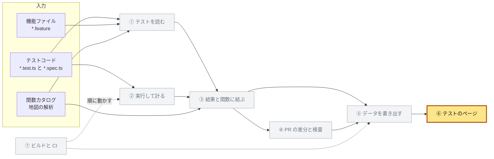

| 項目 | 内容 |
|---|---|
| 入力 | ⑤ が `apps/tests/public/data` に書く五種類のファイル（`tests.json`、`outline.json`、`tests/by-file/<hash>.json`、`tests/sources/<hash>.json`、`tests/diff.json`）。型は `@maronn-openid-connect/test-catalog/model` から読む |
| 出力 | ブラウザに出す画面。`vite build` が書く `apps/tests/dist`（`index.html`、`assets/`、`data/`） |
| 実装 | `apps/tests` の `package.json`、`vite.config.ts`、`tsconfig.json`、`vitest.config.ts`、`index.html`、`src/main.tsx`、`src/App.tsx`、`src/styles.css`、`src/components/`（`Header`、`Home`、`KindPage`、`EndpointPage`、`FilesPage`、`PrPage`、`SearchPage`、`Panel`、`TestDetail`、`TestList`、`TestCode`、`CodeRefs`、`CodeView`、`Target`、`ErrorBoundary`、`ui`、`app-context`）、`src/lib/`（`route`、`load`、`data`、`filter`、`kinds`、`targets`、`helpers`、`lines`、`tokenize`、`format` と、そのテスト、`fixture`） |

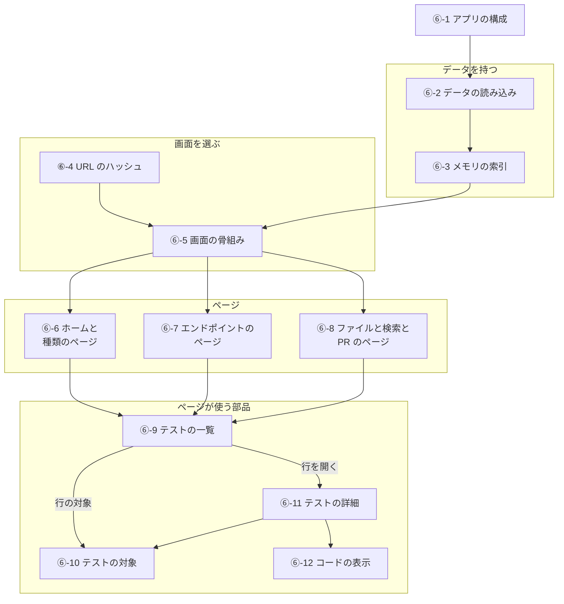

## ⑥-1 アプリの構成

この節は、テストのページのパッケージとビルド、ファイルの分け方、この章の言葉、見た目の約束、小さな部品を決める。

### ⑥-1-a パッケージとビルド

テストのページは、Vite と React で作る単独のアプリ `@maronn-openid-connect/tests`（`apps/tests`）である。
地図とは別にビルドし、⑦ が地図の `dist/tests/` に写して配る（⑦-3、⑦-4）。
このアプリのビルドはデータを作らない。
データは地図のデータの段が書く（⑦-2）。

| 項目 | 値 |
|---|---|
| `dependencies` | `react`、`react-dom`（どちらも `^19.3.1`） |
| `devDependencies` | `@maronn-openid-connect/test-catalog` と `@maronn-openid-connect/test-reach`（`workspace:*`）、`@types/react` と `@types/react-dom`（`^19.3.0`）、`typescript ^7.0.2`、`vite ^8.3.3`、`vitest ^5.0.5` |
| `dev` | `vite --host ${HOST:-127.0.0.1} --port ${PORT:-3620}` |
| `build` | `vite build` |
| `preview` | `vite preview --host ${HOST:-127.0.0.1} --port ${PORT:-3620}` |
| `typecheck` | `tsc --noEmit` |
| `test` | `vitest run` |

`vite.config.ts` は次だけを決める。

```ts
export default defineConfig({
  base: './', // 資産を相対のパスで読む。地図の dist/tests/ に置いても動く
  build: { outDir: 'dist', emptyOutDir: true, sourcemap: false },
});
```

- `public/` は Vite の既定のままで、`public/data` が `dist/data` に写る
- JSX は `tsconfig.json` の `jsx: "react-jsx"` で変換する

| `tsconfig.json` | 値 |
|---|---|
| `target`、`lib` | `ES2022`。`ES2022`、`DOM`、`DOM.Iterable` |
| `module`、`moduleResolution` | `ESNext`、`bundler` |
| `jsx` | `react-jsx` |
| `types` | `["vite/client"]`。TypeScript 7 は `node_modules/@types` を自分では読まないため |
| 検査 | `strict`、`noUnusedLocals`、`noUnusedParameters`、`noFallthroughCasesInSwitch`、`noImplicitReturns`、`isolatedModules`、`verbatimModuleSyntax`、`skipLibCheck`、`noEmit` |
| `include` | `["src"]` |

```ts
// vitest.config.ts
export default defineConfig({
  test: {
    ...testReports({ root: import.meta.url }), // ② の報告。MARONN_TEST_REPORTS か MARONN_REACH=1 のとき
    include: ['src/**/*.test.ts'], // src/lib の純粋な処理だけ。画面はページを開いて確かめる
    environment: 'node',
  },
});
```

`index.html` は次だけを持つ。

- `<html lang="ja">`
- `<meta name="viewport" content="width=device-width, initial-scale=1, viewport-fit=cover">`
- `<meta name="color-scheme" content="light dark">`
- `<title>テスト · OIDC Provider</title>`
- `<div id="root"></div>` と `<script type="module" src="/src/main.tsx"></script>`

`src/main.tsx` は `./styles.css` を読み、`#root` に `<StrictMode><App /></StrictMode>` を描く。

### ⑥-1-b ファイルの分け方

処理は `src/lib`、画面は `src/components` に置く。
`src/lib` は React を使わず、テストはここにだけ置く。
型は `@maronn-openid-connect/test-catalog/model` から `import type` で読み、実行時のコードは読まない。

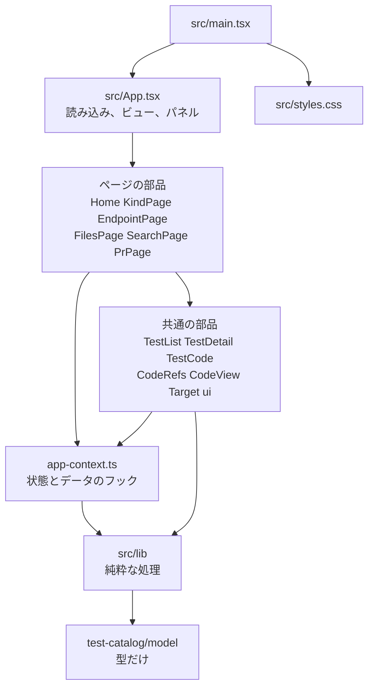

| `src/lib` | すること | 節 |
|---|---|---|
| `route.ts` | ハッシュとビューの読み書き | ⑥-4 |
| `load.ts` | JSON の取得、再試行、キャッシュ。`fetch` を呼ぶのはここだけ | ⑥-2 |
| `data.ts` | `Db`、種類の順と数、エンドポイントとファイルの集計 | ⑥-3、⑥-8 |
| `filter.ts` | 絞り込み、検索、言語の選び方、コードの区切り | ⑥-9、⑥-8、⑥-1-e |
| `kinds.ts` | 種類のページの分け方 | ⑥-6 |
| `targets.ts` | 対象、経路、テスト対象のコード、コードのパネル | ⑥-10、⑥-11、⑥-12 |
| `helpers.ts` | ヘルパーの木 | ⑥-11 |
| `lines.ts` | コードの見せる行 | ⑥-12 |
| `tokenize.ts` | 色づけ | ⑥-12 |
| `format.ts` | 数、時間、日付、実行先の名前、棒の幅 | ⑥-1-e |
| `fixture.ts` | テストが使う小さな索引、アウトライン、カード | |

| `src/components` | すること | 節 |
|---|---|---|
| `app-context.ts` | `AppState`、`useApp`、`useNarrow`、`useTitle`、データのフック | ⑥-2、⑥-5 |
| `Header.tsx` | ヘッダ | ⑥-5 |
| `Panel.tsx` | パネルとテストのページ | ⑥-5 |
| `ErrorBoundary.tsx` | 描けない画面の表示 | ⑥-5 |
| `Home.tsx`、`KindPage.tsx` | ホームと種類のページ | ⑥-6 |
| `EndpointPage.tsx` | エンドポイントのページ | ⑥-7 |
| `FilesPage.tsx`、`SearchPage.tsx`、`PrPage.tsx` | ファイル、検索、PR のページ | ⑥-8 |
| `TestList.tsx`、`Target.tsx` | 一覧と行、対象の一行 | ⑥-9、⑥-10 |
| `TestDetail.tsx`、`TestCode.tsx` | テストの詳細とコードのタブ | ⑥-11 |
| `CodeRefs.tsx`、`CodeView.tsx` | コードの項目と、コードの表示 | ⑥-12 |
| `ui.tsx` | 小さな部品 | ⑥-1-e |

### ⑥-1-c この章の言葉

この章は、README の用語に次の言葉を足す。

| 言葉 | 意味 | コードの名前 |
|---|---|---|
| **ビュー** | ハッシュから読んだ画面の状態。ページ、絞り込み、パネルの中身を持つ（⑥-4） | `View` |
| **ソース** | エンドポイントのアプリ。`hono` か `nextjs`（⑥-5-b） | `Source` |
| **パネル** | 一覧の上に重ねて、テストかコードを出す窓（⑥-5-d） | `Panel` |
| **行** | 一覧の中で、一つのテストを示す一行（⑥-9-b） | `Row` |
| **経路** | E2E テストが通るエンドポイントの列（⑥-10-c） | `RouteStep[]` |
| **対象の文脈** | 一覧がすでに言っているエンドポイントと関数。行はそれを繰り返さない（⑥-10-d） | `TargetContext` |
| **テスト対象** | 詳細のタブの一つ。テストが確かめるコードの項目を並べる（⑥-11-d） | `TestedCode[]` |
| **ブロック** | Next.js の Route Handler の中の、一つのステップのコード。`// [step-id]` から最後の文まで（⑤-6-b） | `BlockCode` |
| **スマートフォン** | 幅 768px 以下の画面。769px 以上を「広い画面」と呼ぶ（⑥-1-d） | `useNarrow` |

### ⑥-1-d 見た目の約束

スタイルは `src/styles.css` の一枚で、CSS の枠組みを使わない。
色は `:root` の変数に置く。
ダークモードは、`@media (prefers-color-scheme: dark)` の中で同じ変数を上書きする。
色だけで意味を伝えず、記号か言葉を添える（✓、✗、– と凡例）。

| 決めごと | 値 |
|---|---|
| ヘッダ | 高さ `--header: 56px`。`position: sticky` で上に留める |
| 本文の幅 | `max-width: 1280px`、余白 `32px 24px 64px` |
| 文字 | 本文 `15px`、行の高さ `1.6`。`--font` は `system-ui` から日本語のフォントへの列、`--mono` は `ui-monospace` からの列 |
| 角と線 | `--radius: 12px`、`--radius-sm: 8px`、線は 1px |
| 間隔 | 8px の格子 |
| 数字 | `.num` は `font-variant-numeric: tabular-nums` |
| フォーカス | `:focus-visible` に 2px の `--accent` の枠 |

配置は、画面の幅で二段に変える。

| 幅 | 変わること |
|---|---|
| 1081px 以上 | 基本の配置 |
| 1080px 以下 | ホームの概要が 2 列。エンドポイントのページの左の列が狭まる。ファイルのページのコードが一覧の下に回る |
| 768px 以下 | スマートフォンの配置。本文の文字が `14px`、ヘッダが一行、パネルが全幅、一覧の行が二段 |

- JavaScript も、768px の境を `NARROW_QUERY = '(max-width: 768px)'` で使う
- `useNarrow()` は `matchMedia` の変化を追い、`matchMedia` が投げれば `false` とする

| 役割 | 変数 | ライト | ダーク |
|---|---|---|---|
| 背景と面 | `--bg`、`--surface`、`--surface-2`、`--surface-3` | `#ffffff`、`#ffffff`、`#f6f7f9`、`#eef0f3` | `#131417`、`#1a1c20`、`#202227`、`#2a2d33` |
| 線 | `--border`、`--border-strong` | `#e5e7eb`、`#d4d7dd` | `#2c2f35`、`#3a3e45` |
| 文字 | `--text`、`--text-2`、`--muted` | `#15171c`、`#464b57`、`#6b7280` | `#eceef1`、`#c2c6cd`、`#8d939c` |
| 強調 | `--accent`、`--accent-text`、`--accent-soft` | `#2a6fd6`、`#1f5fbf`、`#ebf2fd` | `#5b9bf0`、`#8ab8f5`、`#1d2a3d` |
| 結果 | `--passed`、`--failed`、`--none`、`--failed-soft` | `#15803d`、`#d03b3b`、`#848a93`、`#fdecec` | `#3fbf6a`、`#ef6464`、`#7d838c`、`#3a1f21` |
| 正常系 | `--success`、`--success-text`、`--success-soft` | `#12927a`、`#0b6b59`、`#e2f4ef` | `#2bb89b`、`#6fd6c0`、`#16302b` |
| 異常系 | `--failure`、`--failure-text`、`--failure-soft` | `#e3672f`、`#a5461a`、`#fcede5` | `#ee8452`、`#f3a57d`、`#38241a` |
| テストなしの札 | `--amber-text`、`--amber-soft` | `#8a5d00`、`#fbf1dc` | `#e6bf6a`、`#352b17` |
| 種類 | `--part-api`、`--part-e2e`、`--part-unit`、`--part-tool` | `#2a6fd6`、`#7c4ddb`、`#a9c5ef`、`#9aa1ab` | `#5b9bf0`、`#b08cf5`、`#38598a`、`#6a707a` |
| 判定なし | `--part-unknown` | `#c4c9d0` | `#4a4f57` |
| コード | `--code-bg`、`--code-on`、`--code-on-edge` | `#fafbfc`、`#fff6d6`、`#e8b923` | `#16181b`、`#3a3317`、`#c99a1a` |
| 色づけ | `--tok-keyword`、`--tok-string`、`--tok-comment`、`--tok-number`、`--tok-tag`、`--tok-punct` | `#8040c8`、`#1a7f4b`、`#666e78`、`#b35a00`、`#2a6fd6`、`#666e78` | `#c79bff`、`#7fd19b`、`#8b929c`、`#f0a860`、`#86b6ef`、`#8b929c` |
| 重ね | `--scrim`、`--shadow` | `rgba(17, 20, 26, 0.28)`、`0 8px 32px rgba(17, 20, 26, 0.12)` | `rgba(0, 0, 0, 0.5)`、`0 8px 32px rgba(0, 0, 0, 0.4)` |

- `--part-success` と `--part-failure` は、`--success` と `--failure` を指す
- `:root` の `color-scheme` は、ライトで `light`、ダークで `dark` にする
- スタイルの冒頭の注記は、文字の色を、置く面に対して 4.5:1 以上とする

### ⑥-1-e 小さな部品と数の書き方

どの画面も、`ui.tsx` の部品と `format.ts` の書き方で数と状態を出す。

| 部品 | 描くもの | 規則 |
|---|---|---|
| `StatusIcon` | 一つの結果の記号 | `passed` は ✓（`--passed`）、`failed` は ✗（`--failed`）、`skipped` と結果なしは –（`--none`）。`title` と `aria-label` は 成功、失敗、スキップ、結果なし |
| `HealthMark` | 集めた結果の丸 | 色の丸に白の記号。名前は 失敗あり、すべて成功、結果なし |
| `OutcomeBadge` | 正常系か異常系の札 | `success` は 正常系（`--success-soft` の地に `--success-text`）、`failure` は 異常系（`--failure-*`）。`unknown` は何も出さない |
| `Badge` | 灰色の札 | 種類、観点、スキップに使う |
| `Segmented` | 一つを選ぶボタンの列 | `role="group"` と `aria-label`。選んだボタンが `aria-pressed="true"`。`count` があれば小さく添える |
| `Chips` | 折り返すボタンの列 | `aria-pressed`。`quiet` は破線の枠と薄い文字 |
| `Tabs` | タブ | ARIA の tabs の型。→ と ← で隣へ（端で反対の端へ回る）、Home と End で端へ。選んだタブだけを `tabIndex=0` にする |
| `PartsBar` | 内訳の細い棒 | 高さ 6px、部分の間に 2px、部分の幅は最小 3px。0 の部分は描かない |
| `Legend` | 棒の色の名前 | 色の四角と名前。`counts` があれば数も |
| `Words` | 文の中のコード | `codeParts` で区切り、コードの部分を `<code>` にする |
| `SourceSwitch` | ソースの切り替え | `Hono` と `Next.js` の `Segmented`。`place` が `header` なら `.top-source`、`body` なら `.body-source` に置く |
| `CodeIcon` | `</>` の絵 | 16px の SVG |

`PartsBar` の `aria-label` と `title` は、`<名前> <数>` を「、」でつないだものである。
合計が 0 なら「テストなし」とする。

| 関数 | 規則 | 例 |
|---|---|---|
| `formatCount(n)` | `Intl.NumberFormat('ja-JP')` | `5893` → `5,893` |
| `formatDuration(ms)` | 有限でないか負なら空。1000 未満は `<四捨五入> ms`。60000 未満は秒で、10000 未満なら小数一桁。ほかは秒に四捨五入して `<分> 分 <秒> 秒` | `202.7` → `203 ms`、`1234` → `1.2 s`、`42000` → `42 s`、`125000` → `2 分 5 秒` |
| `formatDate(iso)` | 読み手の時間帯の `YYYY/MM/DD HH:mm`。読めなければ空 | |
| `targetLabel(t)` | `''` → `Vitest`、`hono` → `Hono`、`nextjs` → `Next.js`、`http` → `HTTP`、ほかはそのまま | |
| `share(part, whole)` | どちらかが 0 以下なら 0。ほかは `max(part / whole * 100, 0.5)`（棒の幅の %） | `1, 10000` → `0.5` |

`codeParts(text)` は、文を CommonMark のコードスパンと同じ規則で区切る。
① の `words.ts`（`codeSpan`）が、この形で期待結果の文を書くからである。

- N 個続くバッククォートが開き、次にちょうど N 個続くバッククォートが閉じる
- 閉じるものが無ければ、その連なりを文字のまま残す
- 中身が 2 文字以上で、空白で始まって空白で終わり、空白だけでなければ、両端の空白を一つずつ除く

```text
入力  `page.url()` is `` `${issuer}/authorize` ``
出力  コード「page.url()」、文字「 is 」、コード「`${issuer}/authorize`」
```

実装：`apps/tests/package.json`、`vite.config.ts`、`tsconfig.json`、`vitest.config.ts`、`index.html`、`src/main.tsx`、`src/styles.css`（`:root`、`@media (prefers-color-scheme: dark)`、`@media (max-width: 1080px)`、`@media (max-width: 768px)`）、`src/components/app-context.ts`（`NARROW_QUERY`、`useNarrow`）、`src/components/ui.tsx`、`src/lib/format.ts`、`src/lib/filter.ts`（`codeParts`）

## ⑥-2 データの読み込み

この節は、ページがどのファイルをいつ読み、失敗をどう扱い、何を覚えておくかを決める。

### ⑥-2-a 読むファイルと時

ページは ⑤ の五種類のファイルを、ページからの相対の url で読む。

| ファイル | url | 読む時 | 読む部品 |
|---|---|---|---|
| 索引 | `./data/tests.json`（`TESTS_URL`） | 開いたときに一度 | `App` |
| アウトライン | `./data/outline.json`（`OUTLINE_URL`） | 開いたときに一度、索引と同時に | `App` |
| カードのファイル | 項目の `card`（`./data/tests/by-file/<hash>.json`） | テストを開いたとき。E2E の行が対象を言うとき | `useCard`、`useCards` |
| 本文のファイル | `index.sources[パス]`（`./data/tests/sources/<hash>.json`） | コードを見せるとき | `useSource` |
| PR の差分 | `./data/tests/diff.json`（`DIFF_URL`） | 索引の `diff` が `true` のとき、ホームと PR のページで | `PrLine`、`PrPage` |

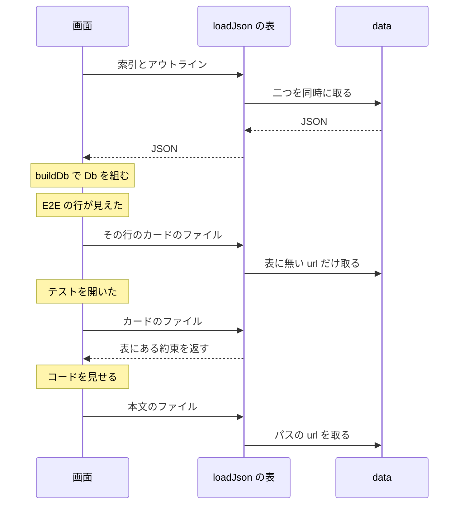

- アウトラインを読めなくても、索引だけで続ける（`loadJson(OUTLINE_URL).catch(() => undefined)`）
- 索引を読めないと、どの画面も出さない（⑥-5-e）
- `buildDb` は読み込みの約束の `then` の中で呼ぶので、`buildDb` が投げても同じ失敗の表示になる

### ⑥-2-b 取得と再試行

`fetchJson` は、一つの url を取って JSON として読み、失敗すれば一度だけ取り直す。

```ts
type Fetch = (url: string) => Promise<{ ok: boolean; status: number; text(): Promise<string> }>;
function fetchJson<T>(url: string, fetcher: Fetch = (input) => fetch(input), retries = 1): Promise<T>;

/** データが無い。地図のデータの段を走らせずにページをビルドした */
class MissingData extends Error {
  constructor(readonly url: string) {
    super(`${url} がありません`);
    this.name = 'MissingData';
  }
}
```

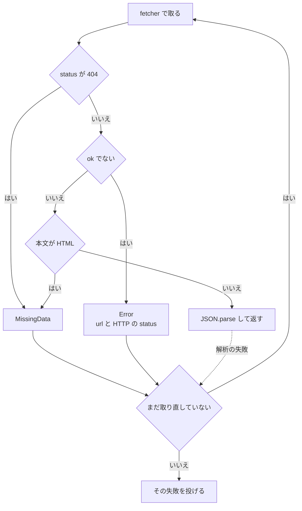

- 本文が HTML とは、本文が `/^\s*</` に合うことである
- 開発サーバーは、無いファイルに `index.html` を返すので、それを「無い」とみなす
- 404 と HTML も、ほかの失敗と同じく一度取り直す（最大 2 回）
- 取り直すのは、地図のデータの段がファイルを書き直している最中に、ページが読むことがあるからである
- HTTP の失敗の文は `${url}: HTTP ${status}` である
- テストでは、`fetcher` に偽物を渡す（`load.test.ts`）

### ⑥-2-c 一度だけ読む仕組み

`loadJson(url)` は、url ごとに取得の約束（`Promise`）を一つだけ持つ。

```ts
const cache = new Map<string, Promise<unknown>>();

function loadJson<T>(url: string): Promise<T> {
  let promise = cache.get(url) as Promise<T> | undefined;
  if (promise === undefined) {
    promise = fetchJson<T>(url);
    cache.set(url, promise);
    promise.catch(() => cache.delete(url)); // 失敗は忘れ、次に開くと取り直す
  }
  return promise;
}
```

部品は、`app-context.ts` のフックでデータを読む。

| フック | 返すもの | 規則 |
|---|---|---|
| `useJson<T>(url)` | 読み込み中は `undefined`、成功は値、失敗は `Error` | `url` が `undefined` なら何もしない。いまの `url` の結果だけを返し、古い url の結果は捨てる |
| `useCard(entry)` | カード（`TestCase`）、`Error`、`undefined` | `entry.card` が無ければ `Error('このテストのカードがありません')`。ファイルの `tests` に `id` が無ければ `Error('カードの中にこのテストがありません')` |
| `useCards(urls)` | 届いたカードのファイルの表（url から `FileTests`） | url の重なりを除き、並べて改行でつないだ鍵が変わったときだけ読む。読めないファイルは表に入れない |
| `useSource(path)` | 本文（`TestSource`）、`Error`、`undefined` | url は `index.sources[path]`。無ければ `Error('このファイルのコードがデータにありません')` |

ほかに、ページは次の表を覚える。

| 表 | 鍵 | 中身 | 場所 |
|---|---|---|---|
| `cache` | url | 取得の約束 | `load.ts` |
| `highlighted` | ファイルのパス | 色づけした行（⑥-12-b） | `CodeView.tsx` |
| `qualifiers` | `Db`（`WeakMap`） | 同じ名前の関数の添え書き（⑥-10-f） | `targets.ts` |
| `cardIndex` | `FileTests`（`WeakMap`） | id からカード（`cardIn`） | `targets.ts` |

- どの表も、ページを閉じるまで残る
- 新しいデータを見るには、ページを読み直す

実装：`apps/tests/src/App.tsx`（`TESTS_URL`、`OUTLINE_URL`、最初の `useEffect`）、`src/lib/load.ts`（`DIFF_URL`、`MissingData`、`fetchJson`、`loadJson`）、`src/components/app-context.ts`（`useJson`、`useCard`、`useCards`、`useSource`）、`src/lib/targets.ts`（`cardIn`）

## ⑥-3 メモリの索引

この節は、索引とアウトラインから一度だけ組む `Db` と、どの画面も使う並べ方と数え方を決める。

### ⑥-3-a Db の形

`buildDb(index, outline?)` は、索引の項目を一度だけたどって表を作る。
画面は項目の列をたどり直さず、この表を引く（このブランチの索引は 6,008 件）。

```ts
interface Db {
  index: TestsIndex; // 欠けた欄を埋めたもの
  endpoints: OutlineEndpoint[]; // アウトラインの順
  functions: Record<string, OutlineFunction>; // フレームの id から
  byId: Map<string, TestEntry>;
  byFile: Map<string, TestEntry[]>; // ファイルごと、行の順
  byEndpoint: Map<string, OutlineEndpoint>; // 鍵は `<source>:<id>`（`hono:token`）
  haystack: Map<string, string>; // 検索が読む文字列
  hasCode: boolean; // アウトラインがコードの範囲を持つか
}
```

| 表 | 作り方 |
|---|---|
| `byId` | 項目の `id` から項目 |
| `byFile` | 項目の `file` ごとの列。`lines[0]` の小さい順、同じなら `title` の `localeCompare` の順 |
| `haystack` | `[title, ja ?? '', file, ...path].join('\n').toLowerCase()` |
| `byEndpoint` | アウトラインのエンドポイントの `key` から |
| `hasCode` | エンドポイントか関数のどれか一つが `code` を持てば `true` |

データの段はページより古いことも新しいこともあるので、欠けた欄を埋める。

| 欄 | 無いとき |
|---|---|
| `index.tests` | `[]` |
| `index.counts` | `countsOf(tests)` |
| `index.endpoints`、`index.sources`、`index.aspectLabels` | `{}` |
| アウトライン | `endpoints` は `[]`、`functions` は `{}` |
| エンドポイントの `methods` | `[]` |
| エンドポイントの `group` | `{ id: 'other', label: 'そのほか' }` |
| エンドポイントの `steps` | `[]`。`null` とオブジェクトでない要素は捨てる |

索引が知らないエンドポイント、ステップ、関数は、テストの無いものとして出し、失敗にしない。

### ⑥-3-b ページが読む欄

ページは ⑤ の型の一部だけを読む。
次の表の「読まない欄」は、画面を変えない。

| ファイル | 読む欄 | 読まない欄 |
|---|---|---|
| `tests.json` | `tests`、`endpoints`（`tests` と `units`）、`counts`、`sources`、`aspectLabels`、`run.at`、`diff` | `version`、`measured`、`frames`、`unknown`、`untranslated`、`gaps`、`requiredAspects`、エンドポイントの `counts` と `gaps` |
| 項目（`TestEntry`） | `id`、`kind`、`root`、`title`、`ja`、`file`、`lines`、`form`、`path`、`outcome`、`aspects`、`subjects`、`skipped`、`result`、`card` | `evidence`、`targets`、`reached` |
| `outline.json` | エンドポイントの `key`、`source`、`id`、`label`、`summary`、`path`、`methods`、`group`、`root`、`code`、`steps`（`id`、`label`、`function`、`calls`、`code`）。関数の `id`、`name`、`package`、`module`、`summary`、`code` | `version`、エンドポイントの `layer` |
| カード（`TestCase`） | `id`、`source.lines`、`spec`、`assertions`（`text`、`ja`）、`steps`（`type`、`keyword`、`text`、`ja`、`definition`）、`requests`（`endpoint`、`method`、`path`、`params`、`auth`）、`result`、`reach`（`target`、`requests`）、`helpers` | ほかの欄。対象、種類、題は項目のものを使う |
| `tests/sources/*.json` | `text` | `path` |
| `tests/diff.json` | `counts.before`、`counts.after`、`added`、`modified[].id`、`renamed`、`removed`、`cards`（`kind`、`title`、`ja`、`outcome`、`source.file`）、`frames`（`frame`、`untouched`、`related`、`reason.text`） | `modified[].what`、`modified[].assertions`、`counts.byKind`、`counts.byEndpoint`、`frames` のほかの欄 |

不足（`gaps`）と読めなかった数（`unknown`）は、データにだけ残る（⑤-10）。
画面が示す不足は、ユニットテストの無いステップの「テストなし」だけである（⑥-7-b）。

### ⑥-3-c 種類の順と数え方

種類は、どの一覧と棒でも E2E、API、ユニット、ツールの順（`KINDS`）に並べる。
広いテストから狭いテストへ並べ、道具を最後に置く。

| 種類 | `KIND_LABELS` | `KIND_NAMES` | `KIND_NOTES` |
|---|---|---|---|
| `e2e` | E2E | E2E テスト | ブラウザと OP を動かし、いくつものエンドポイントを通る流れを確かめる |
| `api` | API | API テスト | エンドポイントにリクエストを送り、応答を確かめる |
| `unit` | ユニット | ユニットテスト | 関数を直接呼び、その結果を確かめる |
| `tool` | ツール | ツールのテスト | CLI、地図、テストの一覧などの道具を確かめる |

| 関数 | 規則 |
|---|---|
| `sortForList(entries)` | 種類の順、`file` の `localeCompare`、`lines[0]`、`title` の `localeCompare` の順 |
| `countsOf(entries)` | `total`、`kinds`、`outcomes` と `results`（`result` が無い項目は `none`）を数える。`aspects` と `evidence` は空 |
| `kindCounts(entries)` | 四つの種類の数。無い種類は 0 |
| `healthOf(results)` | `failed` が 1 以上なら `failed`、`passed` が 1 以上なら `passed`、ほかは `none` |
| `entriesOf(db, ids)` | id の順に項目を引く。索引に無い id は飛ばす |

### ⑥-3-d エンドポイントのテスト

エンドポイントのテストは、その API と E2E のテストと、処理本体とステップのフレームのユニットテストである。
ステップより下で届く関数（cookie、データベース、ストアなど）のユニットテストは、どのエンドポイントにも付く。
そこで、それらは「ほかの関数」に分ける。

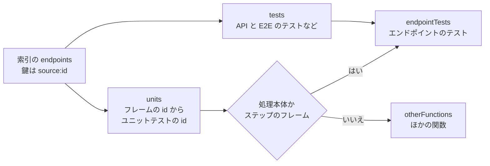

| 関数 | 規則 |
|---|---|
| `stepFrames(step)` | ステップの `function` と `calls` を、重なりを除いて並べる。hono のステップは自分の関数、Next.js のステップはブロックが呼ぶ関数になる |
| `endpointTests(db, endpoint)` | `ref.tests` と、`[endpoint.root, ...各ステップの stepFrames]` の `ref.units` を合わせ、重なりを除いて `sortForList`。`ref` が無ければ `[]` |
| `stepTests(db, key, step)` | ステップのフレームの `units` を合わせ、重なりを除いて `sortForList` |
| `stepCount(db, key, step)` | `stepTests` の id の数 |
| `unitTestsOf(db, key, frame)` | 一つのフレームの `units` を `sortForList` |
| `otherFunctions(db, endpoint)` | `units` のうち処理本体とステップのフレームでないものを `{ id, name, module, count }` にする。`count` の多い順、同じなら `name` の順 |
| `nameOfFrame(id)` | 最後の `#` の後ろ。`#` が無ければ id のまま（`core:jwt.ts#sign` → `sign`） |
| `endpointGroups(db, source)` | ソースのエンドポイントをアウトラインの順のまま、`group` の初めて出た順にまとめる |

- `ref` は `index.endpoints['<source>:<id>']`（`endpointRef`）である
- `otherFunctions` の `name` はアウトラインの `name`、無ければ `nameOfFrame(id)` である
- `module` はアウトラインの `<package>:<module>`、無ければ空の文字列である

例（このブランチのデータ）：hono の `token` のテストは 214 件、ほかの関数は 151 個である。
Next.js の `token` は、テスト 296 件、ほかの関数 140 個である。

実装：`apps/tests/src/lib/data.ts`（`Db`、`buildDb`、`KINDS`、`KIND_LABELS`、`KIND_NAMES`、`KIND_NOTES`、`sortForList`、`countsOf`、`kindCounts`、`healthOf`、`entriesOf`、`endpointRef`、`stepFrames`、`endpointTests`、`stepTests`、`stepCount`、`unitTestsOf`、`otherFunctions`、`nameOfFrame`、`endpointGroups`）

## ⑥-4 URL のハッシュ

この節は、URL のハッシュと画面の対応、ページのつながり、履歴とスクロールの扱いを決める。

ビュー（`View`）はハッシュだけから決まるので、どの画面もハッシュだけで開ける。
サーバーにパスを足さずに済み、`/tests/` の下でもそのまま動く（⑦-4）。

```ts
type Source = 'hono' | 'nextjs';
type MainKind = 'e2e' | 'api' | 'unit'; // ページを持つ種類
type KindFilter = 'all' | 'api' | 'e2e' | 'unit' | 'tool';
type OutcomeFilter = 'both' | 'success' | 'failure';
type Page = 'home' | 'kind' | 'endpoint' | 'files' | 'file' | 'pr' | 'search' | 'test';

interface View {
  page: Page;
  testKind?: MainKind; // 種類のページの種類
  pkg?: string; // ユニットテストのパッケージ（core）
  source?: Source; // エンドポイントのページ
  endpoint?: string;
  file?: string; // ファイルのページのパス
  test?: string; // テストのページのテスト。一覧ではパネルのテスト
  code?: string; // 一覧のパネルのコード（⑥-4-d の形の文字列）
  q?: string; // 検索の語
  step?: string; // エンドポイントのページで絞るステップ
  fn?: string; // 同じく、絞る関数（フレームの id）
  kind?: KindFilter;
  outcome?: OutcomeFilter;
}
```

### ⑥-4-a ページのパス

| ハッシュ | ページ | 部品 | 例 |
|---|---|---|---|
| `#/` | ホーム | `Home` | |
| `#/kind/<e2e\|api\|unit>` | 種類のページ | `KindPage` | `#/kind/unit?pkg=hono` |
| `#/endpoint/<source>/<id>` | エンドポイントのページ | `EndpointPage` | `#/endpoint/hono/token?step=parse-request` |
| `#/files` | ファイルの一覧 | `FilesPage` | |
| `#/file/<パス>` | ファイルのページ | `FilePage` | `#/file/packages/core/src/jwt.test.ts` |
| `#/pr` | この PR のテスト | `PrPage` | |
| `#/search?q=<語>` | 検索の結果 | `SearchPage` | `#/search?q=token+client` |
| `#/test/<id>` | テストのページ | `TestPage` | `#/test/auth-code-flow-online-refresh` |

ページは、次のようにつながる。

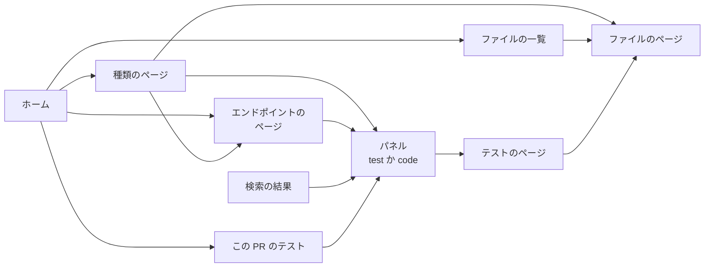

- 検索の結果へは、どのページからもヘッダの検索で移る
- ファイルのページのテストは、広い画面ではそのページのコードに、スマートフォンではパネルに出る（⑥-8-b）

### ⑥-4-b クエリ

一覧は、絞り込みとパネルをクエリに持つ。
戻るボタンでパネルが閉じ、リンクを開けばパネルも開いた一覧が出る。

| キー | 読むページ | 値 | 書かない値 |
|---|---|---|---|
| `test` | `test` 以外 | パネルで開くテストの id | 空 |
| `code` | `test` 以外 | パネルで開くコード（⑥-4-d）。`test` があれば読まない | 読めない値 |
| `kind` | `kind` と `test` 以外 | 一覧の種類の絞り込み（`api`、`e2e`、`unit`、`tool`） | `all` と知らない値 |
| `outcome` | `test` 以外 | `success` か `failure` | `both` と知らない値 |
| `step` | `endpoint` | 絞るステップの id | 空 |
| `fn` | `endpoint` | 絞る関数のフレームの id。`step` があれば読まない | 空 |
| `pkg` | `kind` の `unit` | ユニットテストのパッケージ | 空 |
| `q` | `search` | 検索の語 | なし（空でも `q=` を書く） |

- `kind` を使うのは ⑥-9 の一覧、`outcome` を使うのは ⑥-9 の一覧と種類のページである
- ほかのページでは、読んでも画面を変えない

### ⑥-4-c 読み方と書き方

`parseHash(hash)` は、読めないハッシュをすべてホームにする。

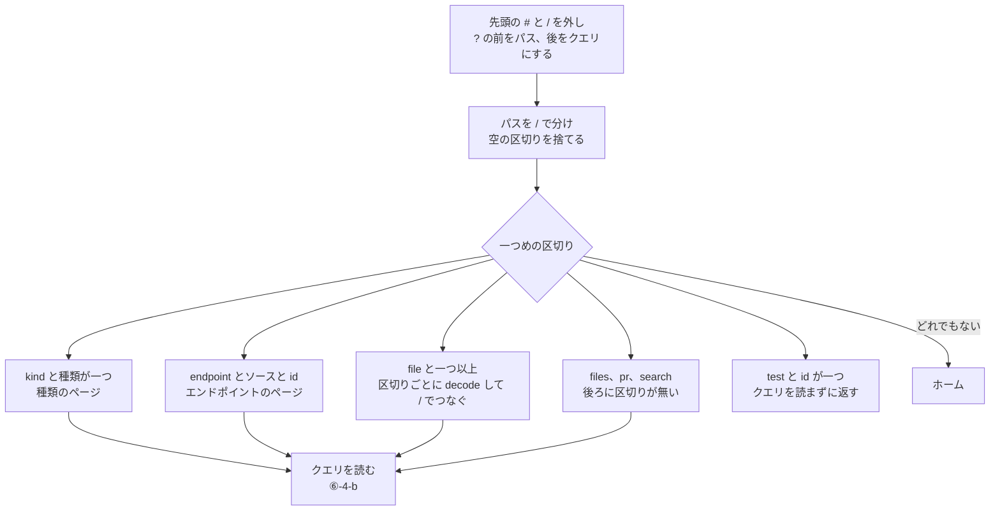

- `decode` は `decodeURIComponent` で、投げたら元の文字列を使う
- ソースは `hono` か `nextjs`、種類は `e2e`、`api`、`unit` だけを読む（`#/kind/tool` と `#/endpoint/express/token` はホーム）
- `pkg` は種類が `unit` のときだけ読む
- `test` と `code` が両方あれば、`test` だけを残す

`formatHash(view)` は、同じビューに読み戻せるハッシュを書く。

| ページ | 書くもの |
|---|---|
| `kind` | `/kind/<testKind ?? 'e2e'>` |
| `endpoint` | `/endpoint/<source ?? 'hono'>/<encodeURIComponent(endpoint)>` |
| `file` | `/file/<パス>`。`/` で分けた区切りごとに `encodeURIComponent` し、`/` は残す |
| `files`、`pr`、`search` | `/files`、`/pr`、`/search` |
| `test` | `#/test/<encodeURIComponent(test)>` だけを返す |
| `home` | `#/` だけを返す |

- クエリは `URLSearchParams` で書き、順は `q`、`pkg`、`step` か `fn`、`kind`、`outcome`、`test` か `code` である
- 既定の値（`kind` の `all`、`outcome` の `both`）は書かない
- クエリが空なら `?` も書かない
- ファイルのパスの `/` を残すのは、アドレス欄でファイルのパスがそのまま読めるようにするためである

例：`{ page: 'endpoint', source: 'nextjs', endpoint: 'token', step: 'parse-request', kind: 'unit', outcome: 'success', test: 'abc' }` は次になる。

```text
#/endpoint/nextjs/token?step=parse-request&kind=unit&outcome=success&test=abc
```

### ⑥-4-d パネルのコードの値

`code` の値は、コードの種類と鍵をコロンでつないだ文字列である。

```ts
type CodeTarget =
  | { kind: 'fn'; id: string } // fn:<フレームの id>
  | { kind: 'endpoint'; key: string } // endpoint:<source>:<id>
  | { kind: 'step'; key: string; step: string }; // step:<source>:<id>:<ステップの id>
```

`parseCode(value)` は、次の順に読む。

1. 最初の `:` の前を種類、後ろを残りとし、`:` が無ければ読まない
2. `fn` は、残りが空でなければ、残りの全体を id とする（id の中の `:` と `#` はそのまま）
3. ほかは残りを `:` で分け、一つめがソースで二つめが空でない id でなければ読まない
4. `endpoint` は区切りがちょうど二つ、`step` はちょうど三つで三つめが空でないときだけ読む
5. ほかの種類（`class:x` など）は読まない

- エンドポイントの id とステップの id はコロンを含まないので、この分け方で足りる
- 例：`fn:hono:oidc-provider/endpoints/token/steps/parse-request.ts#parseTokenRequest`、`endpoint:nextjs:token`、`step:hono:token:authenticate-client`
- `formatCode(target)` は、この逆を書く

### ⑥-4-e 履歴とスクロール

ビューは、`go(view, { replace? })`、リンク、ブラウザの戻ると進むで変わる。

| 関数 | 規則 |
|---|---|
| `samePage(a, b)` | `page`、`testKind`、`source`、`endpoint`、`file` が同じ。テストのページなら `test` も同じ |
| `panelOf(view)` | テストのページなら `undefined`、ほかは `test ?? code` |
| `withoutPanel(view)` | テストのページならホーム、ほかは `test` と `code` を除いたビュー |

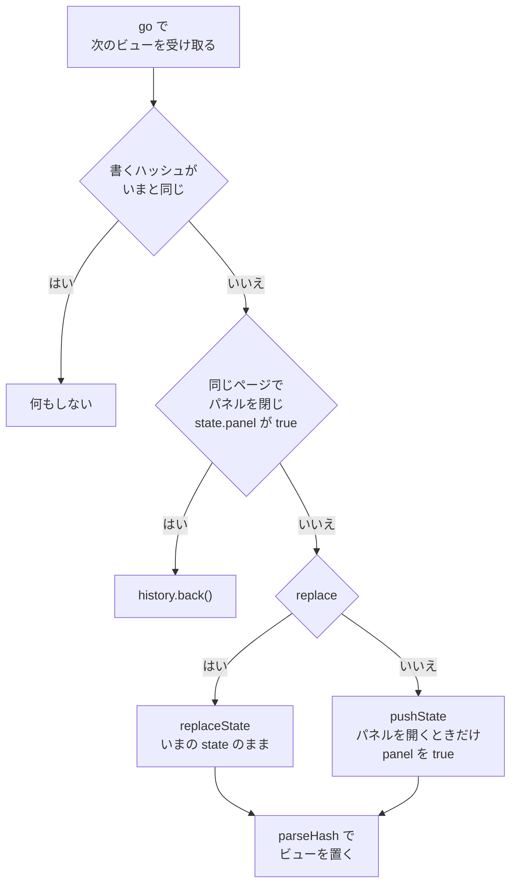

- パネルを開くときの `pushState` は `{ panel: true }` を持つ
- 開くときとは、次のビューにパネルがあり、いまのビューに無く、`samePage` のときである
- 同じページでそのパネルを閉じるときは、`history.back()` で一つ戻る
- 戻るボタンで、閉じたパネルがまた開かないようにするためである
- 絞り込みの変化は `replace` で書き、履歴を増やさない
- `App` は `popstate` と `hashchange` でハッシュを読み直すので、`<a href="#/...">` のリンクでも画面が変わる

スクロールとタブの題は、次のように決める。

- `samePage` でない画面に移ると、`window.scrollTo({ top: 0 })` する（`useLayoutEffect`）
- 絞り込みとパネルの変化では、位置を保つ
- タブの題（`useTitle`）は `<画面の名前> · テスト`、名前が無いか空なら `テスト · OIDC Provider` にする

| 画面 | 名前 |
|---|---|
| ホーム | 無し |
| 種類のページ | `KIND_NAMES` |
| エンドポイントのページ | `<label>（Hono）` か `<label>（Next.js）` |
| ファイルの一覧 | ファイル |
| ファイルのページ | ファイルの名前 |
| 検索の結果 | `「<語>」の検索結果` |
| この PR のテスト | この PR のテスト |
| テストのページ | テストの題（⑥-9-b の `titleOf`） |

実装：`apps/tests/src/lib/route.ts`（`View`、`CodeTarget`、`parseHash`、`formatHash`、`parseCode`、`formatCode`、`samePage`、`panelOf`、`withoutPanel`）、`src/App.tsx`（`go`、`popstate` と `hashchange`、スクロールの `useLayoutEffect`）、`src/components/app-context.ts`（`useTitle`）

## ⑥-5 画面の骨組み

この節は、`App` が描く枠（ヘッダ、本文、パネル）と、その状態の移り方、空と失敗の表示を決める。

### ⑥-5-a 起動から画面まで

`App` は、索引を読むまで本文に「テストを読み込んでいます…」を出す。

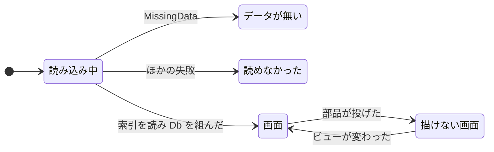

- `Db` ができると、`AppContext` に `AppState` を置き、ビューの `page` で本文の部品を選ぶ（`Screen`）
- 本文の部品は `ErrorBoundary` で包み、`reset` にビューのハッシュを渡す
- ハッシュが変わると、描けなかった画面をもう一度描く

```ts
interface AppState {
  db: Db;
  view: View;
  lang: Lang; // 'ja' | 'en'
  source: Source;
  go: (view: View, options?: { replace?: boolean }) => void;
  chooseSource: (source: Source) => void;
}
```

| `page` | 部品 |
|---|---|
| `kind` | `KindPage` |
| `endpoint` | `EndpointPage` |
| `files`、`file` | `FilesPage`、`FilePage` |
| `pr` | `PrPage` |
| `search` | `SearchPage` |
| `test` | `TestPage` |
| ほか | `Home` |

```text
div.shell          パネルが開いている間は inert
├── Header         ⑥-5-c
└── main.main
    └── ErrorBoundary → ページの部品
Panel              ⑥-5-d。パネルを出すときだけ、.shell の外に置く
```

### ⑥-5-b 読み手の好み

ページは、題の言語とソースを読み手のブラウザに覚える。

| 好み | `localStorage` の鍵 | 値 | 既定 |
|---|---|---|---|
| 題の言語 | `tests.lang` | `ja`、`en` | `ja` |
| ソース | `tests.source` | `hono`、`nextjs` | `hono` |

- 読みも書きも `try` で包み、使えない窓（プライベートの窓など）ではページを閉じるまでの値にする
- 知らない値は既定にする
- エンドポイントのページでは、ハッシュのソースに切り替えを合わせるが、それは覚えない
- 切り替えで選ぶと覚え、エンドポイントのページなら、同じ id の別のソースのページへ `replace` で移る
- ヘッダにソースの切り替えを出すのは、ホーム、エンドポイントのページ、API の種類のページだけである

ソースは、ホームのエンドポイント、API の種類のページ、行と詳細の対象（⑥-10）、コードの項目の初めの版（⑥-12-a）を決める。

### ⑥-5-c ヘッダ

ヘッダは一行で、左から次を並べる。

1. 題のリンク（「テスト」と小さな「OIDC Provider」、`#/`）
2. ソースの切り替え（出すページだけ）
3. 検索の箱（幅 280px、プレースホルダー「テストを検索」）
4. 検索を開くボタン（スマートフォンだけ）
5. 言語の切り替え（`EN` と `日本語`、小さな `Segmented`）
6. 地図へのリンク（「地図」、`../`）

検索は、打つたびに検索の結果へ移る。

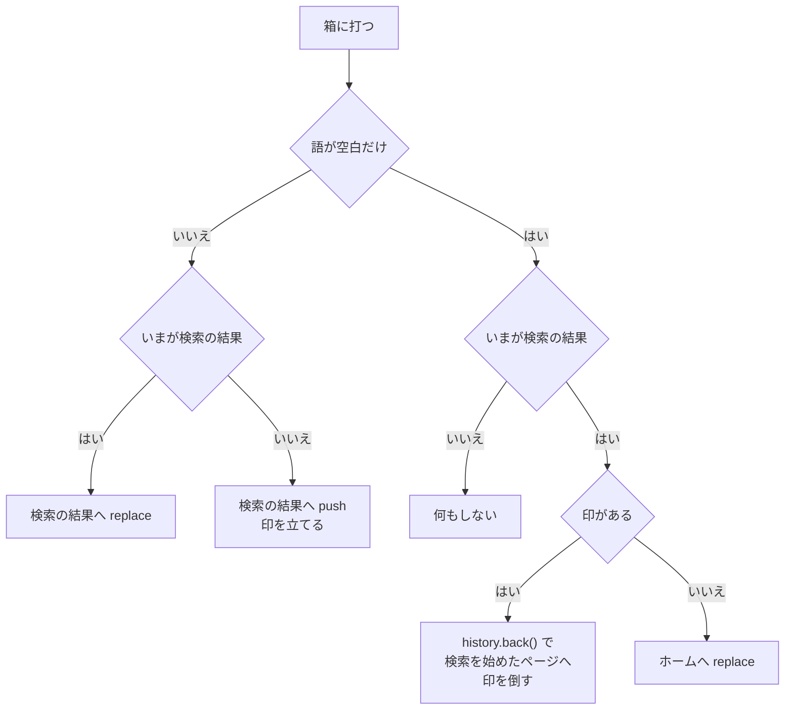

- 印（`pushed`）は、この検索が検索の結果の履歴を足したかを表す
- 語はそのまま `q` に書く（前後の空白も残す）
- 箱の語は、検索の結果ではハッシュの `q`、ほかのページでは空に合わせる
- 検索の結果を離れると、印を倒す
- 送信（Enter）は、語が空でなければ検索の結果へ移る（検索の結果の上では `replace`）
- 送信では、語が空でも箱のフォーカスを外す
- × は箱を空にし、スマートフォンでは検索を畳む
- 広い画面では、箱が空のあいだ × を隠す
- Escape は検索を畳む

スマートフォン（768px 以下）では、ヘッダを次のように変える。

- 題の「OIDC Provider」を隠し、ヘッダの余白を `0 16px` にする
- 検索の箱を隠し、検索のボタンで箱をヘッダの上に重ねて開き、箱にフォーカスする
- ヘッダのソースの切り替え（`.top-source`）を隠し、ページの題の下の切り替え（`.body-source`）を全幅で出す

### ⑥-5-d パネル

パネルに出すものはビューから決め、開閉は履歴に合わせる。

```ts
const narrow = useNarrow(); // 768px 以下
const panelTest = view.page === 'test' || (view.page === 'file' && !narrow) ? undefined : view.test;
const panelCode = view.page === 'test' || panelTest !== undefined ? undefined : view.code;
```

- テストのページはパネルを出さない
- 広い画面のファイルのページは、テストをパネルでなく、そのファイルのコードの印で示す（⑥-8-b）

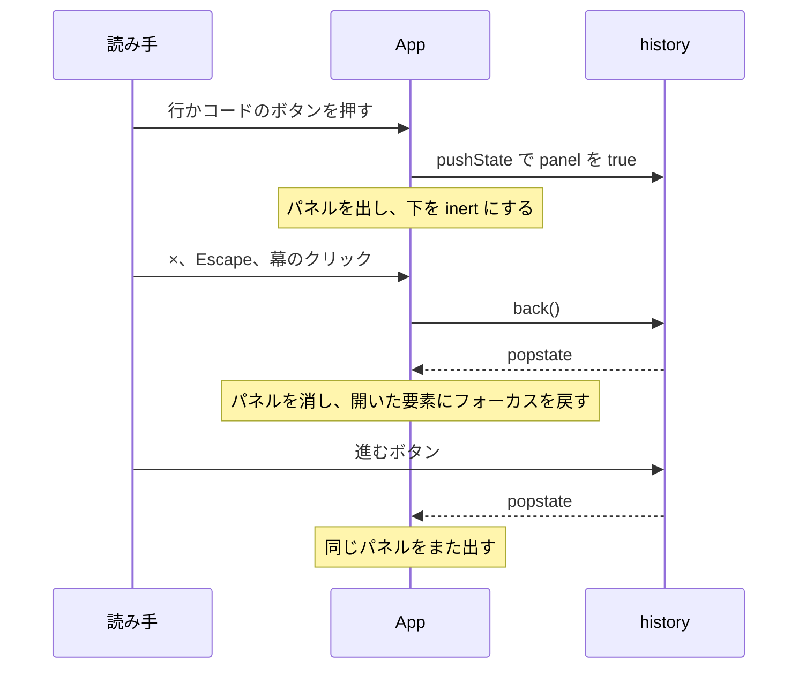

- リンクから開いたパネルは、`state.panel` を持たない
- それを閉じると、戻らずに、パネルの無いビューを `pushState` で足す

| 振る舞い | 規則 |
|---|---|
| 配置 | 右に固定し、幅 `min(1040px, 72vw)`、高さいっぱい、中だけをスクロールする。スマートフォンでは `100vw` |
| 下のページ | `.shell` を `inert` にし、`body` に `panel-open`（`overflow: hidden`）を付ける |
| 帯 | 上に固定した高さ 56px の帯。テストなら「このテストのページ」（`#/test/<id>`）のリンク、コードなら「コード」の文字。右に閉じる × |
| 閉じる | ×、Escape、横の幕（`.scrim`）のクリックで `go(withoutPanel(view))` |
| フォーカス | 開いたときと中身が変わったときに、パネルにフォーカスし、先頭までスクロールを戻す |
| 閉じた後 | 開く前にフォーカスがあった要素へ、まだ文書にあれば `focus({ preventScroll: true })` で戻す |
| 読み上げ | `role="dialog"`、`aria-modal="true"`、`aria-labelledby="panel-title"`（中の題の id） |
| 失敗 | 中身を `ErrorBoundary` で包み、`reset` にテストかコードの値を渡す |

- テストは `TestDetail`（⑥-11）で出し、索引に無い id なら「テスト <id> はありません。」と出す
- コードは `codePanel`（⑥-12-a）の題、場所の一行、要約と、コードの項目で出す
- テストのページ（`#/test/<id>`）は、パンくず（ホーム › ファイルのパス）と `TestDetail` を本文に出す

### ⑥-5-e 空と失敗の表示

ページは、無いデータと読めないデータを、画面ごとの文で示し、白い画面で止めない。

| 場所 | 条件 | 表示 |
|---|---|---|
| 全体 | 索引を読み込み中 | テストを読み込んでいます… |
| 全体 | 索引が `MissingData` | 題「テストのデータがありません」。作り方として `pnpm run build:map`、地図のパッケージだけなら `pnpm --filter @maronn-openid-connect/map run data`、書き出す先 `apps/tests/public/data` |
| 全体 | 索引のほかの失敗 | 題「データを読み込めませんでした」、失敗の文、「もう一度読み込む」（`location.reload()`） |
| 本文、パネル | 部品が投げた | 題「この画面を表示できませんでした」、失敗の文、「ホームへ」 |
| ホーム | ソースのエンドポイントが無い | エンドポイントの一覧（outline.json）がありません。 |
| エンドポイント | 鍵がアウトラインに無い | エンドポイント <鍵> はありません。と「ホームへ」 |
| エンドポイント | ステップにユニットテストが無い | 札「テストなし」 |
| 一覧の節 | その種類のテストが無い | <KIND_NAMES>はありません |
| 一覧 | 絞り込みで空 | 該当するテストはありません |
| API の種類のページ | 何も残らない | <Hono か Next.js> の該当するテストはありません |
| ユニットの種類のページ | パッケージが無い | ユニットテストはありません |
| ファイルのページ | テストが無い | このファイルのテストはありません。 |
| 検索の結果 | 一致しない | 一致するテストはありません。英語と日本語のタイトル、ファイルのパス、describe の名前から探します。 |
| PR | PR のビルドでない | このデータはプルリクエストのビルドではありません。 |
| PR | 読み込み中と失敗 | 読み込んでいます…、この PR のテストの差分を読み込めませんでした（<失敗の文>）。 |
| PR | テストの変更が無い | この PR はテストを変えていません。 |
| PR | 理由の無い変更 | 札「理由の記載なし」 |
| パネル、テストのページ | 索引に無い id | テスト <id> はありません。 |
| パネル | 読めないコードの値、データに無いコード | このコードはデータにありません。 |
| 詳細 | カードを読み込み中と失敗 | 読み込んでいます…、`useCard` の失敗の文（⑥-2-c） |
| ヘルパーのタブ | 何も呼ばない | `hasCode` なら「このテストが呼ぶヘルパーはありません。」、ほかは「このデータにはヘルパーの情報がありません。データを作り直すと表示されます。」 |
| ヘルパーのタブ | ステップ定義が無い | 定義が見つかりません |
| テスト対象のタブ | 項目が無い | このテストが何を確かめているか（関数やエンドポイント）は分かりませんでした。 |
| テスト対象のタブ | `hasCode` が `false` | このデータには関数とエンドポイントのコードの範囲がありません。データを作り直すと表示されます。 |
| コードの項目 | 関数の範囲が無い | <name> のコードはデータにありません。 |
| コードの項目 | ブロックの範囲が無い | 「<name>」のコードはデータにありません。 |
| コードの項目 | エンドポイントの版の範囲が無い | <label>（<Hono か Next.js>）のコードはデータにありません。 |
| コード | 本文のファイルが無い | このファイルのコードがデータにありません |
| コード | 読み込み中 | コードを読み込んでいます… |
| コード | 範囲がファイルの外 | `<a>–<b> 行はファイルの外です（データを作った後にファイルが変わりました）。ファイル全体を表示します。` |

失敗の文は、`MissingData` なら `<url> がありません`、HTTP なら `<url>: HTTP <status>` である。

実装：`apps/tests/src/App.tsx`（`App`、`Screen`、`NoData`、`remembered`、`remember`、`chooseLang`、`chooseSource`、`showsSource`、`panelTest`、`panelCode`）、`src/components/app-context.ts`（`AppState`、`AppContext`、`useApp`）、`src/components/Header.tsx`（`Header`、`search`、`submit`、`close`）、`src/components/Panel.tsx`（`Panel`、`CodeDetail`、`TestPage`）、`src/components/ErrorBoundary.tsx`

## ⑥-6 ホームと種類のページ

この節は、ホーム（`#/`）と三つの種類のページ（`#/kind/<種類>`）が、テストをどう数えてどう並べるかを決める。

### ⑥-6-a ホーム

ホームは、上から次の五つを出す。

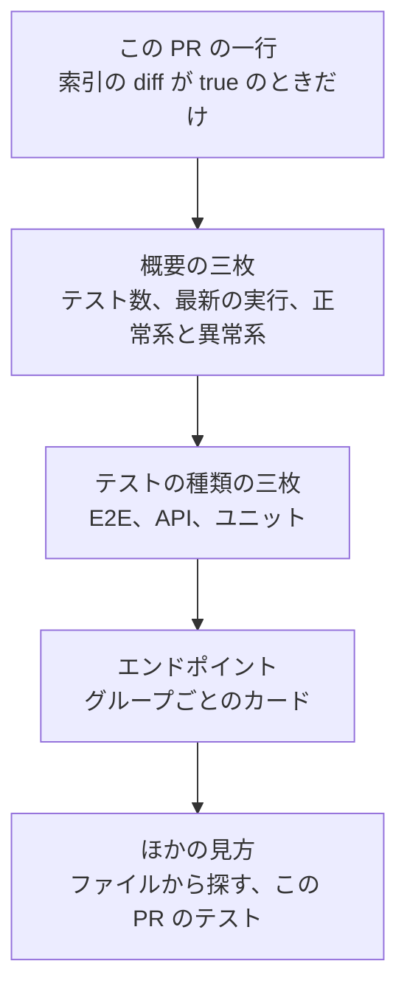

| 部分 | 規則 |
|---|---|
| この PR の一行 | `diff.json` を読み、「この PR」と「テスト <before> → <after>」、追加が 1 以上なら「（追加 <n>）」。読めるまでは「この PR のテスト」。`#/pr` へのリンク |
| テスト数 | `counts.total`（無ければ項目の数）、四つの種類の棒、数つきの凡例 |
| 最新の実行 | 実行した数は `passed + failed + skipped`。0 なら「結果なし」、`failed` が 1 以上なら「✗ <n> 件失敗」、ほかは「✓ すべて成功」 |
| 最新の実行の下 | 成功の数、失敗の数（1 以上のとき）、スキップの数（1 以上のとき）、結果なしの数。`run.at` があれば「<formatDate> の実行」 |
| 正常系 : 異常系 | `success` と `failure` の数を「:」で並べ、正常系、異常系、判定なしの棒と数つきの凡例 |
| テストの種類 | `MAIN_KINDS` の順に、色の四角、`KIND_NAMES`、数、`KIND_NOTES`、「<見方>に見る →」。種類のページへのリンク |
| 見方 | E2E は `spec・シナリオのファイルごと`、API は `エンドポイントごと`、ユニットは `関数ごと`（`KIND_GROUPING`） |
| エンドポイント | 見出しと、ツールを除く種類の凡例。その下に、スマートフォンだけのソースの切り替え。ソースの `endpointGroups` のグループごとに、グループの `label` とカード |
| カード | 結果の丸（`healthOf(countsOf(endpointTests(...)).results)`）、`label`、テストの数、`methods` を ` · ` でつないだものと `path`、ツールを除く種類の棒。エンドポイントのページへのリンク |
| ほかの見方 | 「ファイルから探す →」（`#/files`）、PR のビルドなら「この PR のテスト →」 |

- 種類の棒（`kindParts(counts, withTools)`）は、エンドポイントにツールのテストが無いので、既定でツールを除く
- 概要の「テスト数」だけは `withTools` でツールも出す

| 配置 | 1081px 以上 | 769px から 1080px | 768px 以下 |
|---|---|---|---|
| 概要 | 3 列 | 2 列 | 1 列 |
| 種類のカード | 3 列 | 3 列 | 1 列 |
| エンドポイントのカード | `repeat(auto-fill, minmax(320px, 1fr))` | 同じ | 1 列 |

例（このブランチのデータ）：テスト数は 6,008（E2E 122、API 154、ユニット 4,586、ツール 1,146）である。
最新の実行は成功 5,707、結果なし 301 で、正常系と異常系は 4,366 : 1,319 である。

### ⑥-6-b 種類のページの頭

種類のページは、一つの種類のテストを、確かめるもので分けて並べる。
ツールのテストはページを持たず、ファイルのページと検索にだけ出る。

- パンくずは「ホーム」
- 題は `KIND_NAMES`、その下に「<数> 件 · <KIND_NOTES>」（数は `testsOfKind(db, kind).length`）
- 三つの種類へのリンク（色の四角、`KIND_LABELS`、`counts.kinds` の数）を並べ、いまの種類に `aria-current="page"` を付ける
- どの種類も正常系と異常系の絞り込み（⑥-9-a）を持ち、種類の絞り込みは持たない

| 種類 | 分け方 | 行に渡す対象の文脈（⑥-10-d） |
|---|---|---|
| E2E | ファイルごと（⑥-6-c） | `{}` |
| API | 選んだソースのエンドポイントごと（⑥-6-d） | `{ current: エンドポイントの id }` |
| ユニット | パッケージ、モジュール、関数（⑥-6-e） | `{ known: [関数の id] }` |

`testsOfKind(db, kind)` は、その種類の項目を `sortForList` で並べる。

### ⑥-6-c E2E テストの並べ方

`e2eFiles(db)` は、E2E のテストをファイルごとにまとめる。

- ファイルの題は、そのファイルの最初のテストの `path[0]`（describe か Feature）、無ければファイルの名前
- ファイルは、題の大文字と小文字を区別しない順（`localeCompare(b, 'en', { sensitivity: 'base' })`）、同じならパスの順
- Playwright の spec と機能ファイルを同じ並びに混ぜる
- 見出しは、題、数、ファイルの名前（`#/file/<パス>` へのリンク、`title` にパス）
- 行はファイルの名前を出さない（`hideFile`）
- 正常系と異常系で絞り、空になったファイルは出さない
- 何も残らなければ「該当するテストはありません」と出す

例（このブランチのデータ）：23 ファイルで、最初の三つは `acr_values`、`Auth transaction cookie`、`Authorization Code Flow` である。

### ⑥-6-d API テストの並べ方

`apiEndpoints(db, source)` は、API テストを、選んだソースのエンドポイントごとにまとめる。

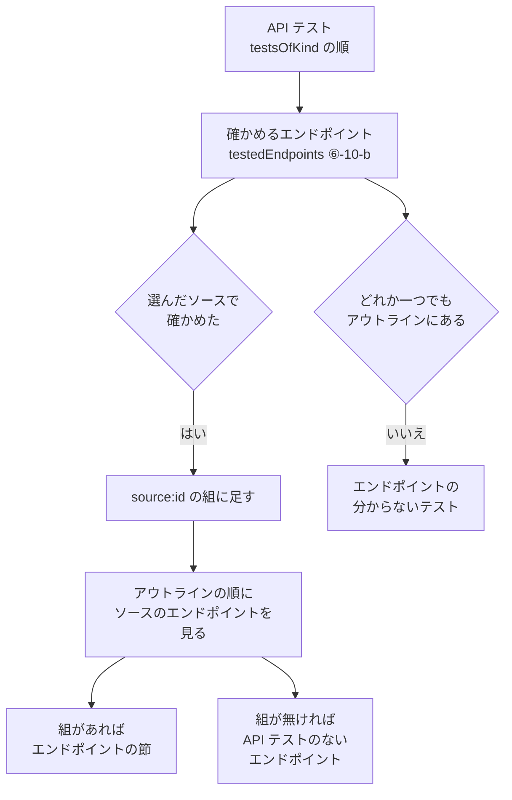

- 二つのエンドポイントを確かめるテストは、両方の組に入る
- 「アウトラインにある」は、そのエンドポイントの、どれかのソースの鍵が `byEndpoint` にあることである
- 「エンドポイントの分からないテスト」の節は、どのソースを選んでも出る
- 節の見出しは、題（エンドポイントのページへのリンク）、数、`methods` と `path`、`code` があれば「コード」のボタン（⑥-12-a）
- 組の無いエンドポイントは、最後の一行「API テストのないエンドポイント（<ソース>）」に、リンクを「、」でつないで出す
- ソースの切り替えと正常系異常系の絞り込みを一行に並べ、スマートフォンでも折り返さない
- 絞って何も残らなければ「<ソース> の該当するテストはありません」

例（このブランチのデータ）：hono は 17 個のエンドポイントのすべてに API テストがある。
Next.js は 2 個にあり、15 個は無い。

### ⑥-6-e ユニットテストの並べ方

`unitPackages(db)` は、ユニットテストを、パッケージ、モジュール、関数の三段にまとめる。

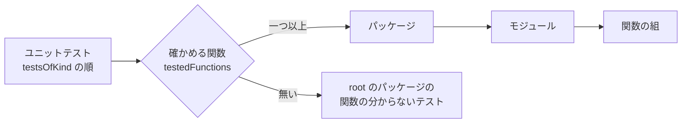

| 規則 | 値 |
|---|---|
| 関数 | `testedFunctions(entry)`（⑥-10-a）。到達だけの関数は入れない。テストは、確かめる関数ごとにその組に入る |
| 場所 | アウトラインの関数の `package` と `module`。アウトラインに無ければ id から読む（`core:jwt.ts#sign` → `core` と `jwt.ts`）。パッケージが空なら、テストの `root` |
| パッケージの順 | `core`、`experimental`、`google-login`、`hono`、`nextjs`（`PACKAGE_ORDER`）、ほかは名前の順 |
| パッケージの数 | 入ったテストの id の数（重なりを除く） |
| モジュールの順 | パスの `localeCompare` |
| 関数の順 | アウトラインの関数のコードの始まりの行、無ければ最後。同じなら名前の順 |
| 組の中の順 | `testsOfKind` の順 |

画面は、次のように畳んで出す。

- パッケージのチップ（名前と数）で一つを選ぶ
- 既定は最初のパッケージで、それを選ぶとハッシュから `pkg` を消す（`replace`）
- `pkg` が知らない名前なら、最初のパッケージを出す
- 説明の一文「モジュールを開くと関数が、関数を開くとそのテストが出ます。…」を置く
- モジュールは `<details>` に畳み、パッケージのモジュールが 8 個以下（`OPEN_MODULES`）なら開いて始める
- 畳んだモジュールの見出しは、パス、テストの数、「関数 <n>」である
- パスは `/` の後ろで折り返せる（`<wbr>`）
- 開いたモジュールは、関数ごとに、開くボタン（▸ か ▾、名前、数）、`code` があれば「コード」のボタン、要約（`Words`）を出す
- 関数を開くと、その関数のテストの行を出す
- モジュールに関数が一つだけなら、その関数を開いて始める
- 関数の分からないテストは、最後に「関数の分からないテスト」として畳む
- 正常系と異常系で絞ると、テストの残らない関数とモジュールを出さない
- 何も残らなければ「該当するテストはありません」と出す
- パッケージか絞り込みを変えると、モジュールの開閉を初めに戻す

例（このブランチのデータ）：core は 1,487 件（29 モジュール）、hono は 1,523 件（182 モジュール）である。
ほかは experimental 764 件、google-login 119 件、nextjs 695 件である。

実装：`apps/tests/src/components/Home.tsx`（`Home`、`PrLine`、`Tiles`、`Kinds`、`Endpoints`、`kindParts`、`KIND_GROUPING`）、`src/components/KindPage.tsx`（`KindPage`、`KindLinks`、`E2eTests`、`ApiTests`、`UnitTests`、`UnitModuleItem`、`UnitFunctionItem`、`UnknownItem`、`PathText`、`OPEN_MODULES`）、`src/lib/kinds.ts`（`testsOfKind`、`e2eFiles`、`apiEndpoints`、`unitPackages`、`PACKAGE_ORDER`、`placeOfFrame`）

## ⑥-7 エンドポイントのページ

この節は、エンドポイントのページ（`#/endpoint/<source>/<id>`）が出す処理の流れと、テストの絞り込みを決める。

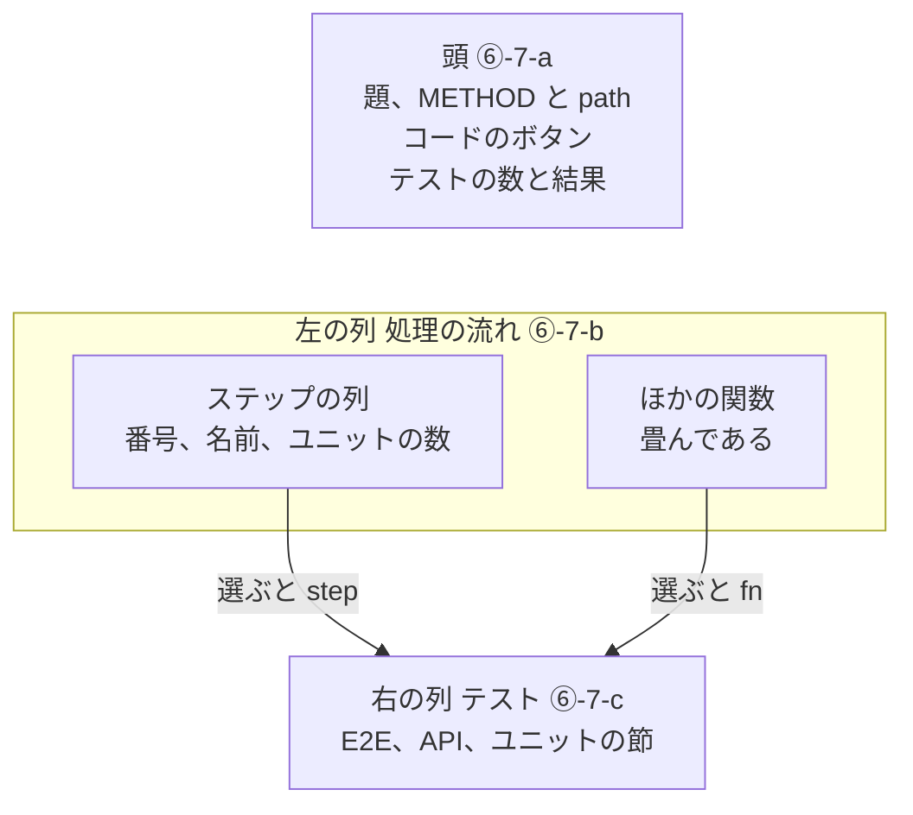

### ⑥-7-a 頭

- 鍵は `<source>:<endpoint>` で、アウトラインに無ければ「エンドポイント <鍵> はありません。」とホームへのリンクだけを出す
- パンくずは「ホーム › <グループの label>」
- 題は `label`、その下に `methods`（` · ` でつなぐ）と `path` を出す
- `code` があれば、`path` の横に「コード」のボタン（`endpoint:<鍵>` を開く）を置く
- `summary` があれば `Words` で出す
- 数の行は、「テスト <total>」、ツールを除く種類の棒（幅 200px）、数つきの凡例、結果である
- 結果は「✗ <n> 件失敗」「✓ すべて成功」「– 結果なし」のどれかである
- 数は `countsOf(endpointTests(db, endpoint))` で、絞り込んでも変えない
- 頭の最後に、スマートフォンだけのソースの切り替え（`.body-source`）を置く

### ⑥-7-b 処理の流れ

左の列「処理の流れ」に、ステップを番号の丸と縦の線で並べる。

| 部分 | 規則 |
|---|---|
| ステップ | 番号（1 から）、`label`、札。`stepCount` が 1 以上なら「ユニット <n>」、0 なら「テストなし」（`--amber-*` の札） |
| 選ぶ | 「ユニット」の札のステップだけがボタン（`aria-pressed`）。選んだステップをもう一度選ぶと外す |
| コード | `stepHasCode(db, step)`（⑥-12-a）なら `</>` のボタン（`step:<鍵>:<ステップの id>` を開く、`title` は「「<label>」のコードを見る」） |
| 列を揃える | どれかのステップにコードがあれば、コードの無いステップにも空の列を置き、札の位置を揃える |
| ほかの関数 | `otherFunctions` が一つ以上なら「▸ ほかの関数 <n>」に畳む。ビューに `fn` があれば開いて始める |
| ほかの関数の中 | 説明「ステップより下で届く関数です。…」と、関数ごとのボタン（名前と数、`title` は `module`、無ければ id）。選んだ関数には `module` を添える |
| 十個まで | 最初の 10 個（`FIRST_OTHERS`）を出し、「すべて表示（<n>）」で全部、「テストの多い 10 件だけ表示」で戻す。選んだ関数が 11 個目以降なら全部を出して始める |

選んだステップは、地を `--accent-soft`、番号の丸を `--accent` で塗り、名前を太くする。

### ⑥-7-c 絞り込みと一覧

ステップか関数を選ぶと、一覧をそのユニットテストに絞る。

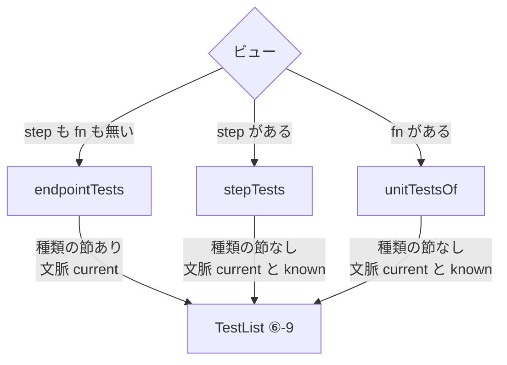

| 選び方 | 一覧のテスト | 一覧の題 | 対象の文脈 |
|---|---|---|---|
| 無し | `endpointTests` | テスト | `{ current: id }` |
| `step` | `stepTests`。そのステップが無ければ「無し」と同じ | 「<label>」のユニットテスト と ×（「絞り込みを外す」） | `{ current: id, known: stepFrames(step) }` |
| `fn` | `unitTestsOf(db, 鍵, fn)` | 「<関数の name か fn>」のユニットテスト と × | `{ current: id, known: [fn] }` |

- 絞ると、種類の節を作らず、種類の絞り込みも出さない（`fixedKind`）
- 絞らないときは、E2E、API、ユニットの節を、テストが無くても出す（`sections={MAIN_KINDS}`）
- 選ぶと、ビューから `step`、`fn`、`test`、`code`、`kind` を消し、`outcome` を残して `replace` で書く
- スマートフォンでは一覧がステップの下にあるので、選んだ後に一覧（`.endpoint-list`）の先頭までスクロールする

| 配置 | 処理の流れと一覧 |
|---|---|
| 1081px 以上 | `minmax(300px, 380px)` と残り、間 32px |
| 769px から 1080px | `minmax(260px, 320px)` と残り、間 24px |
| 768px 以下 | 1 列。処理の流れが上 |

例（このブランチのデータ）：hono の `token` は 22 ステップで、どのステップにもユニットテストがある。
Next.js の `token` では、`parse-request` など 7 個のステップが「テストなし」である。

実装：`apps/tests/src/components/EndpointPage.tsx`（`EndpointPage`、`Flow`、`Step`、`selection`、`pick`、`narrow`、`FIRST_OTHERS`）、`src/lib/data.ts`（⑥-3-d の関数）、`src/lib/targets.ts`（`stepHasCode`）

## ⑥-8 ファイルと検索と PR のページ

この節は、ファイルの一覧（`#/files`）、ファイルのページ（`#/file/<パス>`）、検索の結果（`#/search`）、この PR のテスト（`#/pr`）を決める。

### ⑥-8-a ファイルの一覧

ファイルの一覧は、テストのファイルを root ごとに畳んで並べる。

| `fileGroups(db)` の規則 | 値 |
|---|---|
| 組 | ファイルの最初のテスト（行の順）の `root` |
| ツールの組 | 組を初めて作ったファイルの、最初のテストの種類が `tool` の組 |
| 組の順 | ツールでない組が先。次に `core`、`experimental`、`google-login`、`hono`、`nextjs`、`e2e`、`features` の順（`ROOT_ORDER`）、ほかはその後ろ。同じなら名前の順 |
| ファイルの順 | パスの `localeCompare` |
| 数 | 組とファイルのテストの数 |
| 共通のディレクトリ | `commonDirectory(組のパスの列)` |

```ts
// commonDirectory：最初のパスのディレクトリ（最後の / まで）から始め、合わないパスがあれば一段ずつ縮める
let prefix = first.slice(0, first.lastIndexOf('/') + 1);
for (const path of rest) {
  while (prefix !== '' && !path.startsWith(prefix)) prefix = prefix.slice(0, prefix.slice(0, -1).lastIndexOf('/') + 1);
}
```

- 名前の途中では切らない（`packages/core-a/x.test.ts` と `packages/core-b/y.test.ts` は `packages/`）
- 共有するディレクトリが無ければ空の文字列である

画面は、次を出す。

- 題「ファイル」、その下に「<ファイルの数> ファイル · <テストの数> テスト」
- 組ごとの `<details>` の見出しは、root、数、共通のディレクトリである
- 最初のツールの組の前に「ツールのテスト」と書く
- ファイルは、共通のディレクトリを除いたディレクトリ（薄く）と名前、数で、`#/file/<パス>` へのリンク
- 開いたときに 768px 以下なら、組を畳んで始める
- ファイルの列は `repeat(auto-fill, minmax(340px, 1fr))`、スマートフォンでは 1 列

例（このブランチのデータ）：465 ファイルである。
最初の組は `core`（1,487 件、`packages/core/src/`）で、ツールの組は `cli` から `tests-viewer` までの 7 組である。

### ⑥-8-b ファイルのページ

ファイルのページは、一つのファイルのテストと、そのファイルのコードを並べる。

- パンくずは「ファイル › <最初のテストの root>」
- 題はファイルの名前（等幅）、その下にディレクトリ、「テスト <n>」と結果
- 結果は、そのファイルのテストの `result` の `failed` と `passed` の数を `healthOf` で読む
- 左は、`describeGroups(tests)` の組ごとに、describe の道筋（` › ` でつなぐ）と行を出す
- 左の行は、ファイルの名前も対象も出さない
- 右は、ファイル全体のコード（⑥-12-b）で、選んだテストの行に印を付けてそこまでスクロールする
- テストを選ぶと、コードの上に、結果の記号、題、「詳細」（`#/test/<id>`）、選択を外す ×（`replace`）を出す

`describeGroups(entries)` は、続いて並ぶ同じ `path` のテストを一つの組にする。
同じ道筋でも、間に別の道筋が挟まれば別の組になる。

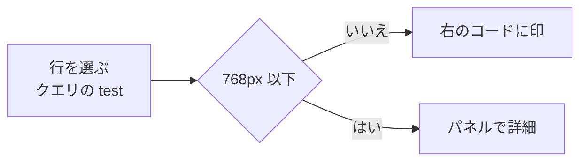

- すでにテストを選んでいれば、次の選択は `replace` で書く
- 広い画面では一覧が隠れないので、選び直すたびに履歴を増やさないためである

| 配置 | テストとコード |
|---|---|
| 1081px 以上 | `5fr` と `7fr`、間 32px。コードは `position: sticky` でヘッダの下 16px に留まる |
| 1080px 以下 | 1 列。コードは留まらない |

コードの箱の高さは、画面に合わせる（`max-height: calc(100vh - var(--header) - 96px)`）。

### ⑥-8-c 検索の結果

検索の結果は、検索の語のすべてを含むテストを一覧にする。

```ts
function searchTests(db: Db, query: string): TestEntry[] {
  const words = query.toLowerCase().split(/\s+/).filter((word) => word !== '');
  if (words.length === 0) return []; // 空の語は何にも合わない
  return db.index.tests.filter((entry) => words.every((word) => (db.haystack.get(entry.id) ?? '').includes(word)));
}
```

- 読むのは `haystack`（英語と日本語の題、ファイルのパス、describe の道筋を小文字にしたもの）である
- 結果は `sortForList` で並べ、`TestList`（対象の文脈 `{}`）で出す
- 題は「「<語>」の検索結果」、その下に件数

### ⑥-8-d この PR のテスト

この PR のテストは、PR のビルドの `tests/diff.json` を出す。
PR のコメントの「この PR のテスト:」の行が、`<プレビューの URL>/tests/#/pr` を指す（⑦-7-a）。

- 索引の `diff` が `true` でなければ、差分を読まない
- 題「この PR のテスト」の下に、「<before> → <after>（+<差>）」を出す
- 減ったときは、`+` の代わりに `−`（U+2212）と差の絶対値を書く
- 四つの数の札（追加、変更、名前の変更、削除）を並べ、0 の札は薄くする
- 節は、追加したテスト、変更したテスト、名前を変えたテスト、削除したテスト、テストが変わっていない実装の変更の順で、空の節は出さない
- 四つの変更がどれも 0 なら「この PR はテストを変えていません。」と出す

| 行 | 作り方 |
|---|---|
| 索引にあるテスト | 索引の項目の行（開ける） |
| 索引に無いテスト | `diff.cards[id]` の `kind`、`title`、`ja`、`outcome`、`source.file` で作る行（開けない） |
| 名前を変えたテスト | 後の id の行。前の題（`cards[前の id].title`、無ければ前の id）を、打ち消し線で前に添える |
| 削除したテスト | いつも開けない行 |

- 節の行は、種類の順（`KINDS`）、同じならファイルの順に並べる
- 節の種類が二つ以上あり、どの行も種類を持てば、種類の変わり目に見出しの行（`KIND_LABELS` と数）を入れる
- 行は対象を出す（対象の文脈 `{}`）

「テストが変わっていない実装の変更」は、`frames` のうち `untouched` が `true` のものを並べる。

- 関数の名前（アウトラインの `name`、無ければ `nameOfFrame`）、`<package>:<module>`、「関連するテスト <n>」
- `reason` があればその `text`、無ければ札「理由の記載なし」

数の札は 4 列（幅 720px まで）、スマートフォンでは 2 列である。

実装：`apps/tests/src/components/FilesPage.tsx`（`FilesPage`、`FilePage`）、`src/components/SearchPage.tsx`（`SearchPage`）、`src/components/PrPage.tsx`（`PrPage`、`rowFor`、`byKind`、`Section`、`Untested`）、`src/lib/data.ts`（`fileGroups`、`ROOT_ORDER`、`commonDirectory`、`describeGroups`、`splitPath`）、`src/lib/filter.ts`（`searchTests`）

## ⑥-9 テストの一覧

この節は、テストを並べる一覧（`TestList` と `Rows`）の絞り込み、節、行、出し方を決める。
`TestList` はエンドポイントのページと検索の結果が使い、`Rows` は種類、ファイル、PR のページも直に使う。

### ⑥-9-a 絞り込みと種類の節

`TestList` は、テストの列を種類の節に分け、上に二つの絞り込みを置く。

```ts
function TestList(props: {
  tests: readonly TestEntry[];
  title?: ReactNode;
  fixedKind?: boolean; // 種類の絞り込みと節を作らない（ステップのユニットテスト）
  empty?: string;
  target?: TargetContext; // 行に渡す対象の文脈（⑥-10-d）
  sections?: readonly TestKind[]; // テストが無くても出す種類の節
}): ReactNode;
```

| 規則 | 値 |
|---|---|
| 出す種類 | テストが 1 件以上の種類と `sections` の種類を、`KINDS` の順に |
| 種類の絞り込み | 出す種類が二つ以上で、`fixedKind` でないときに出す。「すべて」（全体の数）と、種類ごとの `KIND_LABELS`（数） |
| ビューの `kind` | 出す種類に無いか `fixedKind` なら「すべて」とみなす |
| 正常系と異常系 | 「正常系」「異常系」「両方」の順。いつも出す |
| 絞り方 | `filterTests`。種類が `all` でなければ同じ種類、`outcome` が `both` でなければ同じ `outcome` を残す。`unknown` は「両方」のときだけ残る |
| 節 | 「すべて」なら出す種類ごと、ほかは選んだ種類だけ。見出しは色の四角、`KIND_NAMES`、絞った後の数、`KIND_NOTES` |
| 空の節 | `sections` の種類は空でも出す。その種類のテストが無ければ「<KIND_NAMES>はありません」、絞って空なら「該当するテストはありません」 |
| 書き方 | `go({ ...view, kind })` と `go({ ...view, outcome })` を `replace` で書く。既定の値は `undefined` にして書かない |

- `Rows` の鍵を `<kind>:<outcome>:<テストの数>:<最初の id>` にする
- 絞り込みかテストの列が変わると、⑥-9-c の百件の区切りを初めに戻す

### ⑥-9-b 行

行（`Row`）は、次の形を持つ。

```ts
interface Row {
  id: string;
  kind?: TestKind;
  title: string;
  ja?: string;
  outcome?: TestOutcome;
  result?: TestStatus;
  file: string;
  before?: string; // 名前を変えたテストの前の題
  open?: boolean; // 押してパネルで開けるか
  entry?: TestEntry; // 対象を求める元
}
```

- `rowOf(entry)` は、索引の項目から `open: true` の行を作る
- 行は、結果の記号、題、その下の対象の一行（⑥-10-e）、正常系か異常系の札、ファイルの名前（`hideFile` なら出さない）を並べる
- 題は `titleOf(row, lang)` で、前の題があれば打ち消し線で前に添える
- `titleOf` は、言語が `ja` で `ja` が空でなければ `ja`、ほかは英語の `title` である
- 開ける行はボタンで、押すと `go({ ...withoutPanel(view), test: id })` でパネルを開く
- ファイルのページで、すでにテストを選んでいれば、この `go` を `replace` で書く
- ビューの `test` と同じ行は `aria-current` を持ち、地の色を変える
- 開けない行は、同じ並びをボタンにせず文字だけで出す

| 配置 | 列 |
|---|---|
| 769px 以上 | `18px`（記号）、残り（題）、`56px`（札）、`200px`（ファイルの名前）。ファイルの名前を出さなければ `18px`、残り、`56px` |
| 768px 以下 | 二段。一段目は記号と題、二段目は札とファイルの名前（`grid-template-areas: 'status title title' '. outcome file'`） |

### ⑥-9-c 百件ずつ出す仕組み

`Rows` は、行を百件（`CHUNK = 100`）ずつ出し、千件の一覧もすぐに開く。

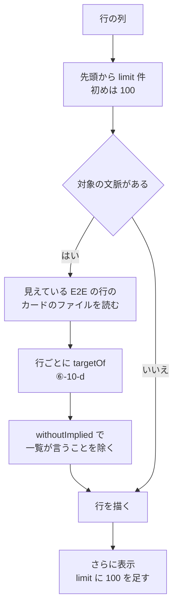

- 対象の文脈が無い一覧（ファイルのページ）は、行に対象を出さない
- 経路はカードの到達から並べるので、カードを読むのは行の種類が E2E のとき（`needsCard`）だけである（⑥-10-c）
- カードが届くまで、E2E の行は、対象のエンドポイントをアウトラインの順に並べて経路を言う
- 残りがあれば「さらに表示（残り <n> 件）」を出す
- `groups` があれば、種類の変わり目に見出しの行（`KIND_LABELS` と数）を入れる
- 行が無ければ `empty`、それも無ければ「該当するテストはありません」

実装：`apps/tests/src/components/TestList.tsx`（`TestList`、`Rows`、`RowItem`、`Row`、`rowOf`、`rowTarget`、`OutcomeFilterControl`、`KindHeading`、`CHUNK`）、`src/lib/filter.ts`（`filterTests`、`titleOf`）、`src/lib/targets.ts`（`needsCard`、`cardIn`）、`src/components/app-context.ts`（`useCards`）

## ⑥-10 テストの対象

この節は、行と詳細が「対象」として何を言うか（関数、エンドポイント、E2E テストの経路）を決める。
対象は、項目の `subjects`（`kind`、`id`、`source`、`how`、①-9-b）から求める。

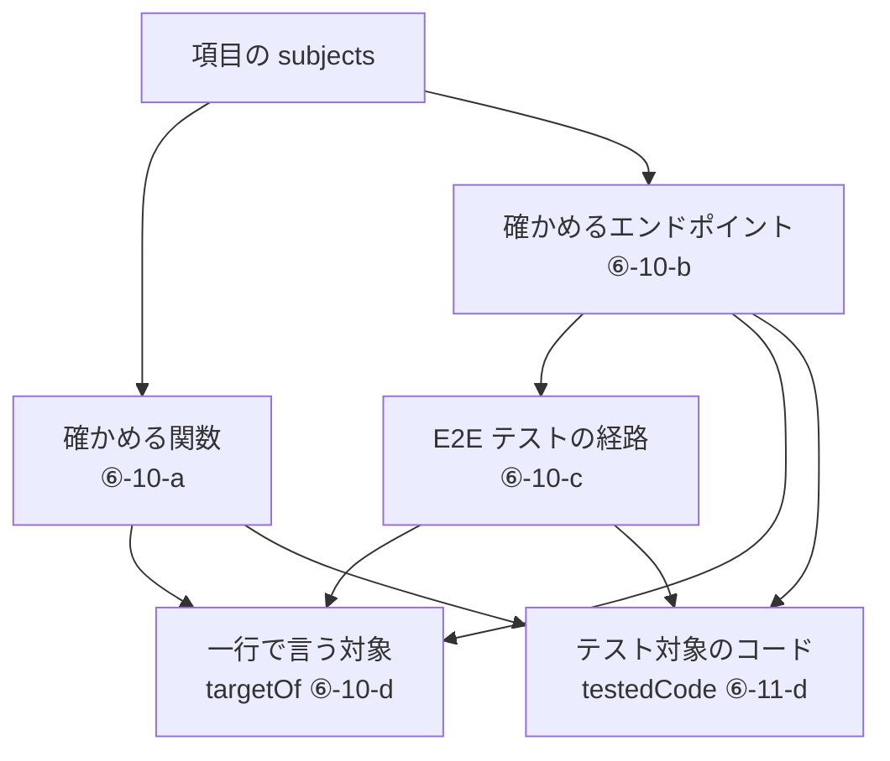

到達だけの関数（`how: 'coverage'`）は対象にしない。
どのテストもストアと cookie に届くので、それを言っても見分けにならないからである。

### ⑥-10-a 確かめる関数

`testedFunctions(entry)` は、関数の対象を、確かめ方の順に並べる。

| `how` | 順 |
|---|---|
| `describe` | 1 |
| `declared` | 2 |
| `call` | 3 |
| `coverage` | 入れない |

- 同じ順なら `subjects` の中の順で、同じ id は最初の一つだけを残す

`subjectFunctions(db, entry)` は、エンドポイントを確かめるテストから、そのエンドポイントの `root` の関数を除く。

- ユニットテストと、関数の無いテストは、`testedFunctions` のまま
- ほかのテストは、確かめるエンドポイントのソースごと（ソースが無ければ両方）に、アウトラインのそのエンドポイントの `root` を除く
- describe が Route Handler の `POST` を名指すテストは、その関数でなくエンドポイントを確かめるからである

### ⑥-10-b 確かめるエンドポイント

`testedEndpoints(entry)` は、エンドポイントの対象を id ごとに一つにまとめる。

```ts
interface TestedEndpoint {
  id: string; // token
  sources: Source[]; // 確かめたソース。hono、nextjs の順
  named: boolean; // コードがリクエストするか宣言した（how が coverage でない）
}
```

- `named` のものを先に、同じなら最初に出た順に並べる
- 到達だけで出た id に、後で `named` の対象が来れば `named` にし、その対象の位置で並べる
- ソースは `hono` と `nextjs` だけを持つ

例：`subjects` が `authorize`（`coverage`）、`introspection`（`request`）、`token`（`declared`）の順なら、結果は `introspection`、`token`、`authorize` の順である。

### ⑥-10-c E2E テストの経路

`routeOf(db, entry, card, source)` は、経路を、計測した実行のリクエストの順で並べる。
計測した実行が無ければ、アウトラインの順で並べる。

```mermaid
flowchart TB
  A["カードの reach のうち<br/>requests が空でないもの"]
  B{"target が<br/>選んだソース"}
  C["その実行のリクエスト"]
  D["最初の実行のリクエスト"]
  E["エンドポイントを<br/>初めて出た順に一つずつ<br/>メソッドを集める"]
  F["リクエストに無い対象<br/>アウトラインの順"]
  G["経路"]
  A --> B
  B -->|"ある"| C --> E
  B -->|"無い"| D --> E
  E --> G
  F --> G
```

```ts
interface RouteStep {
  id: string; // token
  path: string; // /token
  methods: string[]; // リクエストの順。実行もコードも言わなければ空
  named: boolean; // テストのコードがリクエストするか宣言した
}
```

| 規則 | 値 |
|---|---|
| 使う実行 | `requests` が空でない `reach` のうち、`target` が選んだソースのもの。無ければその最初のもの |
| 一歩 | `endpoint` を持つリクエストごとに、初めての id なら一歩を足す。メソッドは、まだ無いものだけを足す |
| 一歩の `path` | アウトラインのそのエンドポイント（選んだソース、無ければ別のソース）の `path`。無ければリクエストの `path` |
| `named` | `testedEndpoints` で `named` の id か |
| 残り | リクエストに出ない対象のエンドポイント。アウトラインでの位置（選んだソースのもの、無ければ同じ id のどれか、無ければ最後）の順、同じなら対象の順。メソッドは空、`path` が無ければ `/<id>` |

- カードが無いか、計測した実行が無ければ、対象だけをアウトラインの順で並べる
- 対象の順をそのまま使わないのは、対象がコードの名指すものを先に置き、テストが通る順にならないからである
- `path` はアウトラインから取る
- Next.js の Route Handler が答える path（`/consent/decision`）でなく、エンドポイントの path（`/consent`）を出すためである

例（このブランチのデータ、hono）：E2E テスト `should carry the most preferred requested acr in the ID Token, the access token and introspection` の経路は次である。

```text
/authorize（通っただけ） → /login → /consent → /token（通っただけ） → /userinfo（通っただけ） → /introspect
```

### ⑥-10-d 一行で言う対象

`targetOf(db, entry, card, source)` は、行と詳細の頭が言う対象を一つ決める。

```ts
type Target =
  | { kind: 'functions'; functions: TargetFunction[] }
  | { kind: 'endpoints'; functions: TargetFunction[]; steps: RouteStep[] } // API テスト
  | { kind: 'route'; steps: RouteStep[] }; // E2E テスト

interface TargetFunction {
  id: string;
  name: string; // アウトラインの name、無ければ nameOfFrame(id)
  qualifier?: string; // 同じ名前の関数との見分け（⑥-10-f）
}
```

```mermaid
flowchart TB
  K{"種類"}
  N["何も言わない"]
  A{"確かめる<br/>エンドポイントがある"}
  AE["endpoints<br/>関数と<br/>エンドポイントの一歩"]
  E{"経路がある"}
  ER["route<br/>経路"]
  FN["functions<br/>関数が無ければ<br/>何も言わない"]
  K -->|"tool"| N
  K -->|"unit"| FN
  K -->|"api"| A
  A -->|"はい"| AE
  A -->|"いいえ"| FN
  K -->|"e2e"| E
  E -->|"はい"| ER
  E -->|"いいえ"| FN
```

- 関数は `subjectFunctions` の関数である
- API テストの一歩は、`testedEndpoints` の順の各エンドポイントの `path`（アウトライン、無ければ `/<id>`）と、メソッドである
- メソッドは、カードの `requests` のうちそのエンドポイントへのもの（重なりを除く）、無ければアウトラインの `methods` である
- 一覧の行は E2E のほかはカードを読まないので、行の API テストのメソッドはアウトラインのものになる

一覧は、対象の文脈（`TargetContext`）を行に渡す。

```ts
interface TargetContext {
  current?: string; // 一覧のエンドポイントの id。太字にし、そのエンドポイントだけへの API テストのリクエストは言わない
  known?: readonly string[]; // 一覧の関数。その関数だけのテストは対象を言わない
}
```

`withoutImplied(target, context)` は、行の対象から、一覧がすでに言っていることを除く。

| 対象 | 除く条件 | 残すもの |
|---|---|---|
| `functions` | `known` がちょうど一つで、対象の関数もちょうど一つで同じ id | 何も言わない |
| `endpoints` | `current` があり、一歩がちょうど一つで、その id が `current` | 関数があれば `functions`、無ければ何も言わない |
| `route` | 除かない | 経路のまま |

- 関数がいくつもあるステップ（Next.js）の一覧では、行が自分の関数を言う

### ⑥-10-e 対象の書き方

対象の一行は、薄い文字の「対象」と、次の書き方の文字列からなる。

| 対象 | 書き方 | 例 |
|---|---|---|
| `functions` | 最初の 3 個（`FIRST_FUNCTIONS`）の名前を `, ` でつなぐ。添え書きがあれば名前の後に `（<添え書き>）`。残りは ` ほか <n> 件` | `parseTokenRequest, sign` |
| `endpoints` | 関数があれば、関数と ` · `。一歩ごとに `<METHOD · METHOD> <path>` を `, ` でつなぐ | `applyOidc（web/express） · POST /token` |
| `route` | path を ` → ` でつなぐ。メソッドは書かない | `/authorize → /login → /token` |

- 一覧のエンドポイント（`current`）の一歩は太字にする
- `named` でない一歩は薄くし、`title` に「（実行で通っただけ）」を添える
- スマートフォンの行は、経路に `named` の一歩と `named` でない一歩の両方があれば、短い形を出す
- 短い形は、`named` の一歩を `, ` でつなぎ、` · 経路 <経路の長さ>` を足したものである
- 広い画面の行と、詳細の頭は、経路の全体を出す
- 行は全体と短い形の両方を描き、CSS の `.route-full` と `.route-short` を幅で切り替える
- 詳細の頭では、名前がボタンになり、押すとその名前のコードを「テスト対象」のタブで開く（⑥-11-a）
- 名前のボタンの鍵は、関数が `function:<id>`、一歩が `endpoint:<id>` で、⑥-11-d の項目の鍵と同じである
- 「ほか <n> 件」のボタンは、4 個目の関数を開く

例（⑥-10-c の経路のスマートフォンの行）：`/login, /consent, /introspect · 経路 6`

### ⑥-10-f 同じ名前の関数

`functionQualifiers(db)` は、アウトラインで名前が重なる関数に、見分けるための添え書きを付ける。

```mermaid
flowchart TB
  A["同じ name の関数の組<br/>二つ以上のときだけ"]
  B{"同じパッケージに<br/>同じ名前が<br/>ほかに無い"}
  C["パッケージの名前<br/>core"]
  D["モジュールのディレクトリ<br/>空かほかと同じなら<br/>モジュールのパス"]
  E{"組のパッケージが一つ"}
  F["その場所<br/>web/express"]
  G["パッケージの名前:場所<br/>experimental:id-jag"]
  A --> B
  B -->|"はい"| C
  B -->|"いいえ"| D --> E
  E -->|"はい"| F
  E -->|"いいえ"| G
```

- 「ほかと同じ」は、同じパッケージの同じ名前の関数に、同じディレクトリのものがあることである
- `Db` ごとに一度だけ求め、`WeakMap` に覚える

例（このブランチのデータ）：三つの `applyOidc` は `oidc-provider`、`web/express`、`web/fastify` になる。
名前の重なる関数は 401 個ある。

実装：`apps/tests/src/lib/targets.ts`（`FUNCTION_RANK`、`testedFunctions`、`testedEndpoints`、`subjectFunctions`、`routeOf`、`measuredRequests`、`endpointOf`、`outlineRank`、`methodsOf`、`requestedSteps`、`targetOf`、`withoutImplied`、`functionQualifiers`、`directoryOf`）、`src/components/Target.tsx`（`TargetLine`、`TargetText`、`Functions`、`Steps`、`Step`、`Name`、`FIRST_FUNCTIONS`）

## ⑥-11 テストの詳細

この節は、パネルとテストのページが出す、一つのテストの詳細（`TestDetail`）を決める。
索引の項目はすぐに出し、カードとコードは開いたときにファイルから読む。

```mermaid
flowchart TB
  H["頭 ⑥-11-a<br/>題、札、対象、結果、ファイル、仕様"]
  C["確かめていることと<br/>リクエスト ⑥-11-b"]
  subgraph CODE["コードのタブ ⑥-11-c"]
    direction LR
    T1["テスト"]
    T2["テスト対象 ⑥-11-d"]
    T3["ヘルパー ⑥-11-e"]
  end
  H --> C --> CODE
  H -. "対象の名前を押す" .-> T2
```

- パネルとテストのページは、詳細をテストの id で鍵にする
- 別のテストを開くと、タブ、選んだコード、「すべて表示」が初めに戻る

### ⑥-11-a 頭

| 部分 | 規則 |
|---|---|
| 道筋 | `path`（describe か Feature）を並べる |
| 題 | `titleOf(entry, lang)` |
| もう一つの言語 | `ja` があれば、選んだ言語でない方の題を小さく出す。題と同じなら出さない |
| 札 | `KIND_LABELS`、正常系か異常系、観点ごとの札（`aspectLabels[観点]`、無ければ観点の名前）、`skipped` なら スキップ |
| 対象 | `targetOf(db, entry, card, source)`。名前を押せる一行（⑥-10-e） |
| 結果の一行 | 下のとおり |
| ファイル | ファイルの名前（`#/file/<パス>` へのリンク、`title` にパス）と `<始め>–<終わり> 行`。行はカードの `source.lines`、無ければ項目の `lines` |
| 仕様 | `spec` があれば「仕様」と各節 |

結果の一行（`ResultLine`）は、次のように書く。

- 状態はカードの `result.status`、無ければ項目の `result`
- 記号と状態の名前（成功、失敗、スキップ、結果なし）の後に、実行先ごとに `· <targetLabel> <formatDuration>` を並べる
- 実行先の状態が揃わなければ、実行先ごとに記号も出す
- `attempts` が 2 以上なら `（<n> 回目で）` を添える
- 状態の名前は、`passed` を `--passed`、`failed` を `--failed` の色にする

対象の名前を押すと、次を一度に行う。

1. タブを「テスト対象」にする
2. 押した名前の鍵（⑥-10-e）を、選んだ項目にする
3. コードの節を見える位置まで動かす（⑥-11-c）

### ⑥-11-b 確かめていることとリクエスト

カードが届くと、頭の下に二つの節を出す。

| 節 | 中身 | 規則 |
|---|---|---|
| 確かめていること | シナリオの `Then` のステップ（`type: 'outcome'`）。無ければ `assertions` | 各行は ✓ と `textOf(line, lang)` を `Words` で。最初の 6 件（`FIRST_CHECKS`）を出し、「すべて表示（<n>）」で全部、「最初の 6 件だけ表示」で戻す。一つも無ければ節を出さない |
| リクエスト | カードの `requests` | 各行は `METHOD path` と、`params` を `, ` でつないだものと `auth` を ` · ` でつないだ添え書き。一つも無ければ節を出さない |

`textOf(line, lang)` は、言語が `ja` で `ja` が空でなければ `ja`、ほかは `text` である。
6 件で切るのは、コードの節を最初の画面に入れるためである。

### ⑥-11-c コードのタブ

コードは、三つのタブで一つずつ出す。

| タブ | 名前 | 中身 |
|---|---|---|
| `test` | テスト | テストのファイルの、そのテストの行（⑥-12-b の `test`） |
| `target` | テスト対象 | ⑥-11-d。種類が `tool` なら、このタブを作らない |
| `helpers` | 下の表 | ⑥-11-e |

ヘルパーのタブの名前（`helpersTab`）は、中身を言う。

| 条件 | 名前 | 薄くする |
|---|---|---|
| カードがまだ無い | シナリオなら「ステップ」、ほかは「ヘルパー」 | いいえ |
| シナリオでない | `ヘルパー（<ヘルパーの数>）` | 数が 0 のとき |
| シナリオで、ヘルパーがある | `ステップ <定義のあるステップの数> · ヘルパー <ヘルパーの数>` | いいえ |
| シナリオで、ヘルパーが無い | `ステップ（<定義のあるステップの数>）` | 定義のあるステップも 0 のとき |

- シナリオは、`form` が `feature` か、カードに `steps` があるテストである
- タブ、テスト対象の選んだ項目、そのソースは詳細が持つので、タブを移っても残る
- 対象の名前を押すと、コードの節を `scrollIntoView({ block: 'start' })` で上に出す
- コードが届いてページが伸びるあいだも、`ResizeObserver` で上に保つ
- 保つのは、読み手がホイール、タッチ、キーを使うか、1.5 秒たつまでである

### ⑥-11-d テスト対象のタブ

`testedCode(db, entry, card, source)` がテスト対象の項目の列を決め、`initialItem` が最初に見せる項目を決める。

```ts
type TestedCode =
  | { kind: 'function'; id: string; name: string; summary?: string; module?: string; code?: CodeRef }
  | {
      kind: 'endpoint';
      id: string;
      path: string;
      named: boolean; // false はテストが実行で通っただけ
      versions: Array<{ source: Source; key: string; label: string; methods: string[]; code?: CodeRef }>;
    }
  | { kind: 'block'; id: string; name: string; code?: CodeRef }; // Next.js のステップのブロック（⑥-12-a）

const codeKey = (item: Pick<TestedCode, 'kind' | 'id'>) => `${item.kind}:${item.id}`; // function:<id>、endpoint:<id>、block:<ステップ>
```

| テスト | 項目 |
|---|---|
| `tool` | 無し |
| 関数のある `unit` と `e2e` | `subjectFunctions` の関数だけ |
| `api` | 関数の後に、確かめるエンドポイント（`testedEndpoints` の順） |
| 関数の無い `e2e` | 経路の順のエンドポイント |
| 関数の無い `unit` | 確かめるエンドポイント |

- 関数の項目（`functionCode`）は、アウトラインの `name`、`summary`、`<package>:<module>`、`code` を持つ
- アウトラインに無い関数の項目は、名前（`nameOfFrame`）だけを持つ
- エンドポイントの項目（`endpointCode`）は、テストが確かめたソースごと（無ければ選んだソース）に、アウトラインの版を `hono`、`nextjs` の順で持つ
- アウトラインに版が一つも無いエンドポイントは、項目にしない
- 版のメソッドは、渡したメソッド（経路の一歩か、API テストのメソッド）が空でなければそれ、ほかはアウトラインの `methods`

`initialItem(items, focus)` は、次の順に選ぶ。

```mermaid
flowchart TB
  A{"最初の項目が関数"}
  B["最初の関数"]
  C{"focus と同じ id の<br/>エンドポイント"}
  D["そのエンドポイント"]
  E{"named の<br/>エンドポイント"}
  F["最初の named"]
  G["最初の項目"]
  A -->|"はい"| B
  A -->|"いいえ"| C
  C -->|"ある"| D
  C -->|"無い"| E
  E -->|"ある"| F
  E -->|"無い"| G
```

- `focus` は、パネルの下がエンドポイントのページなら、その `endpoint` である
- 詳細が鍵を選んでいて、それが項目にあれば、`initialItem` でなくその項目を見せる
- `hasCode` が `false` のデータで項目があれば、コードの範囲が無いことを先に書く
- 項目の見せ方は ⑥-12-a

例（⑥-10-c のテスト）：項目は `authorize`、`login`、`consent`、`token`、`userinfo`、`introspection` のエンドポイントである。
初めは最初の `named` の `login` を見せ、`token` のページから開けば `token` を見せる。

### ⑥-11-e ヘルパーのタブ

ヘルパーのタブは、テストが呼ぶヘルパーを木にして出す。
シナリオでは、ステップ定義を先に並べる。

カードの `helpers` は深さ優先の順で、各ヘルパーが深さ（`depth`、無ければ 1）を持つ（①-6-d）。
`helperTree(helpers)` は、それを木に戻す。

```ts
interface HelperNode {
  helper: HelperRef;
  index: number; // カードの列の位置。カードが同じあいだ変わらない鍵
  children: HelperNode[];
}

function helperTree(helpers: readonly HelperRef[]): HelperNode[] {
  const roots: HelperNode[] = [];
  const path: HelperNode[] = []; // 深さごとの最後のノード（深さ 1 が path[0]）
  helpers.forEach((helper, index) => {
    const wanted = Number.isInteger(helper.depth) && helper.depth! > 1 ? helper.depth! : 1;
    const depth = Math.min(wanted, path.length + 1); // 段を飛ばす深さは、一つ下とみなす
    const node: HelperNode = { helper, index, children: [] };
    if (depth === 1) roots.push(node);
    else path[depth - 2]?.children.push(node);
    path.length = depth - 1;
    path.push(node);
  });
  return roots;
}
```

例（`helpers.test.ts`、ヘルパーの名前の後の数は `depth`）：

```mermaid
flowchart TB
  T["テスト"]
  PC["providerContext 1"]
  RK["rs256Key 2"]
  GK["generateRs256Key 3"]
  CO["contextOf 2"]
  RT["requestTo 3"]
  SK["staticKeyProvider 2"]
  CC["confidentialClient 1"]
  PO["paramsOf 1"]
  BA["basicAuthorization 1"]
  T --> PC
  T --> CC
  T --> PO
  T --> BA
  PC --> RK --> GK
  PC --> CO --> RT
  PC --> SK
```

- `descendants(node)` は、ノードの下にあるヘルパーの数（どの深さも）で、例の `providerContext` は 5 である
- `flatten(node)` は、下のヘルパーをカードの順に、ノードからの深さ（1 から）つきで並べる

| 部分 | 規則 |
|---|---|
| ステップ定義 | シナリオのステップごとに、キーワード（前後の空白を除く）と `textOf` の文。`definition` があれば押してコードを開き、無ければ「定義が見つかりません」 |
| 見出し | ステップがあるときだけ、「ステップの定義」と「ステップの定義が呼ぶヘルパー」を出す |
| ヘルパー | 木の根（テストが自分で呼ぶヘルパー）ごとに、名前（等幅）、ファイルの名前、`<始め>–<終わり>`。押すと、そのコードを下に開く |
| 中で呼ぶヘルパー | 下があれば「▸ <名前> の中で呼ぶ <n> 件」。開くと `flatten` の順に、深さ × 20px 字下げして並べる |
| 開くコード | ステップ定義の列とヘルパーの列で、それぞれ一度に一つだけ |
| コードの見出し | 「ステップの定義」か「ヘルパー <名前>」と場所（⑥-12-a の `RefView`） |

実装：`apps/tests/src/components/TestDetail.tsx`（`TestDetail`、`ResultLine`、`Checks`、`checksOf`、`Requests`、`FIRST_CHECKS`）、`src/components/TestCode.tsx`（`TestCode`、`CodeState`、`helpersTab`、`TargetTab`、`Helpers`、`HelperList`、`HelperItem`、`CodeItem`）、`src/lib/targets.ts`（`testedCode`、`functionCode`、`endpointCode`、`initialItem`、`codeKey`）、`src/lib/helpers.ts`（`helperTree`、`descendants`、`flatten`）、`src/lib/filter.ts`（`textOf`）

## ⑥-12 コードの表示

この節は、コードの項目の見せ方、パネルで開くコード、ファイルのどの行を見せるか、色づけを決める。

### ⑥-12-a コードの項目

`TestedCodeView` は、コードの項目（⑥-11-d の `TestedCode`）を一つずつ出す。
テスト対象のタブと、コードのパネルが使う。

| 部分 | 規則 |
|---|---|
| 項目のチップ | 項目が二つ以上のときに出す。関数は名前、ブロックは「手順のコード」、エンドポイントは `path`。`named` でないエンドポイントは `quiet`（破線）で、`title` に「（このテストは実行で通っただけ）」 |
| ソースの切り替え | 見せるエンドポイントの版が二つ以上のとき、小さな `Hono` と `Next.js`。版は選んだソースのもの、無ければ最初の版 |
| 見せる項目 | 選んだ鍵の項目、無ければ最初の項目 |
| 関数の見出し | 「関数 <名前>」と要約 |
| ブロックの見出し | 「手順のコード」 |
| エンドポイントの見出し | 「エンドポイント <METHOD · METHOD> <path>（<ソース>）」 |
| 名前を言わない見出し | パネルの題が名前を言うとき（`fn` と `endpoint` のパネル）で項目が一つなら、関数は「関数」だけ、版が一つのエンドポイントは「エンドポイントの本体」だけ |
| 場所 | 見出しの後に `<ファイルのパス> <始め>–<終わり> 行` |
| 範囲が無い | 見出しと ⑥-5-e の文 |

- 見出しと場所の下に、⑥-12-b の `range` の表示を出す
- 表示の鍵を範囲ごとに変えるので、別の項目に移ると「この範囲だけ」に戻る

`CodeButton` は、コードをパネルで開くボタンである。

- 押すと `go({ ...withoutPanel(view), code: formatCode(target) })` で開く
- 「コード」の文字つきか、`</>` だけ（ステップの列）で描く
- `</>` だけのボタンは、`aria-label` に名前を持つ

`stepHasCode(db, step)` は、ステップに見せるコードがあるかを決める。
ステップの `code` があるか、`stepFrames(step)` にアウトラインで `code` を持つ関数があれば `true` である（`stepCode` がその関数の列）。

`codePanel(db, target)` は、パネルの `code` に出すものを決める。

| `target` | 題 | 場所の一行 | 項目 |
|---|---|---|---|
| `fn` | 関数の名前（等幅） | `<package>:<module>` | その関数 |
| `endpoint` | `label` | `<methods を · でつなぐ> <path>（Hono か Next.js）` | そのソースの版だけのエンドポイント |
| `step`（関数を持つ） | ステップの `label` | `<エンドポイントの label>（<ソース>）の手順` | ステップの関数。関数の `code` が無ければステップの `code` |
| `step`（関数を持たない） | 同じ | 同じ | ブロック（`code` があれば）、次にコードのある呼ぶ関数（`stepCode`）。どちらも無ければ `stepFrames` の関数を範囲なしで |

- `fn` の関数、`endpoint` と `step` のエンドポイント、`step` のステップがデータに無ければ、パネルは「このコードはデータにありません。」
- 題の下に、関数とエンドポイントの `summary` を `Words` で出す
- パネルは、選んだ項目とソースを自分で持ち、ソースの既定は読み手の選んだソースである

### ⑥-12-b 見せる範囲

`CodeView` は、本文のファイルの一部か全体を、行番号と色づけつきで出す。

```ts
function CodeView(props: {
  path: string; // 本文のファイルのパス（index.sources の鍵）
  lines?: [number, number]; // 見せる範囲
  mark?: [number, number]; // lines が無いとき、ファイル全体で印を付ける行（ファイルのページ）
  fill?: boolean; // 箱を画面の高さに合わせる
  scope?: 'test' | 'range'; // 既定は 'test'
  caption?: ReactNode;
}): ReactNode;
```

| 使う所 | 渡すもの | 範囲の切り替え | 初めの表示 |
|---|---|---|---|
| テストのタブ | `lines` にテストの行、`scope: 'test'` | このテストだけ、ファイル全体 | テストの前後 3 行まで。テストの行に印 |
| コードの項目 | `lines` に範囲、`scope: 'range'` | この範囲だけ、ファイル全体 | 範囲だけ。印なし |
| ファイルのページ | `mark` に選んだテストの行、`fill` | 無し | ファイル全体。テストの行に印 |

- 「ファイル全体」を選ぶと、全体を出して範囲に印を付ける
- 範囲の切り替えは、`lines` があるときだけ見出しの帯に出す

`codeWindow(lines, total, mode, { context?, markRange? })` が、見せる行を決める。

```mermaid
flowchart TB
  A{"範囲がある"}
  W["全体、印なし"]
  B["範囲を小さい順に直す"]
  C{"始めが<br/>最後の行より後"}
  O["全体、印なし<br/>outside の注意を出す"]
  D["印は範囲を<br/>ファイルの中に切ったもの"]
  E{"mode"}
  F["全体と印"]
  G["印の前後 context 行<br/>markRange なら印も"]
  A -->|"無い"| W
  A -->|"ある"| B --> C
  C -->|"はい"| O
  C -->|"いいえ"| D --> E
  E -->|"file"| F
  E -->|"range"| G
```

- 行は 1 から数え、最後の行は `max(行の数, 1)` である
- テストのタブは `context: 3, markRange: true`、コードの項目は `context: 0` で印なしである
- 前後の行（`lineWindow`）は、始めを 1 から最後の行まで、終わりを始めから最後の行までに収める
- 範囲がファイルの外から始まるのは、データを作った後にファイルが変わったときである

表示の規則：

- 行は `tokens.slice(start - 1, end)` で、各行に行番号（幅 52px、右寄せ、選べない）と色づけしたトークンを並べる
- 印の行は `--code-on` の地と、左の 3px の線（`--code-on-edge`）で示す
- 文字は等幅の 12.5px、行の高さ 1.65 で、長い行は箱の中で横にスクロールする
- 「ファイル全体」の箱は `max-height: min(70vh, 720px)`、`fill` なら `calc(100vh - var(--header) - 96px)` で、中を縦にスクロールする
- 箱は `tabIndex=0` で、`aria-label` は `<パス> のコード`
- 色づけは、ファイルのパスごとに一度だけ行い、`highlighted` に覚える
- 最後の行が空（ファイルの最後の改行）なら、その行を捨てる

スクロールは、描いた後に箱の中だけを動かす。

```ts
// useLayoutEffect。印、表示の切り替え、本文が変わるたびに行う
const first = box.querySelector<HTMLElement>('.line-on');
if (first === null) box.scrollTop = 0;
else box.scrollTop = Math.max(first.getBoundingClientRect().top - box.getBoundingClientRect().top + box.scrollTop - 48, 0);
```

ページでなく箱を動かすので、固定のパネルの中でも、最初の印の行が箱の上から 48px のところに来る。

### ⑥-12-c TypeScript の色づけ

`highlight(text, language)` は、本文を、行ごとのトークン（`Token`）の列にする。
構文を解析せず、字句だけを小さく読む。

| 言語 | 決め方（`languageOf(path)`） |
|---|---|
| `gherkin` | パスが `.feature` で終わる |
| `ts` | パスが `/\.[cm]?[jt]sx?$/` に合う |
| `plain` | ほか。行をそのまま `plain` のトークンにする |

- 先に `\r\n` と `\r` を `\n` にする
- TypeScript は、本文の全体をトークンの列にしてから行に分ける（`toLines`）
- そのため、行をまたぐコメントとテンプレートは、その全部の行で色が付く
- トークンの種類は `plain`、`keyword`、`string`、`comment`、`number`、`tag`、`punct` で、`plain` 以外は `tok-<種類>` の `<span>` にする
- 隣り合う同じ種類のトークンは、一つにまとめる
- コメントは斜体にする

コードの中では、見つけたものごとに次のように読む。

| 見つけたもの | トークンの種類 | 終わり |
|---|---|---|
| `//` | `comment` | 改行の前まで |
| `/*` | `comment` | `*/` まで。無ければ本文の終わりまで |
| `"` か `'` | `string` | 同じ引用符まで。`\` は次の文字と一緒に飛ばす。閉じなければ改行の前まで |
| `` ` `` | `string` | テンプレート（下）として読む |
| `[A-Za-z_$]` | 名前を `/[A-Za-z_$][\w$]*/y` で読む。キーワードの表にあり、前の文字が `.` でなければ `keyword`、ほかは `plain` | 名前の終わり |
| 数字 | `number` | `/(?:0[xXbBoO][\da-fA-F_]+\|\d[\d_]*(?:\.\d[\d_]*)?(?:[eE][+-]?\d+)?)n?/y` の終わり |
| ほか | `plain` | 一文字 |

```mermaid
stateDiagram-v2
  direction LR
  state "コード" as CODE
  state "テンプレート" as TPL
  state "置き換えの中のコード" as SUB
  [*] --> CODE
  CODE --> TPL : バッククォート
  TPL --> CODE : 閉じるバッククォート
  TPL --> SUB : ドルと開き波括弧
  SUB --> TPL : 深さ 0 の閉じ波括弧
```

- テンプレートの中では、`\` を次の文字と一緒に飛ばす
- 閉じるバッククォートまでを `string` にする
- `${` に来ると、そこまでを `string`、`${` を `punct` にし、中をコードとして読む
- 置き換えの中のコードは、`{` と `}` の深さを数え、深さ 0 の `}` で止まる
- 止まった `}` を `punct` にして、テンプレートに戻る
- 置き換えの中のコードも、コードと同じ規則で読み、中のテンプレートと引用符も読む
- テンプレートが閉じなければ、本文の終わりまでを `string` にする
- 正規表現のリテラルは読まない
- そのため、正規表現の中の引用符が、行の残りを文字列に見せることがある

キーワードの表（57 語）：

```text
abstract as async await break case catch class const continue debugger declare default
delete do else enum export extends false finally for from function get if implements
import in instanceof interface keyof let new null of private protected public readonly
return satisfies set static super switch this throw true try type typeof undefined
var void while yield
```

例：

```text
入力  const url = `${issuer}/token`; // x
出力  keyword「const」 plain「 url = 」 string「`」 punct「${」 plain「issuer」 punct「}」 string「/token`」 plain「; 」 comment「// x」
```

### ⑥-12-d Gherkin の色づけ

Gherkin は、行ごとに次の順で色を決める。

| 順 | 行の条件 | 色づけ |
|---|---|---|
| 1 | doc string の中 | 行の全体を `string`。空白の後が、開いたときと同じ囲みなら閉じる |
| 2 | 空白の後が `"""` か ```` ``` ```` | 行の全体を `string` にし、その囲みで doc string を開く |
| 3 | 空白の後が `#` | 行の全体を `comment` |
| 4 | 空白の後が `@` | 空白で分け、`@` で始まる語を `tag`、ほかを `plain` |
| 5 | 見出しの正規表現に合う | 字下げを `plain`、キーワードとコロンを `keyword`、残りを `plain` |
| 6 | ステップの正規表現に合う | 字下げを `plain`、キーワードを `keyword`、残りを行の中の規則で |
| 7 | ほか（表の行、説明の行） | 行の全体を行の中の規則で |

```ts
const GHERKIN_HEAD = /^(\s*)(Feature|Rule|Background|Scenario Outline|Scenario Template|Scenario|Examples|Example|Scenarios)(:)(.*)$/;
const GHERKIN_STEP = /^(\s*)(Given|When|Then|And|But|\*)( .*|)$/;
// 行の中の規則（gherkinInline の pattern）：string、tag（<プレースホルダー>）、number、punct（|）
const pattern = /("(?:[^"\\]|\\.)*"?)|(<[^<>\s]+>)|(\b\d+(?:\.\d+)?\b)|(\|)/g;
```

- 見出しの残り（アウトラインの題の `<what>` など）は色づけしない
- 二重引用符の文字列は、閉じていなくても `string` にする

実装：`apps/tests/src/components/CodeRefs.tsx`（`TestedCodeView`、`RefView`、`Where`、`chipOf`、`KindOnly`、`FunctionCaption`、`EndpointCaption`、`CodeButton`、`SOURCE_NAMES`）、`src/components/CodeView.tsx`（`CodeView`、`MODES`、`linesOf`、`highlighted`）、`src/lib/targets.ts`（`codePanel`、`stepCode`、`stepHasCode`）、`src/lib/lines.ts`（`codeWindow`、`lineWindow`、`inRange`）、`src/lib/tokenize.ts`（`highlight`、`languageOf`、`tokenizeTs`、`tokenizeGherkin`、`toLines`、`KEYWORDS`、`GHERKIN_HEAD`、`GHERKIN_STEP`）

## この章の出力

- `vite build` が書く `apps/tests/dist`（`index.html`、`assets/`、`public/data` を写した `data/`）を、⑦ が地図の `dist/tests/` に写して配る（⑦-3、⑦-4）
- 入口は `<地図の URL>/tests/` で、PR のコメントは `<プレビューの URL>/tests/#/pr` を指す
- `src/lib` の 10 個のテストのファイル（このブランチで 105 件）は、ルートの `test:ci` の `pnpm --filter "./apps/*" test` で走る（⑦-5）
- ① は、そのテストを root `tests-viewer` のツールのテストとして読む

[全体像](README.md) ＞ [⑤ データを書き出す](05-data.md) ＞ ⑥ テストのページ ＞ [⑦ ビルドと CI](07-build-ci.md)
