# ⑦ ビルドと CI

[全体像](README.md) ｜ ← [⑥ テストのページ](06-viewer.md) ｜ ⑦ ビルドと CI

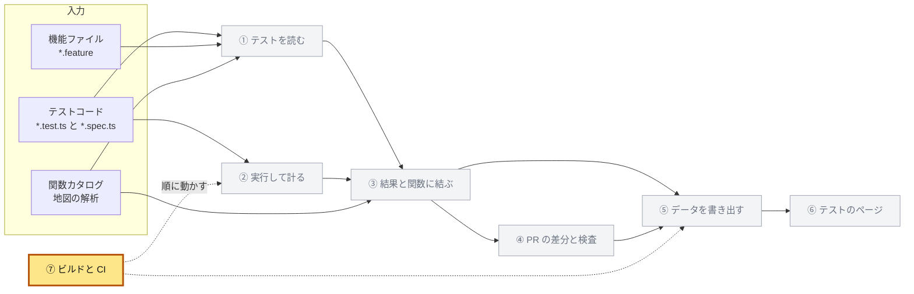

| 項目 | 内容 |
|---|---|
| 入力 | ① から ⑥ のパッケージとスクリプト。<br>GitHub の PR と、シークレットの `CODECOV_TOKEN`、`CLOUDFLARE_API_TOKEN`、`CLOUDFLARE_ACCOUNT_ID` |
| 出力 | artifact の `test-reports`、`oidc-provider-map`、`oidc-e2e-reports`、Codecov への報告、`apps/map/dist`（`dist/tests/` にテストのページ）、プレビューと本番の Worker、PR のコメント、CI の合否 |
| 実装 | `package.json` の `scripts`（ルート、`apps/map`、`apps/tests`、`packages/test-catalog`、`packages/test-reach`、`tests/e2e`、`tests/steps`）、`apps/map/scripts/build-data.mjs`、`copy-tests-viewer.mjs`、`check-map.mjs`、`.github/workflows/ci.yml`、`map-preview.yml`、`codecov.yml`、`.github/scripts/lint-e2e-fixtures.mjs`、`lint-features.mjs`、`lint-steps.mjs`、`lint-tests.mjs`、`verify-ci-gate.mjs`、`.gitignore`、`apps/map/README.md`、`apps/map/changes/README.md`、`.changeset/test-map-no-release.md`<br>作る順：[再現の手順](README.md#再現の手順)の [4](README.md#4-データの段への接続-2)、[10](README.md#10-ビルドと-ci) |

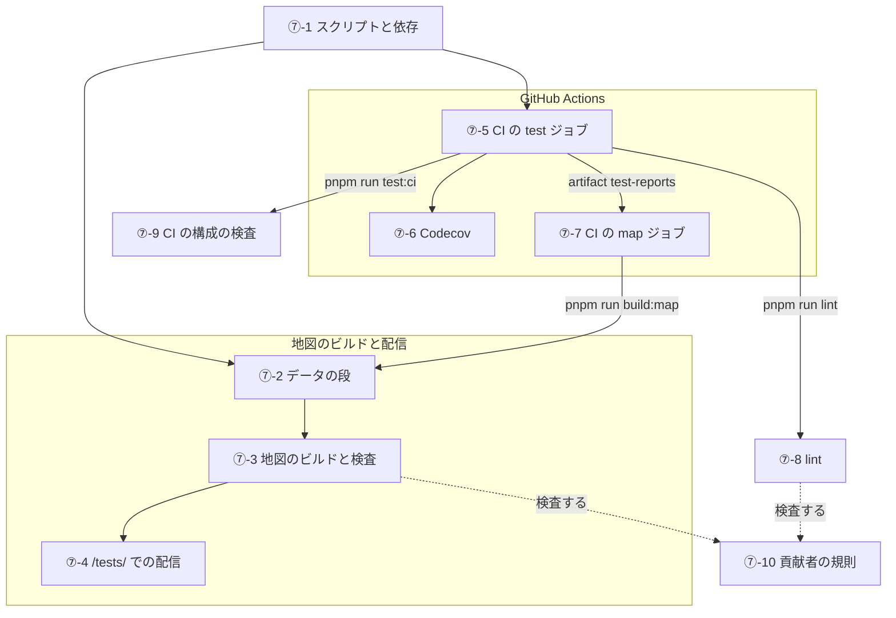

点線は、lint と地図の検査が貢献者の規則を確かめることを表す。

## ⑦-1 スクリプトと依存

ほかの部を動かすコマンドと、そのために足した依存を決める。

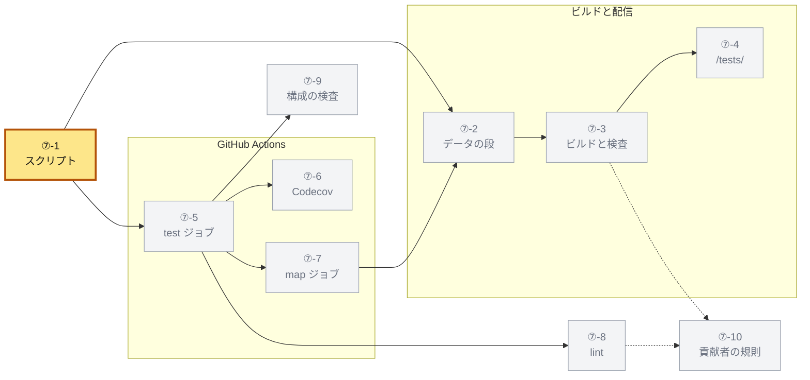

### ⑦-1-a ルートのスクリプト

`build:map`、`lint`、`test:ci` は `&&` でつなぐので、一つが落ちると後のコマンドは走らない。

| スクリプト | 中身 |
|---|---|
| `build` | `core`、`experimental`、`google-login`、`cli`、`map-analysis`、`test-catalog` の `build` |
| `build:map` | `cli` の `build` → `map-analysis` の `build` → `test-catalog` の `build` → `map` の `build` |
| `lint` | `lint-import-boundaries.mjs` → `lint-function-docs.mjs` → `lint-function-forms.mjs` → `lint-e2e-fixtures.mjs` → `lint-features.mjs` → `lint-steps.mjs` → `lint-tests.mjs` → `test-steps` の `lint` |
| `test:ci` | `test:ci-gate` → `test:supply-chain` → `test:release-contract` → `packages/*` の `test` → `apps/*` の `test` → `e2e` の `test:unit` → `cli` の `test:matrix` → `test:conformance` |
| `test:features` | `test-steps` の `test` |
| `test:e2e` | `e2e` の `test:e2e` |
| `test:ci-gate` | `node .github/scripts/verify-ci-gate.mjs` |
| `test:supply-chain` | `node --test .github/scripts/*.test.mjs` |
| `typecheck` | `packages/*`、`apps/*`、`samples/*`、`tests/*` の `typecheck`（前からある） |

- `build` に `map-analysis` と `test-catalog` を入れるのは、`lint-tests.mjs` が `packages/test-catalog/dist/index.js` を読むからである
- `build:map` が `test-catalog` を地図より先にビルドするのは、データの段がその `dist` を import するからである
- `test:ci` の `e2e` の `test:unit` は、`tests/e2e/reach/*.test.mjs` を `node --test` で走らせる

### ⑦-1-b パッケージのスクリプト

| パッケージ | スクリプト | 中身 |
|---|---|---|
| `apps/map` | `data` | `node scripts/build-data.mjs`（[⑦-2](#-2-データの段)） |
| | `build` | `pnpm run data && vite build && pnpm run viewer && pnpm run check && pnpm run check:wiring`（[⑦-3](#-3-地図のビルドと検査)） |
| | `viewer` | `pnpm --filter @maronn-openid-connect/tests build && node scripts/copy-tests-viewer.mjs` |
| | `check` | `node scripts/check-map.mjs` |
| | `changes:draft` | `node scripts/draft-notes.mjs`（[④-9](04-pull-request.md#-9-変更メモの雛形)） |
| | `dev`、`preview` | `vite` と `vite preview` を `--host ${HOST:-127.0.0.1} --port ${PORT:-3610}` で。<br>`dev` は先に `data` を走らせる |
| | `test` | `vitest run`。<br>`src/**/*.test.ts` と `scripts/**/*.test.mjs` |
| `apps/tests` | `dev`、`preview`、`build`、`test`、`typecheck` | [⑥-1-a](06-viewer.md#-1-a-パッケージとビルド)。<br>`build` はデータを作らない |
| `packages/test-catalog` | `build`、`typecheck`、`test` | `tsc`、`tsc --noEmit`、`vitest run` |
| `packages/test-reach` | `test`、`typecheck` | `vitest run`、`tsc --noEmit`。<br>ビルドは無い |
| `tests/e2e` | `test:e2e` | `test:e2e:app-hono` → `test:e2e:app-nextjs` |
| | `test:e2e:app-hono`、`test:e2e:app-nextjs` | アプリの `build` → `bddgen` → 下の表の変数で `playwright test` |
| | `test:unit` | `node --test reach/*.test.mjs` |
| | `typecheck` | `tsc --noEmit` と、`apps/client.mjs`、`apps/resource-server.mjs`、`reach/lcov.mjs` の `node --check` |
| `tests/steps` | `test` | `bddgen && playwright test`。<br>プロセス内の実行先を走らせる |
| | `lint` | `bddgen && bddgen -c ../e2e/playwright.config.ts`（[⑦-8-e](#-8-e-未定義と曖昧なステップ)） |
| | `typecheck` | `tsconfig.json`、`tsconfig.hono.json`、`tsconfig.nextjs.json` のそれぞれで `tsc --noEmit -p`（中身は [①-8-g](01-read.md#-8-g-ステップ定義の-tsconfig)） |

E2E のスクリプトは、ポートを次の値に固定する。

| スクリプト | `E2E_OP_PACKAGE` | OP | RP | リソースサーバー | ほか |
|---|---|---|---|---|---|
| `test:e2e:app-hono` | `@maronn-openid-connect/app-hono` | 3410 | 3420 | 3430 | |
| `test:e2e:app-nextjs` | `@maronn-openid-connect/app-nextjs` | 3510 | 3520 | 3530 | `OIDC_SQLITE_PATH=.data/oidc-e2e.sqlite` |

列の値から `E2E_OP_PORT`、`E2E_CLIENT_PORT`、`E2E_RESOURCE_SERVER_PORT` を渡す。
`E2E_ISSUER`、`E2E_CLIENT_BASE_URL`、`E2E_RESOURCE_SERVER_URL` は `http://127.0.0.1:<ポート>` である。
計測の変数と制御のポートは [②-5-c](02-measure.md#-5-c-op-のインスタンス) が決める。

### ⑦-1-c 機能ファイルの project

`bddgen` は、playwright-bdd の project ごとに、機能ファイルからテストを生成する。
生成先は、設定のファイルのディレクトリの `.features-gen/<project>` である。
`defineBddProject` は `{ name, testDir }` を返し、`testDir` がその生成先を指す。

| 設定のファイル | project | `tags` | `use` |
|---|---|---|---|
| `tests/steps/playwright.config.ts` | `in-process-hono` | `@hono` | `{ target: 'hono' }` |
| `tests/steps/playwright.config.ts` | `in-process-nextjs` | `@nextjs` | `{ target: 'nextjs' }` |
| `tests/e2e/playwright.config.ts` | `http` | `@http` | `devices['Desktop Chrome']` |

三つとも `features: '../features/**/*.feature'`、`featuresRoot: '../features'` である。
`steps` は次の四つの glob で、`http` の project では各 glob の前に `../steps/` が付く。

- `support/*.ts`
- `common/*.steps.ts`
- `in-process/*.steps.ts`
- `http/*.steps.ts`

どの project もすべての定義を読み、実行先に合わない定義は `createBdd` のタグで外す（[⑦-8-e](#-8-e-未定義と曖昧なステップ)）。

`tests/steps/playwright.config.ts` の project の外の設定は次のとおりである。

| 設定 | 値 |
|---|---|
| `outputDir` | `./test-results` |
| `fullyParallel` | `true` |
| `forbidOnly` | `!!process.env.CI` |
| `reporter` | `list`。<br>報告のディレクトリがあれば、`json` と `junit` を足す（[②-5-d](02-measure.md#-5-d-機能ファイルのテスト)） |
| `retries`、`workers`、`webServer` | 書かない（Playwright の既定） |

`http` の project は E2E の設定の中にある。
OP、`retries`、レポーター、`reachRun()` は E2E の spec と同じである（[②-5](02-measure.md#-5-e2e-の実行の設定)）。
そのシナリオは、OP に登録したクライアント `e2e-features-client` として動く。
登録は `tests/e2e/playwright.config.ts` の `OIDC_CLIENTS_JSON` の最後の要素である。

| 欄 | 値 |
|---|---|
| `clientSecret` | `e2e-features-client-secret` |
| `redirectUris` | `<RP の URL>/features-callback` |
| `clientType` | `confidential` |
| `grantTypes` | `authorization_code`、`refresh_token` |
| `tokenEndpointAuthMethods` | `client_secret_basic` |
| `responseTypes` | `code` |

専用のクライアントにするのは、シナリオが記録する同意で、ほかの spec の同意の画面が飛ばないためである。
redirect URI は何も配らず、ステップがブラウザの行き着いた URL から code を読む。

### ⑦-1-d export

| パッケージ | export | 指すもの |
|---|---|---|
| `packages/test-catalog` | `.` | `dist/index.js`（型は `dist/index.d.ts`） |
| | `./model` | 型だけ（`src/model.ts`、[⑤-1](05-data.md#-1-ファイルの一覧)） |
| `packages/test-reach` | `./env`、`./source-map`、`./vitest`、`./vitest-setup`、`./vitest-reporter`、`./op` | `src` の同じ名前の `.js`。<br>`./env`、`./vitest`、`./op` には `.d.ts` を添える |

### ⑦-1-e 依存

公開するパッケージには devDependencies だけを足し、公開するコードの依存は変えない。

| 足したもの | 版 | 足したパッケージ | 使い道 |
|---|---|---|---|
| `@vitest/coverage-istanbul` | `5.0.5` | `packages/core`、`experimental`、`google-login`、`apps/hono`、`apps/nextjs` | Vitest の到達を Istanbul で計る（[②-3](02-measure.md#-3-vitest-のテストごとの到達)） |
| `@maronn-openid-connect/test-reach` | `workspace:*` | 上の 5 つ、`packages/cli`、`map-analysis`、`test-catalog`、`apps/map`、`apps/tests`、`tests/e2e` | `vitest.config` の `testReports`、E2E の報告と到達 |
| `@cucumber/gherkin` | `^39.1.0` | `packages/test-catalog`、`tests/steps` | 機能ファイルを読む。<br>`lint-features.mjs` は `tests/steps` から解決する |
| `@cucumber/messages` | `^32.3.1` | `packages/test-catalog`、`tests/steps` | gherkin の parser に渡す `IdGenerator` |
| `@cucumber/cucumber-expressions` | `19.0.0` | `packages/test-catalog` | ステップの式を読み、照らす |
| `yaml` | `^2.9.1` | `packages/test-catalog` | `aspects.yaml` と `ja.yaml` を読む |
| `@maronn-openid-connect/map-analysis`、`cli` | `workspace:*` | `packages/test-catalog` | 地図の解析を使う。<br>解析はビルドした CLI を読む（[①-2-a](01-read.md#-2-a-入力と地図から使うもの)） |
| `playwright-bdd` | `^9.2.1` | `tests/e2e`、`tests/steps` | 機能ファイルから Playwright のテストを生成する |
| `@playwright/test` | `^1.64.1` | `tests/steps` | プロセス内の実行先を走らせる |
| `v8-to-istanbul` | `^9.3.0` | `tests/e2e` | E2E の V8 の計数を Istanbul の形にする |
| `istanbul-lib-coverage`、`istanbul-lib-report`、`istanbul-reports` | `^3.2.2`、`^3.0.1`、`^3.2.0` | `tests/e2e` | E2E の lcov を書く |
| `@maronn-openid-connect/test-catalog` | `workspace:*` | `apps/map`、`apps/tests` | データの段がテストを読む。<br>テストのページは型だけを読む |

新しいパッケージ `tests/steps`（`@maronn-openid-connect/test-steps`）は、ほかに `typescript`（`^7.0.2`）と `@types/*` を持つ。
`apps/tests`（`@maronn-openid-connect/tests`）の依存は [⑥-1-a](06-viewer.md#-1-a-パッケージとビルド) にある。
`tests/steps` は `pnpm-workspace.yaml` の `tests/*` でワークスペースに入り、ルートの `typecheck` の `--filter "./tests/*"` で型を検査される。
`@vitest/coverage-istanbul` の版は、ルートの `pnpm.overrides` が固定する Vitest の版（`5.0.5`）とそろえてある。

公開するパッケージ（`core`、`experimental`、`google-login`、`cli`）の `package.json` が変わると、CI の `changeset-coverage` は changeset を求める。
リリースは要らないので、空の changeset `.changeset/test-map-no-release.md` を足す。

### ⑦-1-f 生成物と .gitignore

道具が生成するものは、どれもコミットしない。

| 置き場所 | 書くもの | 無視する規則 |
|---|---|---|
| `work/test-reports/` | 計測した実行の報告（[②-1-a](02-measure.md#-1-a-報告のファイル)） | `/work/`（前からある） |
| `tests/e2e/.features-gen/`、`tests/steps/.features-gen/` | `bddgen` が生成するテスト。<br>実行のたびに作り直す | `.features-gen/` |
| `tests/steps/test-results/` | プロセス内の実行先の Playwright の出力 | `tests/steps/test-results/` |
| `apps/tests/public/data/` | データの段が書く、テストのページのデータ（[⑤-1](05-data.md#-1-ファイルの一覧)） | `apps/tests/public/data/` |
| `apps/tests/dist/`、`apps/map/dist/` | ビルドしたページ | `dist/`（前からある） |

生成したテストをコミットしないのは、ステップ定義と二重になり、どちらが正か分からなくなるからである。

実装：

- `package.json`
- `apps/map/package.json`
- `apps/tests/package.json`
- `packages/test-catalog/package.json`
- `packages/test-reach/package.json`
- `tests/e2e/package.json`
- `tests/steps/package.json`
- `tests/steps/playwright.config.ts`
- `tests/e2e/playwright.config.ts`：project `http`、`e2e-features-client`
- `pnpm-workspace.yaml`
- `.gitignore`
- `.changeset/test-map-no-release.md`

## ⑦-2 データの段

地図のデータの段が道具をどう呼び、何をログに出すかを決める。

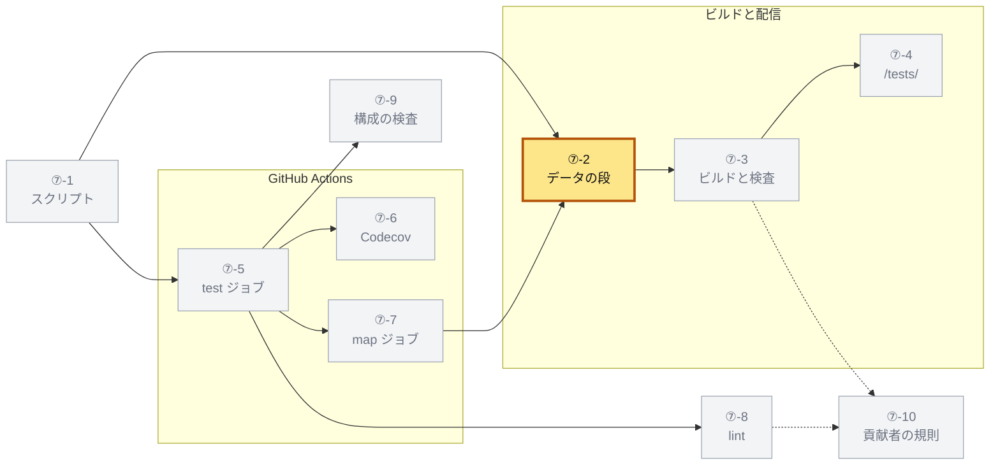

データの段は、次の環境変数を読む。

| 変数 | 意味 | 無いとき |
|---|---|---|
| `MAP_BASE` | 変更前の git のリビジョン。<br>CI の PR では `origin/<base_ref>`。<br>前後の空白を除き、空なら無いとみなす | PR のビルドにならず、テストの差分も作らない |
| `MAP_PR`、`MAP_PR_TITLE`、`MAP_PR_URL` | PR の番号、タイトル、URL。<br>`MAP_PR` が正の整数のときだけ使う | PR の情報を載せない |
| `MAP_TEST_REPORTS` | ② が書いた報告のディレクトリ。<br>前後の空白を除き、空でなければ `resolve` で絶対パスにする。<br>相対パスは現在のディレクトリ（pnpm 経由なら `apps/map`）から解かれるので、絶対パスで渡す | カードはコードから読んだものだけになる。<br>ディレクトリが無いときも同じで、ログは `no run` になる |
| `GITHUB_STEP_SUMMARY` | GitHub Actions のランの要約のファイル | 要約を書かない |

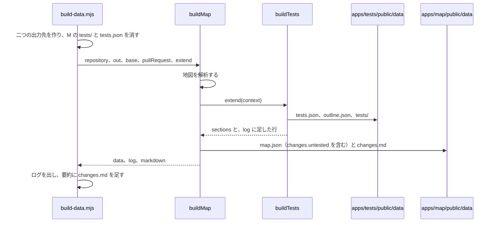

1. `apps/map/public/data`（`out`）と `apps/tests/public/data`（`testsOut`）を作る
2. `out/tests` と `out/tests.json` を消す（地図が自分のデータにテストを書いていた前の版の残りで、残すと [⑦-3](#-3-地図のビルドと検査) の写す段が落ちる）
3. `buildMap` を呼び、`extend` に `(context) => buildTests(context, { out: testsOut, reports })` を渡す（`reports` は `MAP_TEST_REPORTS` があるときだけ）
4. 結果の `log` の各行を、`Wrote <out>/map.json: <行> (<秒>s)` の形で出す（秒は `buildMap` を呼ぶ直前からで、小数一桁）
5. PR のビルドなら、`GITHUB_STEP_SUMMARY` に `## OIDC Provider Map` と `changes.md` を足し、変更の要約の行とフレームごとの行を出す

道具が `log` に足す行は次の形である。

| 行 | 形 |
|---|---|
| 読みの警告 | `tests: <警告>`。<br>警告の形は [①-2-f](01-read.md#-2-f-警告) |
| PR の差分（PR のビルドだけ） | `tests: <前> → <後> cases, <n> added, <n> removed, <n> renamed, <n> changed; <n> changes need a test or a reason` |
| 全体 | `tests: <件数> cases (<種類> <数>, ...) in <n> files, <n> with helpers, the code of <n> files, <n> frames and <n> endpoints with tests, <n> gaps, <実行>, <n> phrases without Japanese (<秒>s)` |

- `(<種類> <数>, ...)` は `counts.kinds` の鍵の順で、カタログの順に初めて出た種類の順である（[③-9](03-join.md#-9-テストの数え方)）
- `, the code of <n> files` は、書き出し先（`out`）があるときだけ付く
- 全体の行の末尾の秒は、`buildTests` の始まりからである
- `<実行>` は、報告が無ければ `no run` である
- 報告があれば `<n> results, the reach of <n> (unmatched: <n> results, <n> reach)` で、計測が無いときは `the reach of` を省く
- `results` は結果を持つテストの数、`the reach of` は到達を持つテストの数である

PR のビルドでは、地図の変更の要約の行とフレームごとの行が続く（形は [④-8-b](04-pull-request.md#-8-b-地図がすること)）。

例：リポジトリのルートで次を走らせると、次のように出る。

```bash
MAP_BASE=origin/main MAP_TEST_REPORTS=$PWD/work/test-reports pnpm --filter @maronn-openid-connect/map run data
```

```text
Wrote /…/apps/map/public/data/map.json: tests: 5731 → 6062 cases, 331 added, 0 removed, 0 renamed, 0 changed; 0 changes need a test or a reason (24.5s)
Wrote /…/apps/map/public/data/map.json: tests: 6062 cases (tool 1200, api 217, unit 4523, e2e 122) in 466 files, 3722 with helpers, the code of 847 files, 1052 frames and 34 endpoints with tests, 350 gaps, 5761 results, the reach of 4855 (unmatched: 0 results, 0 reach), 0 phrases without Japanese (7.1s) (24.5s)
Wrote /…/apps/map/public/data/map.json: 4 frameworks, 500 steps, 1070 functions, 18 endpoint bodies, 200 interface members, 35 untraceable calls, 1014 wiring diagnostics, 444 source files (24.5s)
Changes since origin/main (f4736af, with the uncommitted work): 0 frames, 0 notes, 61 test files, 158 other files, 0 need a note, 0 need a test or a reason
```

実装：

- `apps/map/scripts/build-data.mjs`
- `packages/test-catalog/src/build.ts`：`buildTests` のログ
- `packages/test-catalog/src/catalog.ts`：`readCatalog` の警告
- `packages/map-analysis/src/changes.ts`：`pullRequestOf`

## ⑦-3 地図のビルドと検査

`apps/map` の `build` が、データ、地図、テストのページ、検査をどの順に走らせ、どこで落ちるかを決める。

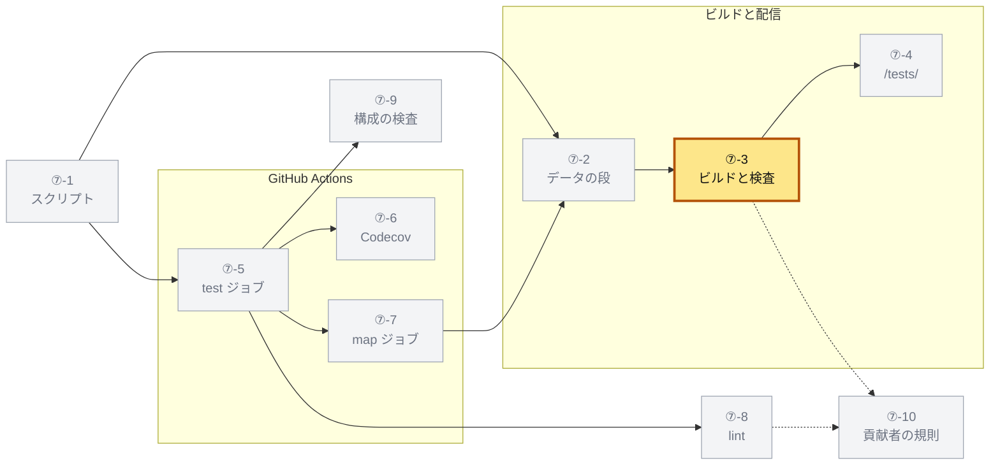

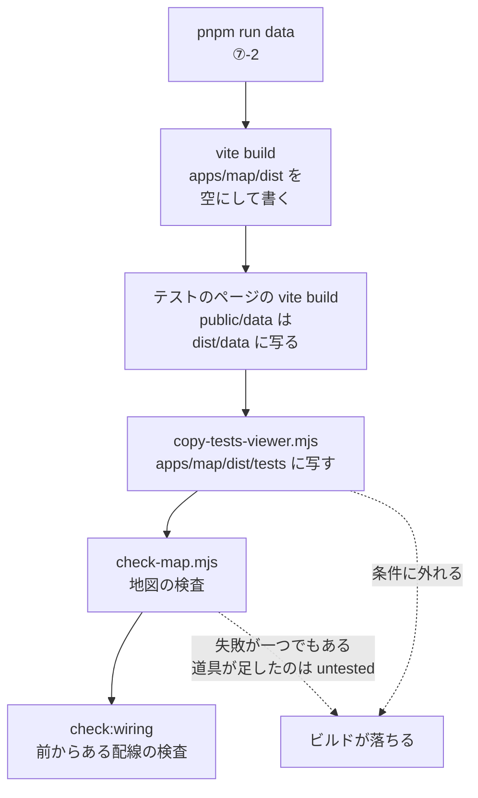

写す段を検査より前に置く。
検査が落ちた PR でも `dist/tests/` にテストのページが入り、CI がそれを配れるからである。

### ⑦-3-a テストのページの写し

`copy-tests-viewer.mjs` は、次の順に確かめてから写す。

| 順 | 条件 | 結果 |
|---|---|---|
| 1 | `<viewer>/index.html` が無い | 失敗する（テストのページがビルドされていない） |
| 2 | `<viewer>/data/tests.json` が無い | 失敗する（データの段より前にビルドした） |
| 3 | `<map>/index.html` が無い | 失敗する（地図がビルドされていない） |
| 4 | `<map>/data/tests.json` か `<map>/data/tests` がある | 失敗する（地図のデータがテストを持っている） |
| 5 | どれでもない | `<map>/tests` を消し、`<viewer>` を丸ごと `<map>/tests` に写す |

- 引数は `[viewer の dist] [地図の dist]` で、既定は `apps/tests/dist` と `apps/map/dist`（pnpm が渡す `--` は読み飛ばす）
- 成功すると `Copied the tests viewer to <写した先>: <n> files, <x> MB (served at <map url>/tests/)` を出す
- この行の `<map url>` だけは置き換えず、その文字のまま出る
- `<n>` は写した先のすべてのファイルの数、`<x>` はバイト数を 1024 で二回割った小数一桁の値である
- 失敗すると `✗ <理由>` を標準エラーに出し、終了コード 1 で終わる
- 例：このブランチでは `1319 files, 24.7 MB` である

### ⑦-3-b 地図の検査

`check-map.mjs` は、`apps/map/public/data/map.json`（引数でディレクトリを変えられる）を `checkMap` で検査する。
数の行と `/token` の選択肢の行を標準出力に出した後、失敗を一つずつ `✗ ` を付けて標準エラーに出し、終了コード 1 で終わる。
失敗には前からあるもの（名の無い選択肢、木の外の行、説明の無い変更など）と、道具が足した `untested` がある。
`untested` を決める規則は [④-6-b](04-pull-request.md#-6-b-検査に落ちる変更) に、その失敗の文と数の行は [④-8-c](04-pull-request.md#-8-c-地図の検査) にある。

実装：

- `apps/map/package.json`：`build`、`viewer`
- `apps/map/scripts/copy-tests-viewer.mjs`：`copyTestsViewer`、`measure`
- `apps/map/scripts/check-map.mjs`
- `packages/map-analysis/src/check.ts`：`checkMap`

## ⑦-4 /tests/ での配信

テストのページを、地図と同じ Worker の `/tests/` で配る仕組みを決める。

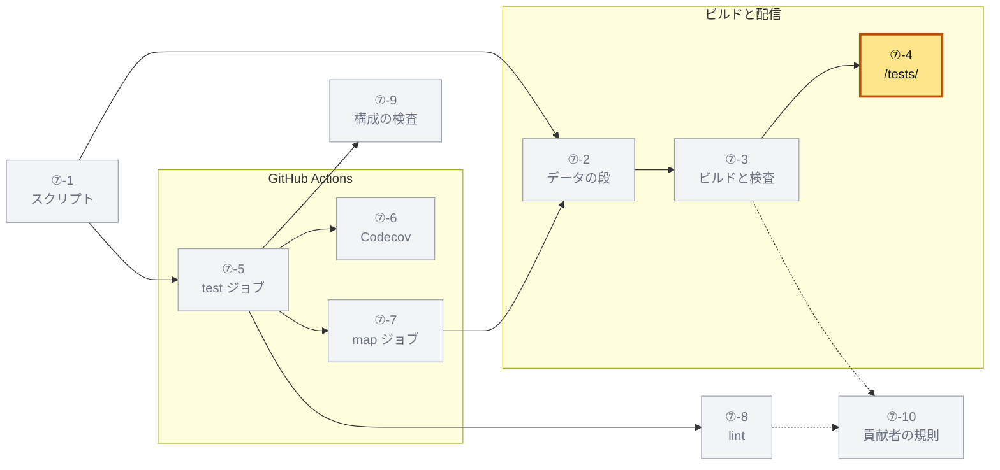

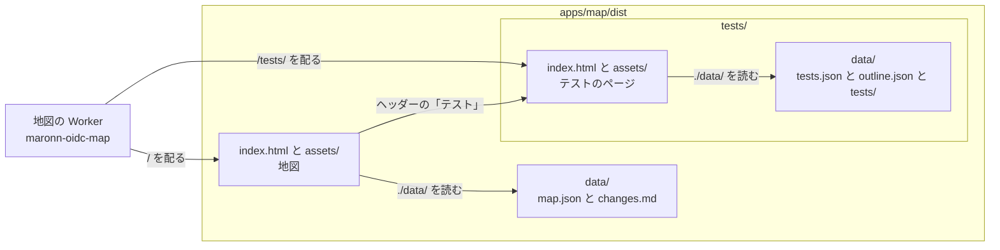

| 決めごと | 値 | 理由 |
|---|---|---|
| Worker | `apps/map/wrangler.jsonc`。<br>名前 `maronn-oidc-map`、`assets.directory` は `./dist`、スクリプトの無い assets だけの Worker | 前からある。<br>`dist/tests/` を置くだけで `/tests/` に出る |
| 見つからないパス | `not_found_handling: single-page-application` | 前からある。<br>無いデータのファイル（main のビルドの `tests/diff.json` など）も、`index.html` と状態 200 で返る。<br>⑥ の `fetchJson` は `<` で始まる本文を「無い」とみなすので、これも無いデータになる（[⑥-2-b](06-viewer.md#-2-b-取得と再試行)） |
| テストのページの資産 | `apps/tests/vite.config.ts` の `base: './'`（[⑥-1-a](06-viewer.md#-1-a-パッケージとビルド)） | 相対のパスなので、どのサブパスに置いても動く |
| データの場所 | `./data/tests.json`、`./data/outline.json`、`./data/tests/...` を相対で読む | `/tests/` の下では `/tests/data/` を読む |
| 画面の切り替え | URL のハッシュ（`#/endpoint/hono/token`、[⑥-4](06-viewer.md#-4-url-のハッシュ)） | サーバーにパスを足さずに済む |
| 地図からの入口 | 地図のヘッダーの `<a href="./tests/">テスト</a>` | 地図はテストを出さない |

| URL | 開くもの |
|---|---|
| `<地図の URL>/` | 地図 |
| `<地図の URL>/tests/` | テストのページのホーム |
| `<地図の URL>/tests/#/pr` | この PR のテスト（PR のビルドだけ） |
| `<地図の URL>/tests/data/tests.json` | 索引 |

手元では、次のように開く。

- 地図の開発サーバー（ポート 3610）は地図だけを配るので、ヘッダーの「テスト」は開かない
- テストのページは、`pnpm --filter @maronn-openid-connect/map run data` の後に、自分の開発サーバー（ポート 3620）で開く
- ビルドした地図を `pnpm --filter @maronn-openid-connect/map preview` で配れば、`/tests/` も開く

実装：

- `apps/map/wrangler.jsonc`
- `apps/tests/vite.config.ts`
- `apps/tests/src/App.tsx`：`TESTS_URL`、`OUTLINE_URL`
- `apps/tests/src/lib/load.ts`：`DIFF_URL`、`fetchJson`
- `apps/map/src/App.tsx`：ヘッダーのリンク

## ⑦-5 CI の test ジョブ

CI の `test` ジョブが、どの順に、どの変数でテストを走らせ、何を残すかを決める。

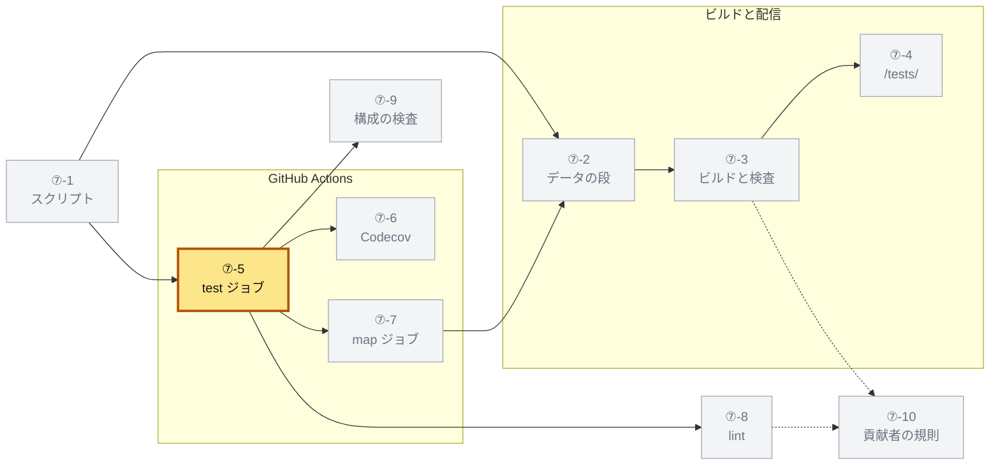

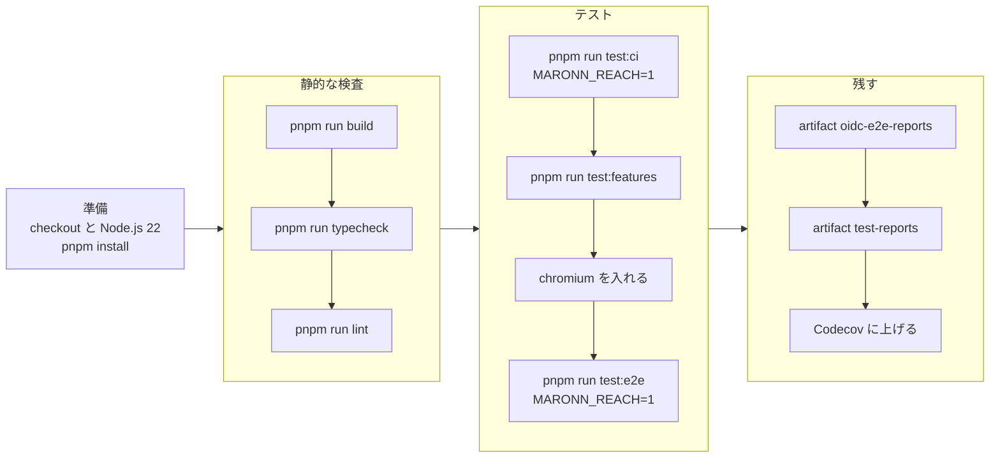

ジョブは `pull_request`（main 向け）と main への `push` で走る。
準備は `actions/checkout@v7`、`corepack enable`、`actions/setup-node@v7`（Node.js 22、pnpm のキャッシュ）、`pnpm install --frozen-lockfile` である。
ブラウザは `pnpm --filter @maronn-openid-connect/e2e exec playwright install --with-deps chromium` で入れる。
プロセス内の実行先はブラウザを使わないので、その前に走らせる。

| 変数 | 置く場所 | 値 |
|---|---|---|
| `MARONN_TEST_REPORTS` | ジョブ | `${{ github.workspace }}/work/test-reports` |
| `CODECOV_TOKEN` | ジョブ | `secrets.CODECOV_TOKEN`。<br>fork からの PR では空 |
| `MARONN_REACH` | `pnpm run test:ci` と `pnpm run test:e2e` のステップ | `'1'` |

- `MARONN_TEST_REPORTS` をジョブに置くので、テストを走らせるどのステップも報告を書く
- その値を絶対パスにするのは、どのパッケージのスクリプトも自分のディレクトリで走るからである
- 相対パスでは、Vitest がパッケージごとに解き、報告が散らばる
- プロセス内の実行先は到達を記録しない（`support/in-process.ts` は `fixtures.ts` の `test` を使わない）
- 到達を書くのは http の実行先だけで、E2E と一緒に走る
- E2E のステップの `MARONN_REACH=1` は、その中の Next.js のビルドも計るためのビルドにする（[②-6-a](02-measure.md#-6-a-計測を始める場所)）
- 計測は CI だけで行う
- 二つの変数が無ければ、`testReports` も Playwright の設定も何も足さず、手元の `pnpm test` は変わらない

各ステップは、`work/test-reports` に次を書く。
`<名前>` は、パッケージの名前からスコープを除いたもの（`app-hono`）である。

| ステップ | 書くもの |
|---|---|
| `pnpm run test:ci` | Vitest のどのパッケージも `vitest/<名前>.json` と `junit/vitest-<名前>.xml`。<br>計測する 5 パッケージ（`core`、`experimental`、`google-login`、`app-hono`、`app-nextjs`）は、ほかに `reach/vitest-<名前>.jsonl` と `coverage/vitest/<名前>/lcov.info` |
| `pnpm run test:features` | `playwright/in-process.json`、`junit/features-in-process.junit.xml` |
| `pnpm run test:e2e` | 実行先（`hono`、`nextjs`）ごとに `playwright/<実行先>.json`、`junit/e2e-<実行先>.junit.xml`、`reach/e2e-<実行先>.jsonl`、`coverage/e2e/<実行先>/lcov.info`。<br>途中のものとして `v8/<実行先>/` と `access/<実行先>-<役>.log` |

`.github/scripts` のテストは `node --test` で走り、報告を書かない。
そのため、テストのページでは結果の無いテストになる（例：301 件）。

テストのステップが落ちると、後のテストのステップは走らない。
`test:ci` と `test:e2e` は `&&` の連なりなので、その中でも落ちたところで止まる。
hono の E2E が落ちると、Next.js の E2E は走らず、その報告は無い。
残すステップは落ちても走り、そこまでの報告を次の `map` ジョブに渡す。

| artifact | 中身 | 条件 | 無いとき |
|---|---|---|---|
| `oidc-e2e-reports` | `tests/e2e/playwright-report`、`tests/e2e/test-results` | `always()` | 何もしない（`if-no-files-found: ignore`） |
| `test-reports` | `work/test-reports` から `v8/` と `access/` を除いたもの | `!cancelled()` | 何もしない（`if-no-files-found: ignore`） |

どちらも `actions/upload-artifact@v7` で上げる。
`v8/` と `access/` は、lcov と到達の行を作る途中のもので、地図は読まない。
例：計測した実行では、`v8/` が約 17.7 MB、残す分が約 18.8 MB である（1 MB は 1,000,000 バイト）。

実装：

- `.github/workflows/ci.yml`：`test`
- `packages/test-reach/src/env.js`：`reachEnabled`、`reportsDirectory`
- `tests/steps/support/in-process.ts`
- `tests/steps/support/http.ts`

## ⑦-6 Codecov

行のカバレッジとテストの結果を Codecov に上げる手順と、評価の設定を決める。

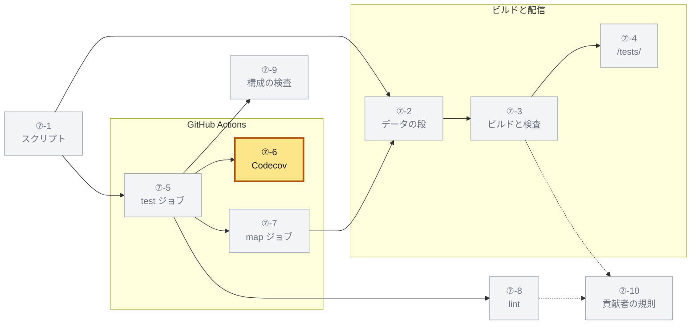

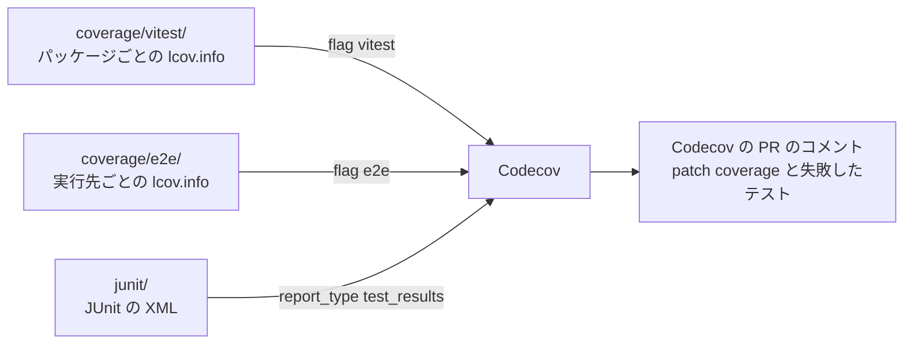

三つのステップは、どれも `codecov/codecov-action@v7` を `token: ${{ env.CODECOV_TOKEN }}`、`fail_ci_if_error: false` で使う。
条件は `!cancelled() && env.CODECOV_TOKEN != ''` で、fork からの PR では上げない。

| ステップ | `directory` | ほかの入力 |
|---|---|---|
| Upload the coverage of Vitest to Codecov | `work/test-reports/coverage/vitest` | `flags: vitest` |
| Upload the coverage of E2E to Codecov | `work/test-reports/coverage/e2e` | `flags: e2e` |
| Upload the test results to Codecov | `work/test-reports/junit` | `report_type: test_results` |

Codecov は、ディレクトリの中で名前が `*junit*.xml` か `*test*.xml` の JUnit だけを拾う。
`vitest-<名前>.xml` は `test` を、`e2e-<実行先>.junit.xml` と `features-in-process.junit.xml` は `junit` を名前に含む。

| `codecov.yml` の設定 | 値 | 意味 |
|---|---|---|
| `coverage.status.project.default.informational` | `true` | 全体のカバレッジで状態を落とさない |
| `coverage.status.patch.default.informational` | `true` | 変えた行のカバレッジで状態を落とさない。<br>閾値はまだ決めていない |
| `flags.vitest.paths`、`flags.e2e.paths` | `packages/core/src/`、`packages/experimental/src/`、`packages/google-login/src/`、`apps/hono/src/oidc-provider/`、`apps/hono/src/web/`、`apps/nextjs/src/app/` | 関数カタログの根だけを数える |
| `comment.layout` | `condensed_header, diff, flags, files, footer` | コメントの欄 |
| `comment.require_changes` | `false` | 変化が無くてもコメントする |

地図のコメントと Codecov のコメントは分けたままにする。
地図はカードの差分と関連するテストの検査を、Codecov はカバレッジと結果を出し、中身が重ならないからである。

実装：

- `.github/workflows/ci.yml`：`test` の最後の三つのステップ
- `codecov.yml`

## ⑦-7 CI の map ジョブ

`map` ジョブが報告を受け取って地図とテストのページを作り、配り、PR にコメントする手順を決める。

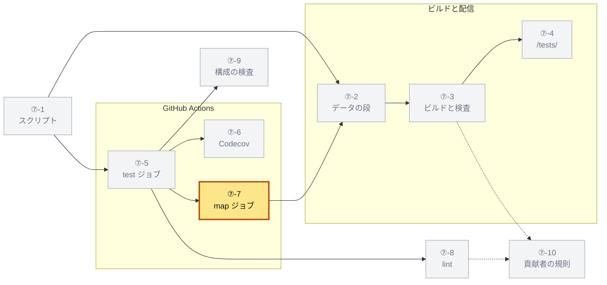

`map` ジョブは、main の `map-preview.yml` の `build` ジョブを `ci.yml` に移し、テストの報告を読むようにしたものである。
次の表の「道具で足したか」は、その移した元と比べたものである。

| 設定 | 値 | 理由 | 道具で足したか |
|---|---|---|---|
| `needs` | `test` | テストの結果と到達を読む | 足した |
| `if` | `${{ !cancelled() }}` | テストが落ちても、そこまでの結果で作る | 足した |
| ワークフローの `concurrency` | group `ci-${{ github.workflow }}-${{ github.ref }}`、`cancel-in-progress` は PR のときだけ真 | PR への新しい push は、前のランを `map` ジョブごと止める。<br>main への push は止めない | 前からある（`ci.yml`） |
| ジョブの `concurrency.group` | `map-preview-${{ github.event.pull_request.number \|\| github.ref }}` | `map-preview.yml` の最上位の group と同じにし、プレビューの削除と `map` ジョブどうしを順に並べる | 移した |
| ジョブの `concurrency.cancel-in-progress` | `false` | 走っているものを打ち切らない。<br>GitHub は一つの group に待ちを一つだけ置き、新しく待つものが前の待ちを取り消す | 移した |
| `permissions` | `contents: read`、`pull-requests: write` | PR にコメントする | 移した |
| `env` | `CLOUDFLARE_API_TOKEN`、`CLOUDFLARE_ACCOUNT_ID` | デプロイする | 移した |
| checkout の `fetch-depth` | `0` | PR のビルドは、マージコミットと base の分岐点を比べるので履歴が要る | 移した |

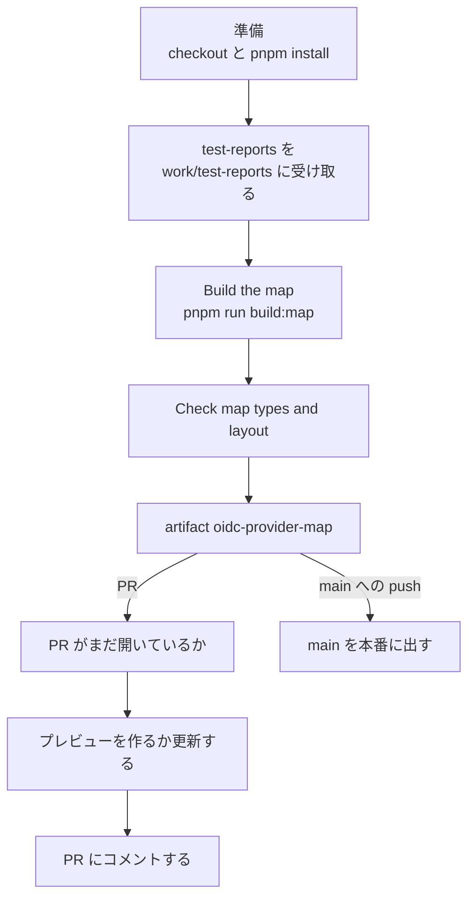

`Build the map` は次の変数で走る。

| 変数 | 値 | 道具で足したか |
|---|---|---|
| `MAP_BASE` | PR では `origin/<github.base_ref>`、push では空 | 移した |
| `MAP_PR`、`MAP_PR_TITLE`、`MAP_PR_URL` | PR の番号、タイトル、`html_url` | 移した |
| `MAP_TEST_REPORTS` | `${{ github.workspace }}/work/test-reports` | 足した |

`MAP_TEST_REPORTS` を絶対パスにするのは、データの段が `apps/map` で走り、相対パスをそこから解くからである（[⑦-2](#-2-データの段)）。

| ステップ | 使うもの | 走る条件 | 道具で足したか |
|---|---|---|---|
| 準備 | `actions/checkout@v7`（`fetch-depth: 0`）、`corepack enable`、`actions/setup-node@v7`（Node.js 22、pnpm のキャッシュ）、`pnpm install --frozen-lockfile` | それまでのステップが失敗していない（`if` が無いときの既定） | 移した |
| Download the test reports | `actions/download-artifact@v8`（`name: test-reports`、`path: work/test-reports`） | 同じ。<br>受け取れなくても続ける（`continue-on-error: true`） | 足した |
| Build the map（`id: build`） | `pnpm run build:map` と上の変数 | 同じ | 移した（`MAP_TEST_REPORTS` を足した） |
| Check map types and layout | `pnpm --filter @maronn-openid-connect/map typecheck && pnpm --filter @maronn-openid-connect/map test` | `!cancelled()` で、`steps.build.outcome` が `skipped` でない | 移した |
| Upload the map | `actions/upload-artifact@v7`（`name: oidc-provider-map`、`path: apps/map/dist`、`if-no-files-found: error`） | `!cancelled()` で、`hashFiles('apps/map/dist/index.html')` が空でない | 移した |
| Check that the pull request is still open（`id: pull`） | `actions/github-script@v9` が `github.rest.pulls.get` で PR を読み、出力 `open` に `String(data.state === 'open')` を書く | `!cancelled()` で、PR のイベントで、PR が同じリポジトリから来た | 足した |
| Create or update the Preview（`id: preview`） | `node .github/scripts/map-preview.mjs create --pr <番号> --sha <head の SHA>` | 上の条件に加えて、`dist/index.html` があり、`steps.pull.outputs.open == 'true'` で、`CLOUDFLARE_API_TOKEN` がある | 移した（`open` の条件を足した） |
| Deploy main to production（`id: production`） | `node .github/scripts/map-preview.mjs deploy` | それまでのステップが失敗しておらず、PR でなく、`CLOUDFLARE_API_TOKEN` がある | 移した |
| Comment the Preview on the pull request | `actions/github-script@v9`（[⑦-7-a](#-7-a-pr-のコメント)） | `!cancelled()` で、`dist/index.html` があり、PR が同じリポジトリから来て、`open` が `'true'` | 移した（`open` の条件と本文の行を足した） |

- 報告を受け取れないとき（`test` ジョブが途中で止まった）は、コードから読めることだけで地図を作る
- PR では、`Build the map` が検査で落ちても、`dist/` があれば後のステップはプレビューとコメントを作る（ジョブは失敗のまま終わる）
- main への push では、`Build the map` が落ちると本番に出さない
- `map-preview.mjs` は前からあるスクリプトで、出力 `url`、`mode`（`preview`、`worker`、`production`、`none`）、`note` を `$GITHUB_OUTPUT` に書く

### ⑦-7-a PR のコメント

コメントは `actions/github-script@v9` が組み、次の環境変数を読む。

| 変数 | 値 |
|---|---|
| `PREVIEW_URL`、`PREVIEW_MODE`、`PREVIEW_NOTE` | プレビューのステップの出力 `url`、`mode`、`note` |
| `PREVIEW_OUTCOME` | プレビューのステップの `outcome` |
| `BUILD_OUTCOME` | `Build the map` の `outcome` |
| `RUN_URL` | `${{ github.server_url }}/${{ github.repository }}/actions/runs/${{ github.run_id }}` |
| `HEAD_SHA` | `github.event.pull_request.head.sha` |

本文は、次の配列を `\n` でつないだものである。
`...` で広げる項は、条件を満たすときだけ入る。

```ts
const body = [
  '<!-- oidc-provider-map-preview -->',
  '## OIDC Provider Map',
  ...(BUILD_OUTCOME === 'failure' ? ['', '> [!WARNING]', `> ${WARNING}`] : []),
  ...(changes ? ['', changes] : []),
  '',
  status,
  ...(url && changes ? ['', `このPRの変更（説明の無い変更、変わった関数の差分と変更メモ、届く経路）: ${url}#changes`] : []),
  ...(url ? [`この PR のテスト: ${url.replace(/\/$/, '')}/tests/#/pr`] : []), // 道具で足した
  `テストの結果とカバレッジ（Codecov）: ${codecov}`, // 道具で足した
  '',
  `Run: ${RUN_URL} (artifact \`oidc-provider-map\`)`,
  '',
  `Built from ${HEAD_SHA}. ${ABOUT}`,
].join('\n');
```

| 名前 | 値 |
|---|---|
| `url` | `PREVIEW_URL`。<br>空なら無いとみなす |
| `changes` | `apps/map/dist/data/changes.md` の前後の空白を除いた中身。<br>ファイルが無ければ空 |
| `codecov` | `context.serverUrl` の `github.com` を `app.codecov.io/gh` に置き換え、`/<owner>/<repo>/pull/<番号>` を足した URL |

`status` は次の三つのどれかである。

| 条件 | `status` |
|---|---|
| `url` がある | `` `Preview: ${url}\n\n(${how})` `` |
| `PREVIEW_OUTCOME` が `skipped` | ``Preview: not deployed (no Cloudflare secrets for this run). Download the `oidc-provider-map` artifact of the run below and serve `dist/` statically.`` |
| それ以外 | `` `Preview: the deploy failed; see the run below. (${PREVIEW_NOTE \|\| ''})` `` |

| `PREVIEW_MODE` | `how` |
|---|---|
| `worker` | `a Worker of this pull request (Worker Previews failed; see the run)` |
| それ以外 | `a Worker Preview of this pull request: the same URL follows every push, and it is removed when the pull request is closed` |

`WARNING` と `ABOUT` は次の固定の文である。

```text
WARNING: 地図のビルドの検査が落ちました。下の「説明の無い変更」に変更メモの節を足すか、「テスト」の節の「関連するテストに変更の無い実装の変更」にテストを足すか変更メモに `テストを変えない理由:` を書くか、検査の出力を Run で確かめてください（`pnpm --filter @maronn-openid-connect/map changes:draft` で雛形を作れます）。

ABOUT: The map shows the endpoints, steps and functions of every framework with every feature on as traces you open call by call; the feature toggles narrow it to one `maronn-oidc generate` command line. The functions and endpoint bodies this pull request changes carry a badge, with what changed (the diff of their flow), the endpoints it reaches and what its change notes (`apps/map/changes/*.md`) say. The tests have a page of their own at `/tests/` (apps/tests): the test cases of each endpoint and step, their latest results and their code.
```

道具で足したのは、上の二行と、`WARNING` の「「テスト」の節の …… を書くか、」の部分と、`ABOUT` の最後の文（`The tests have a page of their own …`）である。

PR の最初の 100 件のコメント（`per_page: 100`）から、本文にコメントの目印 `<!-- oidc-provider-map-preview -->` を含むものを探す。
あれば `updateComment` で書き換え、無ければ `createComment` で作る。
`changes.md` の末尾の `### テスト` の節は ④ が作る。

### ⑦-7-b 閉じた PR のプレビュー

`map-preview.yml` は、PR が閉じたときにプレビューを消すだけのワークフローである。
`test` ジョブの間に PR が閉じると、消した後に `map` ジョブが作り直すおそれがある。
同じ group で順に走らせ、`map` ジョブが PR の状態を確かめることで、それを防ぐ。

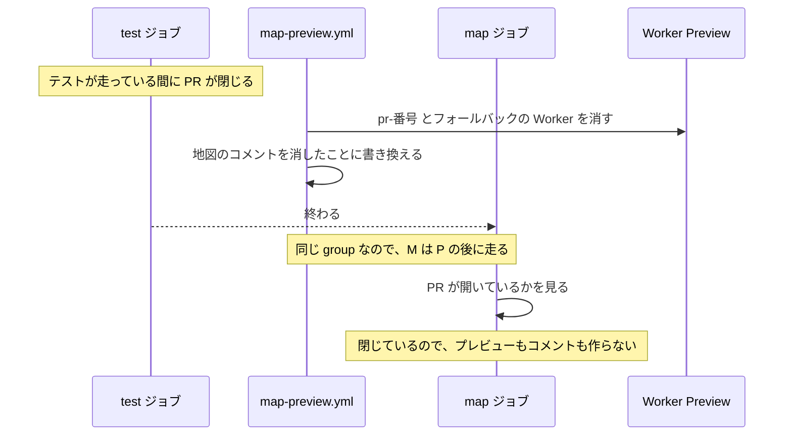

| `map-preview.yml` | 値 |
|---|---|
| 起動 | `pull_request` の `closed`（main 向け） |
| `permissions`（ワークフローの最上位） | `contents: read`、`pull-requests: write` |
| `concurrency`（ワークフローの最上位） | `map` ジョブと同じ group の文字列、`cancel-in-progress: false`。<br>[⑦-9](#-9-ci-の構成の検査) の検査はこの位置を読む |
| `env`（ワークフローの最上位） | `CLOUDFLARE_API_TOKEN`、`CLOUDFLARE_ACCOUNT_ID` |
| ジョブ `cleanup` の条件 | PR が同じリポジトリから来た |
| 準備 | `test` ジョブと同じ checkout、Corepack、Node.js、`pnpm install` |
| 消す（`id: remove`） | `CLOUDFLARE_API_TOKEN` があれば `node .github/scripts/map-preview.mjs delete --pr <番号>` |
| コメント | `actions/github-script@v9` が、最初の 100 件から目印を含むコメントを探し、あれば下の本文に書き換える。<br>無ければ何もしない |

書き換えた本文は、目印と見出しを残す。

```text
<!-- oidc-provider-map-preview -->
## OIDC Provider Map

The preview of this pull request was removed when it was closed (<理由>). The map of main is deployed by the push to main.
```

`<理由>` は消すステップの出力 `note`（`removed preview pr-<番号>`、`nothing to remove` など）である。
消すステップが走らなかったときは、`no Cloudflare secrets` になる。

実装：

- `.github/workflows/ci.yml`：`map`、ワークフローの `concurrency`
- `.github/workflows/map-preview.yml`
- `.github/scripts/map-preview.mjs`

## ⑦-8 lint

道具が前提にする書き方を、`pnpm run lint` で検査する規則を決める。

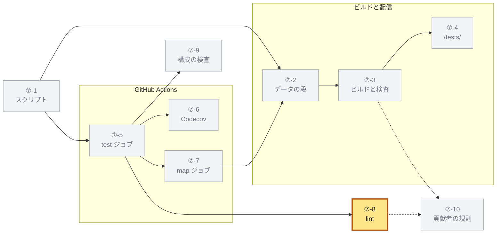

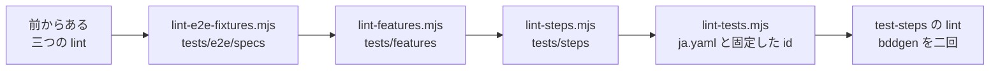

どの lint も、違反を一つずつ `<path>:<line>: <rule>: <message>` の形で標準エラーに出す。
違反があれば、その後に空行と下の表の「失敗の最後の行」を標準エラーに出し、終了コードを 1 にする。
違反が無ければ、成功の一行を標準出力に出す。
読むディレクトリが無ければ、違反は無い。

| lint | 読むファイル | 成功の行 | 失敗の最後の行 |
|---|---|---|---|
| `lint-e2e-fixtures.mjs` | `tests/e2e/specs` の下の `.ts`（ディレクトリごとに名前の順） | `E2E specs take test from tests/e2e/fixtures.ts.` | `<n> E2E fixture import violation(s).` |
| `lint-features.mjs` | `tests/features` の下の `.feature`（ディレクトリごとに名前の順） | `Feature files verified.` | `<n> feature file violation(s).` |
| `lint-steps.mjs` | `tests/steps` の下の、名前が `/\.[cm]?tsx?$/` に合うファイル。<br>`.d.ts` と、`node_modules`、`.features-gen`、`test-results` の下を除く | `Step definitions verified.` | `<n> step definition violation(s).` |
| `lint-tests.mjs` | `tests/steps/ja.yaml`、ステップ定義、リポジトリのテストのファイル | `Tests verified.` | `<n> test lint violation(s).` |

### ⑦-8-a E2E の spec の import

`lint-e2e-fixtures.mjs` は、spec が `test` を `tests/e2e/fixtures.ts` から取ることを確かめる。
`@playwright/test` の `test` は到達を記録しないので、それで書いたテストは何にも届かないように見えるからである。

- import の文を `/^[ \t]*import\s+(type\s+)?([^'";]*?)\s*from\s*['"]@playwright\/test['"]/gm` で探す
- `import type` の文は読み飛ばす
- 波括弧の外に名前がある（デフォルトの import か `* as` の import）と、規則 `e2e-fixtures` の違反である
- 波括弧の中で、`type` の付かない指定子の、`as` の前の名前が `test` なら違反である
- `expect` と型は `@playwright/test` から取ってよい
- 一つの import から二つの違反が出ることがあり、どちらも `import` の語の行で出す

| 違反 | 文 |
|---|---|
| 波括弧の外の名前 | `imports @playwright/test as "<外の名前>", which carries its own test: import { test } from '../fixtures' instead` |
| 波括弧の中の `test` | `imports test from @playwright/test: import { test, expect } from '../fixtures', so the reach of its tests is recorded` |

`<外の名前>` は、句から波括弧の部分と `,` を除き、前後の空白を除いたもの（`base`、`* as pw`）である。

### ⑦-8-b 機能ファイルの形

`lint-features.mjs` は、`@cucumber/gherkin` の parser（`tests/steps` から解決する）で機能ファイルを読む。
`gherkin-lint` を使わないのは、依存の `gherkin` 9 の `protobufjs` に high の勧告があり、`pnpm audit --audit-level=high` が落ちるからである。

| 規則 | 違反 |
|---|---|
| `parse-error` | parser が読めない |
| `empty-file` | `Feature` が無い |
| `no-scenarios` | `Feature` にシナリオが無い（`Rule` の中を含めて数える） |
| `scenario-id` | `@id:<id>` が無い、二つ以上ある、または id が `/^[a-z0-9]+(?:-[a-z0-9]+)*$/` に合わない |
| `scenario-subject` | `@endpoint:`、`@function:`、`@scenario:` で始まり、その後に文字があるタグが無い |
| `scenario-target` | `@hono`、`@nextjs`、`@http` のどれも無い。<br>`Examples` のすべてにどれかがあればよい |
| `duplicate-scenario-name` | 同じ名前のシナリオが、どこかのファイルにある |
| `duplicate-id` | 同じ id のシナリオが、どこかのファイルにある |
| `unused-variable` | `Examples` の列が名前、ステップ、表、doc string のどこにも `<列>` で現れない。<br>または使った `<変数>` がどの列にも無い |

- `Feature` と `Rule` のタグは、その中のシナリオのタグとして数える
- `scenario-id` は id を重ねずに数えるので、`Feature` とシナリオに同じ `@id` があっても一つである
- `unused-variable` は、`Examples` を持つシナリオだけを見る
- 重なりは、名前の順に読んだファイルの先に出たシナリオを正とし、後のものを違反にする
- id が一つに決まらないシナリオは、id の重なりを比べない
- 実行先のタグの無いシナリオは、どの project も生成せず、走らない

| 規則 | 行 | 文 |
|---|---|---|
| `parse-error` | parser の誤りの行（無ければ 1） | parser の文 |
| `empty-file` | 1 | `The file has no Feature` |
| `no-scenarios` | `Feature` の行 | `The feature "<名前>" has no scenario` |
| `scenario-id` | シナリオの行 | `"<名前>" has no @id:<kebab-case-id> tag`、`"<名前>" has more than one id: @id:<a> @id:<b>`、`The id of "<名前>" is not kebab-case: @id:<id>` |
| `scenario-subject` | シナリオの行 | `"<名前>" names no subject: tag it, or its Feature, with @endpoint:<name>, @function:<name>, @scenario:<name>` |
| `scenario-target` | シナリオの行 | `"<名前>" runs on no target: tag it with @hono, @nextjs, @http` |
| `duplicate-scenario-name` | 後のシナリオの行 | `"<名前>" is also the name of the scenario at <path>:<line>` |
| `duplicate-id` | 後のシナリオの行 | `@id:<id> is also the id of the scenario at <path>:<line>` |
| `unused-variable`（使わない列） | 列の見出しのセルの行 | `The column "<列>" of the Examples of "<名前>" is used nowhere in the name or the steps` |
| `unused-variable`（列の無い変数） | シナリオの行 | `"<名前>" uses <変数>, which no column of its Examples defines`（`<変数>` は山括弧ごと出る） |

シナリオの行は、タグの行でなく `Scenario` の語の行である。

### ⑦-8-c ステップ定義の式

`lint-steps.mjs` は、TypeScript 7 の API（`typescript/unstable/sync`、`packages/map-analysis` から解決する）で、ファイルを仮想のプロジェクトに読む。
呼ぶ名前が識別子の `Given`、`When`、`Then`、`Step` の呼び出しの、最初の引数を確かめる。

| 順 | 違反 | 規則 | 文 |
|---|---|---|---|
| 1 | 引数が無い | `step-literal` | `<Name>() has no expression: pass a Cucumber Expression in single quotes as its first argument` |
| 2 | 正規表現のリテラル | `step-regexp` | `<Name>() is defined with a regular expression: write a Cucumber Expression ({int}, {string}, {word}, a/b, (s)) in single quotes instead` |
| 3 | 文字列のリテラルでない（テンプレート、変数、呼び出し） | `step-literal` | `<Name>() takes its expression from a template, a variable or a call: write the Cucumber Expression as a string literal in single quotes so the catalog can read it` |
| 4 | 二重引用符で書いた | `step-literal` | `<Name>() writes its expression in double quotes: use single quotes` |
| 5 | 改行を含む | `step-literal` | `<Name>() writes its expression over more than one line: keep it on one line` |
| 6 | 穴の外に ASCII でない文字がある | `step-ascii` | `<Name>('<式>') has non-ASCII characters outside its holes (<文字>): write the expression in English and its Japanese in tests/steps/ja.yaml` |

- `<Name>` は呼んだ名前、`<文字>` は見つけた文字を重ねずに区切りなしで並べたもの
- 一つの呼び出しは、表の順で最初に当たった違反一つだけを出す
- 行は引数の始まりの行で、引数が無いときは呼び出しの始まりの行である

穴は `{` から次の `}` までである。
穴の外の `\` は次の一字をエスケープし、その字も穴の外として数える。
カタログはステップ定義を書かれたとおりに読み、訳の表はその式を鍵にするので、この形に限る（[①-8-a](01-read.md#-8-a-語彙の読み方)）。

仮想のプロジェクトは、メモリの中だけにある設定 `.github/scripts/tsconfig.steps.json` である。

| 設定 | 値 |
|---|---|
| `compilerOptions` | `noLib: true`、`noResolve: true`、`types: []`、`jsx: 'preserve'`、`target: 'esnext'` |
| `files` | 読むファイルすべて |
| 読むファイルの中身 | メモリに置いた本文だけ。<br>import は解決しない |

プロジェクトかファイルを開けないときは、違反でなく例外で落ちる。
文は `The step-definition lint could not open its virtual TypeScript project` と `The step-definition lint could not parse <path>` である。

### ⑦-8-d 訳の表と固定した id

`lint-tests.mjs` は、ビルドした `packages/test-catalog/dist/index.js` を import し、`lintTests(<リポジトリのルート>)` を呼ぶ。
ビルドが無ければ `packages/test-catalog is not built: run pnpm run build first` を出して落ちる。
規則は `ja-table`（訳の表の鍵と穴）と `test-id-duplicate`（固定した id の重なり）の二つで、中身と文は [①-11](01-read.md#-11-テストの-lint) に書く。
訳が無いことは違反にしない。

### ⑦-8-e 未定義と曖昧なステップ

`tests/steps` の `lint` は `bddgen` を二回走らせる。
一回目はプロセス内の実行先（`tests/steps/playwright.config.ts`）、二回目は `http` の実行先（`tests/e2e/playwright.config.ts`）を生成する（[⑦-1-c](#-1-c-機能ファイルの-project)）。
どのステップ定義にも合わないステップと、二つ以上に合うステップがあると、生成が落ちる。

実行先を限るステップ定義は、`createBdd(test, { tags })` でタグを持つ。
プロセス内の定義は `not @http`、http の定義は `not @hono and not @nextjs` で、`common/` の定義はタグを持たない。
そのため、実行先に合わない定義を使うシナリオは、その実行先に定義が無いとして落ちる（[①-8-e](01-read.md#-8-e-ステップ定義の置き方)）。

lint の規則のテストは次にある。

- `.github/scripts/lint-e2e-fixtures.test.mjs`、`lint-features.test.mjs`、`lint-steps.test.mjs` は `pnpm run test:supply-chain` で走り、どれも最後にリポジトリに違反が無いことを確かめる
- `lint-tests.mjs` の規則は、`packages/test-catalog/src/__tests__/repository.test.ts`（`fixedIds`、`lintTests`）と `features.test.ts`（`checkTranslations`）

実装：

- `.github/scripts/lint-e2e-fixtures.mjs`：`lintSource`
- `.github/scripts/lint-features.mjs`：`lintFeatures`
- `.github/scripts/lint-steps.mjs`：`lintSources`、`nonAsciiOutsideHoles`
- `.github/scripts/lint-tests.mjs`
- `packages/test-catalog/src/lint.ts`：`lintTests`、`fixedIds`
- `packages/test-catalog/src/vocabulary.ts`：`checkTranslations`
- `tests/steps/package.json`：`lint`
- `tests/steps/support/in-process.ts`：`IN_PROCESS_TARGETS`
- `tests/steps/support/http.ts`：`HTTP_TARGETS`

## ⑦-9 CI の構成の検査

CI の構成が道具の前提を保っていることを、`pnpm run test:ci-gate` で確かめる規則を決める。

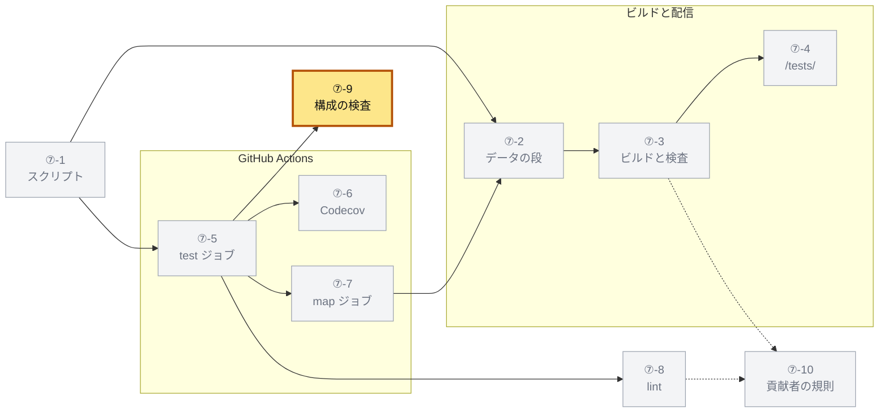

`verify-ci-gate.mjs` は、`ci.yml`、`map-preview.yml`（あれば）、`packages/*` と `apps/*` とルートの `package.json` を読む。
YAML は、自前の小さな読み取り（`parseWorkflow`）で読む。

| 書き方 | 読み方 |
|---|---|
| 入れ子のマッピング、ブロックのシーケンス | 字下げで読む |
| フローのシーケンス（`[main]`） | `,` で分ける |
| 引用符 | 両端が同じ引用符のときだけ外す |
| コメント | `#` で始まる行だけを飛ばす。<br>行末の `# …` は値に残る |
| ブロックスカラー（`\|`、`>`） | 行ごとに前後の空白を除いて `\n` でつなぎ、末尾の空行を落とす |

ジョブは、ステップの `run` の前後の空白を除いた文字列が、コマンドと一字一句同じかで探す。
そのため、`pnpm run build:map` と `pnpm run test:ci` は、それぞれ一つのステップの `run` に単独で書く。
行末のコメントは値に残るので、その `run` の行にはコメントを書かない。

| 検査 | 規則 | 道具で足したか |
|---|---|---|
| `assertWorkflowVerifiesMainPush` | `on.pull_request.branches` と `on.push.branches` に `main` がある | 前から |
| `assertStaticVerificationGate` | `pnpm run test:ci` を走らせるジョブに、`pnpm run build` → `pnpm run typecheck` → `pnpm run test:ci` の順のステップがある | 前から |
| `assertMapFollowsTests` | `pnpm run build:map` を走らせるジョブが、`pnpm run test:ci` を走らせるジョブを `needs` に持つ。<br>同じジョブならよく、どちらかが無ければ確かめない | 足した |
| `assertMapSharesPreviewGroup` | 地図のジョブの、ジョブの `concurrency.group` が空でなく、`map-preview.yml` の最上位の `concurrency.group` と同じ文字列である。<br>両方の `cancel-in-progress` が `false` である。<br>地図のジョブか `map-preview.yml` が無ければ確かめない | 足した |
| `assertEveryPackageIsTypechecked` | `packages/*` と `apps/*` のどの `package.json` にも `typecheck` がある | 前から。<br>新しい `test-catalog`、`test-reach`、`apps/tests` にも要る |
| `assertLintGateIsBacked` | `pnpm run lint` を走らせるなら、どこかのパッケージに `lint` があるか、ルートの `lint` が `node` で検査を走らせる | 前から |
| `assertRootScriptsCoverApps` | ルートの `typecheck` が `--filter "./apps/*" typecheck` を、`test:ci` が `--filter "./apps/*" test` を含む | 前から。<br>`apps/tests` のテストもこれで走る |

- 地図を後に置くのは、地図がテストのジョブの出力を読むからで、並べて走らせると結果の無いページができる
- group を同じにするのは [⑦-7-b](#-7-b-閉じた-pr-のプレビュー) の理由による
- 検査は表の順に走り、最初に落ちた検査の理由だけを標準エラーに出して、終了コード 1 で終わる
- すべて通ると `CI gate verified: main push trigger, build / typecheck / test order, the map after the tests and with the preview cleanup, typecheck coverage (packages and apps)` を出す
- 規則のテストは `verify-ci-gate.test.mjs` にあり、`pnpm run test:supply-chain` で走る

`assertMapSharesPreviewGroup` の比べ方は次のとおりである。

- 二つの group は、どちらも文字列にして前後の空白を除いてから比べる
- `cancel-in-progress` も文字列にして前後の空白を除き、`'false'` と比べる
- `cancel-in-progress` を書かないときは、`'false'` とみなす
- `map-preview.yml` の `concurrency` をジョブの中に置くと、最上位に無いので group は「なし」として落ちる

道具で足した二つの検査は、落ちると次の文を出す。

| 検査 | 文 |
|---|---|
| `assertMapFollowsTests` | ``CI の <地図のジョブ> ジョブは `pnpm run build:map` を実行しますが、`pnpm run test:ci` を実行する <テストのジョブ> ジョブを needs に持っていません。地図はテストの結果と到達をテストのジョブの出力から読むため、そのジョブの後に走らせてください。`` |
| `assertMapSharesPreviewGroup` | `CI の <地図のジョブ> ジョブの concurrency の group（<group か なし>）が、map-preview.yml の group（<group か なし>）と一致していないか、cancel-in-progress が false ではありません。プレビューの作成と削除を同じ group で順に走らせないと、閉じた PR のプレビューが削除の後に作り直されて残ります。` |

実装：

- `.github/scripts/verify-ci-gate.mjs`：`parseWorkflow`、`assertMapFollowsTests`、`assertMapSharesPreviewGroup`、`verifyCiGate`
- `.github/scripts/verify-ci-gate.test.mjs`

## ⑦-10 貢献者の規則

貢献者に課す書き方と、それを検査する場所を決める。

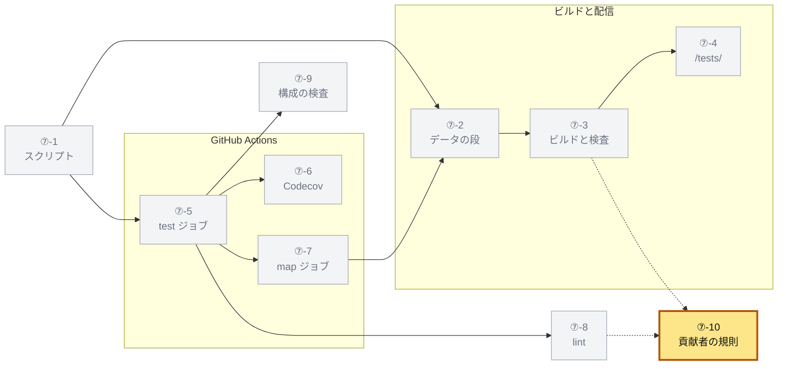

規則は、道具が要るものに限る。
無くても画面が欠けたり CI が落ちたりしない書き方は、課さずに勧める。

| 課す規則 | 理由 | 検査 |
|---|---|---|
| トップレベルの `describe` に関数名を書く | ユニットテストの対象を、その名前を import から型で引いて決める（[①-3-d](01-read.md#-3-d-describe-が名指す関数とコード)） | 検査しない。<br>引けないテストは対象の無いテストとして `tests.json` の `unknown.subject` に数える |
| E2E の spec は `tests/e2e/fixtures.ts` の `test` を使う | 計測した実行で到達を記録する（[②-7](02-measure.md#-7-e2e-のテストごとの到達)） | `lint-e2e-fixtures.mjs` |
| `// @test-id <id>` と `@id:<id>` で固定した id は一意にする | 一つの id は一つのテストを指す | `lint-tests.mjs`、`lint-features.mjs` |
| シナリオに `@id:`、対象のタグ、実行先のタグを付ける | カードの id と対象を決め、走らせる実行先を選ぶ | `lint-features.mjs` |
| ステップ定義の式は、単一引用符の一行の文字列で、穴の外を英語で書く | カタログが式を書かれたとおりに読み、訳の表の鍵にする | `lint-steps.mjs` |
| 未定義と曖昧なステップを作らない | 生成できないシナリオは走らない | `bddgen` |
| 訳の表の鍵は式か言い回しにし、穴を一度ずつ使う | 訳を機械で組み立てる | `lint-tests.mjs` |
| エンドポイントに届く実装の変更で、関連するテストを足しも変えもしないときは、変更メモのその関数の節に `テストを変えない理由:` で始まる行を書く | テストを変えない判断を、変更ごとに人にさせる | 地図の検査（[⑦-3-b](#-3-b-地図の検査)）。<br>行の読み方は ④ |

あれば表示が良くなるものは次のとおりである。

- `it` の直上の仕様のコメント（`// RFC 6749 §5.2: ...`）
- 日本語の訳（`it` の直上の `// ja: ...`、`Feature` と `Scenario` の下の `ja:` の行、`tests/steps/ja.yaml` の行）
- `it` の直上の `// @aspect <観点>` と `// @subject <関数の id>`（規則で観点や対象を拾えないときの補正）
- API テストのパスを、コードから読める形（文字列、`TEST_ISSUER` との連結、定数、パスを返す関数、[①-5-b](01-read.md#-5-b-url-の読み方)）で書くこと（実行時に組み立てたパスは行き先が `unknown` になり、エンドポイントの対象が付かない）

課さないものは次のとおりである。

- 既存のテストの書き直し（読めないテストは、対象や観点の無いテストとしてファイルと検索に出る）
- 生成したテスト（`.features-gen/`）のコミット
- 訳の欠け

規則を書いた場所は、次のとおりである。

| 場所 | 書いてある規則 |
|---|---|
| `apps/map/docs/design-test-catalog.md` の「8. 貢献者に課す規則」 | `describe` の関数名、機能ファイルのタグとステップ定義の式、`@test-id` の一意、E2E の spec の `test`、`テストを変えない理由:` の行と、あれば良くなるもの、課さないもの |
| `apps/map/README.md` の「変更メモと CI」 | 地図の検査が CI を落とす二つの条件と、雛形を作るコマンド |
| `apps/map/changes/README.md` の「テストを変えないとき」と「雛形を作る」 | 理由の行の読み方と、雛形の作り方 |
| `.github/scripts/lint-e2e-fixtures.mjs`、`lint-features.mjs`、`lint-steps.mjs`、`lint-tests.mjs` の先頭のコメント | 各 lint の規則 |
| `packages/test-catalog/src/lint.ts` の先頭のコメントと `tests/steps/ja.yaml` の先頭のコメント | 訳の表の鍵と穴、固定した id |
| `tests/catalog/aspects.yaml` の先頭のコメント | 観点の決まり方と宣言 |

`describe` の規則を書いた場所は、設計の §8 だけである。

実装：

- `apps/map/docs/design-test-catalog.md`
- `apps/map/README.md`
- `apps/map/changes/README.md`
- `tests/catalog/aspects.yaml`
- `tests/steps/ja.yaml`

## この章の出力

⑦ は最後の部で、ほかの部には渡さない。
人と CI が受け取るものは次のとおりである。

- `<地図の URL>/tests/` のテストのページ（PR ごとのプレビューと、main の本番）
- 地図の PR のコメント（`### テスト` の節、`この PR のテスト` と Codecov へのリンク）
- Codecov の PR のコメント（patch coverage、失敗したテスト、flaky なテスト）
- artifact の `test-reports`、`oidc-provider-map`、`oidc-e2e-reports`
- CI の合否（lint、`test:ci-gate`、地図の検査の `untested`）

[全体像](README.md) ｜ ← [⑥ テストのページ](06-viewer.md) ｜ ⑦ ビルドと CI
