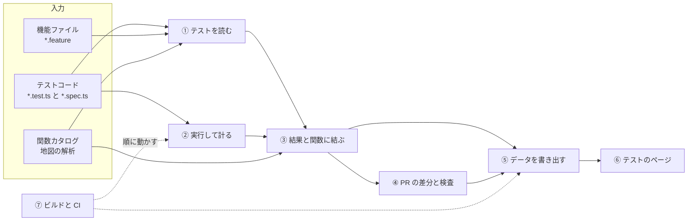
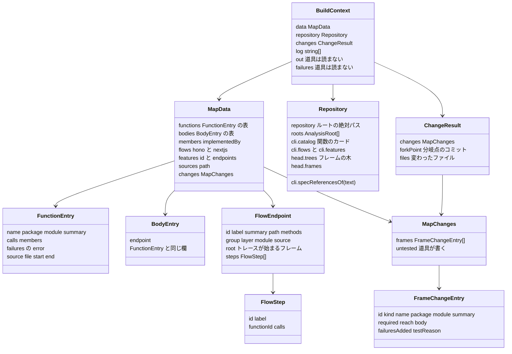
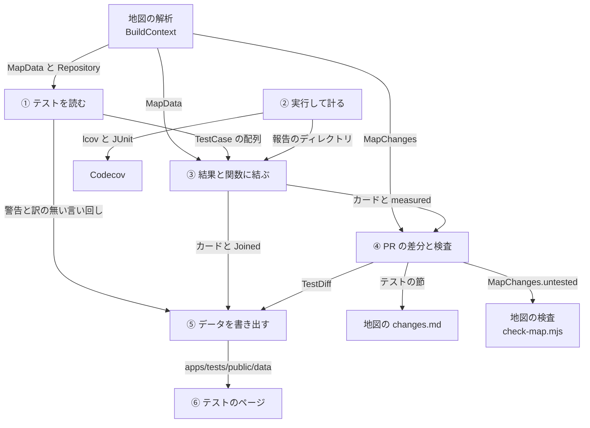
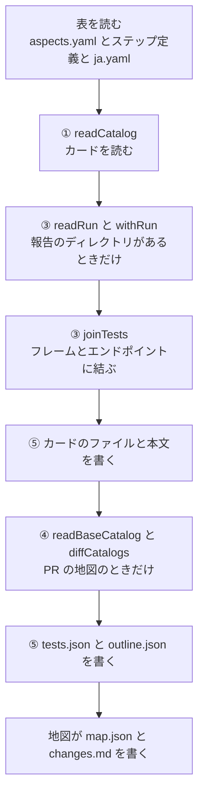
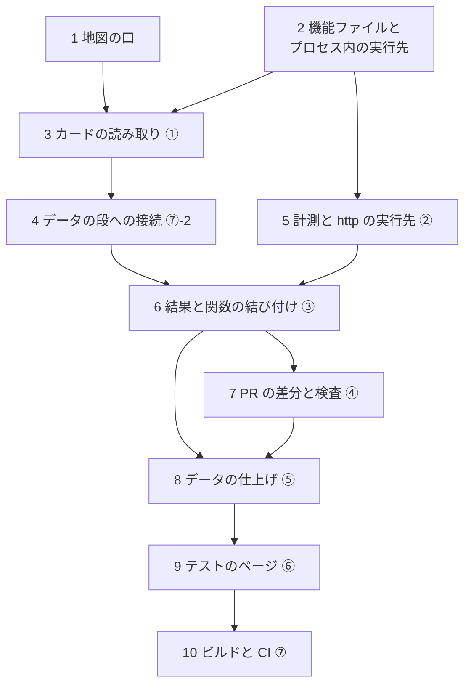

# テストツールの全体像

このフォルダは、テストツール（以下、道具）の実装を記す。
文書だけを読んで、同じ振る舞いの道具を作り直せることを目指す。
設計の経緯は `apps/map/docs/design-test-catalog.md` にあり、設計とコードが違うところはコードに合わせて書く。

## 道具がすること

道具は、テストを実行せずにコードと機能ファイルから読み、テストケースを一つずつ**カード**にする。
CI では計測つきでテストを走らせ、結果と、テストが実際に通った関数を書き出す。
カードを地図の関数カタログとエンドポイントに結び、PR では変更前とのテストの差分を出す。

エンドポイントに届く実装の変更で、関連するテストを変えず理由も無いものは、地図の検査で CI を落とす。
カードはテストのページ（`apps/tests`）に出し、地図と同じ Worker の `/tests/` で配る。

① から ⑦ が道具の部で、章の番号と同じである。
実線はデータの流れを表す。
点線は ⑦ が部を動かす順を表す。
CI はまず ② を走らせ、次に地図のビルドの中で ① ③ ④ ⑤ を一度に動かし、⑥ をビルドする。

関数カタログは、地図の解析（`packages/map-analysis`）が作る入力である。
道具はその結果を読むだけで、作り方はこの文書の範囲の外にある。
読むものは「地図から使うもの」の節に限る。

## 部と章

| 部 | 章 | すること | 実装のディレクトリとファイル |
|---|---|---|---|
| ① テストを読む | [01-read.md](01-read.md) | テストコードと機能ファイルを読み、カードにする | `packages/test-catalog/src`（`discover.ts`、`read-code.ts`、`read-feature.ts`、`vocabulary.ts`、`words.ts`、`catalog.ts`、`id.ts`、`aspects.ts`、`lint.ts`）、`tests/features`、`tests/steps`、`tests/catalog/aspects.yaml` |
| ② 実行して計る | [02-measure.md](02-measure.md) | テストを走らせ、結果と到達を報告のディレクトリに書く | `packages/test-reach/src`、各パッケージの `vitest.config.ts`、`tests/e2e/fixtures.ts`、`tests/e2e/reach`、`tests/e2e/playwright.config.ts`、`tests/steps/playwright.config.ts`、`apps/hono/src/server.ts`、`apps/nextjs/src/instrumentation.ts`、`apps/nextjs/next.config.mjs` |
| ③ 結果と関数に結ぶ | [03-join.md](03-join.md) | 結果と到達をカードに足し、フレームとエンドポイントに結ぶ | `packages/test-catalog/src/run.ts`、`build.ts`（`withRun`）、`join.ts` |
| ④ PR の差分と検査 | [04-pull-request.md](04-pull-request.md) | 変更前後のカードを比べ、関連するテストの変わらない変更を落とす | `packages/test-catalog/src`（`diff.ts`、`markdown.ts`、`draft.ts`、`build.ts` の `readBaseCatalog`）、`packages/map-analysis/src`（`changes.ts`、`notes.ts`、`check.ts`、`draft.ts`）、`apps/map/scripts/draft-notes.mjs`、`check-map.mjs` |
| ⑤ データを書き出す | [05-data.md](05-data.md) | テストのページが読むファイルを書く | `packages/test-catalog/src/build.ts`、`model.ts` |
| ⑥ テストのページ | [06-viewer.md](06-viewer.md) | データを読んで画面を出す | `apps/tests` |
| ⑦ ビルドと CI | [07-build-ci.md](07-build-ci.md) | 部を順に動かし、配り、検査する | `package.json` の `scripts`（ルート、`apps/map`、`apps/tests`、`packages/test-catalog`、`packages/test-reach`、`tests/e2e`、`tests/steps`）、`apps/map/scripts/build-data.mjs`、`copy-tests-viewer.mjs`、`check-map.mjs`、`.github/workflows/ci.yml`、`map-preview.yml`、`codecov.yml`、`.github/scripts/lint-e2e-fixtures.mjs`、`lint-features.mjs`、`lint-steps.mjs`、`lint-tests.mjs`、`verify-ci-gate.mjs`、`.gitignore`、`README.md`、`apps/map/changes/README.md`、`.changeset/test-map-no-release.md` |

## 章の読み方

どの章も同じ形で書く。

1. 先頭に全体の図を置き、その章の部を黄色で示す
2. 「入力」「出力」「実装」の表で、部の境界を示す
3. 章の中の図で節の順を示し、節の番号（③-2 など）を図と同じにする
4. 節は、決めることを一文で述べ、規則を表と図で示し、最後の「実装：」の行に場所を書く
5. 章の最後の「この章の出力」が、次の部が受け取るものである

## 地図から使うもの

道具は、地図のビルド（`buildMap`）の拡張として、同じプロセスで動く。
地図は解析を終えると、`map.json` を書く前に `BuildOptions.extend` を呼び、`BuildContext` を渡す。
拡張が返す `{ sections }` は、地図が `changes.md` の末尾に足す。
道具が読むのは、次の図のフィールドに限る。

`BuildContext` の `out` と `failures` は必須の欄である。
自分で組むとき（④ の `draftTests`）は、`out: ''` と空の `Map` を渡す。

`changes` は PR の地図（`MAP_BASE` があるビルド）のときだけある。
`Repository.cli.flows`、`cli.features`、`head.frames` は、地図のデータを持たない `changes:draft` が `MapData` の代わりを組むときに使う（④）。
`flows` は、エンドポイントの索引（`EndpointIndex`）を作るときだけ 4 つのフレームワークを全部読み、ほかでは `hono` と `nextjs` だけを読む。

道具が名指す id は、地図の id をそのまま使う。

| もの | id の形 | 例 |
|---|---|---|
| 関数カタログの関数 | `<root>:<module>#<name>`。root は `core`、`experimental`、`google-login`、`hono`、`nextjs` | `core:client-auth.ts#verifyClientSecret` |
| エンドポイントの処理本体 | hono は `endpoint:<エンドポイント>`、Next.js は `endpoint:nextjs:<エンドポイント>` | `endpoint:token` |
| interface のメンバー | `<root>:<module>#<型>.<メンバー>` | |
| ソースのファイル | `<root>:<module>`（`MapData.sources` の鍵） | `core:access-token-issuer.ts` |
| エンドポイント | 道具の鍵は `<source>:<エンドポイント>`。source は `hono` か `nextjs` | `hono:token` |

エンドポイントの `root` は、処理本体（`endpoint:…`）か関数カタログの関数で、どちらかは決まっていない。
道具は、どちらかを決めつけず、必ず `FlowEndpoint.root` を読む。

このブランチでは、hono は 17 個中 14 個が処理本体、Next.js は 17 個中 13 個が関数である。
hono で関数から始まるのは、`authorize`、`login-google`、`userinfo` である。
Next.js の関数は、Route Handler 12 個とサーバーアクション `loginAction` である。

道具は、地図の解析の次の関数と口も使う。

| 関数 | 道具での使い道 | 部 |
|---|---|---|
| `Compiler`、`overlayConfigs`、`overlayOf`、`catalogModules` | テストのファイルを、地図と同じ TypeScript のプロジェクトで読む | ① |
| `Resolver.reference(node)` | 名前を型で引き、`kind` が `function` なら関数カタログの `id` を得る | ① |
| `walk`、`is`、`SyntaxKind`、`textOf`、`stringOf`、`nameOf`、`startLine`、`endLine`、`unwrap`、`any`、`isAlias`、`getLeadingCommentRanges` | 構文木を読む | ① |
| `isTestPath(path)` | テストのファイルかを決める（`/\.(test\|spec)\.(c\|m)?[jt]sx?$/` か `.feature`） | ①④ |
| `git(root, args)` | `ls-files`、`ls-tree`、`show` を走らせる | ①④ |
| `readRoots` | `packages/cli/extract.json` から根を読む | ① |
| `nodesOf(nodes)` | 木のノードを平らにたどる | ⑤ |
| `writeHashed`、`removeStale` | 内容のハッシュの名前でファイルを書き、書かなかったものを消す | ⑤ |
| `changesMarkdown` の `sections`、`checkMap` の `untested`、`writeDraft` の `tests` | 道具のために地図の解析に足した口。PR のコメントのテストの節、地図の検査、変更メモの雛形のテストの欄に使う | ④ |

## 部の間で渡すもの

部の間では、同じプロセスのオブジェクトか、ファイルが渡る。

| 元 | 先 | 渡すもの | 形 |
|---|---|---|---|
| 地図 | ① | `MapData`、`Repository`（根、関数カタログ、木） | オブジェクト |
| ① | ③ | カードの配列 `TestCase[]` | オブジェクト |
| ① | ⑤ | 読みの警告と、訳の無い言い回し | 文字列の配列。警告はビルドのログ、言い回しは `tests.json` の `untranslated` に入る |
| ② | ③ | 報告のディレクトリの `vitest/*.json`、`playwright/<実行先>.json`、`reach/*.jsonl`（一行に `RawReach` 一つ） | ファイル。CI では artifact `test-reports` で渡る |
| ② | Codecov | `coverage/vitest/<パッケージ>/lcov.info`、`coverage/e2e/<実行先>/lcov.info`、`junit/*.xml` | ファイル |
| ③ | ④ | `result`、`reach`、`evidence` を足したカードと、計測したかどうか（`measured`） | オブジェクト |
| ③ | ⑤ | 同じカードと、`Joined`（フレームとエンドポイントごとのテストと不足） | オブジェクト |
| 地図 | ④ | `MapChanges`、分岐点のコミット、変わったファイル | オブジェクト |
| ④ | ⑤ | `TestDiff` | オブジェクト。⑤ が `tests/diff.json` に書く |
| ④ | 地図 | `changes.md` に足す節（`### テスト`）、`MapChanges.untested` | 文字列とフィールド。地図が `changes.md` と `map.json` に書く |
| ⑤ | ⑥ | `tests.json`、`outline.json`、`tests/by-file/<hash>.json`、`tests/sources/<hash>.json`、`tests/diff.json` | ファイル（`apps/tests/public/data`） |

一回のビルドの中では、拡張の関数 `buildTests` が部を次の順に動かす。

② だけは別の時に動く。
CI の `test` ジョブが報告を書き、後の `map` ジョブのビルドがそれを読む（⑦）。

## 用語

| 用語 | 意味 | コードの名前 |
|---|---|---|
| テストケース | `it` か `test` の一つ（`it.each` も一つ）、または機能ファイルのシナリオの一つ。シナリオアウトラインは例の行の一つ | |
| カード | テストケース一つの記録。種類、対象、期待結果、結果、到達を持つ | `TestCase`（索引では `TestEntry`） |
| 種類 | `unit`（ユニット）、`api`（API）、`e2e`（E2E）、`tool`（ツール） | `TestKind` |
| root | テストが属する単位。関数カタログの根の名前、`e2e`、`features`、ツールの名前 | `TestCase.root` |
| 地図 | OIDC Provider Map。`apps/map` の画面と、`packages/map-analysis` の解析 | |
| 地図のデータの段 | 地図のデータを作るスクリプト。道具もここで動く | `apps/map/scripts/build-data.mjs` |
| 関数カタログ | 地図が読む関数の一覧。`packages/core/src`、`packages/experimental/src`、`packages/google-login/src`、`apps/hono/src/oidc-provider`、`apps/hono/src/web`、`apps/nextjs/src/app` の関数 | `MapData.functions` |
| エンドポイントの処理本体 | エンドポイントの本体のうち、関数カタログの関数でないもの。例は hono の `tokenApp.post('/', async (c) => { … })` の無名の handler | `MapData.bodies` |
| フレーム | 関数カタログの関数と、エンドポイントの処理本体をまとめた呼び名。地図はフレームごとに処理の流れの木を持つ | フレームの id |
| エンドポイント | hono と Next.js のエンドポイント。それぞれ 17 個ある | `<source>:<id>` |
| ステップ | エンドポイントの処理の一段。hono のステップはほとんどが自分の関数を持つ（このブランチで 125 個中 121 個）。Next.js のステップは Route Handler の中の `// [step-id]` のブロックである | `FlowStep`、`OutlineStep` |
| 対象 | テストが確かめるもの。関数、エンドポイント、interface のメンバー | `Subject` |
| 根拠 | 対象を決めた理由。宣言（`declared`）、コード（`static`）、到達（`coverage`） | `Evidence` |
| 期待結果 | `expect(...)` 一つか `Then` のステップ一つを言葉にしたもの | `Assertion` |
| 正常系、異常系 | 期待結果から決める、成功を期待するか失敗を期待するか。決まらないものは `unknown` | `TestOutcome` |
| 観点 | 正常系か異常系かとは別の軸。境界値、認証、認可、セキュリティ | `aspects`、`tests/catalog/aspects.yaml` |
| ヘルパー | テストが呼ぶ、テスト用のファイルの関数。確かめる関数はヘルパーではない | `HelperRef` |
| 機能ファイル | Gherkin で書いたテスト | `tests/features/**/*.feature` |
| シナリオのステップ | 機能ファイルの `Given`、`When`、`Then` の一行。エンドポイントのステップとは別のもの | `FeatureStep` |
| ステップ定義 | シナリオのステップに合う Cucumber Expression と、その処理 | `tests/steps/**/*.steps.ts` |
| 訳の表 | ステップの式と期待結果の言い回しの日本語 | `tests/steps/ja.yaml` |
| 宣言した実行先 | カードに書く、テストが走る相手。E2E の spec はいつも `hono` と `nextjs`、シナリオはタグの `hono`、`nextjs`、`http` | `TestCase.targets` |
| 結果と到達の実行先 | 実行が結果と到達を分ける鍵。Vitest の結果は `''` で、その到達は鍵を持たない。E2E の spec と `@http` のシナリオは、E2E の実行が立てた OP の `hono` か `nextjs`。プロセス内のシナリオは project の名前から取る `hono` か `nextjs` | `TestResult.targets` の鍵、`TestReach.target` |
| 報告のディレクトリ | 実行が結果と到達を書くディレクトリ。書く側は `MARONN_TEST_REPORTS`、無ければ `MARONN_REACH=1` のとき `<リポジトリ>/work/test-reports`。読む側は `MAP_TEST_REPORTS` で名指す | `reportsDirectory()`（`packages/test-reach/src/env.js`）、`TestBuildOptions.reports` |
| 計測した実行 | `MARONN_REACH=1` で走らせた実行 | `TestsIndex.measured` |
| 到達 | 計測した実行で、テストが実行先ごとに通った関数と、送ったリクエストの列 | `TestReach`（生の行は `RawReach`） |
| 不足 | テストが確かめていないことを、規則で求めたもの | `Gap` |
| 変更メモ | PR が変えた関数ごとに、なぜ変えたかを書く Markdown | `apps/map/changes/*.md` |
| 関連するテスト | 変えたフレームを名指すか、確かめるところで呼ぶか、到達したテスト。計測が無いときは、変更が届くエンドポイントへリクエストする API と E2E のテスト | `TestDiff.frames[].related` |
| テストを変えない理由 | 関連するテストを変えない変更を通すための、変更メモの行 | `FrameChangeEntry.testReason` |
| 索引 | テストのページが最初に読むファイル | `tests.json`（`TestsIndex`） |
| アウトライン | エンドポイントとステップと関数の抜き出し | `outline.json`（`TestsOutline`） |

## 再現の手順

作る順と、それぞれが正しいかの確かめ方を示す。
矢印は、先に作るものを表す。
スクリプトとファイルは、それを最初に使う手順で作る。

例の数は、このブランチの作業ツリーと、`work/test-reports` に残る計測した実行（`tests.json` の `run.at` が `2026-11-07T13:11:32.141Z`）の値である。
コードやテストが変われば変わる。

どの手順も、確かめる前に `pnpm run build` でパッケージをビルドしておく。
手順 3 からは、この `build` が `map-analysis` と `test-catalog` もビルドする。
コマンドはリポジトリのルートで走らせる。

### 1. 地図の口

作るもの：

- `buildMap` が `BuildOptions.extend` を受け取り、`map.json` を書く前に `BuildContext` を渡して呼ぶ
- `changesMarkdown` が、拡張の返す `sections` を `changes.md` の末尾に置く
- `Repository.cli` に `specReferencesOf(text)` を足す（`packages/map-analysis/src/cli.ts` が、CLI の `extract/functions.js` から読む）
- 「地図から使うもの」の関数と型を、`packages/map-analysis/src/index.ts` から export する

確かめ方：

- `pnpm --filter @maronn-openid-connect/map-analysis test` が通る
- `changesMarkdown` が拡張の節を末尾に置くテストと、`isTestPath` のテストを含める

例：地図は関数 1,070 とエンドポイントの処理本体 18 を持つ。
hono と Next.js のエンドポイントは 17 ずつである。

### 2. 機能ファイルとプロセス内の実行先

作るもの：

- `tests/features/token/*.feature`（タグ `@hono` と `@nextjs` のシナリオ）と、`tests/catalog/aspects.yaml`
- パッケージ `@maronn-openid-connect/test-steps`（`tests/steps`）の `support/target.ts`、`support/in-process.ts`、`support/drivers/`、`common/*.steps.ts`、`in-process/*.steps.ts`、`ja.yaml`、三つの `tsconfig`
- `tests/steps/playwright.config.ts` の二つの project（⑦-1-c）
- `tests/steps/package.json` の `test`（`bddgen && playwright test`）、`lint`（ここでは `bddgen` だけ）、`typecheck`
- ルートの `test:features`
- `.github/scripts/lint-features.mjs` と `lint-steps.mjs`、ルートの `lint` に足す三つの項（二つの lint と `test-steps` の `lint`）
- `.gitignore` の `.features-gen/` と `tests/steps/test-results/`

http の実行先は、② の fixture（`tests/e2e/fixtures.ts`）で到達を記録するので、手順 5 で足す。
それまで `steps` の glob に `http/*.steps.ts` は入れない。

確かめ方：

- `pnpm run test:features` が、プロセス内の二つの実行先で通る
- `node .github/scripts/lint-features.mjs` が `Feature files verified.` を出す
- `node .github/scripts/lint-steps.mjs` が `Step definitions verified.` を出す
- `node --test .github/scripts/lint-features.test.mjs .github/scripts/lint-steps.test.mjs` が通る
- `pnpm --filter @maronn-openid-connect/test-steps lint` と `typecheck` が通る

例：機能ファイル 3 個のシナリオ 7 件（シナリオアウトラインは例の行ごとに数える）が、二つの実行先で 14 件通る。

### 3. カードの読み取り ①

作るもの：

- パッケージ `@maronn-openid-connect/test-catalog`（`build` は `tsc`、export は ⑦-1-d）
- `packages/test-catalog/src` の `model.ts`、`discover.ts`、`id.ts`、`words.ts`、`aspects.ts`、`vocabulary.ts`、`read-code.ts`、`read-feature.ts`、`catalog.ts`、`lint.ts`
- ルートの `build` に、`map-analysis` と `test-catalog` を足す
- `.github/scripts/lint-tests.mjs` と、ルートの `lint` のその項

確かめ方：

- `words.test.ts`、`read-code.test.ts`、`id.test.ts`、`features.test.ts` を書く
- `repository.test.ts` で、リポジトリの全テストを警告なしに読み、id が重ならないことを確かめる
- `pnpm run build` の後、`node .github/scripts/lint-tests.mjs` が `Tests verified.` を出す

例：465 ファイルから 6,008 枚。
内訳は、ユニット 4,586、API 154、E2E 122、ツール 1,146 である。

### 4. データの段への接続 ⑦-2

作るもの：

- `apps/map/scripts/build-data.mjs` が、`buildMap` の `extend` に `(context) => buildTests(context, { out, reports })` を渡す
- `buildTests` は、最初は `tests.json` だけを書けばよい
- `apps/map/package.json` の devDependencies に `test-catalog` を足す
- ルートの `build:map` で、`map` の前に `test-catalog` をビルドする
- `.gitignore` の `apps/tests/public/data/`

確かめ方：

- `pnpm --filter @maronn-openid-connect/test-catalog build && pnpm --filter @maronn-openid-connect/map run data` のログに、`tests: <数> cases` の行が出る
- 報告を渡していないので、その行は `no run` を含む

### 5. 計測と http の実行先 ②

作るもの：

- パッケージ `@maronn-openid-connect/test-reach`（`packages/test-reach/src`）と、各 `vitest.config.ts` の `testReports`
- 計る 5 パッケージの devDependencies の `@vitest/coverage-istanbul`（`5.0.5`）
- `apps/hono/src/server.ts`、`apps/nextjs/src/instrumentation.ts`、`apps/nextjs/next.config.mjs`
- `tests/e2e/fixtures.ts`、`tests/e2e/reach`、spec の `test` の import 先、`tests/e2e/playwright.config.ts` のレポーターと `reachRun` と `reachEnv`
- `tests/e2e/package.json` の `test:unit` と、ルートの `test:ci` のその項
- `.github/scripts/lint-e2e-fixtures.mjs` と、ルートの `lint` のその項
- `tests/steps/playwright.config.ts` のレポーター（`MARONN_TEST_REPORTS` か `MARONN_REACH=1` のとき）
- `packages/cli/src/__tests__/test-reach-isolation.test.ts`

http の実行先として、次を足す。

- `tests/steps/support/http.ts`、`tests/steps/http/*.steps.ts`、`@http` のシナリオの機能ファイル、`steps` の glob の `http/*.steps.ts`
- `tests/e2e/playwright.config.ts` の project `http` と、`OIDC_CLIENTS_JSON` のクライアント `e2e-features-client`（⑦-1-c）
- `tests/e2e` の devDependencies の `playwright-bdd` と、`test:e2e:app-hono` と `test:e2e:app-nextjs` の `bddgen &&`
- `tests/steps` の `lint` の後半 `&& bddgen -c ../e2e/playwright.config.ts`

確かめ方：

- `pnpm --filter @maronn-openid-connect/test-reach test` と `pnpm --filter @maronn-openid-connect/e2e test:unit` が通る
- `packages/cli` の `test-reach-isolation.test.ts` が通る
- `node .github/scripts/lint-e2e-fixtures.mjs` が `E2E specs take test from tests/e2e/fixtures.ts.` を出す
- `pnpm --filter @maronn-openid-connect/test-steps lint` が、二つの設定の生成で通る
- `MARONN_REACH=1 pnpm --filter @maronn-openid-connect/core test` で、`work/test-reports` に `vitest/core.json`、`junit/vitest-core.xml`、`reach/vitest-core.jsonl`、`coverage/vitest/core/lcov.info` ができる
- `MARONN_REACH=1 pnpm run test:e2e` で、`playwright/hono.json`、`reach/e2e-hono.jsonl`、`coverage/e2e/hono/lcov.info` ができる（Next.js の分は `nextjs` の名前で）

例：到達の行は、Vitest の 5 パッケージで 4,880 行。
E2E は実行先ごとに 122 行で、spec が 121 行、`@http` のシナリオが 1 行である。

### 6. 結果と関数の結び付け ③

作るもの：

- `run.ts` の `readRun`、`build.ts` の `withRun`、`join.ts`

確かめ方：

- `join.test.ts`（`readRun`、`joinTests`、`reachableFrames`）と `build.test.ts`（`indexRefs`）を書く
- `withRun` には直接のテストが無いので、データの段を報告つきで走らせ、ログの `results`、`the reach of`、`unmatched` を見る
- コマンドは `MAP_TEST_REPORTS=$PWD/work/test-reports pnpm --filter @maronn-openid-connect/map run data` である
- 相対パスは `apps/map` から解かれ、`no run` になるので、絶対パスで渡す（⑦-2）

例：結果 5,707 件、到達 4,855 件、テストに合わない結果 0 件、合わない到達 0 件。
テストのあるフレーム 1,052、エンドポイント 34、不足 350。

### 7. PR の差分と検査 ④

作るもの：

- `packages/map-analysis` の `changes.ts`（`testFiles`、`forkPoint`、`files`）、`notes.ts`（理由の行）、`check.ts`（`untested`）、`draft.ts`（テストの欄）
- `packages/test-catalog` の `readBaseCatalog`、`diff.ts`、`markdown.ts`、`draft.ts`
- `apps/map/scripts/draft-notes.mjs`

確かめ方：

- `map-analysis` の `notes.test.ts`、`check.test.ts`、`changes.test.ts` と、`test-catalog` の `join.test.ts` の `diffCatalogs` を書く
- `MAP_BASE=origin/main pnpm --filter @maronn-openid-connect/map run data` の後、`apps/map/public/data/changes.md` の末尾に `### テスト` が付く
- 同じとき、`apps/tests/public/data/tests/diff.json` ができる
- `pnpm --filter @maronn-openid-connect/map run check` が、`changes whose tests did not change without a reason` の数を出す

例：このブランチでは 5,731 → 6,008 件（277 件の追加）、検査に落ちる変更は 0。

### 8. データの仕上げ ⑤

作るもの：

- `build.ts` の `buildTests`（カードのファイル、本文、`outline.json`、`tests.json`、`tests/diff.json`）
- `model.ts` の型

確かめ方：

- `build.test.ts`（`indexRefs`、`outlineOf`、`stepBlocks`、`codeOfFrame`、`shownFiles`）を書く
- `apps/tests/public/data` の中身を見る

例：1,312 ファイル、合計 25.3 MB である（この手順の 1 MB は 1,000,000 バイト）。

| ファイル | 数 | 大きさ |
|---|---|---|
| `tests.json` | 1 | 4.2 MB |
| `outline.json` | 1 | 0.5 MB |
| `tests/by-file/`（カード） | 465 | 14.1 MB |
| `tests/sources/`（本文） | 844 | 6.4 MB |
| `tests/diff.json`（PR の地図だけ） | 1 | 0.1 MB |

### 9. テストのページ ⑥

作るもの：

- `apps/tests`（パッケージ `@maronn-openid-connect/tests`）の `src/lib`（純粋な処理）と `src/components`（画面）

確かめ方：

- `pnpm --filter @maronn-openid-connect/tests test` で、`src/lib` の 10 個のテストのファイルが通る
- `pnpm --filter @maronn-openid-connect/tests dev` で `http://127.0.0.1:3620` を開く
- データが無いときは、データを作る手順が出る

例：ホームに、テストの数、最新の結果、エンドポイントごとの数が出る。

### 10. ビルドと CI ⑦

作るもの：

- `apps/map/package.json` の `viewer` と、`build` のその段
- `apps/map/scripts/copy-tests-viewer.mjs` と、そのテスト
- `ci.yml` の `test` と `map` のジョブ、`map-preview.yml`、`codecov.yml`
- `verify-ci-gate.mjs` の二つの検査（`assertMapFollowsTests`、`assertMapSharesPreviewGroup`）
- `.changeset/test-map-no-release.md`

確かめ方：

- `pnpm --filter @maronn-openid-connect/map test`（`copy-tests-viewer.test.mjs` を含む）が通る
- `pnpm run test:ci-gate`、`pnpm run test:supply-chain`、`pnpm run lint` が通る
- `pnpm run build:map` の終わり近くに、`Copied the tests viewer to ...` と `Checked the map: ...` が出る（その後に配線の検査の JSON が出る）
- プレビューの URL があるとき、地図のコメントに `この PR のテスト:` の行が付く
- URL は、同じリポジトリの PR で、Cloudflare のシークレットがあるときに出る
- デプロイが URL を返さなければ、その行は付かない

例：`apps/map/dist/tests` に 1,315 ファイル、24.5 MB（スクリプトの表示で、1 MB は 1,048,576 バイト）。
