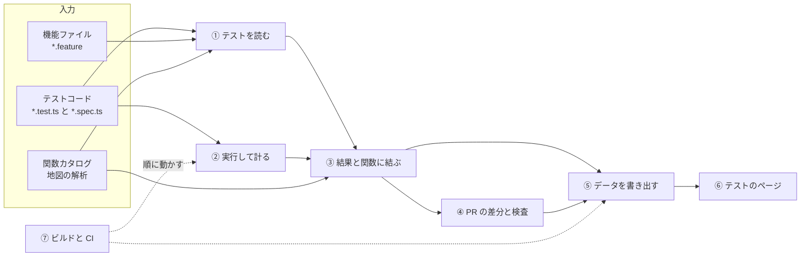
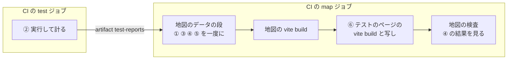
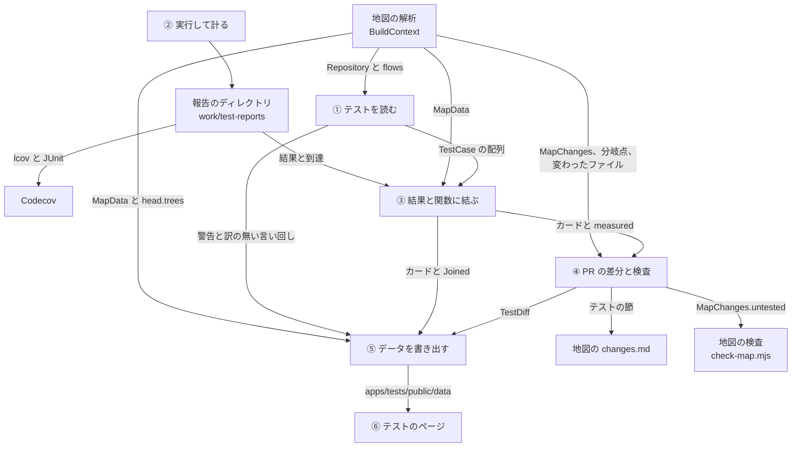
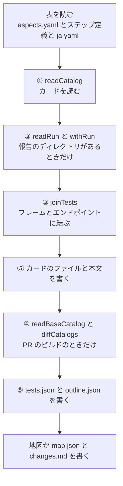
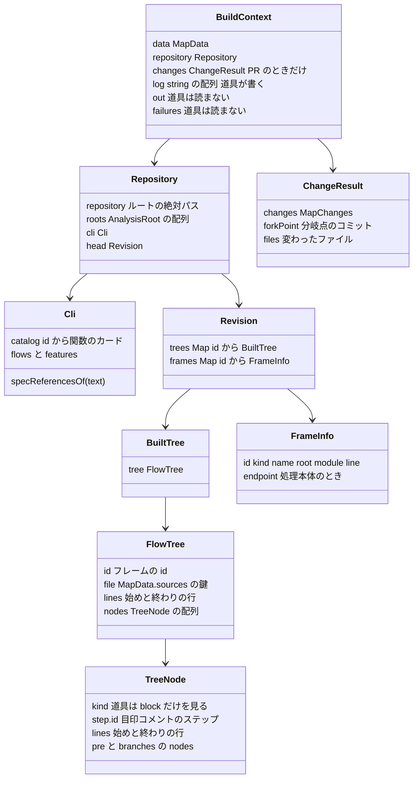
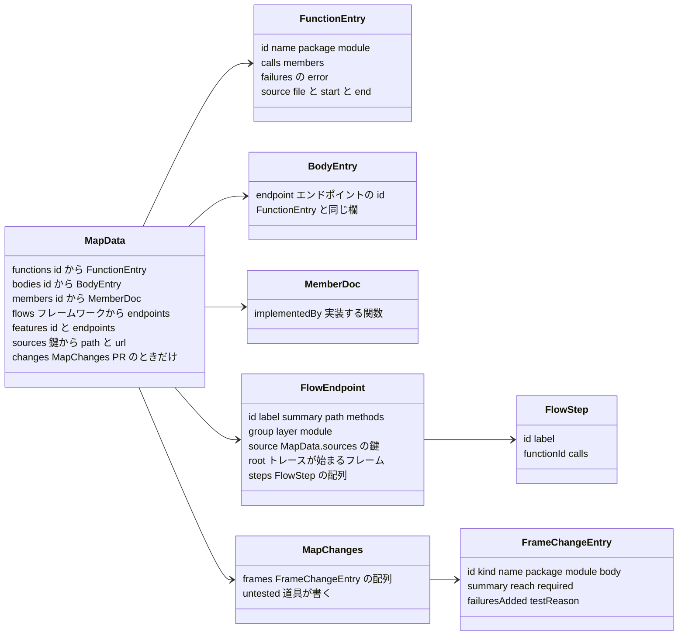
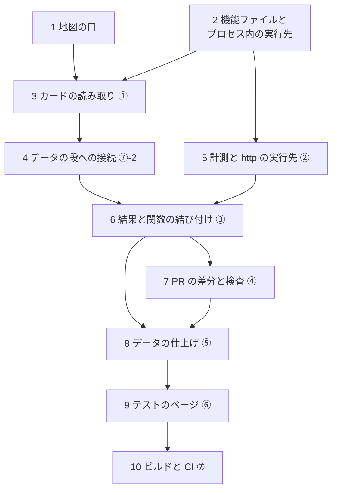

# テストツールの全体像

このフォルダは、テストツール（以下、道具）の実装を記す。
文書だけを読んで、同じ振る舞いの道具を作り直せることを目指す。
設計の経緯は [design-test-catalog.md](../../map/docs/design-test-catalog.md) にある。
設計とコードが違うところは、コードに合わせて書く。

## 道具がすること

道具は、テストを実行せずにテストコードと機能ファイルを読み、テストケースを一つずつカードにする。
CI では計測つきでテストを走らせ、結果と、テストが実際に通った関数を書き出す。
カードを地図の関数カタログとエンドポイントに結び、PR では変更前とのテストの差分を出す。

エンドポイントに届く実装の変更で、関連するテストを変えず理由も無いものは、地図の検査で CI を落とす。
カードはテストのページ（`apps/tests`）に出し、地図と同じ Worker の `/tests/` で配る。

- ① から ⑦ が道具の部で、章の番号と同じである
- 実線はデータの流れである
- 点線は、⑦ が部を動かすことを示す（動く順は下の図）
- 関数カタログは、地図の解析（`packages/map-analysis`）が作る入力である
- 道具はその結果を読むだけで、読むものは「[地図から使うもの](#地図から使うもの)」に限る

⑦ は、部を次の順に動かす。

- map ジョブの四つの箱は、`pnpm run build:map` が順に走らせる（[⑦-3](07-build-ci.md#-3-地図のビルドと検査)）
- ④ は PR のビルドのときだけ動く
- データの段の中の順は「[部の間で渡すもの](#部の間で渡すもの)」の二つ目の図にある

## 部と章

| 部 | 章 | すること | 実装のディレクトリとファイル | 作る手順 |
|---|---|---|---|---|
| ① テストを読む | [01-read.md](01-read.md) | テストコードと機能ファイルを読み、カードにする | `packages/test-catalog/src`（`discover.ts`、`read-code.ts`、`read-feature.ts`、`vocabulary.ts`、`words.ts`、`catalog.ts`、`id.ts`、`aspects.ts`、`lint.ts`）、`tests/features`、`tests/steps`、`tests/catalog/aspects.yaml` | [2](#2-機能ファイルとプロセス内の実行先)、[3](#3-カードの読み取り) |
| ② 実行して計る | [02-measure.md](02-measure.md) | テストを走らせ、結果と到達を報告のディレクトリに書く | `packages/test-reach/src`、各パッケージの `vitest.config.ts`、`tests/e2e/fixtures.ts`、`tests/e2e/reach`、`tests/e2e/playwright.config.ts`、`tests/steps/playwright.config.ts`、`apps/hono/src/server.ts`、`apps/nextjs/src/instrumentation.ts`、`apps/nextjs/next.config.mjs` | [5](#5-計測と-http-の実行先) |
| ③ 結果と関数に結ぶ | [03-join.md](03-join.md) | 結果と到達をカードに足し、フレームとエンドポイントに結ぶ | `packages/test-catalog/src/run.ts`、`build.ts`（`withRun`）、`join.ts` | [6](#6-結果と関数の結び付け) |
| ④ PR の差分と検査 | [04-pull-request.md](04-pull-request.md) | 変更前後のカードを比べ、関連するテストの変わらない変更を落とす | `packages/test-catalog/src`（`diff.ts`、`markdown.ts`、`draft.ts`、`build.ts` の `readBaseCatalog`）、`packages/map-analysis/src`（`changes.ts`、`notes.ts`、`check.ts`、`draft.ts`）、`apps/map/scripts/draft-notes.mjs`、`check-map.mjs` | [7](#7-pr-の差分と検査) |
| ⑤ データを書き出す | [05-data.md](05-data.md) | テストのページが読むファイルを書く | `packages/test-catalog/src/build.ts`、`model.ts` | [4](#4-データの段への接続-2)、[8](#8-データの仕上げ) |
| ⑥ テストのページ | [06-viewer.md](06-viewer.md) | データを読んで画面を出す | `apps/tests` | [9](#9-テストのページ) |
| ⑦ ビルドと CI | [07-build-ci.md](07-build-ci.md) | 部を順に動かし、配り、検査する | 各 `package.json` の `scripts`、`apps/map/scripts/build-data.mjs`、`copy-tests-viewer.mjs`、`check-map.mjs`、`.github/workflows/ci.yml`、`map-preview.yml`、`codecov.yml`、`.github/scripts/` の `lint-e2e-fixtures.mjs`、`lint-features.mjs`、`lint-steps.mjs`、`lint-tests.mjs`、`verify-ci-gate.mjs` | [4](#4-データの段への接続-2)、[10](#10-ビルドと-ci) |

[付録](appendix.md) は、機能ファイルと訳の表（`tests/steps/ja.yaml`）の全文である。

## 章の読み方

どの章も同じ形で書く。

1. 先頭と末尾の行は、全体像と前後の章へのリンクである（`←` が前、`→` が次の章）
2. 全体の図で、その章の部を黄色で示す
3. 「入力」「出力」「実装」の表で、部の境界を示す（「実装」の終わりに、その部を作る「[再現の手順](#再現の手順)」の番号を書く）
4. 章の中の図で節の順を示し、節の番号（[③-2](03-join.md#-2-テストの引き当て) など）を図と同じにする
5. 各節の頭の小さな図は、章の図から節の箱と矢印だけを残したもので、いまの節を黄色で示す
6. 節は、決めることを一文で述べ、規則を表と図で示し、最後の「実装：」に場所を書く（ファイルが二つ以上なら一ファイル一行）
7. 章の最後の「この章の出力」が、次の部が受け取るものである

書き方の決まりは次のとおりである。

- 言葉は「[用語](#用語)」の意味で使う
- 「例：」で始まる文の数は、このブランチの 2026-11-07 のデータの値で、コードやテストが変われば変わる
- そのデータは、作業ツリーと、`work/test-reports` に残る計測した実行（`run.at` が `2026-11-07T19:47:44.818Z`）から作った
- 「id の順」「パスの順」「名前の順」「コード単位の順」と「（コード単位の順に）並べ替える」は、JavaScript の既定の並べ替え（`Array.prototype.sort()`、`<` と `>` の比べ方）である
- それは文字列を UTF-16 のコード単位で比べる順で、`localeCompare` の順とは別である
- 「`localeCompare` の順」は `a.localeCompare(b)` の順で、ロケールと選択肢は書いたときだけ渡す（書いていなければ実行環境の既定になる）

## 用語

言葉は、どの章でもこの意味で使う。
「節」の列は、詳しく決める節である。

### テストとカード

| 用語 | 意味 | コードの名前 | 節 |
|---|---|---|---|
| テストケース | `it` か `test` の一つ（`it.each` も一つ）、または機能ファイルのシナリオの一つ。 シナリオアウトラインは例の行の一つ | `CodeTest`、`FeatureTest` | [①-3](01-read.md#-3-テストの取り出し)、[①-7-b](01-read.md#-7-b-テストケースへの分け方) |
| カード | テストケース一つの記録。 種類、対象、期待結果、結果、到達を持つ | `TestCase` | [①-9](01-read.md#-9-カードの組み立て) |
| カタログ | ① が読んだカードの列。 「カタログの順」は、ファイルのパスの順、同じファイルでは始まりの行の順 | `CatalogResult.tests` | [①-10-c](01-read.md#-10-c-重なったとき) |
| 種類 | `unit`（ユニット）、`api`（API）、`e2e`（E2E）、`tool`（ツール）。 ツールは CLI、地図、道具、スクリプトのテスト | `TestKind` | [①-9-a](01-read.md#-9-a-種類) |
| root | テストが属する単位。 根の名前、`e2e`、`features`、ツールの名前 | `TestCase.root` | [①-1-b](01-read.md#-1-b-テストファイルの分け方) |
| 置き場所 | テストファイルのある場所の分け方。 `catalog`、`e2e`、`features`、`tool` | `TestFile.place` | [①-1-b](01-read.md#-1-b-テストファイルの分け方) |
| テスト支援のファイル | テストが呼ぶ補助の関数を置くファイル | `isTestSupportPath` | [①-1-c](01-read.md#-1-c-テスト支援のファイル) |
| 対象 | テストが確かめるもの。 関数、エンドポイント、interface のメンバー | `Subject` | [①-9-b](01-read.md#-9-b-対象と根拠) |
| 根拠 | カードの対象を決めた手がかり。 宣言（`declared`）、コード（`static`）、到達（`coverage`） | `Evidence` | [①-9-b](01-read.md#-9-b-対象と根拠) |
| 見つけ方 | 対象一つを見つけた方法。 `describe`、`call`、`declared`、`request`、`coverage` | `Subject.how` | [①-9-b](01-read.md#-9-b-対象と根拠) |
| 期待結果 | `expect(...)` 一つか `Then` のステップ一つを言葉にしたもの | `Assertion` | [①-4](01-read.md#-4-期待結果の言葉) |
| 言い回し | 期待結果の英語の一行の型（`the HTTP status is {int}`）。 訳の表の鍵になる | `Assertion.phrase` | [①-4-d](01-read.md#-4-d-言葉にする規則) |
| 正常系、異常系 | 期待結果から決める、成功を期待するか失敗を期待するか。 決まらないものは `unknown` | `TestOutcome` | [①-9-c](01-read.md#-9-c-正常系と異常系) |
| 観点 | 正常系か異常系かとは別の軸。 境界値、認証、認可、セキュリティ | `aspects`、`tests/catalog/aspects.yaml` | [①-9-d](01-read.md#-9-d-観点) |
| 行き先 | リクエストが届くエンドポイントか、届かない理由（`own`、`app`、`unknown`） | `RequestShape.endpoint`、`RequestRoute` | [①-5-e](01-read.md#-5-e-リクエストの行き先) |
| ルートの実装 | エンドポイントでない行き先へのリクエストに答えるコード | `TestCase.routeCode` | [①-9-e](01-read.md#-9-e-そのほかのフィールド) |
| ヘルパー | テストが呼ぶ、同じファイルかテスト支援のファイルの関数。 確かめる関数はヘルパーではない | `HelperRef` | [①-6](01-read.md#-6-ヘルパー) |
| 機能ファイル | Gherkin で書いたテスト | `tests/features/**/*.feature` | [①-7](01-read.md#-7-機能ファイルのシナリオ) |
| シナリオアウトラインの行 | 機能ファイルの `Scenario Outline` の例の行。 一枚のカードになり、その `path` はフィーチャーとアウトラインの名前である | `form` が `feature` で `path` が二つのカード | [①-7-b](01-read.md#-7-b-テストケースへの分け方) |
| シナリオのステップ | シナリオの `Given`、`When`、`Then` の一行。 エンドポイントのステップとは別のもの | `FeatureStep` | [①-7-c](01-read.md#-7-c-テストケースの値) |
| ステップ定義 | シナリオのステップに合う Cucumber Expression と、その処理。 その集まりを語彙と呼ぶ | `StepDefinition`、`Vocabulary` | [①-8-a](01-read.md#-8-a-語彙の読み方) |
| 訳の表 | 言い回しとステップ定義の式から、日本語のひな形への表 | `tests/steps/ja.yaml`、`Translations` | [①-8-d](01-read.md#-8-d-訳の表) |
| 実行先 | テストが走る相手。 カードには宣言した実行先を、結果と到達には実際に走った相手を書く | `TestCase.targets`、`TestResult.targets` の鍵、`TestReach.target` | [①-9-e](01-read.md#-9-e-そのほかのフィールド)、[③-2-d](03-join.md#-2-d-実行先) |
| ドライバー | プロセス内の実行先で、アプリのコードをワーカーのプロセスで直に呼ぶもの。 シナリオごとに新しい OP を開く | `InProcessDriver` | [①-8-f](01-read.md#-8-f-プロセス内のドライバー) |
| 固定した id | `@id:` と `// @test-id` で書いた id。 ほかの id はハッシュ | | [①-10-a](01-read.md#-10-a-決め方) |

### 地図

| 用語 | 意味 | コードの名前 | 節 |
|---|---|---|---|
| 地図 | OIDC Provider Map。 `apps/map` の画面と、`packages/map-analysis` の解析 | | [地図から使うもの](#地図から使うもの) |
| 地図のデータの段 | 地図のデータを作るスクリプト。 道具もここで動く | `apps/map/scripts/build-data.mjs` | [⑦-2](07-build-ci.md#-2-データの段) |
| 根 | 関数カタログを作る解析の単位。 名前（`core`、`hono` など）、ディレクトリ、`include`、`exclude` を持つ | `AnalysisRoot` | [①-1-b](01-read.md#-1-b-テストファイルの分け方) |
| 関数カタログ | 地図が読む関数の一覧。 ① は `Repository.cli.catalog` を、③ と ⑤ は `MapData.functions` を読み、どちらも同じ id で引く | `Repository.cli.catalog`、`MapData.functions` | [地図から使うもの](#地図から使うもの) |
| 関数カタログのディレクトリ | 関数カタログの関数を置くディレクトリ。 `packages/core/src`、`packages/experimental/src`、`packages/google-login/src`、`apps/hono/src/oidc-provider`、`apps/hono/src/web`、`apps/nextjs/src/app` | `FUNCTION_ROOTS` | [②-1-c](02-measure.md#-1-c-関数カタログのディレクトリ) |
| エンドポイントの処理本体 | エンドポイントの本体のうち、関数カタログの関数でないもの。 例は hono の `tokenApp.post('/', async (c) => { … })` の無名の handler | `MapData.bodies` | |
| フレーム | 関数カタログの関数と、エンドポイントの処理本体をまとめた呼び名 | フレームの id | |
| エンドポイント | hono と Next.js のエンドポイント。 それぞれ 17 個ある | `<source>:<id>` | |
| ステップ | エンドポイントの処理の一段。 hono では多くが自分の関数を持ち（例：125 個中 121 個）、Next.js では Route Handler の中の `// [step-id]` のブロックである | `FlowStep`、`OutlineStep` | [⑤-6-b](05-data.md#-6-b-ステップのブロック) |

### 実行と結び付け

| 用語 | 意味 | コードの名前 | 節 |
|---|---|---|---|
| 報告のディレクトリ | 実行が結果と到達を書くディレクトリ。 書く側は `MARONN_TEST_REPORTS`、読む側は `MAP_TEST_REPORTS` で名指す | `reportsDirectory()`、`TestBuildOptions.reports` | [②-1](02-measure.md#-1-スイッチと報告のディレクトリ) |
| 計測した実行 | `MARONN_REACH=1` で走らせた実行 | `TestsIndex.measured` | [②-1](02-measure.md#-1-スイッチと報告のディレクトリ) |
| 到達の行 | テスト一つの到達を一行の JSON にしたもの | `RawReach` | [②-1-b](02-measure.md#-1-b-到達の行) |
| 到達 | 計測した実行で、テストが実行先ごとに通ったフレームと、送ったリクエストの列 | `TestReach` | [③-4](03-join.md#-4-到達の行) |
| フレームのテスト | フレームを関数の対象に持つか、フレームに到達したテスト | `FrameJoin.tests` | [③-6](03-join.md#-6-フレームのテスト) |
| フレームのユニットテスト | フレームを describe か宣言で名指すユニットテスト | `FrameJoin.unit` | [③-6](03-join.md#-6-フレームのテスト) |
| 届くフレーム | エンドポイントの `root` から、呼び出しとメンバーの実装をたどって届くフレーム | `EndpointJoin.reachable` | [③-7-b](03-join.md#-7-b-届くフレーム) |
| エンドポイントのテスト | エンドポイントを対象に持つか到達したテストと、届くフレームのユニットテスト。 テストのページが出すものは、これより狭い「ページのエンドポイントのテスト」である | `EndpointJoin.tests` | [③-7-c](03-join.md#-7-c-エンドポイントのテストの条件) |
| 不足 | テストが確かめていないことを、規則で求めたもの | `Gap` | [③-8](03-join.md#-8-不足) |

### PR

| 用語 | 意味 | コードの名前 | 節 |
|---|---|---|---|
| PR のビルド | `MAP_BASE` を渡した地図のビルド。 地図が PR の変更を集め、道具が ④ を動かす | `BuildContext.changes` | [④-1](04-pull-request.md#-1-pr-の変更) |
| 分岐点 | PR が base から分かれたコミット | `ChangeResult.forkPoint` | [④-1-a](04-pull-request.md#-1-a-分岐点と変わったファイル) |
| 変更前のカタログ | 分岐点の版のテストを、作業ツリーと同じ規則で読んだカード | `readBaseCatalog` | [④-3](04-pull-request.md#-3-変更前のカタログ) |
| 名前の変更 | 消したテストと足したテストの組のうち、同じテストとみなすもの | `TestDiff.renamed` | [④-4-b](04-pull-request.md#-4-b-名前の変更) |
| 触ったテスト | PR が足したテスト、変えたテスト、名前の変更の後のテスト | `touched` | [④-6-a](04-pull-request.md#-6-a-判定の欄) |
| 関連するテスト | 変えたフレームを確かめうるテスト。 名指すか、呼ぶか、到達したテストと、変更が届くエンドポイントへリクエストするテスト | `TestDiff.frames[].related` | [④-5](04-pull-request.md#-5-関連するテスト) |
| 変更メモ | PR が変えた関数ごとに、なぜ変えたかを書く Markdown | `apps/map/changes/*.md` | [④-2](04-pull-request.md#-2-テストを変えない理由の行) |
| テストを変えない理由 | 関連するテストを変えない変更を通すための、変更メモの行 | `FrameChangeEntry.testReason` | [④-2](04-pull-request.md#-2-テストを変えない理由の行) |

### データとページ

| 用語 | 意味 | コードの名前 | 節 |
|---|---|---|---|
| 索引 | テストのページが最初に読むファイル | `tests.json`（`TestsIndex`） | [⑤-10](05-data.md#-10-索引) |
| 索引の項目 | 索引にある、カード一枚の要約。 期待結果、ステップ、リクエスト、到達の中身はカードのファイルにだけある | `TestEntry` | [⑤-10-a](05-data.md#-10-a-索引の項目) |
| アウトライン | エンドポイントとステップと関数の抜き出し。 シナリオアウトラインとは別のもの | `outline.json`（`TestsOutline`） | [⑤-7](05-data.md#-7-アウトライン) |
| コードの範囲 | ファイルのパスと、1 から数えて両端を含む行の範囲 | `CodeRef` | [⑤-6](05-data.md#-6-コードの範囲) |
| ブロック | 関数を持たないステップのコード。 ステップの目印コメント `// [step-id]` が始める | `OutlineStep.code`、`TestedCode` の `block` | [⑤-6-b](05-data.md#-6-b-ステップのブロック) |
| ビュー | ハッシュから読んだ画面の状態。 ページ、絞り込み、パネルの中身を持つ | `View` | [⑥-4](06-viewer.md#-4-url-のハッシュ) |
| ソース | エンドポイントのアプリ（`hono` か `nextjs`）で、ページでは読み手が選ぶ。 「式のソース」「ソースマップ」では、元のコードの意味で使う | `Source`、`source` | [⑥-5-b](06-viewer.md#-5-b-読み手の好み) |
| パネル | 一覧の上に重ねて、テストかコードを出す窓 | `Panel` | [⑥-5-d](06-viewer.md#-5-d-パネル) |
| 一覧の行 | 一覧の中で、一つのテストを示す一行。 ファイルの「コードの行」とは別のもの | `Row` | [⑥-9-b](06-viewer.md#-9-b-一覧の行) |
| 経路 | E2E テストが通るエンドポイントの列 | `RouteStep[]` | [⑥-10-c](06-viewer.md#-10-c-e2e-テストの経路) |
| ほかのルート | API テストのリクエストのうち、OP のエンドポイントに届かないものの行き先 | `OutsideRequest` | [⑥-10-d](06-viewer.md#-10-d-ほかのルート) |
| ページのエンドポイントのテスト | エンドポイントのページとタイルが出すテスト。 索引の `tests` と、エンドポイント自身のフレーム（`root` とステップ）の `units` だけを入れる | `endpointTests` | [⑥-3-d](06-viewer.md#-3-d-ページが出すエンドポイントのテスト) |
| 対象の文脈 | 一覧がすでに言っているエンドポイント、関数、コードの名前。 一覧の行はそれを繰り返さない | `TargetContext` | [⑥-10-e](06-viewer.md#-10-e-一行で言う対象) |
| テスト対象 | 詳細のタブの一つ。 テストが確かめるコードを並べる | `TestedCode[]` | [⑥-11-d](06-viewer.md#-11-d-テスト対象のタブ) |
| コードの項目 | テスト対象とコードのパネルが一つずつ見せるコード。 関数、エンドポイント、ブロック、ルートの実装がある | `TestedCode` | [⑥-12-a](06-viewer.md#-12-a-コードの項目) |
| PR の印 | PR が触れたテスト（足した、変えた、名前を変えた、消したテスト）に付ける、追加、変更、削除の印 | `PrMark` | [⑥-13](06-viewer.md#-13-pr-の印) |
| 削除したテスト | PR が消したテスト。 索引に無く、差分のカードだけが残る | `RemovedTest` | [⑥-13-a](06-viewer.md#-13-a-差分から印へ) |
| タイル | ホームと PR のページで、数を出す四角 | `.tile`、`.kind-card`、`.card`、`.pr-stat` | [⑥-6-a](06-viewer.md#-6-a-ホーム)、[⑥-8-d](06-viewer.md#-8-d-この-pr-のテスト) |
| スマートフォン | 幅 768px 以下の画面。 769px 以上を「広い画面」と呼ぶ | `NARROW_QUERY`、`useNarrow` | [⑥-1-c](06-viewer.md#-1-c-見た目の約束) |

## 部の間で渡すもの

部の間では、同じプロセスのオブジェクトか、ファイルが渡る。

| 元 | 先 | 渡すもの | 形 |
|---|---|---|---|
| 地図 | ① | `Repository`（`repository`、`roots`、`cli.catalog`、`cli.specReferencesOf`）と `MapData.flows` | オブジェクト |
| 地図 | ③ | `MapData`（`functions`、`bodies`、`members`、`flows`、`features`、`sources`） | オブジェクト |
| 地図 | ④ | `BuildContext.changes`（`MapChanges`、分岐点、変わったファイル）と `MapData`（`bodies`、`flows`、`changes`） | オブジェクト |
| 地図 | ⑤ | `MapData`（`flows`、`functions`、`bodies`、`sources`）と `Repository.head.trees` | オブジェクト |
| ① | ③ | カードの配列 `TestCase[]` | オブジェクト |
| ① | ⑤ | 読みの警告と、訳の無い言い回し | 文字列の配列。 警告はビルドのログに、言い回しは `tests.json` の `untranslated` に入る |
| ② | ③ | 報告のディレクトリの `vitest/*.json`、`playwright/*.json`、`reach/*.jsonl`（一行に到達の行一つ） | ファイル。 CI では artifact `test-reports` で渡る |
| ② | Codecov | `coverage/vitest/<パッケージ>/lcov.info`、`coverage/e2e/<実行先>/lcov.info`、`junit/*.xml` | ファイル |
| ③ | ④ | `result` と `reach` を置き、到達の分を対象と `evidence` に足したカードと、`measured` | オブジェクト |
| ③ | ⑤ | 同じカードと、`Joined`（フレームとエンドポイントごとのテストと不足） | オブジェクト |
| ④ | ⑤ | `TestDiff` | オブジェクト。 ⑤ が `tests/diff.json` に書く |
| ④ | 地図 | `changes.md` に足す節（`### テスト`）と `MapChanges.untested` | 文字列とフィールド。 地図が `changes.md` と `map.json` に書く |
| ⑤ | ⑥ | `tests.json`、`outline.json`、`tests/by-file/<hash>.json`、`tests/sources/<hash>.json`、`tests/diff.json` | ファイル（`apps/tests/public/data`） |

一回のビルドの中では、拡張の関数 `buildTests` が部を次の順に動かす。

② だけは別の時に動く。
CI の `test` ジョブが報告を書き、後の `map` ジョブのビルドがそれを読む（[⑦-5](07-build-ci.md#-5-ci-の-test-ジョブ)、[⑦-7](07-build-ci.md#-7-ci-の-map-ジョブ)）。

## 地図から使うもの

道具は、地図のビルド（`buildMap`）の拡張として、同じプロセスで動く。
地図は解析を終えると、`map.json` を書く前に `BuildOptions.extend` を呼び、`BuildContext` を渡す。
拡張が返す `{ sections }` は、地図が `changes.md` の末尾に足す。
道具が読むのは、次の二つの図のフィールドに限る。

| 欄 | 型と決まり |
|---|---|
| `Repository.head.trees` | `Map<id, BuiltTree>`。 道具は各値の `tree`（`FlowTree`）だけを読む（[⑤-6-b](05-data.md#-6-b-ステップのブロック)） |
| `FlowTree.file` | `MapData.sources` の鍵（`core:client-auth.ts`） |
| `FlowTree.lines`、`TreeNode.lines` | `[始め, 終わり]`。 1 から数え、両端を含む |
| `TreeNode.pre`、`TreeNode.branches[].nodes` | 子のノードの列。 `nodesOf` がノード、`pre`、`branches` の順にたどる |
| `TreeNode.kind`、`TreeNode.step` | `kind` が `block` で `step` を持つノードは、目印コメント `// [step-id]` が始めるブロックで、`step.id` がそのステップの id である |
| `Repository.head.frames` | `Map<id, FrameInfo>`。 `FrameInfo` は `{ id, kind: 'function' \| 'body', root, module, name, line, endpoint? }` で、道具は `changes:draft` が処理本体を組むときだけ読む（[④-9-a](04-pull-request.md#-9-a-落ちる変更と関連するテスト)） |
| `FunctionEntry.source`、`BodyEntry.source` | `{ file, start, end }`。 `file` は `MapData.sources` の鍵、行は 1 から数えて両端を含み、JSDoc とオーバーロードを含む |
| `FlowEndpoint.source` | `MapData.sources` の鍵の文字列で、エンドポイントのファイルを指す |
| `MapData.sources[鍵]` | `{ path, url }`。 `path` はリポジトリからのパスである |
| `MapData.flows` | フレームワークの名前から `{ endpoints: FlowEndpoint[] }`。 キーの順は地図が書いた順（このリポジトリでは `hono`、`express`、`fastify`、`nextjs`） |

- `BuildContext` の `out` と `failures` は必須の欄で、自分で組むとき（[④-9](04-pull-request.md#-9-変更メモの雛形) の `draftTests`）は `out: ''` と空の `Map` を渡す
- `changes` は PR のビルドのときだけある
- `Repository.cli.flows`、`cli.features`、`head.frames` は、地図のデータを持たない `changes:draft` が `MapData` の代わりを組むときに使う（[④-9-a](04-pull-request.md#-9-a-落ちる変更と関連するテスト)）
- `flows` は、エンドポイントの索引（`EndpointIndex`、[①-2-d](01-read.md#-2-d-エンドポイントの索引)）を作るときだけ 4 つのフレームワークを全部読み、ほかでは `hono` と `nextjs` だけを読む
- ① は関数カタログを `Repository.cli.catalog` から、③ と ⑤ は `MapData.functions` から、同じ id で引く

道具が名指す id は、地図の id をそのまま使う。

| もの | id の形 | 例 |
|---|---|---|
| 関数カタログの関数 | `<root>:<module>#<name>`。 root は根の名前（`core`、`experimental`、`google-login`、`hono`、`nextjs`） | `core:client-auth.ts#verifyClientSecret` |
| エンドポイントの処理本体 | hono は `endpoint:<エンドポイント>`、Next.js は `endpoint:nextjs:<エンドポイント>` | `endpoint:token` |
| interface のメンバー | `<root>:<module>#<型>.<メンバー>` | `core:auth-transaction.ts#AuthTransactionStore.get` |
| ソースのファイル | `<root>:<module>`（`MapData.sources` の鍵） | `core:access-token-issuer.ts` |
| エンドポイント | 道具の鍵は `<source>:<エンドポイント>`。 source は `hono` か `nextjs` | `hono:token` |

エンドポイントの `root` は、処理本体（`endpoint:…`）か関数カタログの関数で、どちらかは決まっていない。
道具は、どちらかを決めつけず、必ず `FlowEndpoint.root` を読む。

例：hono は 17 個中 14 個が処理本体、Next.js は 17 個中 13 個が関数である。
hono で関数から始まるのは、`authorize`、`login-google`、`userinfo` である。
Next.js の関数は、Route Handler 12 個とサーバーアクション `loginAction` である。

道具は、地図の解析の次の関数と口も使う。
どれも `@maronn-openid-connect/map-analysis` から import する。

| 関数 | すること | 節 |
|---|---|---|
| `new Compiler(cwd, configs, overlay?)` | TypeScript 7 の API（`typescript/unstable/sync`）を開く。 `configs` は tsconfig の絶対パスから本文への `Map` で、ディスクに書かない仮想のファイルとして開く。 `overlay` は絶対パスから版の本文（`null` は無いファイル）で、ディスクより先に読む | [①-2-b](01-read.md#-2-b-二種類のプロジェクト) |
| `compiler.project(path)`、`compiler.close()` | 開いた tsconfig の `Project`（`program` と `checker` を持つ）を返す。 開いていなければ投げる。 `close()` で API を閉じる | [①-2-b](01-read.md#-2-b-二種類のプロジェクト) |
| `overlayConfigs(repository, roots, modules)` | 根の `project` ごとに、重ねる tsconfig（`<project>/tsconfig.map-analysis.json`）の本文を作る | [①-2-b](01-read.md#-2-b-二種類のプロジェクト) |
| `overlayOf(repository, root)` | その根の重ねる tsconfig の絶対パス | [①-2-b](01-read.md#-2-b-二種類のプロジェクト) |
| `catalogModules(cards)` | カードの `package` ごとに `module` を重ならずに集め、並べ替えて返す | [①-2-b](01-read.md#-2-b-二種類のプロジェクト) |
| `new Resolver(project, options)`、`reference(node)` | 名前を型で引き、`kind` が `function` なら関数カタログの `id` を得る | [①-2-a](01-read.md#-2-a-入力と地図から使うもの) |
| `walk(node, visit)` | 前順にたどる。 `visit` が `false` を返せば、その子をたどらない | [①-3](01-read.md#-3-テストの取り出し) |
| `is(node, kind)`、`any(node)` | `node` があって種類が `kind` か。 `any` は型を外して子の欄を読めるようにするだけ | 同じ |
| `textOf(file, node)` | `node.getStart(file)` から `node.end` までの本文（前のコメントを含まない） | 同じ |
| `stringOf(node)` | 文字列か置換の無いテンプレートの値、ほかは `undefined` | 同じ |
| `nameOf(node)` | 識別子とプライベート名はその名前、ほかは `stringOf` | 同じ |
| `startLine(file, node)`、`endLine(file, node)` | 1 から数えた始まりと終わりの行。 始まりは `getStart`（前のコメントを含まない）、終わりは `node.end - 1` の位置の行 | 同じ |
| `unwrap(node)` | 括弧、`await`、`as`、`!`、`satisfies`、型の表明を外した中の式 | 同じ |
| `isAlias(symbol)` | `symbol.flags & SymbolFlags.Alias` が 0 でないか（import と再エクスポート） | 同じ |
| `SyntaxKind`、`getLeadingCommentRanges` | TypeScript の同じ名前の列挙と関数 | 同じ |
| `isTestPath(path)` | テストのファイルかを決める | [①-1-b](01-read.md#-1-b-テストファイルの分け方)、[④-1-b](04-pull-request.md#-1-b-変わったファイルの数え方) |
| `git(root, args)` | `ls-files`、`ls-tree`、`show` を走らせる | [①-1-a](01-read.md#-1-a-git-が知るファイル)、[④-3](04-pull-request.md#-3-変更前のカタログ) |
| `readRoots` | `packages/cli/extract.json` から根を読む | [①-1-b](01-read.md#-1-b-テストファイルの分け方) |
| `nodesOf(nodes)` | 木のノードを前順に平らにたどる | [⑤-6-b](05-data.md#-6-b-ステップのブロック) |
| `writeHashed`、`removeStale` | 内容のハッシュの名前でファイルを書き、書かなかったものを消す | [⑤-3](05-data.md#-3-ハッシュの名前) |
| `changesMarkdown` の `sections`、`checkMap` の `untested`、`writeDraft` の `tests` | 道具のために地図の解析に足した口。 PR のコメントのテストの節、地図の検査、変更メモの雛形のテストの欄に使う | [④-8](04-pull-request.md#-8-書き出しと検査)、[④-9](04-pull-request.md#-9-変更メモの雛形) |

根（`AnalysisRoot`）の `project` は、根のディレクトリから上へたどって最初に `tsconfig.json` のあるディレクトリで、リポジトリからのパス（`packages/core`、`apps/hono`）である。

## 作らなくてよいもの

次のものは、型や関数はあるが、どの出力にも効かない。
同じ振る舞いを作り直すときは、作らなくてよい。

| もの | 何か | 節 |
|---|---|---|
| `japaneseKeyword(keyword)` | `@cucumber/gherkin` の辞書の `ja` から、キーワードの日本語を引く（別名が複数ある語は `機能`、`かつ`、`しかし`、`例`、`シナリオアウトライン`）。 公開してテストもあるが、ビルドも画面も呼ばない | [①-8-d](01-read.md#-8-d-訳の表) |
| `exampleTestId(id, row)` | 例の行の id `<id>-<row>` を返す。 読み取りは、`read-feature.ts` が同じ形を自分で作る | [①-10-c](01-read.md#-10-c-重なったとき) |
| `Vocabulary.invalid` | 式が文字列でない定義の列。 誰も読まない | [①-8-a](01-read.md#-8-a-語彙の読み方) |
| `testReports` の `includeTaskLocation: true` | Vitest の JSON の報告に、テストの行と列を付ける。 ③ は読まない | [②-2-a](02-measure.md#-2-a-返すもの) |
| `TestRun.run` の `ref` と `commit` | 型にあるが、どのコードも埋めない | [③-1-a](03-join.md#-1-a-読む形)、[⑤-10](05-data.md#-10-索引) |
| `Subject` の `member` と `how: 'coverage'` の関数の対象、`TestReach.members` | 型にあるが、どのコードも作らない | [③-5](03-join.md#-5-カードへの結果と到達)、[⑤-4-a](05-data.md#-4-a-カードの型) |
| `FrameJoin.gaps` | フレームごとの不足。 求めるが、どのファイルにも書かない | [③-8-c](03-join.md#-8-c-フレームの不足) |

データに書くが画面が読まない欄（`tests.json` の `gaps`、`unknown` など）は、[⑥-3-b](06-viewer.md#-3-b-ページが読む欄) にある。
同じデータを書くなら、それらは作る。

## 再現の手順

作る順と、それぞれが正しいかの確かめ方を示す。
章を読んだ後に、作る順のチェックリストとして使う。
矢印は、先に作るものを表す。
スクリプトとファイルは、それを最初に使う手順で作る。

- どの手順も、確かめる前に `pnpm run build` でパッケージをビルドしておく
- 手順 3 からは、この `build` が `map-analysis` と `test-catalog` もビルドする
- コマンドはリポジトリのルートで走らせる

### 1. 地図の口

作るもの：

- `buildMap` が `BuildOptions.extend` を受け取り、`map.json` を書く前に `BuildContext` を渡して呼ぶ
- `changesMarkdown` が、拡張の返す `sections` を `changes.md` の末尾に置く
- `Repository.cli` に `specReferencesOf(text)` を足す（`packages/map-analysis/src/cli.ts` が、CLI の `extract/functions.js` から読む）
- 「[地図から使うもの](#地図から使うもの)」の関数と型を、`packages/map-analysis/src/index.ts` から export する

確かめ方：

- `pnpm --filter @maronn-openid-connect/map-analysis test` が通る
- そのテストに、`changesMarkdown` が拡張の節を末尾に置くテストと、`isTestPath` のテストを含める

例：地図は関数 1,070 とエンドポイントの処理本体 18 を持つ。
hono と Next.js のエンドポイントは 17 ずつである。

### 2. 機能ファイルとプロセス内の実行先

作るもの：

- `tests/features/token/*.feature`（タグ `@hono` と `@nextjs` のシナリオ。全文は [付録 A](appendix.md#a-機能ファイル)）と、`tests/catalog/aspects.yaml`（[①-9-d](01-read.md#-9-d-観点)）
- パッケージ `@maronn-openid-connect/test-steps`（`tests/steps`）の `support/target.ts`、`support/in-process.ts`、`common/*.steps.ts`、`in-process/*.steps.ts`（[①-8-e](01-read.md#-8-e-ステップ定義の置き方)）
- `support/drivers/` の三つのファイル（[①-8-f](01-read.md#-8-f-プロセス内のドライバー)）と、三つの `tsconfig`（[①-8-g](01-read.md#-8-g-ステップ定義の-tsconfig)）
- `ja.yaml`（全文は [付録 B](appendix.md#b-訳の表)）
- `tests/steps/playwright.config.ts` の二つの project（[⑦-1-c](07-build-ci.md#-1-c-機能ファイルの-project)）
- `tests/steps/package.json` の `test`（`bddgen && playwright test`）、`lint`（ここでは `bddgen` だけ）、`typecheck`
- ルートの `test:features`
- `.github/scripts/lint-features.mjs` と `lint-steps.mjs`、ルートの `lint` に足す三つの項（二つの lint と `test-steps` の `lint`）
- `.gitignore` の `.features-gen/` と `tests/steps/test-results/`

http の実行先は、② の fixture（`tests/e2e/fixtures.ts`）で到達を記録するので、手順 5 で足す。
それまで `steps` の glob に `http/*.steps.ts` は入れない。

確かめ方：

- `pnpm run test:features` が、プロセス内の二つの実行先で通る
- `node .github/scripts/lint-features.mjs` が `Feature files verified.` を出す
- `node .github/scripts/lint-steps.mjs` が `Step definitions verified.` を出す
- `node --test .github/scripts/lint-features.test.mjs .github/scripts/lint-steps.test.mjs` が通る
- `pnpm --filter @maronn-openid-connect/test-steps lint` と `typecheck` が通る

例：機能ファイル 3 個のシナリオ 7 件（シナリオアウトラインは例の行ごとに数える）が、二つの実行先で 14 件通る。

### 3. カードの読み取り（①）

作るもの：

- パッケージ `@maronn-openid-connect/test-catalog`（`build` は `tsc`、export は [⑦-1-d](07-build-ci.md#-1-d-export)）
- `packages/test-catalog/src` の `model.ts`、`discover.ts`、`id.ts`、`words.ts`、`aspects.ts`、`vocabulary.ts`、`read-code.ts`、`read-feature.ts`、`catalog.ts`、`lint.ts`
- ルートの `build` に、`map-analysis` と `test-catalog` を足す
- `.github/scripts/lint-tests.mjs` と、ルートの `lint` のその項

確かめ方：

- `words.test.ts`、`read-code.test.ts`、`id.test.ts`、`features.test.ts` を書く
- `read-code.test.ts` には、種類と行き先（[①-5-e](01-read.md#-5-e-リクエストの行き先)、[①-9-a](01-read.md#-9-a-種類)）、`it.each` の表（[①-5-g](01-read.md#-5-g-iteach-の表)）、ルートの実装（[①-3-d](01-read.md#-3-d-describe-が名指す関数とコード)、[①-9-e](01-read.md#-9-e-そのほかのフィールド)）の例を入れる
- `repository.test.ts` で、リポジトリの全テストを警告なしに読み、id が重ならないことを確かめる
- 同じテストで、`cors.test.ts` が自前のルートの API テストになり、`page.test.ts` が `authorize` に届くことも確かめる
- `pnpm run build` の後、`node .github/scripts/lint-tests.mjs` が `Tests verified.` を出す

例：466 ファイルから 6,062 枚のカードを読む。
内訳は、ユニット 4,523、API 217、E2E 122、ツール 1,200 である。
API のうち 51 枚は、行き先が `own` か `app` だけで、エンドポイントの対象を持たない。

### 4. データの段への接続（⑦-2）

作るもの：

- `apps/map/scripts/build-data.mjs` が、`buildMap` の `extend` に `(context) => buildTests(context, { out, reports })` を渡す
- `buildTests` は、最初は `tests.json` だけを書けばよい
- `apps/map/package.json` の devDependencies に `test-catalog` を足す
- ルートの `build:map` で、`map` の前に `test-catalog` をビルドする
- `.gitignore` の `apps/tests/public/data/`

確かめ方：

- `pnpm --filter @maronn-openid-connect/test-catalog build && pnpm --filter @maronn-openid-connect/map run data` のログに、`tests: <数> cases` の行が出る
- 報告を渡していないので、その行は `no run` を含む

### 5. 計測と http の実行先（②）

作るもの：

- パッケージ `@maronn-openid-connect/test-reach`（`packages/test-reach/src`）と、各 `vitest.config.ts` の `testReports`
- 計る 5 パッケージの devDependencies の `@vitest/coverage-istanbul`（`5.0.5`）
- `apps/hono/src/server.ts`、`apps/nextjs/src/instrumentation.ts`、`apps/nextjs/next.config.mjs`
- `tests/e2e/fixtures.ts`、`tests/e2e/reach`、spec の `test` の import 先、`tests/e2e/playwright.config.ts` のレポーターと `reachRun` と `reachEnv`
- `tests/e2e/package.json` の `test:unit` と、ルートの `test:ci` のその項
- `.github/scripts/lint-e2e-fixtures.mjs` と、ルートの `lint` のその項
- `tests/steps/playwright.config.ts` のレポーター（`MARONN_TEST_REPORTS` か `MARONN_REACH=1` のとき）
- `packages/cli/src/__tests__/test-reach-isolation.test.ts`

http の実行先として、次を足す。

- `tests/steps/support/http.ts`、`tests/steps/http/*.steps.ts`、`@http` のシナリオの機能ファイル（[付録 A](appendix.md#a-機能ファイル)）、`steps` の glob の `http/*.steps.ts`
- `tests/e2e/playwright.config.ts` の project `http` と、`OIDC_CLIENTS_JSON` のクライアント `e2e-features-client`（[⑦-1-c](07-build-ci.md#-1-c-機能ファイルの-project)）
- `tests/e2e` の devDependencies の `playwright-bdd` と、`test:e2e:app-hono` と `test:e2e:app-nextjs` の `bddgen &&`
- `tests/steps` の `lint` の後半 `&& bddgen -c ../e2e/playwright.config.ts`

確かめ方：

- `pnpm --filter @maronn-openid-connect/test-reach test` と `pnpm --filter @maronn-openid-connect/e2e test:unit` が通る
- `packages/cli` の `test-reach-isolation.test.ts` が通る
- `node .github/scripts/lint-e2e-fixtures.mjs` が `E2E specs take test from tests/e2e/fixtures.ts.` を出す
- `pnpm --filter @maronn-openid-connect/test-steps lint` が、二つの設定の生成で通る
- `MARONN_REACH=1 pnpm --filter @maronn-openid-connect/core test` で、`work/test-reports` に `vitest/core.json`、`junit/vitest-core.xml`、`reach/vitest-core.jsonl`、`coverage/vitest/core/lcov.info` ができる
- `MARONN_REACH=1 pnpm run test:e2e` で、`playwright/hono.json`、`reach/e2e-hono.jsonl`、`coverage/e2e/hono/lcov.info` ができる（Next.js の分は `nextjs` の名前で）

例：到達の行は、Vitest の 5 パッケージで 4,880 行である。
E2E は実行先ごとに 122 行で、spec が 121 行、`@http` のシナリオが 1 行である。

### 6. 結果と関数の結び付け（③）

作るもの：

- `run.ts` の `readRun`、`build.ts` の `withRun`、`join.ts`

確かめ方：

- `join.test.ts`（`readRun`、`joinTests`、`reachableFrames`）と `build.test.ts`（`indexRefs`）を書く
- `withRun` には直接のテストが無いので、データの段を報告つきで走らせ、ログの `results`、`the reach of`、`unmatched` を見る
- コマンドは `MAP_TEST_REPORTS=$PWD/work/test-reports pnpm --filter @maronn-openid-connect/map run data` である
- 相対パスは `apps/map` から解かれ、`no run` になるので、絶対パスで渡す（[⑦-2](07-build-ci.md#-2-データの段)）

例：結果 5,761 件、到達 4,855 件、テストに合わない結果 0 件、合わない到達 0 件である。
テストのあるフレームは 1,052、エンドポイントは 34、不足は 350 である。

### 7. PR の差分と検査（④）

作るもの：

- `packages/map-analysis` の `changes.ts`（`testFiles`、`forkPoint`、`files`）、`notes.ts`（理由の行）、`check.ts`（`untested`）、`draft.ts`（テストの欄）
- `packages/test-catalog` の `readBaseCatalog`、`diff.ts`、`markdown.ts`、`draft.ts`
- `apps/map/scripts/draft-notes.mjs`

確かめ方：

- `map-analysis` の `notes.test.ts`、`check.test.ts`、`changes.test.ts` と、`test-catalog` の `join.test.ts` の `diffCatalogs` を書く
- `MAP_BASE=origin/main pnpm --filter @maronn-openid-connect/map run data` の後、`apps/map/public/data/changes.md` の末尾に `### テスト` が付く
- 同じとき、`apps/tests/public/data/tests/diff.json` ができる
- `pnpm --filter @maronn-openid-connect/map run check` が、`changes whose tests did not change without a reason` の数を出す

例：このブランチでは 5,731 → 6,062 件（331 件の追加）で、検査に落ちる変更は 0 である。

### 8. データの仕上げ（⑤）

作るもの：

- `build.ts` の `buildTests`（カードのファイル、本文、`outline.json`、`tests.json`、`tests/diff.json`）
- `model.ts` の型

確かめ方：

- `build.test.ts`（`indexRefs`、`outlineOf`、`stepBlocks`、`codeOfFrame`、`shownFiles`）を書く
- `apps/tests/public/data` の中身を見る

例：1,316 ファイル、合計 25.5 MB である（この手順の 1 MB は 1,000,000 バイト）。

| ファイル | 数 | 大きさ |
|---|---|---|
| `tests.json` | 1 | 4.2 MB |
| `outline.json` | 1 | 0.5 MB |
| `tests/by-file/`（カード） | 466 | 14.2 MB |
| `tests/sources/`（本文） | 847 | 6.4 MB |
| `tests/diff.json`（PR のビルドだけ） | 1 | 0.1 MB |

### 9. テストのページ（⑥）

作るもの：

- `apps/tests`（パッケージ `@maronn-openid-connect/tests`）の `src/lib`（純粋な処理）と `src/components`（画面）

確かめ方：

- `pnpm --filter @maronn-openid-connect/tests test` で、`src/lib` の 11 個のテストのファイルが通る
- PR の印（[⑥-13](06-viewer.md#-13-pr-の印)）の規則は `pr.test.ts` が確かめる
- このブランチの差分は追加だけなので、変更、名前の変更、削除の印を画面で見るには、テストを変えたか消した作業ツリーで `MAP_BASE` を付けてデータを作る
- `pnpm --filter @maronn-openid-connect/tests dev` で `http://127.0.0.1:3620` を開く
- データが無いときは、データを作る手順が出る

例：ホームに、テストの数、最新の結果、エンドポイントごとの数が出る。
`MAP_BASE` を付けて作ったデータでは、ホームに PR の一行と印の凡例も出る。

### 10. ビルドと CI（⑦）

作るもの：

- `apps/map/package.json` の `viewer` と、`build` のその段
- `apps/map/scripts/copy-tests-viewer.mjs` と、そのテスト
- `ci.yml` の `test` と `map` のジョブ、`map-preview.yml`、`codecov.yml`
- `verify-ci-gate.mjs` の二つの検査（`assertMapFollowsTests`、`assertMapSharesPreviewGroup`）
- `.changeset/test-map-no-release.md`

確かめ方：

- `pnpm --filter @maronn-openid-connect/map test`（`copy-tests-viewer.test.mjs` を含む）が通る
- `pnpm run test:ci-gate`、`pnpm run test:supply-chain`、`pnpm run lint` が通る
- `pnpm run build:map` の終わり近くに、`Copied the tests viewer to ...` と `Checked the map: ...` が出る（その後に配線の検査の JSON が出る）
- プレビューの URL があるとき、地図のコメントに `この PR のテスト:` の行が付く
- URL は、同じリポジトリの PR で、Cloudflare のシークレットがあるときに出る
- デプロイが URL を返さなければ、その行は付かない

例：`apps/map/dist/tests` に 1,319 ファイル、24.7 MB である（スクリプトの表示で、1 MB は 1,048,576 バイト）。
