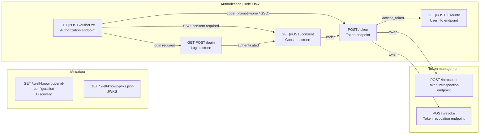

`@maronn-openid-connect/cli` は、Authorization Code Flow（OAuth 2.1 / OIDC Core 1.0 準拠）を実装した OP コード一式を生成する CLI ツールです。生成コードは `@maronn-openid-connect/core` のロジックを HTTP に配線したもので、利用者はこのコードを改造しながら仕様を検証します。

生成される各エンドポイントは、リクエストの解析、クライアント認証、grant の検証、トークンの発行、応答のように、処理を 1 段階ずつ export 関数に分けた形で生成されます。関数はステップごとに 1 ファイル（`endpoints/token/steps/parse-request.ts` など）に置かれ、各関数が core の機能単位ステップ（クライアント認証、PKCE、scope、再利用検知、ID Token クレーム構築など）を呼びます。エンドポイントの本体（`endpoints/token/pipeline.ts` など）は、それらの関数を順に呼ぶだけです。必要な段階を消す、独自検証を間に足す、ID Token に独自クレームを足す、といった PoC 向けの改修を生成コード上で直接行えます。

この関数の分け方は、`maronn-oidc graph` が描く図の箱と一致します。図を見てからコードを読む、図の元になる JSON を編集してからコードを生成する、という使い方を [Flow Graph (graph / --flow)](#flow-graph-graph----flow) で説明します。

## Commands

```bash
# コード生成
maronn-oidc generate <framework> [options]

# 生成 + 既存エントリファイルへの組み込み（Next.js 以外）
maronn-oidc setup <framework> [options]

# 生成される OP を箱と矢印の図（Mermaid）か、その元になる JSON のフロー文書にする
maronn-oidc graph [framework] [options]
```

対応フレームワーク: `hono`, `express`, `fastify`, `nextjs`

`setup` は生成に加えて、エントリファイル内のプレースホルダーコメント（`// <!-- OIDC_IMPORT_PLACEHOLDER -->` と `// <!-- OIDC_SETUP_PLACEHOLDER -->`）を `applyOidc` の import と呼び出しに置換します。Next.js は App Router のファイル規約に従うため `setup` 非対応で、`maronn-oidc generate nextjs --output ./src/app` を使います。

`graph` は何も書き込みません。`generate` と同じ `--enable` / `--disable` / `--scope` / `--db`（または `--flow`）から、生成される OP の図を標準出力に書きます。framework を付けると、JSON のフロー文書に各エンドポイントの生成先ファイル（`module`）が入ります。詳しくは [Flow Graph (graph / --flow)](#flow-graph-graph----flow) を参照してください。

### setup に必要なプレースホルダー

`setup` は、エントリファイルに次の 2 種のコメントが**両方**書かれていることを前提とします。

```typescript
import { Hono } from 'hono';
// <!-- OIDC_IMPORT_PLACEHOLDER -->
const app = new Hono();
// <!-- OIDC_SETUP_PLACEHOLDER -->
```

- 2 種のうち片方でも欠けている場合、`setup` は**エントリファイルを一切書き換えずに**エラーを表示し、終了コード 1 で終わります。片方だけを置換すると、OP がマウントされないまま成功したように見えたり、import の無い `applyOidc(app);` が書き込まれてエントリファイルが型検査を通らなくなるためです。エラーには欠けているプレースホルダー名と記述例が表示されるので、追記して `setup` を再実行してください。なお、コード生成自体は配線判定より前に完了しているため、生成物は出力先に残ります。
- 既に `applyOidc` の import と呼び出しが両方存在する場合（＝一度 `setup` 済み）は、`Already patched (no changes):` と表示してファイルを書き換えずに成功終了します。`setup` の再実行は安全です。

## Options

| オプション | 説明 |
|---|---|
| `--output, -o <dir>` | 出力先ディレクトリ（既定: `./oidc-provider`）。`graph` では標準出力の代わりに書き込むファイル |
| `--entry, -e <file>` | setup 時にパッチするエントリファイル（既定: `./src/index.ts`） |
| `--enable <features>` | 有効化する機能（カンマ区切り・複数回指定可） |
| `--disable <features>` | 既定セットから外す機能（カンマ区切り・複数回指定可） |
| `--scope <scopes>` | 生成 OP が受け付けるカスタムスコープ（カンマ区切り・複数回指定可） |
| `--db <sql\|kv>` | クライアント、ユーザー、認可コード、トークンなどのデータを、SQL のテーブル（`sql`）かキー・バリューストア（`kv`）に保存する（指定しなければプロセスのメモリに置く。いずれの場合も保存先の実装は `db/` に生成される。[Database (--db)](#database---db) を参照） |
| `--flow <file>` | `graph --format json` が書いたフロー文書（編集済みでもよい）から生成、または描画する。`--enable` / `--disable` / `--scope` / `--db` の代わりになり、同時には指定できない（[Flow Graph (graph / --flow)](#flow-graph-graph----flow) を参照） |
| `--format <mermaid\|json>` | `graph` のみ。Mermaid の flowchart（既定）か、JSON のフロー文書 |
| `--detail <endpoints\|steps>` | `graph` のみ。エンドポイントごとに 1 箱（既定）か、各エンドポイントの中のステップを関数 1 つにつき 1 箱で描く |
| `--endpoint <ids>` | `graph` のみ。描くエンドポイントの ID（カンマ区切り・複数回指定可。既定は全部） |
| `--no-error-edges` | `graph` のみ。エラー応答のステップへ向かう破線の矢印を省く |
| `--force` | 出力先に既にあるファイルを上書きする |
| `--dry-run` | 書き込みを行わず、出力予定のファイル一覧（新規か上書きか）を表示する |
| `--help, -h` | ヘルプ表示 |

## Overwrite Protection

出力先に生成対象と同名のファイルが 1 つでもある場合、`generate` / `setup` は**何も書き込まずに**そのファイル一覧を表示し、終了コード 1 で終わります。生成コードは改造して使うことが前提のため、`-o` の指定ミスや機能フラグを変えた再実行が、改造済みの `config.ts` や `views.tsx` を無警告で潰さないようにしています。

```
Error: 2 file(s) already exist in ./oidc-provider:
  config.ts
  views.tsx

Re-run with --force to overwrite them, or use -o <dir> to generate into a new directory.
Tip: commit the generated files before overwriting so you can diff your changes.
```

- 上書きするには `--force` を明示します。ログは新規作成が `Created:`、上書きが `Overwritten:` で区別されます
- `--dry-run` は何も書き込まず、出力予定の全ファイルを `Would create:` / `Would overwrite:` で表示します。`--force` の前に影響範囲を確認する用途を想定しています
- 再生成する予定があるなら、**生成直後にコミットしてから改造してください**。`--force` で上書きしても、自分の変更を `git diff` で取り戻せます
- `--db` で生成する `db/instance.ts` は利用者が書くファイルなので、無いときだけ作り、`--force` を付けても上書きしません。既にあれば上書き保護の対象にも数えず、生成ログには `Kept:`、`--dry-run` には `Would keep:` と表示します

## Generated Files

Hono / Express / Fastify は同じ構成で生成されます。

```
oidc-provider/
├── app.ts / apply.ts     # OP 本体と既存アプリへの組み込み関数
├── web-router.ts / node-adapter.ts  # Express と Fastify のみ。Hono の代わりに OP のルートを受け持つ Fetch API のルーターと、Node.js のリクエストとの変換
├── config.ts             # ProviderConfig と RegisteredClient の型と、設定の既定値（既定値はローカル検証専用）
├── scopes.ts             # スコープポリシー（--scope で宣言したスコープと、ユーザーごとの絞り込み）
├── store.ts              # ストアの契約（ProviderStores）。実装は db/ にある
├── resolvers.ts          # ストアの上に作る、認可コード、トークン、セッション、同意の resolver
├── cookies.ts / cors.ts  # セッションとトランザクションの Cookie、フォームの送信元チェック、CORS
├── development.ts        # 試用のための開発用ユーザー（testuser / otheruser）と registerDevelopmentUsers()
├── views.tsx             # ログイン / 同意 / エラー画面のデフォルトの JSX コンポーネント（hono/jsx）
├── pages/                # 画面が共有する部品。エラー画面の描画（errors.tsx）と、Cookie を付けた応答（respond.ts）
├── endpoints/            # 標準のエンドポイント。1 エンドポイントにつき 1 ディレクトリ（authorize、token、userinfo、login、consent、discovery、jwks）
│   └── token/
│       ├── pipeline.ts   # ステップを順に呼ぶ、エンドポイントの本体
│       ├── steps/        # ステップ。1 ファイルに export 関数 1 つ
│       └── endpoint.ts   # ステップの並びや図の矢印など、エンドポイントが自分を記述する情報（maronn-oidc graph の図の元）
├── features/             # 機能。1 機能につき 1 ディレクトリ（features/<feature-id>/）と、有効な機能を並べる enabled.ts
├── db/                   # クライアント、ユーザー、認可コード、トークンなどの保存先。--db 無しはプロセスのメモリ、--db 付きはテーブル定義（sql）かキーの一覧（kv）とストア（instance.ts だけは利用者が書く）
└── .maronn-openid-connect.json  # 生成元の CLI バージョン、機能構成、--flow で並べ替えたステップの記録
```

Next.js は App Router のファイル規約に沿った別の構成になります（[Next.js](#nextjs) を参照）。

機能ごとのコードは `features/<feature-id>/` にまとまっています。機能のエンドポイント（`features/par/endpoints/par/` など）、設定（`features/par/config.ts` の `parConfig` など）、ストア、画面がこのディレクトリにあり、`features/<feature-id>/feature.ts` がその機能の OP に足すもの（ルート、discovery のメタデータ、リクエストのコンテキストに入れる値、設定の既定値、トークンエンドポイントの grant、同意で戻す応答モード、ログイン画面のログイン手段）を宣言します。標準のエンドポイントの中で動く機能のステップは、パイプラインの `// [step-id] (feature: <feature-id>) ラベル — 仕様` の印が付いたブロックから呼ばれます。無効にした機能のディレクトリは出力されず、パイプラインからもその機能のブロックと import が消えます。

### Screen Routes (page.tsx) and Logic (pipeline.ts / steps/)

生成されるルーティングは、画面の層とロジックの層に分かれています。ブラウザに返すもの（画面の描画・リダイレクト・Cookie の付与）はすべて各エンドポイントの `page.tsx`（HTML を返さない `/authorize` は `page.ts`）が担当し、`pipeline.ts` と `steps/` は画面の Response を作りません。UI をカスタマイズするときに触るのは `page.tsx` と `views.tsx` だけで、ロジックは読まなくて済みます（画面の書き方は [Screens (hono/jsx)](#screens-honojsx) を参照）。

| 層 | ファイル | 役割 |
|---|---|---|
| 画面用ルーティング | `endpoints/authorize/page.ts` / `endpoints/login/page.tsx` / `endpoints/consent/page.tsx` と、共有の `pages/errors.tsx` / `pages/respond.ts`（機能有効時: `features/device-authorization-grant/endpoints/device/page.tsx` / `features/ciba/endpoints/ciba/page.tsx` / `features/rp-initiated-logout/endpoints/logout/page.tsx` / `features/google-login/endpoints/login-google/page.ts`） | ブラウザ向けのルートは **GET も POST も** ここにあります（`GET\|POST /authorize`・`GET\|POST /login`・`GET\|POST /consent` など）。リクエストを読み、ロジックの関数を 1 回呼び、返ってきた結果（outcome）を画面かリダイレクトに変換します。ロジックは持ちません |
| ロジック | `endpoints/*/pipeline.ts` と `endpoints/*/steps/*.ts`（機能のものは `features/<feature-id>/` の下） | OIDC のロジック本体。`token` / `userinfo` などの JSON エンドポイントは、`pipeline.ts` がルーター（`tokenApp` など）です。ブラウザ向けの各エンドポイント（`authorize` / `login` / `consent` / `device` / `ciba` / `logout`）のロジックは Response を返さない関数（`processAuthorizationRequest()` / `prepareLogin()` / `submitLogin()` / `submitConsent()`、device などは `steps/` の `submitDeviceUserCode()` など）で、結果を `kind` 付きの outcome（リダイレクト先 `location`、付与する `cookies`、画面データ、またはエラー）として返します。outcome の型は各エンドポイントの `screen.ts` か `outcome.ts` にあります。画面の描画・リダイレクト・`Set-Cookie`・`c.json()` は行わず、`page.tsx` も import しません（ログイン画面に並べるログイン手段のボタンだけは、`describe-login-screen` のステップが機能の view で組み立てます）。ステップは 1 ファイルに export 関数を 1 つ持ち（`endpoints/token/steps/parse-request.ts` の `parseTokenRequest()` など）、`pipeline.ts` はそれらを `// [parse-request]` のようなステップ ID のコメントを添えて順に呼びます。関数の並びは `maronn-oidc graph --detail steps` が描く箱の並びと同じです |

たとえば `POST /login` は `endpoints/login/page.tsx` がフォームを読んで `submitLogin()`（`endpoints/login/pipeline.ts`）を呼び、`{ kind: 'authenticated', cookies }` なら Cookie を付けて `/consent` へ 302、`{ kind: 'invalid_credentials' }` ならフォームを再表示、`{ kind: 'locked_out' }` なら 429 のエラー画面、という変換だけを行います。

UI を変える場所は、変えたい範囲で選びます。

- **HTML だけ変える** → `views.tsx` の `default*Page`（`defaultLoginPage` など）を書き換えるか、`createApp` / `applyOidc` の `views` オプションで差し替える。機能の画面の view は `features/<feature-id>/views.tsx` にある
- **描画の仕方を変える**（テンプレートエンジン、フレームワークネイティブの Response、別に用意した UI へのリダイレクト）→ `page.tsx` の `render*Page()`（`renderLoginPage()` など）と outcome を変換している箇所を書き換える。画面を返す経路はすべて `page.tsx` を通るので、`GET /login` もログイン失敗時の再表示も一緒に変わる
- **画面遷移を変える**（ログイン後の遷移先、エラー時の見せ方など）→ `page.tsx` で `redirectWithCookies()` / `withCookies()`（`pages/respond.ts`）を呼んでいる箇所。付けるべき Cookie は outcome の `cookies` にそのまま入っている
- **非リダイレクトの認可エラー（OIDC Core 1.0 §3.1.2.2）の見せ方を変える** → `pages/errors.tsx` の `renderAuthorizationErrorPage()`

フォームの `name`（`csrf_token` / `username` / `password`、同意の `action=approve|deny`）は `page.tsx` がロジックの関数へ渡す入力なので、画面を差し替えても維持してください。フォームに認可トランザクションの ID は入りません（[Auth Transaction](#auth-transaction-cookie--csrf_token) を参照）。トランザクション Cookie と `csrf_token` の照合は `endpoints/login/steps/` / `endpoints/consent/steps/`、`google-login` のボタン設定（`buildGoogleSignIn()`）は `features/google-login/login-method.tsx` にあり、`page.tsx` は返ってきた結果を描くだけで済みます。

### Next.js

Next.js では、App Router の機能をそのまま使ったコードを `--output`（例: `./src/app`）へ生成します。共通のルーターや独自のコンテキストは挟まず、エンドポイントごとの Route Handler にその処理を上から順に書いています。`/token` の挙動を知りたければ `token/route.ts` だけを読めば済みます。`/authorize`、`/token`、`/introspect`、Discovery の `route.ts` は、ステップごとに Hono / Express / Fastify と同じ `// [step-id] ラベル — 仕様` の印が付き、隣の `endpoint.ts` がステップの並びと、各ステップが読み書きする値を記述します。

```
src/app/
├── _oidc-provider/           # 全エンドポイントが共有する部品（private folder なのでルーティングされない）
│   ├── provider.ts           # 設定・クライアント・署名鍵・ストアの組み立て。プロジェクトへ組み込むときに編集する場所
│   ├── http.ts               # CORS・キャッシュ禁止の JSON 応答・パラメータ重複の検出・エラーページへのリダイレクトなど、Route Handler と Server Action 共通の部品
│   ├── transaction.ts        # ログイン・同意が続ける認可トランザクションを Cookie から取得（無ければ notFound()）し、フォームの送信元を確かめる
│   ├── error-view.tsx        # エラー画面の共通レイアウト（oidc-error・not-found・error の各画面が使う）
│   ├── html.ts               # Route Handler が返す画面（device、CIBA、RP-Initiated Logout）の HTML 応答
│   ├── config.ts / store.ts / resolvers.ts / scopes.ts / cookies.ts  # 他のフレームワークと共通の設定型・ストアの契約・resolver・スコープポリシー・Cookie
│   ├── development.ts        # 試用のための開発用ユーザー（testuser / otheruser）と registerDevelopmentUsers()
│   ├── shared.ts             # Next.js のモジュールの層をまたいで値を 1 つにする shared()
│   ├── endpoint.ts           # authorize、token、introspect、Discovery の route.ts の隣の endpoint.ts が使う、ステップの並びの記述
│   ├── feature.ts / features.ts  # 機能が OP に足すもの（フック）の定義と、有効な機能の一覧
│   ├── features/             # 機能の設定やストアなど、ルート以外のコード（features/<feature-id>/）
│   └── db/                   # クライアント、ユーザー、認可コード、トークンなどの保存先。--db 無しはプロセスのメモリ、--db 付きはテーブル定義（sql）かキーの一覧（kv）とストア（instance.ts だけは利用者が書く）
├── authorize/route.ts        # GET|POST /authorize（検証パイプラインをこのファイルに直接書いている）
├── token/route.ts            # POST /token
├── userinfo/route.ts         # GET|POST /userinfo
├── (introspection)/introspect/route.ts  # POST /introspect（introspection 有効時）
├── (revocation)/revoke/route.ts         # POST /revoke（revocation 有効時）
├── .well-known/openid-configuration/route.ts
├── .well-known/jwks.json/route.ts
├── login/page.tsx            # ログイン画面（React Server Component）
├── login/actions.ts          # ログインの Server Action
├── login/session.ts          # OP セッションの開始（パスワードログインと Google ログインで共有）
├── login/login-method.ts     # 機能がログイン画面にパスワードフォームと並べるログイン手段の型
├── login/not-found.tsx       # トランザクションが無いとき（notFound()）の画面。HTTP 404
├── login/error.tsx           # 想定外の例外のときの画面（error boundary）
├── consent/page.tsx          # 同意画面
├── consent/actions.ts        # 同意の Server Action（認可コードを発行してクライアントへリダイレクト）
├── consent/not-found.tsx / consent/error.tsx  # 同意画面の not-found / error（ログイン画面と同じ役割）
└── oidc-error/page.tsx       # クライアントへ返してはいけないエラーの表示先
```

各 `route.ts` は `GET` / `POST` / `OPTIONS` などの HTTP メソッドを自分で export します。ログイン・同意画面は React のページと Server Action なので、見た目は `page.tsx`、判断は `actions.ts` を書き換えます。device / CIBA / RP-Initiated Logout の画面は、表示と同時に Cookie を発行し、403 や 429 などのステータスを返す必要があります。Server Component はどちらもできないため、これらは HTML を返す Route Handler（描画は各ディレクトリの `screens.ts`）として生成します。

機能のルートは、その機能の route group（`(par)/par/route.ts`、`(google-login)/login/google/route.ts` など。route group の名前は URL に現れません）の下にあります。機能の設定やストアなど、ルート以外のコードは `_oidc-provider/features/<feature-id>/` にあり（例: `_oidc-provider/features/par/config.ts` の `parConfig`、`_oidc-provider/features/token-exchange/config.ts` の `tokenExchangeConfig`）、`_oidc-provider/features.ts` が有効な機能を並べます。標準の Route Handler の中で動く機能の処理は、`(feature: <feature-id>)` の印が付いたブロックから呼ばれ、無効にした機能はそのブロックごと消えます。

OP がブラウザを止める場面は、Next.js の機能で表します。

- 進行中の認可リクエストが無い（トランザクション Cookie が無い、または Cookie が指すトランザクションが不明・完了済み・期限切れ）: ページと Server Action が `notFound()` を呼び、隣の `not-found.tsx` を HTTP 404 で表示します。利用者はクライアントからやり直すしかありません
- クライアントへ返してはいけないエラー（OIDC Core 1.0 §3.1.2.2。未登録の `redirect_uri`、CSRF トークンの不一致、ログイン試行回数の上限、判断を含まない同意の POST、Google ログインのコールバックの失敗など）: `redirect()` で `oidc-error/page.tsx` へ送ります。Route Handler からは 303 でリダイレクトします
- 想定外の例外（ストアの障害など）: `error.tsx`（error boundary）が表示します。本番の Next.js はエラーメッセージをブラウザへ渡さないので、画面にはサーバーログと突き合わせられる `digest` だけを出します

これらの画面はどれも `_oidc-provider/error-view.tsx` の `ErrorView` で描くので、見た目はそこを書き換えれば揃って変わります。device / CIBA / RP-Initiated Logout の画面のエラーは、ステータスコード（403 / 429 など）を保つため、画面と同じく `_oidc-provider/html.ts` の HTML で返します。

Next.js は Route Handler とページ・Server Action（と `instrumentation.ts`）を別々のモジュール層にバンドルします。どの層からも同じインスタンスを参照する必要がある署名鍵、データ、機能の設定は、`globalThis` に保持しています（署名鍵は `provider.ts`、`--db` 無しのデータは `_oidc-provider/db/database.ts`、機能の設定は `shared.ts` の `shared()`）。そのため、`instrumentation.ts` で書き換えた機能の設定もリクエストに届きます。

設定は環境変数から読みます。

| 環境変数 | 用途 |
|---|---|
| `OIDC_ISSUER` | issuer。OP 自身の URL はすべてこれを基準に組み立てる |
| `OIDC_SIGNING_KEY_ID` | 起動時に生成する署名鍵の `kid` |
| `OIDC_CORS_ORIGINS` | トークンエンドポイントなどをブラウザから呼べるオリジン（既定は issuer） |
| `UPSTASH_REDIS_REST_URL` / `UPSTASH_REDIS_REST_TOKEN` | `--db kv` で生成した `_oidc-provider/db/instance.ts` が使う Upstash Redis。未指定ならローカル SQLite（`OIDC_SQLITE_PATH`、既定 `.data/oidc.sqlite`）。Vercel では指定が必要 |
| `GOOGLE_CLIENT_ID` / `GOOGLE_HOSTED_DOMAIN` | Sign in with Google（`google-login` 有効時。`_oidc-provider/features/google-login/config.ts` が読む） |

クライアントとユーザーは環境変数からは読みません。`_oidc-provider/db` の `registerClient()` と `registerUser()`（開発用ユーザーは `development.ts` の `registerDevelopmentUsers()`）で登録します。起動時に 1 回だけ動く `instrumentation.ts` の `register()` から呼ぶのが手軽です（[クライアントとユーザーの登録](#クライアントとユーザーの登録) を参照）。`--db` 無しの生成物はデータをプロセスのメモリに置くので、Vercel のように複数のインスタンスで動かすときは `--db kv` で生成します。

### Screens (hono/jsx)

Hono / Express / Fastify の出力は TSX 前提で生成されます。画面のマークアップ（`views.tsx`、機能の画面は `features/<feature-id>/views.tsx`）は [hono/jsx](https://hono.dev/docs/guides/jsx) のコンポーネントで、画面を描く `endpoints/login/page.tsx` / `endpoints/consent/page.tsx` / `pages/errors.tsx`（機能有効時は device / CIBA / RP-Initiated Logout の `page.tsx`）も `.tsx` になり、`renderView(<views.loginPage {...params} />)` のように JSX でビューを描画します。HTML を返さない `endpoints/authorize/page.ts` と `pages/respond.ts` は `.ts` のままです。Express と Fastify の画面も hono/jsx で描くので、`hono` のインストールが要ります。JSX は `{...}` で埋め込んだ値をすべてエスケープするので、`login_hint` や `error_description` のような信頼できない値も手でエスケープせずに描画できます。

ビューは JSX 要素を返すコンポーネントです。`createApp` / `applyOidc` の `views` オプションで差し替えるときも、JSX で書きます。

```tsx
const app = createApp({
  views: {
    loginPage: (params) => <MyLoginPage {...params} />,
  },
});
```

別の手段で組み立てた HTML を返すときは `hono/html` の `html` タグか `raw()` で包みます（`raw()` は渡した文字列をそのまま信頼するので、エスケープ済みの HTML だけを渡してください）。ステータスやヘッダーなど Response そのものを変えたいときは、`page.tsx` の `render*Page()` を書き換えます。

コンパイルには `tsconfig.json` で JSX を有効にしておく必要があります。

```jsonc
{
  "compilerOptions": {
    "jsx": "react-jsx",
    "jsxImportSource": "hono/jsx"
  }
}
```

### Generation Manifest (.maronn-openid-connect.json)

生成物には、どの CLI バージョン・どの入力から生成されたかを記録するマニフェストが含まれます。

```json
{
  "cliVersion": "0.5.0",
  "framework": "hono",
  "features": { "pkce": true, "refreshToken": true, "...": "..." },
  "scopes": [],
  "db": null,
  "steps": null,
  "endpointOrder": null
}
```

`steps` と `endpointOrder` には、`--flow` でステップやエンドポイントの順番を変えて生成したときだけ、その並びが入ります（[Flow Graph (graph / --flow)](#flow-graph-graph----flow) を参照）。コマンドラインの機能フラグだけで生成したときは `null` です。

このライブラリは生成コードへ仕様修正（多くはセキュリティ修正）を継続的に入れています。手元の生成コードへ修正を取り込むか判断するときは、`cliVersion` と [リリースノート](https://github.com/maronnjapan/maronn-openid-connect/releases) を突き合わせ、生成元の版と最新版の差分を確認してください。マニフェストは利用者が編集するファイルではないため、上書き保護の対象外として生成のたびに更新されます（生成日時は含めず、同じ入力からは同じ出力になります）。

## Flow Graph (graph / --flow)

`maronn-oidc graph` は、生成される OP を箱と矢印の図にします。`generate` と同じ機能フラグを受け取り、何も書き込みません。既定では箱がエンドポイント、矢印はエンドポイントの間でコードやトークンが渡る向きです。`--detail steps` を付けると、各エンドポイントの中を、生成コードの export 関数 1 つにつき箱 1 つで描きます。

```bash
# エンドポイントの図（Mermaid）を標準出力へ
maronn-oidc graph --enable par --enable jarm

# /token の中のステップを描き、ファイルに書く
maronn-oidc graph --detail steps --endpoint token -o token.mmd

# 図の元になるフロー文書（JSON）
maronn-oidc graph --format json -o op-flow.json

# 編集したフロー文書を描いて確かめる
maronn-oidc graph --flow op-flow.json --detail steps --endpoint token
```

既定の機能構成では、エンドポイントの図は次のようになります。



### 図の箱と生成コードの対応

`--detail steps` の箱は、生成コードの export 関数と 1 対 1 で対応します。箱にはステップの ID、関数名、根拠になる仕様の節が書かれ、生成コードでは同じ ID が呼び出しの手前のコメントになります。関数はステップ ID と同じ名前のファイル（`[parse-request]` なら `endpoints/token/steps/parse-request.ts`）にあり、`(feature: <feature-id>)` の印が付いたステップは `features/<feature-id>/steps/` にあります。たとえば `endpoints/token/pipeline.ts` のハンドラーは次の形です。

```typescript
tokenApp.post('/', async (c) => {
  try {
    // [parse-request] Parse the token request — RFC 6749 §4.1.3 / §3.2
    const { params, authorization } = await parseTokenRequest(c);

    // [authenticate-client] Authenticate the client — OAuth 2.1 §2.3 / OIDC Core 1.0 §9
    const { tokenClient, authenticatedClientId } = await authenticateTokenClient(c, params, authorization);

    // ...（grant の検証、鍵の選択、subject の解決、トークンの発行と保存）

    // [build-token-response] Build the token response body — OIDC Core 1.0 §3.1.3.3 / RFC 6749 §5.1
    const tokenResponse = buildTokenResponse(c, { accessToken, idToken, refreshToken, validatedRequest });

    // [respond] Respond (no-store) — RFC 6749 §5.1
    return respondToken(c, tokenResponse);
  } catch (error) {
    return respondTokenError(c, error);
  }
});
```

API のエンドポイント（`/authorize`、`/token`、`/userinfo`、`/introspect`、`/revoke`、Discovery、JWKS、experimental の `/par`、`/register`、`/device_authorization`、`/backchannel_authentication`）は、この「関数を順に呼ぶ」形で生成されます。画面のエンドポイント（`/login`、`/login/google`、`/consent`、`/device`、`/ciba`、`/logout`）も箱ごとに関数を持ちますが、GET と POST の流れが順番を決めているため、`prepareLogin()` / `submitLogin()` のような入口の関数がそれらを決まった順で呼びます。

### フロー文書を編集して生成する（--flow）

`--format json` が書く**フロー文書**には、エンドポイントとステップの一覧、各ステップが読む値と作る値（`consumes` / `produces`）、消せるかどうか（`removable`）、そして描いたときの `features` / `scopes` / `db` が入っています。この文書を編集して `--flow` に渡すと、`generate` と `setup` はコマンドラインの機能フラグの代わりに文書の内容で生成します。

```bash
maronn-oidc graph --format json -o op-flow.json
# op-flow.json を編集する（例: /token の steps から issue-id-token を外す）
maronn-oidc generate hono --flow op-flow.json -o ./oidc-provider
```

文書で変えられるのは次の 4 つです。

- **ステップを消す**：`removable: true` のステップ（`/token` の `resolve-acr-amr`、`issue-id-token`、`revoke-rotated-refresh-token`、`/authorize` の `verify-id-token-hint`、`authenticate-silently`、`reuse-session`）を `steps` から外します。消したステップが作っていた値を後のステップが読む場合、生成コードはその値を既定値（ID Token や acr なら `undefined`）で補います
- **ステップを並べ替える**：値のやり取りが無いステップ同士は順番を変えられます。値を作るステップより前にそれを読むステップを置く、`after` / `before` の制約に反する、といった並びはエラーになります
- **エンドポイントを並べ替える**：`endpoints` の順番は図の並びとしてマニフェストの `endpointOrder` に記録されます。生成コードがエンドポイントをマウントする順番は変わりません
- **機能を切り替える**：`features` の値を変えると、`--enable` / `--disable` と同じようにエンドポイントとステップが増減します。`scopes` と `db` も同様です

次の変更はエラーで止まり、何も書き込みません。

- `removable: false` のステップを消す。`feature` が付いたステップは、ステップではなく `features` の側で外します
- 画面のエンドポイント（`login` / `login-google` / `consent` / `device` / `ciba` / `logout`）のステップ列を変える
- 必須のエンドポイント（`authorize` / `token` など）を外す。機能で増えたエンドポイント（`introspection` など）は `features` の側で外します
- `--flow` と `--enable` / `--disable` / `--scope` / `--db` を同時に指定する。文書が機能構成を持っているためです

並べ替えたステップは、Hono / Express / Fastify の生成コードでパイプラインのブロックの並びとして反映されます。Next.js は App Router の Route Handler に処理を直接書く構成のため、`steps` を変えた文書を渡すとエラーになり、エンドポイントと機能の変更だけを受け付けます。

フロー文書は、図を UI 上で編集して（箱をドラッグ&ドロップで並べ替えて）生成する、という使い方のための入出力です。CLI だけで使うときは、`graph --format json` の出力を手で編集してください。

## Auth Transaction (Cookie + csrf_token)

`/authorize` から `/login`・`/consent` へ認可リクエストを引き継ぐ認可トランザクションの ID は、URL にも HTML にも載せません。どのフレームワーク・どの機能構成でも同じで、トグルはありません。

- `/authorize` はトランザクションを作ると、その ID を HttpOnly Cookie `__Host-oidc_txn`（`Secure; SameSite=Lax; Path=/; Max-Age=600`）でブラウザに渡し、クエリの無い `/login`（SSO で同意だけが残っている場合は `/consent`）へリダイレクトします
- `/login`・`/consent` は Cookie からトランザクションを引き、フォームには `csrf_token` だけを埋め込みます。`csrf_token` は Cookie とは別の乱数で、トランザクションに保存してあり、リロードしても変わりません
- `POST /login`・`POST /consent` は、まずブラウザが付ける `Sec-Fetch-Site` / `Origin` で OP 自身の画面から送られたかを確かめ（`cookies.ts` の `isSameOriginFormPost()`）、次に Cookie が指すトランザクションに対して `csrf_token` を照合します
- 同意の結果（承認・拒否）をクライアントへ返すときに Cookie を消します

ID が URL に出ないので、ブラウザ履歴・アクセスログ・画面共有から漏れた ID で第三者に同意画面を開かれることはありません。OIDC Core 1.0 §3.1.2.3 / §3.1.2.4 は「認可リクエストを送った User-Agent の End-User」を認証・同意させることを前提にしていますが、その同一性を保証する手段は実装に委ねており、この Cookie がその手段です。

Cookie・`csrf_token`・送信元チェックは、それぞれ別の脅威を受け持つので、1 つが破られても残りが効くように重ねています。

| 脅威 | 効く防御 |
|---|---|
| 別サイトからの偽の POST（CSRF） | `SameSite=Lax`（Cookie が付かない）、`csrf_token`（別サイトからは読めない）、送信元チェック |
| 同じサイトのサブドメインからの偽の POST | `csrf_token`、送信元チェック（`Sec-Fetch-Site: same-site` を拒否） |
| サブドメインが被害者のブラウザに自分のトランザクションの Cookie を設定する（Cookie tossing） | `__Host-` プレフィックス（ブラウザがサブドメインからの設定を拒否）、送信元チェック（設定できても、その Cookie と `csrf_token` を使った POST を拒否） |
| Cookie の値そのものの盗難 | HttpOnly・Secure・URL に載せないこと。盗んだ本人が自分のブラウザで OP の画面を使う場合、OP 側だけでは防げない |

送信元チェックは、`Sec-Fetch-Site` があれば `same-origin` と `none`（リロードなど利用者自身の操作）だけを通し、無ければ `Origin` が issuer のオリジンと一致することを求めます。どちらのヘッダーも無いリクエスト（curl などブラウザ以外）は通し、Cookie と `csrf_token` で判定します。Google が送ってくる `POST /login/google` はクロスサイトの POST なので対象外で、Google の `g_csrf_token` と nonce で守っています。Next.js の Server Action は Next.js 自身も `Origin` と `Host` を照合しますが、生成コードは issuer と比べる同じチェックを Server Action の先頭でも行います。

URL にトランザクションを示すものがなくても、ログイン・同意画面はリロードできます。Cookie は同意の結果を返すまで（最長でトランザクションの有効期限の 10 分）残るので、リロードは同じ Cookie を付けた GET になり、同じトランザクションのフォーム（同じ `csrf_token`）がもう一度表示されます。Next.js はパスワードの誤りもフォームへのリダイレクトで返すので、その後のリロードも送信のやり直しになりません。

Cookie はブラウザに 1 つです。同じブラウザの別タブで新しい認可リクエストを始めると Cookie が置き換わり、先に開いていたタブのフォームは `csrf_token` が一致しないため拒否されます（そのタブをリロードすると、新しいほうの認可リクエストの画面になります）。古いタブから誤ったリクエストを完了させないための挙動です。

| 状況 | Hono / Express / Fastify | Next.js |
|---|---|---|
| Cookie が無い、または指すトランザクションが無い（不明・完了済み・期限切れ） | OP のエラー画面（400） | `not-found.tsx`（404） |
| `csrf_token` が Cookie のトランザクションのものではない | OP のエラー画面（403） | `oidc-error` へリダイレクト |
| OP 自身の画面以外から送られた（送信元チェックに失敗） | OP のエラー画面（403） | `oidc-error` へリダイレクト |

curl などで手動でフローを進めるときは Cookie を持ち回ってください（Hono / Express / Fastify の例）。curl は `Secure` / `__Host-` の Cookie も `localhost` へは HTTP で送り返し、`Origin` / `Sec-Fetch-Site` は付けないので、送信元チェックでは止まりません。

```bash
curl -sS -c jar.txt -o /dev/null 'http://localhost:3000/authorize?response_type=code&client_id=...&redirect_uri=...&scope=openid&code_challenge=...&code_challenge_method=S256'
curl -sS -b jar.txt http://localhost:3000/login
# ↑ 応答 HTML の csrf_token を控える
curl -sS -b jar.txt -c jar.txt -X POST http://localhost:3000/login \
  -d csrf_token=<控えた値> -d username=testuser -d password=password
```

## Feature Toggles

生成される OP の機能は、既定の全部入り構成から機能単位で増減できます。

```bash
# リフレッシュトークンとイントロスペクションを外した OP を生成
maronn-oidc generate hono --disable refresh-token,introspection

# PKCE を任意化（confidential client の非PKCEフローを許可）
maronn-oidc generate express --disable pkce
```

| 機能名 | 既定 | `--disable` 時の挙動 |
|---|---|---|
| `pkce` | 有効 | PKCE を任意化する（`allowNonPkceAuthorizationCodeFlow: true`）。明示的な confidential client の完全な非PKCEリクエストのみ許可され、public client や不正な PKCE 値は引き続き拒否される |
| `refresh-token` | 有効 | `refresh_token` grant を `unsupported_grant_type` で拒否。`offline_access` は付与されず、リフレッシュトークンは発行されない。discovery からも除去される |
| `introspection` | 有効 | RFC 7662 introspection エンドポイント（`/introspect`）を生成しない |
| `revocation` | 有効 | RFC 7009 revocation エンドポイント（`/revoke`）を生成しない |
| `request-object` | 有効 | `request` パラメータ（Request Object by value, OIDC Core 1.0 §6.1）を `request_not_supported` で拒否。discovery は `request_parameter_supported: false` を広告する |

Basic OP に必須の機能（authorize / token / userinfo / discovery / jwks / login / consent）はトグル対象外で、常に生成されます。
未知の機能名や、同じ機能を `--enable` と `--disable` の両方に指定した場合はエラーになります。

### Experimental Features

Experimental 機能は上記いずれとも別カテゴリで、**既定では無効**です。`--enable` で明示したときだけ生成され、実装は別 package の `@maronn-openid-connect/experimental` にあります。

```bash
maronn-oidc generate hono --enable par
pnpm add @maronn-openid-connect/core @maronn-openid-connect/experimental
```

`@maronn-openid-connect/core` は `@maronn-openid-connect/experimental` の peerDependency なので、両方を入れてください（CLI のインストール案内も両方を出力します）。experimental のほうが速く更新されるため、バージョン番号が揃っていない状態は正常です。

| 機能名 | 既定 | 内容 | 準拠仕様 |
|---|---|---|---|
| `par` | 無効 | Pushed Authorization Requests エンドポイント（`/par`）と認可エンドポイントの `request_uri` 解決 | RFC 9126 |

API は安定しておらず、破壊的に変更されることがあります。詳細と注意点は [Experimental機能とは](../../experimental/) を参照してください。

### Extension Features

拡張機能は、OAuth / OIDC の仕様ではなく**ログイン手段**を生成コードに足すカテゴリで、**既定では無効**です。実装は別 package にあり、`--enable` で明示したときだけ生成コードから import されます。

```bash
maronn-oidc generate express --enable google-login
pnpm add @maronn-openid-connect/core @maronn-openid-connect/google-login
```

| 機能名 | 既定 | 内容 | 実装 package |
|---|---|---|---|
| `google-login` | 無効 | ログイン画面に「Google でログイン」（Sign in with Google、redirect mode）を追加し、Google が ID トークンを POST する `POST /login/google` を生成する。検証は Google 公式の `google-auth-library` に委ねる | `@maronn-openid-connect/google-login`（Node.js 22 以上限定） |

有効化しても `config.googleLogin` を渡すまでボタンは表示されません。設定手順・生成物・ユーザーの扱いは [Google ログイン（拡張）](../google-login/) を参照してください。

## Custom Scopes

標準スコープ（`openid` / `profile` / `email` / `address` / `phone` / `offline_access`）は生成 OP 自身が扱います。それ以外に受け付けるスコープは、生成時に `--scope` で宣言します。

```bash
maronn-oidc generate hono --scope reports.read,reports.write
```

宣言したスコープは `scopes.ts`（スコープポリシー。Next.js は `_oidc-provider/scopes.ts`）の `CUSTOM_SCOPES` に書き込まれ、生成 OP は次のようになります。

- discovery の `scopes_supported` に宣言したスコープが載る
- 宣言していないスコープ値を要求した認可リクエストは `invalid_scope` で拒否される（RFC 6749 §3.3 / §4.1.2.1）
- ユーザーごとの絞り込みは、生成された `scopes.ts` に書く

`scopes.ts` は宣言が無くても生成されます。宣言が 1 つも無ければ `CUSTOM_SCOPES` は空で、許容リストのチェック（`findUnsupportedScopes()`）はどの値も拒否しないため、既定の生成物の挙動は変わりません。

許容リストのチェックは `applyOfflineAccessPolicy` の**後**に置かれます。付与条件を満たさない `offline_access` は OIDC Core 1.0 §11 に従ってそこで既に落ちているため、「無視する」挙動が `invalid_scope` に変わることはありません。`--enable device-authorization-grant` / `--enable ciba` を有効にした場合は、デバイス認可エンドポイントとバックチャネル認証エンドポイントにも同じ許容リストが適用されます。

### ユーザーごとの絞り込みは生成コードに書く

「誰にどのスコープを許すか」は CLI のオプションにしていません。運用ごとに条件（ロール、テナント、DB 参照）が違い、生成コードを改造しながら検証するというこのライブラリの使い方に合わないためです。代わりに、生成される `scopes.ts` に絞り込みの入口を用意し、判断が必要な全ステップから呼び出した状態で生成します。

```typescript
// scopes.ts（生成物）
export const RESTRICTED_SCOPE_SUBJECTS: Record<string, readonly string[]> = {
  'reports.read': ['alice'],   // 手早く絞るならここに書く
};

export async function resolveGrantableScopes(
  requested: readonly string[],
  subject: string,
): Promise<string[]> {
  // ロール・テナント・DB 参照など、複雑な条件はここに書く
  return requested.filter((scope) => { /* ... */ });
}
```

`resolveGrantableScopes()` は End-User が確定した後に呼ばれ、次の箇所からすでに `await` されています。async なので、DB / KV 参照へ置き換えても呼び出し側の変更は要りません。

| 呼び出し元 | タイミング |
|---|---|
| `endpoints/consent/steps/describe-consent-screen.ts` / `issue-authorization-code.ts` | 同意画面の表示内容と、承認時の付与スコープ |
| `endpoints/authorize/steps/authenticate-silently.ts` / `reuse-session.ts` | SSO fast path と `prompt=none`（同意画面を出さずに付与する経路） |
| `features/device-authorization-grant/endpoints/device/steps/` / `features/ciba/endpoints/ciba/` | device / CIBA の承認ステップ（該当機能を有効にした場合） |

Next.js では、`consent/page.tsx` / `consent/actions.ts`、`authorize/route.ts`、device と CIBA の Route Handler から呼ばれます。

SSO と `prompt=none` では、**保存済み同意を引く前**にポリシーを適用します。絞る前の scope で同意を探すと、そのユーザーが持てないスコープをキーに検索することになり、いつまでも一致しないためです。

落としたスコープはリクエストを失敗させず、付与スコープを狭めます。RFC 6749 §3.3 が要求より狭いスコープの発行を認めており、トークンレスポンスの `scope` に実際の付与内容が載ります。リクエストごと拒否したい場合は、呼び出し元で throw してください。

なお、カスタムスコープに対応する UserInfo クレームはありません（OIDC Core 1.0 §5.4 が定義するのは profile / email / address / phone のみ）。独自クレームを返す場合は `endpoints/userinfo/steps/resolve-claims.ts`（Next.js は `userinfo/route.ts`）を編集してください。

## Authentication Context (acr_values)

`/authorize` は、省略できるパラメータ `acr_values`（OIDC Core 1.0 §3.1.2.1）を受け付けます。
値は空白区切りで、各値が RFC 6749 §3.3 の scope-token と同じ文字（`"` と `\` を除く、表示できる ASCII 文字）だけでできていれば通し、ほかの文字を含めば `invalid_request` をクライアントへ返します。
空文字と空白だけの値は、省略と同じに扱います。

Hono / Express / Fastify の生成物では、トークンに載せる acr を `endpoints/token/steps/resolve-acr-amr.ts` の `resolveTokenAcrAmr()` が決めます。
`createApp` / `applyOidc` に `acrResolver` を渡していれば、その戻り値の acr / amr を使います。
渡していなければ、要求された値のうち最も優先する値（先頭の値）を acr にし、amr は載せません。
`claims` パラメータの `id_token.acr.values` も、`acr_values` と同じ要求として扱います（OIDC Core 1.0 §5.5.1.1）。
要求が無ければ acr も載せません。
Next.js の生成物では、`_oidc-provider/provider.ts` の `acrResolver` が同じく最も優先する値を返し、amr に `pwd` を加えます。

決めた acr は、ID トークンの `acr`、JWT のアクセストークンの `acr`（RFC 9068 §2.2.1）、アクセストークンの保存レコードに入ります。
保存レコードの acr はイントロスペクションのレスポンスにも `acr`（RFC 9470 §6.2）として載るので、クレームを持たない Opaque のアクセストークンでも、リソースサーバーは acr を確かめられます。
リフレッシュで発行するトークンは、最初に決めた acr / amr を引き継ぎます（OIDC Core 1.0 §12.1）。

要求された値をそのまま acr にした場合、その acr は OP が実際に行った認証を表すとは限りません。
ログインの方式に合った acr を返すときは、`acrResolver` を渡してください（Next.js では書き換えてください）。

## Client Authentication Methods

1 つのクライアントに、client_secret_basic と client_secret_post の両方を登録できます。
登録する方式は、クライアントの `tokenEndpointAuthMethods`（core の `TokenClientInfo`）に一覧で書きます。
省略すると RFC 7591 §2 の既定どおり `['client_secret_basic']` になり、`['none']` は public client を表します。
`none` はクライアント認証をしない方式なので、ほかの方式と並べた登録は例外になります。
OP はリクエストが送った資格情報から方式を決め、一覧に無い方式なら `invalid_client` で拒否します。

```typescript
{
  clientId: 'my-client',
  clientSecret: '...',
  redirectUris: ['https://client.example.com/callback'],
  tokenEndpointAuthMethods: ['client_secret_basic', 'client_secret_post'],
}
```

どの方式で送られても、OP が照合するシークレットは 1 つです（RFC 7591 §2 の `client_secret`）。
`--db sql` では `client_auths` に方式ごとの行を置き、どの行の `client_secrets` にも同じシークレットのハッシュを入れます。
`--db kv` では、クライアントのレコードの `client_auths` に方式ごとの要素を置き、どの要素の `secret` も同じハッシュにします。
`registerClient()` はこの形で書き込みます。
シークレットの異なる行（要素）を持つクライアントは設定の誤りとして扱い、OP はそのクライアントを読むときに例外を投げます。

## Client Keys

クライアントの公開鍵は、鍵を使う処理（用途）ごとに登録します。
鍵を使う処理は、core の `ClientKeyResolver` の `findClientKeys(clientId, purpose)` で、自分の用途の鍵だけを受け取ります。
生成 OP が鍵を読むのは署名付き Request Object の検証（OIDC Core 1.0 §6.3.2）で、`request_object` の用途の鍵を使います。

用途は文字列で、DB の側にも CHECK を付けていないので、ほかの処理の用途も同じ形で登録できます。
たとえば、private_key_jwt（OIDC Core 1.0 §9）によるクライアント認証を足すなら、`private_key_jwt` の用途で鍵を登録し、その処理から `findClientKeys(clientId, 'private_key_jwt')` を呼びます。
DPoP（RFC 9449）の proof を、登録した鍵で署名したものに限る処理なら、`dpop` の用途を使います。
生成 OP は private_key_jwt によるクライアント認証も DPoP も実装しておらず、`request_object` 以外の用途の鍵を読む処理を持ちません。

OP は、クライアントの鍵を発行する機能も、公開鍵を登録する API や画面も持ちません。
鍵の組はクライアントが自分で作り、運用者が公開鍵を DB に書き込みます。
`--db` 付きの生成物は、処理が鍵を使うたびに DB から読むので、書き込んだ変更は次のリクエストから効き、OP を再起動する必要はありません。

`--db sql` では、`client_jwks` に行を足します。
1 行は、1 つの用途と、公開鍵 1 つの JWK（RFC 7517）を JSON で持ちます。
同じ鍵を 2 つの用途で使うときは、用途ごとに 1 行ずつ足してください。

```sql
INSERT INTO client_jwks (id, client_id, purpose, jwk)
  VALUES ('my-client:request_object:2026-10', 'my-client', 'request_object',
          '{"kty":"RSA","kid":"2026-10","alg":"RS256","n":"...","e":"AQAB"}');
```

`client_jwks` には公開鍵だけを入れ、`d` などの秘密鍵のメンバーを持つ JWK は入れないでください。
鍵を入れ替えるときは、新しい鍵の行を先に足し、クライアントが新しい鍵で署名し始めてから古い鍵の行を消します。
1 つの用途にはいくつでも鍵を登録できるので、入れ替えの途中はどちらの鍵の署名も通ります。

`--db kv` では、`client_jwks:<client_id>:<purpose>` のキーに、その用途の鍵を JWK Set（`{ "keys": [ <JWK>, ... ] }`）で書きます。
鍵を足すときも消すときも、この `keys` を書き換えます。

`--db` を付けない生成物は、`registerClient()` で登録したクライアント（`ClientRegistration`）の `keys` から鍵を返します（`db/clients.ts` の `createClientKeyResolver()`）。
`keys` は、用途ごとにその用途の鍵を JWK Set で持ちます。
同じ鍵を 2 つの用途で使うときは、両方の用途に書きます。
この `db/` はクライアントをプロセスのメモリに持ち、呼ばれるたびにそこを読むので、`registerClient()` で登録し直した鍵は次のリクエストから効きます。
メモリの中身は再起動で消えるので、起動のたびに登録してください。

```typescript
{
  clientId: 'my-client',
  clientSecret: '...',
  redirectUris: ['https://client.example.com/callback'],
  keys: {
    request_object: { keys: [{ kty: 'RSA', kid: '2026-10', alg: 'RS256', n: '...', e: 'AQAB' }] },
  },
}
```

`createApp` / `applyOidc` の `clientResolver` に自前のクライアントの一覧から作った resolver を渡すときは、同じ一覧の鍵を返す `ClientKeyResolver` を `clientKeyResolver` に渡してください。
core の `createClientKeyResolver()` に、client_id からそのクライアントの `keys` を引く関数を渡すと作れます。
`clientKeyResolver` の既定は `registerClient()` が `db/` に入れた鍵を返すので、渡さなければ自前のクライアントの鍵は見つかりません。

鍵の保存先を変えるときは、`ClientKeyResolver` を実装して差し替えます。
Hono / Express / Fastify は `createApp` / `applyOidc` の `clientKeyResolver` オプションに渡し、Next.js は `_oidc-provider/provider.ts` の `clientKeyResolver` を書き換えます。
鍵の追加や削除がすぐ効くように、実装は呼ばれるたびに保存先を読んでください。

`--db sql` と `--db kv` の `registerClient()` は、渡したクライアント（`ClientRegistration`）の `keys` の鍵を、それぞれの用途で DB に足します。
`registerClient()` は鍵を足すだけで、DB にある鍵を消すことはありません。
起動のたびに `registerClient()` で登録し直しても、運用中に DB へ足した鍵は残ります。
鍵を消すときは、DB から消すのに加えて、`registerClient()` に渡すクライアントの `keys` からも外してください。
外さなければ、次の登録で足し直されます。

## Database (--db)

`--db` を付けると、生成 OP はクライアント、ユーザー、認可トランザクション、認可コード、トークン、セッション、同意を利用者の DB に保存します。
保存先の種類は `--db` の値で選びます。
`--db sql` は SQL のテーブル（SQLite、Cloudflare D1、PostgreSQL）に、`--db kv` は Redis などのキー・バリューストアに保存します。
`--db` を付けないときは、同じデータをプロセスのメモリに置きます。
メモリの中身は再起動で消え、2 つ目のインスタンスからは見えないので、試用とテスト以外では `--db sql` か `--db kv` を使ってください。

```bash
maronn-oidc generate express --db sql
maronn-oidc generate nextjs --db kv --output ./src/app
```

保存先は `--db` の有無にかかわらず `db/` に生成されます（Next.js は `_oidc-provider/db/`）。
`db/index.ts` は、どの種類でも同じ名前（`createDatabase`、`createProviderStores`、`createClientResolver`、`createClientKeyResolver`、`registerClient`、`registerUser`）を export するので、`--db` を変えて生成し直しても、これらを呼ぶコードは書き換えずに済みます。
`--db` 付きで利用者が書くのは DB インスタンスを返す `instance.ts` だけで、それ以外は CLI が生成します。

| ファイル | `--db sql` | `--db kv` |
|---|---|---|
| `index.ts` | 上に挙げた共通の名前の export | 同じ |
| `instance.ts` | DB インスタンス。`createDatabase()` で利用者の DB を返す。CLI は無いときだけ作り、`--force` を付けても上書きしない | 同じ |
| `database.ts` | `createDatabase()` が返す `SqlDatabase` の型。SQL を 1 文実行する `all` と `run` を持つ | `createDatabase()` が返す `KvDatabase` の型。`get`、`set`、`setIfAbsent`、`delete` を持つ |
| `schema.sql`、`schema.ts` | テーブル定義と、同じ内容の文字列 `SCHEMA_SQL`。SQLite、Cloudflare D1、PostgreSQL のどれでもそのまま通る | 生成しない |
| `keys.ts` | 生成しない | キーの一覧と、各キーに入れる JSON レコードの型 |
| `stores.ts` | `store.ts` の `ProviderStores` の実装 | 同じ |
| `clients.ts` | 登録クライアントを読む `ClientResolver`、クライアントの公開鍵を読む `ClientKeyResolver` と、クライアントを登録する `registerClient()` | 同じ |
| `users.ts` | ユーザーを登録する `registerUser()` と、パスワードのハッシュを作って照合する `hashPassword()` / `verifyPassword()` | 同じ |

生成直後の `instance.ts` は、実装されるまで「`createDatabase()` が未実装である」というエラーを投げます。
ファイルの末尾に DB ごとの例を載せているので、使う DB に合わせて書き換えてください。
Next.js の `--db kv` だけは例外で、`instance.ts` は生成したまま動く実装になっています（後述の「キー・バリューストア（--db kv）」を参照）。

生成アプリは、`storage` オプションを渡さなければ `db/` のストアを使い、`clientResolver` オプションを渡さなければ `db/` からクライアントを読みます。
`instance.ts` の `createDatabase()` は、リクエストの文脈を引数に受け取っても受け取らなくてもかまいません。
呼ぶ時機はフレームワークによって異なります。

- **Hono / Express / Fastify**：リクエストごとに、そのリクエストのコンテキスト（Express と Fastify は `web-router.ts` の `WebContext`）を渡して呼ぶ。Hono なら Cloudflare D1 のバインディング（`c.env.DB`）や環境変数をそこから読める。Express と Fastify の `WebContext` は `c.env` を持たないので、設定は `process.env` から読む。リクエストをまたいで使う接続（PostgreSQL のプールや SQLite のファイル）は、モジュールの変数に置く。`instance.ts` が未実装なら、最初のリクエストがエラーになる
- **Next.js**：`_oidc-provider/db/index.ts` の `createDatabase()` が返すデータベースごとに、最初の読み書きのときに 1 回だけ呼ぶので、`next build` の時点では呼ばない（`instance.ts` がモジュールの読み込み時に接続しない限り、ビルドに DB は要らない）。`provider.ts` は Next.js のモジュールの層（Route Handler、Server Action）ごとにデータベースを作り、`instrumentation.ts` で `createDatabase()` を呼べばそのぶんも作られるので、接続（PostgreSQL のプールや SQLite のファイル）は生成した `instance.ts` の例と同じく `globalThis` に置く

### SQL のテーブル（--db sql）

`SqlDatabase` は SQL を実行する口を 2 つ持つだけなので、どのドライバーでも実装できます。
ORM も生の SQL を実行するメソッドを持っているので、CLI は ORM ごとのコードを生成しません。
`instance.ts` の末尾には node:sqlite、Cloudflare D1（Cloudflare Workers で動かす Hono 向け。Next.js には無い）、PostgreSQL（pg）、Prisma、Drizzle、Kysely の例があります。
Prisma、Drizzle、Kysely の例は、プロジェクトですでに作ってあるクライアント（`prisma` や `db`）をそのまま使います。
Hono / Express / Fastify は `createDatabase()` をリクエストごとに呼ぶので、接続はモジュールの変数に置き、`createDatabase()` はそれを包むだけにします。

```typescript
// db/instance.ts を node:sqlite で書いた例
import { DatabaseSync } from 'node:sqlite';
import type { SqlDatabase, SqlStatement } from './database.js';
import { SCHEMA_SQL } from './schema.js';

const sqlite = new DatabaseSync(process.env.OIDC_SQLITE_PATH ?? 'oidc.sqlite');
sqlite.exec(SCHEMA_SQL);

export function createDatabase(): SqlDatabase {
  return {
    async all<Row>(statement: SqlStatement): Promise<Row[]> {
      return sqlite.prepare(statement.sql).all(...statement.params) as Row[];
    },
    async run(statement: SqlStatement) {
      const result = sqlite.prepare(statement.sql).run(...statement.params);
      return { changes: Number(result.changes) };
    },
  };
}
```

#### テーブルの構成

テーブルは、OP が扱うデータをエンティティごとに分けています。
`schema.sql` の各テーブルのコメントには、そのテーブルが表すエンティティ（Client、Transaction など）の名前を書いています。

| テーブル | 保存するもの |
|---|---|
| `clients` | 登録クライアント（`id` が client_id）。`is_deleted` を立てたクライアントは OP から見えなくなる |
| `client_auths`、`client_secrets` | クライアント認証の方式（client_secret_basic / client_secret_post。1 つのクライアントに両方を登録できる）と、シークレットのハッシュ |
| `client_jwks` | クライアントの公開鍵。1 行が 1 つの用途（`purpose`）と JWK 1 つを持ち、生成 OP は `request_object` の用途の鍵で署名付き Request Object を検証する（[Client Keys](#client-keys) を参照） |
| `client_redirect_uris`、`client_grant_types`、`client_scopes` | リダイレクト URI、使ってよい grant type、要求してよいスコープ |
| `users` | ユーザー。パスワードのハッシュ（`password_hash`）は NULL にでき、`email` と `is_verified` 以外のクレームは `claims` 列に JSON で持つ |
| `transactions`、`authentication_requests` | 認可リクエスト 1 件の進み具合と、検証済みのパラメータ |
| `auth_users` | トランザクションでログインしたユーザー。ログイン画面から同意画面へ渡す |
| `codes`、`access_tokens`、`refresh_tokens` | 認可コードとトークン。値そのものは保存せず、SHA-256 のハッシュで引く |
| `browser_sessions`、`consent_scopes`、`consent_grants` | SSO、`prompt=none`、`max_age` に使うブラウザセッションと、ユーザーが与えた同意 |

Sign in with Google（`--enable google-login`）のような外部の IdP でのログインのために、2 つのテーブルがあります。
`federated_identities` は外部の IdP のアカウント（Google アカウントなど）とユーザーの対応を、`upstream_auth_requests` はログイン画面の Google ボタンに埋めた nonce を持ちます。
この 2 つは、`--enable google-login` を付けずに生成しても `schema.sql` に入っています。

ID トークンは保存しません。
RP は ID トークンを署名で検証し、OP も `id_token_hint` を署名で検証するので、DB から引く場面が無いためです。
private_key_jwt によるクライアント認証と authorization_details（RFC 9396）のテーブルは、その機能を実装するときに足す前提で、今は作っていません。
private_key_jwt を足すときは、`client_auths.client_auth_type` の CHECK を広げ、`client_jwks` の `private_key_jwt` の用途の鍵でアサーションを検証します。

`access_tokens.acr` は、トークンに載せた acr（[Authentication Context](#authentication-context-acr_values) を参照）を持ち、acr を決めなかったトークンでは NULL になります。

`schema.sql` の文はどれも `CREATE TABLE IF NOT EXISTS` なので、`acr` 列が加わる前の CLI で作ったデータベースに実行し直しても、列は増えません。
そのデータベースでは、新しい生成コードでトークンを発行する前に、次の文で列を足してください。

```sql
ALTER TABLE access_tokens ADD COLUMN acr VARCHAR(5000);
```

`transactions.status` は、認可リクエストがどこまで進んだかを表します。
`/authorize` で `requested` になり、Google ボタン付きのログイン画面を出すと `upstream_pending`、ログインすると `authenticated`、認可コードを発行すると `code_issued`、そのコードをトークンに交換すると `token_issued` に進みます。
同意の拒否や `prompt=none` のエラーのように、コードを発行せずに終わったトランザクションは `failed` になります。
OP は終わったトランザクションの行を消さず、`codes` と `access_tokens` から `transaction_id` で参照するので、どの認可リクエストからどのコードとトークンが出たかを後から追えます。
期限切れの行も OP は消さないので、必要なら定期的に削除してください。

クライアントシークレットは、`hashClientSecret()`（core）で作った SHA-256 のハッシュだけを `client_secrets` に保存します。
トークンエンドポイントは、提示されたシークレットのハッシュをこの値と比べます。
SHA-256 は計算が速く、短い値や推測できる値は総当たりで元に戻されるので、シークレットには CSPRNG で作った十分長い値を使ってください。

### キー・バリューストア（--db kv）

`--db kv` の生成物は、キー・バリューストアに 4 つの操作だけを求めます。
`get`、`set`（TTL を付けられる）、`delete` と、キーが無いときだけ値を書く `setIfAbsent` です。
値はどれも JSON の文字列で、キーの一覧は `keys.ts` にあります。

Hono / Express / Fastify の `instance.ts` の末尾には、Upstash Redis の REST API（fetch だけで動き、Vercel の KV もこれに当たる）と、メモリ上の Map の例があります。
Next.js の `instance.ts` は生成したまま動きます。
`UPSTASH_REDIS_REST_URL` と `UPSTASH_REDIS_REST_TOKEN` があれば Upstash Redis に、無ければ node:sqlite の 1 つのテーブル（`OIDC_SQLITE_PATH`、既定は `.data/oidc.sqlite`）に保存します。
Vercel の上でこの 2 つが無いときは、ほかの関数から読めないファイルへ書く代わりに、最初の読み書きでエラーにします。

```typescript
// db/instance.ts を Upstash Redis の REST API で書いた例
import type { KvDatabase } from './database.js';

const run = async (command: Array<string | number>): Promise<unknown> => {
  const response = await fetch(process.env.UPSTASH_REDIS_REST_URL as string, {
    method: 'POST',
    headers: {
      authorization: 'Bearer ' + process.env.UPSTASH_REDIS_REST_TOKEN,
      'content-type': 'application/json',
    },
    body: JSON.stringify(command),
  });
  const body = (await response.json()) as { result?: unknown; error?: string };
  if (!response.ok || body.error !== undefined) {
    throw new Error('Upstash: ' + (body.error ?? 'HTTP ' + response.status));
  }
  return body.result;
};
const expiry = (ttlSeconds?: number) => (ttlSeconds === undefined ? [] : ['EX', ttlSeconds]);

export function createDatabase(): KvDatabase {
  return {
    get: async (key) => (await run(['GET', key])) as string | null,
    set: async (key, value, ttlSeconds) => {
      await run(['SET', key, value, ...expiry(ttlSeconds)]);
    },
    setIfAbsent: async (key, value, ttlSeconds) =>
      (await run(['SET', key, value, 'NX', ...expiry(ttlSeconds)])) === 'OK',
    delete: async (key) => {
      await run(['DEL', key]);
    },
  };
}
```

ストアには 2 つの条件があります。
1 つ目は、`setIfAbsent` を 1 回の不可分な操作にすることです（Redis の `SET NX` や、DynamoDB の条件付き書き込み）。
認可コードとリフレッシュトークンは、使ったときに使用済みの印のキーを `setIfAbsent` で書くことで 1 回限りにしています。
読んでから書く 2 段階に分けると、同じ認可コードで同時に来た 2 つのリクエストがどちらも未使用と判断し、両方にトークンが発行されます。
2 つ目は、書き込みの完了後に始めた読み込みが、その書き込みを必ず見ることです。
Cloudflare Workers KV は、書き込みがほかの拠点に届くまで時間がかかり、不可分な書き込みも持たないので、どちらの条件も満たしません。
ログイン画面で発行した認可コードを、別の拠点に届いたトークンリクエストが見つけられないことがあります。
Cloudflare では D1（`--db sql`）か、Durable Objects の上に作ったストアを使ってください。

#### キーの構成

レコードは、`--db sql` のテーブルと同じ ER モデルのエンティティごとにキーを分け、属性の名前もそろえています。
1 つのエンティティに属するものは、そのレコードの中に入れます。
たとえばクライアントのレコードは、認証の方式、シークレットのハッシュ、リダイレクト URI、grant type、スコープを持ち、1 回の `set` で書きます。

| キー | 保存するもの |
|---|---|
| `client:<client_id>` | 登録クライアントと、`--db sql` の `client_*` テーブルに当たる値 |
| `client_jwks:<client_id>:<purpose>` | クライアントの 1 つの用途の公開鍵（`{ "keys": [ <JWK>, ... ] }`）。`--db sql` の `client_jwks` に当たる |
| `user:<id>` | ユーザー |
| `transaction:<transaction_id>` | 認可リクエスト 1 件の進み具合と、検証済みのパラメータ |
| `transaction_result:<transaction_id>` | トランザクションの終わり方（`failed`、`code_issued`、`token_issued`） |
| `auth_user:<transaction_id>` | トランザクションでログインしたユーザー |
| `code:<hash>`、`access_token:<hash>`、`refresh_token:<hash>` | 認可コードとトークン。値そのものは保存せず、SHA-256 のハッシュをキーにする |
| `code_used:<hash>`、`refresh_token_used:<hash>` | 使用済みの印。`setIfAbsent` で書く |
| `grant:<grant_id>`、`grant_*_revoked:<grant_id>` | 1 回の認可で出したコードとトークンのつながりと、失効の印 |
| `browser_session:<session_id>`、`consent:<subject>:<client_id>` | ブラウザセッションと、ユーザーが与えた同意 |

外部の IdP でのログイン（`--enable google-login` の Sign in with Google など）のために、`federated_identity:<provider>:<sub>`（Google アカウントなどとユーザーの対応）と、`upstream_auth_request:<transaction_id>`、`upstream_nonce:<nonce>`（Google ボタンに埋めた nonce）のキーもあります。
この 3 つは、`--enable google-login` を付けずに生成しても `keys.ts` に入っています。
キーにはすべて `oidc:` が付き、リクエストから来た値（ID やサブジェクト）は URI エンコードしてから入れます。

期限のあるレコードは TTL を付けて書き、期限（`expired_at`、`exp`）もレコードの中に持ちます。
ストアは読むたびにこの期限を確かめるので、期限切れのキーを遅れて消すストア（DynamoDB の TTL など）でも、期限切れのレコードは返りません。
クライアント、ユーザー、ブラウザセッション、同意は期限を持たないので、不要になったら利用者が消してください。

`access_token:<hash>` のレコードは、`--db sql` の `access_tokens.acr` と同じ `acr` を持ちます。
`acr` が加わる前の CLI で書いたレコードはこの属性を持ちませんが、移行は要りません。
そのレコードは acr の無いトークンとして読まれ、アクセストークンの期限が来ると消えます。

`--db kv` は、`--db sql` の UPDATE や JOIN の代わりにキーを分けて動きをそろえています。

- **トランザクションの終了**：`transaction:<id>` を残したまま、`transaction_result:<id>` を書く。`transaction:<id>` を書き直す処理はこのキーに触れないので、終わったトランザクションが再び始まることはない
- **grant 単位の失効**：`grant_access_tokens_revoked:<grant_id>` などの印のキーを書き、トークンを読むときに印を確かめる。ローテーション済みのリフレッシュトークンも、この印で読めなくなる
- **値の読み書き**：grant、同意、進行中のトランザクションの状態は、読んでから書き戻す。同じレコードを 2 つのリクエストが同時に書き換えると、片方の変更が失われることがある。grant を書き換えるのはコードとトークンを発行するリクエストで、リフレッシュは使用済みの印で 1 つしか通らないので、同じ grant が同時に書き換わることは無い。同意は、1 人のユーザーが 1 つのクライアントを 2 つのタブで同時に認可したときに同時に書き換わりうる。失われるのがスコープならユーザーにもう一度同意を求め、grant の ID なら `revokeConsentAndTokens()` がその grant を失効しない

### クライアントのスコープ

スコープを登録したクライアント（`--db sql` は `client_scopes` の行、`--db kv` はクライアントのレコードの `scopes`）は、登録外のスコープを要求すると `invalid_scope` で拒否されます。
`/authorize` のほか、Device Authorization Grant と CIBA の要求も同じ規則で検証します。
`openid` や `offline_access` も、要求させるなら登録してください。
スコープを登録していないクライアントには制限を掛けず、OP が受け付けるスコープをすべて要求できます。

検証は core の `validateClientScope()` が `ClientInfo.scope`（RFC 7591 §2 の `scope`）を見て行うので、`--db` を使わない場合も、`registerClient()` で登録するクライアントに `scope` を書けば同じ制限が掛かります。
`scopes.ts` の `resolveGrantableScopes()` は、この検証を通った後で、ユーザーごとにスコープを絞る場所として残ります。

### クライアントとユーザーの登録

クライアントは、`clients.ts` の `registerClient()` で DB に入れます。
`--db` 無しの生成物も同じ関数でプロセスのメモリに入れます。
1 つも登録しなければ、OP はどのクライアントも受け付けません。
同じ client_id で呼び直すと、前の登録を置き換えます。
同じ値で呼び直しても DB の中身は変わらないので、複数のインスタンスが起動時に同時に呼んでも構いません。
Express や Fastify なら、起動時に次のように登録できます。

```typescript
import type { ClientRegistration } from './oidc-provider/config.js';
import { createDatabase, registerClient } from './oidc-provider/db/index.js';

const clients: ClientRegistration[] = [
  {
    clientId: 'my-client',
    clientSecret: '...',
    redirectUris: ['https://client.example.com/callback'],
    grantTypes: ['authorization_code', 'refresh_token'],
  },
];

for (const client of clients) {
  await registerClient(createDatabase(), client);
}
```

Hono（Cloudflare D1）では、管理用のスクリプトから `registerClient()` を呼ぶか、`hashClientSecret()` で作ったハッシュを使って `INSERT` 文で登録してください。
Workers はリクエストの処理中にしか D1 を使えないので、起動のたびに登録するなら、isolate ごとの最初のリクエストで行います（`samples/hono-cloudflare` の `src/app.ts`）。
Next.js の生成コードは、クライアントを環境変数から読みません。
Next.js で起動のたびに登録するなら、`instrumentation.ts` の `register()` で行います（`samples/nextjs-vercel` の `src/instrumentation.ts`）。
テーブルやレコードに無い登録メタデータ（`response_types`、`default_max_age`、ID トークンと UserInfo の署名アルゴリズム）は既定値になります。
クライアントの公開鍵は `RegisteredClient` に入れず、鍵を使う処理が用途ごとに `client_jwks` から読みます（[Client Keys](#client-keys) を参照）。

ユーザーは、`users.ts` の `registerUser()` で DB に入れます。
`password` を渡すと PBKDF2（HMAC-SHA256、100,000 回）のハッシュを `password_hash` に保存し、渡さなければ NULL になります。
反復回数は Cloudflare Workers の上限に合わせた値で、上限の無い環境では `users.ts` の `PASSWORD_HASH_ITERATIONS` で上げられます。
ハッシュには回数とソルトも記録しているので、回数を上げても既存のハッシュはそのまま検証できます。

```typescript
import { registerUser } from './oidc-provider/db/users.js';

await registerUser(createDatabase(), {
  sub: 'alice',
  email: 'alice@example.com',
  email_verified: true,
  name: 'Alice',
  password: process.env.ALICE_PASSWORD,
});
```

ログインフォームのユーザー名は、ユーザーの ID（`--db sql` は `users.id`、`--db kv` は `user:<id>` のキー）と照合します。
メールアドレスでログインさせる場合、`--db sql` では `stores.ts` の `authenticate()` が引く列を `email` に変え、`--db kv` ではメールアドレスからユーザーの ID を引くキーを足してください。
パスワードの無いユーザーは、ログインフォームでは認証できません。
開発用のユーザー（testuser / otheruser、パスワードはどちらも `password`）は `development.ts` の `developmentUsers` にあり、`--db` の有無にかかわらず自動では登録されません。
試すときは `development.ts` の `registerDevelopmentUsers()` か `registerUser()` で登録してください（`samples/*` はどれも起動時に登録している）。
本番では登録しないでください。

Sign in with Google のユーザーはパスワードを持たず、Google の `sub`（Federated_identity の `provider_sub`）で同じ人かを判断して、初めてのログインでランダムな ID のユーザーを作ります。
メールアドレスは Google アカウント側で変えられるので、同じ人かの判断には使いません。

### stores.ts を書き換えるときに保つ動き

`stores.ts` を ORM のクエリや別のストアの API で書き直してもかまいませんが、ファイル先頭のコメントに挙げた動きは保つ必要があります。
たとえば認可コードとリフレッシュトークンの `consume` は、使用済みにする操作を 1 回の不可分な操作で行い、使用済みにできなければ `invalid_grant` を投げます。
`--db sql` は「`is_used` が FALSE の行だけを TRUE にする」を 1 回の `UPDATE` で行い、`--db kv` は使用済みの印のキーを `setIfAbsent` で書きます。
読んでから書く 2 段階に分けると、同じ認可コードで同時に来た 2 つのリクエストがどちらも未使用と判断し、両方にトークンが発行されます。

実験的機能（PAR、Device Authorization Grant、CIBA、Dynamic Client Registration）のストアは、`--db` を付けても `features/<feature-id>/store.ts`（Next.js は `_oidc-provider/features/<feature-id>/store.ts`）のメモリ上の実装のままです。

## After Generation

1. ProviderConfig・署名鍵・クライアント resolver を環境変数 / DB / KV から供給する
2. `config.ts` のデフォルト値はローカル検証専用として扱う
3. `--db` 無しで生成した場合は、データがプロセスのメモリに置かれるので、起動のたびに `db/clients.ts` の `registerClient()` と `db/users.ts` の `registerUser()`（開発用ユーザーは `development.ts` の `registerDevelopmentUsers()`）でクライアントとユーザーを登録する
4. `--db` 付きで生成した場合は、`db/instance.ts` の `createDatabase()` を書き、`--db sql` なら `db/schema.sql` を DB に適用して、`db/clients.ts` の `registerClient()` と `db/users.ts` の `registerUser()` でクライアントとユーザーを登録する
5. 依存をインストールしてサーバーを起動する（例: `pnpm add hono @maronn-openid-connect/core`。Express と Fastify も画面を hono/jsx で描くので `hono` が要る）

Next.js では 1 と 2 を `_oidc-provider/provider.ts` で行います（クライアント・署名鍵・ストアの差し替え先がこのファイルに集まっています）。

具体的な組み込み手順は [Quick Start](../../quick-start/) を参照してください。
