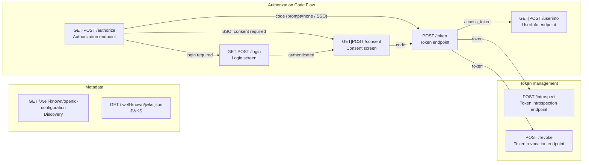

# @maronn-openid-connect/cli

OpenID Connect Provider のコードを生成する CLI ツール。
Hono / Express / Fastify / Next.js 向けに、Authorization Code Flow（OAuth 2.1 / OIDC Core 1.0 準拠）を実装した OP コード一式を生成する。

生成コードは [`@maronn-openid-connect/core`](../core) のロジックを HTTP に配線したもので、利用者はこのコードを改造しながら「自分の要件がこの仕様で実現できるか」を検証する。

生成されるエンドポイントは、処理を 1 段階ずつ export 関数に分け、ハンドラーがそれを順に呼ぶ形で並べる。
各関数は core の機能単位ステップ関数（クライアント認証、PKCE、scope、再利用検知、ID Token クレーム構築など）を呼ぶ。
各段階が生成コード上に見えているため、不要な検証を消したり、段階の間に独自処理を足したりして仕様の挙動を検証しやすい。

| 生成ファイル | 並んでいる関数（`maronn-oidc graph --detail steps` の箱） |
|---|---|
| `endpoints/authorize/pipeline.ts` | `parseAuthorizationRequest` → `resolveAuthorizationClient` → `resolveRequestObject` → `resolveRedirectTarget` → `validateAuthorizationRequestParams` → `createAuthorizationTransaction` → `rejectCombinedPromptNone` → `verifyIdTokenHint` → `completePromptNoneRequest` → `reuseExistingSession` → `continueToLogin`（`prompt=none` と SSO は `issueAuthorizationCodeResponse` を呼ぶ） |
| `endpoints/token/pipeline.ts` | `parseTokenRequest` → `authenticateTokenClient` → `validateTokenGrantType` → `validateAuthorizationCodeGrant` / `validateRefreshTokenGrant` → `selectTokenSigningKeys` → `resolveTokenSubject` → `decideRefreshTokenIssuance` → `resolveTokenAcrAmr` → `issueAccessToken` → `issueIdToken` → `persistAccessToken` → `issueRefreshToken` → `revokeRotatedRefreshToken` → `buildTokenResponse` → `respondToken` |
| `endpoints/userinfo/pipeline.ts` | `parseUserInfoRequest` → `resolveUserInfoToken` → `resolveUserInfoResponseClaims` → `buildUserInfoResponse` → `respondUserInfo` |
| `features/introspection/endpoints/introspection/pipeline.ts` | `parseIntrospectionRequest` → `authenticateIntrospectionClient` → `resolveIntrospectedToken` → `describeIntrospectedToken` → `respondIntrospection`（`jwt-introspection-response` 有効時は `signIntrospectionResponse` が入る） |
| `features/revocation/endpoints/revocation/pipeline.ts` | `parseRevocationRequest` → `authenticateRevocationClient` → `resolveRevocationTokenTarget` → `revokeToken` → `respondRevocation` |
| `endpoints/login/pipeline.ts` / `endpoints/consent/pipeline.ts` | `loadTransaction` → `validateLoginCsrfToken` → `authenticateEndUser` → `establishBrowserSession` → `handOffToConsent` のような画面の判断。GET と POST の流れが順番を決めるため、`prepareLogin()` / `submitLogin()` などの入口がこれらを決まった順で呼ぶ |

表のパスは Hono / Express / Fastify の生成物のもので、関数はステップごとに `steps/<step-id>.ts`（機能のステップは `features/<id>/` の下）にある。
Next.js の構成は [Next.js の生成物](#nextjs-の生成物)を参照。
ID Token へ独自クレームを足すなら `endpoints/token/steps/issue-id-token.ts` の `issueIdToken()` を書き換える、といった改修が生成コード上で完結する。
この関数の分け方は `maronn-oidc graph` が描く図の箱と一致し、図の元になる JSON を編集して生成することもできる（[フロー図とフロー文書（graph / --flow）](#フロー図とフロー文書graph----flow)を参照）。

## インストールと実行

```bash
# インストールせずに実行
pnpm dlx @maronn-openid-connect/cli generate hono

# またはプロジェクトに追加してから実行
pnpm add -D @maronn-openid-connect/cli
pnpm maronn-oidc generate hono
```

## 使い方

```bash
# コード生成
maronn-oidc generate <framework> [options]

# 生成 + 既存エントリファイルへの組み込み（Next.js 以外）
maronn-oidc setup <framework> [options]

# 生成される OP を箱と矢印の図（Mermaid）か、その元になる JSON のフロー文書にする
maronn-oidc graph [framework] [options]
```

対応フレームワーク: `hono`, `express`, `fastify`, `nextjs`

`setup` は生成に加えて、エントリファイル内のプレースホルダーコメント（`// <!-- OIDC_IMPORT_PLACEHOLDER -->` と `// <!-- OIDC_SETUP_PLACEHOLDER -->`）を `applyOidc` の import と呼び出しに置換する。Next.js は App Router のファイル規約に従うため `setup` 非対応で、`maronn-oidc generate nextjs --output ./src/app` を使う。

`graph` はコードを生成しない。`generate` と同じ `--enable` / `--disable` / `--scope` / `--db`（または `--flow`）から、生成される OP の図を標準出力（`--output` を付ければそのファイル）に書く。framework を付けると、JSON のフロー文書に各エンドポイントと各ステップの生成先ファイル（`module`）が入る。詳しくは[フロー図とフロー文書（graph / --flow）](#フロー図とフロー文書graph----flow)を参照。

### オプション

| オプション | 説明 |
|---|---|
| `--output, -o <dir>` | 出力先ディレクトリ（既定: `./oidc-provider`）。`graph` では標準出力の代わりに書き込むファイル |
| `--entry, -e <file>` | setup 時にパッチするエントリファイル（既定: `./src/index.ts`） |
| `--enable <features>` | 有効化する機能（カンマ区切り・複数回指定可） |
| `--disable <features>` | 既定セットから外す機能（カンマ区切り・複数回指定可） |
| `--scope <scopes>` | 生成 OP が受け付けるカスタムスコープ（カンマ区切り・複数回指定可） |
| `--db <sql\|kv>` | クライアント、ユーザー、認可コード、トークンなどのデータを、SQL のテーブル（`sql`）かキー・バリューストア（`kv`）に保存する。指定しなければ、データは `db/` のメモリに入る（[DB に保存する（--db）](#db-に保存する--db)を参照） |
| `--flow <file>` | `graph --format json` が書いたフロー文書（編集済みでもよい）から生成、または描画する。`--enable` / `--disable` / `--scope` / `--db` の代わりになり、同時には指定できない（[フロー図とフロー文書（graph / --flow）](#フロー図とフロー文書graph----flow)を参照） |
| `--format <mermaid\|json>` | `graph` のみ。Mermaid の flowchart（既定）か、JSON のフロー文書 |
| `--detail <endpoints\|steps>` | `graph` のみ。エンドポイントごとに 1 箱（既定）か、各エンドポイントの中のステップを関数 1 つにつき 1 箱で描く |
| `--endpoint <ids>` | `graph` のみ。描くエンドポイントの ID（カンマ区切り・複数回指定可。既定は全部） |
| `--no-error-edges` | `graph` のみ。エラー応答のステップへ向かう破線の矢印を省く |
| `--force` | 出力先に既にあるファイルを上書きする |
| `--dry-run` | 書き込みを行わず、出力予定のファイル一覧（新規か上書きか）を表示する |
| `--help, -h` | ヘルプ表示 |

### 既存ファイルの上書き保護

出力先に生成対象と同名のファイルが 1 つでもある場合、`generate` / `setup` は**何も書き込まずに**そのファイル一覧を表示して終了コード 1 で終わる。改造済みの `config.ts` や `store.ts` を再実行で失わないためで、上書きするには `--force` を明示する（ログは新規が `Created:`、上書きが `Overwritten:` になる）。事前に結果を確認したいときは `--dry-run` を使う。

再生成する予定があるなら、生成直後にコミットしてから改造すること。`--force` で上書きしても、自分の変更を `git diff` で取り戻せる。

`--db` で生成する `db/instance.ts` だけは扱いが異なる。
利用者が書くファイルなので、CLI は無いときだけ作り、`--force` を付けても上書きしない。
既にあれば上書き保護の対象にも数えず、生成ログには `Kept:`、`--dry-run` には `Would keep:` と表示する。

## 生成されるもの

Hono、Express、Fastify の出力は次の構成になる。Express と Fastify には `web-router.ts` と `node-adapter.ts` が加わり、`apply.ts` がそのフレームワーク用のものになる。

```
oidc-provider/
├── app.ts                # OP 本体を作る createApp() と、そのオプションの型 OidcProviderOptions
├── apply.ts              # 既存アプリへの組み込み関数 applyOidc()
├── config.ts             # ProviderConfig の型と既定値、クライアントの型（RegisteredClient / ClientRegistration）
├── store.ts              # ストアの契約 ProviderStores の型（実装は db/stores.ts）
├── resolvers.ts          # ストアの上に作る core の resolver（認可コード、トークン、セッション、同意）
├── cookies.ts            # セッション Cookie とトランザクション Cookie、フォームの送信元の確認
├── cors.ts               # CORS のミドルウェア
├── scopes.ts             # スコープポリシー（--scope の値と、ユーザーごとの絞り込み）
├── development.ts        # 試用のための開発用ユーザー（testuser / otheruser）
├── views.tsx             # ログイン、同意、エラー画面のデフォルト（hono/jsx のコンポーネント）
├── pages/                # 画面に共通の部品（エラー画面の描画と、Cookie 付きのリダイレクト）
├── endpoints/            # どの OP にもあるエンドポイント。1 つにつき 1 ディレクトリで、ハンドラーとステップのファイルが入る
├── features/             # 機能ごとのディレクトリ features/<id>/、フックの型 feature.ts、有効な機能の一覧 enabled.ts
├── db/                   # データの読み書き。--db 無しはメモリ、--db sql はテーブル、--db kv はキー・バリューストア（instance.ts だけは利用者が書く）
├── web-router.ts         # Express / Fastify のみ。エンドポイントが Hono の代わりに使う Fetch API のルーター
├── node-adapter.ts       # Express / Fastify のみ。Node.js のリクエストとレスポンスを Fetch API の Request / Response に変換する
└── .maronn-openid-connect.json  # 生成元の CLI バージョン、機能構成、--flow で並べ替えたステップの記録
```

エンドポイントのディレクトリの中身と、機能がどこに入るかは[エンドポイントの組み立て](#エンドポイントの組み立て)を参照。Next.js は App Router のファイル規約に沿った別の構成になる（[Next.js の生成物](#nextjs-の生成物)を参照）。

### 生成元のアプリとファイルの選び方

生成コードは、このモノレポで動いている OP のアプリのコードを写したものである。Hono、Express、Fastify は `apps/hono/src/oidc-provider/` から、Next.js は `apps/nextjs/src/app/`（App Router）から写す。Express と Fastify には、`apps/hono/src/web/` からフレームワークごとの `apply.ts`（`web/express/apply.ts` か `web/fastify/apply.ts`）と、`web-router.ts`、`node-adapter.ts` を加え、生成コードが import する Hono のルーター（`Hono` と型の `Context`）を `web-router.ts` の `WebRouter` と `WebContext` に置き換える。写す元は `packages/cli/extract.json` に書かれており、テスト（`*.test.ts`、`*.test.tsx`）は写さない。Next.js の `app/layout.tsx` も、アプリに置いたとしても写さない（`extract.json` の exclude）。

`generate` は、写すファイルを機能構成とデータの保存先から選ぶ。どの機能にもデータの保存先の種類にも属さないファイルはすべて写し、機能のファイル（`features/<id>/`、Next.js はルートグループ `(<id>)/` と `_oidc-provider/features/<id>/`）は有効な機能のものだけを写す。データの保存先は `db/memory/`、`db/sql/`、`db/kv/` のうち 1 つ（`--db` 無しは `memory`）を選んで出力の `db/` の直下に置き、その種類の `index.ts` が出力の `db/index.ts` になる。そのうえで、機能の一覧（`features/enabled.ts`、Next.js は `_oidc-provider/features.ts`）を有効な機能だけにし、`scopes.ts` の `CUSTOM_SCOPES` に `--scope` の値を書き込み、無効な機能のブロックをパイプライン（Next.js は Route Handler）から取り除く（[機能の差し込み](#機能の差し込み)を参照）。

生成コードの挙動を変えるときは、CLI ではなく `apps/hono` か `apps/nextjs` のコードを、隣に置いた単体テストと一緒に変える。このリポジトリの中では `generate` が `apps/` のコードを直接読むので、アプリの変更は CLI をビルドし直さなくても生成物に入る。公開する package には `apps/` が無いため、CLI のビルド（`pnpm run build`）がそのコードを `packages/cli/templates/` に写し、package の `generate` はそこから出力を作る。

### 画面の JSX（hono/jsx）

Hono、Express、Fastify の画面は [hono/jsx](https://hono.dev/docs/guides/jsx) で書かれている。画面のマークアップ（`views.tsx`、機能の画面は `features/<id>/views.tsx`）は hono/jsx のコンポーネントで、画面のルートを持つ `page.tsx`（`endpoints/login/`、`endpoints/consent/`、機能有効時は `features/<id>/endpoints/` の `device`、`ciba`、`logout`）とエラー画面の `pages/errors.tsx` が、`renderView(<views.loginPage {...params} />)` のように JSX でビューを描画する。自分ではビューを JSX で描かない `endpoints/authorize/page.ts`、google-login の `features/google-login/endpoints/login-google/page.ts`（どちらもエラー画面は `pages/errors.tsx` に任せる）と `pages/respond.ts` は `.ts` のまま。JSX は `{...}` で埋め込んだ値をすべてエスケープするので、`login_hint` や `error_description` のような信頼できない値も手でエスケープせずに描画できる。

ビューは JSX 要素を返すコンポーネントで、`createApp` / `applyOidc` の `views` オプションで差し替えるときも `loginPage: (params) => <MyLoginPage {...params} />` のように書く。別の手段で組み立てた HTML を返すときは `hono/html` の `html` タグか `raw()` で包む（`raw()` は渡した文字列をそのまま信頼するので、エスケープ済みの HTML だけを渡す）。ステータスやヘッダーなど Response そのものを変えたいときは、その画面の `page.tsx` の `render*Page()`（エラー画面は `pages/errors.tsx` の `renderErrorPage()`）を書き換える。

Express と Fastify の生成物も画面は hono/jsx のままなので、`hono` もインストールする（`generate` の最後に、`pnpm add express hono @maronn-openid-connect/core` のようなフレームワークごとのコマンドが表示される）。3 つのどれでも、コンパイルには `tsconfig.json` で JSX を有効にしておく必要がある。

```jsonc
{
  "compilerOptions": {
    "jsx": "react-jsx",
    "jsxImportSource": "hono/jsx"
  }
}
```

### 生成のマニフェスト（.maronn-openid-connect.json）

`.maronn-openid-connect.json` は、どの CLI バージョン、どの機能構成（`framework` / `features` / `scopes` / `db`）から生成されたかと、`--flow` で並べ替えたステップとエンドポイントの順番（`steps` / `endpointOrder`。並べ替えていなければ `null`）を記録するマニフェスト（[フロー図とフロー文書（graph / --flow）](#フロー図とフロー文書graph----flow)を参照）。生成元のコードへ仕様修正が入ったとき、リリースノートと突き合わせて「自分のコードがどの版から生成されたか」を特定する起点になる。利用者が編集するファイルではないため、上書き保護の対象外として毎回更新される（生成日時は含めず、同じ入力からは同じ出力になる）。

### 生成される OP のエンドポイント

| パス | 役割 |
|---|---|
| `/authorize` | 認可エンドポイント（`response_type=code`、PKCE S256、`prompt` / `max_age` / `claims` / `acr_values` / Request Object 対応） |
| `/token` | トークンエンドポイント（`authorization_code` / `refresh_token` グラント、`client_secret_basic` / `client_secret_post` / public client） |
| `/userinfo` | UserInfo エンドポイント（Bearer トークン、scope 別クレーム） |
| `/login`, `/consent` | ログイン画面と同意画面。ルート（GET / POST）と描画は `endpoints/login/page.tsx` と `endpoints/consent/page.tsx`、認証と同意の判断は同じディレクトリの `pipeline.ts` が呼ぶステップが担当する（差し替え可能なデフォルト UI 付き。Next.js はページと Server Action） |
| `/login/google` | Sign in with Google の `login_uri`（Google が ID トークンを POST する先。`google-login` 有効時） |
| `/.well-known/openid-configuration` | Discovery メタデータ |
| `/.well-known/jwks.json` | JWKS（公開鍵） |
| `/introspect` | RFC 7662 Token Introspection（`introspection` 有効時） |
| `/revoke` | RFC 7009 Token Revocation（`revocation` 有効時） |

## エンドポイントの組み立て

Hono、Express、Fastify の生成物では、エンドポイント 1 つにつき 1 つのディレクトリ（`endpoints/<endpoint>/`、機能が足すエンドポイントは `features/<id>/endpoints/<endpoint>/`）があり、処理の段階（ステップ）ごとに `steps/<step-id>.ts` のファイルを 1 つ置く。ステップのファイルは、処理の本体である export 関数と、その関数を説明する `meta` を持つ。`meta` は `endpoints/step.ts` の `step()` で書き、ステップの ID、関数名、根拠になる仕様の節、読む値と作る値（`consumes` / `produces`）、`--flow` で消せるか（`removable`）を並べる。`maronn-oidc graph` はこの `meta` から図を描く。

| ファイル | 役割 |
|---|---|
| `endpoint.ts` | エンドポイントの説明（`defineEndpoint()`）。パス、メソッド、ステップの並び、図に描く矢印 |
| `pipeline.ts` | ステップを順に呼ぶ。`token` / `userinfo` / `discovery` / `jwks` などの JSON を返すエンドポイントでは、このファイルがルーター（`tokenApp` など）を export し、ハンドラーがステップを呼ぶブロックを上から並べる。`authorize` / `login` / `consent` の `pipeline.ts` は Response を作らず、入口の関数（`processAuthorizationRequest()`、`prepareLogin()` / `submitLogin()`、`prepareConsent()` / `submitConsent()`）がステップを順に呼んで、結果を `kind` 付きの outcome（リダイレクト先 `location`、付与する `cookies`、画面データ、またはエラー）として返す |
| `steps/<step-id>.ts` | ステップ 1 つ。core の機能単位の関数（クライアント認証、PKCE、scope、再利用検知、ID Token クレーム構築など）を呼ぶ |
| `page.tsx`（`authorize` と google-login の `login-google` は `page.ts`） | ブラウザ向けのルート。**GET も POST も**ここにある（`login-google` は POST だけ）。リクエストを読み、`pipeline.ts` の入口の関数を 1 回呼び、返ってきた outcome を画面かリダイレクトに変換する。ロジックは持たない。機能の画面（`device`、`ciba`、`logout`）は `pipeline.ts` を持たず、`page.tsx` が `steps/` の関数を呼ぶ |
| `screen.ts` / `outcome.ts` | 画面に渡すデータ、フォームの入力、outcome の型 |
| `response.ts` | JSON を返すエンドポイントの応答の型（`TokenEndpointResponse` など）と、ステップが決まった応答で終えるときに投げるエラー（`TokenEndpointError` など） |

`pipeline.ts` のブロックは、ステップ ID のマーカーコメント（`// [step-id] Label — Spec`）で始まる。ブロックを消せばそのステップは実行されず、ブロックの間に独自の処理を書き足せる。ハンドラーの実例は[図の箱と生成コードの対応](#図の箱と生成コードの対応)にある。

画面に共通の部品は `pages/` にある。`pages/errors.tsx` は OP のエラー画面を描く `renderErrorPage()` と、非リダイレクトの認可エラーを描く `renderAuthorizationErrorPage()` を持ち、`pages/respond.ts` は Cookie を付けて応答する `redirectWithCookies()` と `withCookies()` を持つ。

たとえば `POST /login` は `endpoints/login/page.tsx` がフォームを読んで `submitLogin()` を呼び、`{ kind: 'authenticated', cookies }` なら Cookie を付けて `/consent` へ 302、`{ kind: 'invalid_credentials' }` ならフォームを再表示、`{ kind: 'locked_out' }` なら 429 のエラー画面、という変換だけを行う。

UI を変える場所は、変えたい範囲で選ぶ。

- **HTML だけ変える** → `views.tsx`（機能の画面は `features/<id>/views.tsx`）の `default*Page` を書き換えるか、`createApp` / `applyOidc` の `views` オプションで差し替える
- **描画の仕方を変える**（テンプレートエンジン、フレームワークネイティブの Response、別に用意した UI へのリダイレクト）→ その画面の `page.tsx` の `render*Page()` と outcome を変換している箇所を書き換える。画面を返す経路はすべて `page.tsx` を通るので、`GET /login` もログイン失敗時の再表示も一緒に変わる
- **画面遷移を変える**（ログイン後の遷移先、エラー時の見せ方など）→ `page.tsx` で `redirectWithCookies()` / `withCookies()`（`pages/respond.ts`）を呼んでいる箇所。付けるべき Cookie は outcome の `cookies` にそのまま入っている
- **非リダイレクトの認可エラー（OIDC Core 1.0 §3.1.2.2）の見せ方を変える** → `pages/errors.tsx` の `renderAuthorizationErrorPage()`

フォームの `name`（`csrf_token` / `username` / `password`、同意の `action=approve|deny`）は `page.tsx` が入口の関数へ渡す入力なので、画面を差し替えても維持する。トランザクション Cookie と `csrf_token` の照合は `login` と `consent` のステップ（`load-transaction`、`validate-csrf-token`、`reject-cross-origin-post`）が行い、機能が足すログイン手段（google-login のボタンなら `features/google-login/login-method.tsx` の `buildGoogleSignIn()`）は `describe-login-screen` のステップが描画済みの部品にして渡すので、`page.tsx` は返ってきた結果を描くだけでよい。

### 機能の差し込み

機能のコードは `features/<id>/` にあり、その `feature.ts` が `features/feature.ts` の `defineFeature()` で、機能が OP に足すものを宣言する。どの OP にもあるコード（`features/<id>/` の外）は、後述するパイプラインの所有者付きブロックを除いて機能を import せず、`features/enabled.ts` の一覧から次のフックを読む。

| フック | 機能が足すもの |
|---|---|
| `routes` | 機能のエンドポイント。`app.ts` がどの OP にもあるエンドポイントと同じようにマウントし、Express と Fastify の `apply.ts` もこの一覧のパスを OP へ渡す |
| `discovery` | Discovery メタデータのメンバー。配列は OP がすでに載せている配列に足し、それ以外は置き換える |
| `context` | リクエストのコンテキスト（`c.set()`）に入れる値。OP が入れた値と同じ名前なら置き換える |
| `config` | `ProviderConfig` の既定値。`config.ts` の既定値の上に重なる |
| `token.grants` | トークンエンドポイントで答える `grant_type`。受け付ける grant と `grant_types_supported` に入る |
| `authorize.responseModes` | 機能が答える response mode。`/consent` は保存したトランザクションから、認可リクエストが求めた mode を戻す |
| `loginMethods` | ログイン画面のパスワードのフォームの隣に出すログイン手段 |

機能の設定、クライアントのメタデータ、オプション、画面の型は、機能のディレクトリから型を拡張して足す（`declare module '../../config.js'` で `ProviderConfig` と `RegisteredClient` に、`'../../app.js'` で `OidcProviderOptions` に、`'../../views.js'` で `Views` に。たとえば ciba は `features/ciba/config.ts` で `RegisteredClient` に `backchannelTokenDeliveryMode` を足す）。機能ごとの設定オブジェクト（`parConfig`、`rpInitiatedLogoutConfig` など）は `features/<id>/config.ts` にある。機能を外すと、これらはディレクトリごと消える。

エンドポイントのパイプラインの中で動く処理は、フックではなく `pipeline.ts` の所有者付きブロックとして書かれている。ブロックのマーカーは `// [step-id] (feature: <id>) Label — Spec` で、そのステップのファイルは `features/<id>/` の下にある。たとえば `endpoints/token/pipeline.ts` には refresh-token の 4 つのブロックがあり、`features/refresh-token/steps/` のステップを呼ぶ。

`generate` は、無効な機能のディレクトリを写さず、`features/enabled.ts` からその import と一覧の行を消し、パイプラインからその機能のブロックとその import を取り除く。取り除いたブロックが作っていた値を後のステップが読むなら、その値は `const <name> = undefined;` として残る（どの値かはステップの `meta` の `produces` で決まる）。読む側が無くなった変数の束縛も外す。たとえば `--disable refresh-token` の `endpoints/token/pipeline.ts` は次の形になる。

```typescript
    // [validate-grant-type] Validate grant_type — RFC 6749 §5.2
    validateTokenGrantType(params, tokenClient);

    const refreshTokenRequest = undefined;

    // [validate-authorization-code-grant] Validate the authorization_code grant — OAuth 2.1 §4.1.2 / RFC 7636 / OIDC Core 1.0 §3.1.3.2
    const validatedRequest =
      refreshTokenRequest ?? (await validateAuthorizationCodeGrant(c, params, authenticatedClientId));
```

生成した後で機能を手で外すときは、`features/enabled.ts` にあるその機能の import の行と一覧の行、`features/<id>/` に加えて、パイプラインにあるその機能のブロックも消す。

### 認可トランザクションの受け渡し（Cookie + csrf_token）

`/authorize` から `/login` と `/consent` へ引き継ぐ認可トランザクションの ID は、URL にも HTML にも載せない。`/authorize` は ID を HttpOnly Cookie `__Host-oidc_txn`（`Secure; SameSite=Lax; Path=/; Max-Age=600`）でブラウザに渡してクエリの無い `/login`（または `/consent`）へリダイレクトし、ログイン画面と同意画面は Cookie からトランザクションを引いて、フォームには `csrf_token`（Cookie とは別の乱数）だけを埋め込む。`POST /login` と `POST /consent` は、まずブラウザが付ける `Sec-Fetch-Site` / `Origin` で OP 自身の画面から送られたかを確かめ（`cookies.ts` の `isSameOriginFormPost()`。Next.js は `_oidc-provider/cookies.ts`）、次に Cookie が指すトランザクションに対して `csrf_token` を照合する。同意の結果を返すときに Cookie は消える。

ID が URL から漏れて第三者に同意画面を開かれることはない（OIDC Core 1.0 §3.1.2.3 / §3.1.2.4 が実装に委ねている User-Agent の同一性の担保）。`__Host-` プレフィックスはサブドメインからの Cookie の設定（Cookie tossing）をブラウザに拒否させ、送信元チェックは Cookie と `csrf_token` の両方を握られた偽の POST でも止める。Cookie は同意の結果を返すまで残るので、ログイン画面や同意画面をリロードしても同じトランザクションのフォーム（同じ `csrf_token`）がもう一度表示される。Cookie はブラウザに 1 つなので、同じブラウザの別タブで新しい認可リクエストを始めると、先のタブのフォームは `csrf_token` が一致せず拒否される。curl などで手動で進めるときは Cookie を持ち回る（`curl -c jar.txt -b jar.txt`）。

## フロー図とフロー文書（graph / --flow）

`maronn-oidc graph` は、生成される OP を箱と矢印の図にする。`generate` と同じ機能フラグを受け取るが、コードは生成しない。既定では箱がエンドポイント、矢印はエンドポイントの間でコードやトークンが渡る向き。`--detail steps` を付けると、各エンドポイントの中を、生成コードの export 関数 1 つにつき箱 1 つで描く。

```bash
# エンドポイントの図（Mermaid）を標準出力へ
maronn-oidc graph --enable par --enable jarm

# /token の中のステップを描き、ファイルに書く
maronn-oidc graph --detail steps --endpoint token -o token.mmd

# 図の元になるフロー文書（JSON）
maronn-oidc graph --format json -o op-flow.json

# 編集したフロー文書を描いて確かめる
maronn-oidc graph --flow op-flow.json --detail steps --endpoint token
```

既定の機能構成では、エンドポイントの図は次のようになる。



### 図の箱と生成コードの対応

`--detail steps` の箱は、生成コードの export 関数（ステップ 1 つにつき `steps/<step-id>.ts` の関数 1 つ）と 1 対 1 で対応する。箱にはステップの名前（`meta` の `label`）、関数名、根拠になる仕様の節が書かれ、生成コードでは、ステップ ID と、箱と同じ名前と仕様の節が、呼び出しの手前のコメント（`// [step-id] Label — Spec`）になる。たとえば `endpoints/token/pipeline.ts` のハンドラーは次の形になる。

```typescript
tokenApp.post('/', async (c) => {
  try {
    // [parse-request] Parse the token request — RFC 6749 §4.1.3 / §3.2
    const { params, authorization } = await parseTokenRequest(c);

    // [authenticate-client] Authenticate the client — OAuth 2.1 §2.3 / OIDC Core 1.0 §9
    const { tokenClient, authenticatedClientId } = await authenticateTokenClient(c, params, authorization);

    // ...（grant の検証、鍵の選択、subject の解決、トークンの発行と保存）

    // [build-token-response] Build the token response body — OIDC Core 1.0 §3.1.3.3 / RFC 6749 §5.1
    const tokenResponse = buildTokenResponse(c, { accessToken, idToken, refreshToken, validatedRequest });

    // [respond] Respond (no-store) — RFC 6749 §5.1
    return respondToken(c, tokenResponse);
  } catch (error) {
    return respondTokenError(c, error);
  }
});
```

画面のエンドポイント以外（`/authorize`、`/token`、`/userinfo`、`/introspect`、`/revoke`、Discovery、JWKS、experimental の `/par`、`/register`、`/device_authorization`、`/backchannel_authentication`）は、この「関数を順に呼ぶ」形で生成され、`--flow` でステップを並べ替えられる。画面のエンドポイント（`/login`、`/login/google`、`/consent`、`/device`、`/ciba`、`/logout`）も箱ごとに関数を持つが、GET と POST の流れが順番を決めているため、入口の関数（`prepareLogin()` / `submitLogin()` など。`device`、`ciba`、`logout` は `page.tsx` のハンドラー）がそれらを決まった順で呼ぶ。

### フロー文書を編集して生成する（--flow）

`--format json` が書く**フロー文書**には、エンドポイントとステップの一覧、各ステップが読む値と作る値（`consumes` / `produces`）、消せるかどうか（`removable`）、そして描いたときの `features` / `scopes` / `db` が入る。この文書を編集して `--flow` に渡すと、`generate` と `setup` はコマンドラインの機能フラグの代わりに文書の内容で生成する。

```bash
maronn-oidc graph --format json -o op-flow.json
# op-flow.json を編集する（例: /token の steps から issue-id-token を外す）
maronn-oidc generate hono --flow op-flow.json -o ./oidc-provider
```

文書で変えられるのは次の 4 つ。

- **ステップを消す**：`removable: true` のステップ（`/token` の `resolve-acr-amr`、`issue-id-token`、`revoke-rotated-refresh-token`、`/authorize` の `verify-id-token-hint`、`authenticate-silently`、`reuse-session`）を `steps` から外す。消したステップが作っていた値を後のステップが読む場合、生成コードはその値を既定値（ID Token や acr なら `undefined`）で補う。消したステップのファイルは、ほかのファイルが import していなければ出力しない
- **ステップを並べ替える**：値のやり取りが無いステップ同士は順番を変えられる。値を作るステップより前にそれを読むステップを置く、`after` / `before` の制約に反する、といった並びはエラーになる
- **エンドポイントを並べ替える**：`endpoints` の順番は図の並びとしてマニフェストの `endpointOrder` に記録される。生成コードがエンドポイントをマウントする順番は変わらない
- **機能を切り替える**：`features` の値を変え、その機能が持つエンドポイント（`endpoints`）とステップ（`steps`）を同じ文書で足すか外す。どちらかだけを変えた文書はエラーで止まるので、`maronn-oidc graph --enable <id>`（または `--disable <id>`）`--format json` で文書を描き直すのが確実である。`scopes` と `db` は値を変えるだけでよい

次の変更はエラーで止まり、何も書き込まない。

- `removable: false` のステップを消す。そのうち `feature` が付いたステップは、`features` のその機能を false にし、機能のステップとエンドポイントも文書から外す
- 画面のエンドポイント（`login` / `login-google` / `consent` / `device` / `ciba` / `logout`）のステップ列を変える
- 必須のエンドポイント（`authorize` / `token` など）を外す。機能で増えたエンドポイント（`introspection` など）は、`features` のその機能を false にし、エンドポイントとステップも文書から外す
- `--flow` と `--enable` / `--disable` / `--scope` / `--db` を同時に指定する。文書が機能構成を持っているため

並べ替えたステップは Hono / Express / Fastify の生成コードに反映される。Next.js は App Router の Route Handler に処理を直接書く構成のため、`steps` を変えた文書を渡すとエラーになり、エンドポイントと機能の変更だけを受け付ける。

フロー文書は、図を UI 上で編集して（箱をドラッグ&ドロップで並べ替えて）生成する、という使い方のための入出力である。CLI だけで使うときは、`graph --format json` の出力を手で編集する。

## Next.js の生成物

Next.js では、`apps/nextjs/src/app/` の App Router のコードを `--output`（例: `./src/app`）へ写す。共通のルーターや独自のコンテキストは挟まず、エンドポイントごとの Route Handler にその処理を上から順に書いている。`/token` の挙動を知りたければ `token/route.ts` を上から読めばよく、機能の処理はそこから `_oidc-provider/features/<id>/` の関数を呼ぶブロックになっている。

```
src/app/
├── _oidc-provider/                 # 全エンドポイントが共有する部品（private folder なのでルーティングされない）
│   ├── provider.ts                 # 設定、クライアントと鍵の resolver、ストア、署名鍵、acrResolver の組み立て。プロジェクトへ組み込むときに編集する場所
│   ├── config.ts / store.ts / resolvers.ts / cookies.ts / scopes.ts / development.ts  # Hono の生成物の同名のファイルと同じ役割
│   ├── feature.ts                  # 機能が使うフックの型と defineFeature()
│   ├── features.ts                 # 有効な機能の一覧（CLI が書く）
│   ├── features/<id>/              # 機能のコード。設定（config.ts）、ストア（store.ts）、Route Handler のブロックから呼ぶ関数
│   ├── shared.ts                   # shared()：モジュール層をまたいで、プロセスに 1 つの値を持つ
│   ├── endpoint.ts                 # route.ts の隣の endpoint.ts が使う defineEndpoint() の型
│   ├── http.ts                     # CORS、キャッシュ禁止の JSON 応答、パラメータ重複の検出、エラーページへのリダイレクトなど、Route Handler と Server Action 共通の部品
│   ├── transaction.ts              # ログインと同意が続ける認可トランザクションを Cookie から取得（無ければ notFound()）し、フォームの送信元を確かめる
│   ├── html.ts                     # Route Handler が返す画面（device / CIBA / RP-Initiated Logout）の HTML 応答
│   ├── error-view.tsx              # エラー画面の共通レイアウト（oidc-error、not-found、error の各画面が使う）
│   └── db/                         # データの読み書き。--db 無しはメモリ（instance.ts は --db sql / kv のときだけ生成する）
├── authorize/route.ts              # GET|POST /authorize（検証パイプラインをこのファイルに直接書いている）
├── authorize/endpoint.ts           # route.ts のブロックの一覧（ステップ ID、機能、読む値と作る値）
├── authorize/response-mode.ts      # 認可レスポンスの返し方（JARM が response mode を足す）
├── token/route.ts / endpoint.ts    # POST /token
├── userinfo/route.ts               # GET|POST /userinfo
├── .well-known/openid-configuration/route.ts / endpoint.ts
├── .well-known/jwks.json/route.ts
├── login/page.tsx                  # ログイン画面（React Server Component）
├── login/actions.ts                # ログインの Server Action
├── login/session.ts                # OP セッションの開始（パスワードログインと Google ログインで共有）
├── login/login-method.ts           # 機能がログイン画面に足すログイン手段の型
├── login/not-found.tsx             # トランザクションが無いとき（notFound()）の画面。HTTP 404
├── login/error.tsx                 # 想定外の例外のときの画面（error boundary）
├── consent/page.tsx                # 同意画面
├── consent/actions.ts              # 同意の Server Action（認可コードを発行してクライアントへリダイレクト）
├── consent/not-found.tsx / consent/error.tsx  # 同意画面の not-found / error（ログイン画面と同じ役割）
├── oidc-error/page.tsx             # クライアントへ返してはいけないエラーの表示先
├── (introspection)/introspect/route.ts / endpoint.ts  # POST /introspect（introspection 有効時）
├── (revocation)/revoke/route.ts    # POST /revoke（revocation 有効時）
└── .maronn-openid-connect.json
```

生成物に `layout.tsx` は含まれないので、プロジェクトのルートレイアウトがそのまま使われる。

### 機能のルートグループとブロック

機能のエンドポイントは、機能 ID を名前にしたルートグループ `(<feature-id>)/` に入る。ルートグループの名前は URL に現れないので、`(introspection)/introspect/route.ts` は `POST /introspect` に、`(google-login)/login/google/route.ts` は `POST /login/google` になる。実験的機能と拡張機能のルートグループは `(par)`、`(device-authorization-grant)`、`(ciba)`、`(rp-initiated-logout)`、`(dynamic-client-registration)`、`(google-login)` で、`generate` は有効な機能のルートグループと `_oidc-provider/features/<id>/` だけを写す。

機能がどの OP にもある処理に入る方法は 2 つある。1 つは `_oidc-provider/feature.ts` のフックで、`discovery`、`config`、`context`（`provider.ts` が作る `clientResolver` の置き換え）、`token.grants`、`authorize.responseModes`、`loginMethods` がある。エンドポイントはルートグループの Route Handler になるので、Hono の生成物の `routes` に当たるフックは無い。もう 1 つは Route Handler の中の所有者付きブロックである。`authorize/route.ts`、`token/route.ts`、`(introspection)/introspect/route.ts`、`.well-known/openid-configuration/route.ts` の処理は、マーカーコメント（`// [step-id] Label — Spec`、機能のブロックは `// [step-id] (feature: <id>) Label — Spec`）で区切られ、隣の `endpoint.ts` が `defineEndpoint()` でブロックごとのステップ ID、機能、読む値と作る値（`consumes` / `produces`）を並べる。

`generate` は、無効な機能のブロックとその import を `route.ts` から取り除き、そのブロックが作っていた値を後のブロックが読むなら、`endpoint.ts` の `produces` から決めた名前で `const <name> = undefined;` を残す。`endpoint.ts` からも、無効な機能のステップの行を消す。生成した後で機能を手で外すときは、`_oidc-provider/features.ts` にあるその機能の import の行と一覧の行、`_oidc-provider/features/<id>/`、ルートグループ `(<id>)/` に加えて、Route Handler にあるその機能のブロックも消す。

### 画面とエラーの表し方

各 `route.ts` は `GET` / `POST` / `OPTIONS` などの HTTP メソッドを自分で export する。ログイン画面と同意画面は React のページと Server Action なので、見た目は `page.tsx`、判断は `actions.ts` を書き換える。device / CIBA / RP-Initiated Logout の画面は、表示と同時に Cookie を発行し、403 や 429 などのステータスを返す必要がある。Server Component はどちらもできないため、これらは HTML を返す Route Handler（描画は各ディレクトリの `screens.ts`）として生成する。機能の設定は `_oidc-provider/features/<id>/config.ts` にある（例: PAR の `parConfig`、Token Exchange の `tokenExchangeConfig`、JARM の `jarmConfig`）。

OP がブラウザを止める場面は、Next.js の機能で表す。

- 進行中の認可リクエストが無い（トランザクション Cookie が無い、または Cookie が指すトランザクションが不明か、完了済みか、期限切れ）: ページと Server Action が `notFound()` を呼び、隣の `not-found.tsx` を HTTP 404 で表示する。利用者はクライアントからやり直すしかない
- クライアントへ返してはいけないエラー（OIDC Core 1.0 §3.1.2.2。未登録の `redirect_uri`、CSRF トークンの不一致、ログイン試行回数の上限、判断を含まない同意の POST、Google ログインのコールバックの失敗など）: `redirect()` で `oidc-error/page.tsx` へ送る。Route Handler からは 303 でリダイレクトする
- 想定外の例外（ストアの障害など）: `error.tsx`（error boundary）が表示する。本番の Next.js はエラーメッセージをブラウザへ渡さないので、画面にはサーバーログと突き合わせられる `digest` だけを出す

これらの画面はどれも `_oidc-provider/error-view.tsx` の `ErrorView` で描くので、見た目はそこを書き換えれば揃って変わる。device / CIBA / RP-Initiated Logout の画面のエラーは、ステータスコード（403 / 429 など）を保つため、画面と同じく `_oidc-provider/html.ts` の HTML で返す。

### モジュール層をまたぐ値（shared()）

Next.js は、モジュールをモジュール層（Route Handler、ページと Server Action、`instrumentation.ts`）ごとに読み込む。モジュールの先頭で作った値は層ごとに別のものになるので、`instrumentation.ts` で書き換えた設定が Route Handler に届かない。そのため、機能の設定（`_oidc-provider/features/<id>/config.ts` の `parConfig` など）は `_oidc-provider/shared.ts` の `shared()` で作り、名前ごとに `globalThis` に 1 つだけ持つ。層をまたいで同じものを使う必要がある署名鍵（`provider.ts`）、メモリ上の `db/`（`db/database.ts`）、`--db kv` の `instance.ts` が開くストア、実験的機能のストア（`_oidc-provider/features/<id>/store.ts`）も `globalThis` に置いている。

### クライアントとユーザーの登録（instrumentation.ts）

Next.js の生成物は、クライアントもユーザーも `_oidc-provider/db/` から読み、クライアントを環境変数からは読まない。生成した直後は、クライアントもユーザーも登録されていない。Next.js はサーバーのインスタンスが起動するとき、リクエストを処理する前に `instrumentation.ts` の `register()` を 1 回呼ぶので、そこで `_oidc-provider/db` の `registerClient()` と `registerUser()` を呼ぶ。`instrumentation.ts` は `app/` の外（`src/app` に生成したなら `src/instrumentation.ts`）に置くファイルで、CLI は生成しない。

```typescript
// src/instrumentation.ts
export async function register(): Promise<void> {
  // register() は Edge ランタイムでも呼ばれるので、Node.js のときだけ db を読み込む
  if (process.env.NEXT_RUNTIME !== 'nodejs') return;
  const { createDatabase, registerClient, registerUser } = await import('./app/_oidc-provider/db');
  const db = createDatabase();
  await registerClient(db, {
    clientId: 'my-client',
    clientSecret: '...',
    redirectUris: ['https://client.example.com/callback'],
    grantTypes: ['authorization_code', 'refresh_token'],
    tokenEndpointAuthMethods: ['client_secret_basic'],
  });
  await registerUser(db, { sub: 'alice', email: 'alice@example.com', email_verified: true, password: '...' });
}
```

開発用のユーザー（testuser と otheruser、パスワードはどちらも `password`）で試すなら、`_oidc-provider/development` の `registerDevelopmentUsers(db)` を呼ぶ。本リポジトリの `apps/nextjs` と `samples/nextjs-vercel` は、`src/instrumentation.ts` からクライアントと開発用のユーザーを登録している。

### データの保存先（_oidc-provider/db/）

`--db` を付けなければ、データは `_oidc-provider/db/` のメモリ（`globalThis` の Map）に入る。プロセスを再起動すると消え、Vercel のように複数のインスタンスで動かすと、インスタンスの間で共有されない。`--db kv` の `_oidc-provider/db/instance.ts` は生成したままで動き、`UPSTASH_REDIS_REST_URL` と `UPSTASH_REDIS_REST_TOKEN` があれば Upstash Redis（Vercel Marketplace の Redis）を REST API で使い、無ければ Node.js 組み込みの node:sqlite の 1 テーブル（`OIDC_SQLITE_PATH`、既定は `.data/oidc.sqlite`。Node.js 22.13 以上）を使う。Vercel の上（`VERCEL` が設定されている）で Upstash の変数が無ければ、ファイルに書く代わりに最初の読み書きでエラーになる。`--db sql` の `instance.ts` は、ほかのフレームワークと同じく利用者が書く（[DB に保存する（--db）](#db-に保存する--db)を参照）。

`--flow` でステップを並べ替えた文書は、Next.js では受け付けない（[フロー文書を編集して生成する（--flow）](#フロー文書を編集して生成する--flow)を参照）。

### 環境変数

設定は環境変数から読む。

| 環境変数 | 用途 |
|---|---|
| `OIDC_ISSUER` | issuer。OP 自身の URL はすべてこれを基準に組み立てる（未指定なら `ISSUER`、どちらも無ければ `http://localhost:3000`） |
| `OIDC_SIGNING_KEY_ID` | 起動時に生成する署名鍵の `kid`（既定は `nextjs-rs256-key`） |
| `OIDC_CORS_ORIGINS` | トークンエンドポイントなどをブラウザから呼べるオリジン（既定は issuer） |
| `OIDC_ALLOW_NON_PKCE_AUTHORIZATION_CODE_FLOW` | `1` で `allowNonPkceAuthorizationCodeFlow` を有効にし、confidential client の PKCE を任意にする（`pkce` 有効時。`_oidc-provider/features/pkce/feature.ts`） |
| `OIDC_ALLOW_UNSIGNED_REQUEST_OBJECT` | `1` で署名の無い Request Object を受け付ける（`request-object` 有効時。`_oidc-provider/features/request-object/feature.ts`） |
| `UPSTASH_REDIS_REST_URL` / `UPSTASH_REDIS_REST_TOKEN` | `--db kv` の `instance.ts` が使う Upstash Redis。未指定ならローカルの node:sqlite（`OIDC_SQLITE_PATH`、既定は `.data/oidc.sqlite`） |
| `GOOGLE_CLIENT_ID` / `GOOGLE_HOSTED_DOMAIN` | Sign in with Google（`google-login` 有効時。`_oidc-provider/features/google-login/config.ts` の `readGoogleLoginConfig()`） |

## 機能トグル（--enable / --disable）

生成されるOPの機能は、既定の全部入り構成から機能単位で増減できる。

```bash
# リフレッシュトークンとイントロスペクションを外した OP を生成
maronn-oidc generate hono --disable refresh-token,introspection

# PKCE を任意化（confidential client の非PKCEフローを許可）
maronn-oidc generate express --disable pkce
```

| 機能名 | 既定 | `--disable` 時の挙動 |
|---|---|---|
| `pkce` | 有効 | PKCE を任意化する（`allowNonPkceAuthorizationCodeFlow: true`）。明示的な confidential client の完全な非PKCEリクエストのみ許可され、public client や不正な PKCE 値は引き続き拒否される |
| `refresh-token` | 有効 | `refresh_token` grant を `unsupported_grant_type` で拒否。`offline_access` は付与されず、リフレッシュトークンは発行されない。discovery からも除去される |
| `introspection` | 有効 | RFC 7662 introspection エンドポイント（`/introspect`）を生成しない |
| `revocation` | 有効 | RFC 7009 revocation エンドポイント（`/revoke`）を生成しない |
| `request-object` | 有効 | `request` パラメータ（Request Object by value, OIDC Core 1.0 §6.1）を `request_not_supported` で拒否。discovery は `request_parameter_supported: false` を広告する |

Basic OP に必須の機能（authorize / token / userinfo / discovery / jwks / login / consent）はトグル対象外で、常に生成される。
未知の機能名や、同じ機能を `--enable` と `--disable` の両方に指定した場合はエラーになる。

### 拡張機能（--enable google-login）

拡張機能は、OAuth / OIDC の仕様ではなく**ログイン手段**を生成コードに足すカテゴリで、既定では無効。実装は別 package にあり、有効にしたときだけ import される。

```bash
maronn-oidc generate express --enable google-login
pnpm add express hono @maronn-openid-connect/core @maronn-openid-connect/google-login google-auth-library
pnpm add -D @types/express
```

| 機能名 | 既定 | 内容 | 実装 package |
|---|---|---|---|
| `google-login` | 無効 | ログイン画面に「Google でログイン」（Google Identity Services の redirect mode）を追加し、Google が ID トークンを POST する `POST /login/google` を生成する。ID トークンの検証は Google 公式の `google-auth-library` に委ね、CSRF（`g_csrf_token` の Double Submit Cookie）、nonce による認証トランザクションへの束縛、Google ユーザーの JIT 登録を生成コードが行う（初めてのログインでランダムな ID のユーザーを作り、Google の sub を Federated_identity として記録する。`--db` 無しは `db/` のメモリ、`--db sql` は `federated_identities` テーブル、`--db kv` は `federated_identity:` のキーに入る） | `@maronn-openid-connect/google-login`（Node.js 22 以上限定。Cloudflare Workers などのエッジでは動かない） |

有効化しても `config.googleLogin` を渡すまでボタンは表示されず、`/login/google` は 404 を返す。設定は `ProviderConfig.googleLogin = { clientId, hostedDomain?, requireVerifiedEmail? }` で、Google Cloud コンソールの OAuth クライアントには `<issuer>/login/google` を「承認済みのリダイレクト URI」に、ログイン画面のオリジンを「承認済みの JavaScript 生成元」に登録する。生成される Next.js では `_oidc-provider/features/google-login/config.ts` の `readGoogleLoginConfig()` が、本リポジトリの Express と Fastify の samples では `src/app.ts` が、`GOOGLE_CLIENT_ID` / `GOOGLE_HOSTED_DOMAIN` からこれを読む。詳細は [`@maronn-openid-connect/google-login` の README](../google-login/README.md) を参照。

## カスタムスコープ（--scope）

標準スコープ（`openid` / `profile` / `email` / `address` / `phone` / `offline_access`）以外に受け付けるスコープを、生成時に宣言できる。

```bash
maronn-oidc generate hono --scope reports.read,reports.write
```

スコープポリシーの `scopes.ts`（Next.js は `_oidc-provider/scopes.ts`）は `--scope` の有無にかかわらず生成され、宣言したスコープはその `CUSTOM_SCOPES` に書き込まれる。宣言すると、生成 OP は次のようになる。

- discovery の `scopes_supported` に宣言したスコープが載る
- **宣言していないスコープ値は `invalid_scope` で拒否される**（RFC 6749 §3.3 / §4.1.2.1）。宣言が 1 つも無ければ `findUnsupportedScopes()` はどの値も拒否しないので、既定の生成物はどのスコープ値も受け付ける
- ユーザーごとの絞り込みは、生成された `scopes.ts` に書く

### ユーザーごとの絞り込みは生成コードに書く

「誰にどのスコープを許すか」は CLI のオプションにしていない。運用ごとに条件（ロール、テナント、DB 参照）が違い、生成コードを改造して検証するというこのライブラリの使い方に合わないためである。代わりに、生成される `scopes.ts` に絞り込みの入口を用意し、判断が必要な全ステップから呼び出した状態で生成する。

```typescript
// scopes.ts（--scope reports.read,reports.write で生成した場合）
export const CUSTOM_SCOPES: readonly string[] = ['reports.read', 'reports.write'];

export const RESTRICTED_SCOPE_SUBJECTS: Record<string, readonly string[]> = {
  'reports.read': ['alice'],   // ← 手早く絞るならここに書く（生成直後は空）
};

export async function resolveGrantableScopes(
  requested: readonly string[],
  subject: string,
): Promise<string[]> {
  // ← ロール・テナント・DB 参照など、複雑な条件はここに書く（async なので
  //    DB / KV 参照を入れても呼び出し側の変更は不要）
  return requested.filter((scope) => { /* ... */ });
}
```

`resolveGrantableScopes()` は End-User が確定した後に呼ばれ、生成コードの次の箇所からすでに `await` されている。

| 呼び出し元 | タイミング |
|---|---|
| `endpoints/consent/steps/describe-consent-screen.ts` / `endpoints/consent/steps/issue-authorization-code.ts` | 同意画面の表示内容と、承認時の付与スコープ |
| `endpoints/authorize/steps/reuse-session.ts` / `endpoints/authorize/steps/authenticate-silently.ts` | SSO fast path と `prompt=none`（同意画面を出さずに付与する経路）。どちらも**保存済み同意を引く前**に適用する。絞る前の scope で同意を探すと、そのユーザーが持てないスコープをキーに検索することになり永久に一致しない |
| `features/device-authorization-grant/endpoints/device/steps/` / `features/ciba/endpoints/ciba/` | device / CIBA の承認ステップ（該当機能を有効にした場合） |

Next.js では、`consent/page.tsx` と `consent/actions.ts`、`authorize/route.ts`、`(device-authorization-grant)/device/` と `(ciba)/ciba/` の下のファイルが、同じ場面で呼ぶ。

落としたスコープはリクエストを失敗させず、付与スコープを狭めるだけになる（RFC 6749 §3.3 は要求より狭いスコープの発行を認めており、トークンレスポンスの `scope` に実際の付与内容が載る）。リクエストごと拒否したい場合は、呼び出し元で throw する。

カスタムスコープに対応する UserInfo クレームは無い（OIDC Core 1.0 §5.4 が定義するのは profile / email / address / phone のみ）。独自クレームを返す場合は `endpoints/userinfo/steps/resolve-claims.ts`（Next.js は `userinfo/route.ts`）を編集する。

## 認証コンテキスト（acr_values と acr）

`/authorize` は、省略できるパラメータ `acr_values`（OIDC Core 1.0 §3.1.2.1）を受け付ける。
値は空白区切りで、各値が RFC 6749 §3.3 の scope-token と同じ文字（`"` と `\` を除く、表示できる ASCII 文字）だけでできていれば通し、ほかの文字を含めば `invalid_request` をクライアントへ返す。
空文字と空白だけの値は、省略と同じに扱う。

Hono / Express / Fastify の生成物では、トークンに載せる acr を `endpoints/token/steps/resolve-acr-amr.ts` の `resolveTokenAcrAmr()` が決める。
`createApp` / `applyOidc` に `acrResolver` を渡していれば、その戻り値の acr / amr を使う。
渡していなければ、要求された値のうち最も優先する値（先頭の値）を acr にし、amr は載せない。
`claims` パラメータの `id_token.acr.values` も、`acr_values` と同じ要求として扱う（OIDC Core 1.0 §5.5.1.1）。
要求が無ければ acr も載せない。
Next.js の生成物では、`_oidc-provider/provider.ts` の `acrResolver` が同じく最も優先する値を返し、amr に `pwd` を加える。

決めた acr は、ID トークンの `acr`、JWT のアクセストークンの `acr`（RFC 9068 §2.2.1）、アクセストークンの保存レコードに入る。
保存レコードの acr はイントロスペクションのレスポンスにも `acr`（RFC 9470 §6.2）として載るので、クレームを持たない Opaque のアクセストークンでも、リソースサーバーは acr を確かめられる。
リフレッシュで発行するトークンは、最初に決めた acr / amr を引き継ぐ（OIDC Core 1.0 §12.1）。

要求された値をそのまま acr にした場合、その acr は OP が実際に行った認証を表すとは限らない。
ログインの方式に合った acr を返すときは、`acrResolver` を渡す（Next.js では書き換える）。

## クライアント認証の方式

1 つのクライアントに、client_secret_basic と client_secret_post の両方を登録できる。
登録する方式は、クライアントの `tokenEndpointAuthMethods`（core の `TokenClientInfo`）に一覧で書く。
省略すると RFC 7591 §2 の既定どおり `['client_secret_basic']` になり、`['none']` は public client を表す。
`none` はクライアント認証をしない方式なので、ほかの方式と並べた登録は例外になる。
OP はリクエストが送った資格情報から方式を決め、一覧に無い方式なら `invalid_client` で拒否する。

```typescript
{
  clientId: 'my-client',
  clientSecret: '...',
  redirectUris: ['https://client.example.com/callback'],
  tokenEndpointAuthMethods: ['client_secret_basic', 'client_secret_post'],
}
```

どの方式で送られても、OP が照合するシークレットは 1 つである（RFC 7591 §2 の `client_secret`）。
`--db sql` では `client_auths` に方式ごとの行を置き、どの行の `client_secrets` にも同じシークレットのハッシュを入れる。
`--db kv` では、クライアントのレコードの `client_auths` に方式ごとの要素を置き、どの要素の `secret` も同じハッシュにする。
`registerClient()` はこの形で書き込む。
シークレットの異なる行（要素）を持つクライアントは設定の誤りとして扱い、OP はそのクライアントを読むときに例外を投げる。

## クライアントの公開鍵

クライアントの公開鍵は、鍵を使う処理（用途）ごとに登録する。
鍵を使う処理は、core の `ClientKeyResolver` の `findClientKeys(clientId, purpose)` で、自分の用途の鍵だけを受け取る。
生成 OP が鍵を読むのは署名付き Request Object の検証（OIDC Core 1.0 §6.3.2）で、`request_object` の用途の鍵を使う。

用途は文字列で、DB の側にも CHECK を付けていないので、ほかの処理の用途も同じ形で登録できる。
たとえば、private_key_jwt（OIDC Core 1.0 §9）によるクライアント認証を足すなら、`private_key_jwt` の用途で鍵を登録し、その処理から `findClientKeys(clientId, 'private_key_jwt')` を呼ぶ。
DPoP（RFC 9449）の proof を、登録した鍵で署名したものに限る処理なら、`dpop` の用途を使う。
生成 OP は private_key_jwt によるクライアント認証も DPoP も実装しておらず、`request_object` 以外の用途の鍵を読む処理を持たない。

OP は、クライアントの鍵を発行する機能も、公開鍵を登録する API や画面も持たない。
鍵の組はクライアントが自分で作り、運用者が公開鍵を DB に書き込む。
`--db` 付きの生成物は、処理が鍵を使うたびに DB から読むので、書き込んだ変更は次のリクエストから効き、OP を再起動する必要は無い。

`--db sql` では、`client_jwks` に行を足す。
1 行は、1 つの用途と、公開鍵 1 つの JWK（RFC 7517）を JSON で持つ。
同じ鍵を 2 つの用途で使うときは、用途ごとに 1 行ずつ足す。

```sql
INSERT INTO client_jwks (id, client_id, purpose, jwk)
  VALUES ('my-client:request_object:2026-10', 'my-client', 'request_object',
          '{"kty":"RSA","kid":"2026-10","alg":"RS256","n":"...","e":"AQAB"}');
```

`client_jwks` には公開鍵だけを入れ、`d` などの秘密鍵のメンバーを持つ JWK は入れない。
鍵を入れ替えるときは、新しい鍵の行を先に足し、クライアントが新しい鍵で署名し始めてから古い鍵の行を消す。
1 つの用途にはいくつでも鍵を登録できるので、入れ替えの途中はどちらの鍵の署名も通る。

`--db kv` では、`client_jwks:<client_id>:<purpose>` のキーに、その用途の鍵を JWK Set（`{ "keys": [ <JWK>, ... ] }`）で書く。
鍵を足すときも消すときも、この `keys` を書き換える。

`--db` を付けない生成物は、`registerClient()` に渡したクライアント（`ClientRegistration`）を `db/` のメモリに持ち、その `keys` から鍵を返す（`db/clients.ts` の `createClientKeyResolver()`。Next.js は `_oidc-provider/db/clients.ts`）。
`keys` は、用途ごとにその用途の鍵を JWK Set で持つ。
同じ鍵を 2 つの用途で使うときは、両方の用途に書く。
鍵は呼ばれるたびにメモリから読むので、`registerClient()` で登録し直せば次のリクエストから効く。
登録し直すと、そのクライアントの前の登録は `keys` ごと置き換わる。
メモリに持つだけなので、OP を再起動すると登録ごと消える。

```typescript
{
  clientId: 'my-client',
  clientSecret: '...',
  redirectUris: ['https://client.example.com/callback'],
  keys: {
    request_object: { keys: [{ kty: 'RSA', kid: '2026-10', alg: 'RS256', n: '...', e: 'AQAB' }] },
  },
}
```

`createApp` / `applyOidc` の `clientResolver` に自前のクライアントの一覧から作った resolver を渡すときは、同じ一覧から鍵を引く resolver を `clientKeyResolver` に渡す（core の `createClientKeyResolver((clientId) => clients.get(clientId)?.keys)` のように作れる）。
`clientKeyResolver` の既定は `db/` に登録したクライアントの鍵を返すので、渡さなければ自前のクライアントの鍵は見つからない。

鍵の保存先を変えるときは、`ClientKeyResolver` を実装して差し替える。
Hono / Express / Fastify は `createApp` / `applyOidc` の `clientKeyResolver` オプションに渡し、Next.js は `_oidc-provider/provider.ts` の `clientKeyResolver` を書き換える。
鍵の追加や削除がすぐ効くように、実装は呼ばれるたびに保存先を読む。

`--db` 付きの `registerClient()` は、渡したクライアント（`ClientRegistration`）の `keys` の鍵を、それぞれの用途で DB に足す。
`registerClient()` は鍵を足すだけで、DB にある鍵を消すことはない。
起動のたびに `registerClient()` で登録し直しても、運用中に DB へ足した鍵は残る。
鍵を消すときは、DB から消すのに加えて、`registerClient()` に渡すクライアントの `keys` からも外す。
外さなければ、次の登録で足し直される。

## DB に保存する（--db）

`--db` を付けると、生成 OP はクライアント、ユーザー、認可トランザクション、認可コード、トークン、セッション、同意を利用者の DB に保存する。
保存先の種類は `--db` の値で選ぶ。
`--db sql` は SQL のテーブル（SQLite、Cloudflare D1、PostgreSQL）に、`--db kv` は Redis などのキー・バリューストアに保存する。
`--db` を付けなければ、同じデータを `db/` のメモリ（`globalThis` の Map）に持つ。
メモリのデータは OP を再起動すると消え、OP の複数のインスタンスの間で共有されないので、試用とテスト向けである。

```bash
maronn-oidc generate express --db sql
maronn-oidc generate nextjs --db kv --output ./src/app
```

出力先の `db/`（Next.js は `_oidc-provider/db/`）は、どの種類でも同じ名前の関数を export する。
`db/index.ts` が export するのは、DB を返す `createDatabase`、ストアを作る `createProviderStores`、クライアントを読む `createClientResolver` と `createClientKeyResolver`、登録する `registerClient` と `registerUser`、それに DB の型 `Database` である。
`app.ts`（Next.js は `_oidc-provider/provider.ts`）はこの関数でデータを読み書きするので、`--db` を変えて生成し直しても、クライアントやユーザーを登録する利用者のコードは変わらない。
`--db sql` と `--db kv` で利用者が書くのは DB インスタンスを返す `instance.ts` だけで、それ以外は CLI が生成する。

| ファイル | `--db` 無し | `--db sql` | `--db kv` |
|---|---|---|---|
| `index.ts` | 上の関数と型を export する | 同じ（`createDatabase` は `instance.ts` の DB を返す。Next.js では、最初の読み書きまで `instance.ts` を呼ばない） | 同じ |
| `instance.ts` | 生成しない | DB インスタンス。`createDatabase()` で利用者の DB を返す。CLI は無いときだけ作り、`--force` を付けても上書きしない | 同じ（Next.js では生成したままで動く。[データの保存先（_oidc-provider/db/）](#データの保存先_oidc-providerdb)を参照） |
| `database.ts` | メモリ上の DB の型 `MemoryDatabase` と、それを `globalThis` に 1 つだけ作る `createDatabase()` | `createDatabase()` が返す `SqlDatabase` の型。SQL を 1 文実行する `all` と `run` を持つ | `createDatabase()` が返す `KvDatabase` の型。`get`、`set`、`setIfAbsent`、`delete` を持つ |
| `schema.sql`、`schema.ts` | 生成しない | テーブル定義と、同じ内容の文字列 `SCHEMA_SQL`。SQLite、Cloudflare D1、PostgreSQL のどれでもそのまま通る | 生成しない |
| `keys.ts` | 生成しない | 生成しない | キーの一覧と、各キーに入れる JSON レコードの型 |
| `stores.ts` | `store.ts` の `ProviderStores` の実装 | 同じ | 同じ |
| `clients.ts` | 登録クライアントを読む `ClientResolver` と `ClientKeyResolver`、クライアントを登録する `registerClient()` | 同じ | 同じ |
| `users.ts` | ユーザーを登録する `registerUser()` と、パスワードのハッシュを作って照合する `hashPassword()` / `verifyPassword()` | 同じ | 同じ |

`--db sql` と、Hono / Express / Fastify の `--db kv` の `instance.ts` は、生成直後には実装されておらず、「`createDatabase()` が未実装である」というエラーを投げる。
ファイルの末尾に DB ごとの例を載せているので、使う DB に合わせて書き換える。

Hono / Express / Fastify の `createApp` / `applyOidc` は、`storage` オプションを渡さなければ `db/` のストアを使い、`clientResolver` と `clientKeyResolver` のオプションを渡さなければ `db/` からクライアントとその鍵を読む。
`createDatabase()` を呼ぶ時機は、Hono / Express / Fastify と Next.js で異なる。

- **Hono / Express / Fastify**：`app.ts` がリクエストごとに、そのリクエストのコンテキスト（Hono の `Context`、Express と Fastify は `web-router.ts` の `WebContext`）を渡して呼ぶ。Hono では Cloudflare D1 のバインディング（`c.env.DB`）や環境変数をそこから読める。引数を取らない `createDatabase()` でもよい。リクエストをまたいで使う接続（PostgreSQL のプール、SQLite のファイル）は、ここで開かずにモジュールの変数に置く
- **Next.js**：`_oidc-provider/provider.ts` はモジュールを読み込むときに `db/index.ts` の `createDatabase()` で DB を作るが、`--db sql` と `--db kv` の `db/index.ts` は、`db/instance.ts` の `createDatabase()` を最初の読み書きのときに 1 回だけ呼ぶ。`next build` が Route Handler のモジュールを読み込んでも `instance.ts` は呼ばれないので、`instance.ts` がモジュールの読み込み時に接続しない限り、ビルドに DB は要らない。Next.js はモジュールをモジュール層ごとに読み込み、層ごとに `instance.ts` を呼ぶので、接続は `globalThis` に置いて層の間で 1 つにする（生成される `--db kv` の `instance.ts` と、`--db sql` の `instance.ts` にある node:sqlite の例はそうしている）

### SQL のテーブル（--db sql）

`SqlDatabase` は SQL を実行する口を 2 つ持つだけなので、どのドライバーでも実装できる。
ORM も生の SQL を実行するメソッドを持っているので、CLI は ORM ごとのコードを生成しない。
Hono / Express / Fastify の `instance.ts` の末尾には Cloudflare D1、node:sqlite、PostgreSQL（pg）、Prisma、Drizzle、Kysely の例がある。
Next.js の `instance.ts` には、Cloudflare D1 を除いた同じ例がある。
Prisma、Drizzle、Kysely の例は、プロジェクトですでに作ってあるクライアント（`prisma` や `db`）をそのまま使う。

Hono / Express / Fastify では `createDatabase()` がリクエストごとに呼ばれるので、次の例は SQLite のファイルをモジュールの読み込み時に 1 回だけ開く（Next.js の `instance.ts` にある例は、開いた DB を `globalThis` にも置く）。

```typescript
// db/instance.ts を node:sqlite で書いた例
import { DatabaseSync } from 'node:sqlite';
import type { SqlDatabase, SqlStatement } from './database.js';
import { SCHEMA_SQL } from './schema.js';

const sqlite = new DatabaseSync(process.env.OIDC_SQLITE_PATH ?? 'oidc.sqlite');
sqlite.exec(SCHEMA_SQL);

export function createDatabase(): SqlDatabase {
  return {
    async all<Row>(statement: SqlStatement): Promise<Row[]> {
      return sqlite.prepare(statement.sql).all(...statement.params) as Row[];
    },
    async run(statement: SqlStatement) {
      const result = sqlite.prepare(statement.sql).run(...statement.params);
      return { changes: Number(result.changes) };
    },
  };
}
```

#### テーブルの構成

テーブルは、OP が扱うデータをエンティティごとに分けている。
`schema.sql` の各テーブルのコメントには、そのテーブルが表すエンティティ（Client、Transaction など）の名前を書いている。

| テーブル | 保存するもの |
|---|---|
| `clients` | 登録クライアント（`id` が client_id）。`is_deleted` を立てたクライアントは OP から見えなくなる |
| `client_auths`、`client_secrets` | クライアント認証の方式（client_secret_basic / client_secret_post。1 つのクライアントに両方を登録できる）と、シークレットのハッシュ |
| `client_jwks` | クライアントの公開鍵。1 行が 1 つの用途（`purpose`）と JWK 1 つを持ち、生成 OP は `request_object` の用途の鍵で署名付き Request Object を検証する（[クライアントの公開鍵](#クライアントの公開鍵)を参照） |
| `client_redirect_uris`、`client_grant_types`、`client_scopes` | リダイレクト URI、使ってよい grant type、要求してよいスコープ |
| `users` | ユーザー。パスワードのハッシュ（`password_hash`）は NULL にでき、`email` と `is_verified` 以外のクレームは `claims` 列に JSON で持つ |
| `transactions`、`authentication_requests` | 認可リクエスト 1 件の進み具合と、検証済みのパラメータ |
| `auth_users` | トランザクションでログインしたユーザー。ログイン画面から同意画面へ渡す |
| `codes`、`access_tokens`、`refresh_tokens` | 認可コードとトークン。値そのものは保存せず、SHA-256 のハッシュで引く |
| `browser_sessions`、`consent_scopes`、`consent_grants` | SSO、`prompt=none`、`max_age` に使うブラウザセッションと、ユーザーが与えた同意 |

`schema.sql` には、Sign in with Google のための 2 つのテーブルも入っている。
`federated_identities` は Google アカウントとユーザーの対応を、`upstream_auth_requests` はログイン画面の Google ボタンに埋めた nonce を持つ。
`--enable google-login` を付けなくても作られるが、OP がこの 2 つに書き込むのは google-login を有効にしたときだけである。
`federated_identities` は、`auth_users.auth_type` を決めるために、パスワードでのログインでも読む。

ID トークンは保存しない。
RP は ID トークンを署名で検証し、OP も `id_token_hint` を署名で検証するので、DB から引く場面が無いためである。
private_key_jwt によるクライアント認証と authorization_details（RFC 9396）のテーブルは、その機能を実装するときに足す前提で、今は作っていない。
private_key_jwt を足すときは、`client_auths.client_auth_type` の CHECK を広げ、`client_jwks` の `private_key_jwt` の用途の鍵でアサーションを検証する。

`access_tokens.acr` は、トークンに載せた acr（[認証コンテキスト（acr_values と acr）](#認証コンテキストacr_values-と-acr)を参照）を持ち、acr を決めなかったトークンでは NULL になる。

`schema.sql` の文はどれも `CREATE TABLE IF NOT EXISTS` なので、`acr` 列が加わる前の CLI で作ったデータベースに実行し直しても、列は増えない。
そのデータベースでは、新しい生成コードでトークンを発行する前に、次の文で列を足す。

```sql
ALTER TABLE access_tokens ADD COLUMN acr VARCHAR(5000);
```

`transactions.status` は、認可リクエストがどこまで進んだかを表す。
`/authorize` で `requested` になり、Google ボタン付きのログイン画面を出すと `upstream_pending`、ログインすると `authenticated`、認可コードを発行すると `code_issued`、そのコードをトークンに交換すると `token_issued` に進む。
同意の拒否や `prompt=none` のエラーのように、コードを発行せずに終わったトランザクションは `failed` になる。
OP は終わったトランザクションの行を消さず、`codes` と `access_tokens` から `transaction_id` で参照するので、どの認可リクエストからどのコードとトークンが出たかを後から追える。
期限切れの行も OP は消さないので、必要なら定期的に削除する。

### キー・バリューストア（--db kv）

`--db kv` の生成物は、キー・バリューストアに 4 つの操作だけを求める。
`get`、`set`（TTL を付けられる）、`delete` と、キーが無いときだけ値を書く `setIfAbsent` である。
値はどれも JSON の文字列で、キーの一覧は `keys.ts` にある。

Hono / Express / Fastify の `instance.ts` の末尾には、Upstash Redis の REST API（fetch だけで動き、Vercel の KV もこれに当たる）、TCP で Redis につなぐ node-redis と ioredis（Node.js だけで動き、Cloudflare Workers では動かない）、メモリ上の Map の例がある。
生成される例はバインディング（`c.env`）から Upstash の URL とトークンを読むので、Node.js で動かすなら、次のように環境変数から読む形に書き換える。
Next.js の `instance.ts` は、Upstash Redis か node:sqlite で生成したままで動く（[データの保存先（_oidc-provider/db/）](#データの保存先_oidc-providerdb)を参照）。

```typescript
// db/instance.ts を Upstash Redis の REST API で書いた例
import type { KvDatabase } from './database.js';

const run = async (command: Array<string | number>): Promise<unknown> => {
  const response = await fetch(process.env.UPSTASH_REDIS_REST_URL as string, {
    method: 'POST',
    headers: {
      authorization: 'Bearer ' + process.env.UPSTASH_REDIS_REST_TOKEN,
      'content-type': 'application/json',
    },
    body: JSON.stringify(command),
  });
  const body = (await response.json()) as { result?: unknown; error?: string };
  if (!response.ok || body.error !== undefined) {
    throw new Error('Upstash: ' + (body.error ?? 'HTTP ' + response.status));
  }
  return body.result;
};
const expiry = (ttlSeconds?: number) => (ttlSeconds === undefined ? [] : ['EX', ttlSeconds]);

export function createDatabase(): KvDatabase {
  return {
    get: async (key) => (await run(['GET', key])) as string | null,
    set: async (key, value, ttlSeconds) => {
      await run(['SET', key, value, ...expiry(ttlSeconds)]);
    },
    setIfAbsent: async (key, value, ttlSeconds) =>
      (await run(['SET', key, value, 'NX', ...expiry(ttlSeconds)])) === 'OK',
    delete: async (key) => {
      await run(['DEL', key]);
    },
  };
}
```

ストアには 2 つの条件がある。
1 つ目は、`setIfAbsent` を 1 回の不可分な操作にすることである（Redis の `SET NX` や、DynamoDB の条件付き書き込み）。
認可コードとリフレッシュトークンは、使ったときに使用済みの印のキーを `setIfAbsent` で書くことで 1 回限りにしている。
読んでから書く 2 段階に分けると、同じ認可コードで同時に来た 2 つのリクエストがどちらも未使用と判断し、両方にトークンが発行される。
2 つ目は、書き込みの完了後に始めた読み込みが、その書き込みを必ず見ることである。
Cloudflare Workers KV は、書き込みがほかの拠点に届くまで時間がかかり、不可分な書き込みも持たないので、どちらの条件も満たさない。
ログイン画面で発行した認可コードを、別の拠点に届いたトークンリクエストが見つけられないことがある。
Cloudflare では D1（`--db sql`）か、Durable Objects の上に作ったストアを使う。

#### キーの構成

レコードは、`--db sql` のテーブルと同じ ER モデルのエンティティごとにキーを分け、属性の名前もそろえている。
1 つのエンティティに属するものは、そのレコードの中に入れる。
たとえばクライアントのレコードは、認証の方式、シークレットのハッシュ、リダイレクト URI、grant type、スコープを持ち、1 回の `set` で書く。

| キー | 保存するもの |
|---|---|
| `client:<client_id>` | 登録クライアントと、`--db sql` の `client_*` テーブルに当たる値 |
| `client_jwks:<client_id>:<purpose>` | クライアントの 1 つの用途の公開鍵（`{ "keys": [ <JWK>, ... ] }`）。`--db sql` の `client_jwks` に当たる |
| `user:<id>` | ユーザー |
| `transaction:<transaction_id>` | 認可リクエスト 1 件の進み具合と、検証済みのパラメータ |
| `transaction_result:<transaction_id>` | トランザクションの終わり方（`failed`、`code_issued`、`token_issued`） |
| `auth_user:<transaction_id>` | トランザクションでログインしたユーザー |
| `code:<hash>`、`access_token:<hash>`、`refresh_token:<hash>` | 認可コードとトークン。値そのものは保存せず、SHA-256 のハッシュをキーにする |
| `code_used:<hash>`、`refresh_token_used:<hash>` | 使用済みの印。`setIfAbsent` で書く |
| `grant:<grant_id>`、`grant_*_revoked:<grant_id>` | 1 回の認可で出したコードとトークンのつながりと、失効の印 |
| `browser_session:<session_id>`、`consent:<subject>:<client_id>` | ブラウザセッションと、ユーザーが与えた同意 |

`keys.ts` には、Sign in with Google のための `federated_identity:<provider>:<sub>`（Google アカウントとユーザーの対応）と、`upstream_auth_request:<transaction_id>`、`upstream_nonce:<nonce>`（Google ボタンに埋めた nonce）も載っており、OP がこれらを書くのは google-login を有効にしたときだけである。
キーにはすべて `oidc:` が付き、リクエストから来た値（ID やサブジェクト）は URI エンコードしてから入れる。

期限のあるレコードは TTL を付けて書き、期限（`expired_at`、`exp`）もレコードの中に持つ。
ストアは読むたびにこの期限を確かめるので、期限切れのキーを遅れて消すストア（DynamoDB の TTL など）でも、期限切れのレコードは返らない。
クライアント、ユーザー、ブラウザセッション、同意は期限を持たないので、不要になったら利用者が消す。

`access_token:<hash>` のレコードは、`--db sql` の `access_tokens.acr` と同じ `acr` を持つ。
`acr` が加わる前の CLI で書いたレコードはこの属性を持たないが、移行は要らない。
そのレコードは acr の無いトークンとして読まれ、アクセストークンの期限が来ると消える。

`--db kv` は、`--db sql` の UPDATE や JOIN の代わりにキーを分けて動きをそろえている。

- **トランザクションの終了**：`transaction:<id>` を残したまま、`transaction_result:<id>` を書く。`transaction:<id>` を書き直す処理はこのキーに触れないので、終わったトランザクションが再び始まることはない
- **grant 単位の失効**：`grant_access_tokens_revoked:<grant_id>` などの印のキーを書き、トークンを読むときに印を確かめる。ローテーション済みのリフレッシュトークンも、この印で読めなくなる
- **値の読み書き**：grant、同意、進行中のトランザクションの状態は、読んでから書き戻す。同じレコードを 2 つのリクエストが同時に書き換えると、片方の変更が失われることがある。grant を書き換えるのはコードとトークンを発行するリクエストで、リフレッシュは使用済みの印で 1 つしか通らないので、同じ grant が同時に書き換わることは無い。同意は、1 人のユーザーが 1 つのクライアントを 2 つのタブで同時に認可したときに同時に書き換わりうる。失われるのがスコープならユーザーにもう一度同意を求め、grant の ID なら `revokeConsentAndTokens()` がその grant を失効しない

### クライアントのスコープ

スコープを登録したクライアント（`--db sql` は `client_scopes` の行、`--db kv` はクライアントのレコードの `scopes`）は、登録外のスコープを要求すると `invalid_scope` で拒否される。
`/authorize` のほか、Device Authorization Grant と CIBA の要求も同じ規則で検証する。
`openid` や `offline_access` も、要求させるなら登録する。
スコープを登録していないクライアントには制限を掛けず、OP が受け付けるスコープをすべて要求できる。

検証は core の `validateClientScope()` が `ClientInfo.scope`（RFC 7591 §2 の `scope`）を見て行うので、`--db` を使わない場合も、`registerClient()` に渡すクライアントに `scope` を書けば同じ制限が掛かる。
`scopes.ts` の `resolveGrantableScopes()` は、この検証を通った後で、ユーザーごとにスコープを絞る場所として残る。

### クライアントとユーザーの登録

生成した直後の OP には、クライアントもユーザーも登録されていない。
クライアントは、`db/clients.ts` の `registerClient()` で `db/` に入れる（`db/index.ts` からも import できる）。
同じ client_id で呼び直すと、前の登録を置き換える。
`--db sql` と `--db kv` では、同じ値で呼び直しても DB の中身は変わらないので、複数のインスタンスが起動時に同時に呼んでもよい。
`--db` 無しの `db/` はメモリなので、起動のたびに登録する。
Hono（Node.js）、Express、Fastify なら、起動時に次のように登録できる。

```typescript
import { createDatabase, registerClient, registerUser } from './oidc-provider/db/index.js';

const db = createDatabase();
await registerClient(db, {
  clientId: 'my-client',
  clientSecret: '...',
  redirectUris: ['https://client.example.com/callback'],
  grantTypes: ['authorization_code', 'refresh_token'],
  tokenEndpointAuthMethods: ['client_secret_basic'],
});
await registerUser(db, {
  sub: 'alice',
  email: 'alice@example.com',
  email_verified: true,
  name: 'Alice',
  password: process.env.ALICE_PASSWORD,
});
```

Hono（Cloudflare D1）では、管理用のスクリプトから `registerClient()` を呼ぶか、`hashClientSecret()` で作ったハッシュを使って `INSERT` 文で登録する。
Workers はリクエストの処理中にしか D1 を使えないので、起動のたびに登録するなら、isolate ごとの最初のリクエストで行う（`samples/hono-cloudflare` の `src/app.ts`）。
Next.js は、`instrumentation.ts` の `register()` で登録する（[クライアントとユーザーの登録（instrumentation.ts）](#クライアントとユーザーの登録instrumentationts)を参照）。
`--db sql` と `--db kv` では、テーブルやレコードに無い登録メタデータ（`response_types`、`default_max_age`、ID トークンと UserInfo の署名アルゴリズム）は既定値になる。
クライアントの公開鍵は `RegisteredClient` に入れず、鍵を使う処理が用途ごとに読む（`--db sql` は `client_jwks` から。[クライアントの公開鍵](#クライアントの公開鍵)を参照）。

ユーザーは、`db/users.ts` の `registerUser()` で `db/` に入れる。
`password` を渡すと PBKDF2（HMAC-SHA256、100,000 回）のハッシュを保存し（`--db sql` は `password_hash` 列）、渡さなければハッシュを持たない（`--db sql` は NULL）。
反復回数は Cloudflare Workers の上限に合わせた値で、上限の無い環境では `users.ts` の `PASSWORD_HASH_ITERATIONS` で上げられる。
ハッシュには回数とソルトも記録しているので、回数を上げても既存のハッシュはそのまま検証できる。

ログインフォームのユーザー名は、ユーザーの ID（`--db sql` は `users.id`、`--db kv` は `user:<id>` のキー、`--db` 無しは `registerUser()` に渡した `sub`）と照合する。
メールアドレスでログインさせる場合、`--db sql` では `stores.ts` の `authenticate()` が引く列を `email` に変え、`--db kv` ではメールアドレスからユーザーの ID を引くキーを足す。
パスワードの無いユーザーは、ログインフォームでは認証できない。
試用のための開発用ユーザー（testuser と otheruser）は `development.ts` にあり、`registerDevelopmentUsers(db)` を呼んだときだけ登録される。
パスワードはどちらも `password` なので、本番の DB には登録しない。
生成コードはこれを呼ばないので、そのユーザーでログインを試すときは自分で呼ぶ（`samples/*` はどれも、起動時か最初のリクエストで `registerDevelopmentUsers()` か `registerUser()` を呼んで登録している）。

Sign in with Google のユーザーはパスワードを持たず、Google の `sub`（Federated_identity の `provider_sub`）で同じ人かを判断して、初めてのログインでランダムな ID のユーザーを作る。
メールアドレスは Google アカウント側で変えられるので、同じ人かの判断には使わない。

### stores.ts を書き換えるときに保つ動き

`stores.ts` を ORM のクエリや別のストアの API で書き直してもよいが、ファイル先頭のコメントに挙げた動きは保つ必要がある。
たとえば認可コードとリフレッシュトークンの `consume` は、使用済みにする操作を 1 回の不可分な操作で行い、使用済みにできなければ `invalid_grant` を投げる。
`--db sql` は「`is_used` が FALSE の行だけを TRUE にする」を 1 回の `UPDATE` で行い、`--db kv` は使用済みの印のキーを `setIfAbsent` で書く。
読んでから書く 2 段階に分けると、同じ認可コードで同時に来た 2 つのリクエストがどちらも未使用と判断し、両方にトークンが発行される。

実験的機能（PAR、Device Authorization Grant、CIBA、Dynamic Client Registration）のストアは、`--db` を付けてもメモリのままである（`features/<id>/store.ts`。Next.js は `_oidc-provider/features/<id>/store.ts`）。

## 生成後のセットアップ

1. ProviderConfig と署名鍵を、環境変数や秘密情報の保存先から `createApp` / `applyOidc` の `config` と `signingKeyProvider` に渡す
2. データの保存先を決める。`--db` 無しのメモリは試用とテストに限る。`--db` 付きで生成した場合は `db/instance.ts` の `createDatabase()` を書き、`--db sql` なら `db/schema.sql` を DB に適用する。自前のストアを使うなら、`store.ts` の `ProviderStores` を実装して `storage` に渡す
3. `db/clients.ts` の `registerClient()` と `db/users.ts` の `registerUser()` でクライアントとユーザーを登録する（[クライアントとユーザーの登録](#クライアントとユーザーの登録)を参照）
4. `config.ts` の既定値と `development.ts` の開発用ユーザーは、ローカル検証専用として扱う
5. 依存をインストールしてサーバーを起動する（例: `pnpm add hono @maronn-openid-connect/core`。Express と Fastify も画面のために `hono` を入れる。`--enable` した機能の package は、`generate` の最後に表示されるコマンドに入っている）

Next.js では、設定と署名鍵を `_oidc-provider/provider.ts` で組み立て（設定は環境変数から読む）、クライアントとユーザーを `instrumentation.ts` で登録する。`provider.ts` の署名鍵はサーバーの起動時に生成するので、再起動すると発行済みのトークンは検証できなくなり、インスタンスの間でも鍵は共有されない。複数のインスタンスで動かす前に、固定の鍵を読み込むように書き換える。

署名鍵は `SigningKeyProvider`（`getSigningKeys()` で鍵の配列を返す）として注入する。配列の先頭の鍵が新しいトークンの署名に使われ、すべての鍵が JWKS で公開される。ローテーションでは新しい鍵を先頭に置き、古い鍵はそれで署名したトークンが失効するまで後ろに残す。`createCachedSigningKeyProvider()`（core 提供）でラップすると、TTL 付きキャッシュで鍵ローテーションに追随できる。

```typescript
import { applyOidc } from './oidc-provider/apply.js';

applyOidc(app, {
  config: { issuer: 'http://localhost:3000' },
  signingKeyProvider: yourSigningKeyProvider,
  // 自前のストアを使うときだけ渡す。省略すると db/ のストアを使う
  storage: yourProviderStores,
});
```

`storage` には、`ProviderStores` のほか、リクエストのコンテキストを受け取って `ProviderStores` を返す関数（`store.ts` の `ProviderStoresFactory`）も渡せる。本リポジトリの `samples/*` はどれも `--db` で生成しており、`db/instance.ts` の実例を参照できる（`samples/nextjs-vercel` は `--db kv` で Upstash Redis とローカルの node:sqlite、ほかは `--db sql` で node:sqlite と Cloudflare D1）。

## ライセンス

MIT
