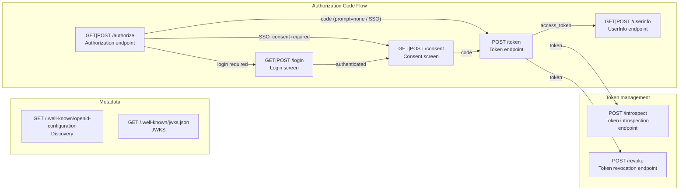

# @maronn-openid-connect/cli

OpenID Connect Provider のコードを生成する CLI ツール。
Hono / Express / Fastify / Next.js 向けに、Authorization Code Flow（OAuth 2.1 / OIDC Core 1.0 準拠）を実装した OP コード一式を生成する。

生成コードは [`@maronn-openid-connect/core`](../core) のロジックを HTTP に配線したもので、利用者はこのコードを改造しながら「自分の要件がこの仕様で実現できるか」を検証する。

生成されるエンドポイントは、処理を 1 段階ずつ export 関数に分け、ハンドラーがそれを順に呼ぶ形で並べる。
各関数は core の機能単位ステップ関数（クライアント認証、PKCE、scope、再利用検知、ID Token クレーム構築など）を呼ぶ。
各段階が生成コード上に見えているため、不要な検証を消したり、段階の間に独自処理を足したりして仕様の挙動を検証しやすい。

| 生成ファイル | 並んでいる関数（`maronn-oidc graph --detail steps` の箱） |
|---|---|
| `routes/authorize.ts` | `parseAuthorizationRequest` → `resolveAuthorizationClient` → `resolveRequestObject` → `resolveRedirectTarget` → `validateAuthorizationRequestParams` → `createAuthorizationTransaction` → `rejectCombinedPromptNone` → `verifyIdTokenHint` → `completePromptNoneRequest` → `reuseExistingSession` → `continueToLogin`（`prompt=none` と SSO は `issueAuthorizationCodeResponse` を呼ぶ） |
| `routes/token.ts` | `parseTokenRequest` → `authenticateTokenClient` → `validateTokenGrantType` → `validateAuthorizationCodeGrant` / `validateRefreshTokenGrant` → `selectTokenSigningKeys` → `resolveTokenSubject` → `decideRefreshTokenIssuance` → `resolveTokenAcrAmr` → `issueAccessToken` → `issueIdToken` → `persistAccessToken` → `issueRefreshToken` → `revokeRotatedRefreshToken` → `buildTokenResponse` → `respondToken` |
| `routes/userinfo.ts` | `parseUserInfoRequest` → `resolveUserInfoToken` → `resolveUserInfoResponseClaims` → `buildUserInfoResponse` → `respondUserInfo` |
| `routes/introspection.ts` | `parseIntrospectionRequest` → `authenticateIntrospectionClient` → `resolveIntrospectedToken` → `describeIntrospectedToken` → `respondIntrospection`（`jwt-introspection-response` 有効時は `signIntrospectionResponse` が入る） |
| `routes/revocation.ts` | `parseRevocationRequest` → `authenticateRevocationClient` → `resolveRevocationTokenTarget` → `revokeToken` → `respondRevocation` |
| `routes/login.ts` / `routes/consent.ts` | `loadTransaction` → `validateLoginCsrfToken` → `authenticateEndUser` → `establishBrowserSession` → `handOffToConsent` のような画面の判断。GET と POST の流れが順番を決めるため、`prepareLogin()` / `submitLogin()` などの入口がこれらを決まった順で呼ぶ |

ID Token へ独自クレームを足すなら `routes/token.ts` の `issueIdToken()` を書き換える、といった改修が生成コード上で完結する。
この関数の分け方は `maronn-oidc graph` が描く図の箱と一致し、図の元になる JSON を編集して生成することもできる（[フロー図とフロー文書（graph / --flow）](#フロー図とフロー文書graph----flow)を参照）。

## インストールと実行

```bash
# インストールせずに実行
pnpm dlx @maronn-openid-connect/cli generate hono

# またはプロジェクトに追加してから実行
pnpm add -D @maronn-openid-connect/cli
pnpm maronn-oidc generate hono
```

## 使い方

```bash
# コード生成
maronn-oidc generate <framework> [options]

# 生成 + 既存エントリファイルへの組み込み（Next.js 以外）
maronn-oidc setup <framework> [options]

# 生成される OP を箱と矢印の図（Mermaid）か、その元になる JSON のフロー文書にする
maronn-oidc graph [framework] [options]
```

対応フレームワーク: `hono`, `express`, `fastify`, `nextjs`

`setup` は生成に加えて、エントリファイル内のプレースホルダーコメント（`// <!-- OIDC_IMPORT_PLACEHOLDER -->` と `// <!-- OIDC_SETUP_PLACEHOLDER -->`）を `applyOidc` の import と呼び出しに置換する。Next.js は App Router のファイル規約に従うため `setup` 非対応で、`maronn-oidc generate nextjs --output ./src/app` を使う。

`graph` は何も書き込まない。`generate` と同じ `--enable` / `--disable` / `--scope` / `--db`（または `--flow`）から、生成される OP の図を標準出力に書く。framework を付けると、JSON のフロー文書に各エンドポイントの生成先ファイル（`module`）が入る。詳しくは[フロー図とフロー文書（graph / --flow）](#フロー図とフロー文書graph----flow)を参照。

### オプション

| オプション | 説明 |
|---|---|
| `--output, -o <dir>` | 出力先ディレクトリ（既定: `./oidc-provider`）。`graph` では標準出力の代わりに書き込むファイル |
| `--entry, -e <file>` | setup 時にパッチするエントリファイル（既定: `./src/index.ts`） |
| `--enable <features>` | 有効化する機能（カンマ区切り・複数回指定可） |
| `--disable <features>` | 既定セットから外す機能（カンマ区切り・複数回指定可） |
| `--scope <scopes>` | 生成 OP が受け付けるカスタムスコープ（カンマ区切り・複数回指定可） |
| `--db <sql\|kv>` | クライアント、ユーザー、認可コード、トークンなどのデータを、SQL のテーブル（`sql`）かキー・バリューストア（`kv`）に保存する（`db/` を生成する。[DB に保存する（--db）](#db-に保存する--db)を参照） |
| `--flow <file>` | `graph --format json` が書いたフロー文書（編集済みでもよい）から生成、または描画する。`--enable` / `--disable` / `--scope` / `--db` の代わりになり、同時には指定できない（[フロー図とフロー文書（graph / --flow）](#フロー図とフロー文書graph----flow)を参照） |
| `--format <mermaid\|json>` | `graph` のみ。Mermaid の flowchart（既定）か、JSON のフロー文書 |
| `--detail <endpoints\|steps>` | `graph` のみ。エンドポイントごとに 1 箱（既定）か、各エンドポイントの中のステップを関数 1 つにつき 1 箱で描く |
| `--endpoint <ids>` | `graph` のみ。描くエンドポイントの ID（カンマ区切り・複数回指定可。既定は全部） |
| `--no-error-edges` | `graph` のみ。エラー応答のステップへ向かう破線の矢印を省く |
| `--force` | 出力先に既にあるファイルを上書きする |
| `--dry-run` | 書き込みを行わず、出力予定のファイル一覧（新規か上書きか）を表示する |
| `--help, -h` | ヘルプ表示 |

### 既存ファイルの上書き保護

出力先に生成対象と同名のファイルが 1 つでもある場合、`generate` / `setup` は**何も書き込まずに**そのファイル一覧を表示して終了コード 1 で終わる。改造済みの `config.ts` や `store.ts` を再実行で失わないためで、上書きするには `--force` を明示する（ログは新規が `Created:`、上書きが `Overwritten:` になる）。事前に結果を確認したいときは `--dry-run` を使う。

再生成する予定があるなら、生成直後にコミットしてから改造すること。`--force` で上書きしても、自分の変更を `git diff` で取り戻せる。

`--db` で生成する `db/instance.ts` だけは扱いが異なる。
利用者が書くファイルなので、CLI は無いときだけ作り、`--force` を付けても上書きしない。
既にあれば上書き保護の対象にも数えず、生成ログには `Kept:`、`--dry-run` には `Would keep:` と表示する。

## 生成されるもの

```
oidc-provider/
├── app.ts / apply.ts     # OP 本体と既存アプリへの組み込み関数
├── config.ts             # ProviderConfig・クライアント登録（既定値はローカル検証専用）
├── store.ts              # インメモリストア（認可コード・トークン・セッション等）
├── resolvers.ts          # セッション・同意状態の resolver
├── client-auth.ts        # private_key_jwt のクライアント認証（クライアントを認証するエンドポイントが共有する）
├── views.ts              # ログイン / 同意 / エラー画面のデフォルト HTML（Hono は views.tsx の JSX コンポーネント）
├── pages/                # 画面用ルーティング（ブラウザ向けの GET/POST。描画・リダイレクト・Cookie 付与はすべてここ。UI カスタマイズはここ）
├── routes/               # API ルーティング（ロジック本体。処理の段階ごとに export 関数 1 つ。ブラウザ向けステップは Response を返さず結果（outcome）を返す関数）
├── db/                   # --db 指定時のみ。テーブル定義（sql）かキーの一覧（kv）、ストア、クライアントとユーザーの読み書き（instance.ts だけは利用者が書く）
└── .maronn-openid-connect.json  # 生成元の CLI バージョン、機能構成、--flow で並べ替えたステップの記録
```

Next.js は App Router のファイル規約に沿った別の構成になる（[Next.js の生成物](#nextjs-の生成物)を参照）。

Hono の出力は TSX 前提で生成される。画面のマークアップ（`views.tsx`）は [hono/jsx](https://hono.dev/docs/guides/jsx) のコンポーネントで、画面を描く `pages/`（`errors` / `login` / `consent`、機能有効時は `device` / `ciba` / `logout`）も `.tsx` になり、`renderView(<views.loginPage {...params} />)` のように JSX でビューを描画する。HTML を返さない `pages/authorize.ts` と `pages/respond.ts` は `.ts` のまま。JSX は `{...}` で埋め込んだ値をすべてエスケープするので、`login_hint` や `error_description` のような信頼できない値も手でエスケープせずに描画できる。

ビューは JSX 要素を返すコンポーネントで、`createApp` / `applyOidc` の `views` オプションで差し替えるときも `loginPage: (params) => <MyLoginPage {...params} />` のように書く。別の手段で組み立てた HTML を返すときは `hono/html` の `html` タグか `raw()` で包む（`raw()` は渡した文字列をそのまま信頼するので、エスケープ済みの HTML だけを渡す）。ステータスやヘッダーなど Response そのものを変えたいときは、`pages/*.tsx` の `render*Page()` を書き換える。

コンパイルには `tsconfig.json` で JSX を有効にしておく必要がある。

```jsonc
{
  "compilerOptions": {
    "jsx": "react-jsx",
    "jsxImportSource": "hono/jsx"
  }
}
```

`.maronn-openid-connect.json` は、どの CLI バージョン・どの機能構成（`framework` / `features` / `scopes` / `db`）から生成されたかと、`--flow` で並べ替えたステップとエンドポイントの順番（`steps` / `endpointOrder`。並べ替えていなければ `null`）を記録するマニフェスト（[フロー図とフロー文書（graph / --flow）](#フロー図とフロー文書graph----flow)を参照）。テンプレートへ仕様修正が入ったとき、リリースノートと突き合わせて「自分のコードがどの版から生成されたか」を特定する起点になる。利用者が編集するファイルではないため、上書き保護の対象外として毎回更新される（生成日時は含めず、同じ入力からは同じ出力になる）。

生成される OP のエンドポイント:

| パス | 役割 |
|---|---|
| `/authorize` | 認可エンドポイント（`response_type=code`、PKCE S256、`prompt` / `max_age` / `claims` / `acr_values` / Request Object 対応） |
| `/token` | トークンエンドポイント（`authorization_code` / `refresh_token` グラント、`client_secret_basic` / `client_secret_post` / `private_key_jwt` / public client） |
| `/userinfo` | UserInfo エンドポイント（Bearer トークン、scope 別クレーム） |
| `/login`, `/consent` | ログイン・同意画面。ルート（GET / POST）と描画は `pages/`、認証・同意の判断は `routes/` の関数が担当する（差し替え可能なデフォルト UI 付き。Next.js はページと Server Action） |
| `/login/google` | Sign in with Google の `login_uri`（Google が ID トークンを POST する先。`google-login` 有効時） |
| `/.well-known/openid-configuration` | Discovery メタデータ |
| `/.well-known/jwks.json` | JWKS（公開鍵） |
| `/introspect` | RFC 7662 Token Introspection（`introspection` 有効時） |
| `/revoke` | RFC 7009 Token Revocation（`revocation` 有効時） |

## 画面用ルーティング（pages/）と API ルーティング（routes/）

生成されるルーティングは 2 種類に分かれている。ブラウザに返すもの（画面の描画・リダイレクト・Cookie の付与）はすべて `pages/` が担当し、`routes/` は Response を一切作らない。UI をカスタマイズするときに触るのは `pages/`（と `views.ts`、Hono は `views.tsx`）だけで、`routes/` のロジックは読まなくてよい。以下の `pages/login.ts` などのファイル名は、Hono では `authorize.ts` と `respond.ts` を除いて `.tsx` になる。

| 層 | ファイル | 役割 |
|---|---|---|
| 画面用ルーティング | `pages/authorize.ts` / `pages/login.ts` / `pages/consent.ts` / `pages/errors.ts` / `pages/respond.ts`（機能有効時: `pages/device.ts` / `pages/ciba.ts` / `pages/logout.ts`） | ブラウザ向けのルートは **GET も POST も** ここにある（`GET\|POST /authorize`・`GET\|POST /login`・`GET\|POST /consent` など）。リクエストを読み、`routes/` の関数を 1 回呼び、返ってきた結果（outcome）を画面かリダイレクトに変換する。ロジックは持たない |
| API ルーティング | `routes/*.ts` | OIDC のロジック本体。`token` / `userinfo` などの JSON エンドポイントはルーターのまま。ブラウザ向けの各ステップ（`authorize` / `login` / `consent` / `device` / `ciba-verification` / `logout`）は Response を返さない関数（`processAuthorizationRequest()` / `prepareLogin()` / `submitLogin()` / `submitConsent()` など）で、結果を `kind` 付きの outcome（リダイレクト先 `location`、付与する `cookies`、画面データ、またはエラー）として返す。描画・リダイレクト・`Set-Cookie`・`c.json()` は一切行わず、`views.ts` も `pages/` も import しない。各ファイルは処理の段階ごとに export 関数を 1 つ持ち（`routes/token.ts` なら `parseTokenRequest()` → `authenticateTokenClient()` → … → `respondToken()`）、ハンドラーはそれらを `// [parse-request]` のようなステップ ID のコメントを添えて順に呼ぶ。関数の並びは `maronn-oidc graph --detail steps` が描く箱の並びと同じ |

たとえば `POST /login` は `pages/login.ts` がフォームを読んで `submitLogin()` を呼び、`{ kind: 'authenticated', cookies }` なら Cookie を付けて `/consent` へ 302、`{ kind: 'invalid_credentials' }` ならフォームを再表示、`{ kind: 'locked_out' }` なら 429 のエラー画面、という変換だけを行う。

UI を変える場所は、変えたい範囲で選ぶ。

- **HTML だけ変える** → `views.ts`（Hono は `views.tsx`）の `default*Page` を書き換えるか、`createApp` / `applyOidc` の `views` オプションで差し替える
- **描画の仕方を変える**（テンプレートエンジン、フレームワークネイティブの Response、別に用意した UI へのリダイレクト）→ `pages/*.ts` の `render*Page()` と outcome を変換している箇所を書き換える。画面を返す経路はすべて `pages/` を通るので、`GET /login` もログイン失敗時の再表示も一緒に変わる
- **画面遷移を変える**（ログイン後の遷移先、エラー時の見せ方など）→ `pages/*.ts` で `redirectWithCookies()` / `withCookies()`（`pages/respond.ts`）を呼んでいる箇所。付けるべき Cookie は outcome の `cookies` にそのまま入っている
- **非リダイレクトの認可エラー（OIDC Core 1.0 §3.1.2.2）の見せ方を変える** → `pages/errors.ts` の `renderAuthorizationErrorPage()`

フォームの `name`（`csrf_token` / `username` / `password`、同意の `action=approve|deny`）は `pages/` が `routes/` の関数へ渡す入力なので、画面を差し替えても維持する。トランザクション Cookie と `csrf_token` の照合や google-login のボタン設定（`buildGoogleSignIn()`）は判断なので `routes/login.ts` / `routes/consent.ts` にあり、`pages/` は返ってきた結果を描くだけでよい。

### 認可トランザクションの受け渡し（Cookie + csrf_token）

`/authorize` から `/login`・`/consent` へ引き継ぐ認可トランザクションの ID は、URL にも HTML にも載せない。`/authorize` は ID を HttpOnly Cookie `__Host-oidc_txn`（`Secure; SameSite=Lax; Path=/; Max-Age=600`）でブラウザに渡してクエリの無い `/login`（または `/consent`）へリダイレクトし、ログイン・同意画面は Cookie からトランザクションを引いて、フォームには `csrf_token`（Cookie とは別の乱数）だけを埋め込む。`POST /login`・`POST /consent` は、まずブラウザが付ける `Sec-Fetch-Site` / `Origin` で OP 自身の画面から送られたかを確かめ（`store.ts` の `isSameOriginFormPost()`）、次に Cookie が指すトランザクションに対して `csrf_token` を照合する。同意の結果を返すときに Cookie は消える。

ID が URL から漏れて第三者に同意画面を開かれることはない（OIDC Core 1.0 §3.1.2.3 / §3.1.2.4 が実装に委ねている User-Agent の同一性の担保）。`__Host-` プレフィックスはサブドメインからの Cookie の設定（Cookie tossing）をブラウザに拒否させ、送信元チェックは Cookie と `csrf_token` の両方を握られた偽の POST でも止める。Cookie は同意の結果を返すまで残るので、ログイン・同意画面をリロードしても同じトランザクションのフォーム（同じ `csrf_token`）がもう一度表示される。Cookie はブラウザに 1 つなので、同じブラウザの別タブで新しい認可リクエストを始めると、先のタブのフォームは `csrf_token` が一致せず拒否される。curl などで手動で進めるときは Cookie を持ち回る（`curl -c jar.txt -b jar.txt`）。

## フロー図とフロー文書（graph / --flow）

`maronn-oidc graph` は、生成される OP を箱と矢印の図にする。`generate` と同じ機能フラグを受け取り、何も書き込まない。既定では箱がエンドポイント、矢印はエンドポイントの間でコードやトークンが渡る向き。`--detail steps` を付けると、各エンドポイントの中を、生成コードの export 関数 1 つにつき箱 1 つで描く。

```bash
# エンドポイントの図（Mermaid）を標準出力へ
maronn-oidc graph --enable par --enable jarm

# /token の中のステップを描き、ファイルに書く
maronn-oidc graph --detail steps --endpoint token -o token.mmd

# 図の元になるフロー文書（JSON）
maronn-oidc graph --format json -o op-flow.json

# 編集したフロー文書を描いて確かめる
maronn-oidc graph --flow op-flow.json --detail steps --endpoint token
```

既定の機能構成では、エンドポイントの図は次のようになる。



### 図の箱と生成コードの対応

`--detail steps` の箱は、生成コードの export 関数と 1 対 1 で対応する。箱にはステップの ID、関数名、根拠になる仕様の節が書かれ、生成コードでは同じ ID が呼び出しの手前のコメントになる。たとえば `routes/token.ts` のハンドラーは次の形になる。

```typescript
tokenApp.post('/', async (c) => {
  try {
    // [parse-request] Parse the token request — RFC 6749 §4.1.3 / §3.2
    const { params, authorization } = await parseTokenRequest(c);

    // [authenticate-client] Authenticate the client — OAuth 2.1 §2.3 / OIDC Core 1.0 §9
    const { tokenClient, authenticatedClientId } = await authenticateTokenClient(c, params, authorization);

    // ...（grant の検証、鍵の選択、subject の解決、トークンの発行と保存）

    // [build-token-response] Build the token response body — OIDC Core 1.0 §3.1.3.3 / RFC 6749 §5.1
    const tokenResponse = buildTokenResponse(c, { accessToken, idToken, refreshToken, validatedRequest });

    // [respond] Respond (no-store) — RFC 6749 §5.1
    return respondToken(c, tokenResponse);
  } catch (error) {
    return respondTokenError(c, error);
  }
});
```

API のエンドポイント（`/authorize`、`/token`、`/userinfo`、`/introspect`、`/revoke`、Discovery、JWKS、experimental の `/par`、`/register`、`/device_authorization`、`/backchannel_authentication`）は、この「関数を順に呼ぶ」形で生成される。画面のエンドポイント（`/login`、`/login/google`、`/consent`、`/device`、`/ciba`、`/logout`）も箱ごとに関数を持つが、GET と POST の流れが順番を決めているため、`prepareLogin()` / `submitLogin()` のような入口の関数がそれらを決まった順で呼ぶ。

### フロー文書を編集して生成する（--flow）

`--format json` が書く**フロー文書**には、エンドポイントとステップの一覧、各ステップが読む値と作る値（`consumes` / `produces`）、消せるかどうか（`removable`）、そして描いたときの `features` / `scopes` / `db` が入る。この文書を編集して `--flow` に渡すと、`generate` と `setup` はコマンドラインの機能フラグの代わりに文書の内容で生成する。

```bash
maronn-oidc graph --format json -o op-flow.json
# op-flow.json を編集する（例: /token の steps から issue-id-token を外す）
maronn-oidc generate hono --flow op-flow.json -o ./oidc-provider
```

文書で変えられるのは次の 4 つ。

- **ステップを消す**：`removable: true` のステップ（`/token` の `resolve-acr-amr`、`issue-id-token`、`revoke-rotated-refresh-token`、`/authorize` の `verify-id-token-hint`、`authenticate-silently`、`reuse-session`）を `steps` から外す。消したステップが作っていた値を後のステップが読む場合、生成コードはその値を既定値（ID Token や acr なら `undefined`）で補う
- **ステップを並べ替える**：値のやり取りが無いステップ同士は順番を変えられる。値を作るステップより前にそれを読むステップを置く、`after` / `before` の制約に反する、といった並びはエラーになる
- **エンドポイントを並べ替える**：`endpoints` の順番は図の並びとしてマニフェストの `endpointOrder` に記録される。生成コードがエンドポイントをマウントする順番は変わらない
- **機能を切り替える**：`features` の値を変えると、`--enable` / `--disable` と同じようにエンドポイントとステップが増減する。`scopes` と `db` も同様

次の変更はエラーで止まり、何も書き込まない。

- `removable: false` のステップを消す。`feature` が付いたステップは、ステップではなく `features` の側で外す
- 画面のエンドポイント（`login` / `login-google` / `consent` / `device` / `ciba` / `logout`）のステップ列を変える
- 必須のエンドポイント（`authorize` / `token` など）を外す。機能で増えたエンドポイント（`introspection` など）は `features` の側で外す
- `--flow` と `--enable` / `--disable` / `--scope` / `--db` を同時に指定する。文書が機能構成を持っているため

並べ替えたステップは Hono / Express / Fastify の生成コードに反映される。Next.js は App Router の Route Handler に処理を直接書く構成のため、`steps` を変えた文書を渡すとエラーになり、エンドポイントと機能の変更だけを受け付ける。

フロー文書は、図を UI 上で編集して（箱をドラッグ&ドロップで並べ替えて）生成する、という使い方のための入出力である。CLI だけで使うときは、`graph --format json` の出力を手で編集する。

## Next.js の生成物

Next.js では、App Router の機能をそのまま使ったコードを `--output`（例: `./src/app`）へ生成する。共通のルーターや独自のコンテキストは挟まず、エンドポイントごとの Route Handler にその処理を上から順に書いている。`/token` の挙動を知りたければ `token/route.ts` だけを読めばよい。

```
src/app/
├── _oidc-provider/           # 全エンドポイントが共有する部品（private folder なのでルーティングされない）
│   ├── provider.ts           # 設定・クライアント・署名鍵・ストアの組み立て。プロジェクトへ組み込むときに編集する場所
│   ├── http.ts               # CORS・キャッシュ禁止の JSON 応答・パラメータ重複の検出・エラーページへのリダイレクトなど、Route Handler と Server Action 共通の部品
│   ├── client-auth.ts        # private_key_jwt のクライアント認証（クライアントを認証する Route Handler が共有する）
│   ├── transaction.ts        # ログイン・同意が続ける認可トランザクションを Cookie から取得（無ければ notFound()）
│   ├── error-view.tsx        # エラー画面の共通レイアウト（oidc-error・not-found・error の各画面が使う）
│   ├── config.ts / store.ts / resolvers.ts  # 他のフレームワークと共通の設定型・ストア・resolver
│   ├── storage-backend.ts    # Vercel 向け Upstash Redis REST とローカル SQLite のストア（--db 指定時は生成しない）
│   └── db/                   # --db 指定時のみ。テーブル定義（sql）かキーの一覧（kv）、ストア、クライアントとユーザーの読み書き（instance.ts だけは利用者が書く）
├── authorize/route.ts        # GET|POST /authorize（検証パイプラインをこのファイルに直接書いている）
├── token/route.ts            # POST /token
├── userinfo/route.ts         # GET|POST /userinfo
├── introspect/route.ts       # POST /introspect（introspection 有効時）
├── revoke/route.ts           # POST /revoke（revocation 有効時）
├── .well-known/openid-configuration/route.ts
├── .well-known/jwks.json/route.ts
├── login/page.tsx            # ログイン画面（React Server Component）
├── login/actions.ts          # ログインの Server Action
├── login/session.ts          # OP セッションの開始（パスワードログインと Google ログインで共有）
├── login/not-found.tsx       # トランザクションが無いとき（notFound()）の画面。HTTP 404
├── login/error.tsx           # 想定外の例外のときの画面（error boundary）
├── consent/page.tsx          # 同意画面
├── consent/actions.ts        # 同意の Server Action（認可コードを発行してクライアントへリダイレクト）
├── consent/not-found.tsx / consent/error.tsx  # 同意画面の not-found / error（ログイン画面と同じ役割）
└── oidc-error/page.tsx       # クライアントへ返してはいけないエラーの表示先
```

各 `route.ts` は `GET` / `POST` / `OPTIONS` などの HTTP メソッドを自分で export する。ログイン・同意画面は React のページと Server Action なので、見た目は `page.tsx`、判断は `actions.ts` を書き換える。device / CIBA / RP-Initiated Logout の画面は、表示と同時に Cookie を発行し、403 や 429 などのステータスを返す必要がある。Server Component はどちらもできないため、これらは HTML を返す Route Handler（描画は各ディレクトリの `screens.ts`）として生成する。実験的機能の設定は、それを使うコードの隣に置く（例: `par/config.ts`、トークンエンドポイントの grant なら `token/token-exchange.ts` の `tokenExchangeConfig`）。認可エンドポイントと同意の両方が読む JARM の設定は `_oidc-provider/jarm.ts` にある。

OP がブラウザを止める場面は、Next.js の機能で表す。

- 進行中の認可リクエストが無い（トランザクション Cookie が無い、または Cookie が指すトランザクションが不明・完了済み・期限切れ）: ページと Server Action が `notFound()` を呼び、隣の `not-found.tsx` を HTTP 404 で表示する。利用者はクライアントからやり直すしかない
- クライアントへ返してはいけないエラー（OIDC Core 1.0 §3.1.2.2。未登録の `redirect_uri`、CSRF トークンの不一致、ログイン試行回数の上限、判断を含まない同意の POST、Google ログインのコールバックの失敗など）: `redirect()` で `oidc-error/page.tsx` へ送る。Route Handler からは 303 でリダイレクトする
- 想定外の例外（ストアの障害など）: `error.tsx`（error boundary）が表示する。本番の Next.js はエラーメッセージをブラウザへ渡さないので、画面にはサーバーログと突き合わせられる `digest` だけを出す

これらの画面はどれも `_oidc-provider/error-view.tsx` の `ErrorView` で描くので、見た目はそこを書き換えれば揃って変わる。device / CIBA / RP-Initiated Logout の画面のエラーは、ステータスコード（403 / 429 など）を保つため、画面と同じく `_oidc-provider/html.ts` の HTML で返す。

Next.js は Route Handler とページ・Server Action を別々のモジュール層にバンドルする。両方から同じインスタンスを参照する必要があるストアと署名鍵は、`globalThis` に保持している（`provider.ts` / `storage-backend.ts`）。

設定は環境変数から読む。

| 環境変数 | 用途 |
|---|---|
| `OIDC_ISSUER` | issuer。OP 自身の URL はすべてこれを基準に組み立てる |
| `OIDC_CLIENTS_JSON` | 登録クライアント（`RegisteredClient` の JSON 配列）。未指定なら `OIDC_CLIENT_ID` / `OIDC_CLIENT_SECRET` / `OIDC_CLIENT_REDIRECT_URI` の 1 クライアント |
| `OIDC_SIGNING_KEY_ID` | 起動時に生成する署名鍵の `kid` |
| `OIDC_CORS_ORIGINS` | トークンエンドポイントなどをブラウザから呼べるオリジン（既定は issuer） |
| `UPSTASH_REDIS_REST_URL` / `UPSTASH_REDIS_REST_TOKEN` | Vercel で使うストア。未指定ならローカル SQLite（`OIDC_SQLITE_PATH`、既定 `.data/oidc.sqlite`） |
| `GOOGLE_CLIENT_ID` / `GOOGLE_HOSTED_DOMAIN` | Sign in with Google（`google-login` 有効時） |

## 機能トグル（--enable / --disable）

生成されるOPの機能は、既定の全部入り構成から機能単位で増減できる。

```bash
# リフレッシュトークンとイントロスペクションを外した OP を生成
maronn-oidc generate hono --disable refresh-token,introspection

# PKCE を任意化（confidential client の非PKCEフローを許可）
maronn-oidc generate express --disable pkce
```

| 機能名 | 既定 | `--disable` 時の挙動 |
|---|---|---|
| `pkce` | 有効 | PKCE を任意化する（`allowNonPkceAuthorizationCodeFlow: true`）。明示的な confidential client の完全な非PKCEリクエストのみ許可され、public client や不正な PKCE 値は引き続き拒否される |
| `refresh-token` | 有効 | `refresh_token` grant を `unsupported_grant_type` で拒否。`offline_access` は付与されず、リフレッシュトークンは発行されない。discovery からも除去される |
| `introspection` | 有効 | RFC 7662 introspection エンドポイント（`/introspect`）を生成しない |
| `revocation` | 有効 | RFC 7009 revocation エンドポイント（`/revoke`）を生成しない |
| `request-object` | 有効 | `request` パラメータ（Request Object by value, OIDC Core 1.0 §6.1）を `request_not_supported` で拒否。discovery は `request_parameter_supported: false` を広告する |

Basic OP に必須の機能（authorize / token / userinfo / discovery / jwks / login / consent）はトグル対象外で、常に生成される。
未知の機能名や、同じ機能を `--enable` と `--disable` の両方に指定した場合はエラーになる。

### 拡張機能（--enable google-login）

拡張機能は、OAuth / OIDC の仕様ではなく**ログイン手段**を生成コードに足すカテゴリで、既定では無効。実装は別 package にあり、有効にしたときだけ import される。

```bash
maronn-oidc generate express --enable google-login
pnpm add express @maronn-openid-connect/core @maronn-openid-connect/google-login
```

| 機能名 | 既定 | 内容 | 実装 package |
|---|---|---|---|
| `google-login` | 無効 | ログイン画面に「Google でログイン」（Google Identity Services の redirect mode）を追加し、Google が ID トークンを POST する `POST /login/google` を生成する。ID トークンの検証は Google 公式の `google-auth-library` に委ね、CSRF（`g_csrf_token` の Double Submit Cookie）、nonce による認証トランザクションへの束縛、`google:<sub>` を subject にした Google ユーザーの JIT 登録を生成コードが行う（`--db` 付きでは、ランダムな ID のユーザーを作り、Google の sub を Federated_identity（`--db sql` は `federated_identities` テーブル、`--db kv` は `federated_identity:` のキー）に記録する） | `@maronn-openid-connect/google-login`（Node.js 22 以上限定。Cloudflare Workers などのエッジでは動かない） |

有効化しても `config.googleLogin` を渡すまでボタンは表示されず、`/login/google` は 404 を返す。設定は `ProviderConfig.googleLogin = { clientId, hostedDomain?, requireVerifiedEmail? }` で、Google Cloud コンソールの OAuth クライアントには `<issuer>/login/google` を「承認済みのリダイレクト URI」に、ログイン画面のオリジンを「承認済みの JavaScript 生成元」に登録する。生成される Next.js の `_oidc-provider/provider.ts` と本リポジトリの samples は `GOOGLE_CLIENT_ID` / `GOOGLE_HOSTED_DOMAIN` からこれを読む。詳細は [`@maronn-openid-connect/google-login` の README](../google-login/README.md) を参照。

## カスタムスコープ（--scope）

標準スコープ（`openid` / `profile` / `email` / `address` / `phone` / `offline_access`）以外に受け付けるスコープを、生成時に宣言できる。

```bash
maronn-oidc generate hono --scope reports.read,reports.write
```

宣言すると `scopes.ts`（スコープポリシー）が生成され、生成 OP は次のようになる。

- discovery の `scopes_supported` に宣言したスコープが載る
- **宣言していないスコープ値は `invalid_scope` で拒否される**（RFC 6749 §3.3 / §4.1.2.1）。宣言が 1 つも無ければこのチェック自体を生成しないので、既定の生成物の挙動は変わらない
- ユーザーごとの絞り込みは、生成された `scopes.ts` に書く

### ユーザーごとの絞り込みは生成コードに書く

「誰にどのスコープを許すか」は CLI のオプションにしていない。運用ごとに条件（ロール、テナント、DB 参照）が違い、生成コードを改造して検証するというこのライブラリの使い方に合わないためである。代わりに、生成される `scopes.ts` に絞り込みの入口を用意し、判断が必要な全ステップから呼び出した状態で生成する。

```typescript
// scopes.ts
export const RESTRICTED_SCOPE_SUBJECTS: Record<string, readonly string[]> = {
  'reports.read': ['alice'],   // ← 手早く絞るならここに書く
};

export async function resolveGrantableScopes(
  requested: readonly string[],
  subject: string,
): Promise<string[]> {
  // ← ロール・テナント・DB 参照など、複雑な条件はここに書く（async なので
  //    DB / KV 参照を入れても呼び出し側の変更は不要）
  return requested.filter((scope) => { /* ... */ });
}
```

`resolveGrantableScopes()` は End-User が確定した後に呼ばれ、生成コードの次の箇所からすでに `await` されている。

| 呼び出し元 | タイミング |
|---|---|
| `routes/consent.ts` | 同意画面の表示内容と、承認時の付与スコープ |
| `routes/authorize.ts` | SSO fast path と `prompt=none`（同意画面を出さずに付与する経路）。どちらも**保存済み同意を引く前**に適用する。絞る前の scope で同意を探すと、そのユーザーが持てないスコープをキーに検索することになり永久に一致しない |
| `routes/device.ts` / `routes/ciba-verification.ts` | device / CIBA の承認ステップ（該当機能を有効にした場合） |

落としたスコープはリクエストを失敗させず、付与スコープを狭めるだけになる（RFC 6749 §3.3 は要求より狭いスコープの発行を認めており、トークンレスポンスの `scope` に実際の付与内容が載る）。リクエストごと拒否したい場合は、呼び出し元で throw する。

カスタムスコープに対応する UserInfo クレームは無い（OIDC Core 1.0 §5.4 が定義するのは profile / email / address / phone のみ）。独自クレームを返す場合は `routes/userinfo.ts` を編集する。

## 認証コンテキスト（acr_values と acr）

`/authorize` は、省略できるパラメータ `acr_values`（OIDC Core 1.0 §3.1.2.1）を受け付ける。
値は空白区切りで、各値が RFC 6749 §3.3 の scope-token と同じ文字（`"` と `\` を除く、表示できる ASCII 文字）だけでできていれば通し、ほかの文字を含めば `invalid_request` をクライアントへ返す。
空文字と空白だけの値は、省略と同じに扱う。

Hono / Express / Fastify の生成物では、トークンに載せる acr を `routes/token.ts` の `resolveTokenAcrAmr()` が決める。
`createApp` / `applyOidc` に `acrResolver` を渡していれば、その戻り値の acr / amr を使う。
渡していなければ、要求された値のうち最も優先する値（先頭の値）を acr にし、amr は載せない。
`claims` パラメータの `id_token.acr.values` も、`acr_values` と同じ要求として扱う（OIDC Core 1.0 §5.5.1.1）。
要求が無ければ acr も載せない。
Next.js の生成物では、`_oidc-provider/provider.ts` の `acrResolver` が同じく最も優先する値を返し、amr に `pwd` を加える。

決めた acr は、ID トークンの `acr`、JWT のアクセストークンの `acr`（RFC 9068 §2.2.1）、アクセストークンの保存レコードに入る。
保存レコードの acr はイントロスペクションのレスポンスにも `acr`（RFC 9470 §6.2）として載るので、クレームを持たない Opaque のアクセストークンでも、リソースサーバーは acr を確かめられる。
リフレッシュで発行するトークンは、最初に決めた acr / amr を引き継ぐ（OIDC Core 1.0 §12.1）。

要求された値をそのまま acr にした場合、その acr は OP が実際に行った認証を表すとは限らない。
ログインの方式に合った acr を返すときは、`acrResolver` を渡す（Next.js では書き換える）。

## クライアントの公開鍵

クライアントの公開鍵は、鍵を使う処理（用途）ごとに登録する。
鍵を使う処理は、core の `ClientKeyResolver` の `findClientKeys(clientId, purpose)` で、自分の用途の鍵だけを受け取る。
生成 OP が鍵を読む用途は、次の 2 つである。

| 用途（`purpose`） | 鍵を使う処理 |
|---|---|
| `private_key_jwt` | クライアント認証のアサーションの検証（OIDC Core 1.0 §9。[private_key_jwt によるクライアント認証](#private_key_jwt-によるクライアント認証)を参照） |
| `request_object` | 署名付き Request Object の検証（OIDC Core 1.0 §6.3.2） |

用途は文字列で、DB の側にも CHECK を付けていないので、ほかの処理の用途も同じ形で登録できる。
たとえば、DPoP（RFC 9449）の proof を、登録した鍵で署名したものに限る処理を足すなら、`dpop` の用途で鍵を登録し、その処理から `findClientKeys(clientId, 'dpop')` を呼ぶ。
標準の DPoP は proof の `jwk` ヘッダーの鍵で検証するので、登録した鍵を使わない。
生成 OP は DPoP を実装しておらず、`dpop` の用途の鍵を読む処理も持たない。

OP は、クライアントの鍵を発行する機能も、公開鍵を登録する API や画面も持たない。
鍵の組はクライアントが自分で作り、運用者が公開鍵を DB に書き込む。
`--db` 付きの生成物は、処理が鍵を使うたびに DB から読むので、書き込んだ変更は次のリクエストから効き、OP を再起動する必要は無い。

`--db sql` では、`client_jwks` に行を足す。
1 行は、1 つの用途と、公開鍵 1 つの JWK（RFC 7517）を JSON で持つ。
同じ鍵を 2 つの用途で使うときは、用途ごとに 1 行ずつ足す。

```sql
INSERT INTO client_jwks (id, client_id, purpose, jwk)
  VALUES ('my-client:private_key_jwt:2026-10', 'my-client', 'private_key_jwt',
          '{"kty":"RSA","kid":"2026-10","alg":"RS256","n":"...","e":"AQAB"}');
```

`client_jwks` には公開鍵だけを入れ、`d` などの秘密鍵のメンバーを持つ JWK は入れない。
鍵を入れ替えるときは、新しい鍵の行を先に足し、クライアントが新しい鍵で署名し始めてから古い鍵の行を消す。
1 つの用途にはいくつでも鍵を登録できるので、入れ替えの途中はどちらの鍵の署名も通る。

`--db kv` では、`client_jwks:<client_id>:<purpose>` のキーに、その用途の鍵を JWK Set（`{ "keys": [ <JWK>, ... ] }`）で書く。
鍵を足すときも消すときも、この `keys` を書き換える。

`--db` を付けない生成物は、クライアントの登録メタデータ `jwks`（`RegisteredClient.jwks`、RFC 7591 §2）を、`private_key_jwt` と `request_object` の両方の用途の鍵として返す（core の `createClientJwksKeyResolver()`）。
`jwks` は、用途を分けない 1 組の鍵だからである。
鍵は、`config.ts` で登録するクライアント（Next.js は `OIDC_CLIENTS_JSON` の各クライアント）の `jwks` に書く。
この登録は起動時に読むので、鍵を足したり消したりするには OP を再起動する。

鍵の保存先を変えるときは、`ClientKeyResolver` を実装して差し替える。
Hono / Express / Fastify は `createApp` / `applyOidc` の `clientKeyResolver` オプションに渡し、Next.js は `_oidc-provider/provider.ts` の `clientKeyResolver` を書き換える。
鍵の追加や削除がすぐ効くように、実装は呼ばれるたびに保存先を読む。

`registerClient()` は、渡したクライアントの `jwks` の鍵を、`private_key_jwt` と `request_object` の両方の用途で DB に足す。
ほかの用途の鍵は、DB に直接書く。
`registerClient()` は鍵を足すだけで、DB にある鍵を消すことはない。
起動のたびに `registerClient()` で登録し直しても、運用中に DB へ足した鍵は残る。
鍵を消すときは、DB から消すのに加えて、`registerClient()` に渡すクライアントの `jwks` からも外す。
外さなければ、次の登録で足し直される。

## private_key_jwt によるクライアント認証

生成 OP は、client_secret_basic と client_secret_post に加えて、private_key_jwt（OIDC Core 1.0 §9、RFC 7523 §3）でクライアントを認証できる。
クライアントは自分の秘密鍵で JWT に署名して `client_assertion` に入れ、OP はそのクライアントが `private_key_jwt` の用途に登録した公開鍵で署名を検証する（[クライアントの公開鍵](#クライアントの公開鍵)を参照）。
受け付けるのは `/token`、`/introspect`、`/revoke` と、生成していれば PAR、Device Authorization、CIBA のエンドポイントである。
検証はどのエンドポイントでも `client-auth.ts`（Next.js は `_oidc-provider/client-auth.ts`）の `verifyPrivateKeyJwt()` が行う。
Discovery メタデータは、トークン、イントロスペクション、失効の各エンドポイントについて、認証方式の一覧（`token_endpoint_auth_methods_supported` など）に `private_key_jwt` を、署名アルゴリズムの一覧（`token_endpoint_auth_signing_alg_values_supported` など）に受け付けるアルゴリズムを載せる（RFC 8414 §2）。

1 つのクライアントに、シークレットの方式（client_secret_basic か client_secret_post のどちらか）と private_key_jwt を両方登録できる。
private_key_jwt を許すのは、`--db sql` では `client_auths` の private_key_jwt の行、`--db kv` ではクライアントのレコードの `private_key_jwt: true` で、`--db` を付けない生成物ではクライアントの `tokenEndpointAuthMethods` の `'private_key_jwt'` である。
鍵を登録しただけでは、private_key_jwt で認証できない。
OP はリクエストが送った資格情報から方式を決め、登録していない方式なら `invalid_client` で拒否する。
Authorization ヘッダー、`client_secret`、`client_assertion` のうち 2 つ以上を同時に送ったリクエストは、`invalid_request` で拒否する。

```sql
INSERT INTO client_auths (id, client_id, client_auth_type)
  VALUES ('my-client:private_key_jwt', 'my-client', 'private_key_jwt');
```

シークレットの方式から移るときは、クライアントが JWT の署名に切り替え終わるまで client_secret_basic（または client_secret_post）の行を残す。
切り替え終わったら、その行と、同じ `id` を持つ `client_secrets` の行を消す。
`registerClient()` は private_key_jwt の登録も足すだけで、消さない。
private_key_jwt の登録を消すときは、DB から消すのに加えて、`registerClient()` に渡すクライアントの `tokenEndpointAuthMethods` からも外す。

OP は、次の条件をすべて満たすアサーションだけを受け付ける。

- 署名を、クライアントが `private_key_jwt` の用途に登録した鍵のどれかで検証できる。ヘッダーに `kid` があれば同じ `kid` の鍵を使い、その `kid` の鍵が無ければ `kid` の無い鍵を使う
- `alg` が RS256、RS384、RS512、ES256、ES384、ES512 のどれかである。RSA の鍵は 2048 ビット以上とする（RFC 7518 §3.3）
- ヘッダーに鍵を指す `jku`、`jwk`、`x5u`、`x5c` と、`crit` が無い。`typ` は省略するか、`JWT` か `client-authentication+jwt` にする
- `iss` と `sub` が client_id である
- `aud` の値がすべて、issuer、トークンエンドポイントの URL、リクエストを受けたエンドポイントの URL のどれかである
- `exp` を過ぎておらず、`nbf` と `iat` が未来の時刻でない。どれも 60 秒までの時計のずれを許す
- `jti` があり、そのクライアントがまだ使っていない値である

使った `jti` は、アサーションの期限（`exp` に許容する時計のずれを足した時刻）まで覚えておく。
保存先は、`--db sql` なら `client_assertion_jtis` テーブル、`--db kv` なら `client_assertion_jti:<hash>` のキーで、`--db` を付けなければ `store.ts` のストアである。
このストア（`ProviderStores` の `clientAssertionJtiStore`）は、private_key_jwt を使わない OP には要らないので省略できる。
OP に渡すストア（Hono / Express / Fastify は `storage` オプション、Next.js は `_oidc-provider/provider.ts` の `stores`）に `clientAssertionJtiStore` が無ければ、`jti` はプロセスのメモリに保存される。
その場合、同じアサーションの再利用を拒否できるのは、そのアサーションを受けたインスタンスだけである。
複数のインスタンスで private_key_jwt を受け付けるときは、インスタンスの間で共有するストアを渡す。
`db/` のストアと `createJsonProviderStores()` が作るストアは、どれも `clientAssertionJtiStore` を持っている。

`aud` に載せてよい値は、`client-auth.ts` の `clientAssertionAudiences()` が決める。
OIDC Core 1.0 §9 は、トークンエンドポイントの URL を `aud` にするよう求めている（SHOULD）。
一方、draft-ietf-oauth-rfc7523bis は issuer だけを `aud` にするよう求め、エンドポイントの URL を禁じている（CVE-2025-27370 への対策）。
生成物はどちらに従うクライアントも受け付ける。
草案に厳密に従うときは、`clientAssertionAudiences()` が issuer だけを返すように書き換える。
そうすると、トークンエンドポイントの URL を `aud` にするクライアントは拒否される。

### 以前の CLI で作ったデータベース

`schema.sql` の文はどれも `CREATE TABLE IF NOT EXISTS` なので、private_key_jwt に対応する前の CLI で作ったデータベースに実行し直すと、`client_jwks` と `client_assertion_jtis` は加わるが、`client_auths.client_auth_type` の CHECK は古いまま残る。
その CHECK は private_key_jwt の行を拒否するので、private_key_jwt の行を足す前に広げる。
PostgreSQL では、次の文で CHECK を置き換える。

```sql
ALTER TABLE client_auths DROP CONSTRAINT client_auths_client_auth_type_check;
ALTER TABLE client_auths ADD CONSTRAINT client_auths_client_auth_type_check
  CHECK (client_auth_type IN ('client_secret_basic', 'client_secret_post', 'private_key_jwt'));
```

SQLite と Cloudflare D1 は CHECK を変更できないので、`client_auths` を作り直す。
`client_secrets` は `client_auths` を外部キーで参照しているため、作り直す間に `client_secrets` の行が消えないようにする必要がある。
手順は、`samples/express-flyio`（node:sqlite）と `samples/hono-cloudflare`（D1）の `src/oidc-provider/db/instance.ts` にある `allowPrivateKeyJwtClientAuth()` を参照する。

## DB に保存する（--db）

`--db` を付けると、生成 OP はクライアント、ユーザー、認可トランザクション、認可コード、トークン、セッション、同意を利用者の DB に保存する。
保存先の種類は `--db` の値で選ぶ。
`--db sql` は SQL のテーブル（SQLite、Cloudflare D1、PostgreSQL）に、`--db kv` は Redis などのキー・バリューストアに保存する。
どちらも、既定のインメモリストアや、`JsonStoreBackend` で JSON を入れる方式の代わりになる。

```bash
maronn-oidc generate express --db sql
maronn-oidc generate nextjs --db kv --output ./src/app
```

出力先には `db/` が生成される（Next.js は `_oidc-provider/db/`）。
利用者が書くのは DB インスタンスを返す `instance.ts` だけで、それ以外は CLI が生成する。

| ファイル | `--db sql` | `--db kv` |
|---|---|---|
| `instance.ts` | DB インスタンス。`createDatabase()` で利用者の DB を返す。CLI は無いときだけ作り、`--force` を付けても上書きしない | 同じ |
| `database.ts` | `createDatabase()` が返す `SqlDatabase` の型。SQL を 1 文実行する `all` と `run` を持つ | `createDatabase()` が返す `KvDatabase` の型。`get`、`set`、`setIfAbsent`、`delete` を持つ |
| `schema.sql`、`schema.ts` | テーブル定義と、同じ内容の文字列 `SCHEMA_SQL`。SQLite、Cloudflare D1、PostgreSQL のどれでもそのまま通る | 生成しない |
| `keys.ts` | 生成しない | キーの一覧と、各キーに入れる JSON レコードの型 |
| `stores.ts` | `store.ts` の `ProviderStores` の実装 | 同じ |
| `clients.ts` | 登録クライアントを読む `ClientResolver` と、クライアントを登録する `registerClient()` | 同じ |
| `users.ts` | ユーザーを登録する `registerUser()` と、パスワードのハッシュを作って照合する `hashPassword()` / `verifyPassword()` | 同じ |

生成直後の `instance.ts` は、実装されるまで「`createDatabase()` が未実装である」というエラーを投げる。
ファイルの末尾に DB ごとの例を載せているので、使う DB に合わせて書き換える。

生成アプリは、`storage` オプションを渡さなければ `db/` のストアを使い、`clientResolver` オプションを渡さなければ `db/` からクライアントを読む。
`createDatabase()` を呼ぶ時機はフレームワークによって異なる。

- **Hono**：リクエストごとに Hono のコンテキストを渡して呼ぶ。Cloudflare D1 のバインディング（`c.env.DB`）や環境変数はそこから読める
- **Express / Fastify**：アプリを作るときに 1 回呼ぶ。`instance.ts` が未実装なら起動時に止まる
- **Next.js**：`_oidc-provider/provider.ts` が最初に使うときに呼ぶので、`next build` の時点では呼ばない（`instance.ts` がモジュールの読み込み時に接続しない限り、ビルドに DB は要らない）

### SQL のテーブル（--db sql）

`SqlDatabase` は SQL を実行する口を 2 つ持つだけなので、どのドライバーでも実装できる。
ORM も生の SQL を実行するメソッドを持っているので、CLI は ORM ごとのコードを生成しない。
`instance.ts` の末尾には node:sqlite、Cloudflare D1（Hono のみ）、PostgreSQL（pg）、Prisma、Drizzle、Kysely の例がある。
Prisma、Drizzle、Kysely の例は、プロジェクトですでに作ってあるクライアント（`prisma` や `db`）をそのまま使う。

```typescript
// db/instance.ts を node:sqlite で書いた例
import { DatabaseSync } from 'node:sqlite';
import type { SqlDatabase, SqlStatement } from './database.js';
import { SCHEMA_SQL } from './schema.js';

export function createDatabase(): SqlDatabase {
  const sqlite = new DatabaseSync(process.env.OIDC_SQLITE_PATH ?? 'oidc.sqlite');
  sqlite.exec(SCHEMA_SQL);
  return {
    async all<Row>(statement: SqlStatement): Promise<Row[]> {
      return sqlite.prepare(statement.sql).all(...statement.params) as Row[];
    },
    async run(statement: SqlStatement) {
      const result = sqlite.prepare(statement.sql).run(...statement.params);
      return { changes: Number(result.changes) };
    },
  };
}
```

#### テーブルの構成

テーブルは、OP が扱うデータをエンティティごとに分けている。
`schema.sql` の各テーブルのコメントには、そのテーブルが表すエンティティ（Client、Transaction など）の名前を書いている。

| テーブル | 保存するもの |
|---|---|
| `clients` | 登録クライアント（`id` が client_id）。`is_deleted` を立てたクライアントは OP から見えなくなる |
| `client_auths`、`client_secrets` | クライアント認証の方式（client_secret_basic / client_secret_post / private_key_jwt）と、シークレットのハッシュ |
| `client_jwks` | クライアントの公開鍵。1 行が 1 つの用途（`purpose`）と JWK 1 つを持ち、用途ごとに private_key_jwt のアサーションや署名付き Request Object の検証に使う（[クライアントの公開鍵](#クライアントの公開鍵)を参照） |
| `client_redirect_uris`、`client_grant_types`、`client_scopes` | リダイレクト URI、使ってよい grant type、要求してよいスコープ |
| `users` | ユーザー。パスワードのハッシュ（`password_hash`）は NULL にでき、`email` と `is_verified` 以外のクレームは `claims` 列に JSON で持つ |
| `transactions`、`authentication_requests` | 認可リクエスト 1 件の進み具合と、検証済みのパラメータ |
| `auth_users` | トランザクションでログインしたユーザー。ログイン画面から同意画面へ渡す |
| `codes`、`access_tokens`、`refresh_tokens` | 認可コードとトークン。値そのものは保存せず、SHA-256 のハッシュで引く |
| `browser_sessions`、`consent_scopes`、`consent_grants` | SSO、`prompt=none`、`max_age` に使うブラウザセッションと、ユーザーが与えた同意 |
| `client_assertion_jtis` | 受け付けた private_key_jwt のアサーションの `jti`。同じアサーションの再利用を拒否するため、期限まで持つ |

`--enable google-login` と組み合わせたときだけ、Sign in with Google のための 2 つのテーブルが加わる。
`federated_identities` は Google アカウントとユーザーの対応を、`upstream_auth_requests` はログイン画面の Google ボタンに埋めた nonce を持つ。

ID トークンは保存しない。
RP は ID トークンを署名で検証し、OP も `id_token_hint` を署名で検証するので、DB から引く場面が無いためである。
authorization_details（RFC 9396）のテーブルは、その機能を実装するときに足す前提で、今は作っていない。

`access_tokens.acr` は、トークンに載せた acr（[認証コンテキスト（acr_values と acr）](#認証コンテキストacr_values-と-acr)を参照）を持ち、acr を決めなかったトークンでは NULL になる。

`schema.sql` の文はどれも `CREATE TABLE IF NOT EXISTS` なので、`acr` 列が加わる前の CLI で作ったデータベースに実行し直しても、列は増えない。
そのデータベースでは、新しい生成コードでトークンを発行する前に、次の文で列を足す。

```sql
ALTER TABLE access_tokens ADD COLUMN acr VARCHAR(5000);
```

`transactions.status` は、認可リクエストがどこまで進んだかを表す。
`/authorize` で `requested` になり、Google ボタン付きのログイン画面を出すと `upstream_pending`、ログインすると `authenticated`、認可コードを発行すると `code_issued`、そのコードをトークンに交換すると `token_issued` に進む。
同意の拒否や `prompt=none` のエラーのように、コードを発行せずに終わったトランザクションは `failed` になる。
OP は終わったトランザクションの行を消さず、`codes` と `access_tokens` から `transaction_id` で参照するので、どの認可リクエストからどのコードとトークンが出たかを後から追える。
期限切れの行も OP は消さないので、必要なら定期的に削除する。

### キー・バリューストア（--db kv）

`--db kv` の生成物は、キー・バリューストアに 4 つの操作だけを求める。
`get`、`set`（TTL を付けられる）、`delete` と、キーが無いときだけ値を書く `setIfAbsent` である。
値はどれも JSON の文字列で、キーの一覧は `keys.ts` にある。

`instance.ts` の末尾には、Upstash Redis の REST API（fetch だけで動き、Vercel の KV もこれに当たる）、node-redis、ioredis、メモリ上の Map の例がある。
Hono の生成物には、Workers で動く Upstash Redis とメモリ上の Map の例だけを載せている。

```typescript
// db/instance.ts を Upstash Redis の REST API で書いた例
import type { KvDatabase } from './database.js';

const run = async (command: Array<string | number>): Promise<unknown> => {
  const response = await fetch(process.env.UPSTASH_REDIS_REST_URL as string, {
    method: 'POST',
    headers: {
      authorization: 'Bearer ' + process.env.UPSTASH_REDIS_REST_TOKEN,
      'content-type': 'application/json',
    },
    body: JSON.stringify(command),
  });
  const body = (await response.json()) as { result?: unknown; error?: string };
  if (!response.ok || body.error !== undefined) {
    throw new Error('Upstash: ' + (body.error ?? 'HTTP ' + response.status));
  }
  return body.result;
};
const expiry = (ttlSeconds?: number) => (ttlSeconds === undefined ? [] : ['EX', ttlSeconds]);

export function createDatabase(): KvDatabase {
  return {
    get: async (key) => (await run(['GET', key])) as string | null,
    set: async (key, value, ttlSeconds) => {
      await run(['SET', key, value, ...expiry(ttlSeconds)]);
    },
    setIfAbsent: async (key, value, ttlSeconds) =>
      (await run(['SET', key, value, 'NX', ...expiry(ttlSeconds)])) === 'OK',
    delete: async (key) => {
      await run(['DEL', key]);
    },
  };
}
```

ストアには 2 つの条件がある。
1 つ目は、`setIfAbsent` を 1 回の不可分な操作にすることである（Redis の `SET NX` や、DynamoDB の条件付き書き込み）。
認可コード、リフレッシュトークン、private_key_jwt のアサーションは、使ったときに使用済みの印のキーを `setIfAbsent` で書くことで 1 回限りにしている。
読んでから書く 2 段階に分けると、同じ認可コードで同時に来た 2 つのリクエストがどちらも未使用と判断し、両方にトークンが発行される。
2 つ目は、書き込みの完了後に始めた読み込みが、その書き込みを必ず見ることである。
Cloudflare Workers KV は、書き込みがほかの拠点に届くまで時間がかかり、不可分な書き込みも持たないので、どちらの条件も満たさない。
ログイン画面で発行した認可コードを、別の拠点に届いたトークンリクエストが見つけられないことがある。
Cloudflare では D1（`--db sql`）か、Durable Objects の上に作ったストアを使う。

#### キーの構成

レコードは、`--db sql` のテーブルと同じ ER モデルのエンティティごとにキーを分け、属性の名前もそろえている。
1 つのエンティティに属するものは、そのレコードの中に入れる。
たとえばクライアントのレコードは、認証の方式、シークレットのハッシュ、リダイレクト URI、grant type、スコープを持ち、1 回の `set` で書く。

| キー | 保存するもの |
|---|---|
| `client:<client_id>` | 登録クライアントと、`--db sql` の `client_*` テーブルに当たる値 |
| `client_jwks:<client_id>:<purpose>` | クライアントの 1 つの用途の公開鍵（`{ "keys": [ <JWK>, ... ] }`）。`--db sql` の `client_jwks` に当たる |
| `user:<id>` | ユーザー |
| `transaction:<transaction_id>` | 認可リクエスト 1 件の進み具合と、検証済みのパラメータ |
| `transaction_result:<transaction_id>` | トランザクションの終わり方（`failed`、`code_issued`、`token_issued`） |
| `auth_user:<transaction_id>` | トランザクションでログインしたユーザー |
| `code:<hash>`、`access_token:<hash>`、`refresh_token:<hash>` | 認可コードとトークン。値そのものは保存せず、SHA-256 のハッシュをキーにする |
| `code_used:<hash>`、`refresh_token_used:<hash>` | 使用済みの印。`setIfAbsent` で書く |
| `grant:<grant_id>`、`grant_*_revoked:<grant_id>` | 1 回の認可で出したコードとトークンのつながりと、失効の印 |
| `browser_session:<session_id>`、`consent:<subject>:<client_id>` | ブラウザセッションと、ユーザーが与えた同意 |
| `client_assertion_jti:<hash>` | 受け付けた private_key_jwt のアサーションの `jti`。`setIfAbsent` で書き、期限まで持つ |

`--enable google-login` と組み合わせたときだけ、`federated_identity:<provider>:<sub>`（Google アカウントとユーザーの対応）と、`upstream_auth_request:<transaction_id>`、`upstream_nonce:<nonce>`（Google ボタンに埋めた nonce）が加わる。
キーにはすべて `oidc:` が付き、リクエストから来た値（ID やサブジェクト）は URI エンコードしてから入れる。

期限のあるレコードは TTL を付けて書き、期限（`expired_at`、`exp`）もレコードの中に持つ。
ストアは読むたびにこの期限を確かめるので、期限切れのキーを遅れて消すストア（DynamoDB の TTL など）でも、期限切れのレコードは返らない。
クライアント、ユーザー、ブラウザセッション、同意は期限を持たないので、不要になったら利用者が消す。

`access_token:<hash>` のレコードは、`--db sql` の `access_tokens.acr` と同じ `acr` を持つ。
`acr` が加わる前の CLI で書いたレコードはこの属性を持たないが、移行は要らない。
そのレコードは acr の無いトークンとして読まれ、アクセストークンの期限が来ると消える。

`--db kv` は、`--db sql` の UPDATE や JOIN の代わりにキーを分けて動きをそろえている。

- **トランザクションの終了**：`transaction:<id>` を残したまま、`transaction_result:<id>` を書く。`transaction:<id>` を書き直す処理はこのキーに触れないので、終わったトランザクションが再び始まることはない
- **grant 単位の失効**：`grant_access_tokens_revoked:<grant_id>` などの印のキーを書き、トークンを読むときに印を確かめる。ローテーション済みのリフレッシュトークンも、この印で読めなくなる
- **値の読み書き**：grant、同意、進行中のトランザクションの状態は、読んでから書き戻す。同じレコードを 2 つのリクエストが同時に書き換えると、片方の変更が失われることがある。grant を書き換えるのはコードとトークンを発行するリクエストで、リフレッシュは使用済みの印で 1 つしか通らないので、同じ grant が同時に書き換わることは無い。同意は、1 人のユーザーが 1 つのクライアントを 2 つのタブで同時に認可したときに同時に書き換わりうる。失われるのがスコープならユーザーにもう一度同意を求め、grant の ID なら `revokeConsentAndTokens()` がその grant を失効しない

### クライアントのスコープ

スコープを登録したクライアント（`--db sql` は `client_scopes` の行、`--db kv` はクライアントのレコードの `scopes`）は、登録外のスコープを要求すると `invalid_scope` で拒否される。
`/authorize` のほか、Device Authorization Grant と CIBA の要求も同じ規則で検証する。
`openid` や `offline_access` も、要求させるなら登録する。
スコープを登録していないクライアントには制限を掛けず、OP が受け付けるスコープをすべて要求できる。

検証は core の `validateClientScope()` が `ClientInfo.scope`（RFC 7591 §2 の `scope`）を見て行うので、`--db` を使わない場合も、`config.ts` で登録するクライアントに `scope` を書けば同じ制限が掛かる。
`scopes.ts` の `resolveGrantableScopes()` は、この検証を通った後で、ユーザーごとにスコープを絞る場所として残る。

### クライアントとユーザーの登録

クライアントは、`clients.ts` の `registerClient()` で DB に入れる。
同じ client_id で呼び直すと、前の登録を置き換える。
同じ値で呼び直しても DB の中身は変わらないので、複数のインスタンスが起動時に同時に呼んでもよい。
Express や Fastify なら、起動時に次のように登録できる。

```typescript
import { defaultRegisteredClients } from './oidc-provider/config.js';
import { registerClient } from './oidc-provider/db/clients.js';
import { createDatabase } from './oidc-provider/db/instance.js';

for (const client of defaultRegisteredClients.values()) {
  await registerClient(createDatabase(), client);
}
```

Hono（Cloudflare D1）では、管理用のスクリプトから `registerClient()` を呼ぶか、`hashClientSecret()` で作ったハッシュを使って `INSERT` 文で登録する。
Workers はリクエストの処理中にしか D1 を使えないので、起動のたびに登録するなら、isolate ごとの最初のリクエストで行う（`samples/hono-cloudflare` の `src/app.ts`）。
Next.js の `OIDC_CLIENTS_JSON` などのクライアント用の環境変数は、`--db` 付きでは読まない。
Next.js で起動のたびに登録するなら、`instrumentation.ts` の `register()` で行う（`samples/nextjs-vercel` の `src/instrumentation.ts`）。
テーブルやレコードに無い登録メタデータ（`response_types`、`default_max_age`、ID トークンと UserInfo の署名アルゴリズム）は既定値になる。
クライアントの公開鍵は `RegisteredClient` に入れず、鍵を使う処理が用途ごとに `client_jwks` から読む（[クライアントの公開鍵](#クライアントの公開鍵)を参照）。

ユーザーは、`users.ts` の `registerUser()` で DB に入れる。
`password` を渡すと PBKDF2（HMAC-SHA256、100,000 回）のハッシュを `password_hash` に保存し、渡さなければ NULL になる。
反復回数は Cloudflare Workers の上限に合わせた値で、上限の無い環境では `users.ts` の `PASSWORD_HASH_ITERATIONS` で上げられる。
ハッシュには回数とソルトも記録しているので、回数を上げても既存のハッシュはそのまま検証できる。

```typescript
import { registerUser } from './oidc-provider/db/users.js';

await registerUser(createDatabase(), {
  sub: 'alice',
  email: 'alice@example.com',
  email_verified: true,
  name: 'Alice',
  password: process.env.ALICE_PASSWORD,
});
```

ログインフォームのユーザー名は、ユーザーの ID（`--db sql` は `users.id`、`--db kv` は `user:<id>` のキー）と照合する。
メールアドレスでログインさせる場合、`--db sql` では `stores.ts` の `authenticate()` が引く列を `email` に変え、`--db kv` ではメールアドレスからユーザーの ID を引くキーを足す。
パスワードの無いユーザーは、ログインフォームでは認証できない。
`store.ts` の開発用の固定ユーザー（testuser / otheruser）は `--db` 付きでは使わないので、試すときは `registerUser()` で登録する（`samples/*` はどれも起動時に登録している）。

Sign in with Google のユーザーはパスワードを持たず、Google の `sub`（Federated_identity の `provider_sub`）で同じ人かを判断して、初めてのログインでランダムな ID のユーザーを作る。
メールアドレスは Google アカウント側で変えられるので、同じ人かの判断には使わない。

### stores.ts を書き換えるときに保つ動き

`stores.ts` を ORM のクエリや別のストアの API で書き直してもよいが、ファイル先頭のコメントに挙げた動きは保つ必要がある。
たとえば認可コードとリフレッシュトークンの `consume` は、使用済みにする操作を 1 回の不可分な操作で行い、使用済みにできなければ `invalid_grant` を投げる。
`--db sql` は「`is_used` が FALSE の行だけを TRUE にする」を 1 回の `UPDATE` で行い、`--db kv` は使用済みの印のキーを `setIfAbsent` で書く。
private_key_jwt のアサーションの `jti` を記録する `markUsed` も同じで、まだ使われていないことの確認と記録を 1 回の不可分な操作で行う。
読んでから書く 2 段階に分けると、同じ認可コードで同時に来た 2 つのリクエストがどちらも未使用と判断し、両方にトークンが発行される。

実験的機能（PAR、Device Authorization Grant、CIBA）のストアはインメモリのままである。

## 生成後のセットアップ

1. ProviderConfig・署名鍵・クライアント resolver を環境変数 / DB / KV から供給する
2. 生成される `JsonStoreBackend` を実装し、`createJsonProviderStores()` の結果を `storage` に渡す（`--db` 付きで生成した場合は、代わりに `db/instance.ts` の `createDatabase()` を書き、`--db sql` なら `db/schema.sql` を DB に適用して、`db/clients.ts` の `registerClient()` と `db/users.ts` の `registerUser()` でクライアントとユーザーを登録する）
3. `config.ts` と未指定時のインメモリストアはローカル検証専用として扱う
4. 依存をインストールしてサーバーを起動する（例: `pnpm add hono @maronn-openid-connect/core`。`--enable google-login` 時は `@maronn-openid-connect/google-login` も）

Next.js では 1〜3 をすべて `_oidc-provider/provider.ts` で行う（クライアント・署名鍵・ストアの差し替え先がこのファイルに集まっている）。

署名鍵は `SigningKeyProvider`（`getSigningKeys()` で鍵の配列を返す）として注入する。配列の先頭の鍵が新しいトークンの署名に使われ、すべての鍵が JWKS で公開される。ローテーションでは新しい鍵を先頭に置き、古い鍵はそれで署名したトークンが失効するまで後ろに残す。`createCachedSigningKeyProvider()`（core 提供）でラップすると、TTL 付きキャッシュで鍵ローテーションに追随できる。

```typescript
import { applyOidc } from './oidc-provider/apply.js';
import { createJsonProviderStores } from './oidc-provider/store.js';

applyOidc(app, {
  config: { issuer: 'http://localhost:3000' },
  signingKeyProvider: yourSigningKeyProvider,
  storage: createJsonProviderStores(yourJsonStoreBackend),
});
```

Honoではリクエストごとのバインディングを受け取るstorage factoryも指定できる。本リポジトリの `samples/*` はどれも `--db` で生成しており、`db/instance.ts` の実例を参照できる（`samples/nextjs-vercel` は `--db kv` で Upstash Redis とローカルの node:sqlite、ほかは `--db sql` で node:sqlite と Cloudflare D1）。

## ライセンス

MIT
